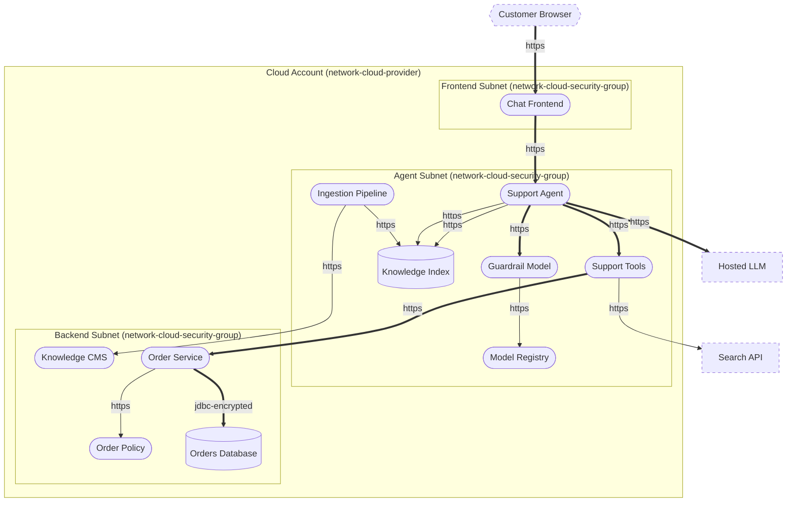
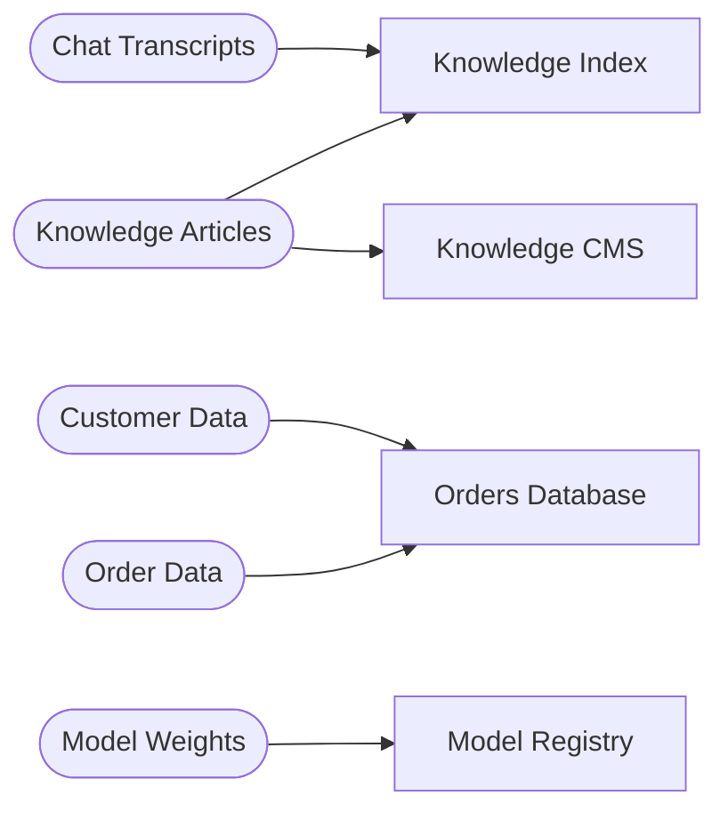

# Threat Model Report: AI Support Assistant

- **Author:** John Doe, [https://www.example.com](https://www.example.com)
- **Date:** 4 November 2026
- **Business criticality:** critical
- **Threagile version:** test-version

## Contents

1. [Management Summary](#management-summary)
2. [Impact Analysis of the Initial Risks](#impact-analysis-of-the-initial-risks)
3. [Risk Mitigation](#risk-mitigation)
4. [Impact Analysis of the Remaining Risks](#impact-analysis-of-the-remaining-risks)
5. [Risks by Severity](#risks-by-severity)
6. [Application Overview](#application-overview)
7. [Data-Flow Diagram](#data-flow-diagram)
8. [Asset Register](#asset-register)
9. [Security Requirements](#security-requirements)
10. [Abuse Cases](#abuse-cases)
11. [STRIDE Classification of Identified Risks](#stride-classification-of-identified-risks)
12. [Assignment by Function](#assignment-by-function)
13. [RAA Analysis](#raa-analysis)
14. [Data Mapping](#data-mapping)
15. [Out-of-Scope Assets](#out-of-scope-assets)
16. [Potential Model Failures](#potential-model-failures)
17. [Questions](#questions)
18. [Identified Risks by Vulnerability Category](#identified-risks-by-vulnerability-category)
19. [Identified Risks by Technical Asset](#identified-risks-by-technical-asset)
20. [Identified Data Breach Probabilities by Data Asset](#identified-data-breach-probabilities-by-data-asset)
21. [Trust Boundaries](#trust-boundaries)
22. [Shared Runtimes](#shared-runtimes)
23. [Policy Decision Points](#policy-decision-points)
24. [Communication Links](#communication-links)
25. [Risk Tracking](#risk-tracking)
26. [Threat Catalog Coverage](#threat-catalog-coverage)
27. [Risk Rules Checked by Threagile](#risk-rules-checked-by-threagile)
28. [Ratings](#ratings)
29. [Disclaimer](#disclaimer)

## Management Summary

Threagile toolkit was used to model the architecture of "AI Support Assistant" and derive risks by analyzing the components and data flows. The risks identified during this analysis are shown in the following chapters. Identified risks during threat modeling do not necessarily mean that the vulnerability associated with this risk actually exists: it is more to be seen as a list of potential risks and threats, which should be individually reviewed and reduced by removing false positives. For the remaining risks it should be checked in the design and implementation of "AI Support Assistant" whether the mitigation advices have been applied or not.

Each risk finding references a chapter of the OWASP ASVS (Application Security Verification Standard) audit checklist. The OWASP ASVS checklist should be considered as an inspiration by architects and developers to further harden the application in a Defense-in-Depth approach. Additionally, for each risk finding a link towards a matching OWASP Cheat Sheet or similar with technical details about how to implement a mitigation is given.

In total **73 initial risks** in **31 categories** have been identified during the threat modeling process:

| Severity | Risks | Status | Risks |
| --- | ---: | --- | ---: |
| Critical | 0 | Unchecked | 72 |
| High | 0 | In Discussion | 0 |
| Elevated | 33 | Accepted | 0 |
| Medium | 31 | In Progress | 1 |
| Low | 9 | Mitigated | 0 |
|  |  | False Positive | 0 |

The assistant acts for the customers: besides answering, it changes orders and issues refunds.

## Impact Analysis of the Initial Risks

The most prevalent impacts of the **73 initial risks** (distributed over **31 risk categories**) are (taking the severity ratings into account and using the highest for each category):

- **Elevated**: [Confused Deputy Agent](#confused-deputy-agent): 1 Initial Risk, exploitation likelihood is _Likely_ with _Medium_ impact

    If this risk is unmitigated, users and attackers who steer the agent might read or change the data of other users through it.

- **Elevated**: [Cross-Site Scripting (XSS)](#cross-site-scripting-xss): 2 Initial Risks, exploitation likelihood is _Likely_ with _Medium_ impact

    If this risk remains unmitigated, attackers might be able to access individual victim sessions and steal or modify user data.

- **Elevated**: [Excessive Agency](#excessive-agency): 1 Initial Risk, exploitation likelihood is _Likely_ with _Medium_ impact

    If this risk is unmitigated, attackers who steer the agent, or the agent's own mistakes, might change or delete critical data and trigger actions with real-world effects.

- **Elevated**: [Missing AI Monitoring](#missing-ai-monitoring): 2 Initial Risks, exploitation likelihood is _Likely_ with _Medium_ impact

    If this risk is unmitigated, attacks through the model or the agent, and its own mistakes, might go on unnoticed, and their effects could not be traced.

- **Elevated**: [Missing Authentication](#missing-authentication): 1 Initial Risk, exploitation likelihood is _Likely_ with _Medium_ impact

    If this risk is unmitigated, attackers might be able to access or modify sensitive data in an unauthenticated way.

- **Elevated**: [Missing Object-Level Authorization](#missing-object-level-authorization): 2 Initial Risks, exploitation likelihood is _Likely_ with _Medium_ impact

    If this risk is unmitigated, attackers with any account might read or change the data of all other users.

- **Elevated**: [Prompt Injection](#prompt-injection): 2 Initial Risks, exploitation likelihood is _Likely_ with _High_ impact

    If this risk is unmitigated, attackers might make the model leak what it has access to, give misleading answers, or, for an agent, use its tools and permissions for their own goals.

- **Elevated**: [SQL/NoSQL-Injection](#sqlnosql-injection): 4 Initial Risks, exploitation likelihood is _Very Likely_ with _Medium_ impact

    If this risk is unmitigated, attackers might be able to modify SQL/NoSQL queries to steal and modify data and eventually further escalate towards a deeper system penetration via code executions.

- **Elevated**: [Sensitive Data Disclosure through Model Output](#sensitive-data-disclosure-through-model-output): 2 Initial Risks, exploitation likelihood is _Likely_ with _Medium_ impact

    If this risk is unmitigated, attackers might extract confidential data, other users' data or the system prompt through crafted questions.

- **Elevated**: [Server-Side Request Forgery (SSRF)](#server-side-request-forgery-ssrf): 12 Initial Risks, exploitation likelihood is _Likely_ with _Medium_ impact

    If this risk is unmitigated, attackers might be able to access sensitive services or files of network-reachable components by modifying outgoing calls of affected components.

- **Elevated**: [Unauthenticated MCP Server](#unauthenticated-mcp-server): 1 Initial Risk, exploitation likelihood is _Likely_ with _Medium_ impact

    If this risk is unmitigated, attackers who reach the server might call its tools directly and read or change what they reach, bypassing the agents and their controls.

- **Elevated**: [Unbounded Model Consumption](#unbounded-model-consumption): 2 Initial Risks, exploitation likelihood is _Very Likely_ with _Medium_ impact

    If this risk is unmitigated, attackers, or a runaway agent, might make the model or the agent unavailable for others, or run up its costs (denial of wallet).

- **Elevated**: [Vector Store Poisoning](#vector-store-poisoning): 1 Initial Risk, exploitation likelihood is _Likely_ with _Medium_ impact

    If this risk is unmitigated, attackers might plant content that misleads the model, injects instructions into its prompts or makes it disclose data, persistently and for every user.

- **Medium**: [Container Base Image Backdooring](#container-base-image-backdooring): 11 Initial Risks, exploitation likelihood is _Unlikely_ with _Medium_ impact

    If this risk is unmitigated, attackers might be able to deeply persist in the target system by executing code in deployed containers.

- **Medium**: [Cross-Site Request Forgery (CSRF)](#cross-site-request-forgery-csrf): 1 Initial Risk, exploitation likelihood is _Very Likely_ with _Low_ impact

    If this risk remains unmitigated, attackers might be able to trick logged-in victim users into unwanted actions within the web application by visiting an attacker controlled web site.

- **Medium**: [Long-Lived Credentials](#long-lived-credentials): 1 Initial Risk, exploitation likelihood is _Unlikely_ with _Medium_ impact

    If this risk is unmitigated, attackers who find a leaked secret might use it for a long time to access the target with the permissions of the caller.

- **Medium**: [Missing Build Infrastructure](#missing-build-infrastructure): 1 Initial Risk, exploitation likelihood is _Unlikely_ with _Medium_ impact

    If this risk is unmitigated, attackers might be able to exploit risks unseen in this threat model due to critical build infrastructure components missing in the model.

- **Medium**: [Missing Cloud Hardening](#missing-cloud-hardening): 4 Initial Risks, exploitation likelihood is _Unlikely_ with _High_ impact

    If this risk is unmitigated, attackers might access cloud components in an unintended way.

- **Medium**: [Missing Hardening](#missing-hardening): 3 Initial Risks, exploitation likelihood is _Likely_ with _Low_ impact

    If this risk remains unmitigated, attackers might be able to easier attack high-value targets.

- **Medium**: [Missing Identity Provider Isolation](#missing-identity-provider-isolation): 1 Initial Risk, exploitation likelihood is _Unlikely_ with _High_ impact

    If this risk is unmitigated, attackers successfully attacking other components of the system might have an easy path towards highly sensitive identity provider assets and their identity data stores, as they are not separated by network segmentation.

- **Medium**: [Missing Identity Store](#missing-identity-store): 1 Initial Risk, exploitation likelihood is _Unlikely_ with _Medium_ impact

    If this risk is unmitigated, attackers might be able to exploit risks unseen in this threat model in the identity provider/store that is currently missing in the model.

- **Medium**: [Missing Multi-Factor Authentication (MFA)](#missing-multi-factor-authentication-mfa): 1 Initial Risk, exploitation likelihood is _Unlikely_ with _Medium_ impact

    If this risk is unmitigated, attackers might be able to access or modify highly sensitive data without strong authentication.

- **Medium**: [Missing Policy Decision Point Redundancy](#missing-policy-decision-point-redundancy): 1 Initial Risk, exploitation likelihood is _Unlikely_ with _Medium_ impact

    If this risk is unmitigated, an outage of the policy decision point might stop every service that asks it, or let any request through services that fail open.

- **Medium**: [Missing Vault (Secret Storage)](#missing-vault-secret-storage): 1 Initial Risk, exploitation likelihood is _Unlikely_ with _Medium_ impact

    If this risk is unmitigated, attackers might be able to easier steal config secrets (like credentials, private keys, client certificates, etc.) once a vulnerability to access files is present and exploited.

- **Medium**: [Unencrypted Technical Assets](#unencrypted-technical-assets): 2 Initial Risks, exploitation likelihood is _Unlikely_ with _Medium_ impact

    If this risk is unmitigated, attackers might be able to access unencrypted data when successfully compromising sensitive components.

- **Medium**: [Unguarded Access From Internet](#unguarded-access-from-internet): 1 Initial Risk, exploitation likelihood is _Very Likely_ with _Low_ impact

    If this risk is unmitigated, attackers might be able to directly attack sensitive systems without any hardening components in-between due to them being directly exposed on the internet.

- **Medium**: [Unverified Model Supply Chain](#unverified-model-supply-chain): 2 Initial Risks, exploitation likelihood is _Unlikely_ with _Medium_ impact

    If this risk is unmitigated, attackers might deploy a backdoored or tampered model that answers as they want, leaks data or runs code on the systems that load it.

- **Low**: [DoS-risky Access Across Trust-Boundary](#dos-risky-access-across-trust-boundary): 2 Initial Risks, exploitation likelihood is _Unlikely_ with _Low_ impact

    If this risk remains unmitigated, attackers might be able to disturb the availability of important parts of the system.

- **Low**: [Missing Network Segmentation](#missing-network-segmentation): 4 Initial Risks, exploitation likelihood is _Unlikely_ with _Low_ impact

    If this risk is unmitigated, attackers successfully attacking other components of the system might have an easy path towards more valuable targets, as they are not separated by network segmentation.

- **Low**: [Missing Web Application Firewall (WAF)](#missing-web-application-firewall-waf): 2 Initial Risks, exploitation likelihood is _Unlikely_ with _Low_ impact

    If this risk is unmitigated, attackers might be able to apply standard attack pattern tests at great speed without any filtering.

- **Low**: [Unchecked Deployment](#unchecked-deployment): 1 Initial Risk, exploitation likelihood is _Unlikely_ with _Low_ impact

    If this risk remains unmitigated, vulnerabilities in custom-developed software or their dependencies might not be identified during continuous deployment cycles.

## Risk Mitigation

The following table gives a high-level overview of the risk tracking status (including mitigated risks):

| Severity | Risks | Unchecked | In Discussion | Accepted | In Progress | Mitigated | False Positive |
| --- | ---: | ---: | ---: | ---: | ---: | ---: | ---: |
| Critical | 0 | 0 | 0 | 0 | 0 | 0 | 0 |
| High | 0 | 0 | 0 | 0 | 0 | 0 | 0 |
| Elevated | 33 | 33 | 0 | 0 | 0 | 0 | 0 |
| Medium | 31 | 30 | 0 | 0 | 1 | 0 | 0 |
| Low | 9 | 9 | 0 | 0 | 0 | 0 | 0 |

After removal of risks with status _mitigated_ and _false positive_ the following **73 remain unmitigated**:

| Severity | Unmitigated risks | To be checked by | Unmitigated risks |
| --- | ---: | --- | ---: |
| Critical | 0 | Business Side | 1 |
| High | 0 | Architecture | 15 |
| Elevated | 33 | Development | 23 |
| Medium | 31 | Operations | 34 |
| Low | 9 |  |  |

## Impact Analysis of the Remaining Risks

The most prevalent impacts of the **73 remaining risks** (distributed over **31 risk categories**) are (taking the severity ratings into account and using the highest for each category):

- **Elevated**: [Confused Deputy Agent](#confused-deputy-agent): 1 Remaining Risk, exploitation likelihood is _Likely_ with _Medium_ impact

    If this risk is unmitigated, users and attackers who steer the agent might read or change the data of other users through it.

- **Elevated**: [Cross-Site Scripting (XSS)](#cross-site-scripting-xss): 2 Remaining Risks, exploitation likelihood is _Likely_ with _Medium_ impact

    If this risk remains unmitigated, attackers might be able to access individual victim sessions and steal or modify user data.

- **Elevated**: [Excessive Agency](#excessive-agency): 1 Remaining Risk, exploitation likelihood is _Likely_ with _Medium_ impact

    If this risk is unmitigated, attackers who steer the agent, or the agent's own mistakes, might change or delete critical data and trigger actions with real-world effects.

- **Elevated**: [Missing AI Monitoring](#missing-ai-monitoring): 2 Remaining Risks, exploitation likelihood is _Likely_ with _Medium_ impact

    If this risk is unmitigated, attacks through the model or the agent, and its own mistakes, might go on unnoticed, and their effects could not be traced.

- **Elevated**: [Missing Authentication](#missing-authentication): 1 Remaining Risk, exploitation likelihood is _Likely_ with _Medium_ impact

    If this risk is unmitigated, attackers might be able to access or modify sensitive data in an unauthenticated way.

- **Elevated**: [Missing Object-Level Authorization](#missing-object-level-authorization): 2 Remaining Risks, exploitation likelihood is _Likely_ with _Medium_ impact

    If this risk is unmitigated, attackers with any account might read or change the data of all other users.

- **Elevated**: [Prompt Injection](#prompt-injection): 2 Remaining Risks, exploitation likelihood is _Likely_ with _High_ impact

    If this risk is unmitigated, attackers might make the model leak what it has access to, give misleading answers, or, for an agent, use its tools and permissions for their own goals.

- **Elevated**: [SQL/NoSQL-Injection](#sqlnosql-injection): 4 Remaining Risks, exploitation likelihood is _Very Likely_ with _Medium_ impact

    If this risk is unmitigated, attackers might be able to modify SQL/NoSQL queries to steal and modify data and eventually further escalate towards a deeper system penetration via code executions.

- **Elevated**: [Sensitive Data Disclosure through Model Output](#sensitive-data-disclosure-through-model-output): 2 Remaining Risks, exploitation likelihood is _Likely_ with _Medium_ impact

    If this risk is unmitigated, attackers might extract confidential data, other users' data or the system prompt through crafted questions.

- **Elevated**: [Server-Side Request Forgery (SSRF)](#server-side-request-forgery-ssrf): 12 Remaining Risks, exploitation likelihood is _Likely_ with _Medium_ impact

    If this risk is unmitigated, attackers might be able to access sensitive services or files of network-reachable components by modifying outgoing calls of affected components.

- **Elevated**: [Unauthenticated MCP Server](#unauthenticated-mcp-server): 1 Remaining Risk, exploitation likelihood is _Likely_ with _Medium_ impact

    If this risk is unmitigated, attackers who reach the server might call its tools directly and read or change what they reach, bypassing the agents and their controls.

- **Elevated**: [Unbounded Model Consumption](#unbounded-model-consumption): 2 Remaining Risks, exploitation likelihood is _Very Likely_ with _Medium_ impact

    If this risk is unmitigated, attackers, or a runaway agent, might make the model or the agent unavailable for others, or run up its costs (denial of wallet).

- **Elevated**: [Vector Store Poisoning](#vector-store-poisoning): 1 Remaining Risk, exploitation likelihood is _Likely_ with _Medium_ impact

    If this risk is unmitigated, attackers might plant content that misleads the model, injects instructions into its prompts or makes it disclose data, persistently and for every user.

- **Medium**: [Container Base Image Backdooring](#container-base-image-backdooring): 11 Remaining Risks, exploitation likelihood is _Unlikely_ with _Medium_ impact

    If this risk is unmitigated, attackers might be able to deeply persist in the target system by executing code in deployed containers.

- **Medium**: [Cross-Site Request Forgery (CSRF)](#cross-site-request-forgery-csrf): 1 Remaining Risk, exploitation likelihood is _Very Likely_ with _Low_ impact

    If this risk remains unmitigated, attackers might be able to trick logged-in victim users into unwanted actions within the web application by visiting an attacker controlled web site.

- **Medium**: [Long-Lived Credentials](#long-lived-credentials): 1 Remaining Risk, exploitation likelihood is _Unlikely_ with _Medium_ impact

    If this risk is unmitigated, attackers who find a leaked secret might use it for a long time to access the target with the permissions of the caller.

- **Medium**: [Missing Build Infrastructure](#missing-build-infrastructure): 1 Remaining Risk, exploitation likelihood is _Unlikely_ with _Medium_ impact

    If this risk is unmitigated, attackers might be able to exploit risks unseen in this threat model due to critical build infrastructure components missing in the model.

- **Medium**: [Missing Cloud Hardening](#missing-cloud-hardening): 4 Remaining Risks, exploitation likelihood is _Unlikely_ with _High_ impact

    If this risk is unmitigated, attackers might access cloud components in an unintended way.

- **Medium**: [Missing Hardening](#missing-hardening): 3 Remaining Risks, exploitation likelihood is _Likely_ with _Low_ impact

    If this risk remains unmitigated, attackers might be able to easier attack high-value targets.

- **Medium**: [Missing Identity Provider Isolation](#missing-identity-provider-isolation): 1 Remaining Risk, exploitation likelihood is _Unlikely_ with _High_ impact

    If this risk is unmitigated, attackers successfully attacking other components of the system might have an easy path towards highly sensitive identity provider assets and their identity data stores, as they are not separated by network segmentation.

- **Medium**: [Missing Identity Store](#missing-identity-store): 1 Remaining Risk, exploitation likelihood is _Unlikely_ with _Medium_ impact

    If this risk is unmitigated, attackers might be able to exploit risks unseen in this threat model in the identity provider/store that is currently missing in the model.

- **Medium**: [Missing Multi-Factor Authentication (MFA)](#missing-multi-factor-authentication-mfa): 1 Remaining Risk, exploitation likelihood is _Unlikely_ with _Medium_ impact

    If this risk is unmitigated, attackers might be able to access or modify highly sensitive data without strong authentication.

- **Medium**: [Missing Policy Decision Point Redundancy](#missing-policy-decision-point-redundancy): 1 Remaining Risk, exploitation likelihood is _Unlikely_ with _Medium_ impact

    If this risk is unmitigated, an outage of the policy decision point might stop every service that asks it, or let any request through services that fail open.

- **Medium**: [Missing Vault (Secret Storage)](#missing-vault-secret-storage): 1 Remaining Risk, exploitation likelihood is _Unlikely_ with _Medium_ impact

    If this risk is unmitigated, attackers might be able to easier steal config secrets (like credentials, private keys, client certificates, etc.) once a vulnerability to access files is present and exploited.

- **Medium**: [Unencrypted Technical Assets](#unencrypted-technical-assets): 2 Remaining Risks, exploitation likelihood is _Unlikely_ with _Medium_ impact

    If this risk is unmitigated, attackers might be able to access unencrypted data when successfully compromising sensitive components.

- **Medium**: [Unguarded Access From Internet](#unguarded-access-from-internet): 1 Remaining Risk, exploitation likelihood is _Very Likely_ with _Low_ impact

    If this risk is unmitigated, attackers might be able to directly attack sensitive systems without any hardening components in-between due to them being directly exposed on the internet.

- **Medium**: [Unverified Model Supply Chain](#unverified-model-supply-chain): 2 Remaining Risks, exploitation likelihood is _Unlikely_ with _Medium_ impact

    If this risk is unmitigated, attackers might deploy a backdoored or tampered model that answers as they want, leaks data or runs code on the systems that load it.

- **Low**: [DoS-risky Access Across Trust-Boundary](#dos-risky-access-across-trust-boundary): 2 Remaining Risks, exploitation likelihood is _Unlikely_ with _Low_ impact

    If this risk remains unmitigated, attackers might be able to disturb the availability of important parts of the system.

- **Low**: [Missing Network Segmentation](#missing-network-segmentation): 4 Remaining Risks, exploitation likelihood is _Unlikely_ with _Low_ impact

    If this risk is unmitigated, attackers successfully attacking other components of the system might have an easy path towards more valuable targets, as they are not separated by network segmentation.

- **Low**: [Missing Web Application Firewall (WAF)](#missing-web-application-firewall-waf): 2 Remaining Risks, exploitation likelihood is _Unlikely_ with _Low_ impact

    If this risk is unmitigated, attackers might be able to apply standard attack pattern tests at great speed without any filtering.

- **Low**: [Unchecked Deployment](#unchecked-deployment): 1 Remaining Risk, exploitation likelihood is _Unlikely_ with _Low_ impact

    If this risk remains unmitigated, vulnerabilities in custom-developed software or their dependencies might not be identified during continuous deployment cycles.

## Risks by Severity

All **73 risks** by severity, with their tracking status. Each risk links to its details in the chapter of its category.

### Critical

**0 risks**

_No risks._

### High

**0 risks**

_No risks._

### Elevated

**33 risks**

| Severity | Risk | Category | Most relevant | Status |
| --- | --- | --- | --- | --- |
| Elevated | [**Confused Deputy Agent** risk at **Support Agent** reaching **Knowledge Index** with its own identity](#confused-deputy-agent) | [Confused Deputy Agent](#confused-deputy-agent) | [Support Agent](#support-agent), [Retrieval](#retrieval) | Unchecked |
| Elevated | [**Cross-Site Scripting (XSS)** risk at **Chat Frontend**](#cross-site-scripting-xss) | [Cross-Site Scripting (XSS)](#cross-site-scripting-xss) | [Chat Frontend](#chat-frontend) | Unchecked |
| Elevated | [**Cross-Site Scripting (XSS)** risk at **Knowledge CMS**](#cross-site-scripting-xss) | [Cross-Site Scripting (XSS)](#cross-site-scripting-xss) | [Knowledge CMS](#knowledge-cms) | Unchecked |
| Elevated | [**Excessive Agency** risk at **Support Agent** changing **Order Service**](#excessive-agency) | [Excessive Agency](#excessive-agency) | [Support Agent](#support-agent), [Tool Calls](#tool-calls) | Unchecked |
| Elevated | [**Missing AI Monitoring** risk at **Guardrail Model**](#missing-ai-monitoring) | [Missing AI Monitoring](#missing-ai-monitoring) | [Guardrail Model](#guardrail-model) | Unchecked |
| Elevated | [**Missing AI Monitoring** risk at **Support Agent**](#missing-ai-monitoring) | [Missing AI Monitoring](#missing-ai-monitoring) | [Support Agent](#support-agent) | Unchecked |
| Elevated | [**Missing Authentication** covering communication link **Tool Calls** from **Support Agent** to **Support Tools**](#missing-authentication) | [Missing Authentication](#missing-authentication) | [Support Tools](#support-tools), [Tool Calls](#tool-calls) | Unchecked |
| Elevated | [**Missing Object-Level Authorization** risk at **Order Service** for **Support Tools** (function-level)](#missing-object-level-authorization) | [Missing Object-Level Authorization](#missing-object-level-authorization) | [Order Service](#order-service), [Order API](#order-api) | Unchecked |
| Elevated | [**Missing Object-Level Authorization** risk at **Support Agent** for **Chat Frontend** (function-level)](#missing-object-level-authorization) | [Missing Object-Level Authorization](#missing-object-level-authorization) | [Support Agent](#support-agent), [Assistant Request](#assistant-request) | Unchecked |
| Elevated | [**Sensitive Data Disclosure through Model Output** risk at **Guardrail Model**](#sensitive-data-disclosure-through-model-output) | [Sensitive Data Disclosure through Model Output](#sensitive-data-disclosure-through-model-output) | [Guardrail Model](#guardrail-model) | Unchecked |
| Elevated | [**Sensitive Data Disclosure through Model Output** risk at **Support Agent**](#sensitive-data-disclosure-through-model-output) | [Sensitive Data Disclosure through Model Output](#sensitive-data-disclosure-through-model-output) | [Support Agent](#support-agent) | Unchecked |
| Elevated | [**Prompt Injection** risk at **Support Agent**](#prompt-injection) | [Prompt Injection](#prompt-injection) | [Support Agent](#support-agent), [Assistant Request](#assistant-request) | Unchecked |
| Elevated | [**Prompt Injection** risk at **Guardrail Model**](#prompt-injection) | [Prompt Injection](#prompt-injection) | [Guardrail Model](#guardrail-model), [Moderation](#moderation) | Unchecked |
| Elevated | [**Server-Side Request Forgery (SSRF)** risk at **Chat Frontend** server-side web-requesting the target **Support Agent** via **Assistant Request**](#server-side-request-forgery-ssrf) | [Server-Side Request Forgery (SSRF)](#server-side-request-forgery-ssrf) | [Chat Frontend](#chat-frontend), [Assistant Request](#assistant-request) | Unchecked |
| Elevated | [**Server-Side Request Forgery (SSRF)** risk at **Guardrail Model** server-side web-requesting the target **Model Registry** via **Model Pull**](#server-side-request-forgery-ssrf) | [Server-Side Request Forgery (SSRF)](#server-side-request-forgery-ssrf) | [Guardrail Model](#guardrail-model), [Model Pull](#model-pull) | Unchecked |
| Elevated | [**Server-Side Request Forgery (SSRF)** risk at **Ingestion Pipeline** server-side web-requesting the target **Knowledge CMS** via **Article Export**](#server-side-request-forgery-ssrf) | [Server-Side Request Forgery (SSRF)](#server-side-request-forgery-ssrf) | [Ingestion Pipeline](#ingestion-pipeline), [Article Export](#article-export) | Unchecked |
| Elevated | [**Server-Side Request Forgery (SSRF)** risk at **Ingestion Pipeline** server-side web-requesting the target **Knowledge Index** via **Embedding Upsert**](#server-side-request-forgery-ssrf) | [Server-Side Request Forgery (SSRF)](#server-side-request-forgery-ssrf) | [Ingestion Pipeline](#ingestion-pipeline), [Embedding Upsert](#embedding-upsert) | Unchecked |
| Elevated | [**Server-Side Request Forgery (SSRF)** risk at **Order Service** server-side web-requesting the target **Order Policy** via **Refund Authorization**](#server-side-request-forgery-ssrf) | [Server-Side Request Forgery (SSRF)](#server-side-request-forgery-ssrf) | [Order Service](#order-service), [Refund Authorization](#refund-authorization) | Unchecked |
| Elevated | [**Server-Side Request Forgery (SSRF)** risk at **Support Agent** server-side web-requesting the target **Guardrail Model** via **Moderation**](#server-side-request-forgery-ssrf) | [Server-Side Request Forgery (SSRF)](#server-side-request-forgery-ssrf) | [Support Agent](#support-agent), [Moderation](#moderation) | Unchecked |
| Elevated | [**Server-Side Request Forgery (SSRF)** risk at **Support Agent** server-side web-requesting the target **Hosted LLM** via **Completion**](#server-side-request-forgery-ssrf) | [Server-Side Request Forgery (SSRF)](#server-side-request-forgery-ssrf) | [Support Agent](#support-agent), [Completion](#completion) | Unchecked |
| Elevated | [**Server-Side Request Forgery (SSRF)** risk at **Support Agent** server-side web-requesting the target **Knowledge Index** via **Memory Write**](#server-side-request-forgery-ssrf) | [Server-Side Request Forgery (SSRF)](#server-side-request-forgery-ssrf) | [Support Agent](#support-agent), [Memory Write](#memory-write) | Unchecked |
| Elevated | [**Server-Side Request Forgery (SSRF)** risk at **Support Agent** server-side web-requesting the target **Knowledge Index** via **Retrieval**](#server-side-request-forgery-ssrf) | [Server-Side Request Forgery (SSRF)](#server-side-request-forgery-ssrf) | [Support Agent](#support-agent), [Retrieval](#retrieval) | Unchecked |
| Elevated | [**Server-Side Request Forgery (SSRF)** risk at **Support Agent** server-side web-requesting the target **Support Tools** via **Tool Calls**](#server-side-request-forgery-ssrf) | [Server-Side Request Forgery (SSRF)](#server-side-request-forgery-ssrf) | [Support Agent](#support-agent), [Tool Calls](#tool-calls) | Unchecked |
| Elevated | [**Server-Side Request Forgery (SSRF)** risk at **Support Tools** server-side web-requesting the target **Order Service** via **Order API**](#server-side-request-forgery-ssrf) | [Server-Side Request Forgery (SSRF)](#server-side-request-forgery-ssrf) | [Support Tools](#support-tools), [Order API](#order-api) | Unchecked |
| Elevated | [**Server-Side Request Forgery (SSRF)** risk at **Support Tools** server-side web-requesting the target **Search API** via **Web Search**](#server-side-request-forgery-ssrf) | [Server-Side Request Forgery (SSRF)](#server-side-request-forgery-ssrf) | [Support Tools](#support-tools), [Web Search](#web-search) | Unchecked |
| Elevated | [**SQL/NoSQL-Injection** risk at **Ingestion Pipeline** against database **Knowledge Index** via **Embedding Upsert**](#sqlnosql-injection) | [SQL/NoSQL-Injection](#sqlnosql-injection) | [Ingestion Pipeline](#ingestion-pipeline), [Embedding Upsert](#embedding-upsert) | Unchecked |
| Elevated | [**SQL/NoSQL-Injection** risk at **Order Service** against database **Orders Database** via **Order Storage**](#sqlnosql-injection) | [SQL/NoSQL-Injection](#sqlnosql-injection) | [Order Service](#order-service), [Order Storage](#order-storage) | Unchecked |
| Elevated | [**SQL/NoSQL-Injection** risk at **Support Agent** against database **Knowledge Index** via **Memory Write**](#sqlnosql-injection) | [SQL/NoSQL-Injection](#sqlnosql-injection) | [Support Agent](#support-agent), [Memory Write](#memory-write) | Unchecked |
| Elevated | [**SQL/NoSQL-Injection** risk at **Support Agent** against database **Knowledge Index** via **Retrieval**](#sqlnosql-injection) | [SQL/NoSQL-Injection](#sqlnosql-injection) | [Support Agent](#support-agent), [Retrieval](#retrieval) | Unchecked |
| Elevated | [**Unauthenticated MCP Server** risk at **Support Tools** called by **Support Agent**](#unauthenticated-mcp-server) | [Unauthenticated MCP Server](#unauthenticated-mcp-server) | [Support Tools](#support-tools), [Tool Calls](#tool-calls) | Unchecked |
| Elevated | [**Unbounded Model Consumption** risk at **Guardrail Model**](#unbounded-model-consumption) | [Unbounded Model Consumption](#unbounded-model-consumption) | [Guardrail Model](#guardrail-model) | Unchecked |
| Elevated | [**Unbounded Model Consumption** risk at **Support Agent**](#unbounded-model-consumption) | [Unbounded Model Consumption](#unbounded-model-consumption) | [Support Agent](#support-agent) | Unchecked |
| Elevated | [**Vector Store Poisoning** risk at **Knowledge Index** used by **Support Agent**](#vector-store-poisoning) | [Vector Store Poisoning](#vector-store-poisoning) | [Knowledge Index](#knowledge-index) | Unchecked |

### Medium

**31 risks**

| Severity | Risk | Category | Most relevant | Status |
| --- | --- | --- | --- | --- |
| Medium | [**Container Base Image Backdooring** risk at **Chat Frontend**](#container-base-image-backdooring) | [Container Base Image Backdooring](#container-base-image-backdooring) | [Chat Frontend](#chat-frontend) | Unchecked |
| Medium | [**Container Base Image Backdooring** risk at **Guardrail Model**](#container-base-image-backdooring) | [Container Base Image Backdooring](#container-base-image-backdooring) | [Guardrail Model](#guardrail-model) | Unchecked |
| Medium | [**Container Base Image Backdooring** risk at **Ingestion Pipeline**](#container-base-image-backdooring) | [Container Base Image Backdooring](#container-base-image-backdooring) | [Ingestion Pipeline](#ingestion-pipeline) | Unchecked |
| Medium | [**Container Base Image Backdooring** risk at **Knowledge CMS**](#container-base-image-backdooring) | [Container Base Image Backdooring](#container-base-image-backdooring) | [Knowledge CMS](#knowledge-cms) | Unchecked |
| Medium | [**Container Base Image Backdooring** risk at **Knowledge Index**](#container-base-image-backdooring) | [Container Base Image Backdooring](#container-base-image-backdooring) | [Knowledge Index](#knowledge-index) | Unchecked |
| Medium | [**Container Base Image Backdooring** risk at **Model Registry**](#container-base-image-backdooring) | [Container Base Image Backdooring](#container-base-image-backdooring) | [Model Registry](#model-registry) | Unchecked |
| Medium | [**Container Base Image Backdooring** risk at **Order Policy**](#container-base-image-backdooring) | [Container Base Image Backdooring](#container-base-image-backdooring) | [Order Policy](#order-policy) | Unchecked |
| Medium | [**Container Base Image Backdooring** risk at **Order Service**](#container-base-image-backdooring) | [Container Base Image Backdooring](#container-base-image-backdooring) | [Order Service](#order-service) | Unchecked |
| Medium | [**Container Base Image Backdooring** risk at **Orders Database**](#container-base-image-backdooring) | [Container Base Image Backdooring](#container-base-image-backdooring) | [Orders Database](#orders-database) | Unchecked |
| Medium | [**Container Base Image Backdooring** risk at **Support Agent**](#container-base-image-backdooring) | [Container Base Image Backdooring](#container-base-image-backdooring) | [Support Agent](#support-agent) | Unchecked |
| Medium | [**Container Base Image Backdooring** risk at **Support Tools**](#container-base-image-backdooring) | [Container Base Image Backdooring](#container-base-image-backdooring) | [Support Tools](#support-tools) | Unchecked |
| Medium | [**Cross-Site Request Forgery (CSRF)** risk at **Chat Frontend** via **Support Chat** from **Customer Browser**](#cross-site-request-forgery-csrf) | [Cross-Site Request Forgery (CSRF)](#cross-site-request-forgery-csrf) | [Chat Frontend](#chat-frontend), [Support Chat](#support-chat) | Unchecked |
| Medium | [**Long-Lived Credentials** risk at **Orders Database** used by **Order Service** (credentials)](#long-lived-credentials) | [Long-Lived Credentials](#long-lived-credentials) | [Orders Database](#orders-database), [Order Storage](#order-storage) | Unchecked |
| Medium | [**Missing Multi-Factor Authentication** covering communication link **Support Chat** from **Customer Browser** to **Chat Frontend**](#missing-multi-factor-authentication-mfa) | [Missing Multi-Factor Authentication (MFA)](#missing-multi-factor-authentication-mfa) | [Chat Frontend](#chat-frontend), [Support Chat](#support-chat) | Unchecked |
| Medium | [**Missing Build Infrastructure** in the threat model (referencing asset **Order Service** as an example)](#missing-build-infrastructure) | [Missing Build Infrastructure](#missing-build-infrastructure) | [Order Service](#order-service) | Unchecked |
| Medium | [**Missing Cloud Hardening** risk at **Agent Subnet**](#missing-cloud-hardening) | [Missing Cloud Hardening](#missing-cloud-hardening) | none | Unchecked |
| Medium | [**Missing Cloud Hardening** risk at **Backend Subnet**](#missing-cloud-hardening) | [Missing Cloud Hardening](#missing-cloud-hardening) | none | Unchecked |
| Medium | [**Missing Cloud Hardening** risk at **Cloud Account**](#missing-cloud-hardening) | [Missing Cloud Hardening](#missing-cloud-hardening) | none | Unchecked |
| Medium | [**Missing Cloud Hardening** risk at **Frontend Subnet**](#missing-cloud-hardening) | [Missing Cloud Hardening](#missing-cloud-hardening) | none | Unchecked |
| Medium | [**Missing Hardening** risk at **Knowledge Index**](#missing-hardening) | [Missing Hardening](#missing-hardening) | [Knowledge Index](#knowledge-index) | Unchecked |
| Medium | [**Missing Hardening** risk at **Orders Database**](#missing-hardening) | [Missing Hardening](#missing-hardening) | [Orders Database](#orders-database) | Unchecked |
| Medium | [**Missing Hardening** risk at **Support Agent**](#missing-hardening) | [Missing Hardening](#missing-hardening) | [Support Agent](#support-agent) | Unchecked |
| Medium | [**Missing Identity Provider Isolation** to further encapsulate and protect identity-related asset **Order Policy** against unrelated lower protected assets **in the same network segment**, which might be easier to compromise by attackers](#missing-identity-provider-isolation) | [Missing Identity Provider Isolation](#missing-identity-provider-isolation) | [Order Policy](#order-policy) | Unchecked |
| Medium | [**Missing Identity Store** in the threat model (referencing asset **Support Agent** as an example)](#missing-identity-store) | [Missing Identity Store](#missing-identity-store) | [Support Agent](#support-agent) | Unchecked |
| Medium | [**Missing Policy Decision Point Redundancy** risk at **Order Policy**](#missing-policy-decision-point-redundancy) | [Missing Policy Decision Point Redundancy](#missing-policy-decision-point-redundancy) | [Order Policy](#order-policy) | Unchecked |
| Medium | [**Missing Vault (Secret Storage)** in the threat model (referencing asset **Order Policy** as an example)](#missing-vault-secret-storage) | [Missing Vault (Secret Storage)](#missing-vault-secret-storage) | [Order Policy](#order-policy) | Unchecked |
| Medium | [**Unverified Model Supply Chain** risk at **Model Registry**](#unverified-model-supply-chain) | [Unverified Model Supply Chain](#unverified-model-supply-chain) | [Model Registry](#model-registry) | Unchecked |
| Medium | [**Unverified Model Supply Chain** risk at **Guardrail Model**](#unverified-model-supply-chain) | [Unverified Model Supply Chain](#unverified-model-supply-chain) | [Guardrail Model](#guardrail-model) | In Progress |
| Medium | [**Unencrypted Technical Asset** named **Knowledge Index**](#unencrypted-technical-assets) | [Unencrypted Technical Assets](#unencrypted-technical-assets) | [Knowledge Index](#knowledge-index) | Unchecked |
| Medium | [**Unencrypted Technical Asset** named **Model Registry**](#unencrypted-technical-assets) | [Unencrypted Technical Assets](#unencrypted-technical-assets) | [Model Registry](#model-registry) | Unchecked |
| Medium | [**Unguarded Access from Internet** of **Chat Frontend** by **Customer Browser** via **Support Chat**](#unguarded-access-from-internet) | [Unguarded Access From Internet](#unguarded-access-from-internet) | [Chat Frontend](#chat-frontend), [Support Chat](#support-chat) | Unchecked |

### Low

**9 risks**

| Severity | Risk | Category | Most relevant | Status |
| --- | --- | --- | --- | --- |
| Low | [**Denial-of-Service** risky access of **Order Service** by **Support Tools** via **Order API**](#dos-risky-access-across-trust-boundary) | [DoS-risky Access Across Trust-Boundary](#dos-risky-access-across-trust-boundary) | [Order Service](#order-service), [Order API](#order-api) | Unchecked |
| Low | [**Denial-of-Service** risky access of **Support Agent** by **Chat Frontend** via **Assistant Request**](#dos-risky-access-across-trust-boundary) | [DoS-risky Access Across Trust-Boundary](#dos-risky-access-across-trust-boundary) | [Support Agent](#support-agent), [Assistant Request](#assistant-request) | Unchecked |
| Low | [**Missing Network Segmentation** to further encapsulate and protect **Knowledge Index** against unrelated lower protected assets in the same network segment, which might be easier to compromise by attackers](#missing-network-segmentation) | [Missing Network Segmentation](#missing-network-segmentation) | [Knowledge Index](#knowledge-index) | Unchecked |
| Low | [**Missing Network Segmentation** to further encapsulate and protect **Order Service** against unrelated lower protected assets in the same network segment, which might be easier to compromise by attackers](#missing-network-segmentation) | [Missing Network Segmentation](#missing-network-segmentation) | [Order Service](#order-service) | Unchecked |
| Low | [**Missing Network Segmentation** to further encapsulate and protect **Orders Database** against unrelated lower protected assets in the same network segment, which might be easier to compromise by attackers](#missing-network-segmentation) | [Missing Network Segmentation](#missing-network-segmentation) | [Orders Database](#orders-database) | Unchecked |
| Low | [**Missing Network Segmentation** to further encapsulate and protect **Support Agent** against unrelated lower protected assets in the same network segment, which might be easier to compromise by attackers](#missing-network-segmentation) | [Missing Network Segmentation](#missing-network-segmentation) | [Support Agent](#support-agent) | Unchecked |
| Low | [**Missing Web Application Firewall (WAF)** risk at **Knowledge CMS**](#missing-web-application-firewall-waf) | [Missing Web Application Firewall (WAF)](#missing-web-application-firewall-waf) | [Knowledge CMS](#knowledge-cms) | Unchecked |
| Low | [**Missing Web Application Firewall (WAF)** risk at **Order Service**](#missing-web-application-firewall-waf) | [Missing Web Application Firewall (WAF)](#missing-web-application-firewall-waf) | [Order Service](#order-service) | Unchecked |
| Low | [**Unchecked Deployment** risk at **Model Registry**](#unchecked-deployment) | [Unchecked Deployment](#unchecked-deployment) | [Model Registry](#model-registry) | Unchecked |

## Application Overview

### Business Criticality

The overall business criticality of "AI Support Assistant" was rated as:

- archive
- operational
- important
- **critical** (selected)
- mission-critical

### Business Overview

Customers get answers and refunds in the support chat at any time, without waiting for an agent.

### Technical Overview

The support agent plans with a hosted language model, checks requests and answers with a self-hosted guardrail model, retrieves articles from a vector index and calls tools through an MCP server.

## Data-Flow Diagram

The following diagram was generated by Threagile based on the model input and gives a high-level overview of the data-flow between technical assets. The RAA value of each asset, the calculated _Relative Attacker Attractiveness_ in percent, is in the chapter [RAA Analysis](#raa-analysis).

Data-flow diagram of "AI Support Assistant". A box is an external entity, a stadium a process, a cylinder a datastore and a hexagon a client used by a human; assets out of scope have a dashed border, and the trust boundaries enclose the assets inside them. An arrow points from the asset that initiates a communication link to its target and names the protocol; a thick arrow is a link that also receives data back.

## Asset Register

### Technical Assets

- [Chat Frontend](#chat-frontend)

    The support chat page and its backend for frontend

- [Guardrail Model](#guardrail-model)

    A small self-hosted model fine-tuned to classify harmful content

- [Ingestion Pipeline](#ingestion-pipeline)

    Embeds the published support articles into the index

- [Knowledge CMS](#knowledge-cms)

    Where the support team writes and reviews the articles

- [Knowledge Index](#knowledge-index)

    Embeddings of the support articles and the memory of the agent

- [Order Service](#order-service)

    Manages orders and refunds

- [Support Agent](#support-agent)

    Answers support questions, looks up orders and issues refunds through its tools

- [Support Tools](#support-tools)

    MCP server exposing the order, refund and web search tools to the agent

- [Model Registry](#model-registry)

    Stores the versions of the guardrail model

- [Order Policy](#order-policy)

    Decides which orders a customer may see and refund, as an OpenFGA relationship graph

- [Orders Database](#orders-database)

    Orders, payments and customers

- [Customer Browser](#customer-browser) (out of scope)

    The web browsers of the customers using the support chat

- [Hosted LLM](#hosted-llm) (out of scope)

    The language model of a provider, used through its API

- [Search API](#search-api) (out of scope)

    A web search service

### Data Assets

- [Chat Transcripts](#chat-transcripts)

    The conversations of the customers with the assistant

- [Customer Data](#customer-data)

    Names, addresses and contact details of the customers

- [Knowledge Articles](#knowledge-articles)

    The support articles the assistant answers from

- [Model Weights](#model-weights)

    The weights of the self-hosted guardrail model

- [Order Data](#order-data)

    Orders, payments and refunds

- [Web Content](#web-content)

    Product information found on the web

## Security Requirements

This chapter lists the custom security requirements which have been defined for the modeled target.

- **Human Approval**

    Refunds above a limit need the approval of a support employee.

- **Least Agency**

    The agent may only act on the orders of the customer it talks to.

_This list is not complete and regulatory or law relevant security requirements have to be taken into account as well. Also custom individual security requirements might exist for the project._

## Abuse Cases

This chapter lists the custom abuse cases which have been defined for the modeled target.

- **Data Theft**

    As an attacker I want to make the assistant reveal the orders and addresses of other customers.

- **Memory Poisoning**

    As an attacker I want to plant instructions in the memory of the agent, so that it follows them in the conversations of other customers.

- **Refund Fraud**

    As a customer I want to talk the assistant into refunding an order I have received, to keep the goods and get the money back.

_This list is not complete and regulatory or law relevant abuse cases have to be taken into account as well. Also custom individual abuse cases might exist for the project._

## STRIDE Classification of Identified Risks

This chapter clusters and classifies the risks by STRIDE categories: in total **73 potential risks** have been identified during the threat modeling process.

### Spoofing

**4 risks**

Spoofing - Authenticity

- **Elevated**: [Unauthenticated MCP Server](#unauthenticated-mcp-server): 1/1 unmitigated Risk, exploitation likelihood is _Likely_ with _Medium_ impact

    An MCP server, or another server exposing tools to AI agents, acts on the systems behind its tools with its own permissions. When it does not authenticate its callers, anyone who can reach it can call those tools, and it cannot tell one agent or user from another to limit what each may do.

- **Medium**: [Cross-Site Request Forgery (CSRF)](#cross-site-request-forgery-csrf): 1/1 unmitigated Risk, exploitation likelihood is _Very Likely_ with _Low_ impact

    When a web application is accessed via web protocols Cross-Site Request Forgery (CSRF) risks might arise.

- **Medium**: [Long-Lived Credentials](#long-lived-credentials): 1/1 unmitigated Risk, exploitation likelihood is _Unlikely_ with _Medium_ impact

    Passwords of service accounts, API keys and personal access tokens stay valid for months or for good. Once one leaks, from a repository, a log, a build system or a laptop, it lets anyone in until someone notices and rotates it.

- **Medium**: [Missing Identity Store](#missing-identity-store): 1/1 unmitigated Risk, exploitation likelihood is _Unlikely_ with _Medium_ impact

    The modeled architecture does not contain an identity store, which might be the risk of a model missing critical assets (and thus not seeing their risks).

### Tampering

**31 risks**

Tampering - Integrity

- **Elevated**: [Cross-Site Scripting (XSS)](#cross-site-scripting-xss): 2/2 unmitigated Risks, exploitation likelihood is _Likely_ with _Medium_ impact

    For each web application Cross-Site Scripting (XSS) risks might arise. In terms of the overall risk level take other applications running on the same domain into account as well.

- **Elevated**: [SQL/NoSQL-Injection](#sqlnosql-injection): 4/4 unmitigated Risks, exploitation likelihood is _Very Likely_ with _Medium_ impact

    When a database is accessed via database access protocols SQL/NoSQL-Injection risks might arise. The risk rating depends on the sensitivity technical asset itself and of the data assets processed.

- **Elevated**: [Vector Store Poisoning](#vector-store-poisoning): 1/1 unmitigated Risk, exploitation likelihood is _Likely_ with _Medium_ impact

    Language models and agents answer and act on what they retrieve from vector stores, for retrieval-augmented generation (RAG) or as the memory of an agent. Whoever can write into the store decides what the model believes: a poisoned document or memory entry carries false facts or hidden instructions into every answer that retrieves it, long after it was written.

- **Medium**: [Container Base Image Backdooring](#container-base-image-backdooring): 11/11 unmitigated Risks, exploitation likelihood is _Unlikely_ with _Medium_ impact

    When a technical asset is built using container technologies, Base Image Backdooring risks might arise where base images and other layers used contain vulnerable components or backdoors.

- **Medium**: [Missing Build Infrastructure](#missing-build-infrastructure): 1/1 unmitigated Risk, exploitation likelihood is _Unlikely_ with _Medium_ impact

    The modeled architecture does not contain a build infrastructure (devops-client, sourcecode-repo, build-pipeline, etc.), which might be the risk of a model missing critical assets (and thus not seeing their risks). If the architecture contains custom-developed parts, the pipeline where code gets developed and built needs to be part of the model.

- **Medium**: [Missing Cloud Hardening](#missing-cloud-hardening): 4/4 unmitigated Risks, exploitation likelihood is _Unlikely_ with _High_ impact

    Cloud components should be hardened according to the cloud vendor best practices. This affects their configuration, auditing, and further areas.

- **Medium**: [Missing Hardening](#missing-hardening): 3/3 unmitigated Risks, exploitation likelihood is _Likely_ with _Low_ impact

    Technical assets with a Relative Attacker Attractiveness (RAA) value of 55 % or higher should be explicitly hardened taking best practices and vendor hardening guides into account.

- **Medium**: [Unverified Model Supply Chain](#unverified-model-supply-chain): 2/2 unmitigated Risks, exploitation likelihood is _Unlikely_ with _Medium_ impact

    Model weights are code in all but name: they decide what the system answers, and some model formats run code when they are loaded. Models that are self-hosted, fine-tuned or pulled from a model registry can be swapped, backdoored or poisoned anywhere between their training and their deployment.

- **Low**: [Missing Web Application Firewall (WAF)](#missing-web-application-firewall-waf): 2/2 unmitigated Risks, exploitation likelihood is _Unlikely_ with _Low_ impact

    To have a first line of filtering defense, security architectures with web-services or web-applications should include a WAF in front of them. Even though a WAF is not a replacement for security (all components must be secure even without a WAF) it adds another layer of defense to the overall system by delaying some attacks and having easier attack alerting through it.

- **Low**: [Unchecked Deployment](#unchecked-deployment): 1/1 unmitigated Risk, exploitation likelihood is _Unlikely_ with _Low_ impact

    For each build-pipeline component Unchecked Deployment risks might arise when the build-pipeline does not include established DevSecOps best-practices. DevSecOps best-practices scan as part of CI/CD pipelines for vulnerabilities in source- or byte-code, dependencies, container layers, and dynamically against running test systems. There are several open-source and commercial tools existing in the categories DAST, SAST, and IAST.

### Repudiation

**2 risks**

Repudiation - Non-repudiability

- **Elevated**: [Missing AI Monitoring](#missing-ai-monitoring): 2/2 unmitigated Risks, exploitation likelihood is _Likely_ with _Medium_ impact

    What an AI agent or a language model does depends on what it reads, so it cannot be tested in full before it runs. Without a record of its prompts, its tool calls and its answers in a monitoring system, nobody sees a prompt injection, an agent going astray or a model that drifts, nor can tell afterwards what it did.

### Information Disclosure

**17 risks**

Information disclosure - Confidentiality

- **Elevated**: [Sensitive Data Disclosure through Model Output](#sensitive-data-disclosure-through-model-output): 2/2 unmitigated Risks, exploitation likelihood is _Likely_ with _Medium_ impact

    Whatever a language model or an agent can read, it can be talked into writing: data in its prompt, in its context window, in the documents it retrieves or in its training data. A model that has confidential data at hand and answers callers from the internet, from users or from another trust zone may hand that data to callers who are not allowed to see it.

- **Elevated**: [Server-Side Request Forgery (SSRF)](#server-side-request-forgery-ssrf): 12/12 unmitigated Risks, exploitation likelihood is _Likely_ with _Medium_ impact

    When a server system (i.e. not a client) is accessing other server systems via typical web protocols Server-Side Request Forgery (SSRF) or Local-File-Inclusion (LFI) or Remote-File-Inclusion (RFI) risks might arise.

- **Medium**: [Missing Vault (Secret Storage)](#missing-vault-secret-storage): 1/1 unmitigated Risk, exploitation likelihood is _Unlikely_ with _Medium_ impact

    In order to avoid the risk of secret leakage via config files (when attacked through vulnerabilities being able to read files like Path-Traversal and others), it is best practice to use a separate hardened process with proper authentication, authorization, and audit logging to access config secrets (like credentials, private keys, client certificates, etc.). This component is usually some kind of Vault.

- **Medium**: [Unencrypted Technical Assets](#unencrypted-technical-assets): 2/2 unmitigated Risks, exploitation likelihood is _Unlikely_ with _Medium_ impact

    Due to the confidentiality rating of the technical asset itself and/or the stored data assets this technical asset must be encrypted. The risk rating depends on the sensitivity technical asset itself and of the data assets stored.

### Denial of Service

**5 risks**

Denial of service - Availability

- **Elevated**: [Unbounded Model Consumption](#unbounded-model-consumption): 2/2 unmitigated Risks, exploitation likelihood is _Very Likely_ with _Medium_ impact

    Every request to a language model or an agent costs compute and tokens, and an agent can turn one request into many model calls. Users who reach a model or an agent without a gateway that limits their requests and tokens can exhaust its capacity, or the budget of a model paid for by use.

- **Medium**: [Missing Policy Decision Point Redundancy](#missing-policy-decision-point-redundancy): 1/1 unmitigated Risk, exploitation likelihood is _Unlikely_ with _Medium_ impact

    Services that externalize their authorization to a policy decision point, for example through the AuthZEN Authorization API, cannot decide a request without it. When it fails, they either deny every request and stop working, or, when they fail open, allow every request.

- **Low**: [DoS-risky Access Across Trust-Boundary](#dos-risky-access-across-trust-boundary): 2/2 unmitigated Risks, exploitation likelihood is _Unlikely_ with _Low_ impact

    Assets accessed across trust boundaries with critical or mission-critical availability rating are more prone to Denial-of-Service (DoS) risks.

### Elevation of Privilege

**14 risks**

Elevation of privilege - Authorization

- **Elevated**: [Confused Deputy Agent](#confused-deputy-agent): 1/1 unmitigated Risk, exploitation likelihood is _Likely_ with _Medium_ impact

    An AI agent that acts for its users but reaches data and tools with an identity of its own, a service account or a workload, can do for any user what the agent may do for all of them. The targets check the agent, not the user, so whatever a user asks for, or a prompt injection makes the agent ask for, is allowed.

- **Elevated**: [Excessive Agency](#excessive-agency): 1/1 unmitigated Risk, exploitation likelihood is _Likely_ with _Medium_ impact

    An AI agent decides on its own which tools to call and with which arguments. An agent that can change critical systems, directly or through the tools of an MCP server, without a human approving the change, does whatever a prompt injection, a hallucination or a misunderstanding makes it do.

- **Elevated**: [Missing Authentication](#missing-authentication): 1/1 unmitigated Risk, exploitation likelihood is _Likely_ with _Medium_ impact

    Technical assets (especially multi-tenant systems) should authenticate incoming requests when the asset processes sensitive data.

- **Elevated**: [Missing Object-Level Authorization](#missing-object-level-authorization): 2/2 unmitigated Risks, exploitation likelihood is _Likely_ with _Medium_ impact

    A service that acts for its users must check in each request that the user may access the object at hand, like the order or the account the request names. Checking only that the caller is logged in, or that its role may call the operation, lets any user read or change the objects of others by changing an id in the request (BOLA, also known as IDOR).

- **Elevated**: [Prompt Injection](#prompt-injection): 2/2 unmitigated Risks, exploitation likelihood is _Likely_ with _High_ impact

    A language model cannot tell the instructions of its prompt apart from the data in it. Content that reaches a model or an agent from users, the internet or another trust zone can carry instructions of its own, either directly in a request or indirectly in a document, a web page or a tool response the model reads, and so take over what the model does.

- **Medium**: [Missing Identity Provider Isolation](#missing-identity-provider-isolation): 1/1 unmitigated Risk, exploitation likelihood is _Unlikely_ with _High_ impact

    Highly sensitive identity provider assets and their identity data stores should be isolated from other assets by their own network segmentation trust-boundary (execution-environment boundaries do not count as network isolation).

- **Medium**: [Missing Multi-Factor Authentication (MFA)](#missing-multi-factor-authentication-mfa): 1/1 unmitigated Risk, exploitation likelihood is _Unlikely_ with _Medium_ impact

    Technical assets (especially multi-tenant systems) should authenticate incoming requests with multi-factor (MFA) authentication when the asset processes or stores highly sensitive data (in terms of confidentiality, integrity, and availability) and is accessed by humans.

- **Medium**: [Unguarded Access From Internet](#unguarded-access-from-internet): 1/1 unmitigated Risk, exploitation likelihood is _Very Likely_ with _Low_ impact

    Internet-exposed assets must be guarded by a protecting service, application, or reverse-proxy.

- **Low**: [Missing Network Segmentation](#missing-network-segmentation): 4/4 unmitigated Risks, exploitation likelihood is _Unlikely_ with _Low_ impact

    Highly sensitive assets and/or data stores residing in the same network segment than other lower sensitive assets (like webservers or content management systems etc.) should be better protected by a network segmentation trust-boundary.

## Assignment by Function

This chapter clusters and assigns the risks by functions which are most likely able to check and mitigate them: in total **73 potential risks** have been identified during the threat modeling process.

### Business Side

**1 risk**

Business

- **Medium**: [Missing Multi-Factor Authentication (MFA)](#missing-multi-factor-authentication-mfa): 1/1 unmitigated Risk, exploitation likelihood is _Unlikely_ with _Medium_ impact

    Apply an authentication method to the technical asset protecting highly sensitive data via multi-factor authentication for human users.

### Architecture

**15 risks**

Architecture

- **Elevated**: [Confused Deputy Agent](#confused-deputy-agent): 1/1 unmitigated Risk, exploitation likelihood is _Likely_ with _Medium_ impact

    Let the agent call data and tools with the identity of the user it acts for, for example through OAuth 2.0 token exchange or on-behalf-of flows, scoped to the task, and model those links with the identity _end-user_. Where the agent must use its own identity, authorize each call by the user in the agent and keep its own permissions to what every user may do.

- **Elevated**: [Excessive Agency](#excessive-agency): 1/1 unmitigated Risk, exploitation likelihood is _Likely_ with _Medium_ impact

    Give the agent only the tools and the permissions its task needs, read-only where possible, and with the identity of the user it acts for rather than a broad technical one. Require a human approval for changes to critical systems and tag the agent or the link with _human-in-the-loop_ when it is in place. Limit the rate and the scope of actions and log every tool call.

- **Elevated**: [Missing Authentication](#missing-authentication): 1/1 unmitigated Risk, exploitation likelihood is _Likely_ with _Medium_ impact

    Apply an authentication method to the technical asset. To protect highly sensitive data consider the use of multi-factor authentication for human users.

- **Elevated**: [Sensitive Data Disclosure through Model Output](#sensitive-data-disclosure-through-model-output): 2/2 unmitigated Risks, exploitation likelihood is _Likely_ with _Medium_ impact

    Give the model only the data the caller may see: filter retrieved documents by the caller's permissions before they reach the prompt, keep secrets and other users' data out of prompts and training data, and filter the output for sensitive data. Do not rely on the system prompt to keep anything secret.

- **Elevated**: [Unauthenticated MCP Server](#unauthenticated-mcp-server): 1/1 unmitigated Risk, exploitation likelihood is _Likely_ with _Medium_ impact

    Authenticate every caller of the server, for example with OAuth 2.1 as the MCP specification describes for HTTP transports, and pass on the identity of the user an agent acts for, so that each tool call is authorized for that user. Expose the server only to the agents that need it.

- **Elevated**: [Unbounded Model Consumption](#unbounded-model-consumption): 2/2 unmitigated Risks, exploitation likelihood is _Very Likely_ with _Medium_ impact

    Put a gateway between the users and the model or agent, like an API gateway or an AI gateway, that limits the requests and the tokens per user and per period, caps the length of inputs and outputs, and alerts on spending, and limit the number of model calls and tool calls per task in the agent. Model the gateway as a gateway technical asset in the path from the users, or between the agent and its language models.

- **Elevated**: [Vector Store Poisoning](#vector-store-poisoning): 1/1 unmitigated Risk, exploitation likelihood is _Likely_ with _Medium_ impact

    Ingest only content from vetted sources, record where each entry came from and validate it before it is embedded. Keep the entries of different users and tenants apart with access controls at retrieval time, limit what agents may write into their memory, and review and expire stored entries regularly.

- **Medium**: [Missing Build Infrastructure](#missing-build-infrastructure): 1/1 unmitigated Risk, exploitation likelihood is _Unlikely_ with _Medium_ impact

    Include the build infrastructure in the model.

- **Medium**: [Missing Identity Store](#missing-identity-store): 1/1 unmitigated Risk, exploitation likelihood is _Unlikely_ with _Medium_ impact

    Include an identity store in the model if the application has a login.

- **Medium**: [Missing Policy Decision Point Redundancy](#missing-policy-decision-point-redundancy): 1/1 unmitigated Risk, exploitation likelihood is _Unlikely_ with _Medium_ impact

    Run the policy decision point redundantly, or as a local instance next to each service that asks it, with the policies distributed to each instance. Let the services deny requests they cannot get a decision for, and cache decisions only briefly.

- **Medium**: [Missing Vault (Secret Storage)](#missing-vault-secret-storage): 1/1 unmitigated Risk, exploitation likelihood is _Unlikely_ with _Medium_ impact

    Consider using a Vault (Secret Storage) to securely store and access config secrets (like credentials, private keys, client certificates, etc.).

- **Medium**: [Unguarded Access From Internet](#unguarded-access-from-internet): 1/1 unmitigated Risk, exploitation likelihood is _Very Likely_ with _Low_ impact

    Encapsulate the asset behind a guarding service, application, or reverse-proxy. For admin maintenance a bastion-host should be used as a jump-server. For file transfer a store-and-forward-host should be used as an indirect file exchange platform.

- **Low**: [Unchecked Deployment](#unchecked-deployment): 1/1 unmitigated Risk, exploitation likelihood is _Unlikely_ with _Low_ impact

    Apply DevSecOps best-practices and use scanning tools to identify vulnerabilities in source- or byte-code,dependencies, container layers, and optionally also via dynamic scans against running test systems.

### Development

**23 risks**

Development

- **Elevated**: [Cross-Site Scripting (XSS)](#cross-site-scripting-xss): 2/2 unmitigated Risks, exploitation likelihood is _Likely_ with _Medium_ impact

    Try to encode all values sent back to the browser and also handle DOM-manipulations in a safe way to avoid DOM-based XSS. When a third-party product is used instead of custom developed software, check if the product applies the proper mitigation and ensure a reasonable patch-level.

- **Elevated**: [Missing Object-Level Authorization](#missing-object-level-authorization): 2/2 unmitigated Risks, exploitation likelihood is _Likely_ with _Medium_ impact

    Check in every operation that the user of the request may access each object it names, by the identity of the user rather than an id the request carries, and deny by default, for example by asking a policy decision point with the user, the action and the object. Set the authorization of the link to _object-level_ once this is in place.

- **Elevated**: [Prompt Injection](#prompt-injection): 2/2 unmitigated Risks, exploitation likelihood is _Likely_ with _High_ impact

    Treat everything a model reads as untrusted, including retrieved documents and tool responses: keep instructions apart from data (for example with clearly delimited and labelled content), filter input and output, and give the model and its tools only the permissions the task needs. Require a human approval for actions with side effects, and monitor for injection attempts. See the OWASP GenAI Security Project at [https://genai.owasp.org/](https://genai.owasp.org/).

- **Elevated**: [SQL/NoSQL-Injection](#sqlnosql-injection): 4/4 unmitigated Risks, exploitation likelihood is _Very Likely_ with _Medium_ impact

    Try to use parameter binding to be safe from injection vulnerabilities. When a third-party product is used instead of custom developed software, check if the product applies the proper mitigation and ensure a reasonable patch-level.

- **Elevated**: [Server-Side Request Forgery (SSRF)](#server-side-request-forgery-ssrf): 12/12 unmitigated Risks, exploitation likelihood is _Likely_ with _Medium_ impact

    Try to avoid constructing the outgoing target URL with caller controllable values. Alternatively use a mapping (whitelist) when accessing outgoing URLs instead of creating them including caller controllable values. When a third-party product is used instead of custom developed software, check if the product applies the proper mitigation and ensure a reasonable patch-level.

- **Medium**: [Cross-Site Request Forgery (CSRF)](#cross-site-request-forgery-csrf): 1/1 unmitigated Risk, exploitation likelihood is _Very Likely_ with _Low_ impact

    Try to use anti-CSRF tokens ot the double-submit patterns (at least for logged-in requests). When your authentication scheme depends on cookies (like session or token cookies), consider marking them with the same-site flag. When a third-party product is used instead of custom developed software, check if the product applies the proper mitigation and ensure a reasonable patch-level.

### Operations

**34 risks**

Operations

- **Elevated**: [Missing AI Monitoring](#missing-ai-monitoring): 2/2 unmitigated Risks, exploitation likelihood is _Likely_ with _Medium_ impact

    Send the prompts, tool calls, answers and decisions of the agent or model, with the user they were for, to a monitoring system, for example as OpenTelemetry traces, and alert on anomalies like injection attempts, unusual tool use and spikes in cost. Evaluate the quality and the safety of the answers continuously, and model the monitoring system as a monitoring technical asset with a link to or from the agent or model.

- **Medium**: [Container Base Image Backdooring](#container-base-image-backdooring): 11/11 unmitigated Risks, exploitation likelihood is _Unlikely_ with _Medium_ impact

    Apply hardening of all container infrastructures (see for example the _CIS-Benchmarks for Docker and Kubernetes_ and the _Docker Bench for Security_). Use only trusted base images of the original vendors, verify digital signatures and apply image creation best practices. Also consider using Google's _Distroless_ base images or otherwise very small base images. Regularly execute container image scans with tools checking the layers for vulnerable components.

- **Medium**: [Long-Lived Credentials](#long-lived-credentials): 1/1 unmitigated Risk, exploitation likelihood is _Unlikely_ with _Medium_ impact

    Replace static secrets between services with a workload identity issued by the platform (cloud IAM roles, Kubernetes service account tokens, SPIFFE), or with short-lived tokens obtained through OAuth 2.0 client credentials or token exchange, and model the link with the identity _workload_ or the authentication _short-lived-token_. Where a long-lived secret remains, keep it in a vault, scope it narrowly, rotate it automatically and detect its use from unexpected places.

- **Medium**: [Missing Cloud Hardening](#missing-cloud-hardening): 4/4 unmitigated Risks, exploitation likelihood is _Unlikely_ with _High_ impact

    Apply hardening of all cloud components and services, taking special care to follow the individual risk descriptions (which depend on the cloud provider tags in the model).

- **Medium**: [Missing Hardening](#missing-hardening): 3/3 unmitigated Risks, exploitation likelihood is _Likely_ with _Low_ impact

    Try to apply all hardening best practices (like CIS benchmarks, OWASP recommendations, vendor recommendations, DevSec Hardening Framework, DBSAT for Oracle databases, and others).

- **Medium**: [Missing Identity Provider Isolation](#missing-identity-provider-isolation): 1/1 unmitigated Risk, exploitation likelihood is _Unlikely_ with _High_ impact

    Apply a network segmentation trust-boundary around the highly sensitive identity provider assets and their identity data stores.

- **Medium**: [Unencrypted Technical Assets](#unencrypted-technical-assets): 2/2 unmitigated Risks, exploitation likelihood is _Unlikely_ with _Medium_ impact

    Apply encryption to the technical asset.

- **Medium**: [Unverified Model Supply Chain](#unverified-model-supply-chain): 2/2 unmitigated Risks, exploitation likelihood is _Unlikely_ with _Medium_ impact

    Take models only from trusted sources, pin them by digest and verify their signatures or hashes before they are loaded. Keep a bill of materials of the models and their training data (an ML BOM), prefer formats that cannot run code when loaded (like safetensors), restrict who can write to the model registry, and evaluate a model before it reaches production.

- **Low**: [DoS-risky Access Across Trust-Boundary](#dos-risky-access-across-trust-boundary): 2/2 unmitigated Risks, exploitation likelihood is _Unlikely_ with _Low_ impact

    Apply anti-DoS techniques like throttling and/or per-client load blocking with quotas. Also for maintenance access routes consider applying a VPN instead of public reachable interfaces. Generally applying redundancy on the targeted technical asset reduces the risk of DoS.

- **Low**: [Missing Network Segmentation](#missing-network-segmentation): 4/4 unmitigated Risks, exploitation likelihood is _Unlikely_ with _Low_ impact

    Apply a network segmentation trust-boundary around the highly sensitive assets and/or data stores.

- **Low**: [Missing Web Application Firewall (WAF)](#missing-web-application-firewall-waf): 2/2 unmitigated Risks, exploitation likelihood is _Unlikely_ with _Low_ impact

    Consider placing a Web Application Firewall (WAF) in front of the web-services and/or web-applications. For cloud environments many cloud providers offer pre-configured WAFs. Even reverse proxies can be enhances by a WAF component via ModSecurity plugins.

## RAA Analysis

For each technical asset the **"Relative Attacker Attractiveness"** (RAA) value was calculated in percent. The higher the RAA, the more interesting it is for an attacker to compromise the asset. The calculation algorithm takes the sensitivity ratings and quantities of stored and processed data into account as well as the communication links of the technical asset. Neighbouring assets to high-value RAA targets might receive an increase in their RAA value when they have a communication link towards that target ("Pivoting-Factor").

The following lists all technical assets sorted by their RAA value from highest (most attacker attractive) to lowest. This list can be used to prioritize on efforts relevant for the most attacker-attractive technical assets:

- [Orders Database](#orders-database): RAA 100 %, highest severity still at risk: **Medium**

    Orders, payments and customers

- [Support Agent](#support-agent): RAA 87 %, highest severity still at risk: **Elevated**

    Answers support questions, looks up orders and issues refunds through its tools

- [Knowledge Index](#knowledge-index): RAA 69 %, highest severity still at risk: **Elevated**

    Embeddings of the support articles and the memory of the agent

- [Order Service](#order-service): RAA 51 %, highest severity still at risk: **Elevated**

    Manages orders and refunds

- [Support Tools](#support-tools): RAA 49 %, highest severity still at risk: **Elevated**

    MCP server exposing the order, refund and web search tools to the agent

- [Guardrail Model](#guardrail-model): RAA 26 %, highest severity still at risk: **Elevated**

    A small self-hosted model fine-tuned to classify harmful content

- [Chat Frontend](#chat-frontend): RAA 25 %, highest severity still at risk: **Elevated**

    The support chat page and its backend for frontend

- [Model Registry](#model-registry): RAA 21 %, highest severity still at risk: **Medium**

    Stores the versions of the guardrail model

- [Order Policy](#order-policy): RAA 18 %, highest severity still at risk: **Medium**

    Decides which orders a customer may see and refund, as an OpenFGA relationship graph

- [Ingestion Pipeline](#ingestion-pipeline): RAA 16 %, highest severity still at risk: **Elevated**

    Embeds the published support articles into the index

- [Knowledge CMS](#knowledge-cms): RAA 14 %, highest severity still at risk: **Elevated**

    Where the support team writes and reviews the articles

## Data Mapping

The following table and diagram were generated by Threagile based on the model input and give a high-level distribution of data assets across technical assets, with the data breach probability still at risk of each data asset (see the chapter [Identified Data Breach Probabilities by Data Asset](#identified-data-breach-probabilities-by-data-asset)).

| Data asset | Data breach | Stored by | Processed by |
| --- | --- | --- | --- |
| [Chat Transcripts](#chat-transcripts) | Probable | [Knowledge Index](#knowledge-index) | [Chat Frontend](#chat-frontend), [Customer Browser](#customer-browser), [Guardrail Model](#guardrail-model), [Hosted LLM](#hosted-llm), [Knowledge Index](#knowledge-index), [Support Agent](#support-agent) |
| [Customer Data](#customer-data) | Probable | [Orders Database](#orders-database) | [Hosted LLM](#hosted-llm), [Order Service](#order-service), [Orders Database](#orders-database), [Support Agent](#support-agent), [Support Tools](#support-tools) |
| [Knowledge Articles](#knowledge-articles) | Probable | [Knowledge CMS](#knowledge-cms), [Knowledge Index](#knowledge-index) | [Ingestion Pipeline](#ingestion-pipeline), [Knowledge CMS](#knowledge-cms), [Knowledge Index](#knowledge-index), [Support Agent](#support-agent) |
| [Model Weights](#model-weights) | Probable | [Model Registry](#model-registry) | [Guardrail Model](#guardrail-model), [Model Registry](#model-registry) |
| [Order Data](#order-data) | Probable | [Orders Database](#orders-database) | [Order Policy](#order-policy), [Order Service](#order-service), [Orders Database](#orders-database), [Support Agent](#support-agent), [Support Tools](#support-tools) |
| [Web Content](#web-content) | Probable | none | [Search API](#search-api), [Support Tools](#support-tools) |

The diagram shows where the data assets are stored: an arrow points from a data asset, a stadium, to each technical asset that stores it, a box; assets out of scope have a dashed border.

## Out-of-Scope Assets

**3 assets**

This chapter lists all technical assets that have been defined as out-of-scope. Each one should be checked in the model whether it should better be included in the overall risk analysis:

- [Customer Browser](#customer-browser) (out of scope)

    Owned and managed by the customers

- [Hosted LLM](#hosted-llm) (out of scope)

    Operated by the model provider under contract

- [Search API](#search-api) (out of scope)

    Operated by the search provider

## Potential Model Failures

**7 of 7 unmitigated**

This chapter lists potential model failures where not all relevant assets have been modeled or the model might itself contain inconsistencies. Each potential model failure should be checked in the model against the architecture design:

- **Elevated**: [Missing AI Monitoring](#missing-ai-monitoring): 2/2 unmitigated Risks, exploitation likelihood is _Likely_ with _Medium_ impact

    What an AI agent or a language model does depends on what it reads, so it cannot be tested in full before it runs. Without a record of its prompts, its tool calls and its answers in a monitoring system, nobody sees a prompt injection, an agent going astray or a model that drifts, nor can tell afterwards what it did.

- **Elevated**: [Unbounded Model Consumption](#unbounded-model-consumption): 2/2 unmitigated Risks, exploitation likelihood is _Very Likely_ with _Medium_ impact

    Every request to a language model or an agent costs compute and tokens, and an agent can turn one request into many model calls. Users who reach a model or an agent without a gateway that limits their requests and tokens can exhaust its capacity, or the budget of a model paid for by use.

- **Medium**: [Missing Build Infrastructure](#missing-build-infrastructure): 1/1 unmitigated Risk, exploitation likelihood is _Unlikely_ with _Medium_ impact

    The modeled architecture does not contain a build infrastructure (devops-client, sourcecode-repo, build-pipeline, etc.), which might be the risk of a model missing critical assets (and thus not seeing their risks). If the architecture contains custom-developed parts, the pipeline where code gets developed and built needs to be part of the model.

- **Medium**: [Missing Identity Store](#missing-identity-store): 1/1 unmitigated Risk, exploitation likelihood is _Unlikely_ with _Medium_ impact

    The modeled architecture does not contain an identity store, which might be the risk of a model missing critical assets (and thus not seeing their risks).

- **Medium**: [Missing Vault (Secret Storage)](#missing-vault-secret-storage): 1/1 unmitigated Risk, exploitation likelihood is _Unlikely_ with _Medium_ impact

    In order to avoid the risk of secret leakage via config files (when attacked through vulnerabilities being able to read files like Path-Traversal and others), it is best practice to use a separate hardened process with proper authentication, authorization, and audit logging to access config secrets (like credentials, private keys, client certificates, etc.). This component is usually some kind of Vault.

## Questions

**2 of 2 unanswered**

This chapter lists custom questions that arose during the threat modeling process.

- **How is the knowledge index kept free of untrusted content?**

    _answer pending_

- **Which actions of the agent need a human approval?**

    _answer pending_

## Identified Risks by Vulnerability Category

In total **73 potential risks** have been identified during the threat modeling process, distributed across **31 vulnerability categories**. The following sections describe each identified risk category and its risks.

### Confused Deputy Agent

**Elevated** · 1/1 unmitigated Risk · `confused-deputy-agent`

| Property | Value |
| --- | --- |
| STRIDE | Elevation of Privilege |
| CWE | [CWE 441](https://cwe.mitre.org/data/definitions/441.html) |
| Function | Architecture |
| Action | Act with the Identity of the User |
| ASVS chapter | V4 - Access Control Verification Requirements |
| Cheat sheet | [Authorization_Cheat_Sheet](https://cheatsheetseries.owasp.org/cheatsheets/Authorization_Cheat_Sheet.html) |
| References | OWASP A01:2025 Broken Access Control; OWASP ASI03:2026 Identity and Privilege Abuse; OWASP LLM06:2025 Excessive Agency; OWASP NHI9:2025 NHI Reuse; MAESTRO Layer 3: Agent Frameworks |

#### Description

An AI agent that acts for its users but reaches data and tools with an identity of its own, a service account or a workload, can do for any user what the agent may do for all of them. The targets check the agent, not the user, so whatever a user asks for, or a prompt injection makes the agent ask for, is allowed.

#### Impact

If this risk is unmitigated, users and attackers who steer the agent might read or change the data of other users through it.

#### Detection Logic

In-scope ai-agent technical assets that act for users, through an incoming communication link with the identity _end-user_ or from a caller used by humans (other than devops links), and reach a technical asset (other than an llm) processing or storing data rated at least as confidential or critical with the identity _service-account_ or _workload_, either directly or through the tools of an mcp-server technical asset.

#### Risk Rating

The risk rating depends on the sensitivity of the most sensitive technical asset the agent reaches with its own identity. The attack is likely when the agent takes untrusted input, and unlikely otherwise.

#### False Positives

Agents whose data and tools hold nothing that any one user may not see or change, or that authorize each call by the user themselves, can be considered as false positives after individual review.

#### Mitigation

Let the agent call data and tools with the identity of the user it acts for, for example through OAuth 2.0 token exchange or on-behalf-of flows, scoped to the task, and model those links with the identity _end-user_. Where the agent must use its own identity, authorize each call by the user in the agent and keep its own permissions to what every user may do.

#### Check

Are recommendations from the linked cheat sheet and referenced ASVS chapter applied?

#### Risk Findings

The risk **Confused Deputy Agent** was found **1 time** in the analyzed architecture to be potentially possible. Each spot should be checked individually by reviewing the implementation whether all controls have been applied properly in order to mitigate each risk.

| Severity | Risk | ID | Likelihood | Impact | Most relevant | Status | Tracking |
| --- | --- | --- | --- | --- | --- | --- | --- |
| Elevated | **Confused Deputy Agent** risk at **Support Agent** reaching **Knowledge Index** with its own identity | `confused-deputy-agent@support-agent` | Likely | Medium | [Support Agent](#support-agent), [Retrieval](#retrieval) | Unchecked | _not tracked_ |

### Cross-Site Scripting (XSS)

**Elevated** · 2/2 unmitigated Risks · `cross-site-scripting`

| Property | Value |
| --- | --- |
| STRIDE | Tampering |
| CWE | [CWE 79](https://cwe.mitre.org/data/definitions/79.html) |
| Function | Development |
| Action | XSS Prevention |
| ASVS chapter | V5 - Validation, Sanitization and Encoding Verification Requirements |
| Cheat sheet | [Cross_Site_Scripting_Prevention_Cheat_Sheet](https://cheatsheetseries.owasp.org/cheatsheets/Cross_Site_Scripting_Prevention_Cheat_Sheet.html) |
| References | OWASP A05:2025 Injection |

#### Description

For each web application Cross-Site Scripting (XSS) risks might arise. In terms of the overall risk level take other applications running on the same domain into account as well.

#### Impact

If this risk remains unmitigated, attackers might be able to access individual victim sessions and steal or modify user data.

#### Detection Logic

In-scope web applications.

#### Risk Rating

The risk rating depends on the sensitivity of the data processed in the web application.

#### False Positives

When the technical asset is not accessed via a browser-like component (i.e not by a human user initiating the request that gets passed through all components until it reaches the web application) this can be considered a false positive.

#### Mitigation

Try to encode all values sent back to the browser and also handle DOM-manipulations in a safe way to avoid DOM-based XSS. When a third-party product is used instead of custom developed software, check if the product applies the proper mitigation and ensure a reasonable patch-level.

#### Check

Are recommendations from the linked cheat sheet and referenced ASVS chapter applied?

#### Risk Findings

The risk **Cross-Site Scripting (XSS)** was found **2 times** in the analyzed architecture to be potentially possible. Each spot should be checked individually by reviewing the implementation whether all controls have been applied properly in order to mitigate each risk.

| Severity | Risk | ID | Likelihood | Impact | Most relevant | Status | Tracking |
| --- | --- | --- | --- | --- | --- | --- | --- |
| Elevated | **Cross-Site Scripting (XSS)** risk at **Chat Frontend** | `cross-site-scripting@chat-frontend` | Likely | Medium | [Chat Frontend](#chat-frontend) | Unchecked | _not tracked_ |
| Elevated | **Cross-Site Scripting (XSS)** risk at **Knowledge CMS** | `cross-site-scripting@knowledge-cms` | Likely | Medium | [Knowledge CMS](#knowledge-cms) | Unchecked | _not tracked_ |

### Excessive Agency

**Elevated** · 1/1 unmitigated Risk · `excessive-agency`

| Property | Value |
| --- | --- |
| STRIDE | Elevation of Privilege |
| CWE | [CWE 250](https://cwe.mitre.org/data/definitions/250.html) |
| Function | Architecture |
| Action | Least Agency |
| ASVS chapter | V4 - Access Control Verification Requirements |
| Cheat sheet | [Authorization_Cheat_Sheet](https://cheatsheetseries.owasp.org/cheatsheets/Authorization_Cheat_Sheet.html) |
| References | OWASP LLM06:2025 Excessive Agency; OWASP ASI02:2026 Tool Misuse and Exploitation; OWASP ASI03:2026 Identity and Privilege Abuse; MAESTRO Layer 3: Agent Frameworks |

#### Description

An AI agent decides on its own which tools to call and with which arguments. An agent that can change critical systems, directly or through the tools of an MCP server, without a human approving the change, does whatever a prompt injection, a hallucination or a misunderstanding makes it do.

#### Impact

If this risk is unmitigated, attackers who steer the agent, or the agent's own mistakes, might change or delete critical data and trigger actions with real-world effects.

#### Detection Logic

In-scope ai-agent technical assets with a non-readonly communication link to a technical asset (other than an llm) processing or storing data rated at least as critical in integrity, either directly or through the tools of an mcp-server technical asset. Agents and links tagged with _human-in-the-loop_ are skipped.

#### Risk Rating

The risk rating depends on the integrity rating of the technical asset the agent can change. The attack is likely when the agent takes untrusted input, and unlikely otherwise.

#### False Positives

Agents whose changes are reviewed by a human or are limited by other controls to what is safe can be considered as false positives after individual review.

#### Mitigation

Give the agent only the tools and the permissions its task needs, read-only where possible, and with the identity of the user it acts for rather than a broad technical one. Require a human approval for changes to critical systems and tag the agent or the link with _human-in-the-loop_ when it is in place. Limit the rate and the scope of actions and log every tool call.

#### Check

Are recommendations from the linked cheat sheet and referenced ASVS chapter applied?

#### Risk Findings

The risk **Excessive Agency** was found **1 time** in the analyzed architecture to be potentially possible. Each spot should be checked individually by reviewing the implementation whether all controls have been applied properly in order to mitigate each risk.

| Severity | Risk | ID | Likelihood | Impact | Most relevant | Status | Tracking |
| --- | --- | --- | --- | --- | --- | --- | --- |
| Elevated | **Excessive Agency** risk at **Support Agent** changing **Order Service** | `excessive-agency@support-agent@support-agent>tool-calls` | Likely | Medium | [Support Agent](#support-agent), [Tool Calls](#tool-calls) | Unchecked | _not tracked_ |

### Missing AI Monitoring

**Elevated** · 2/2 unmitigated Risks · `missing-ai-monitoring`

| Property | Value |
| --- | --- |
| STRIDE | Repudiation |
| CWE | [CWE 778](https://cwe.mitre.org/data/definitions/778.html) |
| Function | Operations |
| Action | AI Observability |
| ASVS chapter | V7 - Error Handling and Logging Verification Requirements |
| Cheat sheet | [Logging_Cheat_Sheet](https://cheatsheetseries.owasp.org/cheatsheets/Logging_Cheat_Sheet.html) |
| References | OWASP A09:2025 Security Logging and Alerting Failures; MAESTRO Layer 5: Evaluation and Observability; OWASP ASI10:2026 Rogue Agents |

#### Description

What an AI agent or a language model does depends on what it reads, so it cannot be tested in full before it runs. Without a record of its prompts, its tool calls and its answers in a monitoring system, nobody sees a prompt injection, an agent going astray or a model that drifts, nor can tell afterwards what it did.

#### Impact

If this risk is unmitigated, attacks through the model or the agent, and its own mistakes, might go on unnoticed, and their effects could not be traced.

#### Detection Logic

In-scope ai-agent technical assets, and in-scope llm technical assets not on the internet (self-hosted models), with no communication link to or from a monitoring technical asset.

#### Risk Rating

The risk rating depends on the sensitivity of the data processed by the agent or model. The attack is likely when the agent or model takes untrusted content, and unlikely otherwise.

#### False Positives

Agents and models whose platform records their prompts, tool calls and answers without a modelled link, like a managed agent service with built-in tracing, can be considered as false positives after individual review.

#### Mitigation

Send the prompts, tool calls, answers and decisions of the agent or model, with the user they were for, to a monitoring system, for example as OpenTelemetry traces, and alert on anomalies like injection attempts, unusual tool use and spikes in cost. Evaluate the quality and the safety of the answers continuously, and model the monitoring system as a monitoring technical asset with a link to or from the agent or model.

#### Check

Are recommendations from the linked cheat sheet and referenced ASVS chapter applied?

#### Risk Findings

The risk **Missing AI Monitoring** was found **2 times** in the analyzed architecture to be potentially possible. Each spot should be checked individually by reviewing the implementation whether all controls have been applied properly in order to mitigate each risk.

| Severity | Risk | ID | Likelihood | Impact | Most relevant | Status | Tracking |
| --- | --- | --- | --- | --- | --- | --- | --- |
| Elevated | **Missing AI Monitoring** risk at **Guardrail Model** | `missing-ai-monitoring@guardrail-model` | Likely | Medium | [Guardrail Model](#guardrail-model) | Unchecked | _not tracked_ |
| Elevated | **Missing AI Monitoring** risk at **Support Agent** | `missing-ai-monitoring@support-agent` | Likely | Medium | [Support Agent](#support-agent) | Unchecked | _not tracked_ |

### Missing Authentication

**Elevated** · 1/1 unmitigated Risk · `missing-authentication`

| Property | Value |
| --- | --- |
| STRIDE | Elevation of Privilege |
| CWE | [CWE 306](https://cwe.mitre.org/data/definitions/306.html) |
| Function | Architecture |
| Action | Authentication of Incoming Requests |
| ASVS chapter | V2 - Authentication Verification Requirements |
| Cheat sheet | [Authentication_Cheat_Sheet](https://cheatsheetseries.owasp.org/cheatsheets/Authentication_Cheat_Sheet.html) |
| References | OWASP A07:2025 Authentication Failures; OWASP API2:2023 Broken Authentication |

#### Description

Technical assets (especially multi-tenant systems) should authenticate incoming requests when the asset processes sensitive data.

#### Impact

If this risk is unmitigated, attackers might be able to access or modify sensitive data in an unauthenticated way.

#### Detection Logic

In-scope technical assets (except load-balancer, reverse-proxy, service-registry, waf, ids, and ips and in-process calls) should authenticate incoming requests when the asset processes sensitive data. This is especially the case for all multi-tenant assets (there even non-sensitive ones). Links over industrial control protocols that cannot authenticate are left to the insecure-control-protocol rule.

#### Risk Rating

The risk rating (medium or high) depends on the sensitivity of the data sent across the communication link. Monitoring callers are exempted from this risk.

#### False Positives

Technical assets which do not process requests regarding functionality or data linked to end-users (customers) can be considered as false positives after individual review.

#### Mitigation

Apply an authentication method to the technical asset. To protect highly sensitive data consider the use of multi-factor authentication for human users.

#### Check

Are recommendations from the linked cheat sheet and referenced ASVS chapter applied?

#### Risk Findings

The risk **Missing Authentication** was found **1 time** in the analyzed architecture to be potentially possible. Each spot should be checked individually by reviewing the implementation whether all controls have been applied properly in order to mitigate each risk.

| Severity | Risk | ID | Likelihood | Impact | Most relevant | Status | Tracking |
| --- | --- | --- | --- | --- | --- | --- | --- |
| Elevated | **Missing Authentication** covering communication link **Tool Calls** from **Support Agent** to **Support Tools** | `missing-authentication@support-agent>tool-calls@support-agent@support-tools` | Likely | Medium | [Support Tools](#support-tools), [Tool Calls](#tool-calls) | Unchecked | _not tracked_ |

### Missing Object-Level Authorization

**Elevated** · 2/2 unmitigated Risks · `missing-object-level-authorization`

| Property | Value |
| --- | --- |
| STRIDE | Elevation of Privilege |
| CWE | [CWE 639](https://cwe.mitre.org/data/definitions/639.html) |
| Function | Development |
| Action | Object-Level Authorization |
| ASVS chapter | V4 - Access Control Verification Requirements |
| Cheat sheet | [Authorization_Cheat_Sheet](https://cheatsheetseries.owasp.org/cheatsheets/Authorization_Cheat_Sheet.html) |
| References | OWASP A01:2025 Broken Access Control; OWASP API1:2023 Broken Object Level Authorization; OWASP API5:2023 Broken Function Level Authorization |

#### Description

A service that acts for its users must check in each request that the user may access the object at hand, like the order or the account the request names. Checking only that the caller is logged in, or that its role may call the operation, lets any user read or change the objects of others by changing an id in the request (BOLA, also known as IDOR).

#### Impact

If this risk is unmitigated, attackers with any account might read or change the data of all other users.

#### Detection Logic

In-scope technical assets other than datastores and assets that forward requests without authenticating them (like load balancers and reverse proxies), processing or storing data rated at least as confidential or critical, with an incoming communication link whose authorization is _none_, _authenticated-only_ or _function-level_, and whose identity is _end-user_ or whose caller is used by humans. DevOps links, which administrators use by role, and links whose authorization is _unknown_ are skipped.

#### Risk Rating

The risk rating depends on the sensitivity of the data processed or stored by the target, one step higher when the link has no function-level authorization either. The attack is very likely when the caller is on the internet, and likely otherwise.

#### False Positives

Services whose objects belong to all users alike, like a product catalog, can be considered as false positives after individual review.

#### Mitigation

Check in every operation that the user of the request may access each object it names, by the identity of the user rather than an id the request carries, and deny by default, for example by asking a policy decision point with the user, the action and the object. Set the authorization of the link to _object-level_ once this is in place.

#### Check

Are recommendations from the linked cheat sheet and referenced ASVS chapter applied?

#### Risk Findings

The risk **Missing Object-Level Authorization** was found **2 times** in the analyzed architecture to be potentially possible. Each spot should be checked individually by reviewing the implementation whether all controls have been applied properly in order to mitigate each risk.

| Severity | Risk | ID | Likelihood | Impact | Most relevant | Status | Tracking |
| --- | --- | --- | --- | --- | --- | --- | --- |
| Elevated | **Missing Object-Level Authorization** risk at **Order Service** for **Support Tools** (function-level) | `missing-object-level-authorization@order-service@support-tools>order-api` | Likely | Medium | [Order Service](#order-service), [Order API](#order-api) | Unchecked | _not tracked_ |
| Elevated | **Missing Object-Level Authorization** risk at **Support Agent** for **Chat Frontend** (function-level) | `missing-object-level-authorization@support-agent@chat-frontend>assistant-request` | Likely | Medium | [Support Agent](#support-agent), [Assistant Request](#assistant-request) | Unchecked | _not tracked_ |

### Prompt Injection

**Elevated** · 2/2 unmitigated Risks · `prompt-injection`

| Property | Value |
| --- | --- |
| STRIDE | Elevation of Privilege |
| CWE | [CWE 1427](https://cwe.mitre.org/data/definitions/1427.html) |
| Function | Development |
| Action | Prompt Injection Defenses |
| ASVS chapter | V5 - Validation, Sanitization and Encoding Verification Requirements |
| Cheat sheet | [LLM_Prompt_Injection_Prevention_Cheat_Sheet](https://cheatsheetseries.owasp.org/cheatsheets/LLM_Prompt_Injection_Prevention_Cheat_Sheet.html) |
| References | OWASP LLM01:2025 Prompt Injection; OWASP ASI01:2026 Agent Goal Hijack; MAESTRO Layer 1: Foundation Models; MAESTRO Layer 3: Agent Frameworks |

#### Description

A language model cannot tell the instructions of its prompt apart from the data in it. Content that reaches a model or an agent from users, the internet or another trust zone can carry instructions of its own, either directly in a request or indirectly in a document, a web page or a tool response the model reads, and so take over what the model does.

#### Impact

If this risk is unmitigated, attackers might make the model leak what it has access to, give misleading answers, or, for an agent, use its tools and permissions for their own goals.

#### Detection Logic

In-scope llm and ai-agent technical assets that untrusted content reaches: they are on the internet, are called across a network trust boundary, read from internet assets (directly or through a tool that does), or are sent requests, directly or through other technical assets, by internet assets or clients used by humans.

#### Risk Rating

The risk rating depends on the sensitivity of the data processed by the model or agent, raised by one step for agents as they act on what they read. Talking to the internet directly makes the attack very likely, other untrusted input likely.

#### False Positives

Models that only ever see content from fully trusted sources, for example a fixed set of internal documents reviewed before ingestion, can be considered as false positives after individual review.

#### Mitigation

Treat everything a model reads as untrusted, including retrieved documents and tool responses: keep instructions apart from data (for example with clearly delimited and labelled content), filter input and output, and give the model and its tools only the permissions the task needs. Require a human approval for actions with side effects, and monitor for injection attempts. See the OWASP GenAI Security Project at [https://genai.owasp.org/](https://genai.owasp.org/).

#### Check

Are recommendations from the linked cheat sheet and referenced ASVS chapter applied?

#### Risk Findings

The risk **Prompt Injection** was found **2 times** in the analyzed architecture to be potentially possible. Each spot should be checked individually by reviewing the implementation whether all controls have been applied properly in order to mitigate each risk.

| Severity | Risk | ID | Likelihood | Impact | Most relevant | Status | Tracking |
| --- | --- | --- | --- | --- | --- | --- | --- |
| Elevated | **Prompt Injection** risk at **Support Agent** | `prompt-injection@support-agent` | Likely | High | [Support Agent](#support-agent), [Assistant Request](#assistant-request) | Unchecked | _not tracked_ |
| Elevated | **Prompt Injection** risk at **Guardrail Model** | `prompt-injection@guardrail-model` | Likely | Medium | [Guardrail Model](#guardrail-model), [Moderation](#moderation) | Unchecked | _not tracked_ |

### SQL/NoSQL-Injection

**Elevated** · 4/4 unmitigated Risks · `sql-nosql-injection`

| Property | Value |
| --- | --- |
| STRIDE | Tampering |
| CWE | [CWE 89](https://cwe.mitre.org/data/definitions/89.html) |
| Function | Development |
| Action | SQL/NoSQL-Injection Prevention |
| ASVS chapter | V5 - Validation, Sanitization and Encoding Verification Requirements |
| Cheat sheet | [SQL_Injection_Prevention_Cheat_Sheet](https://cheatsheetseries.owasp.org/cheatsheets/SQL_Injection_Prevention_Cheat_Sheet.html) |
| References | OWASP A05:2025 Injection |

#### Description

When a database is accessed via database access protocols SQL/NoSQL-Injection risks might arise. The risk rating depends on the sensitivity technical asset itself and of the data assets processed.

#### Impact

If this risk is unmitigated, attackers might be able to modify SQL/NoSQL queries to steal and modify data and eventually further escalate towards a deeper system penetration via code executions.

#### Detection Logic

In-scope datastores accessed via typical database access protocols, and databases accessed via HTTP or binary protocols as well (like NoSQL databases with a REST interface).

#### Risk Rating

The risk rating depends on the sensitivity of the data stored inside the database.

#### False Positives

Database accesses by queries not consisting of parts controllable by the caller can be considered as false positives after individual review.

#### Mitigation

Try to use parameter binding to be safe from injection vulnerabilities. When a third-party product is used instead of custom developed software, check if the product applies the proper mitigation and ensure a reasonable patch-level.

#### Check

Are recommendations from the linked cheat sheet and referenced ASVS chapter applied?

#### Risk Findings

The risk **SQL/NoSQL-Injection** was found **4 times** in the analyzed architecture to be potentially possible. Each spot should be checked individually by reviewing the implementation whether all controls have been applied properly in order to mitigate each risk.

| Severity | Risk | ID | Likelihood | Impact | Most relevant | Status | Tracking |
| --- | --- | --- | --- | --- | --- | --- | --- |
| Elevated | **SQL/NoSQL-Injection** risk at **Ingestion Pipeline** against database **Knowledge Index** via **Embedding Upsert** | `sql-nosql-injection@ingestion-pipeline@knowledge-index@ingestion-pipeline>embedding-upsert` | Very Likely | Medium | [Ingestion Pipeline](#ingestion-pipeline), [Embedding Upsert](#embedding-upsert) | Unchecked | _not tracked_ |
| Elevated | **SQL/NoSQL-Injection** risk at **Order Service** against database **Orders Database** via **Order Storage** | `sql-nosql-injection@order-service@orders-db@order-service>order-storage` | Very Likely | Medium | [Order Service](#order-service), [Order Storage](#order-storage) | Unchecked | _not tracked_ |
| Elevated | **SQL/NoSQL-Injection** risk at **Support Agent** against database **Knowledge Index** via **Memory Write** | `sql-nosql-injection@support-agent@knowledge-index@support-agent>memory-write` | Very Likely | Medium | [Support Agent](#support-agent), [Memory Write](#memory-write) | Unchecked | _not tracked_ |
| Elevated | **SQL/NoSQL-Injection** risk at **Support Agent** against database **Knowledge Index** via **Retrieval** | `sql-nosql-injection@support-agent@knowledge-index@support-agent>retrieval` | Very Likely | Medium | [Support Agent](#support-agent), [Retrieval](#retrieval) | Unchecked | _not tracked_ |

### Sensitive Data Disclosure through Model Output

**Elevated** · 2/2 unmitigated Risks · `model-output-disclosure`

| Property | Value |
| --- | --- |
| STRIDE | Information Disclosure |
| CWE | [CWE 200](https://cwe.mitre.org/data/definitions/200.html) |
| Function | Architecture |
| Action | Output Data Protection |
| ASVS chapter | V8 - Data Protection Verification Requirements |
| Cheat sheet | [LLM_Prompt_Injection_Prevention_Cheat_Sheet](https://cheatsheetseries.owasp.org/cheatsheets/LLM_Prompt_Injection_Prevention_Cheat_Sheet.html) |
| References | OWASP LLM02:2025 Sensitive Information Disclosure; MAESTRO Layer 1: Foundation Models |

#### Description

Whatever a language model or an agent can read, it can be talked into writing: data in its prompt, in its context window, in the documents it retrieves or in its training data. A model that has confidential data at hand and answers callers from the internet, from users or from another trust zone may hand that data to callers who are not allowed to see it.

#### Impact

If this risk is unmitigated, attackers might extract confidential data, other users' data or the system prompt through crafted questions.

#### Detection Logic

In-scope llm and ai-agent technical assets that take untrusted input (as the prompt-injection rule defines it) and process, or read from a vector-database technical asset, data rated at least as confidential.

#### Risk Rating

The risk rating depends on the confidentiality of the data the model or agent can read. Talking to the internet directly makes the attack very likely, other untrusted input likely.

#### False Positives

Models that only read data every one of their callers may see can be considered as false positives after individual review.

#### Mitigation

Give the model only the data the caller may see: filter retrieved documents by the caller's permissions before they reach the prompt, keep secrets and other users' data out of prompts and training data, and filter the output for sensitive data. Do not rely on the system prompt to keep anything secret.

#### Check

Are recommendations from the linked cheat sheet and referenced ASVS chapter applied?

#### Risk Findings

The risk **Sensitive Data Disclosure through Model Output** was found **2 times** in the analyzed architecture to be potentially possible. Each spot should be checked individually by reviewing the implementation whether all controls have been applied properly in order to mitigate each risk.

| Severity | Risk | ID | Likelihood | Impact | Most relevant | Status | Tracking |
| --- | --- | --- | --- | --- | --- | --- | --- |
| Elevated | **Sensitive Data Disclosure through Model Output** risk at **Guardrail Model** | `model-output-disclosure@guardrail-model` | Likely | Medium | [Guardrail Model](#guardrail-model) | Unchecked | _not tracked_ |
| Elevated | **Sensitive Data Disclosure through Model Output** risk at **Support Agent** | `model-output-disclosure@support-agent` | Likely | Medium | [Support Agent](#support-agent) | Unchecked | _not tracked_ |

### Server-Side Request Forgery (SSRF)

**Elevated** · 12/12 unmitigated Risks · `server-side-request-forgery`

| Property | Value |
| --- | --- |
| STRIDE | Information Disclosure |
| CWE | [CWE 918](https://cwe.mitre.org/data/definitions/918.html) |
| Function | Development |
| Action | SSRF Prevention |
| ASVS chapter | V12 - File and Resources Verification Requirements |
| Cheat sheet | [Server_Side_Request_Forgery_Prevention_Cheat_Sheet](https://cheatsheetseries.owasp.org/cheatsheets/Server_Side_Request_Forgery_Prevention_Cheat_Sheet.html) |
| References | OWASP A01:2025 Broken Access Control; OWASP API7:2023 Server Side Request Forgery |

#### Description

When a server system (i.e. not a client) is accessing other server systems via typical web protocols Server-Side Request Forgery (SSRF) or Local-File-Inclusion (LFI) or Remote-File-Inclusion (RFI) risks might arise.

#### Impact

If this risk is unmitigated, attackers might be able to access sensitive services or files of network-reachable components by modifying outgoing calls of affected components.

#### Detection Logic

In-scope non-client systems accessing (using outgoing communication links) targets with either HTTP or HTTPS protocol.

#### Risk Rating

The risk rating (low or medium) depends on the sensitivity of the data assets receivable via web protocols from targets within the same network trust-boundary as well on the sensitivity of the data assets receivable via web protocols from the target asset itself. Also for cloud-based environments the exploitation impact is at least medium, as cloud backend services can be attacked via SSRF.

#### False Positives

Servers not sending outgoing web requests can be considered as false positives after review.

#### Mitigation

Try to avoid constructing the outgoing target URL with caller controllable values. Alternatively use a mapping (whitelist) when accessing outgoing URLs instead of creating them including caller controllable values. When a third-party product is used instead of custom developed software, check if the product applies the proper mitigation and ensure a reasonable patch-level.

#### Check

Are recommendations from the linked cheat sheet and referenced ASVS chapter applied?

#### Risk Findings

The risk **Server-Side Request Forgery (SSRF)** was found **12 times** in the analyzed architecture to be potentially possible. Each spot should be checked individually by reviewing the implementation whether all controls have been applied properly in order to mitigate each risk.

| Severity | Risk | ID | Likelihood | Impact | Most relevant | Status | Tracking |
| --- | --- | --- | --- | --- | --- | --- | --- |
| Elevated | **Server-Side Request Forgery (SSRF)** risk at **Chat Frontend** server-side web-requesting the target **Support Agent** via **Assistant Request** | `server-side-request-forgery@chat-frontend@support-agent@chat-frontend>assistant-request` | Likely | Medium | [Chat Frontend](#chat-frontend), [Assistant Request](#assistant-request) | Unchecked | _not tracked_ |
| Elevated | **Server-Side Request Forgery (SSRF)** risk at **Guardrail Model** server-side web-requesting the target **Model Registry** via **Model Pull** | `server-side-request-forgery@guardrail-model@model-registry@guardrail-model>model-pull` | Likely | Medium | [Guardrail Model](#guardrail-model), [Model Pull](#model-pull) | Unchecked | _not tracked_ |
| Elevated | **Server-Side Request Forgery (SSRF)** risk at **Ingestion Pipeline** server-side web-requesting the target **Knowledge CMS** via **Article Export** | `server-side-request-forgery@ingestion-pipeline@knowledge-cms@ingestion-pipeline>article-export` | Likely | Medium | [Ingestion Pipeline](#ingestion-pipeline), [Article Export](#article-export) | Unchecked | _not tracked_ |
| Elevated | **Server-Side Request Forgery (SSRF)** risk at **Ingestion Pipeline** server-side web-requesting the target **Knowledge Index** via **Embedding Upsert** | `server-side-request-forgery@ingestion-pipeline@knowledge-index@ingestion-pipeline>embedding-upsert` | Likely | Medium | [Ingestion Pipeline](#ingestion-pipeline), [Embedding Upsert](#embedding-upsert) | Unchecked | _not tracked_ |
| Elevated | **Server-Side Request Forgery (SSRF)** risk at **Order Service** server-side web-requesting the target **Order Policy** via **Refund Authorization** | `server-side-request-forgery@order-service@order-policy@order-service>refund-authorization` | Likely | Medium | [Order Service](#order-service), [Refund Authorization](#refund-authorization) | Unchecked | _not tracked_ |
| Elevated | **Server-Side Request Forgery (SSRF)** risk at **Support Agent** server-side web-requesting the target **Guardrail Model** via **Moderation** | `server-side-request-forgery@support-agent@guardrail-model@support-agent>moderation` | Likely | Medium | [Support Agent](#support-agent), [Moderation](#moderation) | Unchecked | _not tracked_ |
| Elevated | **Server-Side Request Forgery (SSRF)** risk at **Support Agent** server-side web-requesting the target **Hosted LLM** via **Completion** | `server-side-request-forgery@support-agent@hosted-llm@support-agent>completion` | Likely | Medium | [Support Agent](#support-agent), [Completion](#completion) | Unchecked | _not tracked_ |
| Elevated | **Server-Side Request Forgery (SSRF)** risk at **Support Agent** server-side web-requesting the target **Knowledge Index** via **Memory Write** | `server-side-request-forgery@support-agent@knowledge-index@support-agent>memory-write` | Likely | Medium | [Support Agent](#support-agent), [Memory Write](#memory-write) | Unchecked | _not tracked_ |
| Elevated | **Server-Side Request Forgery (SSRF)** risk at **Support Agent** server-side web-requesting the target **Knowledge Index** via **Retrieval** | `server-side-request-forgery@support-agent@knowledge-index@support-agent>retrieval` | Likely | Medium | [Support Agent](#support-agent), [Retrieval](#retrieval) | Unchecked | _not tracked_ |
| Elevated | **Server-Side Request Forgery (SSRF)** risk at **Support Agent** server-side web-requesting the target **Support Tools** via **Tool Calls** | `server-side-request-forgery@support-agent@support-tools@support-agent>tool-calls` | Likely | Medium | [Support Agent](#support-agent), [Tool Calls](#tool-calls) | Unchecked | _not tracked_ |
| Elevated | **Server-Side Request Forgery (SSRF)** risk at **Support Tools** server-side web-requesting the target **Order Service** via **Order API** | `server-side-request-forgery@support-tools@order-service@support-tools>order-api` | Likely | Medium | [Support Tools](#support-tools), [Order API](#order-api) | Unchecked | _not tracked_ |
| Elevated | **Server-Side Request Forgery (SSRF)** risk at **Support Tools** server-side web-requesting the target **Search API** via **Web Search** | `server-side-request-forgery@support-tools@search-api@support-tools>web-search` | Likely | Medium | [Support Tools](#support-tools), [Web Search](#web-search) | Unchecked | _not tracked_ |

### Unauthenticated MCP Server

**Elevated** · 1/1 unmitigated Risk · `unauthenticated-mcp-server`

| Property | Value |
| --- | --- |
| STRIDE | Spoofing |
| CWE | [CWE 306](https://cwe.mitre.org/data/definitions/306.html) |
| Function | Architecture |
| Action | Tool Server Authentication |
| ASVS chapter | V2 - Authentication Verification Requirements |
| Cheat sheet | [Authentication_Cheat_Sheet](https://cheatsheetseries.owasp.org/cheatsheets/Authentication_Cheat_Sheet.html) |
| References | OWASP ASI02:2026 Tool Misuse and Exploitation; OWASP ASI03:2026 Identity and Privilege Abuse; OWASP LLM06:2025 Excessive Agency; MAESTRO Layer 7: Agent Ecosystem; MAESTRO Layer 4: Deployment and Infrastructure |

#### Description

An MCP server, or another server exposing tools to AI agents, acts on the systems behind its tools with its own permissions. When it does not authenticate its callers, anyone who can reach it can call those tools, and it cannot tell one agent or user from another to limit what each may do.

#### Impact

If this risk is unmitigated, attackers who reach the server might call its tools directly and read or change what they reach, bypassing the agents and their controls.

#### Detection Logic

In-scope mcp-server technical assets with an incoming communication link without authentication that is not process-local, whose tools (the outgoing communication links) reach technical assets processing or storing data rated at least as confidential or critical.

#### Risk Rating

The risk rating depends on the sensitivity of the technical assets the tools reach. The attack is very likely when the caller is on the internet, likely when it takes untrusted input or sits across a network trust boundary, and unlikely otherwise.

#### False Positives

Servers whose tools only ever act with the permissions of an authenticated user, checked by the systems behind them, can be considered as false positives after individual review.

#### Mitigation

Authenticate every caller of the server, for example with OAuth 2.1 as the MCP specification describes for HTTP transports, and pass on the identity of the user an agent acts for, so that each tool call is authorized for that user. Expose the server only to the agents that need it.

#### Check

Are recommendations from the linked cheat sheet and referenced ASVS chapter applied?

#### Risk Findings

The risk **Unauthenticated MCP Server** was found **1 time** in the analyzed architecture to be potentially possible. Each spot should be checked individually by reviewing the implementation whether all controls have been applied properly in order to mitigate each risk.

| Severity | Risk | ID | Likelihood | Impact | Most relevant | Status | Tracking |
| --- | --- | --- | --- | --- | --- | --- | --- |
| Elevated | **Unauthenticated MCP Server** risk at **Support Tools** called by **Support Agent** | `unauthenticated-mcp-server@support-tools@support-agent>tool-calls` | Likely | Medium | [Support Tools](#support-tools), [Tool Calls](#tool-calls) | Unchecked | _not tracked_ |

### Unbounded Model Consumption

**Elevated** · 2/2 unmitigated Risks · `unbounded-model-consumption`

| Property | Value |
| --- | --- |
| STRIDE | Denial of Service |
| CWE | [CWE 770](https://cwe.mitre.org/data/definitions/770.html) |
| Function | Architecture |
| Action | Rate Limits and Token Budgets |
| ASVS chapter | V11 - Business Logic Verification Requirements |
| Cheat sheet | [Denial_of_Service_Cheat_Sheet](https://cheatsheetseries.owasp.org/cheatsheets/Denial_of_Service_Cheat_Sheet.html) |
| References | OWASP LLM10:2025 Unbounded Consumption; OWASP API4:2023 Unrestricted Resource Consumption; MAESTRO Layer 4: Deployment and Infrastructure |

#### Description

Every request to a language model or an agent costs compute and tokens, and an agent can turn one request into many model calls. Users who reach a model or an agent without a gateway that limits their requests and tokens can exhaust its capacity, or the budget of a model paid for by use.

#### Impact

If this risk is unmitigated, attackers, or a runaway agent, might make the model or the agent unavailable for others, or run up its costs (denial of wallet).

#### Detection Logic

In-scope llm and ai-agent technical assets that users reach, from the internet or from clients used by humans, through communication links that pass no gateway technical asset. An agent that calls all its language models through a gateway technical asset is skipped, as the gateway can limit its tokens.

#### Risk Rating

The risk rating depends on the availability rating of the data processed by the model or agent, at least medium for the costs. The attack is very likely when users on the internet reach it, and likely otherwise.

#### False Positives

Models and agents whose platform enforces quotas per user, like a managed model service with rate limits, can be considered as false positives after individual review.

#### Mitigation

Put a gateway between the users and the model or agent, like an API gateway or an AI gateway, that limits the requests and the tokens per user and per period, caps the length of inputs and outputs, and alerts on spending, and limit the number of model calls and tool calls per task in the agent. Model the gateway as a gateway technical asset in the path from the users, or between the agent and its language models.

#### Check

Are recommendations from the linked cheat sheet and referenced ASVS chapter applied?

#### Risk Findings

The risk **Unbounded Model Consumption** was found **2 times** in the analyzed architecture to be potentially possible. Each spot should be checked individually by reviewing the implementation whether all controls have been applied properly in order to mitigate each risk.

| Severity | Risk | ID | Likelihood | Impact | Most relevant | Status | Tracking |
| --- | --- | --- | --- | --- | --- | --- | --- |
| Elevated | **Unbounded Model Consumption** risk at **Guardrail Model** | `unbounded-model-consumption@guardrail-model` | Very Likely | Medium | [Guardrail Model](#guardrail-model) | Unchecked | _not tracked_ |
| Elevated | **Unbounded Model Consumption** risk at **Support Agent** | `unbounded-model-consumption@support-agent` | Very Likely | Medium | [Support Agent](#support-agent) | Unchecked | _not tracked_ |

### Vector Store Poisoning

**Elevated** · 1/1 unmitigated Risk · `vector-store-poisoning`

| Property | Value |
| --- | --- |
| STRIDE | Tampering |
| CWE | [CWE 345](https://cwe.mitre.org/data/definitions/345.html) |
| Function | Architecture |
| Action | Ingestion Integrity |
| ASVS chapter | V5 - Validation, Sanitization and Encoding Verification Requirements |
| Cheat sheet | [LLM_Prompt_Injection_Prevention_Cheat_Sheet](https://cheatsheetseries.owasp.org/cheatsheets/LLM_Prompt_Injection_Prevention_Cheat_Sheet.html) |
| References | OWASP LLM04:2025 Data and Model Poisoning; OWASP LLM08:2025 Vector and Embedding Weaknesses; OWASP ASI06:2026 Memory and Context Poisoning; MAESTRO Layer 2: Data Operations |

#### Description

Language models and agents answer and act on what they retrieve from vector stores, for retrieval-augmented generation (RAG) or as the memory of an agent. Whoever can write into the store decides what the model believes: a poisoned document or memory entry carries false facts or hidden instructions into every answer that retrieves it, long after it was written.

#### Impact

If this risk is unmitigated, attackers might plant content that misleads the model, injects instructions into its prompts or makes it disclose data, persistently and for every user.

#### Detection Logic

In-scope vector-database technical assets that an llm or ai-agent technical asset communicates with.

#### Risk Rating

The risk rating depends on the sensitivity of the data processed by the models and agents that use the store. The attack is likely when the store is written by an asset that takes untrusted input or sits across a network trust boundary, and unlikely otherwise.

#### False Positives

Vector stores filled only from fully trusted and reviewed content can be considered as false positives after individual review.

#### Mitigation

Ingest only content from vetted sources, record where each entry came from and validate it before it is embedded. Keep the entries of different users and tenants apart with access controls at retrieval time, limit what agents may write into their memory, and review and expire stored entries regularly.

#### Check

Are recommendations from the linked cheat sheet and referenced ASVS chapter applied?

#### Risk Findings

The risk **Vector Store Poisoning** was found **1 time** in the analyzed architecture to be potentially possible. Each spot should be checked individually by reviewing the implementation whether all controls have been applied properly in order to mitigate each risk.

| Severity | Risk | ID | Likelihood | Impact | Most relevant | Status | Tracking |
| --- | --- | --- | --- | --- | --- | --- | --- |
| Elevated | **Vector Store Poisoning** risk at **Knowledge Index** used by **Support Agent** | `vector-store-poisoning@knowledge-index` | Likely | Medium | [Knowledge Index](#knowledge-index) | Unchecked | _not tracked_ |

### Container Base Image Backdooring

**Medium** · 11/11 unmitigated Risks · `container-baseimage-backdooring`

| Property | Value |
| --- | --- |
| STRIDE | Tampering |
| CWE | [CWE 912](https://cwe.mitre.org/data/definitions/912.html) |
| Function | Operations |
| Action | Container Infrastructure Hardening |
| ASVS chapter | V10 - Malicious Code Verification Requirements |
| Cheat sheet | [Docker_Security_Cheat_Sheet](https://cheatsheetseries.owasp.org/cheatsheets/Docker_Security_Cheat_Sheet.html) |
| References | OWASP A03:2025 Software Supply Chain Failures |

#### Description

When a technical asset is built using container technologies, Base Image Backdooring risks might arise where base images and other layers used contain vulnerable components or backdoors.

See for example: [https://techcrunch.com/2018/06/15/tainted-crypto-mining-containers-pulled-from-docker-hub/](https://techcrunch.com/2018/06/15/tainted-crypto-mining-containers-pulled-from-docker-hub/)

#### Impact

If this risk is unmitigated, attackers might be able to deeply persist in the target system by executing code in deployed containers.

#### Detection Logic

In-scope technical assets running as containers, other than external entities. To track the risks of all containers at once, use the risk tracking key _container-baseimage-backdooring@\*_.

#### Risk Rating

The risk rating depends on the sensitivity of the technical asset itself and of the data assets.

#### False Positives

Fully trusted (i.e. reviewed and cryptographically signed or similar) base images of containers can be considered as false positives after individual review.

#### Mitigation

Apply hardening of all container infrastructures (see for example the _CIS-Benchmarks for Docker and Kubernetes_ and the _Docker Bench for Security_). Use only trusted base images of the original vendors, verify digital signatures and apply image creation best practices. Also consider using Google's _Distroless_ base images or otherwise very small base images. Regularly execute container image scans with tools checking the layers for vulnerable components.

#### Check

Are recommendations from the linked cheat sheet and referenced ASVS/CSVS applied?

#### Risk Findings

The risk **Container Base Image Backdooring** was found **11 times** in the analyzed architecture to be potentially possible. Each spot should be checked individually by reviewing the implementation whether all controls have been applied properly in order to mitigate each risk.

| Severity | Risk | ID | Likelihood | Impact | Most relevant | Status | Tracking |
| --- | --- | --- | --- | --- | --- | --- | --- |
| Medium | **Container Base Image Backdooring** risk at **Chat Frontend** | `container-baseimage-backdooring@chat-frontend` | Unlikely | Medium | [Chat Frontend](#chat-frontend) | Unchecked | _not tracked_ |
| Medium | **Container Base Image Backdooring** risk at **Guardrail Model** | `container-baseimage-backdooring@guardrail-model` | Unlikely | Medium | [Guardrail Model](#guardrail-model) | Unchecked | _not tracked_ |
| Medium | **Container Base Image Backdooring** risk at **Ingestion Pipeline** | `container-baseimage-backdooring@ingestion-pipeline` | Unlikely | Medium | [Ingestion Pipeline](#ingestion-pipeline) | Unchecked | _not tracked_ |
| Medium | **Container Base Image Backdooring** risk at **Knowledge CMS** | `container-baseimage-backdooring@knowledge-cms` | Unlikely | Medium | [Knowledge CMS](#knowledge-cms) | Unchecked | _not tracked_ |
| Medium | **Container Base Image Backdooring** risk at **Knowledge Index** | `container-baseimage-backdooring@knowledge-index` | Unlikely | Medium | [Knowledge Index](#knowledge-index) | Unchecked | _not tracked_ |
| Medium | **Container Base Image Backdooring** risk at **Model Registry** | `container-baseimage-backdooring@model-registry` | Unlikely | Medium | [Model Registry](#model-registry) | Unchecked | _not tracked_ |
| Medium | **Container Base Image Backdooring** risk at **Order Policy** | `container-baseimage-backdooring@order-policy` | Unlikely | Medium | [Order Policy](#order-policy) | Unchecked | _not tracked_ |
| Medium | **Container Base Image Backdooring** risk at **Order Service** | `container-baseimage-backdooring@order-service` | Unlikely | Medium | [Order Service](#order-service) | Unchecked | _not tracked_ |
| Medium | **Container Base Image Backdooring** risk at **Orders Database** | `container-baseimage-backdooring@orders-db` | Unlikely | Medium | [Orders Database](#orders-database) | Unchecked | _not tracked_ |
| Medium | **Container Base Image Backdooring** risk at **Support Agent** | `container-baseimage-backdooring@support-agent` | Unlikely | Medium | [Support Agent](#support-agent) | Unchecked | _not tracked_ |
| Medium | **Container Base Image Backdooring** risk at **Support Tools** | `container-baseimage-backdooring@support-tools` | Unlikely | Medium | [Support Tools](#support-tools) | Unchecked | _not tracked_ |

### Cross-Site Request Forgery (CSRF)

**Medium** · 1/1 unmitigated Risk · `cross-site-request-forgery`

| Property | Value |
| --- | --- |
| STRIDE | Spoofing |
| CWE | [CWE 352](https://cwe.mitre.org/data/definitions/352.html) |
| Function | Development |
| Action | CSRF Prevention |
| ASVS chapter | V4 - Access Control Verification Requirements |
| Cheat sheet | [Cross-Site_Request_Forgery_Prevention_Cheat_Sheet](https://cheatsheetseries.owasp.org/cheatsheets/Cross-Site_Request_Forgery_Prevention_Cheat_Sheet.html) |
| References | OWASP A01:2025 Broken Access Control |

#### Description

When a web application is accessed via web protocols Cross-Site Request Forgery (CSRF) risks might arise.

#### Impact

If this risk remains unmitigated, attackers might be able to trick logged-in victim users into unwanted actions within the web application by visiting an attacker controlled web site.

#### Detection Logic

In-scope web applications accessed via typical web access protocols by a caller used by humans or a browser, directly or through technical assets forwarding the traffic, like load balancers, reverse proxies and WAFs. Requests of other callers, like a backend or a batch job, come from no browser a forged request could use, and are skipped.

#### Risk Rating

The risk rating depends on the integrity rating of the data sent across the communication link. The attack is very likely, likely for DevOps usage, and unlikely when the link is authenticated with a token (_token_, _short-lived-token_ or _long-lived-token_), which a browser does not send on its own like a cookie.

#### False Positives

Web applications passing the authentication state via custom headers instead of cookies can eventually be false positives; model their links with a token authentication. Clients used by humans that are no browser and render no web content, like a command-line tool, can be considered as false positives after individual review.

#### Mitigation

Try to use anti-CSRF tokens ot the double-submit patterns (at least for logged-in requests). When your authentication scheme depends on cookies (like session or token cookies), consider marking them with the same-site flag. When a third-party product is used instead of custom developed software, check if the product applies the proper mitigation and ensure a reasonable patch-level.

#### Check

Are recommendations from the linked cheat sheet and referenced ASVS chapter applied?

#### Risk Findings

The risk **Cross-Site Request Forgery (CSRF)** was found **1 time** in the analyzed architecture to be potentially possible. Each spot should be checked individually by reviewing the implementation whether all controls have been applied properly in order to mitigate each risk.

| Severity | Risk | ID | Likelihood | Impact | Most relevant | Status | Tracking |
| --- | --- | --- | --- | --- | --- | --- | --- |
| Medium | **Cross-Site Request Forgery (CSRF)** risk at **Chat Frontend** via **Support Chat** from **Customer Browser** | `cross-site-request-forgery@chat-frontend@customer-browser>support-chat` | Very Likely | Low | [Chat Frontend](#chat-frontend), [Support Chat](#support-chat) | Unchecked | _not tracked_ |

### Long-Lived Credentials

**Medium** · 1/1 unmitigated Risk · `long-lived-credentials`

| Property | Value |
| --- | --- |
| STRIDE | Spoofing |
| CWE | [CWE 522](https://cwe.mitre.org/data/definitions/522.html) |
| Function | Operations |
| Action | Short-Lived Credentials |
| ASVS chapter | V2 - Authentication Verification Requirements |
| Cheat sheet | [Secrets_Management_Cheat_Sheet](https://cheatsheetseries.owasp.org/cheatsheets/Secrets_Management_Cheat_Sheet.html) |
| References | OWASP A07:2025 Authentication Failures; OWASP NHI7:2025 Long-Lived Secrets; OWASP NHI2:2025 Secret Leakage |

#### Description

Passwords of service accounts, API keys and personal access tokens stay valid for months or for good. Once one leaks, from a repository, a log, a build system or a laptop, it lets anyone in until someone notices and rotates it.

#### Impact

If this risk is unmitigated, attackers who find a leaked secret might use it for a long time to access the target with the permissions of the caller.

#### Detection Logic

In-scope technical assets processing or storing data rated at least as confidential or critical with an incoming communication link that is not process-local and is authenticated with _long-lived-token_, or with _credentials_ by a caller not used by humans, unless the identity of the link is _workload_. Links authenticated with _token_ are skipped, as the lifetime of the token is not modelled.

#### Risk Rating

The risk rating depends on the sensitivity of the data processed or stored by the target. The attack is likely when the caller is on the internet, is used by humans or calls across a network trust boundary, where secrets leak more easily, and unlikely otherwise.

#### False Positives

Secrets that are rotated automatically within hours can be considered as false positives after individual review.

#### Mitigation

Replace static secrets between services with a workload identity issued by the platform (cloud IAM roles, Kubernetes service account tokens, SPIFFE), or with short-lived tokens obtained through OAuth 2.0 client credentials or token exchange, and model the link with the identity _workload_ or the authentication _short-lived-token_. Where a long-lived secret remains, keep it in a vault, scope it narrowly, rotate it automatically and detect its use from unexpected places.

#### Check

Are recommendations from the linked cheat sheet and referenced ASVS chapter applied?

#### Risk Findings

The risk **Long-Lived Credentials** was found **1 time** in the analyzed architecture to be potentially possible. Each spot should be checked individually by reviewing the implementation whether all controls have been applied properly in order to mitigate each risk.

| Severity | Risk | ID | Likelihood | Impact | Most relevant | Status | Tracking |
| --- | --- | --- | --- | --- | --- | --- | --- |
| Medium | **Long-Lived Credentials** risk at **Orders Database** used by **Order Service** (credentials) | `long-lived-credentials@orders-db@order-service>order-storage` | Unlikely | Medium | [Orders Database](#orders-database), [Order Storage](#order-storage) | Unchecked | _not tracked_ |

### Missing Build Infrastructure

**Medium** · 1/1 unmitigated Risk · `missing-build-infrastructure`

| Property | Value |
| --- | --- |
| STRIDE | Tampering |
| CWE | [CWE 1127](https://cwe.mitre.org/data/definitions/1127.html) |
| Function | Architecture |
| Action | Build Pipeline Hardening |
| ASVS chapter | V1 - Architecture, Design and Threat Modeling Requirements |
| Cheat sheet | [Attack_Surface_Analysis_Cheat_Sheet](https://cheatsheetseries.owasp.org/cheatsheets/Attack_Surface_Analysis_Cheat_Sheet.html) |

#### Description

The modeled architecture does not contain a build infrastructure (devops-client, sourcecode-repo, build-pipeline, etc.), which might be the risk of a model missing critical assets (and thus not seeing their risks). If the architecture contains custom-developed parts, the pipeline where code gets developed and built needs to be part of the model.

#### Impact

If this risk is unmitigated, attackers might be able to exploit risks unseen in this threat model due to critical build infrastructure components missing in the model.

#### Detection Logic

Models with in-scope custom-developed parts missing in-scope development (code creation) and build infrastructure components (devops-client, sourcecode-repo, build-pipeline, etc.).

#### Risk Rating

The risk rating depends on the highest sensitivity of the in-scope assets running custom-developed parts.

#### False Positives

Models not having any custom-developed parts can be considered as false positives after individual review.

#### Mitigation

Include the build infrastructure in the model.

#### Check

Are recommendations from the linked cheat sheet and referenced ASVS chapter applied?

#### Risk Findings

The risk **Missing Build Infrastructure** was found **1 time** in the analyzed architecture to be potentially possible. Each spot should be checked individually by reviewing the implementation whether all controls have been applied properly in order to mitigate each risk.

| Severity | Risk | ID | Likelihood | Impact | Most relevant | Status | Tracking |
| --- | --- | --- | --- | --- | --- | --- | --- |
| Medium | **Missing Build Infrastructure** in the threat model (referencing asset **Order Service** as an example) | `missing-build-infrastructure@order-service` | Unlikely | Medium | [Order Service](#order-service) | Unchecked | _not tracked_ |

### Missing Cloud Hardening

**Medium** · 4/4 unmitigated Risks · `missing-cloud-hardening`

| Property | Value |
| --- | --- |
| STRIDE | Tampering |
| CWE | [CWE 1008](https://cwe.mitre.org/data/definitions/1008.html) |
| Function | Operations |
| Action | Cloud Hardening |
| ASVS chapter | V1 - Architecture, Design and Threat Modeling Requirements |
| Cheat sheet | [Attack_Surface_Analysis_Cheat_Sheet](https://cheatsheetseries.owasp.org/cheatsheets/Attack_Surface_Analysis_Cheat_Sheet.html) |
| References | OWASP A02:2025 Security Misconfiguration; OWASP API8:2023 Security Misconfiguration |

#### Description

Cloud components should be hardened according to the cloud vendor best practices. This affects their configuration, auditing, and further areas.

#### Impact

If this risk is unmitigated, attackers might access cloud components in an unintended way.

#### Detection Logic

In-scope cloud components (either residing in cloud trust boundaries or more specifically tagged with cloud provider types).

#### Risk Rating

The risk rating depends on the sensitivity of the technical asset itself and of the data assets processed.

#### False Positives

Cloud components not running parts of the target architecture can be considered as false positives after individual review.

#### Mitigation

Apply hardening of all cloud components and services, taking special care to follow the individual risk descriptions (which depend on the cloud provider tags in the model).

For **Amazon Web Services (AWS)**: Follow the _CIS Benchmark for Amazon Web Services_ (see also the automated checks of cloud audit tools like _"PacBot", "CloudSploit", "CloudMapper", "ScoutSuite", or "Prowler AWS CIS Benchmark Tool"_).

For EC2 and other servers running Amazon Linux, follow the _CIS Benchmark for Amazon Linux_ and switch to IMDSv2.

For S3 buckets follow the _Security Best Practices for Amazon S3_ at [https://docs.aws.amazon.com/AmazonS3/latest/dev/security-best-practices.html](https://docs.aws.amazon.com/AmazonS3/latest/dev/security-best-practices.html) to avoid accidental leakage.

Also take a look at some of these tools: [https://github.com/toniblyx/my-arsenal-of-aws-security-tools](https://github.com/toniblyx/my-arsenal-of-aws-security-tools)

For **Microsoft Azure**: Follow the _CIS Benchmark for Microsoft Azure_ (see also the automated checks of cloud audit tools like _"CloudSploit" or "ScoutSuite"_).

For **Google Cloud Platform**: Follow the _CIS Benchmark for Google Cloud Computing Platform_ (see also the automated checks of cloud audit tools like _"CloudSploit" or "ScoutSuite"_).

For **Oracle Cloud Platform**: Follow the hardening best practices (see also the automated checks of cloud audit tools like _"CloudSploit"_).

#### Check

Are recommendations from the linked cheat sheet and referenced ASVS chapter applied?

#### Risk Findings

The risk **Missing Cloud Hardening** was found **4 times** in the analyzed architecture to be potentially possible. Each spot should be checked individually by reviewing the implementation whether all controls have been applied properly in order to mitigate each risk.

| Severity | Risk | ID | Likelihood | Impact | Most relevant | Status | Tracking |
| --- | --- | --- | --- | --- | --- | --- | --- |
| Medium | **Missing Cloud Hardening** risk at **Agent Subnet** | `missing-cloud-hardening@agent-subnet` | Unlikely | High | none | Unchecked | _not tracked_ |
| Medium | **Missing Cloud Hardening** risk at **Backend Subnet** | `missing-cloud-hardening@backend-subnet` | Unlikely | High | none | Unchecked | _not tracked_ |
| Medium | **Missing Cloud Hardening** risk at **Cloud Account** | `missing-cloud-hardening@cloud-account` | Unlikely | High | none | Unchecked | _not tracked_ |
| Medium | **Missing Cloud Hardening** risk at **Frontend Subnet** | `missing-cloud-hardening@frontend-subnet` | Unlikely | High | none | Unchecked | _not tracked_ |

### Missing Hardening

**Medium** · 3/3 unmitigated Risks · `missing-hardening`

| Property | Value |
| --- | --- |
| STRIDE | Tampering |
| CWE | [CWE 16](https://cwe.mitre.org/data/definitions/16.html) |
| Function | Operations |
| Action | System Hardening |
| ASVS chapter | V14 - Configuration Verification Requirements |
| Cheat sheet | [Attack_Surface_Analysis_Cheat_Sheet](https://cheatsheetseries.owasp.org/cheatsheets/Attack_Surface_Analysis_Cheat_Sheet.html) |
| References | OWASP A02:2025 Security Misconfiguration; OWASP API8:2023 Security Misconfiguration |

#### Description

Technical assets with a Relative Attacker Attractiveness (RAA) value of 55 % or higher should be explicitly hardened taking best practices and vendor hardening guides into account.

#### Impact

If this risk remains unmitigated, attackers might be able to easier attack high-value targets.

#### Detection Logic

In-scope technical assets with RAA values of 55 % or higher. Generally for high-value targets like data stores, application servers, identity providers and ERP systems this limit is reduced to 40 %

#### Risk Rating

The risk rating depends on the sensitivity of the data processed in the technical asset.

#### False Positives

Usually no false positives.

#### Mitigation

Try to apply all hardening best practices (like CIS benchmarks, OWASP recommendations, vendor recommendations, DevSec Hardening Framework, DBSAT for Oracle databases, and others).

#### Check

Are recommendations from the linked cheat sheet and referenced ASVS chapter applied?

#### Risk Findings

The risk **Missing Hardening** was found **3 times** in the analyzed architecture to be potentially possible. Each spot should be checked individually by reviewing the implementation whether all controls have been applied properly in order to mitigate each risk.

| Severity | Risk | ID | Likelihood | Impact | Most relevant | Status | Tracking |
| --- | --- | --- | --- | --- | --- | --- | --- |
| Medium | **Missing Hardening** risk at **Knowledge Index** | `missing-hardening@knowledge-index` | Likely | Low | [Knowledge Index](#knowledge-index) | Unchecked | _not tracked_ |
| Medium | **Missing Hardening** risk at **Orders Database** | `missing-hardening@orders-db` | Likely | Low | [Orders Database](#orders-database) | Unchecked | _not tracked_ |
| Medium | **Missing Hardening** risk at **Support Agent** | `missing-hardening@support-agent` | Likely | Low | [Support Agent](#support-agent) | Unchecked | _not tracked_ |

### Missing Identity Provider Isolation

**Medium** · 1/1 unmitigated Risk · `missing-identity-provider-isolation`

| Property | Value |
| --- | --- |
| STRIDE | Elevation of Privilege |
| CWE | [CWE 1008](https://cwe.mitre.org/data/definitions/1008.html) |
| Function | Operations |
| Action | Network Segmentation |
| ASVS chapter | V1 - Architecture, Design and Threat Modeling Requirements |
| Cheat sheet | [Attack_Surface_Analysis_Cheat_Sheet](https://cheatsheetseries.owasp.org/cheatsheets/Attack_Surface_Analysis_Cheat_Sheet.html) |
| References | OWASP A06:2025 Insecure Design |

#### Description

Highly sensitive identity provider assets and their identity data stores should be isolated from other assets by their own network segmentation trust-boundary (execution-environment boundaries do not count as network isolation).

#### Impact

If this risk is unmitigated, attackers successfully attacking other components of the system might have an easy path towards highly sensitive identity provider assets and their identity data stores, as they are not separated by network segmentation.

#### Detection Logic

In-scope identity provider assets and their identity data stores when surrounded by other (not identity-related) assets (without a network trust-boundary in-between). This risk is especially prevalent when other non-identity related assets are within the same execution environment (i.e. same database or same application server).

#### Risk Rating

Default is high impact. The impact is increased to very-high when the asset missing the trust-boundary protection is rated as strictly-confidential or mission-critical.

#### False Positives

When all assets within the network segmentation trust-boundary are hardened and protected to the same extend as if all were identity providers with data of highest sensitivity.

#### Mitigation

Apply a network segmentation trust-boundary around the highly sensitive identity provider assets and their identity data stores.

#### Check

Are recommendations from the linked cheat sheet and referenced ASVS chapter applied?

#### Risk Findings

The risk **Missing Identity Provider Isolation** was found **1 time** in the analyzed architecture to be potentially possible. Each spot should be checked individually by reviewing the implementation whether all controls have been applied properly in order to mitigate each risk.

| Severity | Risk | ID | Likelihood | Impact | Most relevant | Status | Tracking |
| --- | --- | --- | --- | --- | --- | --- | --- |
| Medium | **Missing Identity Provider Isolation** to further encapsulate and protect identity-related asset **Order Policy** against unrelated lower protected assets **in the same network segment**, which might be easier to compromise by attackers | `missing-identity-provider-isolation@order-policy` | Unlikely | High | [Order Policy](#order-policy) | Unchecked | _not tracked_ |

### Missing Identity Store

**Medium** · 1/1 unmitigated Risk · `missing-identity-store`

| Property | Value |
| --- | --- |
| STRIDE | Spoofing |
| CWE | [CWE 287](https://cwe.mitre.org/data/definitions/287.html) |
| Function | Architecture |
| Action | Identity Store |
| ASVS chapter | V2 - Authentication Verification Requirements |
| Cheat sheet | [Authentication_Cheat_Sheet](https://cheatsheetseries.owasp.org/cheatsheets/Authentication_Cheat_Sheet.html) |

#### Description

The modeled architecture does not contain an identity store, which might be the risk of a model missing critical assets (and thus not seeing their risks).

#### Impact

If this risk is unmitigated, attackers might be able to exploit risks unseen in this threat model in the identity provider/store that is currently missing in the model.

#### Detection Logic

Models with authenticated data-flows authorized via end user identity missing an in-scope identity store.

#### Risk Rating

The risk rating depends on the sensitivity of the end user-identity authorized technical assets and their data assets processed.

#### False Positives

Models only offering data/services without any real authentication need can be considered as false positives after individual review.

#### Mitigation

Include an identity store in the model if the application has a login.

#### Check

Are recommendations from the linked cheat sheet and referenced ASVS chapter applied?

#### Risk Findings

The risk **Missing Identity Store** was found **1 time** in the analyzed architecture to be potentially possible. Each spot should be checked individually by reviewing the implementation whether all controls have been applied properly in order to mitigate each risk.

| Severity | Risk | ID | Likelihood | Impact | Most relevant | Status | Tracking |
| --- | --- | --- | --- | --- | --- | --- | --- |
| Medium | **Missing Identity Store** in the threat model (referencing asset **Support Agent** as an example) | `missing-identity-store@support-agent` | Unlikely | Medium | [Support Agent](#support-agent) | Unchecked | _not tracked_ |

### Missing Multi-Factor Authentication (MFA)

**Medium** · 1/1 unmitigated Risk · `missing-authentication-second-factor`

| Property | Value |
| --- | --- |
| STRIDE | Elevation of Privilege |
| CWE | [CWE 308](https://cwe.mitre.org/data/definitions/308.html) |
| Function | Business Side |
| Action | Multi-Factor Authentication (MFA) |
| ASVS chapter | V2 - Authentication Verification Requirements |
| Cheat sheet | [Multifactor_Authentication_Cheat_Sheet](https://cheatsheetseries.owasp.org/cheatsheets/Multifactor_Authentication_Cheat_Sheet.html) |
| References | OWASP A07:2025 Authentication Failures; OWASP API2:2023 Broken Authentication |

#### Description

Technical assets (especially multi-tenant systems) should authenticate incoming requests with multi-factor (MFA) authentication when the asset processes or stores highly sensitive data (in terms of confidentiality, integrity, and availability) and is accessed by humans.

#### Impact

If this risk is unmitigated, attackers might be able to access or modify highly sensitive data without strong authentication.

#### Detection Logic

In-scope technical assets (except load-balancer, reverse-proxy, waf, ids, and ips) should authenticate incoming requests via multi-factor authentication (MFA) when the asset processes or stores highly sensitive data (in terms of confidentiality, integrity, and availability) and is accessed by a client used by a human user. Links over industrial control protocols that cannot authenticate are left to the insecure-control-protocol rule.

#### Risk Rating

medium

#### False Positives

Technical assets which do not process requests regarding functionality or data linked to end-users (customers) can be considered as false positives after individual review.

#### Mitigation

Apply an authentication method to the technical asset protecting highly sensitive data via multi-factor authentication for human users.

#### Check

Are recommendations from the linked cheat sheet and referenced ASVS chapter applied?

#### Risk Findings

The risk **Missing Multi-Factor Authentication (MFA)** was found **1 time** in the analyzed architecture to be potentially possible. Each spot should be checked individually by reviewing the implementation whether all controls have been applied properly in order to mitigate each risk.

| Severity | Risk | ID | Likelihood | Impact | Most relevant | Status | Tracking |
| --- | --- | --- | --- | --- | --- | --- | --- |
| Medium | **Missing Multi-Factor Authentication** covering communication link **Support Chat** from **Customer Browser** to **Chat Frontend** | `missing-authentication-second-factor@customer-browser>support-chat@customer-browser@chat-frontend` | Unlikely | Medium | [Chat Frontend](#chat-frontend), [Support Chat](#support-chat) | Unchecked | _not tracked_ |

### Missing Policy Decision Point Redundancy

**Medium** · 1/1 unmitigated Risk · `missing-policy-decision-point-redundancy`

| Property | Value |
| --- | --- |
| STRIDE | Denial of Service |
| CWE | [CWE 636](https://cwe.mitre.org/data/definitions/636.html) |
| Function | Architecture |
| Action | Policy Decision Point Redundancy |
| ASVS chapter | V1 - Architecture, Design and Threat Modeling Requirements |
| Cheat sheet | [Authorization_Cheat_Sheet](https://cheatsheetseries.owasp.org/cheatsheets/Authorization_Cheat_Sheet.html) |
| References | OWASP A10:2025 Mishandling of Exceptional Conditions; OpenID AuthZEN Authorization API 1.0; NIST SP 800-162 Guide to Attribute Based Access Control |

#### Description

Services that externalize their authorization to a policy decision point, for example through the AuthZEN Authorization API, cannot decide a request without it. When it fails, they either deny every request and stop working, or, when they fail open, allow every request.

#### Impact

If this risk is unmitigated, an outage of the policy decision point might stop every service that asks it, or let any request through services that fail open.

#### Detection Logic

In-scope policy-decision-point technical assets that are not redundant and that in-scope technical assets ask for decisions through communication links that are not process-local.

#### Risk Rating

The risk rating depends on the highest availability rating of the services that ask the policy decision point.

#### False Positives

Policy decision points whose callers keep working on cached policies of their own can be considered as false positives after individual review.

#### Mitigation

Run the policy decision point redundantly, or as a local instance next to each service that asks it, with the policies distributed to each instance. Let the services deny requests they cannot get a decision for, and cache decisions only briefly.

#### Check

Are recommendations from the linked cheat sheet and referenced ASVS chapter applied?

#### Risk Findings

The risk **Missing Policy Decision Point Redundancy** was found **1 time** in the analyzed architecture to be potentially possible. Each spot should be checked individually by reviewing the implementation whether all controls have been applied properly in order to mitigate each risk.

| Severity | Risk | ID | Likelihood | Impact | Most relevant | Status | Tracking |
| --- | --- | --- | --- | --- | --- | --- | --- |
| Medium | **Missing Policy Decision Point Redundancy** risk at **Order Policy** | `missing-policy-decision-point-redundancy@order-policy` | Unlikely | Medium | [Order Policy](#order-policy) | Unchecked | _not tracked_ |

### Missing Vault (Secret Storage)

**Medium** · 1/1 unmitigated Risk · `missing-vault`

| Property | Value |
| --- | --- |
| STRIDE | Information Disclosure |
| CWE | [CWE 522](https://cwe.mitre.org/data/definitions/522.html) |
| Function | Architecture |
| Action | Vault (Secret Storage) |
| ASVS chapter | V6 - Stored Cryptography Verification Requirements |
| Cheat sheet | [Cryptographic_Storage_Cheat_Sheet](https://cheatsheetseries.owasp.org/cheatsheets/Cryptographic_Storage_Cheat_Sheet.html) |
| References | OWASP NHI2:2025 Secret Leakage |

#### Description

In order to avoid the risk of secret leakage via config files (when attacked through vulnerabilities being able to read files like Path-Traversal and others), it is best practice to use a separate hardened process with proper authentication, authorization, and audit logging to access config secrets (like credentials, private keys, client certificates, etc.). This component is usually some kind of Vault.

#### Impact

If this risk is unmitigated, attackers might be able to easier steal config secrets (like credentials, private keys, client certificates, etc.) once a vulnerability to access files is present and exploited.

#### Detection Logic

Models without a Vault (Secret Storage).

#### Risk Rating

The risk rating depends on the sensitivity of the technical asset itself and of the data assets processed.

#### False Positives

Models where no technical assets have any kind of sensitive config data to protect can be considered as false positives after individual review.

#### Mitigation

Consider using a Vault (Secret Storage) to securely store and access config secrets (like credentials, private keys, client certificates, etc.).

#### Check

GetAttribute a Vault (Secret Storage) in place?

#### Risk Findings

The risk **Missing Vault (Secret Storage)** was found **1 time** in the analyzed architecture to be potentially possible. Each spot should be checked individually by reviewing the implementation whether all controls have been applied properly in order to mitigate each risk.

| Severity | Risk | ID | Likelihood | Impact | Most relevant | Status | Tracking |
| --- | --- | --- | --- | --- | --- | --- | --- |
| Medium | **Missing Vault (Secret Storage)** in the threat model (referencing asset **Order Policy** as an example) | `missing-vault@order-policy` | Unlikely | Medium | [Order Policy](#order-policy) | Unchecked | _not tracked_ |

### Unencrypted Technical Assets

**Medium** · 2/2 unmitigated Risks · `unencrypted-asset`

| Property | Value |
| --- | --- |
| STRIDE | Information Disclosure |
| CWE | [CWE 311](https://cwe.mitre.org/data/definitions/311.html) |
| Function | Operations |
| Action | Encryption of Technical Asset |
| ASVS chapter | V6 - Stored Cryptography Verification Requirements |
| Cheat sheet | [Cryptographic_Storage_Cheat_Sheet](https://cheatsheetseries.owasp.org/cheatsheets/Cryptographic_Storage_Cheat_Sheet.html) |
| References | OWASP A04:2025 Cryptographic Failures |

#### Description

Due to the confidentiality rating of the technical asset itself and/or the stored data assets this technical asset must be encrypted. The risk rating depends on the sensitivity technical asset itself and of the data assets stored.

#### Impact

If this risk is unmitigated, attackers might be able to access unencrypted data when successfully compromising sensitive components.

#### Detection Logic

In-scope unencrypted technical assets (excluding reverse-proxy, load-balancer, waf, ids, ips and embedded components like library) storing data assets rated at least as confidential or critical. For technical assets storing data assets rated as strictly-confidential or mission-critical the encryption must be of type data-with-end-user-individual-key.

#### Risk Rating

Depending on the confidentiality rating of the stored data-assets either medium or high risk.

#### False Positives

When all sensitive data stored within the asset is already fully encrypted on document or data level.

#### Mitigation

Apply encryption to the technical asset.

#### Check

Are recommendations from the linked cheat sheet and referenced ASVS chapter applied?

#### Risk Findings

The risk **Unencrypted Technical Assets** was found **2 times** in the analyzed architecture to be potentially possible. Each spot should be checked individually by reviewing the implementation whether all controls have been applied properly in order to mitigate each risk.

| Severity | Risk | ID | Likelihood | Impact | Most relevant | Status | Tracking |
| --- | --- | --- | --- | --- | --- | --- | --- |
| Medium | **Unencrypted Technical Asset** named **Knowledge Index** | `unencrypted-asset@knowledge-index` | Unlikely | Medium | [Knowledge Index](#knowledge-index) | Unchecked | _not tracked_ |
| Medium | **Unencrypted Technical Asset** named **Model Registry** | `unencrypted-asset@model-registry` | Unlikely | Medium | [Model Registry](#model-registry) | Unchecked | _not tracked_ |

### Unguarded Access From Internet

**Medium** · 1/1 unmitigated Risk · `unguarded-access-from-internet`

| Property | Value |
| --- | --- |
| STRIDE | Elevation of Privilege |
| CWE | [CWE 501](https://cwe.mitre.org/data/definitions/501.html) |
| Function | Architecture |
| Action | Encapsulation of Technical Asset |
| ASVS chapter | V1 - Architecture, Design and Threat Modeling Requirements |
| Cheat sheet | [Attack_Surface_Analysis_Cheat_Sheet](https://cheatsheetseries.owasp.org/cheatsheets/Attack_Surface_Analysis_Cheat_Sheet.html) |
| References | OWASP A06:2025 Insecure Design |

#### Description

Internet-exposed assets must be guarded by a protecting service, application, or reverse-proxy.

#### Impact

If this risk is unmitigated, attackers might be able to directly attack sensitive systems without any hardening components in-between due to them being directly exposed on the internet.

#### Detection Logic

In-scope technical assets (excluding load-balancer) with confidentiality rating of confidential (or higher) or with integrity rating of critical (or higher) when accessed directly from the internet. All web-server, web-application, reverse-proxy, waf, and gateway assets are exempted from this risk when they do not consist of custom developed code and the data-flow only consists of HTTP or FTP protocols. Access from monitoring systems as well as VPN-protected connections are exempted.

#### Risk Rating

The matching technical assets are at low risk. When either the confidentiality rating is strictly-confidential or the integrity rating is mission-critical, the risk-rating is considered medium. For assets with RAA values higher than 40 % the risk-rating increases.

#### False Positives

When other means of filtering client requests are applied equivalent of reverse-proxy, waf, or gateway components.

#### Mitigation

Encapsulate the asset behind a guarding service, application, or reverse-proxy. For admin maintenance a bastion-host should be used as a jump-server. For file transfer a store-and-forward-host should be used as an indirect file exchange platform.

#### Check

Are recommendations from the linked cheat sheet and referenced ASVS chapter applied?

#### Risk Findings

The risk **Unguarded Access From Internet** was found **1 time** in the analyzed architecture to be potentially possible. Each spot should be checked individually by reviewing the implementation whether all controls have been applied properly in order to mitigate each risk.

| Severity | Risk | ID | Likelihood | Impact | Most relevant | Status | Tracking |
| --- | --- | --- | --- | --- | --- | --- | --- |
| Medium | **Unguarded Access from Internet** of **Chat Frontend** by **Customer Browser** via **Support Chat** | `unguarded-access-from-internet@chat-frontend@customer-browser@customer-browser>support-chat` | Very Likely | Low | [Chat Frontend](#chat-frontend), [Support Chat](#support-chat) | Unchecked | _not tracked_ |

### Unverified Model Supply Chain

**Medium** · 2/2 unmitigated Risks · `model-supply-chain`

| Property | Value |
| --- | --- |
| STRIDE | Tampering |
| CWE | [CWE 494](https://cwe.mitre.org/data/definitions/494.html) |
| Function | Operations |
| Action | Model Provenance |
| ASVS chapter | V14 - Configuration Verification Requirements |
| Cheat sheet | [Software_Supply_Chain_Security_Cheat_Sheet](https://cheatsheetseries.owasp.org/cheatsheets/Software_Supply_Chain_Security_Cheat_Sheet.html) |
| References | OWASP LLM03:2025 Supply Chain; OWASP LLM04:2025 Data and Model Poisoning; OWASP ASI04:2026 Agentic Supply Chain Vulnerabilities; MAESTRO Layer 1: Foundation Models |

#### Description

Model weights are code in all but name: they decide what the system answers, and some model formats run code when they are loaded. Models that are self-hosted, fine-tuned or pulled from a model registry can be swapped, backdoored or poisoned anywhere between their training and their deployment.

#### Impact

If this risk is unmitigated, attackers might deploy a backdoored or tampered model that answers as they want, leaks data or runs code on the systems that load it.

#### Detection Logic

In-scope model-registry technical assets, and in-scope llm technical assets that are custom-developed or communicate with a model-registry.

#### Risk Rating

The risk rating depends on the sensitivity of the data processed by the model, or by the models a registry serves.

#### False Positives

Models whose provenance is verified on every deployment, for example by signature checks in the deployment pipeline, can be considered as false positives after individual review.

#### Mitigation

Take models only from trusted sources, pin them by digest and verify their signatures or hashes before they are loaded. Keep a bill of materials of the models and their training data (an ML BOM), prefer formats that cannot run code when loaded (like safetensors), restrict who can write to the model registry, and evaluate a model before it reaches production.

#### Check

Are recommendations from the linked cheat sheet and referenced ASVS chapter applied?

#### Risk Findings

The risk **Unverified Model Supply Chain** was found **2 times** in the analyzed architecture to be potentially possible. Each spot should be checked individually by reviewing the implementation whether all controls have been applied properly in order to mitigate each risk.

| Severity | Risk | ID | Likelihood | Impact | Most relevant | Status | Tracking |
| --- | --- | --- | --- | --- | --- | --- | --- |
| Medium | **Unverified Model Supply Chain** risk at **Model Registry** | `model-supply-chain@model-registry` | Unlikely | Medium | [Model Registry](#model-registry) | Unchecked | _not tracked_ |
| Medium | **Unverified Model Supply Chain** risk at **Guardrail Model** | `model-supply-chain@guardrail-model` | Unlikely | Medium | [Guardrail Model](#guardrail-model) | In Progress | 2026-11-04; by John Doe; ticket AI-42; Signing the model versions in the training pipeline and verifying them at start |

### DoS-risky Access Across Trust-Boundary

**Low** · 2/2 unmitigated Risks · `dos-risky-access-across-trust-boundary`

| Property | Value |
| --- | --- |
| STRIDE | Denial of Service |
| CWE | [CWE 400](https://cwe.mitre.org/data/definitions/400.html) |
| Function | Operations |
| Action | Anti-DoS Measures |
| ASVS chapter | V1 - Architecture, Design and Threat Modeling Requirements |
| Cheat sheet | [Denial_of_Service_Cheat_Sheet](https://cheatsheetseries.owasp.org/cheatsheets/Denial_of_Service_Cheat_Sheet.html) |
| References | OWASP API4:2023 Unrestricted Resource Consumption |

#### Description

Assets accessed across trust boundaries with critical or mission-critical availability rating are more prone to Denial-of-Service (DoS) risks.

#### Impact

If this risk remains unmitigated, attackers might be able to disturb the availability of important parts of the system.

#### Detection Logic

In-scope technical assets (excluding load-balancer) with availability rating of critical or higher which have incoming data-flows across a network trust-boundary (excluding devops usage).

#### Risk Rating

Matching technical assets with availability rating of critical or higher are at low risk. When the availability rating is mission-critical and neither a VPN nor IP filter for the incoming data-flow nor redundancy for the asset is applied, the risk-rating is considered medium.

#### False Positives

When the accessed target operations are not time- or resource-consuming.

#### Mitigation

Apply anti-DoS techniques like throttling and/or per-client load blocking with quotas. Also for maintenance access routes consider applying a VPN instead of public reachable interfaces. Generally applying redundancy on the targeted technical asset reduces the risk of DoS.

#### Check

Are recommendations from the linked cheat sheet and referenced ASVS chapter applied?

#### Risk Findings

The risk **DoS-risky Access Across Trust-Boundary** was found **2 times** in the analyzed architecture to be potentially possible. Each spot should be checked individually by reviewing the implementation whether all controls have been applied properly in order to mitigate each risk.

| Severity | Risk | ID | Likelihood | Impact | Most relevant | Status | Tracking |
| --- | --- | --- | --- | --- | --- | --- | --- |
| Low | **Denial-of-Service** risky access of **Order Service** by **Support Tools** via **Order API** | `dos-risky-access-across-trust-boundary@order-service@support-tools@support-tools>order-api->` | Unlikely | Low | [Order Service](#order-service), [Order API](#order-api) | Unchecked | _not tracked_ |
| Low | **Denial-of-Service** risky access of **Support Agent** by **Chat Frontend** via **Assistant Request** | `dos-risky-access-across-trust-boundary@support-agent@chat-frontend@chat-frontend>assistant-request->` | Unlikely | Low | [Support Agent](#support-agent), [Assistant Request](#assistant-request) | Unchecked | _not tracked_ |

### Missing Network Segmentation

**Low** · 4/4 unmitigated Risks · `missing-network-segmentation`

| Property | Value |
| --- | --- |
| STRIDE | Elevation of Privilege |
| CWE | [CWE 1008](https://cwe.mitre.org/data/definitions/1008.html) |
| Function | Operations |
| Action | Network Segmentation |
| ASVS chapter | V1 - Architecture, Design and Threat Modeling Requirements |
| Cheat sheet | [Attack_Surface_Analysis_Cheat_Sheet](https://cheatsheetseries.owasp.org/cheatsheets/Attack_Surface_Analysis_Cheat_Sheet.html) |
| References | OWASP A06:2025 Insecure Design |

#### Description

Highly sensitive assets and/or data stores residing in the same network segment than other lower sensitive assets (like webservers or content management systems etc.) should be better protected by a network segmentation trust-boundary.

#### Impact

If this risk is unmitigated, attackers successfully attacking other components of the system might have an easy path towards more valuable targets, as they are not separated by network segmentation.

#### Detection Logic

In-scope technical assets with high sensitivity and RAA values as well as data stores when surrounded by assets (without a network trust-boundary in-between) which are of type client-system, web-server, web-application, cms, web-service-rest, web-service-soap, build-pipeline, sourcecode-repository, monitoring, or similar and there is no direct connection between these (hence no requirement to be so close to each other).

#### Risk Rating

Default is low risk. The risk is increased to medium when the asset missing the trust-boundary protection is rated as strictly-confidential or mission-critical.

#### False Positives

When all assets within the network segmentation trust-boundary are hardened and protected to the same extend as if all were containing/processing highly sensitive data.

#### Mitigation

Apply a network segmentation trust-boundary around the highly sensitive assets and/or data stores.

#### Check

Are recommendations from the linked cheat sheet and referenced ASVS chapter applied?

#### Risk Findings

The risk **Missing Network Segmentation** was found **4 times** in the analyzed architecture to be potentially possible. Each spot should be checked individually by reviewing the implementation whether all controls have been applied properly in order to mitigate each risk.

| Severity | Risk | ID | Likelihood | Impact | Most relevant | Status | Tracking |
| --- | --- | --- | --- | --- | --- | --- | --- |
| Low | **Missing Network Segmentation** to further encapsulate and protect **Knowledge Index** against unrelated lower protected assets in the same network segment, which might be easier to compromise by attackers | `missing-network-segmentation@knowledge-index` | Unlikely | Low | [Knowledge Index](#knowledge-index) | Unchecked | _not tracked_ |
| Low | **Missing Network Segmentation** to further encapsulate and protect **Order Service** against unrelated lower protected assets in the same network segment, which might be easier to compromise by attackers | `missing-network-segmentation@order-service` | Unlikely | Low | [Order Service](#order-service) | Unchecked | _not tracked_ |
| Low | **Missing Network Segmentation** to further encapsulate and protect **Orders Database** against unrelated lower protected assets in the same network segment, which might be easier to compromise by attackers | `missing-network-segmentation@orders-db` | Unlikely | Low | [Orders Database](#orders-database) | Unchecked | _not tracked_ |
| Low | **Missing Network Segmentation** to further encapsulate and protect **Support Agent** against unrelated lower protected assets in the same network segment, which might be easier to compromise by attackers | `missing-network-segmentation@support-agent` | Unlikely | Low | [Support Agent](#support-agent) | Unchecked | _not tracked_ |

### Missing Web Application Firewall (WAF)

**Low** · 2/2 unmitigated Risks · `missing-waf`

| Property | Value |
| --- | --- |
| STRIDE | Tampering |
| CWE | [CWE 1008](https://cwe.mitre.org/data/definitions/1008.html) |
| Function | Operations |
| Action | Web Application Firewall (WAF) |
| ASVS chapter | V1 - Architecture, Design and Threat Modeling Requirements |
| Cheat sheet | [Virtual_Patching_Cheat_Sheet](https://cheatsheetseries.owasp.org/cheatsheets/Virtual_Patching_Cheat_Sheet.html) |

#### Description

To have a first line of filtering defense, security architectures with web-services or web-applications should include a WAF in front of them. Even though a WAF is not a replacement for security (all components must be secure even without a WAF) it adds another layer of defense to the overall system by delaying some attacks and having easier attack alerting through it.

#### Impact

If this risk is unmitigated, attackers might be able to apply standard attack pattern tests at great speed without any filtering.

#### Detection Logic

In-scope web-services and/or web-applications accessed across a network trust boundary not having a Web Application Firewall (WAF) in front of them.

#### Risk Rating

The risk rating depends on the sensitivity of the technical asset itself and of the data assets processed.

#### False Positives

Targets only accessible via WAFs or reverse proxies containing a WAF component (like ModSecurity) can be considered as false positives after individual review.

#### Mitigation

Consider placing a Web Application Firewall (WAF) in front of the web-services and/or web-applications. For cloud environments many cloud providers offer pre-configured WAFs. Even reverse proxies can be enhances by a WAF component via ModSecurity plugins.

#### Check

GetAttribute a Web Application Firewall (WAF) in place?

#### Risk Findings

The risk **Missing Web Application Firewall (WAF)** was found **2 times** in the analyzed architecture to be potentially possible. Each spot should be checked individually by reviewing the implementation whether all controls have been applied properly in order to mitigate each risk.

| Severity | Risk | ID | Likelihood | Impact | Most relevant | Status | Tracking |
| --- | --- | --- | --- | --- | --- | --- | --- |
| Low | **Missing Web Application Firewall (WAF)** risk at **Knowledge CMS** | `missing-waf@knowledge-cms` | Unlikely | Low | [Knowledge CMS](#knowledge-cms) | Unchecked | _not tracked_ |
| Low | **Missing Web Application Firewall (WAF)** risk at **Order Service** | `missing-waf@order-service` | Unlikely | Low | [Order Service](#order-service) | Unchecked | _not tracked_ |

### Unchecked Deployment

**Low** · 1/1 unmitigated Risk · `unchecked-deployment`

| Property | Value |
| --- | --- |
| STRIDE | Tampering |
| CWE | [CWE 1127](https://cwe.mitre.org/data/definitions/1127.html) |
| Function | Architecture |
| Action | Build Pipeline Hardening |
| ASVS chapter | V14 - Configuration Verification Requirements |
| Cheat sheet | [Vulnerable_Dependency_Management_Cheat_Sheet](https://cheatsheetseries.owasp.org/cheatsheets/Vulnerable_Dependency_Management_Cheat_Sheet.html) |
| References | OWASP A03:2025 Software Supply Chain Failures |

#### Description

For each build-pipeline component Unchecked Deployment risks might arise when the build-pipeline does not include established DevSecOps best-practices. DevSecOps best-practices scan as part of CI/CD pipelines for vulnerabilities in source- or byte-code, dependencies, container layers, and dynamically against running test systems. There are several open-source and commercial tools existing in the categories DAST, SAST, and IAST.

#### Impact

If this risk remains unmitigated, vulnerabilities in custom-developed software or their dependencies might not be identified during continuous deployment cycles.

#### Detection Logic

All development-relevant technical assets.

#### Risk Rating

The risk rating depends on the highest rating of the technical assets and data assets processed by deployment-receiving targets.

#### False Positives

When the build-pipeline does not build any software components it can be considered a false positive after individual review.

#### Mitigation

Apply DevSecOps best-practices and use scanning tools to identify vulnerabilities in source- or byte-code,dependencies, container layers, and optionally also via dynamic scans against running test systems.

#### Check

Are recommendations from the linked cheat sheet and referenced ASVS chapter applied?

#### Risk Findings

The risk **Unchecked Deployment** was found **1 time** in the analyzed architecture to be potentially possible. Each spot should be checked individually by reviewing the implementation whether all controls have been applied properly in order to mitigate each risk.

| Severity | Risk | ID | Likelihood | Impact | Most relevant | Status | Tracking |
| --- | --- | --- | --- | --- | --- | --- | --- |
| Low | **Unchecked Deployment** risk at **Model Registry** | `unchecked-deployment@model-registry` | Unlikely | Low | [Model Registry](#model-registry) | Unchecked | _not tracked_ |

## Identified Risks by Technical Asset

In total **73 potential risks** have been identified during the threat modeling process, distributed across **11 in-scope technical assets**. The RAA value of a technical asset is the calculated "Relative Attacker Attractiveness" value in percent.

### Chat Frontend

**Elevated** · 6/6 unmitigated Risks · `chat-frontend`

The support chat page and its backend for frontend

#### Identified Risks of the Asset

- **Elevated**: [**Cross-Site Scripting (XSS)** risk at **Chat Frontend**](#cross-site-scripting-xss) (Unchecked)
- **Elevated**: [**Server-Side Request Forgery (SSRF)** risk at **Chat Frontend** server-side web-requesting the target **Support Agent** via **Assistant Request**](#server-side-request-forgery-ssrf) (Unchecked)
- **Medium**: [**Container Base Image Backdooring** risk at **Chat Frontend**](#container-base-image-backdooring) (Unchecked)
- **Medium**: [**Missing Multi-Factor Authentication** covering communication link **Support Chat** from **Customer Browser** to **Chat Frontend**](#missing-multi-factor-authentication-mfa) (Unchecked)
- **Medium**: [**Cross-Site Request Forgery (CSRF)** risk at **Chat Frontend** via **Support Chat** from **Customer Browser**](#cross-site-request-forgery-csrf) (Unchecked)
- **Medium**: [**Unguarded Access from Internet** of **Chat Frontend** by **Customer Browser** via **Support Chat**](#unguarded-access-from-internet) (Unchecked)

#### Asset Information

| Property | Value |
| --- | --- |
| Type | process |
| Usage | business |
| RAA | 25 % |
| Size | service |
| Technology | web-application |
| Tags | none |
| Trust boundary | [Frontend Subnet](#frontend-subnet) |
| Internet | no |
| Machine | container |
| Encryption | none |
| Multi-tenant | no |
| Redundant | no |
| Custom-developed | yes |
| Client used by a human | no |
| Data formats accepted | JSON |
| Data processed | [Chat Transcripts](#chat-transcripts) |
| Data stored | none |
| Outgoing communication links | [Assistant Request](#assistant-request) |
| Incoming communication links | [Support Chat](#support-chat) |

#### Asset Rating

| Property | Value |
| --- | --- |
| Owner | Some Company |
| Confidentiality | confidential |
| Integrity | important |
| Availability | important |
| CIA justification | Handles the conversations of the customers |

### Guardrail Model

**Elevated** · 7/7 unmitigated Risks · `guardrail-model`

A small self-hosted model fine-tuned to classify harmful content

#### Identified Risks of the Asset

- **Elevated**: [**Unbounded Model Consumption** risk at **Guardrail Model**](#unbounded-model-consumption) (Unchecked)
- **Elevated**: [**Missing AI Monitoring** risk at **Guardrail Model**](#missing-ai-monitoring) (Unchecked)
- **Elevated**: [**Prompt Injection** risk at **Guardrail Model**](#prompt-injection) (Unchecked)
- **Elevated**: [**Sensitive Data Disclosure through Model Output** risk at **Guardrail Model**](#sensitive-data-disclosure-through-model-output) (Unchecked)
- **Elevated**: [**Server-Side Request Forgery (SSRF)** risk at **Guardrail Model** server-side web-requesting the target **Model Registry** via **Model Pull**](#server-side-request-forgery-ssrf) (Unchecked)
- **Medium**: [**Container Base Image Backdooring** risk at **Guardrail Model**](#container-base-image-backdooring) (Unchecked)
- **Medium**: [**Unverified Model Supply Chain** risk at **Guardrail Model**](#unverified-model-supply-chain) (In Progress)

#### Asset Information

| Property | Value |
| --- | --- |
| Type | process |
| Usage | business |
| RAA | 26 % |
| Size | service |
| Technology | llm/ai-guardrail |
| Tags | none |
| Trust boundary | [Agent Subnet](#agent-subnet) |
| Internet | no |
| Machine | container |
| Encryption | none |
| Multi-tenant | no |
| Redundant | no |
| Custom-developed | yes |
| Client used by a human | no |
| Data formats accepted | JSON |
| Data processed | [Chat Transcripts](#chat-transcripts), [Model Weights](#model-weights) |
| Data stored | none |
| Outgoing communication links | [Model Pull](#model-pull) |
| Incoming communication links | [Moderation](#moderation) |

#### Asset Rating

| Property | Value |
| --- | --- |
| Owner | Some Company |
| Confidentiality | confidential |
| Integrity | critical |
| Availability | important |
| CIA justification | Lets requests and answers through or blocks them |

### Ingestion Pipeline

**Elevated** · 4/4 unmitigated Risks · `ingestion-pipeline`

Embeds the published support articles into the index

#### Identified Risks of the Asset

- **Elevated**: [**SQL/NoSQL-Injection** risk at **Ingestion Pipeline** against database **Knowledge Index** via **Embedding Upsert**](#sqlnosql-injection) (Unchecked)
- **Elevated**: [**Server-Side Request Forgery (SSRF)** risk at **Ingestion Pipeline** server-side web-requesting the target **Knowledge CMS** via **Article Export**](#server-side-request-forgery-ssrf) (Unchecked)
- **Elevated**: [**Server-Side Request Forgery (SSRF)** risk at **Ingestion Pipeline** server-side web-requesting the target **Knowledge Index** via **Embedding Upsert**](#server-side-request-forgery-ssrf) (Unchecked)
- **Medium**: [**Container Base Image Backdooring** risk at **Ingestion Pipeline**](#container-base-image-backdooring) (Unchecked)

#### Asset Information

| Property | Value |
| --- | --- |
| Type | process |
| Usage | business |
| RAA | 16 % |
| Size | service |
| Technology | batch-processing |
| Tags | none |
| Trust boundary | [Agent Subnet](#agent-subnet) |
| Internet | no |
| Machine | container |
| Encryption | none |
| Multi-tenant | no |
| Redundant | no |
| Custom-developed | yes |
| Client used by a human | no |
| Data formats accepted | JSON |
| Data processed | [Knowledge Articles](#knowledge-articles) |
| Data stored | none |
| Outgoing communication links | [Embedding Upsert](#embedding-upsert), [Article Export](#article-export) |
| Incoming communication links | none |

#### Asset Rating

| Property | Value |
| --- | --- |
| Owner | Some Company |
| Confidentiality | internal |
| Integrity | important |
| Availability | important |
| CIA justification | Fills the knowledge index |

### Knowledge CMS

**Elevated** · 3/3 unmitigated Risks · `knowledge-cms`

Where the support team writes and reviews the articles

#### Identified Risks of the Asset

- **Elevated**: [**Cross-Site Scripting (XSS)** risk at **Knowledge CMS**](#cross-site-scripting-xss) (Unchecked)
- **Medium**: [**Container Base Image Backdooring** risk at **Knowledge CMS**](#container-base-image-backdooring) (Unchecked)
- **Low**: [**Missing Web Application Firewall (WAF)** risk at **Knowledge CMS**](#missing-web-application-firewall-waf) (Unchecked)

#### Asset Information

| Property | Value |
| --- | --- |
| Type | process |
| Usage | business |
| RAA | 14 % |
| Size | service |
| Technology | cms |
| Tags | none |
| Trust boundary | [Backend Subnet](#backend-subnet) |
| Internet | no |
| Machine | container |
| Encryption | none |
| Multi-tenant | no |
| Redundant | no |
| Custom-developed | no |
| Client used by a human | no |
| Data formats accepted | JSON |
| Data processed | [Knowledge Articles](#knowledge-articles) |
| Data stored | [Knowledge Articles](#knowledge-articles) |
| Outgoing communication links | none |
| Incoming communication links | [Article Export](#article-export) |

#### Asset Rating

| Property | Value |
| --- | --- |
| Owner | Some Company |
| Confidentiality | internal |
| Integrity | important |
| Availability | important |
| CIA justification | Source of the articles |

### Knowledge Index

**Elevated** · 5/5 unmitigated Risks · `knowledge-index`

Embeddings of the support articles and the memory of the agent

#### Identified Risks of the Asset

- **Elevated**: [**Vector Store Poisoning** risk at **Knowledge Index** used by **Support Agent**](#vector-store-poisoning) (Unchecked)
- **Medium**: [**Container Base Image Backdooring** risk at **Knowledge Index**](#container-base-image-backdooring) (Unchecked)
- **Medium**: [**Unencrypted Technical Asset** named **Knowledge Index**](#unencrypted-technical-assets) (Unchecked)
- **Medium**: [**Missing Hardening** risk at **Knowledge Index**](#missing-hardening) (Unchecked)
- **Low**: [**Missing Network Segmentation** to further encapsulate and protect **Knowledge Index** against unrelated lower protected assets in the same network segment, which might be easier to compromise by attackers](#missing-network-segmentation) (Unchecked)

#### Asset Information

| Property | Value |
| --- | --- |
| Type | datastore |
| Usage | business |
| RAA | 69 % |
| Size | service |
| Technology | vector-database |
| Tags | none |
| Trust boundary | [Agent Subnet](#agent-subnet) |
| Internet | no |
| Machine | container |
| Encryption | none |
| Multi-tenant | no |
| Redundant | no |
| Custom-developed | no |
| Client used by a human | no |
| Data formats accepted | JSON |
| Data processed | [Chat Transcripts](#chat-transcripts), [Knowledge Articles](#knowledge-articles) |
| Data stored | [Chat Transcripts](#chat-transcripts), [Knowledge Articles](#knowledge-articles) |
| Outgoing communication links | none |
| Incoming communication links | [Embedding Upsert](#embedding-upsert), [Memory Write](#memory-write), [Retrieval](#retrieval) |

#### Asset Rating

| Property | Value |
| --- | --- |
| Owner | Some Company |
| Confidentiality | confidential |
| Integrity | important |
| Availability | important |
| CIA justification | Holds summaries of conversations |

### Order Service

**Elevated** · 8/8 unmitigated Risks · `order-service`

Manages orders and refunds

#### Identified Risks of the Asset

- **Elevated**: [**SQL/NoSQL-Injection** risk at **Order Service** against database **Orders Database** via **Order Storage**](#sqlnosql-injection) (Unchecked)
- **Elevated**: [**Missing Object-Level Authorization** risk at **Order Service** for **Support Tools** (function-level)](#missing-object-level-authorization) (Unchecked)
- **Elevated**: [**Server-Side Request Forgery (SSRF)** risk at **Order Service** server-side web-requesting the target **Order Policy** via **Refund Authorization**](#server-side-request-forgery-ssrf) (Unchecked)
- **Medium**: [**Container Base Image Backdooring** risk at **Order Service**](#container-base-image-backdooring) (Unchecked)
- **Medium**: [**Missing Build Infrastructure** in the threat model (referencing asset **Order Service** as an example)](#missing-build-infrastructure) (Unchecked)
- **Low**: [**Denial-of-Service** risky access of **Order Service** by **Support Tools** via **Order API**](#dos-risky-access-across-trust-boundary) (Unchecked)
- **Low**: [**Missing Network Segmentation** to further encapsulate and protect **Order Service** against unrelated lower protected assets in the same network segment, which might be easier to compromise by attackers](#missing-network-segmentation) (Unchecked)
- **Low**: [**Missing Web Application Firewall (WAF)** risk at **Order Service**](#missing-web-application-firewall-waf) (Unchecked)

#### Asset Information

| Property | Value |
| --- | --- |
| Type | process |
| Usage | business |
| RAA | 51 % |
| Size | service |
| Technology | web-service-rest |
| Tags | none |
| Trust boundary | [Backend Subnet](#backend-subnet) |
| Internet | no |
| Machine | container |
| Encryption | none |
| Multi-tenant | no |
| Redundant | no |
| Custom-developed | yes |
| Client used by a human | no |
| Data formats accepted | JSON |
| Data processed | [Customer Data](#customer-data), [Order Data](#order-data) |
| Data stored | none |
| Outgoing communication links | [Refund Authorization](#refund-authorization), [Order Storage](#order-storage) |
| Incoming communication links | [Order API](#order-api) |

#### Asset Rating

| Property | Value |
| --- | --- |
| Owner | Some Company |
| Confidentiality | confidential |
| Integrity | critical |
| Availability | critical |
| CIA justification | Moves money |

### Support Agent

**Elevated** · 19/19 unmitigated Risks · `support-agent`

Answers support questions, looks up orders and issues refunds through its tools

#### Identified Risks of the Asset

- **Elevated**: [**Prompt Injection** risk at **Support Agent**](#prompt-injection) (Unchecked)
- **Elevated**: [**SQL/NoSQL-Injection** risk at **Support Agent** against database **Knowledge Index** via **Memory Write**](#sqlnosql-injection) (Unchecked)
- **Elevated**: [**SQL/NoSQL-Injection** risk at **Support Agent** against database **Knowledge Index** via **Retrieval**](#sqlnosql-injection) (Unchecked)
- **Elevated**: [**Unbounded Model Consumption** risk at **Support Agent**](#unbounded-model-consumption) (Unchecked)
- **Elevated**: [**Confused Deputy Agent** risk at **Support Agent** reaching **Knowledge Index** with its own identity](#confused-deputy-agent) (Unchecked)
- **Elevated**: [**Excessive Agency** risk at **Support Agent** changing **Order Service**](#excessive-agency) (Unchecked)
- **Elevated**: [**Missing AI Monitoring** risk at **Support Agent**](#missing-ai-monitoring) (Unchecked)
- **Elevated**: [**Missing Object-Level Authorization** risk at **Support Agent** for **Chat Frontend** (function-level)](#missing-object-level-authorization) (Unchecked)
- **Elevated**: [**Sensitive Data Disclosure through Model Output** risk at **Support Agent**](#sensitive-data-disclosure-through-model-output) (Unchecked)
- **Elevated**: [**Server-Side Request Forgery (SSRF)** risk at **Support Agent** server-side web-requesting the target **Guardrail Model** via **Moderation**](#server-side-request-forgery-ssrf) (Unchecked)
- **Elevated**: [**Server-Side Request Forgery (SSRF)** risk at **Support Agent** server-side web-requesting the target **Hosted LLM** via **Completion**](#server-side-request-forgery-ssrf) (Unchecked)
- **Elevated**: [**Server-Side Request Forgery (SSRF)** risk at **Support Agent** server-side web-requesting the target **Knowledge Index** via **Memory Write**](#server-side-request-forgery-ssrf) (Unchecked)
- **Elevated**: [**Server-Side Request Forgery (SSRF)** risk at **Support Agent** server-side web-requesting the target **Knowledge Index** via **Retrieval**](#server-side-request-forgery-ssrf) (Unchecked)
- **Elevated**: [**Server-Side Request Forgery (SSRF)** risk at **Support Agent** server-side web-requesting the target **Support Tools** via **Tool Calls**](#server-side-request-forgery-ssrf) (Unchecked)
- **Medium**: [**Container Base Image Backdooring** risk at **Support Agent**](#container-base-image-backdooring) (Unchecked)
- **Medium**: [**Missing Identity Store** in the threat model (referencing asset **Support Agent** as an example)](#missing-identity-store) (Unchecked)
- **Medium**: [**Missing Hardening** risk at **Support Agent**](#missing-hardening) (Unchecked)
- **Low**: [**Denial-of-Service** risky access of **Support Agent** by **Chat Frontend** via **Assistant Request**](#dos-risky-access-across-trust-boundary) (Unchecked)
- **Low**: [**Missing Network Segmentation** to further encapsulate and protect **Support Agent** against unrelated lower protected assets in the same network segment, which might be easier to compromise by attackers](#missing-network-segmentation) (Unchecked)

#### Asset Information

| Property | Value |
| --- | --- |
| Type | process |
| Usage | business |
| RAA | 87 % |
| Size | service |
| Technology | ai-agent |
| Tags | none |
| Trust boundary | [Agent Subnet](#agent-subnet) |
| Internet | no |
| Machine | container |
| Encryption | none |
| Multi-tenant | no |
| Redundant | no |
| Custom-developed | yes |
| Client used by a human | no |
| Data formats accepted | JSON |
| Data processed | [Chat Transcripts](#chat-transcripts), [Customer Data](#customer-data), [Knowledge Articles](#knowledge-articles), [Order Data](#order-data) |
| Data stored | none |
| Outgoing communication links | [Tool Calls](#tool-calls), [Retrieval](#retrieval), [Moderation](#moderation), [Memory Write](#memory-write), [Completion](#completion) |
| Incoming communication links | [Assistant Request](#assistant-request) |

#### Asset Rating

| Property | Value |
| --- | --- |
| Owner | Some Company |
| Confidentiality | confidential |
| Integrity | critical |
| Availability | critical |
| CIA justification | Acts on orders and refunds |

### Support Tools

**Elevated** · 5/5 unmitigated Risks · `support-tools`

MCP server exposing the order, refund and web search tools to the agent

#### Identified Risks of the Asset

- **Elevated**: [**Missing Authentication** covering communication link **Tool Calls** from **Support Agent** to **Support Tools**](#missing-authentication) (Unchecked)
- **Elevated**: [**Server-Side Request Forgery (SSRF)** risk at **Support Tools** server-side web-requesting the target **Order Service** via **Order API**](#server-side-request-forgery-ssrf) (Unchecked)
- **Elevated**: [**Server-Side Request Forgery (SSRF)** risk at **Support Tools** server-side web-requesting the target **Search API** via **Web Search**](#server-side-request-forgery-ssrf) (Unchecked)
- **Elevated**: [**Unauthenticated MCP Server** risk at **Support Tools** called by **Support Agent**](#unauthenticated-mcp-server) (Unchecked)
- **Medium**: [**Container Base Image Backdooring** risk at **Support Tools**](#container-base-image-backdooring) (Unchecked)

#### Asset Information

| Property | Value |
| --- | --- |
| Type | process |
| Usage | business |
| RAA | 49 % |
| Size | service |
| Technology | mcp-server |
| Tags | none |
| Trust boundary | [Agent Subnet](#agent-subnet) |
| Internet | no |
| Machine | container |
| Encryption | none |
| Multi-tenant | no |
| Redundant | no |
| Custom-developed | yes |
| Client used by a human | no |
| Data formats accepted | JSON |
| Data processed | [Customer Data](#customer-data), [Order Data](#order-data), [Web Content](#web-content) |
| Data stored | none |
| Outgoing communication links | [Web Search](#web-search), [Order API](#order-api) |
| Incoming communication links | [Tool Calls](#tool-calls) |

#### Asset Rating

| Property | Value |
| --- | --- |
| Owner | Some Company |
| Confidentiality | confidential |
| Integrity | critical |
| Availability | critical |
| CIA justification | Changes orders and issues refunds |

### Model Registry

**Medium** · 4/4 unmitigated Risks · `model-registry`

Stores the versions of the guardrail model

#### Identified Risks of the Asset

- **Medium**: [**Container Base Image Backdooring** risk at **Model Registry**](#container-base-image-backdooring) (Unchecked)
- **Medium**: [**Unencrypted Technical Asset** named **Model Registry**](#unencrypted-technical-assets) (Unchecked)
- **Medium**: [**Unverified Model Supply Chain** risk at **Model Registry**](#unverified-model-supply-chain) (Unchecked)
- **Low**: [**Unchecked Deployment** risk at **Model Registry**](#unchecked-deployment) (Unchecked)

#### Asset Information

| Property | Value |
| --- | --- |
| Type | process |
| Usage | business |
| RAA | 21 % |
| Size | service |
| Technology | model-registry |
| Tags | none |
| Trust boundary | [Agent Subnet](#agent-subnet) |
| Internet | no |
| Machine | container |
| Encryption | none |
| Multi-tenant | no |
| Redundant | no |
| Custom-developed | no |
| Client used by a human | no |
| Data formats accepted | JSON |
| Data processed | [Model Weights](#model-weights) |
| Data stored | [Model Weights](#model-weights) |
| Outgoing communication links | none |
| Incoming communication links | [Model Pull](#model-pull) |

#### Asset Rating

| Property | Value |
| --- | --- |
| Owner | Some Company |
| Confidentiality | confidential |
| Integrity | critical |
| Availability | important |
| CIA justification | Holds the model weights |

### Order Policy

**Medium** · 4/4 unmitigated Risks · `order-policy`

Decides which orders a customer may see and refund, as an OpenFGA relationship graph

#### Identified Risks of the Asset

- **Medium**: [**Missing Identity Provider Isolation** to further encapsulate and protect identity-related asset **Order Policy** against unrelated lower protected assets **in the same network segment**, which might be easier to compromise by attackers](#missing-identity-provider-isolation) (Unchecked)
- **Medium**: [**Container Base Image Backdooring** risk at **Order Policy**](#container-base-image-backdooring) (Unchecked)
- **Medium**: [**Missing Policy Decision Point Redundancy** risk at **Order Policy**](#missing-policy-decision-point-redundancy) (Unchecked)
- **Medium**: [**Missing Vault (Secret Storage)** in the threat model (referencing asset **Order Policy** as an example)](#missing-vault-secret-storage) (Unchecked)

#### Asset Information

| Property | Value |
| --- | --- |
| Type | process |
| Usage | business |
| RAA | 18 % |
| Size | service |
| Technology | policy-decision-point |
| Tags | none |
| Trust boundary | [Backend Subnet](#backend-subnet) |
| Internet | no |
| Machine | container |
| Encryption | none |
| Multi-tenant | no |
| Redundant | no |
| Custom-developed | no |
| Client used by a human | no |
| Data formats accepted | JSON |
| Data processed | [Order Data](#order-data) |
| Data stored | none |
| Outgoing communication links | none |
| Incoming communication links | [Refund Authorization](#refund-authorization) |

#### Asset Rating

| Property | Value |
| --- | --- |
| Owner | Some Company |
| Confidentiality | confidential |
| Integrity | critical |
| Availability | critical |
| CIA justification | Wrong decisions leak orders or refund money |

### Orders Database

**Medium** · 4/4 unmitigated Risks · `orders-db`

Orders, payments and customers

#### Identified Risks of the Asset

- **Medium**: [**Container Base Image Backdooring** risk at **Orders Database**](#container-base-image-backdooring) (Unchecked)
- **Medium**: [**Long-Lived Credentials** risk at **Orders Database** used by **Order Service** (credentials)](#long-lived-credentials) (Unchecked)
- **Medium**: [**Missing Hardening** risk at **Orders Database**](#missing-hardening) (Unchecked)
- **Low**: [**Missing Network Segmentation** to further encapsulate and protect **Orders Database** against unrelated lower protected assets in the same network segment, which might be easier to compromise by attackers](#missing-network-segmentation) (Unchecked)

#### Asset Information

| Property | Value |
| --- | --- |
| Type | datastore |
| Usage | business |
| RAA | 100 % |
| Size | service |
| Technology | database |
| Tags | none |
| Trust boundary | [Backend Subnet](#backend-subnet) |
| Internet | no |
| Machine | container |
| Encryption | transparent |
| Multi-tenant | no |
| Redundant | no |
| Custom-developed | no |
| Client used by a human | no |
| Data formats accepted | JSON |
| Data processed | [Customer Data](#customer-data), [Order Data](#order-data) |
| Data stored | [Customer Data](#customer-data), [Order Data](#order-data) |
| Outgoing communication links | none |
| Incoming communication links | [Order Storage](#order-storage) |

#### Asset Rating

| Property | Value |
| --- | --- |
| Owner | Some Company |
| Confidentiality | confidential |
| Integrity | critical |
| Availability | critical |
| CIA justification | Holds the orders and the customer data |

### Customer Browser

**out of scope** · `customer-browser`

The web browsers of the customers using the support chat

#### Identified Risks of the Asset

_The asset was defined as out-of-scope._

#### Asset Information

| Property | Value |
| --- | --- |
| Type | external-entity |
| Usage | business |
| RAA | out of scope |
| Size | system |
| Technology | browser |
| Tags | none |
| Trust boundary | none |
| Internet | yes |
| Machine | physical |
| Encryption | none |
| Multi-tenant | no |
| Redundant | no |
| Custom-developed | no |
| Client used by a human | yes |
| Data formats accepted | JSON |
| Data processed | [Chat Transcripts](#chat-transcripts) |
| Data stored | none |
| Outgoing communication links | [Support Chat](#support-chat) |
| Incoming communication links | none |

#### Asset Rating

| Property | Value |
| --- | --- |
| Owner | Customers |
| Confidentiality | confidential |
| Integrity | important |
| Availability | important |
| CIA justification | Devices of the customers |
| Out-of-scope justification | Owned and managed by the customers |

### Hosted LLM

**out of scope** · `hosted-llm`

The language model of a provider, used through its API

#### Identified Risks of the Asset

_The asset was defined as out-of-scope._

#### Asset Information

| Property | Value |
| --- | --- |
| Type | external-entity |
| Usage | business |
| RAA | out of scope |
| Size | system |
| Technology | llm |
| Tags | none |
| Trust boundary | none |
| Internet | yes |
| Machine | virtual |
| Encryption | none |
| Multi-tenant | no |
| Redundant | no |
| Custom-developed | no |
| Client used by a human | no |
| Data formats accepted | JSON |
| Data processed | [Chat Transcripts](#chat-transcripts), [Customer Data](#customer-data) |
| Data stored | none |
| Outgoing communication links | none |
| Incoming communication links | [Completion](#completion) |

#### Asset Rating

| Property | Value |
| --- | --- |
| Owner | Model Provider |
| Confidentiality | confidential |
| Integrity | critical |
| Availability | important |
| CIA justification | Sees the conversations |
| Out-of-scope justification | Operated by the model provider under contract |

### Search API

**out of scope** · `search-api`

A web search service

#### Identified Risks of the Asset

_The asset was defined as out-of-scope._

#### Asset Information

| Property | Value |
| --- | --- |
| Type | external-entity |
| Usage | business |
| RAA | out of scope |
| Size | system |
| Technology | web-service-rest |
| Tags | none |
| Trust boundary | none |
| Internet | yes |
| Machine | virtual |
| Encryption | none |
| Multi-tenant | no |
| Redundant | no |
| Custom-developed | no |
| Client used by a human | no |
| Data formats accepted | JSON |
| Data processed | [Web Content](#web-content) |
| Data stored | none |
| Outgoing communication links | none |
| Incoming communication links | [Web Search](#web-search) |

#### Asset Rating

| Property | Value |
| --- | --- |
| Owner | Search Provider |
| Confidentiality | public |
| Integrity | operational |
| Availability | operational |
| CIA justification | Public web content |
| Out-of-scope justification | Operated by the search provider |

## Identified Data Breach Probabilities by Data Asset

In total **73 potential risks** have been identified during the threat modeling process, distributed across **6 data assets**. The following sections describe the derived data breach probabilities grouped by data asset.

### Chat Transcripts

**Probable** · 42/42 unmitigated Risks · `chat-transcripts`

The conversations of the customers with the assistant

| Property | Value |
| --- | --- |
| Usage | business |
| Quantity | many |
| Tags | none |
| Origin | Customers |
| Owner | Some Company |
| Confidentiality | confidential |
| Integrity | important |
| Availability | important |
| CIA justification | Customers share personal details and order problems in the chat |
| Processed by | [Chat Frontend](#chat-frontend), [Customer Browser](#customer-browser), [Guardrail Model](#guardrail-model), [Hosted LLM](#hosted-llm), [Knowledge Index](#knowledge-index), [Support Agent](#support-agent) |
| Stored by | [Knowledge Index](#knowledge-index) |
| Sent via | [Support Chat](#support-chat), [Moderation](#moderation), [Memory Write](#memory-write), [Completion](#completion), [Assistant Request](#assistant-request) |
| Received via | [Support Chat](#support-chat), [Moderation](#moderation), [Completion](#completion), [Assistant Request](#assistant-request) |
| Data breach | Probable |

#### Data Breach Risks

This data asset has data breach potential because of 42 remaining risks:

- Probable, **Elevated**: [**Confused Deputy Agent** risk at **Support Agent** reaching **Knowledge Index** with its own identity](#confused-deputy-agent) (Unchecked)
- Probable, **Medium**: [**Container Base Image Backdooring** risk at **Chat Frontend**](#container-base-image-backdooring) (Unchecked)
- Probable, **Medium**: [**Container Base Image Backdooring** risk at **Guardrail Model**](#container-base-image-backdooring) (Unchecked)
- Probable, **Medium**: [**Container Base Image Backdooring** risk at **Knowledge Index**](#container-base-image-backdooring) (Unchecked)
- Probable, **Medium**: [**Container Base Image Backdooring** risk at **Support Agent**](#container-base-image-backdooring) (Unchecked)
- Probable, **Medium**: [**Missing Cloud Hardening** risk at **Agent Subnet**](#missing-cloud-hardening) (Unchecked)
- Probable, **Medium**: [**Missing Cloud Hardening** risk at **Cloud Account**](#missing-cloud-hardening) (Unchecked)
- Probable, **Medium**: [**Missing Cloud Hardening** risk at **Frontend Subnet**](#missing-cloud-hardening) (Unchecked)
- Probable, **Elevated**: [**Missing Object-Level Authorization** risk at **Support Agent** for **Chat Frontend** (function-level)](#missing-object-level-authorization) (Unchecked)
- Probable, **Elevated**: [**SQL/NoSQL-Injection** risk at **Ingestion Pipeline** against database **Knowledge Index** via **Embedding Upsert**](#sqlnosql-injection) (Unchecked)
- Probable, **Elevated**: [**SQL/NoSQL-Injection** risk at **Support Agent** against database **Knowledge Index** via **Memory Write**](#sqlnosql-injection) (Unchecked)
- Probable, **Elevated**: [**SQL/NoSQL-Injection** risk at **Support Agent** against database **Knowledge Index** via **Retrieval**](#sqlnosql-injection) (Unchecked)
- Probable, **Elevated**: [**Sensitive Data Disclosure through Model Output** risk at **Guardrail Model**](#sensitive-data-disclosure-through-model-output) (Unchecked)
- Probable, **Elevated**: [**Sensitive Data Disclosure through Model Output** risk at **Support Agent**](#sensitive-data-disclosure-through-model-output) (Unchecked)
- Possible, **Elevated**: [**Cross-Site Scripting (XSS)** risk at **Chat Frontend**](#cross-site-scripting-xss) (Unchecked)
- Possible, **Medium**: [**Missing Multi-Factor Authentication** covering communication link **Support Chat** from **Customer Browser** to **Chat Frontend**](#missing-multi-factor-authentication-mfa) (Unchecked)
- Possible, **Elevated**: [**Prompt Injection** risk at **Guardrail Model**](#prompt-injection) (Unchecked)
- Possible, **Elevated**: [**Prompt Injection** risk at **Support Agent**](#prompt-injection) (Unchecked)
- Possible, **Elevated**: [**Server-Side Request Forgery (SSRF)** risk at **Chat Frontend** server-side web-requesting the target **Support Agent** via **Assistant Request**](#server-side-request-forgery-ssrf) (Unchecked)
- Possible, **Elevated**: [**Server-Side Request Forgery (SSRF)** risk at **Guardrail Model** server-side web-requesting the target **Model Registry** via **Model Pull**](#server-side-request-forgery-ssrf) (Unchecked)
- Possible, **Elevated**: [**Server-Side Request Forgery (SSRF)** risk at **Ingestion Pipeline** server-side web-requesting the target **Knowledge CMS** via **Article Export**](#server-side-request-forgery-ssrf) (Unchecked)
- Possible, **Elevated**: [**Server-Side Request Forgery (SSRF)** risk at **Ingestion Pipeline** server-side web-requesting the target **Knowledge Index** via **Embedding Upsert**](#server-side-request-forgery-ssrf) (Unchecked)
- Possible, **Elevated**: [**Server-Side Request Forgery (SSRF)** risk at **Support Agent** server-side web-requesting the target **Guardrail Model** via **Moderation**](#server-side-request-forgery-ssrf) (Unchecked)
- Possible, **Elevated**: [**Server-Side Request Forgery (SSRF)** risk at **Support Agent** server-side web-requesting the target **Hosted LLM** via **Completion**](#server-side-request-forgery-ssrf) (Unchecked)
- Possible, **Elevated**: [**Server-Side Request Forgery (SSRF)** risk at **Support Agent** server-side web-requesting the target **Knowledge Index** via **Memory Write**](#server-side-request-forgery-ssrf) (Unchecked)
- Possible, **Elevated**: [**Server-Side Request Forgery (SSRF)** risk at **Support Agent** server-side web-requesting the target **Knowledge Index** via **Retrieval**](#server-side-request-forgery-ssrf) (Unchecked)
- Possible, **Elevated**: [**Server-Side Request Forgery (SSRF)** risk at **Support Agent** server-side web-requesting the target **Support Tools** via **Tool Calls**](#server-side-request-forgery-ssrf) (Unchecked)
- Possible, **Elevated**: [**Server-Side Request Forgery (SSRF)** risk at **Support Tools** server-side web-requesting the target **Order Service** via **Order API**](#server-side-request-forgery-ssrf) (Unchecked)
- Possible, **Elevated**: [**Server-Side Request Forgery (SSRF)** risk at **Support Tools** server-side web-requesting the target **Search API** via **Web Search**](#server-side-request-forgery-ssrf) (Unchecked)
- Possible, **Medium**: [**Unguarded Access from Internet** of **Chat Frontend** by **Customer Browser** via **Support Chat**](#unguarded-access-from-internet) (Unchecked)
- Improbable, **Medium**: [**Cross-Site Request Forgery (CSRF)** risk at **Chat Frontend** via **Support Chat** from **Customer Browser**](#cross-site-request-forgery-csrf) (Unchecked)
- Improbable, **Elevated**: [**Missing AI Monitoring** risk at **Guardrail Model**](#missing-ai-monitoring) (Unchecked)
- Improbable, **Elevated**: [**Missing AI Monitoring** risk at **Support Agent**](#missing-ai-monitoring) (Unchecked)
- Improbable, **Medium**: [**Missing Hardening** risk at **Knowledge Index**](#missing-hardening) (Unchecked)
- Improbable, **Medium**: [**Missing Hardening** risk at **Support Agent**](#missing-hardening) (Unchecked)
- Improbable, **Low**: [**Missing Network Segmentation** to further encapsulate and protect **Knowledge Index** against unrelated lower protected assets in the same network segment, which might be easier to compromise by attackers](#missing-network-segmentation) (Unchecked)
- Improbable, **Low**: [**Missing Network Segmentation** to further encapsulate and protect **Support Agent** against unrelated lower protected assets in the same network segment, which might be easier to compromise by attackers](#missing-network-segmentation) (Unchecked)
- Improbable, **Elevated**: [**Unbounded Model Consumption** risk at **Guardrail Model**](#unbounded-model-consumption) (Unchecked)
- Improbable, **Elevated**: [**Unbounded Model Consumption** risk at **Support Agent**](#unbounded-model-consumption) (Unchecked)
- Improbable, **Medium**: [**Unencrypted Technical Asset** named **Knowledge Index**](#unencrypted-technical-assets) (Unchecked)
- Improbable, **Elevated**: [**Vector Store Poisoning** risk at **Knowledge Index** used by **Support Agent**](#vector-store-poisoning) (Unchecked)
- Improbable, **Medium**: [**Unverified Model Supply Chain** risk at **Guardrail Model**](#unverified-model-supply-chain) (In Progress)

### Customer Data

**Probable** · 35/35 unmitigated Risks · `customer-data`

Names, addresses and contact details of the customers

| Property | Value |
| --- | --- |
| Usage | business |
| Quantity | many |
| Tags | none |
| Origin | Some Company |
| Owner | Some Company |
| Confidentiality | confidential |
| Integrity | critical |
| Availability | important |
| CIA justification | Personal data of the customers |
| Processed by | [Hosted LLM](#hosted-llm), [Order Service](#order-service), [Orders Database](#orders-database), [Support Agent](#support-agent), [Support Tools](#support-tools) |
| Stored by | [Orders Database](#orders-database) |
| Sent via | [Completion](#completion) |
| Received via | [Tool Calls](#tool-calls), [Order Storage](#order-storage), [Order API](#order-api) |
| Data breach | Probable |

#### Data Breach Risks

This data asset has data breach potential because of 35 remaining risks:

- Probable, **Medium**: [**Container Base Image Backdooring** risk at **Order Service**](#container-base-image-backdooring) (Unchecked)
- Probable, **Medium**: [**Container Base Image Backdooring** risk at **Orders Database**](#container-base-image-backdooring) (Unchecked)
- Probable, **Medium**: [**Container Base Image Backdooring** risk at **Support Agent**](#container-base-image-backdooring) (Unchecked)
- Probable, **Medium**: [**Container Base Image Backdooring** risk at **Support Tools**](#container-base-image-backdooring) (Unchecked)
- Probable, **Medium**: [**Missing Cloud Hardening** risk at **Agent Subnet**](#missing-cloud-hardening) (Unchecked)
- Probable, **Medium**: [**Missing Cloud Hardening** risk at **Backend Subnet**](#missing-cloud-hardening) (Unchecked)
- Probable, **Medium**: [**Missing Cloud Hardening** risk at **Cloud Account**](#missing-cloud-hardening) (Unchecked)
- Probable, **Elevated**: [**Missing Object-Level Authorization** risk at **Order Service** for **Support Tools** (function-level)](#missing-object-level-authorization) (Unchecked)
- Probable, **Elevated**: [**Missing Object-Level Authorization** risk at **Support Agent** for **Chat Frontend** (function-level)](#missing-object-level-authorization) (Unchecked)
- Probable, **Elevated**: [**SQL/NoSQL-Injection** risk at **Order Service** against database **Orders Database** via **Order Storage**](#sqlnosql-injection) (Unchecked)
- Probable, **Elevated**: [**Sensitive Data Disclosure through Model Output** risk at **Support Agent**](#sensitive-data-disclosure-through-model-output) (Unchecked)
- Possible, **Medium**: [**Long-Lived Credentials** risk at **Orders Database** used by **Order Service** (credentials)](#long-lived-credentials) (Unchecked)
- Possible, **Elevated**: [**Missing Authentication** covering communication link **Tool Calls** from **Support Agent** to **Support Tools**](#missing-authentication) (Unchecked)
- Possible, **Elevated**: [**Prompt Injection** risk at **Support Agent**](#prompt-injection) (Unchecked)
- Possible, **Elevated**: [**Server-Side Request Forgery (SSRF)** risk at **Guardrail Model** server-side web-requesting the target **Model Registry** via **Model Pull**](#server-side-request-forgery-ssrf) (Unchecked)
- Possible, **Elevated**: [**Server-Side Request Forgery (SSRF)** risk at **Ingestion Pipeline** server-side web-requesting the target **Knowledge CMS** via **Article Export**](#server-side-request-forgery-ssrf) (Unchecked)
- Possible, **Elevated**: [**Server-Side Request Forgery (SSRF)** risk at **Ingestion Pipeline** server-side web-requesting the target **Knowledge Index** via **Embedding Upsert**](#server-side-request-forgery-ssrf) (Unchecked)
- Possible, **Elevated**: [**Server-Side Request Forgery (SSRF)** risk at **Order Service** server-side web-requesting the target **Order Policy** via **Refund Authorization**](#server-side-request-forgery-ssrf) (Unchecked)
- Possible, **Elevated**: [**Server-Side Request Forgery (SSRF)** risk at **Support Agent** server-side web-requesting the target **Guardrail Model** via **Moderation**](#server-side-request-forgery-ssrf) (Unchecked)
- Possible, **Elevated**: [**Server-Side Request Forgery (SSRF)** risk at **Support Agent** server-side web-requesting the target **Hosted LLM** via **Completion**](#server-side-request-forgery-ssrf) (Unchecked)
- Possible, **Elevated**: [**Server-Side Request Forgery (SSRF)** risk at **Support Agent** server-side web-requesting the target **Knowledge Index** via **Memory Write**](#server-side-request-forgery-ssrf) (Unchecked)
- Possible, **Elevated**: [**Server-Side Request Forgery (SSRF)** risk at **Support Agent** server-side web-requesting the target **Knowledge Index** via **Retrieval**](#server-side-request-forgery-ssrf) (Unchecked)
- Possible, **Elevated**: [**Server-Side Request Forgery (SSRF)** risk at **Support Agent** server-side web-requesting the target **Support Tools** via **Tool Calls**](#server-side-request-forgery-ssrf) (Unchecked)
- Possible, **Elevated**: [**Server-Side Request Forgery (SSRF)** risk at **Support Tools** server-side web-requesting the target **Order Service** via **Order API**](#server-side-request-forgery-ssrf) (Unchecked)
- Possible, **Elevated**: [**Server-Side Request Forgery (SSRF)** risk at **Support Tools** server-side web-requesting the target **Search API** via **Web Search**](#server-side-request-forgery-ssrf) (Unchecked)
- Possible, **Elevated**: [**Unauthenticated MCP Server** risk at **Support Tools** called by **Support Agent**](#unauthenticated-mcp-server) (Unchecked)
- Improbable, **Elevated**: [**Excessive Agency** risk at **Support Agent** changing **Order Service**](#excessive-agency) (Unchecked)
- Improbable, **Elevated**: [**Missing AI Monitoring** risk at **Support Agent**](#missing-ai-monitoring) (Unchecked)
- Improbable, **Medium**: [**Missing Hardening** risk at **Orders Database**](#missing-hardening) (Unchecked)
- Improbable, **Medium**: [**Missing Hardening** risk at **Support Agent**](#missing-hardening) (Unchecked)
- Improbable, **Low**: [**Missing Network Segmentation** to further encapsulate and protect **Order Service** against unrelated lower protected assets in the same network segment, which might be easier to compromise by attackers](#missing-network-segmentation) (Unchecked)
- Improbable, **Low**: [**Missing Network Segmentation** to further encapsulate and protect **Orders Database** against unrelated lower protected assets in the same network segment, which might be easier to compromise by attackers](#missing-network-segmentation) (Unchecked)
- Improbable, **Low**: [**Missing Network Segmentation** to further encapsulate and protect **Support Agent** against unrelated lower protected assets in the same network segment, which might be easier to compromise by attackers](#missing-network-segmentation) (Unchecked)
- Improbable, **Low**: [**Missing Web Application Firewall (WAF)** risk at **Order Service**](#missing-web-application-firewall-waf) (Unchecked)
- Improbable, **Elevated**: [**Unbounded Model Consumption** risk at **Support Agent**](#unbounded-model-consumption) (Unchecked)

### Knowledge Articles

**Probable** · 35/35 unmitigated Risks · `knowledge-articles`

The support articles the assistant answers from

| Property | Value |
| --- | --- |
| Usage | business |
| Quantity | many |
| Tags | none |
| Origin | Some Company |
| Owner | Some Company |
| Confidentiality | internal |
| Integrity | important |
| Availability | important |
| CIA justification | Wrong articles make the assistant give wrong answers |
| Processed by | [Ingestion Pipeline](#ingestion-pipeline), [Knowledge CMS](#knowledge-cms), [Knowledge Index](#knowledge-index), [Support Agent](#support-agent) |
| Stored by | [Knowledge CMS](#knowledge-cms), [Knowledge Index](#knowledge-index) |
| Sent via | [Embedding Upsert](#embedding-upsert) |
| Received via | [Retrieval](#retrieval), [Article Export](#article-export) |
| Data breach | Probable |

#### Data Breach Risks

This data asset has data breach potential because of 35 remaining risks:

- Probable, **Elevated**: [**Confused Deputy Agent** risk at **Support Agent** reaching **Knowledge Index** with its own identity](#confused-deputy-agent) (Unchecked)
- Probable, **Medium**: [**Container Base Image Backdooring** risk at **Ingestion Pipeline**](#container-base-image-backdooring) (Unchecked)
- Probable, **Medium**: [**Container Base Image Backdooring** risk at **Knowledge CMS**](#container-base-image-backdooring) (Unchecked)
- Probable, **Medium**: [**Container Base Image Backdooring** risk at **Knowledge Index**](#container-base-image-backdooring) (Unchecked)
- Probable, **Medium**: [**Container Base Image Backdooring** risk at **Support Agent**](#container-base-image-backdooring) (Unchecked)
- Probable, **Medium**: [**Missing Cloud Hardening** risk at **Agent Subnet**](#missing-cloud-hardening) (Unchecked)
- Probable, **Medium**: [**Missing Cloud Hardening** risk at **Backend Subnet**](#missing-cloud-hardening) (Unchecked)
- Probable, **Medium**: [**Missing Cloud Hardening** risk at **Cloud Account**](#missing-cloud-hardening) (Unchecked)
- Probable, **Elevated**: [**Missing Object-Level Authorization** risk at **Support Agent** for **Chat Frontend** (function-level)](#missing-object-level-authorization) (Unchecked)
- Probable, **Elevated**: [**SQL/NoSQL-Injection** risk at **Ingestion Pipeline** against database **Knowledge Index** via **Embedding Upsert**](#sqlnosql-injection) (Unchecked)
- Probable, **Elevated**: [**SQL/NoSQL-Injection** risk at **Support Agent** against database **Knowledge Index** via **Memory Write**](#sqlnosql-injection) (Unchecked)
- Probable, **Elevated**: [**SQL/NoSQL-Injection** risk at **Support Agent** against database **Knowledge Index** via **Retrieval**](#sqlnosql-injection) (Unchecked)
- Probable, **Elevated**: [**Sensitive Data Disclosure through Model Output** risk at **Support Agent**](#sensitive-data-disclosure-through-model-output) (Unchecked)
- Possible, **Elevated**: [**Cross-Site Scripting (XSS)** risk at **Knowledge CMS**](#cross-site-scripting-xss) (Unchecked)
- Possible, **Elevated**: [**Prompt Injection** risk at **Support Agent**](#prompt-injection) (Unchecked)
- Possible, **Elevated**: [**Server-Side Request Forgery (SSRF)** risk at **Guardrail Model** server-side web-requesting the target **Model Registry** via **Model Pull**](#server-side-request-forgery-ssrf) (Unchecked)
- Possible, **Elevated**: [**Server-Side Request Forgery (SSRF)** risk at **Ingestion Pipeline** server-side web-requesting the target **Knowledge CMS** via **Article Export**](#server-side-request-forgery-ssrf) (Unchecked)
- Possible, **Elevated**: [**Server-Side Request Forgery (SSRF)** risk at **Ingestion Pipeline** server-side web-requesting the target **Knowledge Index** via **Embedding Upsert**](#server-side-request-forgery-ssrf) (Unchecked)
- Possible, **Elevated**: [**Server-Side Request Forgery (SSRF)** risk at **Order Service** server-side web-requesting the target **Order Policy** via **Refund Authorization**](#server-side-request-forgery-ssrf) (Unchecked)
- Possible, **Elevated**: [**Server-Side Request Forgery (SSRF)** risk at **Support Agent** server-side web-requesting the target **Guardrail Model** via **Moderation**](#server-side-request-forgery-ssrf) (Unchecked)
- Possible, **Elevated**: [**Server-Side Request Forgery (SSRF)** risk at **Support Agent** server-side web-requesting the target **Hosted LLM** via **Completion**](#server-side-request-forgery-ssrf) (Unchecked)
- Possible, **Elevated**: [**Server-Side Request Forgery (SSRF)** risk at **Support Agent** server-side web-requesting the target **Knowledge Index** via **Memory Write**](#server-side-request-forgery-ssrf) (Unchecked)
- Possible, **Elevated**: [**Server-Side Request Forgery (SSRF)** risk at **Support Agent** server-side web-requesting the target **Knowledge Index** via **Retrieval**](#server-side-request-forgery-ssrf) (Unchecked)
- Possible, **Elevated**: [**Server-Side Request Forgery (SSRF)** risk at **Support Agent** server-side web-requesting the target **Support Tools** via **Tool Calls**](#server-side-request-forgery-ssrf) (Unchecked)
- Possible, **Elevated**: [**Server-Side Request Forgery (SSRF)** risk at **Support Tools** server-side web-requesting the target **Order Service** via **Order API**](#server-side-request-forgery-ssrf) (Unchecked)
- Possible, **Elevated**: [**Server-Side Request Forgery (SSRF)** risk at **Support Tools** server-side web-requesting the target **Search API** via **Web Search**](#server-side-request-forgery-ssrf) (Unchecked)
- Improbable, **Elevated**: [**Missing AI Monitoring** risk at **Support Agent**](#missing-ai-monitoring) (Unchecked)
- Improbable, **Medium**: [**Missing Hardening** risk at **Knowledge Index**](#missing-hardening) (Unchecked)
- Improbable, **Medium**: [**Missing Hardening** risk at **Support Agent**](#missing-hardening) (Unchecked)
- Improbable, **Low**: [**Missing Network Segmentation** to further encapsulate and protect **Knowledge Index** against unrelated lower protected assets in the same network segment, which might be easier to compromise by attackers](#missing-network-segmentation) (Unchecked)
- Improbable, **Low**: [**Missing Network Segmentation** to further encapsulate and protect **Support Agent** against unrelated lower protected assets in the same network segment, which might be easier to compromise by attackers](#missing-network-segmentation) (Unchecked)
- Improbable, **Low**: [**Missing Web Application Firewall (WAF)** risk at **Knowledge CMS**](#missing-web-application-firewall-waf) (Unchecked)
- Improbable, **Elevated**: [**Unbounded Model Consumption** risk at **Support Agent**](#unbounded-model-consumption) (Unchecked)
- Improbable, **Medium**: [**Unencrypted Technical Asset** named **Knowledge Index**](#unencrypted-technical-assets) (Unchecked)
- Improbable, **Elevated**: [**Vector Store Poisoning** risk at **Knowledge Index** used by **Support Agent**](#vector-store-poisoning) (Unchecked)

### Model Weights

**Probable** · 22/22 unmitigated Risks · `model-weights`

The weights of the self-hosted guardrail model

| Property | Value |
| --- | --- |
| Usage | business |
| Quantity | few |
| Tags | none |
| Origin | Some Company |
| Owner | Some Company |
| Confidentiality | confidential |
| Integrity | critical |
| Availability | important |
| CIA justification | A tampered guardrail model lets harmful requests and answers through |
| Processed by | [Guardrail Model](#guardrail-model), [Model Registry](#model-registry) |
| Stored by | [Model Registry](#model-registry) |
| Sent via | none |
| Received via | [Model Pull](#model-pull) |
| Data breach | Probable |

#### Data Breach Risks

This data asset has data breach potential because of 22 remaining risks:

- Probable, **Medium**: [**Container Base Image Backdooring** risk at **Guardrail Model**](#container-base-image-backdooring) (Unchecked)
- Probable, **Medium**: [**Container Base Image Backdooring** risk at **Model Registry**](#container-base-image-backdooring) (Unchecked)
- Probable, **Medium**: [**Missing Cloud Hardening** risk at **Agent Subnet**](#missing-cloud-hardening) (Unchecked)
- Probable, **Medium**: [**Missing Cloud Hardening** risk at **Cloud Account**](#missing-cloud-hardening) (Unchecked)
- Probable, **Elevated**: [**Sensitive Data Disclosure through Model Output** risk at **Guardrail Model**](#sensitive-data-disclosure-through-model-output) (Unchecked)
- Possible, **Elevated**: [**Prompt Injection** risk at **Guardrail Model**](#prompt-injection) (Unchecked)
- Possible, **Elevated**: [**Server-Side Request Forgery (SSRF)** risk at **Guardrail Model** server-side web-requesting the target **Model Registry** via **Model Pull**](#server-side-request-forgery-ssrf) (Unchecked)
- Possible, **Elevated**: [**Server-Side Request Forgery (SSRF)** risk at **Ingestion Pipeline** server-side web-requesting the target **Knowledge CMS** via **Article Export**](#server-side-request-forgery-ssrf) (Unchecked)
- Possible, **Elevated**: [**Server-Side Request Forgery (SSRF)** risk at **Ingestion Pipeline** server-side web-requesting the target **Knowledge Index** via **Embedding Upsert**](#server-side-request-forgery-ssrf) (Unchecked)
- Possible, **Elevated**: [**Server-Side Request Forgery (SSRF)** risk at **Support Agent** server-side web-requesting the target **Guardrail Model** via **Moderation**](#server-side-request-forgery-ssrf) (Unchecked)
- Possible, **Elevated**: [**Server-Side Request Forgery (SSRF)** risk at **Support Agent** server-side web-requesting the target **Hosted LLM** via **Completion**](#server-side-request-forgery-ssrf) (Unchecked)
- Possible, **Elevated**: [**Server-Side Request Forgery (SSRF)** risk at **Support Agent** server-side web-requesting the target **Knowledge Index** via **Memory Write**](#server-side-request-forgery-ssrf) (Unchecked)
- Possible, **Elevated**: [**Server-Side Request Forgery (SSRF)** risk at **Support Agent** server-side web-requesting the target **Knowledge Index** via **Retrieval**](#server-side-request-forgery-ssrf) (Unchecked)
- Possible, **Elevated**: [**Server-Side Request Forgery (SSRF)** risk at **Support Agent** server-side web-requesting the target **Support Tools** via **Tool Calls**](#server-side-request-forgery-ssrf) (Unchecked)
- Possible, **Elevated**: [**Server-Side Request Forgery (SSRF)** risk at **Support Tools** server-side web-requesting the target **Order Service** via **Order API**](#server-side-request-forgery-ssrf) (Unchecked)
- Possible, **Elevated**: [**Server-Side Request Forgery (SSRF)** risk at **Support Tools** server-side web-requesting the target **Search API** via **Web Search**](#server-side-request-forgery-ssrf) (Unchecked)
- Possible, **Low**: [**Unchecked Deployment** risk at **Model Registry**](#unchecked-deployment) (Unchecked)
- Improbable, **Elevated**: [**Missing AI Monitoring** risk at **Guardrail Model**](#missing-ai-monitoring) (Unchecked)
- Improbable, **Elevated**: [**Unbounded Model Consumption** risk at **Guardrail Model**](#unbounded-model-consumption) (Unchecked)
- Improbable, **Medium**: [**Unencrypted Technical Asset** named **Model Registry**](#unencrypted-technical-assets) (Unchecked)
- Improbable, **Medium**: [**Unverified Model Supply Chain** risk at **Model Registry**](#unverified-model-supply-chain) (Unchecked)
- Improbable, **Medium**: [**Unverified Model Supply Chain** risk at **Guardrail Model**](#unverified-model-supply-chain) (In Progress)

### Order Data

**Probable** · 38/38 unmitigated Risks · `order-data`

Orders, payments and refunds

| Property | Value |
| --- | --- |
| Usage | business |
| Quantity | many |
| Tags | none |
| Origin | Some Company |
| Owner | Some Company |
| Confidentiality | confidential |
| Integrity | critical |
| Availability | critical |
| CIA justification | Refunds move money, so wrong order data costs the company directly |
| Processed by | [Order Policy](#order-policy), [Order Service](#order-service), [Orders Database](#orders-database), [Support Agent](#support-agent), [Support Tools](#support-tools) |
| Stored by | [Orders Database](#orders-database) |
| Sent via | [Tool Calls](#tool-calls), [Refund Authorization](#refund-authorization), [Order Storage](#order-storage), [Order API](#order-api) |
| Received via | [Tool Calls](#tool-calls), [Order Storage](#order-storage), [Order API](#order-api) |
| Data breach | Probable |

#### Data Breach Risks

This data asset has data breach potential because of 38 remaining risks:

- Probable, **Medium**: [**Container Base Image Backdooring** risk at **Order Policy**](#container-base-image-backdooring) (Unchecked)
- Probable, **Medium**: [**Container Base Image Backdooring** risk at **Order Service**](#container-base-image-backdooring) (Unchecked)
- Probable, **Medium**: [**Container Base Image Backdooring** risk at **Orders Database**](#container-base-image-backdooring) (Unchecked)
- Probable, **Medium**: [**Container Base Image Backdooring** risk at **Support Agent**](#container-base-image-backdooring) (Unchecked)
- Probable, **Medium**: [**Container Base Image Backdooring** risk at **Support Tools**](#container-base-image-backdooring) (Unchecked)
- Probable, **Medium**: [**Missing Cloud Hardening** risk at **Agent Subnet**](#missing-cloud-hardening) (Unchecked)
- Probable, **Medium**: [**Missing Cloud Hardening** risk at **Backend Subnet**](#missing-cloud-hardening) (Unchecked)
- Probable, **Medium**: [**Missing Cloud Hardening** risk at **Cloud Account**](#missing-cloud-hardening) (Unchecked)
- Probable, **Elevated**: [**Missing Object-Level Authorization** risk at **Order Service** for **Support Tools** (function-level)](#missing-object-level-authorization) (Unchecked)
- Probable, **Elevated**: [**Missing Object-Level Authorization** risk at **Support Agent** for **Chat Frontend** (function-level)](#missing-object-level-authorization) (Unchecked)
- Probable, **Elevated**: [**SQL/NoSQL-Injection** risk at **Order Service** against database **Orders Database** via **Order Storage**](#sqlnosql-injection) (Unchecked)
- Probable, **Elevated**: [**Sensitive Data Disclosure through Model Output** risk at **Support Agent**](#sensitive-data-disclosure-through-model-output) (Unchecked)
- Possible, **Medium**: [**Long-Lived Credentials** risk at **Orders Database** used by **Order Service** (credentials)](#long-lived-credentials) (Unchecked)
- Possible, **Elevated**: [**Missing Authentication** covering communication link **Tool Calls** from **Support Agent** to **Support Tools**](#missing-authentication) (Unchecked)
- Possible, **Elevated**: [**Prompt Injection** risk at **Support Agent**](#prompt-injection) (Unchecked)
- Possible, **Elevated**: [**Server-Side Request Forgery (SSRF)** risk at **Guardrail Model** server-side web-requesting the target **Model Registry** via **Model Pull**](#server-side-request-forgery-ssrf) (Unchecked)
- Possible, **Elevated**: [**Server-Side Request Forgery (SSRF)** risk at **Ingestion Pipeline** server-side web-requesting the target **Knowledge CMS** via **Article Export**](#server-side-request-forgery-ssrf) (Unchecked)
- Possible, **Elevated**: [**Server-Side Request Forgery (SSRF)** risk at **Ingestion Pipeline** server-side web-requesting the target **Knowledge Index** via **Embedding Upsert**](#server-side-request-forgery-ssrf) (Unchecked)
- Possible, **Elevated**: [**Server-Side Request Forgery (SSRF)** risk at **Order Service** server-side web-requesting the target **Order Policy** via **Refund Authorization**](#server-side-request-forgery-ssrf) (Unchecked)
- Possible, **Elevated**: [**Server-Side Request Forgery (SSRF)** risk at **Support Agent** server-side web-requesting the target **Guardrail Model** via **Moderation**](#server-side-request-forgery-ssrf) (Unchecked)
- Possible, **Elevated**: [**Server-Side Request Forgery (SSRF)** risk at **Support Agent** server-side web-requesting the target **Hosted LLM** via **Completion**](#server-side-request-forgery-ssrf) (Unchecked)
- Possible, **Elevated**: [**Server-Side Request Forgery (SSRF)** risk at **Support Agent** server-side web-requesting the target **Knowledge Index** via **Memory Write**](#server-side-request-forgery-ssrf) (Unchecked)
- Possible, **Elevated**: [**Server-Side Request Forgery (SSRF)** risk at **Support Agent** server-side web-requesting the target **Knowledge Index** via **Retrieval**](#server-side-request-forgery-ssrf) (Unchecked)
- Possible, **Elevated**: [**Server-Side Request Forgery (SSRF)** risk at **Support Agent** server-side web-requesting the target **Support Tools** via **Tool Calls**](#server-side-request-forgery-ssrf) (Unchecked)
- Possible, **Elevated**: [**Server-Side Request Forgery (SSRF)** risk at **Support Tools** server-side web-requesting the target **Order Service** via **Order API**](#server-side-request-forgery-ssrf) (Unchecked)
- Possible, **Elevated**: [**Server-Side Request Forgery (SSRF)** risk at **Support Tools** server-side web-requesting the target **Search API** via **Web Search**](#server-side-request-forgery-ssrf) (Unchecked)
- Possible, **Elevated**: [**Unauthenticated MCP Server** risk at **Support Tools** called by **Support Agent**](#unauthenticated-mcp-server) (Unchecked)
- Improbable, **Elevated**: [**Excessive Agency** risk at **Support Agent** changing **Order Service**](#excessive-agency) (Unchecked)
- Improbable, **Elevated**: [**Missing AI Monitoring** risk at **Support Agent**](#missing-ai-monitoring) (Unchecked)
- Improbable, **Medium**: [**Missing Hardening** risk at **Orders Database**](#missing-hardening) (Unchecked)
- Improbable, **Medium**: [**Missing Hardening** risk at **Support Agent**](#missing-hardening) (Unchecked)
- Improbable, **Medium**: [**Missing Identity Provider Isolation** to further encapsulate and protect identity-related asset **Order Policy** against unrelated lower protected assets **in the same network segment**, which might be easier to compromise by attackers](#missing-identity-provider-isolation) (Unchecked)
- Improbable, **Low**: [**Missing Network Segmentation** to further encapsulate and protect **Order Service** against unrelated lower protected assets in the same network segment, which might be easier to compromise by attackers](#missing-network-segmentation) (Unchecked)
- Improbable, **Low**: [**Missing Network Segmentation** to further encapsulate and protect **Orders Database** against unrelated lower protected assets in the same network segment, which might be easier to compromise by attackers](#missing-network-segmentation) (Unchecked)
- Improbable, **Low**: [**Missing Network Segmentation** to further encapsulate and protect **Support Agent** against unrelated lower protected assets in the same network segment, which might be easier to compromise by attackers](#missing-network-segmentation) (Unchecked)
- Improbable, **Medium**: [**Missing Policy Decision Point Redundancy** risk at **Order Policy**](#missing-policy-decision-point-redundancy) (Unchecked)
- Improbable, **Low**: [**Missing Web Application Firewall (WAF)** risk at **Order Service**](#missing-web-application-firewall-waf) (Unchecked)
- Improbable, **Elevated**: [**Unbounded Model Consumption** risk at **Support Agent**](#unbounded-model-consumption) (Unchecked)

### Web Content

**Probable** · 15/15 unmitigated Risks · `web-content`

Product information found on the web

| Property | Value |
| --- | --- |
| Usage | business |
| Quantity | many |
| Tags | none |
| Origin | The internet |
| Owner | Some Company |
| Confidentiality | public |
| Integrity | operational |
| Availability | operational |
| CIA justification | Public pages |
| Processed by | [Search API](#search-api), [Support Tools](#support-tools) |
| Stored by | none |
| Sent via | none |
| Received via | [Web Search](#web-search) |
| Data breach | Probable |

#### Data Breach Risks

This data asset has data breach potential because of 15 remaining risks:

- Probable, **Medium**: [**Container Base Image Backdooring** risk at **Support Tools**](#container-base-image-backdooring) (Unchecked)
- Probable, **Medium**: [**Missing Cloud Hardening** risk at **Agent Subnet**](#missing-cloud-hardening) (Unchecked)
- Probable, **Medium**: [**Missing Cloud Hardening** risk at **Cloud Account**](#missing-cloud-hardening) (Unchecked)
- Possible, **Elevated**: [**Missing Authentication** covering communication link **Tool Calls** from **Support Agent** to **Support Tools**](#missing-authentication) (Unchecked)
- Possible, **Elevated**: [**Server-Side Request Forgery (SSRF)** risk at **Guardrail Model** server-side web-requesting the target **Model Registry** via **Model Pull**](#server-side-request-forgery-ssrf) (Unchecked)
- Possible, **Elevated**: [**Server-Side Request Forgery (SSRF)** risk at **Ingestion Pipeline** server-side web-requesting the target **Knowledge CMS** via **Article Export**](#server-side-request-forgery-ssrf) (Unchecked)
- Possible, **Elevated**: [**Server-Side Request Forgery (SSRF)** risk at **Ingestion Pipeline** server-side web-requesting the target **Knowledge Index** via **Embedding Upsert**](#server-side-request-forgery-ssrf) (Unchecked)
- Possible, **Elevated**: [**Server-Side Request Forgery (SSRF)** risk at **Support Agent** server-side web-requesting the target **Guardrail Model** via **Moderation**](#server-side-request-forgery-ssrf) (Unchecked)
- Possible, **Elevated**: [**Server-Side Request Forgery (SSRF)** risk at **Support Agent** server-side web-requesting the target **Hosted LLM** via **Completion**](#server-side-request-forgery-ssrf) (Unchecked)
- Possible, **Elevated**: [**Server-Side Request Forgery (SSRF)** risk at **Support Agent** server-side web-requesting the target **Knowledge Index** via **Memory Write**](#server-side-request-forgery-ssrf) (Unchecked)
- Possible, **Elevated**: [**Server-Side Request Forgery (SSRF)** risk at **Support Agent** server-side web-requesting the target **Knowledge Index** via **Retrieval**](#server-side-request-forgery-ssrf) (Unchecked)
- Possible, **Elevated**: [**Server-Side Request Forgery (SSRF)** risk at **Support Agent** server-side web-requesting the target **Support Tools** via **Tool Calls**](#server-side-request-forgery-ssrf) (Unchecked)
- Possible, **Elevated**: [**Server-Side Request Forgery (SSRF)** risk at **Support Tools** server-side web-requesting the target **Order Service** via **Order API**](#server-side-request-forgery-ssrf) (Unchecked)
- Possible, **Elevated**: [**Server-Side Request Forgery (SSRF)** risk at **Support Tools** server-side web-requesting the target **Search API** via **Web Search**](#server-side-request-forgery-ssrf) (Unchecked)
- Possible, **Elevated**: [**Unauthenticated MCP Server** risk at **Support Tools** called by **Support Agent**](#unauthenticated-mcp-server) (Unchecked)

## Trust Boundaries

In total **4 trust boundaries have** been modeled during the threat modeling process.

### Agent Subnet

`agent-subnet`

The assistant and its models, index and tools

| Property | Value |
| --- | --- |
| Type | network-cloud-security-group |
| Tags | none |
| Nested in | [Cloud Account](#cloud-account) |
| Assets inside | [Guardrail Model](#guardrail-model), [Ingestion Pipeline](#ingestion-pipeline), [Knowledge Index](#knowledge-index), [Model Registry](#model-registry), [Support Agent](#support-agent), [Support Tools](#support-tools) |
| Boundaries nested | none |

### Backend Subnet

`backend-subnet`

The order system and the content management

| Property | Value |
| --- | --- |
| Type | network-cloud-security-group |
| Tags | none |
| Nested in | [Cloud Account](#cloud-account) |
| Assets inside | [Knowledge CMS](#knowledge-cms), [Order Policy](#order-policy), [Order Service](#order-service), [Orders Database](#orders-database) |
| Boundaries nested | none |

### Cloud Account

`cloud-account`

The cloud account of the support system

| Property | Value |
| --- | --- |
| Type | network-cloud-provider |
| Tags | none |
| Nested in | none |
| Assets inside | none |
| Boundaries nested | [Agent Subnet](#agent-subnet), [Backend Subnet](#backend-subnet), [Frontend Subnet](#frontend-subnet) |

### Frontend Subnet

`frontend-subnet`

Reachable from the internet through the load balancer

| Property | Value |
| --- | --- |
| Type | network-cloud-security-group |
| Tags | none |
| Nested in | [Cloud Account](#cloud-account) |
| Assets inside | [Chat Frontend](#chat-frontend) |
| Boundaries nested | none |

## Shared Runtimes

In total **0 shared runtimes have** been modeled during the threat modeling process.

## Policy Decision Points

Policy decision points decide the authorization of other services, their enforcement points, which ask them before granting a request. A decision point that is unavailable, tampered with or wrong affects every request that its enforcement points authorize.

### Order Policy

[Order Policy](#order-policy): not redundant, 4/4 unmitigated Risks.

| Enforcement point | Asks via | Authentication | Requests it authorizes (authorization) |
| --- | --- | --- | --- |
| [Order Service](#order-service) | [Refund Authorization](#refund-authorization) | client-certificate | [Order API](#order-api) from [Support Tools](#support-tools) (function-level) |

## Communication Links

In total **14 communication links have** been modeled, listed by their source asset.

### Assistant Request

from [Chat Frontend](#chat-frontend) to [Support Agent](#support-agent) · `chat-frontend>assistant-request`

Forwards the messages of a customer to the assistant

| Property | Value |
| --- | --- |
| Source | [Chat Frontend](#chat-frontend) |
| Target | [Support Agent](#support-agent) |
| Protocol | https |
| Encrypted | yes |
| Authentication | short-lived-token |
| Identity | end-user |
| Authorization | function-level |
| Read-only | no |
| Usage | business |
| Tags | none |
| VPN | no |
| IP-filtered | no |
| Data sent | [Chat Transcripts](#chat-transcripts) |
| Data received | [Chat Transcripts](#chat-transcripts) |

### Support Chat

from [Customer Browser](#customer-browser) to [Chat Frontend](#chat-frontend) · `customer-browser>support-chat`

The customers chat with the assistant

| Property | Value |
| --- | --- |
| Source | [Customer Browser](#customer-browser) |
| Target | [Chat Frontend](#chat-frontend) |
| Protocol | https |
| Encrypted | yes |
| Authentication | session-id |
| Identity | end-user |
| Authorization | object-level |
| Read-only | no |
| Usage | business |
| Tags | none |
| VPN | no |
| IP-filtered | no |
| Data sent | [Chat Transcripts](#chat-transcripts) |
| Data received | [Chat Transcripts](#chat-transcripts) |

### Model Pull

from [Guardrail Model](#guardrail-model) to [Model Registry](#model-registry) · `guardrail-model>model-pull`

Loads the current model version at start

| Property | Value |
| --- | --- |
| Source | [Guardrail Model](#guardrail-model) |
| Target | [Model Registry](#model-registry) |
| Protocol | https |
| Encrypted | yes |
| Authentication | short-lived-token |
| Identity | workload |
| Authorization | function-level |
| Read-only | yes |
| Usage | business |
| Tags | none |
| VPN | no |
| IP-filtered | no |
| Data sent | none |
| Data received | [Model Weights](#model-weights) |

### Embedding Upsert

from [Ingestion Pipeline](#ingestion-pipeline) to [Knowledge Index](#knowledge-index) · `ingestion-pipeline>embedding-upsert`

Writes the embeddings of the articles

| Property | Value |
| --- | --- |
| Source | [Ingestion Pipeline](#ingestion-pipeline) |
| Target | [Knowledge Index](#knowledge-index) |
| Protocol | https |
| Encrypted | yes |
| Authentication | short-lived-token |
| Identity | workload |
| Authorization | function-level |
| Read-only | no |
| Usage | business |
| Tags | none |
| VPN | no |
| IP-filtered | no |
| Data sent | [Knowledge Articles](#knowledge-articles) |
| Data received | none |

### Article Export

from [Ingestion Pipeline](#ingestion-pipeline) to [Knowledge CMS](#knowledge-cms) · `ingestion-pipeline>article-export`

Reads the published articles

| Property | Value |
| --- | --- |
| Source | [Ingestion Pipeline](#ingestion-pipeline) |
| Target | [Knowledge CMS](#knowledge-cms) |
| Protocol | https |
| Encrypted | yes |
| Authentication | short-lived-token |
| Identity | workload |
| Authorization | function-level |
| Read-only | yes |
| Usage | business |
| Tags | none |
| VPN | no |
| IP-filtered | no |
| Data sent | none |
| Data received | [Knowledge Articles](#knowledge-articles) |

### Refund Authorization

from [Order Service](#order-service) to [Order Policy](#order-policy) · `order-service>refund-authorization`

Asks whether the customer may get a refund of the order

| Property | Value |
| --- | --- |
| Source | [Order Service](#order-service) |
| Target | [Order Policy](#order-policy) |
| Protocol | https |
| Encrypted | yes |
| Authentication | client-certificate |
| Identity | workload |
| Authorization | function-level |
| Read-only | no |
| Usage | business |
| Tags | none |
| VPN | no |
| IP-filtered | no |
| Data sent | [Order Data](#order-data) |
| Data received | none |

### Order Storage

from [Order Service](#order-service) to [Orders Database](#orders-database) · `order-service>order-storage`

Reads and writes the orders

| Property | Value |
| --- | --- |
| Source | [Order Service](#order-service) |
| Target | [Orders Database](#orders-database) |
| Protocol | jdbc-encrypted |
| Encrypted | yes |
| Authentication | credentials |
| Identity | service-account |
| Authorization | function-level |
| Read-only | no |
| Usage | business |
| Tags | none |
| VPN | no |
| IP-filtered | no |
| Data sent | [Order Data](#order-data) |
| Data received | [Customer Data](#customer-data), [Order Data](#order-data) |

### Tool Calls

from [Support Agent](#support-agent) to [Support Tools](#support-tools) · `support-agent>tool-calls`

Calls the order, refund and web search tools

| Property | Value |
| --- | --- |
| Source | [Support Agent](#support-agent) |
| Target | [Support Tools](#support-tools) |
| Protocol | https |
| Encrypted | yes |
| Authentication | none |
| Identity | none |
| Authorization | none |
| Read-only | no |
| Usage | business |
| Tags | none |
| VPN | no |
| IP-filtered | no |
| Data sent | [Order Data](#order-data) |
| Data received | [Customer Data](#customer-data), [Order Data](#order-data) |

### Retrieval

from [Support Agent](#support-agent) to [Knowledge Index](#knowledge-index) · `support-agent>retrieval`

Retrieves the articles matching a question

| Property | Value |
| --- | --- |
| Source | [Support Agent](#support-agent) |
| Target | [Knowledge Index](#knowledge-index) |
| Protocol | https |
| Encrypted | yes |
| Authentication | short-lived-token |
| Identity | workload |
| Authorization | function-level |
| Read-only | yes |
| Usage | business |
| Tags | none |
| VPN | no |
| IP-filtered | no |
| Data sent | none |
| Data received | [Knowledge Articles](#knowledge-articles) |

### Moderation

from [Support Agent](#support-agent) to [Guardrail Model](#guardrail-model) · `support-agent>moderation`

Checks requests and answers for harmful content

| Property | Value |
| --- | --- |
| Source | [Support Agent](#support-agent) |
| Target | [Guardrail Model](#guardrail-model) |
| Protocol | https |
| Encrypted | yes |
| Authentication | short-lived-token |
| Identity | workload |
| Authorization | function-level |
| Read-only | no |
| Usage | business |
| Tags | none |
| VPN | no |
| IP-filtered | no |
| Data sent | [Chat Transcripts](#chat-transcripts) |
| Data received | [Chat Transcripts](#chat-transcripts) |

### Memory Write

from [Support Agent](#support-agent) to [Knowledge Index](#knowledge-index) · `support-agent>memory-write`

Stores summaries of resolved conversations as memory

| Property | Value |
| --- | --- |
| Source | [Support Agent](#support-agent) |
| Target | [Knowledge Index](#knowledge-index) |
| Protocol | https |
| Encrypted | yes |
| Authentication | short-lived-token |
| Identity | workload |
| Authorization | function-level |
| Read-only | no |
| Usage | business |
| Tags | none |
| VPN | no |
| IP-filtered | no |
| Data sent | [Chat Transcripts](#chat-transcripts) |
| Data received | none |

### Completion

from [Support Agent](#support-agent) to [Hosted LLM](#hosted-llm) · `support-agent>completion`

Plans the next step and writes the answers

| Property | Value |
| --- | --- |
| Source | [Support Agent](#support-agent) |
| Target | [Hosted LLM](#hosted-llm) |
| Protocol | https |
| Encrypted | yes |
| Authentication | long-lived-token |
| Identity | service-account |
| Authorization | function-level |
| Read-only | no |
| Usage | business |
| Tags | none |
| VPN | no |
| IP-filtered | no |
| Data sent | [Chat Transcripts](#chat-transcripts), [Customer Data](#customer-data) |
| Data received | [Chat Transcripts](#chat-transcripts) |

### Web Search

from [Support Tools](#support-tools) to [Search API](#search-api) · `support-tools>web-search`

Searches the web for product information

| Property | Value |
| --- | --- |
| Source | [Support Tools](#support-tools) |
| Target | [Search API](#search-api) |
| Protocol | https |
| Encrypted | yes |
| Authentication | long-lived-token |
| Identity | service-account |
| Authorization | function-level |
| Read-only | yes |
| Usage | business |
| Tags | none |
| VPN | no |
| IP-filtered | no |
| Data sent | none |
| Data received | [Web Content](#web-content) |

### Order API

from [Support Tools](#support-tools) to [Order Service](#order-service) · `support-tools>order-api`

Looks up orders and issues refunds

| Property | Value |
| --- | --- |
| Source | [Support Tools](#support-tools) |
| Target | [Order Service](#order-service) |
| Protocol | https |
| Encrypted | yes |
| Authentication | short-lived-token |
| Identity | end-user |
| Authorization | function-level |
| Read-only | no |
| Usage | business |
| Tags | none |
| VPN | no |
| IP-filtered | no |
| Data sent | [Order Data](#order-data) |
| Data received | [Customer Data](#customer-data), [Order Data](#order-data) |

## Risk Tracking

**1 of 73 risks** are tracked in the model; the others are unchecked.

| Risk | ID | Severity | Status | Date | Checked by | Ticket | Justification |
| --- | --- | --- | --- | --- | --- | --- | --- |
| [**Unverified Model Supply Chain** risk at **Guardrail Model**](#unverified-model-supply-chain) | `model-supply-chain@guardrail-model` | Medium | In Progress | 2026-11-04 | John Doe | AI-42 | Signing the model versions in the training pipeline and verifying them at start |

## Threat Catalog Coverage

The risk rules reference the entries of threat catalogs. For each entry of the catalogs that the risks of this model fall into, the report lists the risk rules that checked it and the risks they found. An entry that no risk rule checks needs a review of its own.

### OWASP Top 10:2025

The risk rules checked **10 of 10** entries of the [OWASP Top 10:2025](https://top10.owasp.org/2025/).

| Entry | Risk rules | Risks |
| --- | --- | --- |
| `A01` Broken Access Control | [Confused Deputy Agent](#confused-deputy-agent), Cross-Account Takeover, [Cross-Site Request Forgery (CSRF)](#cross-site-request-forgery-csrf), Kubernetes API Write Access, Missing Identity Propagation, [Missing Object-Level Authorization](#missing-object-level-authorization), Overprivileged Machine Identity, Path-Traversal, Public Cloud Asset Access, [Server-Side Request Forgery (SSRF)](#server-side-request-forgery-ssrf) | 16/16 unmitigated Risks |
| `A02` Security Misconfiguration | Container Platform Escape, [Missing Cloud Hardening](#missing-cloud-hardening), [Missing Hardening](#missing-hardening), Missing Network Policy, Privileged Workload, Public Cloud Asset Access, Publicly Shared Cloud Snapshot, XML External Entity (XXE) | 7/7 unmitigated Risks |
| `A03` Software Supply Chain Failures | Code Backdooring, [Container Base Image Backdooring](#container-base-image-backdooring), [Unchecked Deployment](#unchecked-deployment) | 12/12 unmitigated Risks |
| `A04` Cryptographic Failures | Unencrypted Communication, [Unencrypted Technical Assets](#unencrypted-technical-assets) | 2/2 unmitigated Risks |
| `A05` Injection | [Cross-Site Scripting (XSS)](#cross-site-scripting-xss), LDAP-Injection, [SQL/NoSQL-Injection](#sqlnosql-injection), Search-Query Injection | 6/6 unmitigated Risks |
| `A06` Insecure Design | Missing File Validation, [Missing Identity Provider Isolation](#missing-identity-provider-isolation), [Missing Network Segmentation](#missing-network-segmentation), Missing Vault Isolation, Mixed Targets on Shared Runtime, [Unguarded Access From Internet](#unguarded-access-from-internet), Unguarded Direct Datastore Access | 6/6 unmitigated Risks |
| `A07` Authentication Failures | Human Use of Machine Identity, [Long-Lived Credentials](#long-lived-credentials), [Missing Authentication](#missing-authentication), [Missing Multi-Factor Authentication (MFA)](#missing-multi-factor-authentication-mfa) | 3/3 unmitigated Risks |
| `A08` Software or Data Integrity Failures | Code Backdooring, Push instead of Pull Deployment, Service Registry Poisoning, Untrusted Deserialization | _no risks found_ |
| `A09` Security Logging and Alerting Failures | [Missing AI Monitoring](#missing-ai-monitoring) | 2/2 unmitigated Risks |
| `A10` Mishandling of Exceptional Conditions | [Missing Policy Decision Point Redundancy](#missing-policy-decision-point-redundancy) | 1/1 unmitigated Risk |

### OWASP API Security Top 10 2023

The risk rules checked **6 of 10** entries of the [OWASP API Security Top 10 2023](https://owasp.org/API-Security/editions/2023/en/0x11-t10/).

| Entry | Risk rules | Risks |
| --- | --- | --- |
| `API1` Broken Object Level Authorization | Missing Identity Propagation, [Missing Object-Level Authorization](#missing-object-level-authorization) | 2/2 unmitigated Risks |
| `API2` Broken Authentication | [Missing Authentication](#missing-authentication), [Missing Multi-Factor Authentication (MFA)](#missing-multi-factor-authentication-mfa) | 2/2 unmitigated Risks |
| `API3` Broken Object Property Level Authorization | none | _not checked by any risk rule_ |
| `API4` Unrestricted Resource Consumption | [DoS-risky Access Across Trust-Boundary](#dos-risky-access-across-trust-boundary), [Unbounded Model Consumption](#unbounded-model-consumption) | 4/4 unmitigated Risks |
| `API5` Broken Function Level Authorization | [Missing Object-Level Authorization](#missing-object-level-authorization) | 2/2 unmitigated Risks |
| `API6` Unrestricted Access to Sensitive Business Flows | none | _not checked by any risk rule_ |
| `API7` Server Side Request Forgery | [Server-Side Request Forgery (SSRF)](#server-side-request-forgery-ssrf) | 12/12 unmitigated Risks |
| `API8` Security Misconfiguration | [Missing Cloud Hardening](#missing-cloud-hardening), [Missing Hardening](#missing-hardening), Unencrypted Communication | 7/7 unmitigated Risks |
| `API9` Improper Inventory Management | none | _not checked by any risk rule_ |
| `API10` Unsafe Consumption of APIs | none | _not checked by any risk rule_ |

### OWASP Top 10 for LLM Applications 2025

The risk rules checked **8 of 10** entries of the [OWASP Top 10 for LLM Applications 2025](https://genai.owasp.org/llm-top-10/).

| Entry | Risk rules | Risks |
| --- | --- | --- |
| `LLM01` Prompt Injection | Missing AI Guardrail, [Prompt Injection](#prompt-injection) | 2/2 unmitigated Risks |
| `LLM02` Sensitive Information Disclosure | [Sensitive Data Disclosure through Model Output](#sensitive-data-disclosure-through-model-output) | 2/2 unmitigated Risks |
| `LLM03` Supply Chain | [Unverified Model Supply Chain](#unverified-model-supply-chain) | 2/2 unmitigated Risks |
| `LLM04` Data and Model Poisoning | [Unverified Model Supply Chain](#unverified-model-supply-chain), [Vector Store Poisoning](#vector-store-poisoning) | 3/3 unmitigated Risks |
| `LLM05` Improper Output Handling | Unsandboxed Code Execution | _no risks found_ |
| `LLM06` Excessive Agency | [Confused Deputy Agent](#confused-deputy-agent), [Excessive Agency](#excessive-agency), [Unauthenticated MCP Server](#unauthenticated-mcp-server) | 3/3 unmitigated Risks |
| `LLM07` System Prompt Leakage | none | _not checked by any risk rule_ |
| `LLM08` Vector and Embedding Weaknesses | [Vector Store Poisoning](#vector-store-poisoning) | 1/1 unmitigated Risk |
| `LLM09` Misinformation | none | _not checked by any risk rule_ |
| `LLM10` Unbounded Consumption | [Unbounded Model Consumption](#unbounded-model-consumption) | 2/2 unmitigated Risks |

### OWASP Top 10 for Agentic Applications 2026

The risk rules checked **9 of 10** entries of the [OWASP Top 10 for Agentic Applications 2026](https://genai.owasp.org/resource/owasp-top-10-for-agentic-applications-for-2026/).

| Entry | Risk rules | Risks |
| --- | --- | --- |
| `ASI01` Agent Goal Hijack | Missing AI Guardrail, [Prompt Injection](#prompt-injection) | 2/2 unmitigated Risks |
| `ASI02` Tool Misuse and Exploitation | [Excessive Agency](#excessive-agency), [Unauthenticated MCP Server](#unauthenticated-mcp-server) | 2/2 unmitigated Risks |
| `ASI03` Identity and Privilege Abuse | [Confused Deputy Agent](#confused-deputy-agent), [Excessive Agency](#excessive-agency), Human Use of Machine Identity, Overprivileged Machine Identity, Shared Machine Account, [Unauthenticated MCP Server](#unauthenticated-mcp-server) | 3/3 unmitigated Risks |
| `ASI04` Agentic Supply Chain Vulnerabilities | [Unverified Model Supply Chain](#unverified-model-supply-chain) | 2/2 unmitigated Risks |
| `ASI05` Unexpected Code Execution | Unsandboxed Code Execution | _no risks found_ |
| `ASI06` Memory and Context Poisoning | [Vector Store Poisoning](#vector-store-poisoning) | 1/1 unmitigated Risk |
| `ASI07` Insecure Inter-Agent Communication | Insecure Inter-Agent Communication | _no risks found_ |
| `ASI08` Cascading Failures | Insecure Inter-Agent Communication | _no risks found_ |
| `ASI09` Human-Agent Trust Exploitation | none | _not checked by any risk rule_ |
| `ASI10` Rogue Agents | [Missing AI Monitoring](#missing-ai-monitoring) | 2/2 unmitigated Risks |

### CSA MAESTRO

The risk rules checked **7 of 7** entries of the [CSA MAESTRO](https://cloudsecurityalliance.org/blog/2025/02/06/agentic-ai-threat-modeling-framework-maestro).

| Entry | Risk rules | Risks |
| --- | --- | --- |
| `L1` Foundation Models | [Prompt Injection](#prompt-injection), [Sensitive Data Disclosure through Model Output](#sensitive-data-disclosure-through-model-output), [Unverified Model Supply Chain](#unverified-model-supply-chain) | 6/6 unmitigated Risks |
| `L2` Data Operations | [Vector Store Poisoning](#vector-store-poisoning) | 1/1 unmitigated Risk |
| `L3` Agent Frameworks | [Confused Deputy Agent](#confused-deputy-agent), [Excessive Agency](#excessive-agency), [Prompt Injection](#prompt-injection), Unsandboxed Code Execution | 4/4 unmitigated Risks |
| `L4` Deployment and Infrastructure | [Unauthenticated MCP Server](#unauthenticated-mcp-server), [Unbounded Model Consumption](#unbounded-model-consumption), Unsandboxed Code Execution | 3/3 unmitigated Risks |
| `L5` Evaluation and Observability | [Missing AI Monitoring](#missing-ai-monitoring) | 2/2 unmitigated Risks |
| `L6` Security and Compliance | Missing AI Guardrail | _no risks found_ |
| `L7` Agent Ecosystem | Insecure Inter-Agent Communication, [Unauthenticated MCP Server](#unauthenticated-mcp-server) | 1/1 unmitigated Risk |

### OWASP Non-Human Identities Top 10 2025

The risk rules checked **6 of 10** entries of the [OWASP Non-Human Identities Top 10 2025](https://owasp.org/www-project-non-human-identities-top-10/2025/).

| Entry | Risk rules | Risks |
| --- | --- | --- |
| `NHI1` Improper Offboarding | none | _not checked by any risk rule_ |
| `NHI2` Secret Leakage | Accidental Secret Leak, [Long-Lived Credentials](#long-lived-credentials), [Missing Vault (Secret Storage)](#missing-vault-secret-storage) | 2/2 unmitigated Risks |
| `NHI3` Vulnerable Third-Party NHI | none | _not checked by any risk rule_ |
| `NHI4` Insecure Authentication | none | _not checked by any risk rule_ |
| `NHI5` Overprivileged NHI | Overprivileged Machine Identity | _no risks found_ |
| `NHI6` Insecure Cloud Deployment Configurations | Push instead of Pull Deployment | _no risks found_ |
| `NHI7` Long-Lived Secrets | [Long-Lived Credentials](#long-lived-credentials) | 1/1 unmitigated Risk |
| `NHI8` Environment Isolation | none | _not checked by any risk rule_ |
| `NHI9` NHI Reuse | [Confused Deputy Agent](#confused-deputy-agent), Shared Machine Account | 1/1 unmitigated Risk |
| `NHI10` Human Use of NHI | Human Use of Machine Identity | _no risks found_ |

## Risk Rules Checked by Threagile

| Property | Value |
| --- | --- |
| Threagile version | test-version |
| Threagile build timestamp | test-build-timestamp |
| Threagile execution timestamp | 20231114221320 |
| Model filename | ../../demo/ai-agent/threagile.yaml |
| Model hash (SHA256) | `test-model-hash` |

Threagile (see [threagile.io](https://threagile.io) for more details) is an open-source toolkit for agile threat modeling, created by Christian Schneider ([christian-schneider.net](https://christian-schneider.net)): It allows to model an architecture with its assets in an agile fashion as a YAML file directly inside the IDE. Upon execution of the Threagile toolkit all standard risk rules (as well as individual custom rules if present) are checked against the architecture model. At the time the Threagile toolkit was executed on the model input file the following risk rules were checked:

| Risk rule | ID | STRIDE | Description | Detection | Rating |
| --- | --- | --- | --- | --- | --- |
| Accidental Secret Leak | `accidental-secret-leak` | Information Disclosure | Sourcecode repositories (including their histories) as well as artifact registries can accidentally contain secrets like checked-in or packaged-in passwords, API tokens, certificates, crypto keys, etc. | In-scope sourcecode repositories and artifact registries. | The risk rating depends on the sensitivity of the technical asset itself and of the data assets processed. |
| Code Backdooring | `code-backdooring` | Tampering | For each build pipeline component Code Backdooring risks might arise where attackers compromise the build pipeline in order to let backdoored artifacts be shipped into production. Aside from direct code backdooring this includes backdooring of dependencies and even of more lower-level build infrastructure, like backdooring compilers (similar to what the XcodeGhost malware did) or dependencies. | In-scope development relevant technical assets which are either accessed by out-of-scope unmanaged developer clients and/or are directly accessed by any kind of internet-located (non-VPN) component or are themselves directly located on the internet. | The risk rating depends on the confidentiality and integrity rating of the code being handled and deployed as well as the placement/calling of this technical asset on/from the internet. |
| Confused Deputy Agent | `confused-deputy-agent` | Elevation of Privilege | An AI agent that acts for its users but reaches data and tools with an identity of its own, a service account or a workload, can do for any user what the agent may do for all of them. The targets check the agent, not the user, so whatever a user asks for, or a prompt injection makes the agent ask for, is allowed. | In-scope ai-agent technical assets that act for users, through an incoming communication link with the identity _end-user_ or from a caller used by humans (other than devops links), and reach a technical asset (other than an llm) processing or storing data rated at least as confidential or critical with the identity _service-account_ or _workload_, either directly or through the tools of an mcp-server technical asset. | The risk rating depends on the sensitivity of the most sensitive technical asset the agent reaches with its own identity. The attack is likely when the agent takes untrusted input, and unlikely otherwise. |
| Container Base Image Backdooring | `container-baseimage-backdooring` | Tampering | When a technical asset is built using container technologies, Base Image Backdooring risks might arise where base images and other layers used contain vulnerable components or backdoors. | In-scope technical assets running as containers, other than external entities. To track the risks of all containers at once, use the risk tracking key _container-baseimage-backdooring@\*_. | The risk rating depends on the sensitivity of the technical asset itself and of the data assets. |
| Container Platform Escape | `container-platform-escape` | Elevation of Privilege | Container platforms are especially interesting targets for attackers as they host big parts of a containerized runtime infrastructure. When not configured and operated with security best practices in mind, attackers might exploit a vulnerability inside an container and escape towards the platform as highly privileged users. These scenarios might give attackers capabilities to attack every other container as owning the container platform (via container escape attacks) equals to owning every container. | In-scope container platforms. | The risk rating depends on the sensitivity of the technical asset itself and of the data assets processed. |
| Cross-Account Takeover | `cross-account-takeover` | Elevation of Privilege | Cloud accounts, subscriptions, projects and VPCs isolate workloads and tenants from each other. Access from one of them into another (account A to account B) is granted by cross-account roles, trust policies or resource policies, and a misconfigured grant (too broad principals or rights, or no condition on the calling account) breaks that isolation. | Communication links into in-scope technical assets from technical assets in another cloud account, i.e. where the innermost trust boundaries of type network-cloud-provider around the source and the target differ. | The risk rating depends on the sensitivity of the target technical asset itself and of the data assets it processes and stores. The likelihood rises when the source or the target is multi-tenant, as another tenant can then try to abuse the cross-account access. |
| Cross-Site Request Forgery (CSRF) | `cross-site-request-forgery` | Spoofing | When a web application is accessed via web protocols Cross-Site Request Forgery (CSRF) risks might arise. | In-scope web applications accessed via typical web access protocols by a caller used by humans or a browser, directly or through technical assets forwarding the traffic, like load balancers, reverse proxies and WAFs. Requests of other callers, like a backend or a batch job, come from no browser a forged request could use, and are skipped. | The risk rating depends on the integrity rating of the data sent across the communication link. The attack is very likely, likely for DevOps usage, and unlikely when the link is authenticated with a token (_token_, _short-lived-token_ or _long-lived-token_), which a browser does not send on its own like a cookie. |
| Cross-Site Scripting (XSS) | `cross-site-scripting` | Tampering | For each web application Cross-Site Scripting (XSS) risks might arise. In terms of the overall risk level take other applications running on the same domain into account as well. | In-scope web applications. | The risk rating depends on the sensitivity of the data processed in the web application. |
| Direct IT/OT Communication | `direct-it-ot-communication` | Elevation of Privilege | Controllers, field devices, HMIs, SCADA servers and engineering workstations of an industrial control system belong into control zones that IT assets reach only through an industrial DMZ. A direct communication link between an IT asset and an asset of a control zone lets attackers who compromise the IT side, which is far more exposed, move straight into the control of the physical process. | In-scope OT technical assets (plc, rtu, safety-controller, field-device, hmi, scada-server, engineering-workstation) with a communication link, in either direction, with a technical asset that is neither an OT asset nor in the industrial DMZ (a historian or an asset tagged with _industrial-dmz_). | The risk rating depends on the integrity and availability of the OT asset, and is the highest for safety controllers. The attack is very likely when the other asset is on the internet, and likely otherwise. |
| DoS-risky Access Across Trust-Boundary | `dos-risky-access-across-trust-boundary` | Denial of Service | Assets accessed across trust boundaries with critical or mission-critical availability rating are more prone to Denial-of-Service (DoS) risks. | In-scope technical assets (excluding load-balancer) with availability rating of critical or higher which have incoming data-flows across a network trust-boundary (excluding devops usage). | Matching technical assets with availability rating of critical or higher are at low risk. When the availability rating is mission-critical and neither a VPN nor IP filter for the incoming data-flow nor redundancy for the asset is applied, the risk-rating is considered medium. |
| Denial of Service by Encryption Key Deletion | `encryption-key-deletion` | Denial of Service | Data in cloud storage encrypted with a key from a cloud key management service (like AWS KMS, Azure Key Vault or Google Cloud KMS) can only be decrypted as long as the key exists. Deleting the key, by mistake or by an attacker with enough rights, makes the data permanently unusable. | In-scope encrypted cloud technical assets (residing in cloud trust boundaries or tagged with cloud provider tags) storing data assets, which are either tagged as encrypted with a key from a cloud key management service (aws:kms, azure:keyvault, gcp:kms on the asset, a trust boundary around it or its shared runtime) or communicate with a cloud vault or hsm asset. Key stores themselves are excluded. | The risk rating depends on the availability rating of the technical asset itself and of the data assets stored, as the deletion destroys the data but does not disclose it. |
| Excessive Agency | `excessive-agency` | Elevation of Privilege | An AI agent decides on its own which tools to call and with which arguments. An agent that can change critical systems, directly or through the tools of an MCP server, without a human approving the change, does whatever a prompt injection, a hallucination or a misunderstanding makes it do. | In-scope ai-agent technical assets with a non-readonly communication link to a technical asset (other than an llm) processing or storing data rated at least as critical in integrity, either directly or through the tools of an mcp-server technical asset. Agents and links tagged with _human-in-the-loop_ are skipped. | The risk rating depends on the integrity rating of the technical asset the agent can change. The attack is likely when the agent takes untrusted input, and unlikely otherwise. |
| Human Use of Machine Identity | `human-use-of-machine-identity` | Repudiation | People who call a service with the account of a machine, like an administrator using the credentials of a service account or a client that ships with an API key of its own, act without an identity of theirs. The service cannot tell them apart, nor require a second factor or end their access when they leave, and the secret gets copied to wherever they work. | In-scope technical assets processing or storing data rated at least as confidential or critical with an incoming communication link that is not process-local, from a caller used by humans, whose identity is _service-account_ or _workload_. | The risk rating depends on the sensitivity of the data processed or stored by the target. The attack is likely, as secrets in the hands of people leak easily. |
| Incomplete Model | `incomplete-model` | Information Disclosure | When the threat model contains unknown technologies or transfers data over unknown protocols, this is an indicator for an incomplete model. | All technical assets and communication links with technology type or protocol type specified as unknown. | low |
| Insecure Control Protocol | `insecure-control-protocol` | Tampering | Most industrial control protocols, like Modbus, DNP3, S7comm, EtherNet/IP or PROFINET, were designed for closed networks: a controller or field device executes every command it receives, without checking who sent it or whether it was changed on the way. Anyone who can send packets to it can write setpoints and outputs, stop it or download a new program. | In-scope controllers (plc, rtu, safety-controller) and field-device technical assets with an incoming non-readonly communication link over an industrial control protocol without a secure variant in use (all of them except modbus-security, dnp3-encrypted and opc-ua-encrypted). | The risk rating depends on the integrity and availability of the controlled process, and is the highest for safety controllers. The attack is very likely when the sender is on the internet, likely when it is an IT asset, reaches IT or calls across a network trust boundary, and unlikely otherwise. |
| Insecure Inter-Agent Communication | `insecure-inter-agent-communication` | Spoofing | An AI agent takes the messages of another agent as tasks to act on. When it cannot verify which agent sent a message, because the link is not authenticated or only with a static secret, or cannot rely on the message being unchanged, because the link is not encrypted, anyone who reaches the link can make it act, and a prompt injection in one agent passes on to the next. | Communication links that are not process-local between ai-agent technical assets, into an in-scope agent, whose authentication is _none_, _credentials_, _session-id_ or _long-lived-token_, or whose protocol is not encrypted, when the receiving agent processes data rated at least as confidential or critical or can change such an asset, directly or through the tools of an mcp-server technical asset. | The risk rating depends on what the receiving agent can do: the most sensitive data it processes or asset it can change. The attack is likely across a network trust boundary, and unlikely otherwise. The rules on missing authentication, long-lived credentials and unencrypted communication may report the same link for the data it carries. |
| Kubernetes API Write Access | `kubernetes-api-write-access` | Elevation of Privilege | A workload whose service account may change resources through the API of its cluster, even narrowly, like creating pods, reading secrets or patching deployments, hands that power to whoever compromises the workload: a pod created with a mounted host path, or a secret read, opens the rest of the cluster. | Communication links that are not readonly and not process-local to a container-platform technical asset from a technical asset that is not used by humans, where either is in scope. Links of devops usage, like deployments, are skipped. | The risk rating depends on the most sensitive of the platform, the workload and the technical assets sharing a runtime with the workload. The attack is likely when the workload is on the internet or talks to the internet, and unlikely otherwise. |
| LDAP-Injection | `ldap-injection` | Tampering | When an LDAP server is accessed LDAP-Injection risks might arise. The risk rating depends on the sensitivity of the LDAP server itself and of the data assets processed. | In-scope clients accessing LDAP servers via typical LDAP access protocols. | The risk rating depends on the sensitivity of the LDAP server itself and of the data assets processed. |
| Long-Lived Credentials | `long-lived-credentials` | Spoofing | Passwords of service accounts, API keys and personal access tokens stay valid for months or for good. Once one leaks, from a repository, a log, a build system or a laptop, it lets anyone in until someone notices and rotates it. | In-scope technical assets processing or storing data rated at least as confidential or critical with an incoming communication link that is not process-local and is authenticated with _long-lived-token_, or with _credentials_ by a caller not used by humans, unless the identity of the link is _workload_. Links authenticated with _token_ are skipped, as the lifetime of the token is not modelled. | The risk rating depends on the sensitivity of the data processed or stored by the target. The attack is likely when the caller is on the internet, is used by humans or calls across a network trust boundary, where secrets leak more easily, and unlikely otherwise. |
| Missing AI Guardrail | `missing-ai-guardrail` | Elevation of Privilege | A guardrail screens what reaches a language model or an agent, and what comes back from it, for prompt injection, jailbreaks and data that must not pass, independently of the model. Without one, the instructions of the system prompt are the only defense, and a model follows whatever content convinces it. | In-scope llm and ai-agent technical assets that untrusted content reaches (as for prompt injection) through a communication link that no guardrail screens. A link is screened when it comes from an ai-guardrail technical asset, or when the model or agent is one itself or has a link to one. Links from other language models and agents are skipped, as the rule reports a missing guardrail where the content first reaches a model. | The risk rating depends on the sensitivity of the data processed by the model or agent. The attack is likely when the model or agent talks to the internet directly, and unlikely otherwise. |
| Missing AI Monitoring | `missing-ai-monitoring` | Repudiation | What an AI agent or a language model does depends on what it reads, so it cannot be tested in full before it runs. Without a record of its prompts, its tool calls and its answers in a monitoring system, nobody sees a prompt injection, an agent going astray or a model that drifts, nor can tell afterwards what it did. | In-scope ai-agent technical assets, and in-scope llm technical assets not on the internet (self-hosted models), with no communication link to or from a monitoring technical asset. | The risk rating depends on the sensitivity of the data processed by the agent or model. The attack is likely when the agent or model takes untrusted content, and unlikely otherwise. |
| Missing Authentication | `missing-authentication` | Elevation of Privilege | Technical assets (especially multi-tenant systems) should authenticate incoming requests when the asset processes sensitive data. | In-scope technical assets (except load-balancer, reverse-proxy, service-registry, waf, ids, and ips and in-process calls) should authenticate incoming requests when the asset processes sensitive data. This is especially the case for all multi-tenant assets (there even non-sensitive ones). Links over industrial control protocols that cannot authenticate are left to the insecure-control-protocol rule. | The risk rating (medium or high) depends on the sensitivity of the data sent across the communication link. Monitoring callers are exempted from this risk. |
| Missing Multi-Factor Authentication (MFA) | `missing-authentication-second-factor` | Elevation of Privilege | Technical assets (especially multi-tenant systems) should authenticate incoming requests with multi-factor (MFA) authentication when the asset processes or stores highly sensitive data (in terms of confidentiality, integrity, and availability) and is accessed by humans. | In-scope technical assets (except load-balancer, reverse-proxy, waf, ids, and ips) should authenticate incoming requests via multi-factor authentication (MFA) when the asset processes or stores highly sensitive data (in terms of confidentiality, integrity, and availability) and is accessed by a client used by a human user. Links over industrial control protocols that cannot authenticate are left to the insecure-control-protocol rule. | medium |
| Missing Build Infrastructure | `missing-build-infrastructure` | Tampering | The modeled architecture does not contain a build infrastructure (devops-client, sourcecode-repo, build-pipeline, etc.), which might be the risk of a model missing critical assets (and thus not seeing their risks). If the architecture contains custom-developed parts, the pipeline where code gets developed and built needs to be part of the model. | Models with in-scope custom-developed parts missing in-scope development (code creation) and build infrastructure components (devops-client, sourcecode-repo, build-pipeline, etc.). | The risk rating depends on the highest sensitivity of the in-scope assets running custom-developed parts. |
| Missing Cloud Hardening | `missing-cloud-hardening` | Tampering | Cloud components should be hardened according to the cloud vendor best practices. This affects their configuration, auditing, and further areas. | In-scope cloud components (either residing in cloud trust boundaries or more specifically tagged with cloud provider types). | The risk rating depends on the sensitivity of the technical asset itself and of the data assets processed. |
| Missing File Validation | `missing-file-validation` | Spoofing | When a technical asset accepts files, these input files should be strictly validated about filename and type. | In-scope technical assets with custom-developed code accepting file data formats. | The risk rating depends on the sensitivity of the technical asset itself and of the data assets processed. |
| Missing Hardening | `missing-hardening` | Tampering | Technical assets with a Relative Attacker Attractiveness (RAA) value of 55 % or higher should be explicitly hardened taking best practices and vendor hardening guides into account. | In-scope technical assets with RAA values of 55 % or higher. Generally for high-value targets like data stores, application servers, identity providers and ERP systems this limit is reduced to 40 % | The risk rating depends on the sensitivity of the data processed in the technical asset. |
| Missing Identity Propagation | `missing-identity-propagation` | Elevation of Privilege | Technical assets (especially multi-tenant systems), which usually process data for end users should authorize every request based on the identity of the end user when the data flow is authenticated (i.e. non-public). For DevOps usages at least the identity of a service account or a workload is required. | In-scope service-like technical assets which usually process data based on end user requests, if authenticated (i.e. non-public), should authorize incoming requests based on the propagated end user identity when their rating is sensitive. This is especially the case for all multi-tenant assets (there even less-sensitive rated ones). DevOps usages are exempted from this risk. | The risk rating (medium or high) depends on the confidentiality, integrity, and availability rating of the technical asset. |
| Missing Identity Provider Isolation | `missing-identity-provider-isolation` | Elevation of Privilege | Highly sensitive identity provider assets and their identity data stores should be isolated from other assets by their own network segmentation trust-boundary (execution-environment boundaries do not count as network isolation). | In-scope identity provider assets and their identity data stores when surrounded by other (not identity-related) assets (without a network trust-boundary in-between). This risk is especially prevalent when other non-identity related assets are within the same execution environment (i.e. same database or same application server). | Default is high impact. The impact is increased to very-high when the asset missing the trust-boundary protection is rated as strictly-confidential or mission-critical. |
| Missing Identity Store | `missing-identity-store` | Spoofing | The modeled architecture does not contain an identity store, which might be the risk of a model missing critical assets (and thus not seeing their risks). | Models with authenticated data-flows authorized via end user identity missing an in-scope identity store. | The risk rating depends on the sensitivity of the end user-identity authorized technical assets and their data assets processed. |
| Missing Network Policy | `missing-network-policy` | Elevation of Privilege | Without network policies, every pod of a Kubernetes cluster can reach the pods of a namespace, and its pods can reach the rest of the cluster and beyond: the namespace separates names, not traffic. | Execution environment trust boundaries (Kubernetes namespaces) whose network_policy is _none_, _ingress_ or _egress_, holding in-scope technical assets that process or store data rated at least as confidential or critical. Namespaces whose network policy is not modelled are skipped. | The risk rating depends on the most sensitive technical asset in the namespace. The attack is likely when incoming traffic is not restricted, and unlikely when only outgoing traffic is not. |
| Missing Network Segmentation | `missing-network-segmentation` | Elevation of Privilege | Highly sensitive assets and/or data stores residing in the same network segment than other lower sensitive assets (like webservers or content management systems etc.) should be better protected by a network segmentation trust-boundary. | In-scope technical assets with high sensitivity and RAA values as well as data stores when surrounded by assets (without a network trust-boundary in-between) which are of type client-system, web-server, web-application, cms, web-service-rest, web-service-soap, build-pipeline, sourcecode-repository, monitoring, or similar and there is no direct connection between these (hence no requirement to be so close to each other). | Default is low risk. The risk is increased to medium when the asset missing the trust-boundary protection is rated as strictly-confidential or mission-critical. |
| Missing Object-Level Authorization | `missing-object-level-authorization` | Elevation of Privilege | A service that acts for its users must check in each request that the user may access the object at hand, like the order or the account the request names. Checking only that the caller is logged in, or that its role may call the operation, lets any user read or change the objects of others by changing an id in the request (BOLA, also known as IDOR). | In-scope technical assets other than datastores and assets that forward requests without authenticating them (like load balancers and reverse proxies), processing or storing data rated at least as confidential or critical, with an incoming communication link whose authorization is _none_, _authenticated-only_ or _function-level_, and whose identity is _end-user_ or whose caller is used by humans. DevOps links, which administrators use by role, and links whose authorization is _unknown_ are skipped. | The risk rating depends on the sensitivity of the data processed or stored by the target, one step higher when the link has no function-level authorization either. The attack is very likely when the caller is on the internet, and likely otherwise. |
| Missing Policy Decision Point Redundancy | `missing-policy-decision-point-redundancy` | Denial of Service | Services that externalize their authorization to a policy decision point, for example through the AuthZEN Authorization API, cannot decide a request without it. When it fails, they either deny every request and stop working, or, when they fail open, allow every request. | In-scope policy-decision-point technical assets that are not redundant and that in-scope technical assets ask for decisions through communication links that are not process-local. | The risk rating depends on the highest availability rating of the services that ask the policy decision point. |
| Missing Safety System Independence | `missing-safety-system-independence` | Elevation of Privilege | A safety instrumented system brings the process into a safe state when the basic process control fails or is attacked. It only does so when it is independent of that control: when assets other than a dedicated safety engineering workstation can change its program, setpoints or outputs, one compromise can disable the control and the safety function together, as the TRITON attack did. | In-scope safety-controller technical assets with an incoming non-readonly communication link that is not process-local, from a technical asset other than an engineering-workstation that has no non-readonly communication links to other controllers. | The impact is very high, as the safety function protects people. The attack is very likely when the sender is on the internet, likely when it is an IT asset, reaches IT or calls across a network trust boundary, and unlikely otherwise. |
| Missing Vault (Secret Storage) | `missing-vault` | Information Disclosure | In order to avoid the risk of secret leakage via config files (when attacked through vulnerabilities being able to read files like Path-Traversal and others), it is best practice to use a separate hardened process with proper authentication, authorization, and audit logging to access config secrets (like credentials, private keys, client certificates, etc.). This component is usually some kind of Vault. | Models without a Vault (Secret Storage). | The risk rating depends on the sensitivity of the technical asset itself and of the data assets processed. |
| Missing Vault Isolation | `missing-vault-isolation` | Elevation of Privilege | Highly sensitive vault assets and their data stores should be isolated from other assets by their own network segmentation trust-boundary (execution-environment boundaries do not count as network isolation). | In-scope vault assets when surrounded by other (not vault-related) assets (without a network trust-boundary in-between). This risk is especially prevalent when other non-vault related assets are within the same execution environment (i.e. same database or same application server). | Default is medium impact. The impact is increased to high when the asset missing the trust-boundary protection is rated as strictly-confidential or mission-critical. |
| Missing Web Application Firewall (WAF) | `missing-waf` | Tampering | To have a first line of filtering defense, security architectures with web-services or web-applications should include a WAF in front of them. Even though a WAF is not a replacement for security (all components must be secure even without a WAF) it adds another layer of defense to the overall system by delaying some attacks and having easier attack alerting through it. | In-scope web-services and/or web-applications accessed across a network trust boundary not having a Web Application Firewall (WAF) in front of them. | The risk rating depends on the sensitivity of the technical asset itself and of the data assets processed. |
| Mixed Targets on Shared Runtime | `mixed-targets-on-shared-runtime` | Elevation of Privilege | Different attacker targets (like frontend and backend/datastore components) should not be running on the same shared (underlying) runtime. | Shared runtime running technical assets of different trust-boundaries is at risk. Also mixing backend/datastore with frontend components on the same shared runtime is considered a risk. | The risk rating (low or medium) depends on the confidentiality, integrity, and availability rating of the technical asset running on the shared runtime. |
| Sensitive Data Disclosure through Model Output | `model-output-disclosure` | Information Disclosure | Whatever a language model or an agent can read, it can be talked into writing: data in its prompt, in its context window, in the documents it retrieves or in its training data. A model that has confidential data at hand and answers callers from the internet, from users or from another trust zone may hand that data to callers who are not allowed to see it. | In-scope llm and ai-agent technical assets that take untrusted input (as the prompt-injection rule defines it) and process, or read from a vector-database technical asset, data rated at least as confidential. | The risk rating depends on the confidentiality of the data the model or agent can read. Talking to the internet directly makes the attack very likely, other untrusted input likely. |
| Unverified Model Supply Chain | `model-supply-chain` | Tampering | Model weights are code in all but name: they decide what the system answers, and some model formats run code when they are loaded. Models that are self-hosted, fine-tuned or pulled from a model registry can be swapped, backdoored or poisoned anywhere between their training and their deployment. | In-scope model-registry technical assets, and in-scope llm technical assets that are custom-developed or communicate with a model-registry. | The risk rating depends on the sensitivity of the data processed by the model, or by the models a registry serves. |
| Overprivileged Machine Identity | `overprivileged-machine-identity` | Elevation of Privilege | A service account or workload identity that the target lets do everything, because it checks only that the caller is authenticated, like a cluster-admin binding, a subscription-wide role or a database owner, gives whoever controls the caller the whole target, while the caller needs only a part of it. | Communication links that are not process-local and not readonly, whose identity is _service-account_ or _workload_ and whose authorization is _none_ or _authenticated-only_, to technical assets processing or storing data rated at least as confidential or critical. Out-of-scope targets, like the API of a cloud provider, count for links from in-scope callers. Links whose authorization is _unknown_ are skipped. | The risk rating depends on the sensitivity of the data processed or stored by the target. An out-of-scope target is rated one level lower, as the model does not hold what else it holds. The rating of an out-of-scope target includes the data its callers send it and its own rating, so a cloud API rated by what the identity may change there is rated as such. The attack is likely when the link crosses a network trust boundary or the target is on the internet, where stolen credentials of the identity work from anywhere, and unlikely otherwise. |
| Path-Traversal | `path-traversal` | Information Disclosure | When a filesystem is accessed Path-Traversal or Local-File-Inclusion (LFI) risks might arise. The risk rating depends on the sensitivity of the technical asset itself and of the data assets processed. | Filesystems accessed by in-scope callers. | The risk rating depends on the sensitivity of the data stored inside the technical asset. |
| Privileged Workload | `privileged-workload` | Elevation of Privilege | A workload that runs as a privileged container, mounts a path of its node or shares the node's network, process or IPC namespace is not contained by its container: whoever controls the workload controls the node, the other workloads on it and the credentials of the node's kubelet. | In-scope technical assets that are privileged (the field privileged), rated by what runs on the same shared runtimes. | The risk rating depends on the most sensitive of the workload and the technical assets sharing a runtime with it, at least medium as the node itself is at stake. The attack is likely when the workload is on the internet or talks to the internet, and unlikely otherwise. |
| Prompt Injection | `prompt-injection` | Elevation of Privilege | A language model cannot tell the instructions of its prompt apart from the data in it. Content that reaches a model or an agent from users, the internet or another trust zone can carry instructions of its own, either directly in a request or indirectly in a document, a web page or a tool response the model reads, and so take over what the model does. | In-scope llm and ai-agent technical assets that untrusted content reaches: they are on the internet, are called across a network trust boundary, read from internet assets (directly or through a tool that does), or are sent requests, directly or through other technical assets, by internet assets or clients used by humans. | The risk rating depends on the sensitivity of the data processed by the model or agent, raised by one step for agents as they act on what they read. Talking to the internet directly makes the attack very likely, other untrusted input likely. |
| Public Cloud Asset Access | `public-cloud-asset-access` | Information Disclosure | Cloud storage and messaging services like object storage buckets or message queues are governed by resource policies and access control lists. A policy with wildcards (like a principal of _"\*"_) or an ACL granting access to all users makes the asset public. | In-scope cloud technical assets (residing in cloud trust boundaries or tagged with cloud provider tags) processing or storing data assets, that are either tagged as resource-policy governed services (aws:s3, aws:sqs) or are serverless file storage (like file-server), data-lake or message-queue assets, which is how managed cloud storage and queue services are modelled. | The risk rating depends on the sensitivity of the technical asset itself and of the data assets processed and stored. The likelihood rises when the asset is reachable from the internet (the internet flag of the asset or a communication link from an internet asset). |
| Publicly Shared Cloud Snapshot | `public-cloud-snapshot` | Information Disclosure | Snapshots and images of cloud disks, databases and virtual machines (like EBS or RDS snapshots and EC2 AMIs) can be shared with all accounts of the cloud provider. A snapshot shared publicly by mistake hands everything stored on the asset to anyone. | In-scope cloud technical assets (residing in cloud trust boundaries or tagged with cloud provider tags) storing data assets, that are either tagged as snapshot-capable services (aws:ebs, aws:rds, aws:ec2 for AMIs) or are database or block-storage assets not running as containers. | The risk rating depends on the confidentiality of the technical asset itself and of the data assets stored, as a snapshot discloses the stored data but does not alter it. |
| Push instead of Pull Deployment | `push-instead-of-pull-deployment` | Tampering | When comparing push-based vs. pull-based deployments from a security perspective, pull-based deployments improve the overall security of the deployment targets. Every exposed interface of a production system to accept a deployment increases the attack surface of the production system, thus a pull-based approach exposes less attack surface relevant interfaces. | Models with build pipeline components accessing in-scope targets of deployment (in a non-readonly way) which are not build-related components themselves. | The risk rating depends on the highest sensitivity of the deployment targets running custom-developed parts. |
| Search-Query Injection | `search-query-injection` | Tampering | When a search engine server is accessed Search-Query Injection risks might arise. | In-scope clients accessing search engine servers via typical search access protocols. | The risk rating depends on the sensitivity of the search engine server itself and of the data assets processed. |
| Server-Side Request Forgery (SSRF) | `server-side-request-forgery` | Information Disclosure | When a server system (i.e. not a client) is accessing other server systems via typical web protocols Server-Side Request Forgery (SSRF) or Local-File-Inclusion (LFI) or Remote-File-Inclusion (RFI) risks might arise. | In-scope non-client systems accessing (using outgoing communication links) targets with either HTTP or HTTPS protocol. | The risk rating (low or medium) depends on the sensitivity of the data assets receivable via web protocols from targets within the same network trust-boundary as well on the sensitivity of the data assets receivable via web protocols from the target asset itself. Also for cloud-based environments the exploitation impact is at least medium, as cloud backend services can be attacked via SSRF. |
| Service Registry Poisoning | `service-registry-poisoning` | Spoofing | When a service registry used for discovery of trusted service endpoints Service Registry Poisoning risks might arise. | In-scope service registries. | The risk rating depends on the sensitivity of the technical assets accessing the service registry as well as the data assets processed. |
| Shared Machine Account | `shared-machine-account` | Elevation of Privilege | Several technical assets that call others with one service account, API key or workload identity share all of its permissions: each can do what any of them needs, and the targets cannot tell them apart. | In-scope technical assets with a communication link naming an _account_ that communication links of other technical assets name as well, with the identity _service-account_ or _workload_. Links that name no account are skipped. | The risk rating depends on the sensitivity of the data processed or stored by the targets of all links of the account. The attack is likely when the callers are in different trust boundaries, so that the compromise of one crosses into others, and unlikely otherwise. |
| SQL/NoSQL-Injection | `sql-nosql-injection` | Tampering | When a database is accessed via database access protocols SQL/NoSQL-Injection risks might arise. The risk rating depends on the sensitivity technical asset itself and of the data assets processed. | In-scope datastores accessed via typical database access protocols, and databases accessed via HTTP or binary protocols as well (like NoSQL databases with a REST interface). | The risk rating depends on the sensitivity of the data stored inside the database. |
| Unauthenticated MCP Server | `unauthenticated-mcp-server` | Spoofing | An MCP server, or another server exposing tools to AI agents, acts on the systems behind its tools with its own permissions. When it does not authenticate its callers, anyone who can reach it can call those tools, and it cannot tell one agent or user from another to limit what each may do. | In-scope mcp-server technical assets with an incoming communication link without authentication that is not process-local, whose tools (the outgoing communication links) reach technical assets processing or storing data rated at least as confidential or critical. | The risk rating depends on the sensitivity of the technical assets the tools reach. The attack is very likely when the caller is on the internet, likely when it takes untrusted input or sits across a network trust boundary, and unlikely otherwise. |
| Unbounded Model Consumption | `unbounded-model-consumption` | Denial of Service | Every request to a language model or an agent costs compute and tokens, and an agent can turn one request into many model calls. Users who reach a model or an agent without a gateway that limits their requests and tokens can exhaust its capacity, or the budget of a model paid for by use. | In-scope llm and ai-agent technical assets that users reach, from the internet or from clients used by humans, through communication links that pass no gateway technical asset. An agent that calls all its language models through a gateway technical asset is skipped, as the gateway can limit its tokens. | The risk rating depends on the availability rating of the data processed by the model or agent, at least medium for the costs. The attack is very likely when users on the internet reach it, and likely otherwise. |
| Unchecked Deployment | `unchecked-deployment` | Tampering | For each build-pipeline component Unchecked Deployment risks might arise when the build-pipeline does not include established DevSecOps best-practices. DevSecOps best-practices scan as part of CI/CD pipelines for vulnerabilities in source- or byte-code, dependencies, container layers, and dynamically against running test systems. There are several open-source and commercial tools existing in the categories DAST, SAST, and IAST. | All development-relevant technical assets. | The risk rating depends on the highest rating of the technical assets and data assets processed by deployment-receiving targets. |
| Unencrypted Technical Assets | `unencrypted-asset` | Information Disclosure | Due to the confidentiality rating of the technical asset itself and/or the stored data assets this technical asset must be encrypted. The risk rating depends on the sensitivity technical asset itself and of the data assets stored. | In-scope unencrypted technical assets (excluding reverse-proxy, load-balancer, waf, ids, ips and embedded components like library) storing data assets rated at least as confidential or critical. For technical assets storing data assets rated as strictly-confidential or mission-critical the encryption must be of type data-with-end-user-individual-key. | Depending on the confidentiality rating of the stored data-assets either medium or high risk. |
| Unencrypted Communication | `unencrypted-communication` | Information Disclosure | Due to the confidentiality and/or integrity rating of the data assets transferred over the communication link this connection must be encrypted. | Unencrypted technical communication links of in-scope technical assets (excluding monitoring traffic as well as local-file-access, in-process-library-call and inter-process-communication) transferring sensitive data. | Depending on the confidentiality rating of the transferred data-assets either medium or high risk. |
| Unguarded Access From Internet | `unguarded-access-from-internet` | Elevation of Privilege | Internet-exposed assets must be guarded by a protecting service, application, or reverse-proxy. | In-scope technical assets (excluding load-balancer) with confidentiality rating of confidential (or higher) or with integrity rating of critical (or higher) when accessed directly from the internet. All web-server, web-application, reverse-proxy, waf, and gateway assets are exempted from this risk when they do not consist of custom developed code and the data-flow only consists of HTTP or FTP protocols. Access from monitoring systems as well as VPN-protected connections are exempted. | The matching technical assets are at low risk. When either the confidentiality rating is strictly-confidential or the integrity rating is mission-critical, the risk-rating is considered medium. For assets with RAA values higher than 40 % the risk-rating increases. |
| Unguarded Direct Datastore Access | `unguarded-direct-datastore-access` | Elevation of Privilege | Data stores accessed across trust boundaries must be guarded by some protecting service or application. | In-scope technical assets of type datastore (except identity-store-ldap when accessed from identity-provider and file-server when accessed via file transfer protocols) with confidentiality rating of confidential (or higher) or with integrity rating of critical (or higher) which have incoming data-flows from assets outside across a network trust-boundary. DevOps config and deployment access is excluded from this risk. | The matching technical assets are at low risk. When either the confidentiality rating is strictly-confidential or the integrity rating is mission-critical, the risk-rating is considered medium. For assets with RAA values higher than 40 % the risk-rating increases. |
| Unnecessary Communication Link | `unnecessary-communication-link` | Elevation of Privilege | When a technical communication link does not send or receive any data assets, this is an indicator for an unnecessary communication link (or for an incomplete model). | In-scope technical assets' technical communication links not sending or receiving any data assets. | low |
| Unnecessary Data Asset | `unnecessary-data-asset` | Elevation of Privilege | When a data asset is not processed by any data assets and also not transferred by any communication links, this is an indicator for an unnecessary data asset (or for an incomplete model). | Modelled data assets not processed by any data assets and also not transferred by any communication links. | low |
| Unnecessary Data Transfer | `unnecessary-data-transfer` | Elevation of Privilege | When a technical asset sends or receives data assets, which it neither processes or stores this is an indicator for unnecessarily transferred data (or for an incomplete model). When the unnecessarily transferred data assets are sensitive, this poses an unnecessary risk of an increased attack surface. | In-scope technical assets sending or receiving sensitive data assets which are neither processed nor stored by the technical asset are flagged with this risk. The risk rating (low or medium) depends on the confidentiality, integrity, and availability rating of the technical asset. Monitoring data is exempted from this risk. | The risk assessment is depending on the confidentiality and integrity rating of the transferred data asset either low or medium. |
| Unnecessary Technical Asset | `unnecessary-technical-asset` | Elevation of Privilege | When a technical asset does not process any data assets, this is an indicator for an unnecessary technical asset (or for an incomplete model). This is also the case if the asset has no communication links (either outgoing or incoming). | Technical assets not processing or storing any data assets. | low |
| Unprotected Authorization Decisions | `unprotected-authorization-decisions` | Tampering | A service that asks a policy decision point whether to allow a request trusts the answer it gets. When the link to the decision point is unauthenticated or unencrypted, attackers in the network can answer in its place or change its answers, and so allow themselves anything the service can do. | In-scope technical assets with a communication link to a policy-decision-point technical asset that is not process-local and is unauthenticated or uses a protocol that is not encrypted. | The risk rating depends on the sensitivity of the data processed or stored by the service that asks. The attack is likely when the link crosses a network trust boundary, and unlikely otherwise. |
| Unsandboxed Code Execution | `unsandboxed-code-execution` | Elevation of Privilege | A code interpreter runs the code that a language model or an AI agent writes. When untrusted content reaches the model, a prompt injection decides what that code does, and the code can do whatever the interpreter can reach: the systems it has links to, the internet, and the other assets of the runtime it shares, or all of the agent when it runs inside it. | In-scope code-interpreter technical assets that a language model or an AI agent taking untrusted content (as for prompt injection) sends code to, or that are such a model or agent themselves, when the code can reach data rated at least as confidential or critical: through a link of the interpreter, in an asset of a shared runtime it runs in, by sending what it processes to an internet asset, or, inside an agent, through what the agent processes and can change. | The risk rating depends on the most sensitive data the code can reach. The attack is very likely when the model or agent writing the code talks to the internet directly, and likely otherwise. |
| Untrusted Deserialization | `untrusted-deserialization` | Tampering | When a technical asset accepts data in a specific serialized form (like Java or .NET serialization), Untrusted Deserialization risks might arise. | In-scope technical assets accepting serialization data formats (including EJB and RMI protocols). | The risk rating depends on the sensitivity of the technical asset itself and of the data assets processed. |
| Vector Store Poisoning | `vector-store-poisoning` | Tampering | Language models and agents answer and act on what they retrieve from vector stores, for retrieval-augmented generation (RAG) or as the memory of an agent. Whoever can write into the store decides what the model believes: a poisoned document or memory entry carries false facts or hidden instructions into every answer that retrieves it, long after it was written. | In-scope vector-database technical assets that an llm or ai-agent technical asset communicates with. | The risk rating depends on the sensitivity of the data processed by the models and agents that use the store. The attack is likely when the store is written by an asset that takes untrusted input or sits across a network trust boundary, and unlikely otherwise. |
| Wrong Communication Link Content | `wrong-communication-link-content` | Information Disclosure | When a communication link is defined as readonly, but does not receive any data asset, or when it is defined as not readonly, but does not send any data asset, it is likely to be a model failure. | Communication links with inconsistent data assets being sent/received not matching their readonly flag or otherwise inconsistent protocols not matching the target technology type. | low |
| Wrong Trust Boundary Content | `wrong-trust-boundary-content` | Elevation of Privilege | When a trust boundary of type network-policy-namespace-isolation contains non-container assets it is likely to be a model failure. | Trust boundaries which should only contain containers, but have different assets inside. | low |
| XML External Entity (XXE) | `xml-external-entity` | Information Disclosure | When a technical asset accepts data in XML format, XML External Entity (XXE) risks might arise. | In-scope technical assets accepting XML data formats. | The risk rating depends on the sensitivity of the technical asset itself and of the data assets processed. Also for cloud-based environments the exploitation impact is at least medium, as cloud backend services can be attacked via SSRF (and XXE vulnerabilities are often also SSRF vulnerabilities). |

## Ratings

### Confidentiality Values

| Name | Value | Description |
| --- | ---: | --- |
| public | 1 | Public available information |
| internal | 2 | (Company) internal information - but all people in the institution can access it |
| restricted | 3 | Internal and with restricted access |
| confidential | 4 | Only a few selected people have access |
| strictly-confidential | 5 | Highest secrecy level |

### Criticality Values

| Name | Value | Description |
| --- | ---: | --- |
| archive | 1 | Stored, not active |
| operational | 2 | If this fails, people will just have an ad-hoc coffee break until it is back |
| important | 3 | Issues here results in angry people |
| critical | 4 | Failure is really expensive or crippling |
| mission-critical | 5 | This must not fail |

## Disclaimer

John Doe conducted this threat analysis using the open-source Threagile toolkit on the applications and systems that were modeled as of this report's date. Information security threats are continually changing, with new vulnerabilities discovered on a daily basis, and no application can ever be 100% secure no matter how much threat modeling is conducted. It is recommended to execute threat modeling and also penetration testing on a regular basis (for example yearly) to ensure a high ongoing level of security and constantly check for new attack vectors.

This report cannot and does not protect against personal or business loss as the result of use of the applications or systems described. John Doe and the Threagile toolkit offers no warranties, representations or legal certifications concerning the applications or systems it tests. All software includes defects: nothing in this document is intended to represent or warrant that threat modeling was complete and without error, nor does this document represent or warrant that the architecture analyzed is suitable to task, free of other defects than reported, fully compliant with any industry standards, or fully compatible with any operating system, hardware, or other application. Threat modeling tries to analyze the modeled architecture without having access to a real working system and thus cannot and does not test the implementation for defects and vulnerabilities. These kinds of checks would only be possible with a separate code review and penetration test against a working system and not via a threat model.

By using the resulting information you agree that John Doe and the Threagile toolkit shall be held harmless in any event.

This report is confidential and intended for internal, confidential use by the client. The recipient is obligated to ensure the highly confidential contents are kept secret. The recipient assumes responsibility for further distribution of this document.

In this particular project, a time box approach was used to define the analysis effort. This means that the author allotted a prearranged amount of time to identify and document threats. Because of this, there is no guarantee that all possible threats and risks are discovered. Furthermore, the analysis applies to a snapshot of the current state of the modeled architecture (based on the architecture information provided by the customer) at the examination time.

### Report Distribution

Distribution of this report (in full or in part like diagrams or risk findings) requires that this disclaimer as well as the chapter about the Threagile toolkit and method used is kept intact as part of the distributed report or referenced from the distributed parts.

_Generated by Threagile test-version on 2023-11-14T22:13:20Z._
