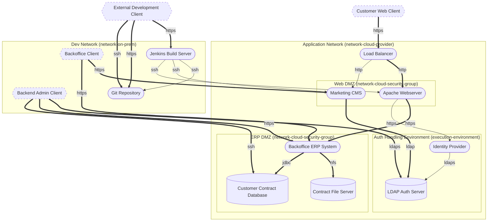
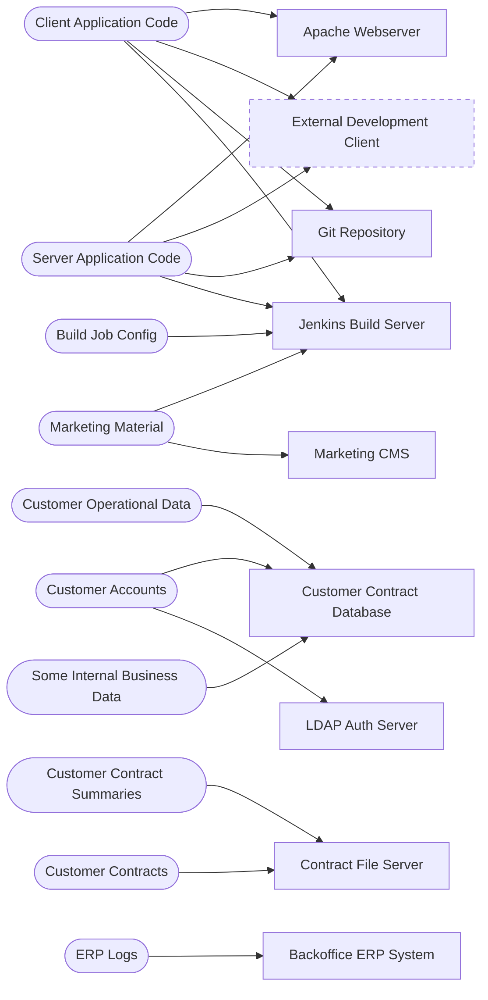

# Threat Model Report: Some Example Application

- **Author:** John Doe, [https://www.example.com](https://www.example.com)
- **Date:** 1 July 2020
- **Business criticality:** important
- **Threagile version:** test-version

## Contents

1. [Management Summary](#management-summary)
2. [Impact Analysis of the Initial Risks](#impact-analysis-of-the-initial-risks)
3. [Risk Mitigation](#risk-mitigation)
4. [Impact Analysis of the Remaining Risks](#impact-analysis-of-the-remaining-risks)
5. [Risks by Severity](#risks-by-severity)
6. [Application Overview](#application-overview)
7. [Data-Flow Diagram](#data-flow-diagram)
8. [Asset Register](#asset-register)
9. [Security Requirements](#security-requirements)
10. [Abuse Cases](#abuse-cases)
11. [Tag Listing](#tag-listing)
12. [STRIDE Classification of Identified Risks](#stride-classification-of-identified-risks)
13. [Assignment by Function](#assignment-by-function)
14. [RAA Analysis](#raa-analysis)
15. [Data Mapping](#data-mapping)
16. [Out-of-Scope Assets](#out-of-scope-assets)
17. [Potential Model Failures](#potential-model-failures)
18. [Questions](#questions)
19. [Identified Risks by Vulnerability Category](#identified-risks-by-vulnerability-category)
20. [Identified Risks by Technical Asset](#identified-risks-by-technical-asset)
21. [Identified Data Breach Probabilities by Data Asset](#identified-data-breach-probabilities-by-data-asset)
22. [Trust Boundaries](#trust-boundaries)
23. [Shared Runtimes](#shared-runtimes)
24. [Communication Links](#communication-links)
25. [Risk Tracking](#risk-tracking)
26. [Risk Rules Checked by Threagile](#risk-rules-checked-by-threagile)
27. [Ratings](#ratings)
28. [Disclaimer](#disclaimer)

## Management Summary

Threagile toolkit was used to model the architecture of "Some Example Application" and derive risks by analyzing the components and data flows. The risks identified during this analysis are shown in the following chapters. Identified risks during threat modeling do not necessarily mean that the vulnerability associated with this risk actually exists: it is more to be seen as a list of potential risks and threats, which should be individually reviewed and reduced by removing false positives. For the remaining risks it should be checked in the design and implementation of "Some Example Application" whether the mitigation advices have been applied or not.

Each risk finding references a chapter of the OWASP ASVS (Application Security Verification Standard) audit checklist. The OWASP ASVS checklist should be considered as an inspiration by architects and developers to further harden the application in a Defense-in-Depth approach. Additionally, for each risk finding a link towards a matching OWASP Cheat Sheet or similar with technical details about how to implement a mitigation is given.

In total **70 initial risks** in **27 categories** have been identified during the threat modeling process:

| Severity | Risks | Status | Risks |
| --- | ---: | --- | ---: |
| Critical | 1 | Unchecked | 42 |
| High | 2 | In Discussion | 0 |
| Elevated | 27 | Accepted | 1 |
| Medium | 36 | In Progress | 3 |
| Low | 4 | Mitigated | 24 |
|  |  | False Positive | 0 |

Just some **more** custom summary possible here...

## Impact Analysis of the Initial Risks

The most prevalent impacts of the **70 initial risks** (distributed over **27 risk categories**) are (taking the severity ratings into account and using the highest for each category):

- **Critical**: [Some Individual Risk Example](#some-individual-risk-example): 2 Initial Risks, exploitation likelihood is _Frequent_ with _Very High_ impact

    Some text describing the impact...

- **High**: [SQL/NoSQL-Injection](#sqlnosql-injection): 1 Initial Risk, exploitation likelihood is _Very Likely_ with _High_ impact

    If this risk is unmitigated, attackers might be able to modify SQL/NoSQL queries to steal and modify data and eventually further escalate towards a deeper system penetration via code executions.

- **High**: [XML External Entity (XXE)](#xml-external-entity-xxe): 1 Initial Risk, exploitation likelihood is _Very Likely_ with _High_ impact

    If this risk is unmitigated, attackers might be able to read sensitive files (configuration data, key/credential files, deployment files, business data files, etc.) form the filesystem of affected components and/or access sensitive services or files of other components.

- **Elevated**: [LDAP-Injection](#ldap-injection): 2 Initial Risks, exploitation likelihood is _Likely_ with _High_ impact

    If this risk remains unmitigated, attackers might be able to modify LDAP queries and access more data from the LDAP server than allowed.

- **Elevated**: [Missing Authentication](#missing-authentication): 2 Initial Risks, exploitation likelihood is _Likely_ with _Medium_ impact

    If this risk is unmitigated, attackers might be able to access or modify sensitive data in an unauthenticated way.

- **Elevated**: [Missing Cloud Hardening](#missing-cloud-hardening): 6 Initial Risks, exploitation likelihood is _Unlikely_ with _Very High_ impact

    If this risk is unmitigated, attackers might access cloud components in an unintended way.

- **Elevated**: [Missing File Validation](#missing-file-validation): 1 Initial Risk, exploitation likelihood is _Very Likely_ with _Medium_ impact

    If this risk is unmitigated, attackers might be able to provide malicious files to the application.

- **Elevated**: [Missing Hardening](#missing-hardening): 6 Initial Risks, exploitation likelihood is _Likely_ with _Medium_ impact

    If this risk remains unmitigated, attackers might be able to easier attack high-value targets.

- **Elevated**: [Path-Traversal](#path-traversal): 1 Initial Risk, exploitation likelihood is _Very Likely_ with _Medium_ impact

    If this risk is unmitigated, attackers might be able to read sensitive files (configuration data, key/credential files, deployment files, business data files, etc.) from the filesystem of affected components.

- **Elevated**: [Publicly Shared Cloud Snapshot](#publicly-shared-cloud-snapshot): 2 Initial Risks, exploitation likelihood is _Unlikely_ with _Very High_ impact

    If this risk is unmitigated, attackers might restore a publicly shared snapshot or image and read the data stored on it, including credentials baked into an image.

- **Elevated**: [Server-Side Request Forgery (SSRF)](#server-side-request-forgery-ssrf): 2 Initial Risks, exploitation likelihood is _Likely_ with _Medium_ impact

    If this risk is unmitigated, attackers might be able to access sensitive services or files of network-reachable components by modifying outgoing calls of affected components.

- **Elevated**: [Unencrypted Communication](#unencrypted-communication): 4 Initial Risks, exploitation likelihood is _Likely_ with _High_ impact

    If this risk is unmitigated, network attackers might be able to eavesdrop on unencrypted sensitive data sent between components.

- **Elevated**: [Unguarded Access From Internet](#unguarded-access-from-internet): 3 Initial Risks, exploitation likelihood is _Very Likely_ with _Medium_ impact

    If this risk is unmitigated, attackers might be able to directly attack sensitive systems without any hardening components in-between due to them being directly exposed on the internet.

- **Elevated**: [Untrusted Deserialization](#untrusted-deserialization): 2 Initial Risks, exploitation likelihood is _Likely_ with _Very High_ impact

    If this risk is unmitigated, attackers might be able to execute code on target systems by exploiting untrusted deserialization endpoints.

- **Medium**: [Accidental Secret Leak](#accidental-secret-leak): 1 Initial Risk, exploitation likelihood is _Unlikely_ with _High_ impact

    If this risk is unmitigated, attackers which have access to affected sourcecode repositories or artifact registries might find secrets accidentally checked-in.

- **Medium**: [Code Backdooring](#code-backdooring): 2 Initial Risks, exploitation likelihood is _Unlikely_ with _High_ impact

    If this risk remains unmitigated, attackers might be able to execute code on and completely takeover production environments.

- **Medium**: [Container Base Image Backdooring](#container-base-image-backdooring): 2 Initial Risks, exploitation likelihood is _Unlikely_ with _High_ impact

    If this risk is unmitigated, attackers might be able to deeply persist in the target system by executing code in deployed containers.

- **Medium**: [Missing Cloud Hardening](#missing-cloud-hardening): 6 Initial Risks, exploitation likelihood is _Unlikely_ with _Very High_ impact

    If this risk is unmitigated, attackers might access cloud components in an unintended way.

- **Medium**: [Missing Identity Propagation](#missing-identity-propagation): 1 Initial Risk, exploitation likelihood is _Unlikely_ with _Medium_ impact

    If this risk is unmitigated, attackers might be able to access or modify foreign data after a successful compromise of a component within the system due to missing resource-based authorization checks.

- **Medium**: [Missing Multi-Factor Authentication (MFA)](#missing-multi-factor-authentication-mfa): 9 Initial Risks, exploitation likelihood is _Unlikely_ with _Medium_ impact

    If this risk is unmitigated, attackers might be able to access or modify highly sensitive data without strong authentication.

- **Medium**: [Missing Network Segmentation](#missing-network-segmentation): 2 Initial Risks, exploitation likelihood is _Unlikely_ with _Medium_ impact

    If this risk is unmitigated, attackers successfully attacking other components of the system might have an easy path towards more valuable targets, as they are not separated by network segmentation.

- **Medium**: [Missing Vault (Secret Storage)](#missing-vault-secret-storage): 1 Initial Risk, exploitation likelihood is _Unlikely_ with _Medium_ impact

    If this risk is unmitigated, attackers might be able to easier steal config secrets (like credentials, private keys, client certificates, etc.) once a vulnerability to access files is present and exploited.

- **Medium**: [Mixed Targets on Shared Runtime](#mixed-targets-on-shared-runtime): 1 Initial Risk, exploitation likelihood is _Unlikely_ with _Medium_ impact

    If this risk is unmitigated, attackers successfully attacking other components of the system might have an easy path towards more valuable targets, as they are running on the same shared runtime.

- **Medium**: [Public Cloud Asset Access](#public-cloud-asset-access): 1 Initial Risk, exploitation likelihood is _Unlikely_ with _High_ impact

    If this risk is unmitigated, anyone on the internet might read (data leakage), alter or delete (tampering) the data held by the cloud asset.

- **Medium**: [Push instead of Pull Deployment](#push-instead-of-pull-deployment): 2 Initial Risks, exploitation likelihood is _Unlikely_ with _Medium_ impact

    If this risk is unmitigated, attackers might have more potential target vectors for attacks, as the overall attack surface is unnecessarily increased.

- **Medium**: [Some Individual Risk Example](#some-individual-risk-example): 2 Initial Risks, exploitation likelihood is _Frequent_ with _Very High_ impact

    Some text describing the impact...

- **Medium**: [Unchecked Deployment](#unchecked-deployment): 3 Initial Risks, exploitation likelihood is _Unlikely_ with _Medium_ impact

    If this risk remains unmitigated, vulnerabilities in custom-developed software or their dependencies might not be identified during continuous deployment cycles.

- **Medium**: [Unencrypted Communication](#unencrypted-communication): 4 Initial Risks, exploitation likelihood is _Likely_ with _High_ impact

    If this risk is unmitigated, network attackers might be able to eavesdrop on unencrypted sensitive data sent between components.

- **Medium**: [Unencrypted Technical Assets](#unencrypted-technical-assets): 7 Initial Risks, exploitation likelihood is _Unlikely_ with _High_ impact

    If this risk is unmitigated, attackers might be able to access unencrypted data when successfully compromising sensitive components.

- **Low**: [DoS-risky Access Across Trust-Boundary](#dos-risky-access-across-trust-boundary): 3 Initial Risks, exploitation likelihood is _Unlikely_ with _Low_ impact

    If this risk remains unmitigated, attackers might be able to disturb the availability of important parts of the system.

- **Low**: [Unchecked Deployment](#unchecked-deployment): 3 Initial Risks, exploitation likelihood is _Unlikely_ with _Medium_ impact

    If this risk remains unmitigated, vulnerabilities in custom-developed software or their dependencies might not be identified during continuous deployment cycles.

## Risk Mitigation

The following table gives a high-level overview of the risk tracking status (including mitigated risks):

| Severity | Risks | Unchecked | In Discussion | Accepted | In Progress | Mitigated | False Positive |
| --- | ---: | ---: | ---: | ---: | ---: | ---: | ---: |
| Critical | 1 | 1 | 0 | 0 | 0 | 0 | 0 |
| High | 2 | 2 | 0 | 0 | 0 | 0 | 0 |
| Elevated | 27 | 18 | 0 | 1 | 0 | 8 | 0 |
| Medium | 36 | 20 | 0 | 0 | 0 | 16 | 0 |
| Low | 4 | 1 | 0 | 0 | 3 | 0 | 0 |

After removal of risks with status _mitigated_ and _false positive_ the following **46 remain unmitigated**:

| Severity | Unmitigated risks | To be checked by | Unmitigated risks |
| --- | ---: | --- | ---: |
| Critical | 1 | Business Side | 2 |
| High | 2 | Architecture | 14 |
| Elevated | 19 | Development | 6 |
| Medium | 20 | Operations | 24 |
| Low | 4 |  |  |

## Impact Analysis of the Remaining Risks

The most prevalent impacts of the **46 remaining risks** (distributed over **23 risk categories**) are (taking the severity ratings into account and using the highest for each category):

- **Critical**: [Some Individual Risk Example](#some-individual-risk-example): 2 Remaining Risks, exploitation likelihood is _Frequent_ with _Very High_ impact

    Some text describing the impact...

- **High**: [SQL/NoSQL-Injection](#sqlnosql-injection): 1 Remaining Risk, exploitation likelihood is _Very Likely_ with _High_ impact

    If this risk is unmitigated, attackers might be able to modify SQL/NoSQL queries to steal and modify data and eventually further escalate towards a deeper system penetration via code executions.

- **High**: [XML External Entity (XXE)](#xml-external-entity-xxe): 1 Remaining Risk, exploitation likelihood is _Very Likely_ with _High_ impact

    If this risk is unmitigated, attackers might be able to read sensitive files (configuration data, key/credential files, deployment files, business data files, etc.) form the filesystem of affected components and/or access sensitive services or files of other components.

- **Elevated**: [Missing Authentication](#missing-authentication): 2 Remaining Risks, exploitation likelihood is _Likely_ with _Medium_ impact

    If this risk is unmitigated, attackers might be able to access or modify sensitive data in an unauthenticated way.

- **Elevated**: [Missing Cloud Hardening](#missing-cloud-hardening): 6 Remaining Risks, exploitation likelihood is _Unlikely_ with _Very High_ impact

    If this risk is unmitigated, attackers might access cloud components in an unintended way.

- **Elevated**: [Missing File Validation](#missing-file-validation): 1 Remaining Risk, exploitation likelihood is _Very Likely_ with _Medium_ impact

    If this risk is unmitigated, attackers might be able to provide malicious files to the application.

- **Elevated**: [Path-Traversal](#path-traversal): 1 Remaining Risk, exploitation likelihood is _Very Likely_ with _Medium_ impact

    If this risk is unmitigated, attackers might be able to read sensitive files (configuration data, key/credential files, deployment files, business data files, etc.) from the filesystem of affected components.

- **Elevated**: [Publicly Shared Cloud Snapshot](#publicly-shared-cloud-snapshot): 2 Remaining Risks, exploitation likelihood is _Unlikely_ with _Very High_ impact

    If this risk is unmitigated, attackers might restore a publicly shared snapshot or image and read the data stored on it, including credentials baked into an image.

- **Elevated**: [Server-Side Request Forgery (SSRF)](#server-side-request-forgery-ssrf): 2 Remaining Risks, exploitation likelihood is _Likely_ with _Medium_ impact

    If this risk is unmitigated, attackers might be able to access sensitive services or files of network-reachable components by modifying outgoing calls of affected components.

- **Elevated**: [Unencrypted Communication](#unencrypted-communication): 4 Remaining Risks, exploitation likelihood is _Likely_ with _High_ impact

    If this risk is unmitigated, network attackers might be able to eavesdrop on unencrypted sensitive data sent between components.

- **Elevated**: [Unguarded Access From Internet](#unguarded-access-from-internet): 3 Remaining Risks, exploitation likelihood is _Very Likely_ with _Medium_ impact

    If this risk is unmitigated, attackers might be able to directly attack sensitive systems without any hardening components in-between due to them being directly exposed on the internet.

- **Elevated**: [Untrusted Deserialization](#untrusted-deserialization): 2 Remaining Risks, exploitation likelihood is _Likely_ with _Very High_ impact

    If this risk is unmitigated, attackers might be able to execute code on target systems by exploiting untrusted deserialization endpoints.

- **Medium**: [Accidental Secret Leak](#accidental-secret-leak): 1 Remaining Risk, exploitation likelihood is _Unlikely_ with _High_ impact

    If this risk is unmitigated, attackers which have access to affected sourcecode repositories or artifact registries might find secrets accidentally checked-in.

- **Medium**: [Code Backdooring](#code-backdooring): 2 Remaining Risks, exploitation likelihood is _Unlikely_ with _High_ impact

    If this risk remains unmitigated, attackers might be able to execute code on and completely takeover production environments.

- **Medium**: [Container Base Image Backdooring](#container-base-image-backdooring): 2 Remaining Risks, exploitation likelihood is _Unlikely_ with _High_ impact

    If this risk is unmitigated, attackers might be able to deeply persist in the target system by executing code in deployed containers.

- **Medium**: [Missing Cloud Hardening](#missing-cloud-hardening): 6 Remaining Risks, exploitation likelihood is _Unlikely_ with _Very High_ impact

    If this risk is unmitigated, attackers might access cloud components in an unintended way.

- **Medium**: [Missing Identity Propagation](#missing-identity-propagation): 1 Remaining Risk, exploitation likelihood is _Unlikely_ with _Medium_ impact

    If this risk is unmitigated, attackers might be able to access or modify foreign data after a successful compromise of a component within the system due to missing resource-based authorization checks.

- **Medium**: [Missing Network Segmentation](#missing-network-segmentation): 2 Remaining Risks, exploitation likelihood is _Unlikely_ with _Medium_ impact

    If this risk is unmitigated, attackers successfully attacking other components of the system might have an easy path towards more valuable targets, as they are not separated by network segmentation.

- **Medium**: [Missing Vault (Secret Storage)](#missing-vault-secret-storage): 1 Remaining Risk, exploitation likelihood is _Unlikely_ with _Medium_ impact

    If this risk is unmitigated, attackers might be able to easier steal config secrets (like credentials, private keys, client certificates, etc.) once a vulnerability to access files is present and exploited.

- **Medium**: [Mixed Targets on Shared Runtime](#mixed-targets-on-shared-runtime): 1 Remaining Risk, exploitation likelihood is _Unlikely_ with _Medium_ impact

    If this risk is unmitigated, attackers successfully attacking other components of the system might have an easy path towards more valuable targets, as they are running on the same shared runtime.

- **Medium**: [Public Cloud Asset Access](#public-cloud-asset-access): 1 Remaining Risk, exploitation likelihood is _Unlikely_ with _High_ impact

    If this risk is unmitigated, anyone on the internet might read (data leakage), alter or delete (tampering) the data held by the cloud asset.

- **Medium**: [Push instead of Pull Deployment](#push-instead-of-pull-deployment): 2 Remaining Risks, exploitation likelihood is _Unlikely_ with _Medium_ impact

    If this risk is unmitigated, attackers might have more potential target vectors for attacks, as the overall attack surface is unnecessarily increased.

- **Medium**: [Some Individual Risk Example](#some-individual-risk-example): 2 Remaining Risks, exploitation likelihood is _Frequent_ with _Very High_ impact

    Some text describing the impact...

- **Medium**: [Unchecked Deployment](#unchecked-deployment): 3 Remaining Risks, exploitation likelihood is _Unlikely_ with _Medium_ impact

    If this risk remains unmitigated, vulnerabilities in custom-developed software or their dependencies might not be identified during continuous deployment cycles.

- **Medium**: [Unencrypted Communication](#unencrypted-communication): 4 Remaining Risks, exploitation likelihood is _Likely_ with _High_ impact

    If this risk is unmitigated, network attackers might be able to eavesdrop on unencrypted sensitive data sent between components.

- **Low**: [DoS-risky Access Across Trust-Boundary](#dos-risky-access-across-trust-boundary): 3 Remaining Risks, exploitation likelihood is _Unlikely_ with _Low_ impact

    If this risk remains unmitigated, attackers might be able to disturb the availability of important parts of the system.

- **Low**: [Unchecked Deployment](#unchecked-deployment): 3 Remaining Risks, exploitation likelihood is _Unlikely_ with _Medium_ impact

    If this risk remains unmitigated, vulnerabilities in custom-developed software or their dependencies might not be identified during continuous deployment cycles.

## Risks by Severity

All **70 risks** by severity, with their tracking status. Each risk links to its details in the chapter of its category.

### Critical

**1 risk**

| Severity | Risk | Category | Most relevant | Status |
| --- | --- | --- | --- | --- |
| Critical | [**Example Individual Risk** at **Database**](#some-individual-risk-example) | [Some Individual Risk Example](#some-individual-risk-example) | [Customer Contract Database](#customer-contract-database) | Unchecked |

### High

**2 risks**

| Severity | Risk | Category | Most relevant | Status |
| --- | --- | --- | --- | --- |
| High | [**SQL/NoSQL-Injection** risk at **Backoffice ERP System** against database **Customer Contract Database** via **Database Traffic**](#sqlnosql-injection) | [SQL/NoSQL-Injection](#sqlnosql-injection) | [Backoffice ERP System](#backoffice-erp-system), [Database Traffic](#database-traffic) | Unchecked |
| High | [**XML External Entity (XXE)** risk at **Backoffice ERP System**](#xml-external-entity-xxe) | [XML External Entity (XXE)](#xml-external-entity-xxe) | [Backoffice ERP System](#backoffice-erp-system) | Unchecked |

### Elevated

**27 risks**

| Severity | Risk | Category | Most relevant | Status |
| --- | --- | --- | --- | --- |
| Elevated | [**LDAP-Injection** risk at **Identity Provider** against LDAP server **LDAP Auth Server** via **LDAP Credential Check Traffic**](#ldap-injection) | [LDAP-Injection](#ldap-injection) | [Identity Provider](#identity-provider), [LDAP Credential Check Traffic](#ldap-credential-check-traffic) | Mitigated |
| Elevated | [**LDAP-Injection** risk at **Marketing CMS** against LDAP server **LDAP Auth Server** via **Auth Traffic**](#ldap-injection) | [LDAP-Injection](#ldap-injection) | [Marketing CMS](#marketing-cms), [Auth Traffic](#auth-traffic) | Mitigated |
| Elevated | [**Missing Authentication** covering communication link **CMS Content Traffic** from **Load Balancer** to **Marketing CMS**](#missing-authentication) | [Missing Authentication](#missing-authentication) | [Marketing CMS](#marketing-cms), [CMS Content Traffic](#cms-content-traffic) | Unchecked |
| Elevated | [**Missing Authentication** covering communication link **NFS Filesystem Access** from **Backoffice ERP System** to **Contract File Server**](#missing-authentication) | [Missing Authentication](#missing-authentication) | [Contract File Server](#contract-file-server), [NFS Filesystem Access](#nfs-filesystem-access) | Unchecked |
| Elevated | [**Missing Cloud Hardening (AWS)** risk at **Application Network**: _CIS Benchmark for AWS_](#missing-cloud-hardening) | [Missing Cloud Hardening](#missing-cloud-hardening) | none | Unchecked |
| Elevated | [**Missing Cloud Hardening (EC2)** risk at **Apache Webserver**: _CIS Benchmark for Amazon Linux_](#missing-cloud-hardening) | [Missing Cloud Hardening](#missing-cloud-hardening) | none | Unchecked |
| Elevated | [**Missing Cloud Hardening** risk at **ERP DMZ**](#missing-cloud-hardening) | [Missing Cloud Hardening](#missing-cloud-hardening) | none | Unchecked |
| Elevated | [**Missing Cloud Hardening** risk at **Web DMZ**](#missing-cloud-hardening) | [Missing Cloud Hardening](#missing-cloud-hardening) | none | Unchecked |
| Elevated | [**Missing Cloud Hardening** risk at **WebApp and Backoffice Virtualization**](#missing-cloud-hardening) | [Missing Cloud Hardening](#missing-cloud-hardening) | none | Unchecked |
| Elevated | [**Missing File Validation** risk at **Apache Webserver**](#missing-file-validation) | [Missing File Validation](#missing-file-validation) | [Apache Webserver](#apache-webserver) | Unchecked |
| Elevated | [**Missing Hardening** risk at **Apache Webserver**](#missing-hardening) | [Missing Hardening](#missing-hardening) | [Apache Webserver](#apache-webserver) | Mitigated |
| Elevated | [**Missing Hardening** risk at **Backoffice ERP System**](#missing-hardening) | [Missing Hardening](#missing-hardening) | [Backoffice ERP System](#backoffice-erp-system) | Mitigated |
| Elevated | [**Missing Hardening** risk at **Customer Contract Database**](#missing-hardening) | [Missing Hardening](#missing-hardening) | [Customer Contract Database](#customer-contract-database) | Mitigated |
| Elevated | [**Missing Hardening** risk at **Identity Provider**](#missing-hardening) | [Missing Hardening](#missing-hardening) | [Identity Provider](#identity-provider) | Mitigated |
| Elevated | [**Missing Hardening** risk at **Jenkins Build Server**](#missing-hardening) | [Missing Hardening](#missing-hardening) | [Jenkins Build Server](#jenkins-build-server) | Mitigated |
| Elevated | [**Missing Hardening** risk at **LDAP Auth Server**](#missing-hardening) | [Missing Hardening](#missing-hardening) | [LDAP Auth Server](#ldap-auth-server) | Mitigated |
| Elevated | [**Path-Traversal** risk at **Backoffice ERP System** against filesystem **Contract File Server** via **NFS Filesystem Access**](#path-traversal) | [Path-Traversal](#path-traversal) | [Backoffice ERP System](#backoffice-erp-system), [NFS Filesystem Access](#nfs-filesystem-access) | Unchecked |
| Elevated | [**Publicly Shared Cloud Snapshot (AMI)** risk at **Apache Webserver**](#publicly-shared-cloud-snapshot) | [Publicly Shared Cloud Snapshot](#publicly-shared-cloud-snapshot) | [Apache Webserver](#apache-webserver) | Unchecked |
| Elevated | [**Publicly Shared Cloud Snapshot** risk at **Customer Contract Database**](#publicly-shared-cloud-snapshot) | [Publicly Shared Cloud Snapshot](#publicly-shared-cloud-snapshot) | [Customer Contract Database](#customer-contract-database) | Unchecked |
| Elevated | [**Server-Side Request Forgery (SSRF)** risk at **Apache Webserver** server-side web-requesting the target **Backoffice ERP System** via **ERP System Traffic**](#server-side-request-forgery-ssrf) | [Server-Side Request Forgery (SSRF)](#server-side-request-forgery-ssrf) | [Apache Webserver](#apache-webserver), [ERP System Traffic](#erp-system-traffic) | Unchecked |
| Elevated | [**Server-Side Request Forgery (SSRF)** risk at **Apache Webserver** server-side web-requesting the target **Identity Provider** via **Auth Credential Check Traffic**](#server-side-request-forgery-ssrf) | [Server-Side Request Forgery (SSRF)](#server-side-request-forgery-ssrf) | [Apache Webserver](#apache-webserver), [Auth Credential Check Traffic](#auth-credential-check-traffic) | Unchecked |
| Elevated | [**Unencrypted Communication** named **Web Application Traffic** between **Load Balancer** and **Apache Webserver** transferring authentication data (like credentials, token, session-id, etc.)](#unencrypted-communication) | [Unencrypted Communication](#unencrypted-communication) | [Load Balancer](#load-balancer), [Web Application Traffic](#web-application-traffic) | Unchecked |
| Elevated | [**Unguarded Access from Internet** of **Git Repository** by **External Development Client** via **Git-Repo Code Write Access**](#unguarded-access-from-internet) | [Unguarded Access From Internet](#unguarded-access-from-internet) | [Git Repository](#git-repository), [Git-Repo Code Write Access](#git-repo-code-write-access) | Unchecked |
| Elevated | [**Unguarded Access from Internet** of **Git Repository** by **External Development Client** via **Git-Repo Web-UI Access**](#unguarded-access-from-internet) | [Unguarded Access From Internet](#unguarded-access-from-internet) | [Git Repository](#git-repository), [Git-Repo Web-UI Access](#git-repo-web-ui-access) | Unchecked |
| Elevated | [**Unguarded Access from Internet** of **Jenkins Build Server** by **External Development Client** via **Jenkins Web-UI Access**](#unguarded-access-from-internet) | [Unguarded Access From Internet](#unguarded-access-from-internet) | [Jenkins Build Server](#jenkins-build-server), [Jenkins Web-UI Access](#jenkins-web-ui-access) | Unchecked |
| Elevated | [**Untrusted Deserialization** risk at **Jenkins Build Server**](#untrusted-deserialization) | [Untrusted Deserialization](#untrusted-deserialization) | [Jenkins Build Server](#jenkins-build-server) | Unchecked |
| Elevated | [**Untrusted Deserialization** risk at **Backoffice ERP System**](#untrusted-deserialization) | [Untrusted Deserialization](#untrusted-deserialization) | [Backoffice ERP System](#backoffice-erp-system) | Accepted |

### Medium

**36 risks**

| Severity | Risk | Category | Most relevant | Status |
| --- | --- | --- | --- | --- |
| Medium | [**Accidental Secret Leak(Git)** risk at **Git Repository**: _Git Leak Prevention_](#accidental-secret-leak) | [Accidental Secret Leak](#accidental-secret-leak) | [Git Repository](#git-repository) | Unchecked |
| Medium | [**Code Backdooring** risk at **Git Repository**](#code-backdooring) | [Code Backdooring](#code-backdooring) | [Git Repository](#git-repository) | Unchecked |
| Medium | [**Code Backdooring** risk at **Jenkins Build Server**](#code-backdooring) | [Code Backdooring](#code-backdooring) | [Jenkins Build Server](#jenkins-build-server) | Unchecked |
| Medium | [**Container Base Image Backdooring** risk at **Apache Webserver**](#container-base-image-backdooring) | [Container Base Image Backdooring](#container-base-image-backdooring) | [Apache Webserver](#apache-webserver) | Unchecked |
| Medium | [**Container Base Image Backdooring** risk at **Marketing CMS**](#container-base-image-backdooring) | [Container Base Image Backdooring](#container-base-image-backdooring) | [Marketing CMS](#marketing-cms) | Unchecked |
| Medium | [**Missing Multi-Factor Authentication** covering communication link **CMS Content Traffic** from **Customer Web Client** forwarded via **Load Balancer** to **Marketing CMS**](#missing-multi-factor-authentication-mfa) | [Missing Multi-Factor Authentication (MFA)](#missing-multi-factor-authentication-mfa) | [Marketing CMS](#marketing-cms), [CMS Content Traffic](#cms-content-traffic) | Mitigated |
| Medium | [**Missing Multi-Factor Authentication** covering communication link **DB Update Access** from **Backend Admin Client** to **Customer Contract Database**](#missing-multi-factor-authentication-mfa) | [Missing Multi-Factor Authentication (MFA)](#missing-multi-factor-authentication-mfa) | [Customer Contract Database](#customer-contract-database), [DB Update Access](#db-update-access) | Mitigated |
| Medium | [**Missing Multi-Factor Authentication** covering communication link **ERP Internal Access** from **Backoffice Client** to **Backoffice ERP System**](#missing-multi-factor-authentication-mfa) | [Missing Multi-Factor Authentication (MFA)](#missing-multi-factor-authentication-mfa) | [Backoffice ERP System](#backoffice-erp-system), [ERP Internal Access](#erp-internal-access) | Mitigated |
| Medium | [**Missing Multi-Factor Authentication** covering communication link **ERP Web Access** from **Backend Admin Client** to **Backoffice ERP System**](#missing-multi-factor-authentication-mfa) | [Missing Multi-Factor Authentication (MFA)](#missing-multi-factor-authentication-mfa) | [Backoffice ERP System](#backoffice-erp-system), [ERP Web Access](#erp-web-access) | Mitigated |
| Medium | [**Missing Multi-Factor Authentication** covering communication link **Git-Repo Code Write Access** from **External Development Client** to **Git Repository**](#missing-multi-factor-authentication-mfa) | [Missing Multi-Factor Authentication (MFA)](#missing-multi-factor-authentication-mfa) | [Git Repository](#git-repository), [Git-Repo Code Write Access](#git-repo-code-write-access) | Mitigated |
| Medium | [**Missing Multi-Factor Authentication** covering communication link **Git-Repo Web-UI Access** from **External Development Client** to **Git Repository**](#missing-multi-factor-authentication-mfa) | [Missing Multi-Factor Authentication (MFA)](#missing-multi-factor-authentication-mfa) | [Git Repository](#git-repository), [Git-Repo Web-UI Access](#git-repo-web-ui-access) | Mitigated |
| Medium | [**Missing Multi-Factor Authentication** covering communication link **Jenkins Web-UI Access** from **External Development Client** to **Jenkins Build Server**](#missing-multi-factor-authentication-mfa) | [Missing Multi-Factor Authentication (MFA)](#missing-multi-factor-authentication-mfa) | [Jenkins Build Server](#jenkins-build-server), [Jenkins Web-UI Access](#jenkins-web-ui-access) | Mitigated |
| Medium | [**Missing Multi-Factor Authentication** covering communication link **User Management Access** from **Backend Admin Client** to **LDAP Auth Server**](#missing-multi-factor-authentication-mfa) | [Missing Multi-Factor Authentication (MFA)](#missing-multi-factor-authentication-mfa) | [LDAP Auth Server](#ldap-auth-server), [User Management Access](#user-management-access) | Mitigated |
| Medium | [**Missing Multi-Factor Authentication** covering communication link **Web Application Traffic** from **Customer Web Client** forwarded via **Load Balancer** to **Apache Webserver**](#missing-multi-factor-authentication-mfa) | [Missing Multi-Factor Authentication (MFA)](#missing-multi-factor-authentication-mfa) | [Apache Webserver](#apache-webserver), [Web Application Traffic](#web-application-traffic) | Mitigated |
| Medium | [**Missing Cloud Hardening (S3)** risk at **Contract File Server**: _Security Best Practices for AWS S3_](#missing-cloud-hardening) | [Missing Cloud Hardening](#missing-cloud-hardening) | none | Unchecked |
| Medium | [**Missing End User Identity Propagation** over communication link **ERP System Traffic** from **Apache Webserver** to **Backoffice ERP System**](#missing-identity-propagation) | [Missing Identity Propagation](#missing-identity-propagation) | [Backoffice ERP System](#backoffice-erp-system), [ERP System Traffic](#erp-system-traffic) | Unchecked |
| Medium | [**Missing Network Segmentation** to further encapsulate and protect **Apache Webserver** against unrelated lower protected assets in the same network segment, which might be easier to compromise by attackers](#missing-network-segmentation) | [Missing Network Segmentation](#missing-network-segmentation) | [Apache Webserver](#apache-webserver) | Unchecked |
| Medium | [**Missing Network Segmentation** to further encapsulate and protect **Jenkins Build Server** against unrelated lower protected assets in the same network segment, which might be easier to compromise by attackers](#missing-network-segmentation) | [Missing Network Segmentation](#missing-network-segmentation) | [Jenkins Build Server](#jenkins-build-server) | Unchecked |
| Medium | [**Missing Vault (Secret Storage)** in the threat model (referencing asset **Backoffice ERP System** as an example)](#missing-vault-secret-storage) | [Missing Vault (Secret Storage)](#missing-vault-secret-storage) | [Backoffice ERP System](#backoffice-erp-system) | Unchecked |
| Medium | [**Mixed Targets on Shared Runtime** named **WebApp and Backoffice Virtualization** might enable attackers moving from one less valuable target to a more valuable one](#mixed-targets-on-shared-runtime) | [Mixed Targets on Shared Runtime](#mixed-targets-on-shared-runtime) | [WebApp and Backoffice Virtualization](#webapp-and-backoffice-virtualization) | Unchecked |
| Medium | [**Public Cloud Asset Access (S3)** risk at **Contract File Server**](#public-cloud-asset-access) | [Public Cloud Asset Access](#public-cloud-asset-access) | [Contract File Server](#contract-file-server) | Unchecked |
| Medium | [**Push instead of Pull Deployment** at **Apache Webserver** via build pipeline asset **Jenkins Build Server**](#push-instead-of-pull-deployment) | [Push instead of Pull Deployment](#push-instead-of-pull-deployment) | [Apache Webserver](#apache-webserver), [Application Deployment](#application-deployment) | Unchecked |
| Medium | [**Push instead of Pull Deployment** at **Marketing CMS** via build pipeline asset **Jenkins Build Server**](#push-instead-of-pull-deployment) | [Push instead of Pull Deployment](#push-instead-of-pull-deployment) | [Marketing CMS](#marketing-cms), [CMS Updates](#cms-updates) | Unchecked |
| Medium | [**Example Individual Risk** at **Contract Filesystem**](#some-individual-risk-example) | [Some Individual Risk Example](#some-individual-risk-example) | [Contract File Server](#contract-file-server) | Unchecked |
| Medium | [**Unchecked Deployment** risk at **External Development Client**](#unchecked-deployment) | [Unchecked Deployment](#unchecked-deployment) | [External Development Client](#external-development-client) | Unchecked |
| Medium | [**Unchecked Deployment** risk at **Jenkins Build Server**](#unchecked-deployment) | [Unchecked Deployment](#unchecked-deployment) | [Jenkins Build Server](#jenkins-build-server) | Unchecked |
| Medium | [**Unencrypted Technical Asset** named **Apache Webserver**](#unencrypted-technical-assets) | [Unencrypted Technical Assets](#unencrypted-technical-assets) | [Apache Webserver](#apache-webserver) | Mitigated |
| Medium | [**Unencrypted Technical Asset** named **Backoffice ERP System** missing end user individual encryption with data-with-end-user-individual-key](#unencrypted-technical-assets) | [Unencrypted Technical Assets](#unencrypted-technical-assets) | [Backoffice ERP System](#backoffice-erp-system) | Mitigated |
| Medium | [**Unencrypted Technical Asset** named **Git Repository**](#unencrypted-technical-assets) | [Unencrypted Technical Assets](#unencrypted-technical-assets) | [Git Repository](#git-repository) | Mitigated |
| Medium | [**Unencrypted Technical Asset** named **Jenkins Build Server**](#unencrypted-technical-assets) | [Unencrypted Technical Assets](#unencrypted-technical-assets) | [Jenkins Build Server](#jenkins-build-server) | Mitigated |
| Medium | [**Unencrypted Technical Asset** named **Marketing CMS**](#unencrypted-technical-assets) | [Unencrypted Technical Assets](#unencrypted-technical-assets) | [Marketing CMS](#marketing-cms) | Mitigated |
| Medium | [**Unencrypted Technical Asset** named **Contract File Server**](#unencrypted-technical-assets) | [Unencrypted Technical Assets](#unencrypted-technical-assets) | [Contract File Server](#contract-file-server) | Mitigated |
| Medium | [**Unencrypted Technical Asset** named **Customer Contract Database** missing end user individual encryption with data-with-end-user-individual-key](#unencrypted-technical-assets) | [Unencrypted Technical Assets](#unencrypted-technical-assets) | [Customer Contract Database](#customer-contract-database) | Mitigated |
| Medium | [**Unencrypted Communication** named **Auth Traffic** between **Marketing CMS** and **LDAP Auth Server** transferring authentication data (like credentials, token, session-id, etc.)](#unencrypted-communication) | [Unencrypted Communication](#unencrypted-communication) | [Marketing CMS](#marketing-cms), [Auth Traffic](#auth-traffic) | Unchecked |
| Medium | [**Unencrypted Communication** named **Database Traffic** between **Backoffice ERP System** and **Customer Contract Database** transferring authentication data (like credentials, token, session-id, etc.)](#unencrypted-communication) | [Unencrypted Communication](#unencrypted-communication) | [Backoffice ERP System](#backoffice-erp-system), [Database Traffic](#database-traffic) | Unchecked |
| Medium | [**Unencrypted Communication** named **NFS Filesystem Access** between **Backoffice ERP System** and **Contract File Server**](#unencrypted-communication) | [Unencrypted Communication](#unencrypted-communication) | [Backoffice ERP System](#backoffice-erp-system), [NFS Filesystem Access](#nfs-filesystem-access) | Unchecked |

### Low

**4 risks**

| Severity | Risk | Category | Most relevant | Status |
| --- | --- | --- | --- | --- |
| Low | [**Denial-of-Service** risky access of **Backoffice ERP System** by **Apache Webserver** via **ERP System Traffic**](#dos-risky-access-across-trust-boundary) | [DoS-risky Access Across Trust-Boundary](#dos-risky-access-across-trust-boundary) | [Backoffice ERP System](#backoffice-erp-system), [ERP System Traffic](#erp-system-traffic) | In Progress |
| Low | [**Denial-of-Service** risky access of **Backoffice ERP System** by **Backoffice Client** via **ERP Internal Access**](#dos-risky-access-across-trust-boundary) | [DoS-risky Access Across Trust-Boundary](#dos-risky-access-across-trust-boundary) | [Backoffice ERP System](#backoffice-erp-system), [ERP Internal Access](#erp-internal-access) | In Progress |
| Low | [**Denial-of-Service** risky access of **Marketing CMS** by **Backoffice Client** via **Marketing CMS Editing**](#dos-risky-access-across-trust-boundary) | [DoS-risky Access Across Trust-Boundary](#dos-risky-access-across-trust-boundary) | [Marketing CMS](#marketing-cms), [Marketing CMS Editing](#marketing-cms-editing) | In Progress |
| Low | [**Unchecked Deployment** risk at **Git Repository**](#unchecked-deployment) | [Unchecked Deployment](#unchecked-deployment) | [Git Repository](#git-repository) | Unchecked |

## Application Overview

### Business Criticality

The overall business criticality of "Some Example Application" was rated as:

- archive
- operational
- **important** (selected)
- critical
- mission-critical

### Business Overview

Some more _demo text_ here and even images...

### Technical Overview

Some more _demo text_ here and even images...

## Data-Flow Diagram

The following diagram was generated by Threagile based on the model input and gives a high-level overview of the data-flow between technical assets. The RAA value of each asset, the calculated _Relative Attacker Attractiveness_ in percent, is in the chapter [RAA Analysis](#raa-analysis).

Data-flow diagram of "Some Example Application". A box is an external entity, a stadium a process, a cylinder a datastore and a hexagon a client used by a human; assets out of scope have a dashed border, and the trust boundaries enclose the assets inside them. An arrow points from the asset that initiates a communication link to its target and names the protocol; a thick arrow is a link that also receives data back.

## Asset Register

### Technical Assets

- [Customer Contract Database](#customer-contract-database)

    The database behind the ERP system

- [Backoffice ERP System](#backoffice-erp-system)

    ERP system

- [Apache Webserver](#apache-webserver)

    Apache Webserver hosting the API code and client-side code

- [Contract File Server](#contract-file-server)

    NFS Filesystem for storing the contract PDFs

- [Git Repository](#git-repository)

    Git repository server

- [Jenkins Build Server](#jenkins-build-server)

    Jenkins build-server

- [Load Balancer](#load-balancer)

    Load Balancer (HA-Proxy)

- [Marketing CMS](#marketing-cms)

    CMS for the marketing content

- [Identity Provider](#identity-provider)

    Identity provider server

- [LDAP Auth Server](#ldap-auth-server)

    LDAP authentication server

- [Backend Admin Client](#backend-admin-client) (out of scope)

    Backend admin client

- [Backoffice Client](#backoffice-client) (out of scope)

    Backoffice client

- [Customer Web Client](#customer-web-client) (out of scope)

    Customer Web Client

- [External Development Client](#external-development-client) (out of scope)

    External developer client

### Data Assets

- [Build Job Config](#build-job-config)

    Data for customizing of the build job system.

- [Client Application Code](#client-application-code)

    Angular and other client-side code delivered by the application.

- [Customer Accounts](#customer-accounts)

    Customer Accounts (including transient credentials when entered for checking them)

- [Customer Contract Summaries](#customer-contract-summaries)

    Customer Contract Summaries

- [Customer Contracts](#customer-contracts)

    Customer Contracts (PDF)

- [Customer Operational Data](#customer-operational-data)

    Customer Operational Data

- [Database Customizing and Dumps](#database-customizing-and-dumps)

    Data for customizing of the DB system, which might include full database dumps.

- [ERP Customizing Data](#erp-customizing-data)

    Data for customizing of the ERP system.

- [ERP Logs](#erp-logs)

    Logs generated by the ERP system.

- [Marketing Material](#marketing-material)

    Website and marketing data to inform potential customers and generate new leads.

- [Server Application Code](#server-application-code)

    API and other server-side code of the application.

- [Some Internal Business Data](#some-internal-business-data)

    Internal business data of the ERP system used unrelated to the customer-facing processes.

## Security Requirements

This chapter lists the custom security requirements which have been defined for the modeled target.

- **EU-DSGVO**

    Mandatory EU-Datenschutzgrundverordnung

- **Input Validation**

    Strict input validation is required to reduce the overall attack surface.

- **Securing Administrative Access**

    Administrative access must be secured with strong encryption and multi-factor authentication.

_This list is not complete and regulatory or law relevant security requirements have to be taken into account as well. Also custom individual security requirements might exist for the project._

## Abuse Cases

This chapter lists the custom abuse cases which have been defined for the modeled target.

- **CPU-Cycle Theft**

    As a hacker I want to steal CPU cycles in order to transform them into money via installed crypto currency miners.

- **Contract Filesystem Compromise**

    As a hacker I want to access the filesystem storing the contract PDFs in order to steal/modify contract data.

- **Cross-Site Scripting Attacks**

    As a hacker I want to execute Cross-Site Scripting (XSS) and similar attacks in order to takeover victim sessions and cause reputational damage.

- **Database Compromise**

    As a hacker I want to access the database backend of the ERP-System in order to steal/modify sensitive business data.

- **Denial-of-Service**

    As a hacker I want to disturb the functionality of the backend system in order to cause indirect financial damage via unusable features.

- **Denial-of-Service of ERP/DB Functionality**

    As a hacker I want to disturb the functionality of the ERP system and/or it's database in order to cause indirect financial damage via unusable internal ERP features (not related to customer portal).

- **Denial-of-Service of End-User Functionality**

    As a hacker I want to disturb the functionality of the end-user parts of the application in order to cause direct financial damage (lower sales).

- **ERP-System Compromise**

    As a hacker I want to access the ERP-System in order to steal/modify sensitive business data.

- **Identity Theft**

    As a hacker I want to steal identity data in order to reuse credentials and/or keys on other targets of the same company or outside.

- **PII Theft**

    As a hacker I want to steal PII (Personally Identifiable Information) data in order to blackmail the company and/or damage their repudiation by publishing them.

- **Ransomware**

    As a hacker I want to encrypt the storage and file systems in order to demand ransom.

_This list is not complete and regulatory or law relevant abuse cases have to be taken into account as well. Also custom individual abuse cases might exist for the project._

## Tag Listing

This chapter lists what tags are used by which elements.

- **apache**: [Apache Webserver](#apache-webserver)
- **aws**: [Application Network](#application-network)
- **aws:ec2**: [Apache Webserver](#apache-webserver)
- **aws:s3**: [Contract File Server](#contract-file-server)
- **git**: [Git Repository](#git-repository)
- **jboss**: [Identity Provider](#identity-provider)
- **jenkins**: [Jenkins Build Server](#jenkins-build-server)
- **keycloak**: [Identity Provider](#identity-provider)
- **linux**: [Apache Webserver](#apache-webserver), [Backoffice ERP System](#backoffice-erp-system), [Contract File Server](#contract-file-server), [Customer Contract Database](#customer-contract-database), [External Development Client](#external-development-client), [Git Repository](#git-repository), [Identity Provider](#identity-provider), [Jenkins Build Server](#jenkins-build-server), [LDAP Auth Server](#ldap-auth-server), [Marketing CMS](#marketing-cms)
- **mysql**: [Customer Contract Database](#customer-contract-database)
- **oracle**: [Database Customizing and Dumps](#database-customizing-and-dumps)
- **some-erp**: [ERP Internal Access](#erp-internal-access), [ERP DMZ](#erp-dmz)
- **vmware**: [WebApp and Backoffice Virtualization](#webapp-and-backoffice-virtualization)

## STRIDE Classification of Identified Risks

This chapter clusters and classifies the risks by STRIDE categories: in total **70 potential risks** have been identified during the threat modeling process.

### Spoofing

**1 risk**

Spoofing - Authenticity

- **Elevated**: [Missing File Validation](#missing-file-validation): 1/1 unmitigated Risk, exploitation likelihood is _Very Likely_ with _Medium_ impact

    When a technical asset accepts files, these input files should be strictly validated about filename and type.

### Tampering

**26 risks**

Tampering - Integrity

- **High**: [SQL/NoSQL-Injection](#sqlnosql-injection): 1/1 unmitigated Risk, exploitation likelihood is _Very Likely_ with _High_ impact

    When a database is accessed via database access protocols SQL/NoSQL-Injection risks might arise. The risk rating depends on the sensitivity technical asset itself and of the data assets processed.

- **Elevated**: [LDAP-Injection](#ldap-injection): 2 mitigated Risks, exploitation likelihood is _Likely_ with _High_ impact

    When an LDAP server is accessed LDAP-Injection risks might arise. The risk rating depends on the sensitivity of the LDAP server itself and of the data assets processed.

- **Elevated**: [Missing Cloud Hardening](#missing-cloud-hardening): 6/6 unmitigated Risks, exploitation likelihood is _Unlikely_ with _Very High_ impact

    Cloud components should be hardened according to the cloud vendor best practices. This affects their configuration, auditing, and further areas.

- **Elevated**: [Missing Hardening](#missing-hardening): 6 mitigated Risks, exploitation likelihood is _Likely_ with _Medium_ impact

    Technical assets with a Relative Attacker Attractiveness (RAA) value of 55 % or higher should be explicitly hardened taking best practices and vendor hardening guides into account.

- **Elevated**: [Untrusted Deserialization](#untrusted-deserialization): 2/2 unmitigated Risks, exploitation likelihood is _Likely_ with _Very High_ impact

    When a technical asset accepts data in a specific serialized form (like Java or .NET serialization), Untrusted Deserialization risks might arise.

- **Medium**: [Code Backdooring](#code-backdooring): 2/2 unmitigated Risks, exploitation likelihood is _Unlikely_ with _High_ impact

    For each build pipeline component Code Backdooring risks might arise where attackers compromise the build pipeline in order to let backdoored artifacts be shipped into production. Aside from direct code backdooring this includes backdooring of dependencies and even of more lower-level build infrastructure, like backdooring compilers (similar to what the XcodeGhost malware did) or dependencies.

- **Medium**: [Container Base Image Backdooring](#container-base-image-backdooring): 2/2 unmitigated Risks, exploitation likelihood is _Unlikely_ with _High_ impact

    When a technical asset is built using container technologies, Base Image Backdooring risks might arise where base images and other layers used contain vulnerable components or backdoors.

- **Medium**: [Missing Cloud Hardening](#missing-cloud-hardening): 6/6 unmitigated Risks, exploitation likelihood is _Unlikely_ with _Very High_ impact

    Cloud components should be hardened according to the cloud vendor best practices. This affects their configuration, auditing, and further areas.

- **Medium**: [Push instead of Pull Deployment](#push-instead-of-pull-deployment): 2/2 unmitigated Risks, exploitation likelihood is _Unlikely_ with _Medium_ impact

    When comparing push-based vs. pull-based deployments from a security perspective, pull-based deployments improve the overall security of the deployment targets. Every exposed interface of a production system to accept a deployment increases the attack surface of the production system, thus a pull-based approach exposes less attack surface relevant interfaces.

- **Medium**: [Unchecked Deployment](#unchecked-deployment): 3/3 unmitigated Risks, exploitation likelihood is _Unlikely_ with _Medium_ impact

    For each build-pipeline component Unchecked Deployment risks might arise when the build-pipeline does not include established DevSecOps best-practices. DevSecOps best-practices scan as part of CI/CD pipelines for vulnerabilities in source- or byte-code, dependencies, container layers, and dynamically against running test systems. There are several open-source and commercial tools existing in the categories DAST, SAST, and IAST.

- **Low**: [Unchecked Deployment](#unchecked-deployment): 3/3 unmitigated Risks, exploitation likelihood is _Unlikely_ with _Medium_ impact

    For each build-pipeline component Unchecked Deployment risks might arise when the build-pipeline does not include established DevSecOps best-practices. DevSecOps best-practices scan as part of CI/CD pipelines for vulnerabilities in source- or byte-code, dependencies, container layers, and dynamically against running test systems. There are several open-source and commercial tools existing in the categories DAST, SAST, and IAST.

### Repudiation

**2 risks**

Repudiation - Non-repudiability

- **Critical**: [Some Individual Risk Example](#some-individual-risk-example): 2/2 unmitigated Risks, exploitation likelihood is _Frequent_ with _Very High_ impact

    Some text describing the risk category...

- **Medium**: [Some Individual Risk Example](#some-individual-risk-example): 2/2 unmitigated Risks, exploitation likelihood is _Frequent_ with _Very High_ impact

    Some text describing the risk category...

### Information Disclosure

**20 risks**

Information disclosure - Confidentiality

- **High**: [XML External Entity (XXE)](#xml-external-entity-xxe): 1/1 unmitigated Risk, exploitation likelihood is _Very Likely_ with _High_ impact

    When a technical asset accepts data in XML format, XML External Entity (XXE) risks might arise.

- **Elevated**: [Path-Traversal](#path-traversal): 1/1 unmitigated Risk, exploitation likelihood is _Very Likely_ with _Medium_ impact

    When a filesystem is accessed Path-Traversal or Local-File-Inclusion (LFI) risks might arise. The risk rating depends on the sensitivity of the technical asset itself and of the data assets processed.

- **Elevated**: [Publicly Shared Cloud Snapshot](#publicly-shared-cloud-snapshot): 2/2 unmitigated Risks, exploitation likelihood is _Unlikely_ with _Very High_ impact

    Snapshots and images of cloud disks, databases and virtual machines (like EBS or RDS snapshots and EC2 AMIs) can be shared with all accounts of the cloud provider. A snapshot shared publicly by mistake hands everything stored on the asset to anyone.

- **Elevated**: [Server-Side Request Forgery (SSRF)](#server-side-request-forgery-ssrf): 2/2 unmitigated Risks, exploitation likelihood is _Likely_ with _Medium_ impact

    When a server system (i.e. not a client) is accessing other server systems via typical web protocols Server-Side Request Forgery (SSRF) or Local-File-Inclusion (LFI) or Remote-File-Inclusion (RFI) risks might arise.

- **Elevated**: [Unencrypted Communication](#unencrypted-communication): 4/4 unmitigated Risks, exploitation likelihood is _Likely_ with _High_ impact

    Due to the confidentiality and/or integrity rating of the data assets transferred over the communication link this connection must be encrypted.

- **Medium**: [Accidental Secret Leak](#accidental-secret-leak): 1/1 unmitigated Risk, exploitation likelihood is _Unlikely_ with _High_ impact

    Sourcecode repositories (including their histories) as well as artifact registries can accidentally contain secrets like checked-in or packaged-in passwords, API tokens, certificates, crypto keys, etc.

- **Medium**: [Missing Vault (Secret Storage)](#missing-vault-secret-storage): 1/1 unmitigated Risk, exploitation likelihood is _Unlikely_ with _Medium_ impact

    In order to avoid the risk of secret leakage via config files (when attacked through vulnerabilities being able to read files like Path-Traversal and others), it is best practice to use a separate hardened process with proper authentication, authorization, and audit logging to access config secrets (like credentials, private keys, client certificates, etc.). This component is usually some kind of Vault.

- **Medium**: [Public Cloud Asset Access](#public-cloud-asset-access): 1/1 unmitigated Risk, exploitation likelihood is _Unlikely_ with _High_ impact

    Cloud storage and messaging services like object storage buckets or message queues are governed by resource policies and access control lists. A policy with wildcards (like a principal of _"\*"_) or an ACL granting access to all users makes the asset public.

- **Medium**: [Unencrypted Communication](#unencrypted-communication): 4/4 unmitigated Risks, exploitation likelihood is _Likely_ with _High_ impact

    Due to the confidentiality and/or integrity rating of the data assets transferred over the communication link this connection must be encrypted.

- **Medium**: [Unencrypted Technical Assets](#unencrypted-technical-assets): 7 mitigated Risks, exploitation likelihood is _Unlikely_ with _High_ impact

    Due to the confidentiality rating of the technical asset itself and/or the stored data assets this technical asset must be encrypted. The risk rating depends on the sensitivity technical asset itself and of the data assets stored.

### Denial of Service

**3 risks**

Denial of service - Availability

- **Low**: [DoS-risky Access Across Trust-Boundary](#dos-risky-access-across-trust-boundary): 3/3 unmitigated Risks, exploitation likelihood is _Unlikely_ with _Low_ impact

    Assets accessed across trust boundaries with critical or mission-critical availability rating are more prone to Denial-of-Service (DoS) risks.

### Elevation of Privilege

**18 risks**

Elevation of privilege - Authorization

- **Elevated**: [Missing Authentication](#missing-authentication): 2/2 unmitigated Risks, exploitation likelihood is _Likely_ with _Medium_ impact

    Technical assets (especially multi-tenant systems) should authenticate incoming requests when the asset processes sensitive data.

- **Elevated**: [Unguarded Access From Internet](#unguarded-access-from-internet): 3/3 unmitigated Risks, exploitation likelihood is _Very Likely_ with _Medium_ impact

    Internet-exposed assets must be guarded by a protecting service, application, or reverse-proxy.

- **Medium**: [Missing Identity Propagation](#missing-identity-propagation): 1/1 unmitigated Risk, exploitation likelihood is _Unlikely_ with _Medium_ impact

    Technical assets (especially multi-tenant systems), which usually process data for end users should authorize every request based on the identity of the end user when the data flow is authenticated (i.e. non-public). For DevOps usages at least a technical-user authorization is required.

- **Medium**: [Missing Multi-Factor Authentication (MFA)](#missing-multi-factor-authentication-mfa): 9 mitigated Risks, exploitation likelihood is _Unlikely_ with _Medium_ impact

    Technical assets (especially multi-tenant systems) should authenticate incoming requests with multi-factor (MFA) authentication when the asset processes or stores highly sensitive data (in terms of confidentiality, integrity, and availability) and is accessed by humans.

- **Medium**: [Missing Network Segmentation](#missing-network-segmentation): 2/2 unmitigated Risks, exploitation likelihood is _Unlikely_ with _Medium_ impact

    Highly sensitive assets and/or data stores residing in the same network segment than other lower sensitive assets (like webservers or content management systems etc.) should be better protected by a network segmentation trust-boundary.

- **Medium**: [Mixed Targets on Shared Runtime](#mixed-targets-on-shared-runtime): 1/1 unmitigated Risk, exploitation likelihood is _Unlikely_ with _Medium_ impact

    Different attacker targets (like frontend and backend/datastore components) should not be running on the same shared (underlying) runtime.

## Assignment by Function

This chapter clusters and assigns the risks by functions which are most likely able to check and mitigate them: in total **70 potential risks** have been identified during the threat modeling process.

### Business Side

**11 risks**

Business

- **Critical**: [Some Individual Risk Example](#some-individual-risk-example): 2/2 unmitigated Risks, exploitation likelihood is _Frequent_ with _Very High_ impact

    Some text describing the mitigation...

- **Medium**: [Missing Multi-Factor Authentication (MFA)](#missing-multi-factor-authentication-mfa): 9 mitigated Risks, exploitation likelihood is _Unlikely_ with _Medium_ impact

    Apply an authentication method to the technical asset protecting highly sensitive data via multi-factor authentication for human users.

- **Medium**: [Some Individual Risk Example](#some-individual-risk-example): 2/2 unmitigated Risks, exploitation likelihood is _Frequent_ with _Very High_ impact

    Some text describing the mitigation...

### Architecture

**14 risks**

Architecture

- **Elevated**: [Missing Authentication](#missing-authentication): 2/2 unmitigated Risks, exploitation likelihood is _Likely_ with _Medium_ impact

    Apply an authentication method to the technical asset. To protect highly sensitive data consider the use of multi-factor authentication for human users.

- **Elevated**: [Unguarded Access From Internet](#unguarded-access-from-internet): 3/3 unmitigated Risks, exploitation likelihood is _Very Likely_ with _Medium_ impact

    Encapsulate the asset behind a guarding service, application, or reverse-proxy. For admin maintenance a bastion-host should be used as a jump-server. For file transfer a store-and-forward-host should be used as an indirect file exchange platform.

- **Elevated**: [Untrusted Deserialization](#untrusted-deserialization): 2/2 unmitigated Risks, exploitation likelihood is _Likely_ with _Very High_ impact

    Try to avoid the deserialization of untrusted data (even of data within the same trust-boundary as long as it is sent across a remote connection) in order to stay safe from Untrusted Deserialization vulnerabilities. Alternatively a strict whitelisting approach of the classes/types/values to deserialize might help as well. When a third-party product is used instead of custom developed software, check if the product applies the proper mitigation and ensure a reasonable patch-level.

- **Medium**: [Missing Identity Propagation](#missing-identity-propagation): 1/1 unmitigated Risk, exploitation likelihood is _Unlikely_ with _Medium_ impact

    When processing requests for end users if possible authorize in the backend against the propagated identity of the end user. This can be achieved in passing JWTs or similar tokens and checking them in the backend services. For DevOps usages apply at least a technical-user authorization.

- **Medium**: [Missing Vault (Secret Storage)](#missing-vault-secret-storage): 1/1 unmitigated Risk, exploitation likelihood is _Unlikely_ with _Medium_ impact

    Consider using a Vault (Secret Storage) to securely store and access config secrets (like credentials, private keys, client certificates, etc.).

- **Medium**: [Push instead of Pull Deployment](#push-instead-of-pull-deployment): 2/2 unmitigated Risks, exploitation likelihood is _Unlikely_ with _Medium_ impact

    Try to prefer pull-based deployments (like GitOps scenarios offer) over push-based deployments to reduce the attack surface of the production system.

- **Medium**: [Unchecked Deployment](#unchecked-deployment): 3/3 unmitigated Risks, exploitation likelihood is _Unlikely_ with _Medium_ impact

    Apply DevSecOps best-practices and use scanning tools to identify vulnerabilities in source- or byte-code,dependencies, container layers, and optionally also via dynamic scans against running test systems.

- **Low**: [Unchecked Deployment](#unchecked-deployment): 3/3 unmitigated Risks, exploitation likelihood is _Unlikely_ with _Medium_ impact

    Apply DevSecOps best-practices and use scanning tools to identify vulnerabilities in source- or byte-code,dependencies, container layers, and optionally also via dynamic scans against running test systems.

### Development

**8 risks**

Development

- **High**: [SQL/NoSQL-Injection](#sqlnosql-injection): 1/1 unmitigated Risk, exploitation likelihood is _Very Likely_ with _High_ impact

    Try to use parameter binding to be safe from injection vulnerabilities. When a third-party product is used instead of custom developed software, check if the product applies the proper mitigation and ensure a reasonable patch-level.

- **High**: [XML External Entity (XXE)](#xml-external-entity-xxe): 1/1 unmitigated Risk, exploitation likelihood is _Very Likely_ with _High_ impact

    Apply hardening of all XML parser instances in order to stay safe from XML External Entity (XXE) vulnerabilities. When a third-party product is used instead of custom developed software, check if the product applies the proper mitigation and ensure a reasonable patch-level.

- **Elevated**: [LDAP-Injection](#ldap-injection): 2 mitigated Risks, exploitation likelihood is _Likely_ with _High_ impact

    Try to use libraries that properly encode LDAP meta characters in searches and queries to access the LDAP server in order to stay safe from LDAP-Injection vulnerabilities. When a third-party product is used instead of custom developed software, check if the product applies the proper mitigation and ensure a reasonable patch-level.

- **Elevated**: [Missing File Validation](#missing-file-validation): 1/1 unmitigated Risk, exploitation likelihood is _Very Likely_ with _Medium_ impact

    Filter by file extension and discard (if feasible) the name provided. Whitelist the accepted file types and determine the mime-type on the server-side (for example via "Apache Tika" or similar checks). If the file is retrievable by end users and/or backoffice employees, consider performing scans for popular malware (if the files can be retrieved much later than they were uploaded, also apply a fresh malware scan during retrieval to scan with newer signatures of popular malware). Also enforce limits on maximum file size to avoid denial-of-service like scenarios.

- **Elevated**: [Path-Traversal](#path-traversal): 1/1 unmitigated Risk, exploitation likelihood is _Very Likely_ with _Medium_ impact

    Before accessing the file cross-check that it resides in the expected folder and is of the expected type and filename/suffix. Try to use a mapping if possible instead of directly accessing by a filename which is (partly or fully) provided by the caller. When a third-party product is used instead of custom developed software, check if the product applies the proper mitigation and ensure a reasonable patch-level.

- **Elevated**: [Server-Side Request Forgery (SSRF)](#server-side-request-forgery-ssrf): 2/2 unmitigated Risks, exploitation likelihood is _Likely_ with _Medium_ impact

    Try to avoid constructing the outgoing target URL with caller controllable values. Alternatively use a mapping (whitelist) when accessing outgoing URLs instead of creating them including caller controllable values. When a third-party product is used instead of custom developed software, check if the product applies the proper mitigation and ensure a reasonable patch-level.

### Operations

**37 risks**

Operations

- **Elevated**: [Missing Cloud Hardening](#missing-cloud-hardening): 6/6 unmitigated Risks, exploitation likelihood is _Unlikely_ with _Very High_ impact

    Apply hardening of all cloud components and services, taking special care to follow the individual risk descriptions (which depend on the cloud provider tags in the model).

- **Elevated**: [Missing Hardening](#missing-hardening): 6 mitigated Risks, exploitation likelihood is _Likely_ with _Medium_ impact

    Try to apply all hardening best practices (like CIS benchmarks, OWASP recommendations, vendor recommendations, DevSec Hardening Framework, DBSAT for Oracle databases, and others).

- **Elevated**: [Publicly Shared Cloud Snapshot](#publicly-shared-cloud-snapshot): 2/2 unmitigated Risks, exploitation likelihood is _Unlikely_ with _Very High_ impact

    Prevent the public sharing of snapshots and images with a cloud configuration rule that revokes it, and audit the sharing settings regularly. Do not bake credentials into images; see the secrets management cheat sheet at [https://cheatsheetseries.owasp.org/cheatsheets/Secrets_Management_Cheat_Sheet.html](https://cheatsheetseries.owasp.org/cheatsheets/Secrets_Management_Cheat_Sheet.html).

- **Elevated**: [Unencrypted Communication](#unencrypted-communication): 4/4 unmitigated Risks, exploitation likelihood is _Likely_ with _High_ impact

    Apply transport layer encryption to the communication link.

- **Medium**: [Accidental Secret Leak](#accidental-secret-leak): 1/1 unmitigated Risk, exploitation likelihood is _Unlikely_ with _High_ impact

    Establish measures preventing accidental check-in or package-in of secrets into sourcecode repositories and artifact registries. This starts by using good .gitignore and .dockerignore files, but does not stop there. See for example tools like _\\"git-secrets\\"_ or _\\"Talisman\\"_ to have check-in preventive measures for secrets. Consider also to regularly scan your repositories for secrets accidentally checked-in using scanning tools like _"gitleaks"_ or _"gitrob"_.

- **Medium**: [Code Backdooring](#code-backdooring): 2/2 unmitigated Risks, exploitation likelihood is _Unlikely_ with _High_ impact

    Reduce the attack surface of backdooring the build pipeline by not directly exposing the build pipeline components on the public internet and also not exposing it in front of unmanaged (out-of-scope) developer clients.Also consider the use of code signing to prevent code modifications.

- **Medium**: [Container Base Image Backdooring](#container-base-image-backdooring): 2/2 unmitigated Risks, exploitation likelihood is _Unlikely_ with _High_ impact

    Apply hardening of all container infrastructures (see for example the _CIS-Benchmarks for Docker and Kubernetes_ and the _Docker Bench for Security_). Use only trusted base images of the original vendors, verify digital signatures and apply image creation best practices. Also consider using Google's _Distroless_ base images or otherwise very small base images. Regularly execute container image scans with tools checking the layers for vulnerable components.

- **Medium**: [Missing Cloud Hardening](#missing-cloud-hardening): 6/6 unmitigated Risks, exploitation likelihood is _Unlikely_ with _Very High_ impact

    Apply hardening of all cloud components and services, taking special care to follow the individual risk descriptions (which depend on the cloud provider tags in the model).

- **Medium**: [Missing Network Segmentation](#missing-network-segmentation): 2/2 unmitigated Risks, exploitation likelihood is _Unlikely_ with _Medium_ impact

    Apply a network segmentation trust-boundary around the highly sensitive assets and/or data stores.

- **Medium**: [Mixed Targets on Shared Runtime](#mixed-targets-on-shared-runtime): 1/1 unmitigated Risk, exploitation likelihood is _Unlikely_ with _Medium_ impact

    Use separate runtime environments for running different target components or apply similar separation styles to prevent load- or breach-related problems originating from one more attacker-facing asset impacts also the other more critical rated backend/datastore assets.

- **Medium**: [Public Cloud Asset Access](#public-cloud-asset-access): 1/1 unmitigated Risk, exploitation likelihood is _Unlikely_ with _High_ impact

    Audit the resource policies and ACLs of the cloud asset regularly and reduce the granted rights to the bare minimum: no wildcard principals or actions, and conditions that pin access to the expected accounts, VPCs or endpoints. Label the assets that have to be public and isolate them from the non-public ones.

- **Medium**: [Unencrypted Communication](#unencrypted-communication): 4/4 unmitigated Risks, exploitation likelihood is _Likely_ with _High_ impact

    Apply transport layer encryption to the communication link.

- **Medium**: [Unencrypted Technical Assets](#unencrypted-technical-assets): 7 mitigated Risks, exploitation likelihood is _Unlikely_ with _High_ impact

    Apply encryption to the technical asset.

- **Low**: [DoS-risky Access Across Trust-Boundary](#dos-risky-access-across-trust-boundary): 3/3 unmitigated Risks, exploitation likelihood is _Unlikely_ with _Low_ impact

    Apply anti-DoS techniques like throttling and/or per-client load blocking with quotas. Also for maintenance access routes consider applying a VPN instead of public reachable interfaces. Generally applying redundancy on the targeted technical asset reduces the risk of DoS.

## RAA Analysis

For each technical asset the **"Relative Attacker Attractiveness"** (RAA) value was calculated in percent. The higher the RAA, the more interesting it is for an attacker to compromise the asset. The calculation algorithm takes the sensitivity ratings and quantities of stored and processed data into account as well as the communication links of the technical asset. Neighbouring assets to high-value RAA targets might receive an increase in their RAA value when they have a communication link towards that target ("Pivoting-Factor").

The following lists all technical assets sorted by their RAA value from highest (most attacker attractive) to lowest. This list can be used to prioritize on efforts relevant for the most attacker-attractive technical assets:

- [Customer Contract Database](#customer-contract-database): RAA 100 %, highest severity still at risk: **Critical**

    The database behind the ERP system

- [Backoffice ERP System](#backoffice-erp-system): RAA 62 %, highest severity still at risk: **High**

    ERP system

- [Apache Webserver](#apache-webserver): RAA 61 %, highest severity still at risk: **Elevated**

    Apache Webserver hosting the API code and client-side code

- [Jenkins Build Server](#jenkins-build-server): RAA 60 %, highest severity still at risk: **Elevated**

    Jenkins build-server

- [LDAP Auth Server](#ldap-auth-server): RAA 51 %

    LDAP authentication server

- [Identity Provider](#identity-provider): RAA 41 %

    Identity provider server

- [Contract File Server](#contract-file-server): RAA 33 %, highest severity still at risk: **Elevated**

    NFS Filesystem for storing the contract PDFs

- [Git Repository](#git-repository): RAA 31 %, highest severity still at risk: **Elevated**

    Git repository server

- [Marketing CMS](#marketing-cms): RAA 23 %, highest severity still at risk: **Elevated**

    CMS for the marketing content

- [Load Balancer](#load-balancer): RAA 10 %, highest severity still at risk: **Elevated**

    Load Balancer (HA-Proxy)

## Data Mapping

The following table and diagram were generated by Threagile based on the model input and give a high-level distribution of data assets across technical assets, with the data breach probability still at risk of each data asset (see the chapter [Identified Data Breach Probabilities by Data Asset](#identified-data-breach-probabilities-by-data-asset)).

| Data asset | Data breach | Stored by | Processed by |
| --- | --- | --- | --- |
| [Build Job Config](#build-job-config) | Probable | [Jenkins Build Server](#jenkins-build-server) | [External Development Client](#external-development-client), [Jenkins Build Server](#jenkins-build-server) |
| [Client Application Code](#client-application-code) | Probable | [Apache Webserver](#apache-webserver), [External Development Client](#external-development-client), [Git Repository](#git-repository), [Jenkins Build Server](#jenkins-build-server) | [Apache Webserver](#apache-webserver), [Customer Web Client](#customer-web-client), [External Development Client](#external-development-client), [Git Repository](#git-repository), [Jenkins Build Server](#jenkins-build-server), [Load Balancer](#load-balancer) |
| [Customer Accounts](#customer-accounts) | Probable | [Customer Contract Database](#customer-contract-database), [LDAP Auth Server](#ldap-auth-server) | [Apache Webserver](#apache-webserver), [Backend Admin Client](#backend-admin-client), [Backoffice ERP System](#backoffice-erp-system), [Customer Contract Database](#customer-contract-database), [Customer Web Client](#customer-web-client), [Identity Provider](#identity-provider), [LDAP Auth Server](#ldap-auth-server), [Load Balancer](#load-balancer), [Marketing CMS](#marketing-cms) |
| [Customer Contract Summaries](#customer-contract-summaries) | Probable | [Contract File Server](#contract-file-server) | [Contract File Server](#contract-file-server) |
| [Customer Contracts](#customer-contracts) | Probable | [Contract File Server](#contract-file-server) | [Apache Webserver](#apache-webserver), [Backoffice Client](#backoffice-client), [Backoffice ERP System](#backoffice-erp-system), [Contract File Server](#contract-file-server), [Customer Web Client](#customer-web-client), [Load Balancer](#load-balancer) |
| [Customer Operational Data](#customer-operational-data) | Probable | [Customer Contract Database](#customer-contract-database) | [Apache Webserver](#apache-webserver), [Backend Admin Client](#backend-admin-client), [Backoffice ERP System](#backoffice-erp-system), [Customer Contract Database](#customer-contract-database), [Customer Web Client](#customer-web-client), [Load Balancer](#load-balancer) |
| [Database Customizing and Dumps](#database-customizing-and-dumps) | Probable | none | [Backend Admin Client](#backend-admin-client), [Customer Contract Database](#customer-contract-database) |
| [ERP Customizing Data](#erp-customizing-data) | Probable | none | [Backend Admin Client](#backend-admin-client), [Backoffice ERP System](#backoffice-erp-system) |
| [ERP Logs](#erp-logs) | Probable | [Backoffice ERP System](#backoffice-erp-system) | [Backend Admin Client](#backend-admin-client), [Backoffice Client](#backoffice-client), [Backoffice ERP System](#backoffice-erp-system), [Customer Contract Database](#customer-contract-database) |
| [Marketing Material](#marketing-material) | Probable | [Jenkins Build Server](#jenkins-build-server), [Marketing CMS](#marketing-cms) | [Backoffice Client](#backoffice-client), [Customer Web Client](#customer-web-client), [Jenkins Build Server](#jenkins-build-server), [Load Balancer](#load-balancer), [Marketing CMS](#marketing-cms) |
| [Server Application Code](#server-application-code) | Probable | [Apache Webserver](#apache-webserver), [External Development Client](#external-development-client), [Git Repository](#git-repository), [Jenkins Build Server](#jenkins-build-server) | [Apache Webserver](#apache-webserver), [External Development Client](#external-development-client), [Git Repository](#git-repository), [Jenkins Build Server](#jenkins-build-server) |
| [Some Internal Business Data](#some-internal-business-data) | Probable | [Customer Contract Database](#customer-contract-database) | [Apache Webserver](#apache-webserver), [Backoffice Client](#backoffice-client), [Backoffice ERP System](#backoffice-erp-system), [Customer Contract Database](#customer-contract-database), [Load Balancer](#load-balancer) |

The diagram shows where the data assets are stored: an arrow points from a data asset, a stadium, to each technical asset that stores it, a box; assets out of scope have a dashed border.

## Out-of-Scope Assets

**4 assets**

This chapter lists all technical assets that have been defined as out-of-scope. Each one should be checked in the model whether it should better be included in the overall risk analysis:

- [Backend Admin Client](#backend-admin-client) (out of scope)

    Owned and managed by ops provider

- [Backoffice Client](#backoffice-client) (out of scope)

    Owned and managed by Company XYZ company

- [Customer Web Client](#customer-web-client) (out of scope)

    Owned and managed by end-user customer

- [External Development Client](#external-development-client) (out of scope)

    Owned and managed by external developers

## Potential Model Failures

**3 of 3 unmitigated**

This chapter lists potential model failures where not all relevant assets have been modeled or the model might itself contain inconsistencies. Each potential model failure should be checked in the model against the architecture design:

- **Medium**: [Missing Vault (Secret Storage)](#missing-vault-secret-storage): 1/1 unmitigated Risk, exploitation likelihood is _Unlikely_ with _Medium_ impact

    In order to avoid the risk of secret leakage via config files (when attacked through vulnerabilities being able to read files like Path-Traversal and others), it is best practice to use a separate hardened process with proper authentication, authorization, and audit logging to access config secrets (like credentials, private keys, client certificates, etc.). This component is usually some kind of Vault.

- **Medium**: [Push instead of Pull Deployment](#push-instead-of-pull-deployment): 2/2 unmitigated Risks, exploitation likelihood is _Unlikely_ with _Medium_ impact

    When comparing push-based vs. pull-based deployments from a security perspective, pull-based deployments improve the overall security of the deployment targets. Every exposed interface of a production system to accept a deployment increases the attack surface of the production system, thus a pull-based approach exposes less attack surface relevant interfaces.

## Questions

**1 of 3 unanswered**

This chapter lists custom questions that arose during the threat modeling process.

- **How are the admin clients managed/protected against compromise?**

    _answer pending_

- **How are the build pipeline components managed/protected against compromise?**

    Managed by XYZ

- **How are the development clients managed/protected against compromise?**

    Managed by XYZ

## Identified Risks by Vulnerability Category

In total **70 potential risks** have been identified during the threat modeling process, distributed across **27 vulnerability categories**. The following sections describe each identified risk category and its risks.

### Some Individual Risk Example

**Critical** · 2/2 unmitigated Risks · `something-strange`

| Property | Value |
| --- | --- |
| STRIDE | Repudiation |
| CWE | [CWE 693](https://cwe.mitre.org/data/definitions/693.html) |
| Function | Business Side |
| Action | Some text describing the action... |
| ASVS chapter | V0 - Something Strange |
| Cheat sheet | [example.com](https://example.com) |

**Description**

Some text describing the risk category...

**Impact**

Some text describing the impact...

**Detection Logic**

Some text describing the detection logic...

**Risk Rating**

Some text describing the risk assessment...

**False Positives**

Some text describing the most common types of false positives...

**Mitigation**

Some text describing the mitigation...

**Check**

Check if XYZ...

**Risk Findings**

The risk **Some Individual Risk Example** was found **2 times** in the analyzed architecture to be potentially possible. Each spot should be checked individually by reviewing the implementation whether all controls have been applied properly in order to mitigate each risk.

| Severity | Risk | ID | Likelihood | Impact | Most relevant | Status | Tracking |
| --- | --- | --- | --- | --- | --- | --- | --- |
| Critical | **Example Individual Risk** at **Database** | `something-strange@sql-database` | Likely | Medium | [Customer Contract Database](#customer-contract-database) | Unchecked | _not tracked_ |
| Medium | **Example Individual Risk** at **Contract Filesystem** | `something-strange@contract-file-server` | Frequent | Very High | [Contract File Server](#contract-file-server) | Unchecked | _not tracked_ |

### SQL/NoSQL-Injection

**High** · 1/1 unmitigated Risk · `sql-nosql-injection`

| Property | Value |
| --- | --- |
| STRIDE | Tampering |
| CWE | [CWE 89](https://cwe.mitre.org/data/definitions/89.html) |
| Function | Development |
| Action | SQL/NoSQL-Injection Prevention |
| ASVS chapter | V5 - Validation, Sanitization and Encoding Verification Requirements |
| Cheat sheet | [SQL_Injection_Prevention_Cheat_Sheet](https://cheatsheetseries.owasp.org/cheatsheets/SQL_Injection_Prevention_Cheat_Sheet.html) |

**Description**

When a database is accessed via database access protocols SQL/NoSQL-Injection risks might arise. The risk rating depends on the sensitivity technical asset itself and of the data assets processed.

**Impact**

If this risk is unmitigated, attackers might be able to modify SQL/NoSQL queries to steal and modify data and eventually further escalate towards a deeper system penetration via code executions.

**Detection Logic**

Database accessed via typical database access protocols by in-scope clients.

**Risk Rating**

The risk rating depends on the sensitivity of the data stored inside the database.

**False Positives**

Database accesses by queries not consisting of parts controllable by the caller can be considered as false positives after individual review.

**Mitigation**

Try to use parameter binding to be safe from injection vulnerabilities. When a third-party product is used instead of custom developed software, check if the product applies the proper mitigation and ensure a reasonable patch-level.

**Check**

Are recommendations from the linked cheat sheet and referenced ASVS chapter applied?

**Risk Findings**

The risk **SQL/NoSQL-Injection** was found **1 time** in the analyzed architecture to be potentially possible. Each spot should be checked individually by reviewing the implementation whether all controls have been applied properly in order to mitigate each risk.

| Severity | Risk | ID | Likelihood | Impact | Most relevant | Status | Tracking |
| --- | --- | --- | --- | --- | --- | --- | --- |
| High | **SQL/NoSQL-Injection** risk at **Backoffice ERP System** against database **Customer Contract Database** via **Database Traffic** | `sql-nosql-injection@erp-system@sql-database@erp-system>database-traffic` | Very Likely | High | [Backoffice ERP System](#backoffice-erp-system), [Database Traffic](#database-traffic) | Unchecked | _not tracked_ |

### XML External Entity (XXE)

**High** · 1/1 unmitigated Risk · `xml-external-entity`

| Property | Value |
| --- | --- |
| STRIDE | Information Disclosure |
| CWE | [CWE 611](https://cwe.mitre.org/data/definitions/611.html) |
| Function | Development |
| Action | XML Parser Hardening |
| ASVS chapter | V14 - Configuration Verification Requirements |
| Cheat sheet | [XML_External_Entity_Prevention_Cheat_Sheet](https://cheatsheetseries.owasp.org/cheatsheets/XML_External_Entity_Prevention_Cheat_Sheet.html) |

**Description**

When a technical asset accepts data in XML format, XML External Entity (XXE) risks might arise.

**Impact**

If this risk is unmitigated, attackers might be able to read sensitive files (configuration data, key/credential files, deployment files, business data files, etc.) form the filesystem of affected components and/or access sensitive services or files of other components.

**Detection Logic**

In-scope technical assets accepting XML data formats.

**Risk Rating**

The risk rating depends on the sensitivity of the technical asset itself and of the data assets processed. Also for cloud-based environments the exploitation impact is at least medium, as cloud backend services can be attacked via SSRF (and XXE vulnerabilities are often also SSRF vulnerabilities).

**False Positives**

Fully trusted (i.e. cryptographically signed or similar) XML data can be considered as false positives after individual review.

**Mitigation**

Apply hardening of all XML parser instances in order to stay safe from XML External Entity (XXE) vulnerabilities. When a third-party product is used instead of custom developed software, check if the product applies the proper mitigation and ensure a reasonable patch-level.

**Check**

Are recommendations from the linked cheat sheet and referenced ASVS chapter applied?

**Risk Findings**

The risk **XML External Entity (XXE)** was found **1 time** in the analyzed architecture to be potentially possible. Each spot should be checked individually by reviewing the implementation whether all controls have been applied properly in order to mitigate each risk.

| Severity | Risk | ID | Likelihood | Impact | Most relevant | Status | Tracking |
| --- | --- | --- | --- | --- | --- | --- | --- |
| High | **XML External Entity (XXE)** risk at **Backoffice ERP System** | `xml-external-entity@erp-system` | Very Likely | High | [Backoffice ERP System](#backoffice-erp-system) | Unchecked | _not tracked_ |

### Missing Authentication

**Elevated** · 2/2 unmitigated Risks · `missing-authentication`

| Property | Value |
| --- | --- |
| STRIDE | Elevation of Privilege |
| CWE | [CWE 306](https://cwe.mitre.org/data/definitions/306.html) |
| Function | Architecture |
| Action | Authentication of Incoming Requests |
| ASVS chapter | V2 - Authentication Verification Requirements |
| Cheat sheet | [Authentication_Cheat_Sheet](https://cheatsheetseries.owasp.org/cheatsheets/Authentication_Cheat_Sheet.html) |

**Description**

Technical assets (especially multi-tenant systems) should authenticate incoming requests when the asset processes sensitive data.

**Impact**

If this risk is unmitigated, attackers might be able to access or modify sensitive data in an unauthenticated way.

**Detection Logic**

In-scope technical assets (except load-balancer, reverse-proxy, service-registry, waf, ids, and ips and in-process calls) should authenticate incoming requests when the asset processes sensitive data. This is especially the case for all multi-tenant assets (there even non-sensitive ones). Links over industrial control protocols that cannot authenticate are left to the insecure-control-protocol rule.

**Risk Rating**

The risk rating (medium or high) depends on the sensitivity of the data sent across the communication link. Monitoring callers are exempted from this risk.

**False Positives**

Technical assets which do not process requests regarding functionality or data linked to end-users (customers) can be considered as false positives after individual review.

**Mitigation**

Apply an authentication method to the technical asset. To protect highly sensitive data consider the use of multi-factor authentication for human users.

**Check**

Are recommendations from the linked cheat sheet and referenced ASVS chapter applied?

**Risk Findings**

The risk **Missing Authentication** was found **2 times** in the analyzed architecture to be potentially possible. Each spot should be checked individually by reviewing the implementation whether all controls have been applied properly in order to mitigate each risk.

| Severity | Risk | ID | Likelihood | Impact | Most relevant | Status | Tracking |
| --- | --- | --- | --- | --- | --- | --- | --- |
| Elevated | **Missing Authentication** covering communication link **CMS Content Traffic** from **Load Balancer** to **Marketing CMS** | `missing-authentication@load-balancer>cms-content-traffic@load-balancer@marketing-cms` | Likely | Medium | [Marketing CMS](#marketing-cms), [CMS Content Traffic](#cms-content-traffic) | Unchecked | _not tracked_ |
| Elevated | **Missing Authentication** covering communication link **NFS Filesystem Access** from **Backoffice ERP System** to **Contract File Server** | `missing-authentication@erp-system>nfs-filesystem-access@erp-system@contract-file-server` | Likely | Medium | [Contract File Server](#contract-file-server), [NFS Filesystem Access](#nfs-filesystem-access) | Unchecked | _not tracked_ |

### Missing Cloud Hardening

**Elevated** · 6/6 unmitigated Risks · `missing-cloud-hardening`

| Property | Value |
| --- | --- |
| STRIDE | Tampering |
| CWE | [CWE 1008](https://cwe.mitre.org/data/definitions/1008.html) |
| Function | Operations |
| Action | Cloud Hardening |
| ASVS chapter | V1 - Architecture, Design and Threat Modeling Requirements |
| Cheat sheet | [Attack_Surface_Analysis_Cheat_Sheet](https://cheatsheetseries.owasp.org/cheatsheets/Attack_Surface_Analysis_Cheat_Sheet.html) |

**Description**

Cloud components should be hardened according to the cloud vendor best practices. This affects their configuration, auditing, and further areas.

**Impact**

If this risk is unmitigated, attackers might access cloud components in an unintended way.

**Detection Logic**

In-scope cloud components (either residing in cloud trust boundaries or more specifically tagged with cloud provider types).

**Risk Rating**

The risk rating depends on the sensitivity of the technical asset itself and of the data assets processed.

**False Positives**

Cloud components not running parts of the target architecture can be considered as false positives after individual review.

**Mitigation**

Apply hardening of all cloud components and services, taking special care to follow the individual risk descriptions (which depend on the cloud provider tags in the model).

For **Amazon Web Services (AWS)**: Follow the _CIS Benchmark for Amazon Web Services_ (see also the automated checks of cloud audit tools like _"PacBot", "CloudSploit", "CloudMapper", "ScoutSuite", or "Prowler AWS CIS Benchmark Tool"_).

For EC2 and other servers running Amazon Linux, follow the _CIS Benchmark for Amazon Linux_ and switch to IMDSv2.

For S3 buckets follow the _Security Best Practices for Amazon S3_ at [https://docs.aws.amazon.com/AmazonS3/latest/dev/security-best-practices.html](https://docs.aws.amazon.com/AmazonS3/latest/dev/security-best-practices.html) to avoid accidental leakage.

Also take a look at some of these tools: [https://github.com/toniblyx/my-arsenal-of-aws-security-tools](https://github.com/toniblyx/my-arsenal-of-aws-security-tools)

For **Microsoft Azure**: Follow the _CIS Benchmark for Microsoft Azure_ (see also the automated checks of cloud audit tools like _"CloudSploit" or "ScoutSuite"_).

For **Google Cloud Platform**: Follow the _CIS Benchmark for Google Cloud Computing Platform_ (see also the automated checks of cloud audit tools like _"CloudSploit" or "ScoutSuite"_).

For **Oracle Cloud Platform**: Follow the hardening best practices (see also the automated checks of cloud audit tools like _"CloudSploit"_).

**Check**

Are recommendations from the linked cheat sheet and referenced ASVS chapter applied?

**Risk Findings**

The risk **Missing Cloud Hardening** was found **6 times** in the analyzed architecture to be potentially possible. Each spot should be checked individually by reviewing the implementation whether all controls have been applied properly in order to mitigate each risk.

| Severity | Risk | ID | Likelihood | Impact | Most relevant | Status | Tracking |
| --- | --- | --- | --- | --- | --- | --- | --- |
| Elevated | **Missing Cloud Hardening (AWS)** risk at **Application Network**: _CIS Benchmark for AWS_ | `missing-cloud-hardening@application-network@aws` | Unlikely | Very High | none | Unchecked | _not tracked_ |
| Elevated | **Missing Cloud Hardening (EC2)** risk at **Apache Webserver**: _CIS Benchmark for Amazon Linux_ | `missing-cloud-hardening@apache-webserver@ec2` | Unlikely | Very High | none | Unchecked | _not tracked_ |
| Elevated | **Missing Cloud Hardening** risk at **ERP DMZ** | `missing-cloud-hardening@erp-dmz` | Unlikely | Very High | none | Unchecked | _not tracked_ |
| Elevated | **Missing Cloud Hardening** risk at **Web DMZ** | `missing-cloud-hardening@web-dmz` | Unlikely | Very High | none | Unchecked | _not tracked_ |
| Elevated | **Missing Cloud Hardening** risk at **WebApp and Backoffice Virtualization** | `missing-cloud-hardening@webapp-virtualization` | Unlikely | Very High | none | Unchecked | _not tracked_ |
| Medium | **Missing Cloud Hardening (S3)** risk at **Contract File Server**: _Security Best Practices for AWS S3_ | `missing-cloud-hardening@contract-file-server@s3` | Unlikely | High | none | Unchecked | _not tracked_ |

### Missing File Validation

**Elevated** · 1/1 unmitigated Risk · `missing-file-validation`

| Property | Value |
| --- | --- |
| STRIDE | Spoofing |
| CWE | [CWE 434](https://cwe.mitre.org/data/definitions/434.html) |
| Function | Development |
| Action | File Validation |
| ASVS chapter | V12 - File and Resources Verification Requirements |
| Cheat sheet | [File_Upload_Cheat_Sheet](https://cheatsheetseries.owasp.org/cheatsheets/File_Upload_Cheat_Sheet.html) |

**Description**

When a technical asset accepts files, these input files should be strictly validated about filename and type.

**Impact**

If this risk is unmitigated, attackers might be able to provide malicious files to the application.

**Detection Logic**

In-scope technical assets with custom-developed code accepting file data formats.

**Risk Rating**

The risk rating depends on the sensitivity of the technical asset itself and of the data assets processed.

**False Positives**

Fully trusted (i.e. cryptographically signed or similar) files can be considered as false positives after individual review.

**Mitigation**

Filter by file extension and discard (if feasible) the name provided. Whitelist the accepted file types and determine the mime-type on the server-side (for example via "Apache Tika" or similar checks). If the file is retrievable by end users and/or backoffice employees, consider performing scans for popular malware (if the files can be retrieved much later than they were uploaded, also apply a fresh malware scan during retrieval to scan with newer signatures of popular malware). Also enforce limits on maximum file size to avoid denial-of-service like scenarios.

**Check**

Are recommendations from the linked cheat sheet and referenced ASVS chapter applied?

**Risk Findings**

The risk **Missing File Validation** was found **1 time** in the analyzed architecture to be potentially possible. Each spot should be checked individually by reviewing the implementation whether all controls have been applied properly in order to mitigate each risk.

| Severity | Risk | ID | Likelihood | Impact | Most relevant | Status | Tracking |
| --- | --- | --- | --- | --- | --- | --- | --- |
| Elevated | **Missing File Validation** risk at **Apache Webserver** | `missing-file-validation@apache-webserver` | Very Likely | Medium | [Apache Webserver](#apache-webserver) | Unchecked | _not tracked_ |

### Path-Traversal

**Elevated** · 1/1 unmitigated Risk · `path-traversal`

| Property | Value |
| --- | --- |
| STRIDE | Information Disclosure |
| CWE | [CWE 22](https://cwe.mitre.org/data/definitions/22.html) |
| Function | Development |
| Action | Path-Traversal Prevention |
| ASVS chapter | V12 - File and Resources Verification Requirements |
| Cheat sheet | [Input_Validation_Cheat_Sheet](https://cheatsheetseries.owasp.org/cheatsheets/Input_Validation_Cheat_Sheet.html) |

**Description**

When a filesystem is accessed Path-Traversal or Local-File-Inclusion (LFI) risks might arise. The risk rating depends on the sensitivity of the technical asset itself and of the data assets processed.

**Impact**

If this risk is unmitigated, attackers might be able to read sensitive files (configuration data, key/credential files, deployment files, business data files, etc.) from the filesystem of affected components.

**Detection Logic**

Filesystems accessed by in-scope callers.

**Risk Rating**

The risk rating depends on the sensitivity of the data stored inside the technical asset.

**False Positives**

File accesses by filenames not consisting of parts controllable by the caller can be considered as false positives after individual review.

**Mitigation**

Before accessing the file cross-check that it resides in the expected folder and is of the expected type and filename/suffix. Try to use a mapping if possible instead of directly accessing by a filename which is (partly or fully) provided by the caller. When a third-party product is used instead of custom developed software, check if the product applies the proper mitigation and ensure a reasonable patch-level.

**Check**

Are recommendations from the linked cheat sheet and referenced ASVS chapter applied?

**Risk Findings**

The risk **Path-Traversal** was found **1 time** in the analyzed architecture to be potentially possible. Each spot should be checked individually by reviewing the implementation whether all controls have been applied properly in order to mitigate each risk.

| Severity | Risk | ID | Likelihood | Impact | Most relevant | Status | Tracking |
| --- | --- | --- | --- | --- | --- | --- | --- |
| Elevated | **Path-Traversal** risk at **Backoffice ERP System** against filesystem **Contract File Server** via **NFS Filesystem Access** | `path-traversal@erp-system@contract-file-server@erp-system>nfs-filesystem-access` | Very Likely | Medium | [Backoffice ERP System](#backoffice-erp-system), [NFS Filesystem Access](#nfs-filesystem-access) | Unchecked | _not tracked_ |

### Publicly Shared Cloud Snapshot

**Elevated** · 2/2 unmitigated Risks · `public-cloud-snapshot`

| Property | Value |
| --- | --- |
| STRIDE | Information Disclosure |
| CWE | [CWE 668](https://cwe.mitre.org/data/definitions/668.html) |
| Function | Operations |
| Action | Snapshot Sharing Restrictions |
| ASVS chapter | V14 - Configuration Verification Requirements |
| Cheat sheet | [Secure_Cloud_Architecture_Cheat_Sheet](https://cheatsheetseries.owasp.org/cheatsheets/Secure_Cloud_Architecture_Cheat_Sheet.html) |

**Description**

Snapshots and images of cloud disks, databases and virtual machines (like EBS or RDS snapshots and EC2 AMIs) can be shared with all accounts of the cloud provider. A snapshot shared publicly by mistake hands everything stored on the asset to anyone.

**Impact**

If this risk is unmitigated, attackers might restore a publicly shared snapshot or image and read the data stored on it, including credentials baked into an image.

**Detection Logic**

In-scope cloud technical assets (residing in cloud trust boundaries or tagged with cloud provider tags) storing data assets, that are either tagged as snapshot-capable services (aws:ebs, aws:rds, aws:ec2 for AMIs) or are database or block-storage assets.

**Risk Rating**

The risk rating depends on the confidentiality of the technical asset itself and of the data assets stored, as a snapshot discloses the stored data but does not alter it.

**False Positives**

Cloud assets whose snapshots and images are not shared at all, or are shared only with fixed accounts while public sharing is blocked at the account level, can be considered as false positives after individual review.

**Mitigation**

Prevent the public sharing of snapshots and images with a cloud configuration rule that revokes it, and audit the sharing settings regularly. Do not bake credentials into images; see the secrets management cheat sheet at [https://cheatsheetseries.owasp.org/cheatsheets/Secrets_Management_Cheat_Sheet.html](https://cheatsheetseries.owasp.org/cheatsheets/Secrets_Management_Cheat_Sheet.html).

For **Amazon Web Services (AWS)**: Turn on _block public access_ for EBS snapshots ([https://docs.aws.amazon.com/ebs/latest/userguide/block-public-access-snapshots.html](https://docs.aws.amazon.com/ebs/latest/userguide/block-public-access-snapshots.html)) and for AMIs ([https://docs.aws.amazon.com/AWSEC2/latest/UserGuide/block-public-access-to-amis.html](https://docs.aws.amazon.com/AWSEC2/latest/UserGuide/block-public-access-to-amis.html)) in every region, use the AWS Config managed rules _ebs-snapshot-public-restorable-check_ ([https://docs.aws.amazon.com/config/latest/developerguide/ebs-snapshot-public-restorable-check.html](https://docs.aws.amazon.com/config/latest/developerguide/ebs-snapshot-public-restorable-check.html)) and _rds-snapshots-public-prohibited_ ([https://docs.aws.amazon.com/config/latest/developerguide/rds-snapshots-public-prohibited.html](https://docs.aws.amazon.com/config/latest/developerguide/rds-snapshots-public-prohibited.html)) with an automatic remediation, and review the snapshot findings of _IAM Access Analyzer_ ([https://docs.aws.amazon.com/IAM/latest/UserGuide/what-is-access-analyzer.html](https://docs.aws.amazon.com/IAM/latest/UserGuide/what-is-access-analyzer.html)).

**Check**

Are recommendations from the linked cheat sheet and referenced ASVS chapter applied?

**Risk Findings**

The risk **Publicly Shared Cloud Snapshot** was found **2 times** in the analyzed architecture to be potentially possible. Each spot should be checked individually by reviewing the implementation whether all controls have been applied properly in order to mitigate each risk.

| Severity | Risk | ID | Likelihood | Impact | Most relevant | Status | Tracking |
| --- | --- | --- | --- | --- | --- | --- | --- |
| Elevated | **Publicly Shared Cloud Snapshot (AMI)** risk at **Apache Webserver** | `public-cloud-snapshot@apache-webserver` | Unlikely | Very High | [Apache Webserver](#apache-webserver) | Unchecked | _not tracked_ |
| Elevated | **Publicly Shared Cloud Snapshot** risk at **Customer Contract Database** | `public-cloud-snapshot@sql-database` | Unlikely | Very High | [Customer Contract Database](#customer-contract-database) | Unchecked | _not tracked_ |

### Server-Side Request Forgery (SSRF)

**Elevated** · 2/2 unmitigated Risks · `server-side-request-forgery`

| Property | Value |
| --- | --- |
| STRIDE | Information Disclosure |
| CWE | [CWE 918](https://cwe.mitre.org/data/definitions/918.html) |
| Function | Development |
| Action | SSRF Prevention |
| ASVS chapter | V12 - File and Resources Verification Requirements |
| Cheat sheet | [Server_Side_Request_Forgery_Prevention_Cheat_Sheet](https://cheatsheetseries.owasp.org/cheatsheets/Server_Side_Request_Forgery_Prevention_Cheat_Sheet.html) |

**Description**

When a server system (i.e. not a client) is accessing other server systems via typical web protocols Server-Side Request Forgery (SSRF) or Local-File-Inclusion (LFI) or Remote-File-Inclusion (RFI) risks might arise.

**Impact**

If this risk is unmitigated, attackers might be able to access sensitive services or files of network-reachable components by modifying outgoing calls of affected components.

**Detection Logic**

In-scope non-client systems accessing (using outgoing communication links) targets with either HTTP or HTTPS protocol.

**Risk Rating**

The risk rating (low or medium) depends on the sensitivity of the data assets receivable via web protocols from targets within the same network trust-boundary as well on the sensitivity of the data assets receivable via web protocols from the target asset itself. Also for cloud-based environments the exploitation impact is at least medium, as cloud backend services can be attacked via SSRF.

**False Positives**

Servers not sending outgoing web requests can be considered as false positives after review.

**Mitigation**

Try to avoid constructing the outgoing target URL with caller controllable values. Alternatively use a mapping (whitelist) when accessing outgoing URLs instead of creating them including caller controllable values. When a third-party product is used instead of custom developed software, check if the product applies the proper mitigation and ensure a reasonable patch-level.

**Check**

Are recommendations from the linked cheat sheet and referenced ASVS chapter applied?

**Risk Findings**

The risk **Server-Side Request Forgery (SSRF)** was found **2 times** in the analyzed architecture to be potentially possible. Each spot should be checked individually by reviewing the implementation whether all controls have been applied properly in order to mitigate each risk.

| Severity | Risk | ID | Likelihood | Impact | Most relevant | Status | Tracking |
| --- | --- | --- | --- | --- | --- | --- | --- |
| Elevated | **Server-Side Request Forgery (SSRF)** risk at **Apache Webserver** server-side web-requesting the target **Backoffice ERP System** via **ERP System Traffic** | `server-side-request-forgery@apache-webserver@erp-system@apache-webserver>erp-system-traffic` | Likely | Medium | [Apache Webserver](#apache-webserver), [ERP System Traffic](#erp-system-traffic) | Unchecked | _not tracked_ |
| Elevated | **Server-Side Request Forgery (SSRF)** risk at **Apache Webserver** server-side web-requesting the target **Identity Provider** via **Auth Credential Check Traffic** | `server-side-request-forgery@apache-webserver@identity-provider@apache-webserver>auth-credential-check-traffic` | Likely | Medium | [Apache Webserver](#apache-webserver), [Auth Credential Check Traffic](#auth-credential-check-traffic) | Unchecked | _not tracked_ |

### Unencrypted Communication

**Elevated** · 4/4 unmitigated Risks · `unencrypted-communication`

| Property | Value |
| --- | --- |
| STRIDE | Information Disclosure |
| CWE | [CWE 319](https://cwe.mitre.org/data/definitions/319.html) |
| Function | Operations |
| Action | Encryption of Communication Links |
| ASVS chapter | V9 - Communication Verification Requirements |
| Cheat sheet | [Transport_Layer_Protection_Cheat_Sheet](https://cheatsheetseries.owasp.org/cheatsheets/Transport_Layer_Protection_Cheat_Sheet.html) |

**Description**

Due to the confidentiality and/or integrity rating of the data assets transferred over the communication link this connection must be encrypted.

**Impact**

If this risk is unmitigated, network attackers might be able to eavesdrop on unencrypted sensitive data sent between components.

**Detection Logic**

Unencrypted technical communication links of in-scope technical assets (excluding monitoring traffic as well as local-file-access, in-process-library-call and inter-process-communication) transferring sensitive data.

**Risk Rating**

Depending on the confidentiality rating of the transferred data-assets either medium or high risk.

**False Positives**

When all sensitive data sent over the communication link is already fully encrypted on document or data level. Also intra-container/pod communication can be considered false positive when container orchestration platform handles encryption.

**Mitigation**

Apply transport layer encryption to the communication link.

**Check**

Are recommendations from the linked cheat sheet and referenced ASVS chapter applied?

**Risk Findings**

The risk **Unencrypted Communication** was found **4 times** in the analyzed architecture to be potentially possible. Each spot should be checked individually by reviewing the implementation whether all controls have been applied properly in order to mitigate each risk.

| Severity | Risk | ID | Likelihood | Impact | Most relevant | Status | Tracking |
| --- | --- | --- | --- | --- | --- | --- | --- |
| Elevated | **Unencrypted Communication** named **Web Application Traffic** between **Load Balancer** and **Apache Webserver** transferring authentication data (like credentials, token, session-id, etc.) | `unencrypted-communication@load-balancer>web-application-traffic@load-balancer@apache-webserver` | Likely | High | [Load Balancer](#load-balancer), [Web Application Traffic](#web-application-traffic) | Unchecked | _not tracked_ |
| Medium | **Unencrypted Communication** named **Auth Traffic** between **Marketing CMS** and **LDAP Auth Server** transferring authentication data (like credentials, token, session-id, etc.) | `unencrypted-communication@marketing-cms>auth-traffic@marketing-cms@ldap-auth-server` | Unlikely | High | [Marketing CMS](#marketing-cms), [Auth Traffic](#auth-traffic) | Unchecked | _not tracked_ |
| Medium | **Unencrypted Communication** named **Database Traffic** between **Backoffice ERP System** and **Customer Contract Database** transferring authentication data (like credentials, token, session-id, etc.) | `unencrypted-communication@erp-system>database-traffic@erp-system@sql-database` | Unlikely | High | [Backoffice ERP System](#backoffice-erp-system), [Database Traffic](#database-traffic) | Unchecked | _not tracked_ |
| Medium | **Unencrypted Communication** named **NFS Filesystem Access** between **Backoffice ERP System** and **Contract File Server** | `unencrypted-communication@erp-system>nfs-filesystem-access@erp-system@contract-file-server` | Unlikely | Medium | [Backoffice ERP System](#backoffice-erp-system), [NFS Filesystem Access](#nfs-filesystem-access) | Unchecked | _not tracked_ |

### Unguarded Access From Internet

**Elevated** · 3/3 unmitigated Risks · `unguarded-access-from-internet`

| Property | Value |
| --- | --- |
| STRIDE | Elevation of Privilege |
| CWE | [CWE 501](https://cwe.mitre.org/data/definitions/501.html) |
| Function | Architecture |
| Action | Encapsulation of Technical Asset |
| ASVS chapter | V1 - Architecture, Design and Threat Modeling Requirements |
| Cheat sheet | [Attack_Surface_Analysis_Cheat_Sheet](https://cheatsheetseries.owasp.org/cheatsheets/Attack_Surface_Analysis_Cheat_Sheet.html) |

**Description**

Internet-exposed assets must be guarded by a protecting service, application, or reverse-proxy.

**Impact**

If this risk is unmitigated, attackers might be able to directly attack sensitive systems without any hardening components in-between due to them being directly exposed on the internet.

**Detection Logic**

In-scope technical assets (excluding load-balancer) with confidentiality rating of confidential (or higher) or with integrity rating of critical (or higher) when accessed directly from the internet. All web-server, web-application, reverse-proxy, waf, and gateway assets are exempted from this risk when they do not consist of custom developed code and the data-flow only consists of HTTP or FTP protocols. Access from monitoring systems as well as VPN-protected connections are exempted.

**Risk Rating**

The matching technical assets are at low risk. When either the confidentiality rating is strictly-confidential or the integrity rating is mission-critical, the risk-rating is considered medium. For assets with RAA values higher than 40 % the risk-rating increases.

**False Positives**

When other means of filtering client requests are applied equivalent of reverse-proxy, waf, or gateway components.

**Mitigation**

Encapsulate the asset behind a guarding service, application, or reverse-proxy. For admin maintenance a bastion-host should be used as a jump-server. For file transfer a store-and-forward-host should be used as an indirect file exchange platform.

**Check**

Are recommendations from the linked cheat sheet and referenced ASVS chapter applied?

**Risk Findings**

The risk **Unguarded Access From Internet** was found **3 times** in the analyzed architecture to be potentially possible. Each spot should be checked individually by reviewing the implementation whether all controls have been applied properly in order to mitigate each risk.

| Severity | Risk | ID | Likelihood | Impact | Most relevant | Status | Tracking |
| --- | --- | --- | --- | --- | --- | --- | --- |
| Elevated | **Unguarded Access from Internet** of **Git Repository** by **External Development Client** via **Git-Repo Code Write Access** | `unguarded-access-from-internet@git-repo@external-dev-client@external-dev-client>git-repo-code-write-access` | Very Likely | Medium | [Git Repository](#git-repository), [Git-Repo Code Write Access](#git-repo-code-write-access) | Unchecked | _not tracked_ |
| Elevated | **Unguarded Access from Internet** of **Git Repository** by **External Development Client** via **Git-Repo Web-UI Access** | `unguarded-access-from-internet@git-repo@external-dev-client@external-dev-client>git-repo-web-ui-access` | Very Likely | Medium | [Git Repository](#git-repository), [Git-Repo Web-UI Access](#git-repo-web-ui-access) | Unchecked | _not tracked_ |
| Elevated | **Unguarded Access from Internet** of **Jenkins Build Server** by **External Development Client** via **Jenkins Web-UI Access** | `unguarded-access-from-internet@jenkins-build-server@external-dev-client@external-dev-client>jenkins-web-ui-access` | Very Likely | Medium | [Jenkins Build Server](#jenkins-build-server), [Jenkins Web-UI Access](#jenkins-web-ui-access) | Unchecked | _not tracked_ |

### Untrusted Deserialization

**Elevated** · 2/2 unmitigated Risks · `untrusted-deserialization`

| Property | Value |
| --- | --- |
| STRIDE | Tampering |
| CWE | [CWE 502](https://cwe.mitre.org/data/definitions/502.html) |
| Function | Architecture |
| Action | Prevention of Deserialization of Untrusted Data |
| ASVS chapter | V5 - Validation, Sanitization and Encoding Verification Requirements |
| Cheat sheet | [Deserialization_Cheat_Sheet](https://cheatsheetseries.owasp.org/cheatsheets/Deserialization_Cheat_Sheet.html) |

**Description**

When a technical asset accepts data in a specific serialized form (like Java or .NET serialization), Untrusted Deserialization risks might arise.

See [https://christian-schneider.net/JavaDeserializationSecurityFAQ.html](https://christian-schneider.net/JavaDeserializationSecurityFAQ.html) for more details.

**Impact**

If this risk is unmitigated, attackers might be able to execute code on target systems by exploiting untrusted deserialization endpoints.

**Detection Logic**

In-scope technical assets accepting serialization data formats (including EJB and RMI protocols).

**Risk Rating**

The risk rating depends on the sensitivity of the technical asset itself and of the data assets processed.

**False Positives**

Fully trusted (i.e. cryptographically signed or similar) data deserialized can be considered as false positives after individual review.

**Mitigation**

Try to avoid the deserialization of untrusted data (even of data within the same trust-boundary as long as it is sent across a remote connection) in order to stay safe from Untrusted Deserialization vulnerabilities. Alternatively a strict whitelisting approach of the classes/types/values to deserialize might help as well. When a third-party product is used instead of custom developed software, check if the product applies the proper mitigation and ensure a reasonable patch-level.

**Check**

Are recommendations from the linked cheat sheet and referenced ASVS chapter applied?

**Risk Findings**

The risk **Untrusted Deserialization** was found **2 times** in the analyzed architecture to be potentially possible. Each spot should be checked individually by reviewing the implementation whether all controls have been applied properly in order to mitigate each risk.

| Severity | Risk | ID | Likelihood | Impact | Most relevant | Status | Tracking |
| --- | --- | --- | --- | --- | --- | --- | --- |
| Elevated | **Untrusted Deserialization** risk at **Jenkins Build Server** | `untrusted-deserialization@jenkins-build-server` | Likely | Very High | [Jenkins Build Server](#jenkins-build-server) | Unchecked | _not tracked_ |
| Elevated | **Untrusted Deserialization** risk at **Backoffice ERP System** | `untrusted-deserialization@erp-system` | Likely | Very High | [Backoffice ERP System](#backoffice-erp-system) | Accepted | 2020-01-04; by John Doe; ticket XYZ-1234; Risk accepted as tolerable |

### Accidental Secret Leak

**Medium** · 1/1 unmitigated Risk · `accidental-secret-leak`

| Property | Value |
| --- | --- |
| STRIDE | Information Disclosure |
| CWE | [CWE 200](https://cwe.mitre.org/data/definitions/200.html) |
| Function | Operations |
| Action | Build Pipeline Hardening |
| ASVS chapter | V14 - Configuration Verification Requirements |
| Cheat sheet | [Attack_Surface_Analysis_Cheat_Sheet](https://cheatsheetseries.owasp.org/cheatsheets/Attack_Surface_Analysis_Cheat_Sheet.html) |

**Description**

Sourcecode repositories (including their histories) as well as artifact registries can accidentally contain secrets like checked-in or packaged-in passwords, API tokens, certificates, crypto keys, etc.

**Impact**

If this risk is unmitigated, attackers which have access to affected sourcecode repositories or artifact registries might find secrets accidentally checked-in.

**Detection Logic**

In-scope sourcecode repositories and artifact registries.

**Risk Rating**

The risk rating depends on the sensitivity of the technical asset itself and of the data assets processed.

**False Positives**

Usually no false positives.

**Mitigation**

Establish measures preventing accidental check-in or package-in of secrets into sourcecode repositories and artifact registries. This starts by using good .gitignore and .dockerignore files, but does not stop there. See for example tools like _\\"git-secrets\\"_ or _\\"Talisman\\"_ to have check-in preventive measures for secrets. Consider also to regularly scan your repositories for secrets accidentally checked-in using scanning tools like _"gitleaks"_ or _"gitrob"_.

**Check**

Are recommendations from the linked cheat sheet and referenced ASVS chapter applied?

**Risk Findings**

The risk **Accidental Secret Leak** was found **1 time** in the analyzed architecture to be potentially possible. Each spot should be checked individually by reviewing the implementation whether all controls have been applied properly in order to mitigate each risk.

| Severity | Risk | ID | Likelihood | Impact | Most relevant | Status | Tracking |
| --- | --- | --- | --- | --- | --- | --- | --- |
| Medium | **Accidental Secret Leak(Git)** risk at **Git Repository**: _Git Leak Prevention_ | `accidental-secret-leak@git-repo` | Unlikely | High | [Git Repository](#git-repository) | Unchecked | _not tracked_ |

### Code Backdooring

**Medium** · 2/2 unmitigated Risks · `code-backdooring`

| Property | Value |
| --- | --- |
| STRIDE | Tampering |
| CWE | [CWE 912](https://cwe.mitre.org/data/definitions/912.html) |
| Function | Operations |
| Action | Build Pipeline Hardening |
| ASVS chapter | V10 - Malicious Code Verification Requirements |
| Cheat sheet | [Vulnerable_Dependency_Management_Cheat_Sheet](https://cheatsheetseries.owasp.org/cheatsheets/Vulnerable_Dependency_Management_Cheat_Sheet.html) |

**Description**

For each build pipeline component Code Backdooring risks might arise where attackers compromise the build pipeline in order to let backdoored artifacts be shipped into production. Aside from direct code backdooring this includes backdooring of dependencies and even of more lower-level build infrastructure, like backdooring compilers (similar to what the XcodeGhost malware did) or dependencies.

**Impact**

If this risk remains unmitigated, attackers might be able to execute code on and completely takeover production environments.

**Detection Logic**

In-scope development relevant technical assets which are either accessed by out-of-scope unmanaged developer clients and/or are directly accessed by any kind of internet-located (non-VPN) component or are themselves directly located on the internet.

**Risk Rating**

The risk rating depends on the confidentiality and integrity rating of the code being handled and deployed as well as the placement/calling of this technical asset on/from the internet.

**False Positives**

When the build-pipeline and sourcecode-repo is not exposed to the internet and considered fully trusted (which implies that all accessing clients are also considered fully trusted in terms of their patch management and applied hardening, which must be equivalent to a managed developer client environment) this can be considered a false positive after individual review.

**Mitigation**

Reduce the attack surface of backdooring the build pipeline by not directly exposing the build pipeline components on the public internet and also not exposing it in front of unmanaged (out-of-scope) developer clients.Also consider the use of code signing to prevent code modifications.

**Check**

Are recommendations from the linked cheat sheet and referenced ASVS chapter applied?

**Risk Findings**

The risk **Code Backdooring** was found **2 times** in the analyzed architecture to be potentially possible. Each spot should be checked individually by reviewing the implementation whether all controls have been applied properly in order to mitigate each risk.

| Severity | Risk | ID | Likelihood | Impact | Most relevant | Status | Tracking |
| --- | --- | --- | --- | --- | --- | --- | --- |
| Medium | **Code Backdooring** risk at **Git Repository** | `code-backdooring@git-repo` | Unlikely | High | [Git Repository](#git-repository) | Unchecked | _not tracked_ |
| Medium | **Code Backdooring** risk at **Jenkins Build Server** | `code-backdooring@jenkins-build-server` | Unlikely | High | [Jenkins Build Server](#jenkins-build-server) | Unchecked | _not tracked_ |

### Container Base Image Backdooring

**Medium** · 2/2 unmitigated Risks · `container-baseimage-backdooring`

| Property | Value |
| --- | --- |
| STRIDE | Tampering |
| CWE | [CWE 912](https://cwe.mitre.org/data/definitions/912.html) |
| Function | Operations |
| Action | Container Infrastructure Hardening |
| ASVS chapter | V10 - Malicious Code Verification Requirements |
| Cheat sheet | [Docker_Security_Cheat_Sheet](https://cheatsheetseries.owasp.org/cheatsheets/Docker_Security_Cheat_Sheet.html) |

**Description**

When a technical asset is built using container technologies, Base Image Backdooring risks might arise where base images and other layers used contain vulnerable components or backdoors.

See for example: [https://techcrunch.com/2018/06/15/tainted-crypto-mining-containers-pulled-from-docker-hub/](https://techcrunch.com/2018/06/15/tainted-crypto-mining-containers-pulled-from-docker-hub/)

**Impact**

If this risk is unmitigated, attackers might be able to deeply persist in the target system by executing code in deployed containers.

**Detection Logic**

In-scope technical assets running as containers.

**Risk Rating**

The risk rating depends on the sensitivity of the technical asset itself and of the data assets.

**False Positives**

Fully trusted (i.e. reviewed and cryptographically signed or similar) base images of containers can be considered as false positives after individual review.

**Mitigation**

Apply hardening of all container infrastructures (see for example the _CIS-Benchmarks for Docker and Kubernetes_ and the _Docker Bench for Security_). Use only trusted base images of the original vendors, verify digital signatures and apply image creation best practices. Also consider using Google's _Distroless_ base images or otherwise very small base images. Regularly execute container image scans with tools checking the layers for vulnerable components.

**Check**

Are recommendations from the linked cheat sheet and referenced ASVS/CSVS applied?

**Risk Findings**

The risk **Container Base Image Backdooring** was found **2 times** in the analyzed architecture to be potentially possible. Each spot should be checked individually by reviewing the implementation whether all controls have been applied properly in order to mitigate each risk.

| Severity | Risk | ID | Likelihood | Impact | Most relevant | Status | Tracking |
| --- | --- | --- | --- | --- | --- | --- | --- |
| Medium | **Container Base Image Backdooring** risk at **Apache Webserver** | `container-baseimage-backdooring@apache-webserver` | Unlikely | High | [Apache Webserver](#apache-webserver) | Unchecked | _not tracked_ |
| Medium | **Container Base Image Backdooring** risk at **Marketing CMS** | `container-baseimage-backdooring@marketing-cms` | Unlikely | High | [Marketing CMS](#marketing-cms) | Unchecked | _not tracked_ |

### Missing Identity Propagation

**Medium** · 1/1 unmitigated Risk · `missing-identity-propagation`

| Property | Value |
| --- | --- |
| STRIDE | Elevation of Privilege |
| CWE | [CWE 284](https://cwe.mitre.org/data/definitions/284.html) |
| Function | Architecture |
| Action | Identity Propagation and Resource-based Authorization |
| ASVS chapter | V4 - Access Control Verification Requirements |
| Cheat sheet | [Access_Control_Cheat_Sheet](https://cheatsheetseries.owasp.org/cheatsheets/Access_Control_Cheat_Sheet.html) |

**Description**

Technical assets (especially multi-tenant systems), which usually process data for end users should authorize every request based on the identity of the end user when the data flow is authenticated (i.e. non-public). For DevOps usages at least a technical-user authorization is required.

**Impact**

If this risk is unmitigated, attackers might be able to access or modify foreign data after a successful compromise of a component within the system due to missing resource-based authorization checks.

**Detection Logic**

In-scope service-like technical assets which usually process data based on end user requests, if authenticated (i.e. non-public), should authorize incoming requests based on the propagated end user identity when their rating is sensitive. This is especially the case for all multi-tenant assets (there even less-sensitive rated ones). DevOps usages are exempted from this risk.

**Risk Rating**

The risk rating (medium or high) depends on the confidentiality, integrity, and availability rating of the technical asset.

**False Positives**

Technical assets which do not process requests regarding functionality or data linked to end-users (customers) can be considered as false positives after individual review.

**Mitigation**

When processing requests for end users if possible authorize in the backend against the propagated identity of the end user. This can be achieved in passing JWTs or similar tokens and checking them in the backend services. For DevOps usages apply at least a technical-user authorization.

**Check**

Are recommendations from the linked cheat sheet and referenced ASVS chapter applied?

**Risk Findings**

The risk **Missing Identity Propagation** was found **1 time** in the analyzed architecture to be potentially possible. Each spot should be checked individually by reviewing the implementation whether all controls have been applied properly in order to mitigate each risk.

| Severity | Risk | ID | Likelihood | Impact | Most relevant | Status | Tracking |
| --- | --- | --- | --- | --- | --- | --- | --- |
| Medium | **Missing End User Identity Propagation** over communication link **ERP System Traffic** from **Apache Webserver** to **Backoffice ERP System** | `missing-identity-propagation@apache-webserver>erp-system-traffic@apache-webserver@erp-system` | Unlikely | Medium | [Backoffice ERP System](#backoffice-erp-system), [ERP System Traffic](#erp-system-traffic) | Unchecked | _not tracked_ |

### Missing Network Segmentation

**Medium** · 2/2 unmitigated Risks · `missing-network-segmentation`

| Property | Value |
| --- | --- |
| STRIDE | Elevation of Privilege |
| CWE | [CWE 1008](https://cwe.mitre.org/data/definitions/1008.html) |
| Function | Operations |
| Action | Network Segmentation |
| ASVS chapter | V1 - Architecture, Design and Threat Modeling Requirements |
| Cheat sheet | [Attack_Surface_Analysis_Cheat_Sheet](https://cheatsheetseries.owasp.org/cheatsheets/Attack_Surface_Analysis_Cheat_Sheet.html) |

**Description**

Highly sensitive assets and/or data stores residing in the same network segment than other lower sensitive assets (like webservers or content management systems etc.) should be better protected by a network segmentation trust-boundary.

**Impact**

If this risk is unmitigated, attackers successfully attacking other components of the system might have an easy path towards more valuable targets, as they are not separated by network segmentation.

**Detection Logic**

In-scope technical assets with high sensitivity and RAA values as well as data stores when surrounded by assets (without a network trust-boundary in-between) which are of type client-system, web-server, web-application, cms, web-service-rest, web-service-soap, build-pipeline, sourcecode-repository, monitoring, or similar and there is no direct connection between these (hence no requirement to be so close to each other).

**Risk Rating**

Default is low risk. The risk is increased to medium when the asset missing the trust-boundary protection is rated as strictly-confidential or mission-critical.

**False Positives**

When all assets within the network segmentation trust-boundary are hardened and protected to the same extend as if all were containing/processing highly sensitive data.

**Mitigation**

Apply a network segmentation trust-boundary around the highly sensitive assets and/or data stores.

**Check**

Are recommendations from the linked cheat sheet and referenced ASVS chapter applied?

**Risk Findings**

The risk **Missing Network Segmentation** was found **2 times** in the analyzed architecture to be potentially possible. Each spot should be checked individually by reviewing the implementation whether all controls have been applied properly in order to mitigate each risk.

| Severity | Risk | ID | Likelihood | Impact | Most relevant | Status | Tracking |
| --- | --- | --- | --- | --- | --- | --- | --- |
| Medium | **Missing Network Segmentation** to further encapsulate and protect **Apache Webserver** against unrelated lower protected assets in the same network segment, which might be easier to compromise by attackers | `missing-network-segmentation@apache-webserver` | Unlikely | Medium | [Apache Webserver](#apache-webserver) | Unchecked | _not tracked_ |
| Medium | **Missing Network Segmentation** to further encapsulate and protect **Jenkins Build Server** against unrelated lower protected assets in the same network segment, which might be easier to compromise by attackers | `missing-network-segmentation@jenkins-build-server` | Unlikely | Medium | [Jenkins Build Server](#jenkins-build-server) | Unchecked | _not tracked_ |

### Missing Vault (Secret Storage)

**Medium** · 1/1 unmitigated Risk · `missing-vault`

| Property | Value |
| --- | --- |
| STRIDE | Information Disclosure |
| CWE | [CWE 522](https://cwe.mitre.org/data/definitions/522.html) |
| Function | Architecture |
| Action | Vault (Secret Storage) |
| ASVS chapter | V6 - Stored Cryptography Verification Requirements |
| Cheat sheet | [Cryptographic_Storage_Cheat_Sheet](https://cheatsheetseries.owasp.org/cheatsheets/Cryptographic_Storage_Cheat_Sheet.html) |

**Description**

In order to avoid the risk of secret leakage via config files (when attacked through vulnerabilities being able to read files like Path-Traversal and others), it is best practice to use a separate hardened process with proper authentication, authorization, and audit logging to access config secrets (like credentials, private keys, client certificates, etc.). This component is usually some kind of Vault.

**Impact**

If this risk is unmitigated, attackers might be able to easier steal config secrets (like credentials, private keys, client certificates, etc.) once a vulnerability to access files is present and exploited.

**Detection Logic**

Models without a Vault (Secret Storage).

**Risk Rating**

The risk rating depends on the sensitivity of the technical asset itself and of the data assets processed.

**False Positives**

Models where no technical assets have any kind of sensitive config data to protect can be considered as false positives after individual review.

**Mitigation**

Consider using a Vault (Secret Storage) to securely store and access config secrets (like credentials, private keys, client certificates, etc.).

**Check**

GetAttribute a Vault (Secret Storage) in place?

**Risk Findings**

The risk **Missing Vault (Secret Storage)** was found **1 time** in the analyzed architecture to be potentially possible. Each spot should be checked individually by reviewing the implementation whether all controls have been applied properly in order to mitigate each risk.

| Severity | Risk | ID | Likelihood | Impact | Most relevant | Status | Tracking |
| --- | --- | --- | --- | --- | --- | --- | --- |
| Medium | **Missing Vault (Secret Storage)** in the threat model (referencing asset **Backoffice ERP System** as an example) | `missing-vault@erp-system` | Unlikely | Medium | [Backoffice ERP System](#backoffice-erp-system) | Unchecked | _not tracked_ |

### Mixed Targets on Shared Runtime

**Medium** · 1/1 unmitigated Risk · `mixed-targets-on-shared-runtime`

| Property | Value |
| --- | --- |
| STRIDE | Elevation of Privilege |
| CWE | [CWE 1008](https://cwe.mitre.org/data/definitions/1008.html) |
| Function | Operations |
| Action | Runtime Separation |
| ASVS chapter | V1 - Architecture, Design and Threat Modeling Requirements |
| Cheat sheet | [Attack_Surface_Analysis_Cheat_Sheet](https://cheatsheetseries.owasp.org/cheatsheets/Attack_Surface_Analysis_Cheat_Sheet.html) |

**Description**

Different attacker targets (like frontend and backend/datastore components) should not be running on the same shared (underlying) runtime.

**Impact**

If this risk is unmitigated, attackers successfully attacking other components of the system might have an easy path towards more valuable targets, as they are running on the same shared runtime.

**Detection Logic**

Shared runtime running technical assets of different trust-boundaries is at risk. Also mixing backend/datastore with frontend components on the same shared runtime is considered a risk.

**Risk Rating**

The risk rating (low or medium) depends on the confidentiality, integrity, and availability rating of the technical asset running on the shared runtime.

**False Positives**

When all assets running on the shared runtime are hardened and protected to the same extend as if all were containing/processing highly sensitive data.

**Mitigation**

Use separate runtime environments for running different target components or apply similar separation styles to prevent load- or breach-related problems originating from one more attacker-facing asset impacts also the other more critical rated backend/datastore assets.

**Check**

Are recommendations from the linked cheat sheet and referenced ASVS chapter applied?

**Risk Findings**

The risk **Mixed Targets on Shared Runtime** was found **1 time** in the analyzed architecture to be potentially possible. Each spot should be checked individually by reviewing the implementation whether all controls have been applied properly in order to mitigate each risk.

| Severity | Risk | ID | Likelihood | Impact | Most relevant | Status | Tracking |
| --- | --- | --- | --- | --- | --- | --- | --- |
| Medium | **Mixed Targets on Shared Runtime** named **WebApp and Backoffice Virtualization** might enable attackers moving from one less valuable target to a more valuable one | `mixed-targets-on-shared-runtime@webapp-virtualization` | Unlikely | Medium | [WebApp and Backoffice Virtualization](#webapp-and-backoffice-virtualization) | Unchecked | _not tracked_ |

### Public Cloud Asset Access

**Medium** · 1/1 unmitigated Risk · `public-cloud-asset-access`

| Property | Value |
| --- | --- |
| STRIDE | Information Disclosure |
| CWE | [CWE 732](https://cwe.mitre.org/data/definitions/732.html) |
| Function | Operations |
| Action | Cloud Access Policies |
| ASVS chapter | V4 - Access Control Verification Requirements |
| Cheat sheet | [Secure_Cloud_Architecture_Cheat_Sheet](https://cheatsheetseries.owasp.org/cheatsheets/Secure_Cloud_Architecture_Cheat_Sheet.html) |

**Description**

Cloud storage and messaging services like object storage buckets or message queues are governed by resource policies and access control lists. A policy with wildcards (like a principal of _"\*"_) or an ACL granting access to all users makes the asset public.

**Impact**

If this risk is unmitigated, anyone on the internet might read (data leakage), alter or delete (tampering) the data held by the cloud asset.

**Detection Logic**

In-scope cloud technical assets (residing in cloud trust boundaries or tagged with cloud provider tags) processing or storing data assets, that are either tagged as resource-policy governed services (aws:s3, aws:sqs) or are serverless file storage (like file-server), data-lake or message-queue assets, which is how managed cloud storage and queue services are modelled.

**Risk Rating**

The risk rating depends on the sensitivity of the technical asset itself and of the data assets processed and stored. The likelihood rises when the asset is reachable from the internet (the internet flag of the asset or a communication link from an internet asset).

**False Positives**

Cloud assets whose resource policies and ACLs grant access only to fixed principals (and that block public access at the account level) can be considered as false positives after individual review.

**Mitigation**

Audit the resource policies and ACLs of the cloud asset regularly and reduce the granted rights to the bare minimum: no wildcard principals or actions, and conditions that pin access to the expected accounts, VPCs or endpoints. Label the assets that have to be public and isolate them from the non-public ones.

For **Amazon Web Services (AWS)**: Turn on _S3 Block Public Access_ at the account level (see [https://docs.aws.amazon.com/AmazonS3/latest/userguide/access-control-block-public-access.html](https://docs.aws.amazon.com/AmazonS3/latest/userguide/access-control-block-public-access.html)) and review the public and cross-account findings of _IAM Access Analyzer_, which covers S3 buckets, SQS queues and further resource types (see [https://docs.aws.amazon.com/IAM/latest/UserGuide/what-is-access-analyzer.html](https://docs.aws.amazon.com/IAM/latest/UserGuide/what-is-access-analyzer.html)).

**Check**

Are recommendations from the linked cheat sheet and referenced ASVS chapter applied?

**Risk Findings**

The risk **Public Cloud Asset Access** was found **1 time** in the analyzed architecture to be potentially possible. Each spot should be checked individually by reviewing the implementation whether all controls have been applied properly in order to mitigate each risk.

| Severity | Risk | ID | Likelihood | Impact | Most relevant | Status | Tracking |
| --- | --- | --- | --- | --- | --- | --- | --- |
| Medium | **Public Cloud Asset Access (S3)** risk at **Contract File Server** | `public-cloud-asset-access@contract-file-server` | Unlikely | High | [Contract File Server](#contract-file-server) | Unchecked | _not tracked_ |

### Push instead of Pull Deployment

**Medium** · 2/2 unmitigated Risks · `push-instead-of-pull-deployment`

| Property | Value |
| --- | --- |
| STRIDE | Tampering |
| CWE | [CWE 1127](https://cwe.mitre.org/data/definitions/1127.html) |
| Function | Architecture |
| Action | Build Pipeline Hardening |
| ASVS chapter | V1 - Architecture, Design and Threat Modeling Requirements |
| Cheat sheet | [Attack_Surface_Analysis_Cheat_Sheet](https://cheatsheetseries.owasp.org/cheatsheets/Attack_Surface_Analysis_Cheat_Sheet.html) |

**Description**

When comparing push-based vs. pull-based deployments from a security perspective, pull-based deployments improve the overall security of the deployment targets. Every exposed interface of a production system to accept a deployment increases the attack surface of the production system, thus a pull-based approach exposes less attack surface relevant interfaces.

**Impact**

If this risk is unmitigated, attackers might have more potential target vectors for attacks, as the overall attack surface is unnecessarily increased.

**Detection Logic**

Models with build pipeline components accessing in-scope targets of deployment (in a non-readonly way) which are not build-related components themselves.

**Risk Rating**

The risk rating depends on the highest sensitivity of the deployment targets running custom-developed parts.

**False Positives**

Communication links that are not deployment paths can be considered as false positives after individual review.

**Mitigation**

Try to prefer pull-based deployments (like GitOps scenarios offer) over push-based deployments to reduce the attack surface of the production system.

**Check**

Are recommendations from the linked cheat sheet and referenced ASVS chapter applied?

**Risk Findings**

The risk **Push instead of Pull Deployment** was found **2 times** in the analyzed architecture to be potentially possible. Each spot should be checked individually by reviewing the implementation whether all controls have been applied properly in order to mitigate each risk.

| Severity | Risk | ID | Likelihood | Impact | Most relevant | Status | Tracking |
| --- | --- | --- | --- | --- | --- | --- | --- |
| Medium | **Push instead of Pull Deployment** at **Apache Webserver** via build pipeline asset **Jenkins Build Server** | `push-instead-of-pull-deployment@jenkins-build-server@apache-webserver` | Unlikely | Medium | [Apache Webserver](#apache-webserver), [Application Deployment](#application-deployment) | Unchecked | _not tracked_ |
| Medium | **Push instead of Pull Deployment** at **Marketing CMS** via build pipeline asset **Jenkins Build Server** | `push-instead-of-pull-deployment@jenkins-build-server@marketing-cms` | Unlikely | Medium | [Marketing CMS](#marketing-cms), [CMS Updates](#cms-updates) | Unchecked | _not tracked_ |

### Unchecked Deployment

**Medium** · 3/3 unmitigated Risks · `unchecked-deployment`

| Property | Value |
| --- | --- |
| STRIDE | Tampering |
| CWE | [CWE 1127](https://cwe.mitre.org/data/definitions/1127.html) |
| Function | Architecture |
| Action | Build Pipeline Hardening |
| ASVS chapter | V14 - Configuration Verification Requirements |
| Cheat sheet | [Vulnerable_Dependency_Management_Cheat_Sheet](https://cheatsheetseries.owasp.org/cheatsheets/Vulnerable_Dependency_Management_Cheat_Sheet.html) |

**Description**

For each build-pipeline component Unchecked Deployment risks might arise when the build-pipeline does not include established DevSecOps best-practices. DevSecOps best-practices scan as part of CI/CD pipelines for vulnerabilities in source- or byte-code, dependencies, container layers, and dynamically against running test systems. There are several open-source and commercial tools existing in the categories DAST, SAST, and IAST.

**Impact**

If this risk remains unmitigated, vulnerabilities in custom-developed software or their dependencies might not be identified during continuous deployment cycles.

**Detection Logic**

All development-relevant technical assets.

**Risk Rating**

The risk rating depends on the highest rating of the technical assets and data assets processed by deployment-receiving targets.

**False Positives**

When the build-pipeline does not build any software components it can be considered a false positive after individual review.

**Mitigation**

Apply DevSecOps best-practices and use scanning tools to identify vulnerabilities in source- or byte-code,dependencies, container layers, and optionally also via dynamic scans against running test systems.

**Check**

Are recommendations from the linked cheat sheet and referenced ASVS chapter applied?

**Risk Findings**

The risk **Unchecked Deployment** was found **3 times** in the analyzed architecture to be potentially possible. Each spot should be checked individually by reviewing the implementation whether all controls have been applied properly in order to mitigate each risk.

| Severity | Risk | ID | Likelihood | Impact | Most relevant | Status | Tracking |
| --- | --- | --- | --- | --- | --- | --- | --- |
| Medium | **Unchecked Deployment** risk at **External Development Client** | `unchecked-deployment@external-dev-client` | Unlikely | Medium | [External Development Client](#external-development-client) | Unchecked | _not tracked_ |
| Medium | **Unchecked Deployment** risk at **Jenkins Build Server** | `unchecked-deployment@jenkins-build-server` | Unlikely | Medium | [Jenkins Build Server](#jenkins-build-server) | Unchecked | _not tracked_ |
| Low | **Unchecked Deployment** risk at **Git Repository** | `unchecked-deployment@git-repo` | Unlikely | Low | [Git Repository](#git-repository) | Unchecked | _not tracked_ |

### DoS-risky Access Across Trust-Boundary

**Low** · 3/3 unmitigated Risks · `dos-risky-access-across-trust-boundary`

| Property | Value |
| --- | --- |
| STRIDE | Denial of Service |
| CWE | [CWE 400](https://cwe.mitre.org/data/definitions/400.html) |
| Function | Operations |
| Action | Anti-DoS Measures |
| ASVS chapter | V1 - Architecture, Design and Threat Modeling Requirements |
| Cheat sheet | [Denial_of_Service_Cheat_Sheet](https://cheatsheetseries.owasp.org/cheatsheets/Denial_of_Service_Cheat_Sheet.html) |

**Description**

Assets accessed across trust boundaries with critical or mission-critical availability rating are more prone to Denial-of-Service (DoS) risks.

**Impact**

If this risk remains unmitigated, attackers might be able to disturb the availability of important parts of the system.

**Detection Logic**

In-scope technical assets (excluding load-balancer) with availability rating of critical or higher which have incoming data-flows across a network trust-boundary (excluding devops usage).

**Risk Rating**

Matching technical assets with availability rating of critical or higher are at low risk. When the availability rating is mission-critical and neither a VPN nor IP filter for the incoming data-flow nor redundancy for the asset is applied, the risk-rating is considered medium.

**False Positives**

When the accessed target operations are not time- or resource-consuming.

**Mitigation**

Apply anti-DoS techniques like throttling and/or per-client load blocking with quotas. Also for maintenance access routes consider applying a VPN instead of public reachable interfaces. Generally applying redundancy on the targeted technical asset reduces the risk of DoS.

**Check**

Are recommendations from the linked cheat sheet and referenced ASVS chapter applied?

**Risk Findings**

The risk **DoS-risky Access Across Trust-Boundary** was found **3 times** in the analyzed architecture to be potentially possible. Each spot should be checked individually by reviewing the implementation whether all controls have been applied properly in order to mitigate each risk.

| Severity | Risk | ID | Likelihood | Impact | Most relevant | Status | Tracking |
| --- | --- | --- | --- | --- | --- | --- | --- |
| Low | **Denial-of-Service** risky access of **Backoffice ERP System** by **Apache Webserver** via **ERP System Traffic** | `dos-risky-access-across-trust-boundary@erp-system@apache-webserver@apache-webserver>erp-system-traffic->` | Unlikely | Low | [Backoffice ERP System](#backoffice-erp-system), [ERP System Traffic](#erp-system-traffic) | In Progress | 2020-01-04; by John Doe; ticket XYZ-1234; The hardening measures are being implemented and checked |
| Low | **Denial-of-Service** risky access of **Backoffice ERP System** by **Backoffice Client** via **ERP Internal Access** | `dos-risky-access-across-trust-boundary@erp-system@backoffice-client@backoffice-client>erp-internal-access->` | Unlikely | Low | [Backoffice ERP System](#backoffice-erp-system), [ERP Internal Access](#erp-internal-access) | In Progress | 2020-01-04; by John Doe; ticket XYZ-1234; The hardening measures are being implemented and checked |
| Low | **Denial-of-Service** risky access of **Marketing CMS** by **Backoffice Client** via **Marketing CMS Editing** | `dos-risky-access-across-trust-boundary@marketing-cms@backoffice-client@backoffice-client>marketing-cms-editing->` | Unlikely | Low | [Marketing CMS](#marketing-cms), [Marketing CMS Editing](#marketing-cms-editing) | In Progress | 2020-01-04; by John Doe; ticket XYZ-1234; The hardening measures are being implemented and checked |

### LDAP-Injection

2 mitigated Risks · `ldap-injection`

| Property | Value |
| --- | --- |
| STRIDE | Tampering |
| CWE | [CWE 90](https://cwe.mitre.org/data/definitions/90.html) |
| Function | Development |
| Action | LDAP-Injection Prevention |
| ASVS chapter | V5 - Validation, Sanitization and Encoding Verification Requirements |
| Cheat sheet | [LDAP_Injection_Prevention_Cheat_Sheet](https://cheatsheetseries.owasp.org/cheatsheets/LDAP_Injection_Prevention_Cheat_Sheet.html) |

**Description**

When an LDAP server is accessed LDAP-Injection risks might arise. The risk rating depends on the sensitivity of the LDAP server itself and of the data assets processed.

**Impact**

If this risk remains unmitigated, attackers might be able to modify LDAP queries and access more data from the LDAP server than allowed.

**Detection Logic**

In-scope clients accessing LDAP servers via typical LDAP access protocols.

**Risk Rating**

The risk rating depends on the sensitivity of the LDAP server itself and of the data assets processed.

**False Positives**

LDAP server queries by search values not consisting of parts controllable by the caller can be considered as false positives after individual review.

**Mitigation**

Try to use libraries that properly encode LDAP meta characters in searches and queries to access the LDAP server in order to stay safe from LDAP-Injection vulnerabilities. When a third-party product is used instead of custom developed software, check if the product applies the proper mitigation and ensure a reasonable patch-level.

**Check**

Are recommendations from the linked cheat sheet and referenced ASVS chapter applied?

**Risk Findings**

The risk **LDAP-Injection** was found **2 times** in the analyzed architecture to be potentially possible. Each spot should be checked individually by reviewing the implementation whether all controls have been applied properly in order to mitigate each risk.

| Severity | Risk | ID | Likelihood | Impact | Most relevant | Status | Tracking |
| --- | --- | --- | --- | --- | --- | --- | --- |
| Elevated | **LDAP-Injection** risk at **Identity Provider** against LDAP server **LDAP Auth Server** via **LDAP Credential Check Traffic** | `ldap-injection@identity-provider@ldap-auth-server@identity-provider>ldap-credential-check-traffic` | Likely | High | [Identity Provider](#identity-provider), [LDAP Credential Check Traffic](#ldap-credential-check-traffic) | Mitigated | 2020-01-05; by John Doe; ticket XYZ-5678; The hardening measures were implemented and checked |
| Elevated | **LDAP-Injection** risk at **Marketing CMS** against LDAP server **LDAP Auth Server** via **Auth Traffic** | `ldap-injection@marketing-cms@ldap-auth-server@marketing-cms>auth-traffic` | Likely | High | [Marketing CMS](#marketing-cms), [Auth Traffic](#auth-traffic) | Mitigated | 2020-01-05; by John Doe; ticket XYZ-5678; The hardening measures were implemented and checked |

### Missing Hardening

6 mitigated Risks · `missing-hardening`

| Property | Value |
| --- | --- |
| STRIDE | Tampering |
| CWE | [CWE 16](https://cwe.mitre.org/data/definitions/16.html) |
| Function | Operations |
| Action | System Hardening |
| ASVS chapter | V14 - Configuration Verification Requirements |
| Cheat sheet | [Attack_Surface_Analysis_Cheat_Sheet](https://cheatsheetseries.owasp.org/cheatsheets/Attack_Surface_Analysis_Cheat_Sheet.html) |

**Description**

Technical assets with a Relative Attacker Attractiveness (RAA) value of 55 % or higher should be explicitly hardened taking best practices and vendor hardening guides into account.

**Impact**

If this risk remains unmitigated, attackers might be able to easier attack high-value targets.

**Detection Logic**

In-scope technical assets with RAA values of 55 % or higher. Generally for high-value targets like data stores, application servers, identity providers and ERP systems this limit is reduced to 40 %

**Risk Rating**

The risk rating depends on the sensitivity of the data processed in the technical asset.

**False Positives**

Usually no false positives.

**Mitigation**

Try to apply all hardening best practices (like CIS benchmarks, OWASP recommendations, vendor recommendations, DevSec Hardening Framework, DBSAT for Oracle databases, and others).

**Check**

Are recommendations from the linked cheat sheet and referenced ASVS chapter applied?

**Risk Findings**

The risk **Missing Hardening** was found **6 times** in the analyzed architecture to be potentially possible. Each spot should be checked individually by reviewing the implementation whether all controls have been applied properly in order to mitigate each risk.

| Severity | Risk | ID | Likelihood | Impact | Most relevant | Status | Tracking |
| --- | --- | --- | --- | --- | --- | --- | --- |
| Elevated | **Missing Hardening** risk at **Apache Webserver** | `missing-hardening@apache-webserver` | Likely | Medium | [Apache Webserver](#apache-webserver) | Mitigated | 2020-01-04; by John Doe; ticket XYZ-1234; The hardening measures were implemented and checked |
| Elevated | **Missing Hardening** risk at **Backoffice ERP System** | `missing-hardening@erp-system` | Likely | Medium | [Backoffice ERP System](#backoffice-erp-system) | Mitigated | 2020-01-04; by John Doe; ticket XYZ-1234; The hardening measures were implemented and checked |
| Elevated | **Missing Hardening** risk at **Customer Contract Database** | `missing-hardening@sql-database` | Likely | Medium | [Customer Contract Database](#customer-contract-database) | Mitigated | 2020-01-04; by John Doe; ticket XYZ-1234; The hardening measures were implemented and checked |
| Elevated | **Missing Hardening** risk at **Identity Provider** | `missing-hardening@identity-provider` | Likely | Medium | [Identity Provider](#identity-provider) | Mitigated | 2020-01-04; by John Doe; ticket XYZ-1234; The hardening measures were implemented and checked |
| Elevated | **Missing Hardening** risk at **Jenkins Build Server** | `missing-hardening@jenkins-build-server` | Likely | Medium | [Jenkins Build Server](#jenkins-build-server) | Mitigated | 2020-01-04; by John Doe; ticket XYZ-1234; The hardening measures were implemented and checked |
| Elevated | **Missing Hardening** risk at **LDAP Auth Server** | `missing-hardening@ldap-auth-server` | Likely | Medium | [LDAP Auth Server](#ldap-auth-server) | Mitigated | 2020-01-04; by John Doe; ticket XYZ-1234; The hardening measures were implemented and checked |

### Missing Multi-Factor Authentication (MFA)

9 mitigated Risks · `missing-authentication-second-factor`

| Property | Value |
| --- | --- |
| STRIDE | Elevation of Privilege |
| CWE | [CWE 308](https://cwe.mitre.org/data/definitions/308.html) |
| Function | Business Side |
| Action | Multi-Factor Authentication (MFA) |
| ASVS chapter | V2 - Authentication Verification Requirements |
| Cheat sheet | [Multifactor_Authentication_Cheat_Sheet](https://cheatsheetseries.owasp.org/cheatsheets/Multifactor_Authentication_Cheat_Sheet.html) |

**Description**

Technical assets (especially multi-tenant systems) should authenticate incoming requests with multi-factor (MFA) authentication when the asset processes or stores highly sensitive data (in terms of confidentiality, integrity, and availability) and is accessed by humans.

**Impact**

If this risk is unmitigated, attackers might be able to access or modify highly sensitive data without strong authentication.

**Detection Logic**

In-scope technical assets (except load-balancer, reverse-proxy, waf, ids, and ips) should authenticate incoming requests via multi-factor authentication (MFA) when the asset processes or stores highly sensitive data (in terms of confidentiality, integrity, and availability) and is accessed by a client used by a human user. Links over industrial control protocols that cannot authenticate are left to the insecure-control-protocol rule.

**Risk Rating**

medium

**False Positives**

Technical assets which do not process requests regarding functionality or data linked to end-users (customers) can be considered as false positives after individual review.

**Mitigation**

Apply an authentication method to the technical asset protecting highly sensitive data via multi-factor authentication for human users.

**Check**

Are recommendations from the linked cheat sheet and referenced ASVS chapter applied?

**Risk Findings**

The risk **Missing Multi-Factor Authentication (MFA)** was found **9 times** in the analyzed architecture to be potentially possible. Each spot should be checked individually by reviewing the implementation whether all controls have been applied properly in order to mitigate each risk.

| Severity | Risk | ID | Likelihood | Impact | Most relevant | Status | Tracking |
| --- | --- | --- | --- | --- | --- | --- | --- |
| Medium | **Missing Multi-Factor Authentication** covering communication link **CMS Content Traffic** from **Customer Web Client** forwarded via **Load Balancer** to **Marketing CMS** | `missing-authentication-second-factor@load-balancer>cms-content-traffic@load-balancer@marketing-cms` | Unlikely | Medium | [Marketing CMS](#marketing-cms), [CMS Content Traffic](#cms-content-traffic) | Mitigated | 2020-01-04; by John Doe; ticket XYZ-1234; The hardening measures were implemented and checked |
| Medium | **Missing Multi-Factor Authentication** covering communication link **DB Update Access** from **Backend Admin Client** to **Customer Contract Database** | `missing-authentication-second-factor@backend-admin-client>db-update-access@backend-admin-client@sql-database` | Unlikely | Medium | [Customer Contract Database](#customer-contract-database), [DB Update Access](#db-update-access) | Mitigated | 2020-01-04; by John Doe; ticket XYZ-1234; The hardening measures were implemented and checked |
| Medium | **Missing Multi-Factor Authentication** covering communication link **ERP Internal Access** from **Backoffice Client** to **Backoffice ERP System** | `missing-authentication-second-factor@backoffice-client>erp-internal-access@backoffice-client@erp-system` | Unlikely | Medium | [Backoffice ERP System](#backoffice-erp-system), [ERP Internal Access](#erp-internal-access) | Mitigated | 2020-01-04; by John Doe; ticket XYZ-1234; The hardening measures were implemented and checked |
| Medium | **Missing Multi-Factor Authentication** covering communication link **ERP Web Access** from **Backend Admin Client** to **Backoffice ERP System** | `missing-authentication-second-factor@backend-admin-client>erp-web-access@backend-admin-client@erp-system` | Unlikely | Medium | [Backoffice ERP System](#backoffice-erp-system), [ERP Web Access](#erp-web-access) | Mitigated | 2020-01-04; by John Doe; ticket XYZ-1234; The hardening measures were implemented and checked |
| Medium | **Missing Multi-Factor Authentication** covering communication link **Git-Repo Code Write Access** from **External Development Client** to **Git Repository** | `missing-authentication-second-factor@external-dev-client>git-repo-code-write-access@external-dev-client@git-repo` | Unlikely | Medium | [Git Repository](#git-repository), [Git-Repo Code Write Access](#git-repo-code-write-access) | Mitigated | 2020-01-04; by John Doe; ticket XYZ-1234; The hardening measures were implemented and checked |
| Medium | **Missing Multi-Factor Authentication** covering communication link **Git-Repo Web-UI Access** from **External Development Client** to **Git Repository** | `missing-authentication-second-factor@external-dev-client>git-repo-web-ui-access@external-dev-client@git-repo` | Unlikely | Medium | [Git Repository](#git-repository), [Git-Repo Web-UI Access](#git-repo-web-ui-access) | Mitigated | 2020-01-04; by John Doe; ticket XYZ-1234; The hardening measures were implemented and checked |
| Medium | **Missing Multi-Factor Authentication** covering communication link **Jenkins Web-UI Access** from **External Development Client** to **Jenkins Build Server** | `missing-authentication-second-factor@external-dev-client>jenkins-web-ui-access@external-dev-client@jenkins-build-server` | Unlikely | Medium | [Jenkins Build Server](#jenkins-build-server), [Jenkins Web-UI Access](#jenkins-web-ui-access) | Mitigated | 2020-01-04; by John Doe; ticket XYZ-1234; The hardening measures were implemented and checked |
| Medium | **Missing Multi-Factor Authentication** covering communication link **User Management Access** from **Backend Admin Client** to **LDAP Auth Server** | `missing-authentication-second-factor@backend-admin-client>user-management-access@backend-admin-client@ldap-auth-server` | Unlikely | Medium | [LDAP Auth Server](#ldap-auth-server), [User Management Access](#user-management-access) | Mitigated | 2020-01-04; by John Doe; ticket XYZ-1234; The hardening measures were implemented and checked |
| Medium | **Missing Multi-Factor Authentication** covering communication link **Web Application Traffic** from **Customer Web Client** forwarded via **Load Balancer** to **Apache Webserver** | `missing-authentication-second-factor@load-balancer>web-application-traffic@load-balancer@apache-webserver` | Unlikely | Medium | [Apache Webserver](#apache-webserver), [Web Application Traffic](#web-application-traffic) | Mitigated | 2020-01-04; by John Doe; ticket XYZ-1234; The hardening measures were implemented and checked |

### Unencrypted Technical Assets

7 mitigated Risks · `unencrypted-asset`

| Property | Value |
| --- | --- |
| STRIDE | Information Disclosure |
| CWE | [CWE 311](https://cwe.mitre.org/data/definitions/311.html) |
| Function | Operations |
| Action | Encryption of Technical Asset |
| ASVS chapter | V6 - Stored Cryptography Verification Requirements |
| Cheat sheet | [Cryptographic_Storage_Cheat_Sheet](https://cheatsheetseries.owasp.org/cheatsheets/Cryptographic_Storage_Cheat_Sheet.html) |

**Description**

Due to the confidentiality rating of the technical asset itself and/or the stored data assets this technical asset must be encrypted. The risk rating depends on the sensitivity technical asset itself and of the data assets stored.

**Impact**

If this risk is unmitigated, attackers might be able to access unencrypted data when successfully compromising sensitive components.

**Detection Logic**

In-scope unencrypted technical assets (excluding reverse-proxy, load-balancer, waf, ids, ips and embedded components like library) storing data assets rated at least as confidential or critical. For technical assets storing data assets rated as strictly-confidential or mission-critical the encryption must be of type data-with-end-user-individual-key.

**Risk Rating**

Depending on the confidentiality rating of the stored data-assets either medium or high risk.

**False Positives**

When all sensitive data stored within the asset is already fully encrypted on document or data level.

**Mitigation**

Apply encryption to the technical asset.

**Check**

Are recommendations from the linked cheat sheet and referenced ASVS chapter applied?

**Risk Findings**

The risk **Unencrypted Technical Assets** was found **7 times** in the analyzed architecture to be potentially possible. Each spot should be checked individually by reviewing the implementation whether all controls have been applied properly in order to mitigate each risk.

| Severity | Risk | ID | Likelihood | Impact | Most relevant | Status | Tracking |
| --- | --- | --- | --- | --- | --- | --- | --- |
| Medium | **Unencrypted Technical Asset** named **Apache Webserver** | `unencrypted-asset@apache-webserver` | Unlikely | High | [Apache Webserver](#apache-webserver) | Mitigated | 2020-01-04; by John Doe; ticket XYZ-1234; The hardening measures were implemented and checked |
| Medium | **Unencrypted Technical Asset** named **Backoffice ERP System** missing end user individual encryption with data-with-end-user-individual-key | `unencrypted-asset@erp-system` | Unlikely | High | [Backoffice ERP System](#backoffice-erp-system) | Mitigated | 2020-01-04; by John Doe; ticket XYZ-1234; The hardening measures were implemented and checked |
| Medium | **Unencrypted Technical Asset** named **Git Repository** | `unencrypted-asset@git-repo` | Unlikely | High | [Git Repository](#git-repository) | Mitigated | 2020-01-04; by John Doe; ticket XYZ-1234; The hardening measures were implemented and checked |
| Medium | **Unencrypted Technical Asset** named **Jenkins Build Server** | `unencrypted-asset@jenkins-build-server` | Unlikely | High | [Jenkins Build Server](#jenkins-build-server) | Mitigated | 2020-01-04; by John Doe; ticket XYZ-1234; The hardening measures were implemented and checked |
| Medium | **Unencrypted Technical Asset** named **Marketing CMS** | `unencrypted-asset@marketing-cms` | Unlikely | High | [Marketing CMS](#marketing-cms) | Mitigated | 2020-01-04; by John Doe; ticket XYZ-1234; The hardening measures were implemented and checked |
| Medium | **Unencrypted Technical Asset** named **Contract File Server** | `unencrypted-asset@contract-file-server` | Unlikely | Medium | [Contract File Server](#contract-file-server) | Mitigated | 2020-01-04; by John Doe; ticket XYZ-1234; The hardening measures were implemented and checked |
| Medium | **Unencrypted Technical Asset** named **Customer Contract Database** missing end user individual encryption with data-with-end-user-individual-key | `unencrypted-asset@sql-database` | Unlikely | Medium | [Customer Contract Database](#customer-contract-database) | Mitigated | 2020-01-04; by John Doe; ticket XYZ-1234; The hardening measures were implemented and checked |

## Identified Risks by Technical Asset

In total **70 potential risks** have been identified during the threat modeling process, distributed across **10 in-scope technical assets**. The RAA value of a technical asset is the calculated "Relative Attacker Attractiveness" value in percent.

### Customer Contract Database

**Critical** · 2/5 unmitigated Risks · `sql-database`

The database behind the ERP system

**Identified Risks of the Asset**

- **Critical**: [**Example Individual Risk** at **Database**](#some-individual-risk-example) (Unchecked)
- **Elevated**: [**Publicly Shared Cloud Snapshot** risk at **Customer Contract Database**](#publicly-shared-cloud-snapshot) (Unchecked)
- **Elevated**: [**Missing Hardening** risk at **Customer Contract Database**](#missing-hardening) (Mitigated)
- **Medium**: [**Missing Multi-Factor Authentication** covering communication link **DB Update Access** from **Backend Admin Client** to **Customer Contract Database**](#missing-multi-factor-authentication-mfa) (Mitigated)
- **Medium**: [**Unencrypted Technical Asset** named **Customer Contract Database** missing end user individual encryption with data-with-end-user-individual-key](#unencrypted-technical-assets) (Mitigated)

**Asset Information**

| Property | Value |
| --- | --- |
| Type | datastore |
| Usage | business |
| RAA | 100 % |
| Size | component |
| Technology | database |
| Tags | linux, mysql |
| Trust boundary | [ERP DMZ](#erp-dmz) |
| Internet | no |
| Machine | virtual |
| Encryption | data-with-symmetric-shared-key |
| Multi-tenant | no |
| Redundant | no |
| Custom-developed | no |
| Client used by a human | no |
| Data formats accepted | none |
| Data processed | [Customer Accounts](#customer-accounts), [Customer Operational Data](#customer-operational-data), [Database Customizing and Dumps](#database-customizing-and-dumps), [ERP Logs](#erp-logs), [Some Internal Business Data](#some-internal-business-data) |
| Data stored | [Customer Accounts](#customer-accounts), [Customer Operational Data](#customer-operational-data), [Some Internal Business Data](#some-internal-business-data) |
| Outgoing communication links | none |
| Incoming communication links | [DB Update Access](#db-update-access), [Database Traffic](#database-traffic) |

**Asset Rating**

| Property | Value |
| --- | --- |
| Owner | Company ABC |
| Confidentiality | strictly-confidential |
| Integrity | mission-critical |
| Availability | mission-critical |
| CIA justification | The ERP system's database contains business-relevant sensitive data for the leasing processes and eventually also for other Company XYZ internal processes. |

### Backoffice ERP System

**High** · 10/14 unmitigated Risks · `erp-system`

ERP system

**Identified Risks of the Asset**

- **High**: [**SQL/NoSQL-Injection** risk at **Backoffice ERP System** against database **Customer Contract Database** via **Database Traffic**](#sqlnosql-injection) (Unchecked)
- **High**: [**XML External Entity (XXE)** risk at **Backoffice ERP System**](#xml-external-entity-xxe) (Unchecked)
- **Elevated**: [**Path-Traversal** risk at **Backoffice ERP System** against filesystem **Contract File Server** via **NFS Filesystem Access**](#path-traversal) (Unchecked)
- **Elevated**: [**Untrusted Deserialization** risk at **Backoffice ERP System**](#untrusted-deserialization) (Accepted)
- **Elevated**: [**Missing Hardening** risk at **Backoffice ERP System**](#missing-hardening) (Mitigated)
- **Medium**: [**Unencrypted Communication** named **Database Traffic** between **Backoffice ERP System** and **Customer Contract Database** transferring authentication data (like credentials, token, session-id, etc.)](#unencrypted-communication) (Unchecked)
- **Medium**: [**Missing End User Identity Propagation** over communication link **ERP System Traffic** from **Apache Webserver** to **Backoffice ERP System**](#missing-identity-propagation) (Unchecked)
- **Medium**: [**Missing Vault (Secret Storage)** in the threat model (referencing asset **Backoffice ERP System** as an example)](#missing-vault-secret-storage) (Unchecked)
- **Medium**: [**Unencrypted Communication** named **NFS Filesystem Access** between **Backoffice ERP System** and **Contract File Server**](#unencrypted-communication) (Unchecked)
- **Medium**: [**Unencrypted Technical Asset** named **Backoffice ERP System** missing end user individual encryption with data-with-end-user-individual-key](#unencrypted-technical-assets) (Mitigated)
- **Medium**: [**Missing Multi-Factor Authentication** covering communication link **ERP Internal Access** from **Backoffice Client** to **Backoffice ERP System**](#missing-multi-factor-authentication-mfa) (Mitigated)
- **Medium**: [**Missing Multi-Factor Authentication** covering communication link **ERP Web Access** from **Backend Admin Client** to **Backoffice ERP System**](#missing-multi-factor-authentication-mfa) (Mitigated)
- **Low**: [**Denial-of-Service** risky access of **Backoffice ERP System** by **Apache Webserver** via **ERP System Traffic**](#dos-risky-access-across-trust-boundary) (In Progress)
- **Low**: [**Denial-of-Service** risky access of **Backoffice ERP System** by **Backoffice Client** via **ERP Internal Access**](#dos-risky-access-across-trust-boundary) (In Progress)

**Asset Information**

| Property | Value |
| --- | --- |
| Type | process |
| Usage | business |
| RAA | 62 % |
| Size | system |
| Technology | erp |
| Tags | linux |
| Trust boundary | [ERP DMZ](#erp-dmz) |
| Internet | no |
| Machine | virtual |
| Encryption | none |
| Multi-tenant | no |
| Redundant | yes |
| Custom-developed | no |
| Client used by a human | no |
| Data formats accepted | File, Serialization, XML |
| Data processed | [Customer Accounts](#customer-accounts), [Customer Contracts](#customer-contracts), [Customer Operational Data](#customer-operational-data), [ERP Customizing Data](#erp-customizing-data), [ERP Logs](#erp-logs), [Some Internal Business Data](#some-internal-business-data) |
| Data stored | [ERP Logs](#erp-logs) |
| Outgoing communication links | [NFS Filesystem Access](#nfs-filesystem-access), [Database Traffic](#database-traffic) |
| Incoming communication links | [ERP Internal Access](#erp-internal-access), [ERP System Traffic](#erp-system-traffic), [ERP Web Access](#erp-web-access) |

**Asset Rating**

| Property | Value |
| --- | --- |
| Owner | Company ABC |
| Confidentiality | strictly-confidential |
| Integrity | mission-critical |
| Availability | mission-critical |
| CIA justification | The ERP system contains business-relevant sensitive data for the leasing processes and eventually also for other Company XYZ internal processes. |

### Apache Webserver

**Elevated** · 7/10 unmitigated Risks · `apache-webserver`

Apache Webserver hosting the API code and client-side code

**Identified Risks of the Asset**

- **Elevated**: [**Publicly Shared Cloud Snapshot (AMI)** risk at **Apache Webserver**](#publicly-shared-cloud-snapshot) (Unchecked)
- **Elevated**: [**Missing File Validation** risk at **Apache Webserver**](#missing-file-validation) (Unchecked)
- **Elevated**: [**Server-Side Request Forgery (SSRF)** risk at **Apache Webserver** server-side web-requesting the target **Backoffice ERP System** via **ERP System Traffic**](#server-side-request-forgery-ssrf) (Unchecked)
- **Elevated**: [**Server-Side Request Forgery (SSRF)** risk at **Apache Webserver** server-side web-requesting the target **Identity Provider** via **Auth Credential Check Traffic**](#server-side-request-forgery-ssrf) (Unchecked)
- **Elevated**: [**Missing Hardening** risk at **Apache Webserver**](#missing-hardening) (Mitigated)
- **Medium**: [**Container Base Image Backdooring** risk at **Apache Webserver**](#container-base-image-backdooring) (Unchecked)
- **Medium**: [**Missing Network Segmentation** to further encapsulate and protect **Apache Webserver** against unrelated lower protected assets in the same network segment, which might be easier to compromise by attackers](#missing-network-segmentation) (Unchecked)
- **Medium**: [**Push instead of Pull Deployment** at **Apache Webserver** via build pipeline asset **Jenkins Build Server**](#push-instead-of-pull-deployment) (Unchecked)
- **Medium**: [**Unencrypted Technical Asset** named **Apache Webserver**](#unencrypted-technical-assets) (Mitigated)
- **Medium**: [**Missing Multi-Factor Authentication** covering communication link **Web Application Traffic** from **Customer Web Client** forwarded via **Load Balancer** to **Apache Webserver**](#missing-multi-factor-authentication-mfa) (Mitigated)

**Asset Information**

| Property | Value |
| --- | --- |
| Type | process |
| Usage | business |
| RAA | 61 % |
| Size | application |
| Technology | web-server |
| Tags | apache, aws:ec2, linux |
| Trust boundary | [Web DMZ](#web-dmz) |
| Internet | no |
| Machine | container |
| Encryption | none |
| Multi-tenant | no |
| Redundant | no |
| Custom-developed | yes |
| Client used by a human | no |
| Data formats accepted | File, JSON |
| Data processed | [Client Application Code](#client-application-code), [Customer Accounts](#customer-accounts), [Customer Contracts](#customer-contracts), [Customer Operational Data](#customer-operational-data), [Server Application Code](#server-application-code), [Some Internal Business Data](#some-internal-business-data) |
| Data stored | [Client Application Code](#client-application-code), [Server Application Code](#server-application-code) |
| Outgoing communication links | [ERP System Traffic](#erp-system-traffic), [Auth Credential Check Traffic](#auth-credential-check-traffic) |
| Incoming communication links | [Application Deployment](#application-deployment), [Web Application Traffic](#web-application-traffic) |

**Asset Rating**

| Property | Value |
| --- | --- |
| Owner | Company ABC |
| Confidentiality | strictly-confidential |
| Integrity | mission-critical |
| Availability | critical |
| CIA justification | The correct configuration and reachability of the web server is mandatory for all customer usages of the portal. |

### Contract File Server

**Elevated** · 3/4 unmitigated Risks · `contract-file-server`

NFS Filesystem for storing the contract PDFs

**Identified Risks of the Asset**

- **Elevated**: [**Missing Authentication** covering communication link **NFS Filesystem Access** from **Backoffice ERP System** to **Contract File Server**](#missing-authentication) (Unchecked)
- **Medium**: [**Example Individual Risk** at **Contract Filesystem**](#some-individual-risk-example) (Unchecked)
- **Medium**: [**Public Cloud Asset Access (S3)** risk at **Contract File Server**](#public-cloud-asset-access) (Unchecked)
- **Medium**: [**Unencrypted Technical Asset** named **Contract File Server**](#unencrypted-technical-assets) (Mitigated)

**Asset Information**

| Property | Value |
| --- | --- |
| Type | datastore |
| Usage | business |
| RAA | 33 % |
| Size | component |
| Technology | file-server |
| Tags | aws:s3, linux |
| Trust boundary | [ERP DMZ](#erp-dmz) |
| Internet | no |
| Machine | virtual |
| Encryption | none |
| Multi-tenant | no |
| Redundant | no |
| Custom-developed | no |
| Client used by a human | no |
| Data formats accepted | File |
| Data processed | [Customer Contract Summaries](#customer-contract-summaries), [Customer Contracts](#customer-contracts) |
| Data stored | [Customer Contract Summaries](#customer-contract-summaries), [Customer Contracts](#customer-contracts) |
| Outgoing communication links | none |
| Incoming communication links | [NFS Filesystem Access](#nfs-filesystem-access) |

**Asset Rating**

| Property | Value |
| --- | --- |
| Owner | Company ABC |
| Confidentiality | confidential |
| Integrity | critical |
| Availability | important |
| CIA justification | Contract data might contain financial data as well as personally identifiable information (PII). The integrity and availability of contract data is required for clearing payment disputes. The filesystem is also required to be available for storing new contracts of freshly generated customers. |

### Git Repository

**Elevated** · 5/8 unmitigated Risks · `git-repo`

Git repository server

**Identified Risks of the Asset**

- **Elevated**: [**Unguarded Access from Internet** of **Git Repository** by **External Development Client** via **Git-Repo Code Write Access**](#unguarded-access-from-internet) (Unchecked)
- **Elevated**: [**Unguarded Access from Internet** of **Git Repository** by **External Development Client** via **Git-Repo Web-UI Access**](#unguarded-access-from-internet) (Unchecked)
- **Medium**: [**Accidental Secret Leak(Git)** risk at **Git Repository**: _Git Leak Prevention_](#accidental-secret-leak) (Unchecked)
- **Medium**: [**Code Backdooring** risk at **Git Repository**](#code-backdooring) (Unchecked)
- **Medium**: [**Unencrypted Technical Asset** named **Git Repository**](#unencrypted-technical-assets) (Mitigated)
- **Medium**: [**Missing Multi-Factor Authentication** covering communication link **Git-Repo Code Write Access** from **External Development Client** to **Git Repository**](#missing-multi-factor-authentication-mfa) (Mitigated)
- **Medium**: [**Missing Multi-Factor Authentication** covering communication link **Git-Repo Web-UI Access** from **External Development Client** to **Git Repository**](#missing-multi-factor-authentication-mfa) (Mitigated)
- **Low**: [**Unchecked Deployment** risk at **Git Repository**](#unchecked-deployment) (Unchecked)

**Asset Information**

| Property | Value |
| --- | --- |
| Type | process |
| Usage | devops |
| RAA | 31 % |
| Size | system |
| Technology | sourcecode-repository |
| Tags | git, linux |
| Trust boundary | [Dev Network](#dev-network) |
| Internet | no |
| Machine | virtual |
| Encryption | none |
| Multi-tenant | yes |
| Redundant | no |
| Custom-developed | no |
| Client used by a human | no |
| Data formats accepted | File |
| Data processed | [Client Application Code](#client-application-code), [Server Application Code](#server-application-code) |
| Data stored | [Client Application Code](#client-application-code), [Server Application Code](#server-application-code) |
| Outgoing communication links | none |
| Incoming communication links | [Git Repo Code Read Access](#git-repo-code-read-access), [Git-Repo Code Write Access](#git-repo-code-write-access), [Git-Repo Web-UI Access](#git-repo-web-ui-access) |

**Asset Rating**

| Property | Value |
| --- | --- |
| Owner | Company ABC |
| Confidentiality | confidential |
| Integrity | mission-critical |
| Availability | important |
| CIA justification | The code repo pipeline might contain sensitive configuration values like backend credentials, certificates etc. and is therefore rated as confidential. |

### Jenkins Build Server

**Elevated** · 5/8 unmitigated Risks · `jenkins-build-server`

Jenkins build-server

**Identified Risks of the Asset**

- **Elevated**: [**Untrusted Deserialization** risk at **Jenkins Build Server**](#untrusted-deserialization) (Unchecked)
- **Elevated**: [**Unguarded Access from Internet** of **Jenkins Build Server** by **External Development Client** via **Jenkins Web-UI Access**](#unguarded-access-from-internet) (Unchecked)
- **Elevated**: [**Missing Hardening** risk at **Jenkins Build Server**](#missing-hardening) (Mitigated)
- **Medium**: [**Code Backdooring** risk at **Jenkins Build Server**](#code-backdooring) (Unchecked)
- **Medium**: [**Missing Network Segmentation** to further encapsulate and protect **Jenkins Build Server** against unrelated lower protected assets in the same network segment, which might be easier to compromise by attackers](#missing-network-segmentation) (Unchecked)
- **Medium**: [**Unchecked Deployment** risk at **Jenkins Build Server**](#unchecked-deployment) (Unchecked)
- **Medium**: [**Unencrypted Technical Asset** named **Jenkins Build Server**](#unencrypted-technical-assets) (Mitigated)
- **Medium**: [**Missing Multi-Factor Authentication** covering communication link **Jenkins Web-UI Access** from **External Development Client** to **Jenkins Build Server**](#missing-multi-factor-authentication-mfa) (Mitigated)

**Asset Information**

| Property | Value |
| --- | --- |
| Type | process |
| Usage | devops |
| RAA | 60 % |
| Size | system |
| Technology | build-pipeline |
| Tags | jenkins, linux |
| Trust boundary | [Dev Network](#dev-network) |
| Internet | no |
| Machine | virtual |
| Encryption | none |
| Multi-tenant | yes |
| Redundant | no |
| Custom-developed | no |
| Client used by a human | no |
| Data formats accepted | File, Serialization |
| Data processed | [Build Job Config](#build-job-config), [Client Application Code](#client-application-code), [Marketing Material](#marketing-material), [Server Application Code](#server-application-code) |
| Data stored | [Build Job Config](#build-job-config), [Client Application Code](#client-application-code), [Marketing Material](#marketing-material), [Server Application Code](#server-application-code) |
| Outgoing communication links | [Git Repo Code Read Access](#git-repo-code-read-access), [CMS Updates](#cms-updates), [Application Deployment](#application-deployment) |
| Incoming communication links | [Jenkins Web-UI Access](#jenkins-web-ui-access) |

**Asset Rating**

| Property | Value |
| --- | --- |
| Owner | Company ABC |
| Confidentiality | confidential |
| Integrity | mission-critical |
| Availability | important |
| CIA justification | The build pipeline might contain sensitive configuration values like backend credentials, certificates etc. and is therefore rated as confidential. The integrity and availability is rated as critical and important due to the risk of reputation damage and application update unavailability when the build pipeline is compromised. |

### Load Balancer

**Elevated** · 1/1 unmitigated Risk · `load-balancer`

Load Balancer (HA-Proxy)

**Identified Risks of the Asset**

- **Elevated**: [**Unencrypted Communication** named **Web Application Traffic** between **Load Balancer** and **Apache Webserver** transferring authentication data (like credentials, token, session-id, etc.)](#unencrypted-communication) (Unchecked)

**Asset Information**

| Property | Value |
| --- | --- |
| Type | process |
| Usage | business |
| RAA | 10 % |
| Size | component |
| Technology | load-balancer |
| Tags | none |
| Trust boundary | [Application Network](#application-network) |
| Internet | no |
| Machine | physical |
| Encryption | none |
| Multi-tenant | no |
| Redundant | no |
| Custom-developed | no |
| Client used by a human | no |
| Data formats accepted | none |
| Data processed | [Client Application Code](#client-application-code), [Customer Accounts](#customer-accounts), [Customer Contracts](#customer-contracts), [Customer Operational Data](#customer-operational-data), [Marketing Material](#marketing-material), [Some Internal Business Data](#some-internal-business-data) |
| Data stored | none |
| Outgoing communication links | [Web Application Traffic](#web-application-traffic), [CMS Content Traffic](#cms-content-traffic) |
| Incoming communication links | [Customer Traffic](#customer-traffic) |

**Asset Rating**

| Property | Value |
| --- | --- |
| Owner | Company ABC |
| Confidentiality | strictly-confidential |
| Integrity | mission-critical |
| Availability | mission-critical |
| CIA justification | The correct configuration and reachability of the load balancer is mandatory for all customer and Company XYZ usages of the portal and ERP system. |

### Marketing CMS

**Elevated** · 5/8 unmitigated Risks · `marketing-cms`

CMS for the marketing content

**Identified Risks of the Asset**

- **Elevated**: [**Missing Authentication** covering communication link **CMS Content Traffic** from **Load Balancer** to **Marketing CMS**](#missing-authentication) (Unchecked)
- **Elevated**: [**LDAP-Injection** risk at **Marketing CMS** against LDAP server **LDAP Auth Server** via **Auth Traffic**](#ldap-injection) (Mitigated)
- **Medium**: [**Container Base Image Backdooring** risk at **Marketing CMS**](#container-base-image-backdooring) (Unchecked)
- **Medium**: [**Unencrypted Communication** named **Auth Traffic** between **Marketing CMS** and **LDAP Auth Server** transferring authentication data (like credentials, token, session-id, etc.)](#unencrypted-communication) (Unchecked)
- **Medium**: [**Push instead of Pull Deployment** at **Marketing CMS** via build pipeline asset **Jenkins Build Server**](#push-instead-of-pull-deployment) (Unchecked)
- **Medium**: [**Unencrypted Technical Asset** named **Marketing CMS**](#unencrypted-technical-assets) (Mitigated)
- **Medium**: [**Missing Multi-Factor Authentication** covering communication link **CMS Content Traffic** from **Customer Web Client** forwarded via **Load Balancer** to **Marketing CMS**](#missing-multi-factor-authentication-mfa) (Mitigated)
- **Low**: [**Denial-of-Service** risky access of **Marketing CMS** by **Backoffice Client** via **Marketing CMS Editing**](#dos-risky-access-across-trust-boundary) (In Progress)

**Asset Information**

| Property | Value |
| --- | --- |
| Type | process |
| Usage | business |
| RAA | 23 % |
| Size | application |
| Technology | cms |
| Tags | linux |
| Trust boundary | [Web DMZ](#web-dmz) |
| Internet | no |
| Machine | container |
| Encryption | none |
| Multi-tenant | no |
| Redundant | no |
| Custom-developed | yes |
| Client used by a human | no |
| Data formats accepted | none |
| Data processed | [Customer Accounts](#customer-accounts), [Marketing Material](#marketing-material) |
| Data stored | [Marketing Material](#marketing-material) |
| Outgoing communication links | [Auth Traffic](#auth-traffic) |
| Incoming communication links | [CMS Content Traffic](#cms-content-traffic), [CMS Updates](#cms-updates), [Marketing CMS Editing](#marketing-cms-editing) |

**Asset Rating**

| Property | Value |
| --- | --- |
| Owner | Company ABC |
| Confidentiality | strictly-confidential |
| Integrity | critical |
| Availability | critical |
| CIA justification | The correct configuration and reachability of the web server is mandatory for all customer usages of the portal. |

### Identity Provider

2 mitigated Risks · `identity-provider`

Identity provider server

**Identified Risks of the Asset**

- **Elevated**: [**LDAP-Injection** risk at **Identity Provider** against LDAP server **LDAP Auth Server** via **LDAP Credential Check Traffic**](#ldap-injection) (Mitigated)
- **Elevated**: [**Missing Hardening** risk at **Identity Provider**](#missing-hardening) (Mitigated)

**Asset Information**

| Property | Value |
| --- | --- |
| Type | process |
| Usage | business |
| RAA | 41 % |
| Size | component |
| Technology | identity-provider |
| Tags | jboss, keycloak, linux |
| Trust boundary | [Auth Handling Environment](#auth-handling-environment) |
| Internet | no |
| Machine | virtual |
| Encryption | none |
| Multi-tenant | no |
| Redundant | no |
| Custom-developed | no |
| Client used by a human | no |
| Data formats accepted | none |
| Data processed | [Customer Accounts](#customer-accounts) |
| Data stored | none |
| Outgoing communication links | [LDAP Credential Check Traffic](#ldap-credential-check-traffic) |
| Incoming communication links | [Auth Credential Check Traffic](#auth-credential-check-traffic) |

**Asset Rating**

| Property | Value |
| --- | --- |
| Owner | Company ABC |
| Confidentiality | strictly-confidential |
| Integrity | critical |
| Availability | critical |
| CIA justification | The auth data of the application |

### LDAP Auth Server

2 mitigated Risks · `ldap-auth-server`

LDAP authentication server

**Identified Risks of the Asset**

- **Elevated**: [**Missing Hardening** risk at **LDAP Auth Server**](#missing-hardening) (Mitigated)
- **Medium**: [**Missing Multi-Factor Authentication** covering communication link **User Management Access** from **Backend Admin Client** to **LDAP Auth Server**](#missing-multi-factor-authentication-mfa) (Mitigated)

**Asset Information**

| Property | Value |
| --- | --- |
| Type | datastore |
| Usage | business |
| RAA | 51 % |
| Size | component |
| Technology | identity-store-ldap |
| Tags | linux |
| Trust boundary | [Auth Handling Environment](#auth-handling-environment) |
| Internet | no |
| Machine | physical |
| Encryption | transparent |
| Multi-tenant | no |
| Redundant | no |
| Custom-developed | no |
| Client used by a human | no |
| Data formats accepted | none |
| Data processed | [Customer Accounts](#customer-accounts) |
| Data stored | [Customer Accounts](#customer-accounts) |
| Outgoing communication links | none |
| Incoming communication links | [Auth Traffic](#auth-traffic), [LDAP Credential Check Traffic](#ldap-credential-check-traffic), [User Management Access](#user-management-access) |

**Asset Rating**

| Property | Value |
| --- | --- |
| Owner | Company ABC |
| Confidentiality | strictly-confidential |
| Integrity | critical |
| Availability | critical |
| CIA justification | The auth data of the application |

### Backend Admin Client

**out of scope** · `backend-admin-client`

Backend admin client

**Identified Risks of the Asset**

_The asset was defined as out-of-scope._

**Asset Information**

| Property | Value |
| --- | --- |
| Type | external-entity |
| Usage | devops |
| RAA | out of scope |
| Size | component |
| Technology | browser |
| Tags | none |
| Trust boundary | [Dev Network](#dev-network) |
| Internet | no |
| Machine | physical |
| Encryption | none |
| Multi-tenant | no |
| Redundant | no |
| Custom-developed | no |
| Client used by a human | yes |
| Data formats accepted | none |
| Data processed | [Customer Accounts](#customer-accounts), [Customer Operational Data](#customer-operational-data), [Database Customizing and Dumps](#database-customizing-and-dumps), [ERP Customizing Data](#erp-customizing-data), [ERP Logs](#erp-logs) |
| Data stored | none |
| Outgoing communication links | [User Management Access](#user-management-access), [ERP Web Access](#erp-web-access), [DB Update Access](#db-update-access) |
| Incoming communication links | none |

**Asset Rating**

| Property | Value |
| --- | --- |
| Owner | Company XYZ |
| Confidentiality | strictly-confidential |
| Integrity | critical |
| Availability | critical |
| CIA justification | The client used by Company XYZ to administer the system. |
| Out-of-scope justification | Owned and managed by ops provider |

### Backoffice Client

**out of scope** · `backoffice-client`

Backoffice client

**Identified Risks of the Asset**

_The asset was defined as out-of-scope._

**Asset Information**

| Property | Value |
| --- | --- |
| Type | external-entity |
| Usage | business |
| RAA | out of scope |
| Size | component |
| Technology | desktop |
| Tags | none |
| Trust boundary | [Dev Network](#dev-network) |
| Internet | no |
| Machine | physical |
| Encryption | none |
| Multi-tenant | no |
| Redundant | no |
| Custom-developed | no |
| Client used by a human | yes |
| Data formats accepted | none |
| Data processed | [Customer Contracts](#customer-contracts), [ERP Logs](#erp-logs), [Marketing Material](#marketing-material), [Some Internal Business Data](#some-internal-business-data) |
| Data stored | none |
| Outgoing communication links | [Marketing CMS Editing](#marketing-cms-editing), [ERP Internal Access](#erp-internal-access) |
| Incoming communication links | none |

**Asset Rating**

| Property | Value |
| --- | --- |
| Owner | Company XYZ |
| Confidentiality | strictly-confidential |
| Integrity | critical |
| Availability | critical |
| CIA justification | The client used by Company XYZ to administer and use the system. |
| Out-of-scope justification | Owned and managed by Company XYZ company |

### Customer Web Client

**out of scope** · `customer-client`

Customer Web Client

**Identified Risks of the Asset**

_The asset was defined as out-of-scope._

**Asset Information**

| Property | Value |
| --- | --- |
| Type | external-entity |
| Usage | business |
| RAA | out of scope |
| Size | component |
| Technology | browser |
| Tags | none |
| Trust boundary | none |
| Internet | yes |
| Machine | physical |
| Encryption | none |
| Multi-tenant | no |
| Redundant | no |
| Custom-developed | no |
| Client used by a human | yes |
| Data formats accepted | none |
| Data processed | [Client Application Code](#client-application-code), [Customer Accounts](#customer-accounts), [Customer Contracts](#customer-contracts), [Customer Operational Data](#customer-operational-data), [Marketing Material](#marketing-material) |
| Data stored | none |
| Outgoing communication links | [Customer Traffic](#customer-traffic) |
| Incoming communication links | none |

**Asset Rating**

| Property | Value |
| --- | --- |
| Owner | Customer |
| Confidentiality | strictly-confidential |
| Integrity | critical |
| Availability | critical |
| CIA justification | The client used by the customer to access the system. |
| Out-of-scope justification | Owned and managed by end-user customer |

### External Development Client

**out of scope** · `external-dev-client`

External developer client

**Identified Risks of the Asset**

- **Medium**: [**Unchecked Deployment** risk at **External Development Client**](#unchecked-deployment) (Unchecked)

**Asset Information**

| Property | Value |
| --- | --- |
| Type | external-entity |
| Usage | devops |
| RAA | out of scope |
| Size | system |
| Technology | devops-client |
| Tags | linux |
| Trust boundary | none |
| Internet | yes |
| Machine | physical |
| Encryption | none |
| Multi-tenant | yes |
| Redundant | no |
| Custom-developed | no |
| Client used by a human | yes |
| Data formats accepted | File |
| Data processed | [Build Job Config](#build-job-config), [Client Application Code](#client-application-code), [Server Application Code](#server-application-code) |
| Data stored | [Client Application Code](#client-application-code), [Server Application Code](#server-application-code) |
| Outgoing communication links | [Jenkins Web-UI Access](#jenkins-web-ui-access), [Git-Repo Web-UI Access](#git-repo-web-ui-access), [Git-Repo Code Write Access](#git-repo-code-write-access) |
| Incoming communication links | none |

**Asset Rating**

| Property | Value |
| --- | --- |
| Owner | External Developers |
| Confidentiality | confidential |
| Integrity | mission-critical |
| Availability | important |
| CIA justification | The clients used by external developers to create parts of the application code. |
| Out-of-scope justification | Owned and managed by external developers |

## Identified Data Breach Probabilities by Data Asset

In total **70 potential risks** have been identified during the threat modeling process, distributed across **12 data assets**. The following sections describe the derived data breach probabilities grouped by data asset.

### Build Job Config

**Probable** · 6/9 unmitigated Risks · `build-job-config`

Data for customizing of the build job system.

| Property | Value |
| --- | --- |
| Usage | devops |
| Quantity | very-few |
| Tags | none |
| Origin | Company XYZ |
| Owner | Company XYZ |
| Confidentiality | restricted |
| Integrity | critical |
| Availability | operational |
| CIA justification | Data for customizing of the build job system. |
| Processed by | [External Development Client](#external-development-client), [Jenkins Build Server](#jenkins-build-server) |
| Stored by | [Jenkins Build Server](#jenkins-build-server) |
| Sent via | [Jenkins Web-UI Access](#jenkins-web-ui-access) |
| Received via | [Jenkins Web-UI Access](#jenkins-web-ui-access) |
| Data breach | Probable |

**Data Breach Risks**

This data asset has data breach potential because of 6 remaining risks:

- Probable, **Medium**: [**Code Backdooring** risk at **Jenkins Build Server**](#code-backdooring) (Unchecked)
- Probable, **Elevated**: [**Untrusted Deserialization** risk at **Jenkins Build Server**](#untrusted-deserialization) (Unchecked)
- Possible, **Medium**: [**Unchecked Deployment** risk at **External Development Client**](#unchecked-deployment) (Unchecked)
- Possible, **Medium**: [**Unchecked Deployment** risk at **Jenkins Build Server**](#unchecked-deployment) (Unchecked)
- Possible, **Elevated**: [**Unguarded Access from Internet** of **Jenkins Build Server** by **External Development Client** via **Jenkins Web-UI Access**](#unguarded-access-from-internet) (Unchecked)
- Improbable, **Medium**: [**Missing Network Segmentation** to further encapsulate and protect **Jenkins Build Server** against unrelated lower protected assets in the same network segment, which might be easier to compromise by attackers](#missing-network-segmentation) (Unchecked)

### Client Application Code

**Probable** · 24/33 unmitigated Risks · `client-application-code`

Angular and other client-side code delivered by the application.

| Property | Value |
| --- | --- |
| Usage | devops |
| Quantity | very-few |
| Tags | none |
| Origin | Company ABC |
| Owner | Company ABC |
| Confidentiality | public |
| Integrity | critical |
| Availability | important |
| CIA justification | The integrity of the public data is critical to avoid reputational damage and the availability is important on the long-term scale (but not critical) to keep the growth rate of the customer base steady. |
| Processed by | [Apache Webserver](#apache-webserver), [Customer Web Client](#customer-web-client), [External Development Client](#external-development-client), [Git Repository](#git-repository), [Jenkins Build Server](#jenkins-build-server), [Load Balancer](#load-balancer) |
| Stored by | [Apache Webserver](#apache-webserver), [External Development Client](#external-development-client), [Git Repository](#git-repository), [Jenkins Build Server](#jenkins-build-server) |
| Sent via | [Git-Repo Web-UI Access](#git-repo-web-ui-access), [Git-Repo Code Write Access](#git-repo-code-write-access), [Application Deployment](#application-deployment) |
| Received via | [Web Application Traffic](#web-application-traffic), [Git-Repo Web-UI Access](#git-repo-web-ui-access), [Git-Repo Code Write Access](#git-repo-code-write-access), [Git Repo Code Read Access](#git-repo-code-read-access), [Customer Traffic](#customer-traffic) |
| Data breach | Probable |

**Data Breach Risks**

This data asset has data breach potential because of 24 remaining risks:

- Probable, **Medium**: [**Accidental Secret Leak(Git)** risk at **Git Repository**: _Git Leak Prevention_](#accidental-secret-leak) (Unchecked)
- Probable, **Medium**: [**Code Backdooring** risk at **Git Repository**](#code-backdooring) (Unchecked)
- Probable, **Medium**: [**Code Backdooring** risk at **Jenkins Build Server**](#code-backdooring) (Unchecked)
- Probable, **Medium**: [**Container Base Image Backdooring** risk at **Apache Webserver**](#container-base-image-backdooring) (Unchecked)
- Probable, **Elevated**: [**Missing Cloud Hardening (AWS)** risk at **Application Network**: _CIS Benchmark for AWS_](#missing-cloud-hardening) (Unchecked)
- Probable, **Elevated**: [**Missing Cloud Hardening (EC2)** risk at **Apache Webserver**: _CIS Benchmark for Amazon Linux_](#missing-cloud-hardening) (Unchecked)
- Probable, **Elevated**: [**Missing Cloud Hardening** risk at **Web DMZ**](#missing-cloud-hardening) (Unchecked)
- Probable, **Elevated**: [**Missing Cloud Hardening** risk at **WebApp and Backoffice Virtualization**](#missing-cloud-hardening) (Unchecked)
- Probable, **Elevated**: [**Missing File Validation** risk at **Apache Webserver**](#missing-file-validation) (Unchecked)
- Probable, **Elevated**: [**Publicly Shared Cloud Snapshot (AMI)** risk at **Apache Webserver**](#publicly-shared-cloud-snapshot) (Unchecked)
- Probable, **Elevated**: [**Untrusted Deserialization** risk at **Jenkins Build Server**](#untrusted-deserialization) (Unchecked)
- Possible, **Elevated**: [**Server-Side Request Forgery (SSRF)** risk at **Apache Webserver** server-side web-requesting the target **Backoffice ERP System** via **ERP System Traffic**](#server-side-request-forgery-ssrf) (Unchecked)
- Possible, **Elevated**: [**Server-Side Request Forgery (SSRF)** risk at **Apache Webserver** server-side web-requesting the target **Identity Provider** via **Auth Credential Check Traffic**](#server-side-request-forgery-ssrf) (Unchecked)
- Possible, **Medium**: [**Unchecked Deployment** risk at **External Development Client**](#unchecked-deployment) (Unchecked)
- Possible, **Low**: [**Unchecked Deployment** risk at **Git Repository**](#unchecked-deployment) (Unchecked)
- Possible, **Medium**: [**Unchecked Deployment** risk at **Jenkins Build Server**](#unchecked-deployment) (Unchecked)
- Possible, **Elevated**: [**Unencrypted Communication** named **Web Application Traffic** between **Load Balancer** and **Apache Webserver** transferring authentication data (like credentials, token, session-id, etc.)](#unencrypted-communication) (Unchecked)
- Possible, **Elevated**: [**Unguarded Access from Internet** of **Git Repository** by **External Development Client** via **Git-Repo Code Write Access**](#unguarded-access-from-internet) (Unchecked)
- Possible, **Elevated**: [**Unguarded Access from Internet** of **Git Repository** by **External Development Client** via **Git-Repo Web-UI Access**](#unguarded-access-from-internet) (Unchecked)
- Possible, **Elevated**: [**Unguarded Access from Internet** of **Jenkins Build Server** by **External Development Client** via **Jenkins Web-UI Access**](#unguarded-access-from-internet) (Unchecked)
- Improbable, **Medium**: [**Missing Network Segmentation** to further encapsulate and protect **Apache Webserver** against unrelated lower protected assets in the same network segment, which might be easier to compromise by attackers](#missing-network-segmentation) (Unchecked)
- Improbable, **Medium**: [**Missing Network Segmentation** to further encapsulate and protect **Jenkins Build Server** against unrelated lower protected assets in the same network segment, which might be easier to compromise by attackers](#missing-network-segmentation) (Unchecked)
- Improbable, **Medium**: [**Mixed Targets on Shared Runtime** named **WebApp and Backoffice Virtualization** might enable attackers moving from one less valuable target to a more valuable one](#mixed-targets-on-shared-runtime) (Unchecked)
- Improbable, **Medium**: [**Push instead of Pull Deployment** at **Apache Webserver** via build pipeline asset **Jenkins Build Server**](#push-instead-of-pull-deployment) (Unchecked)

### Customer Accounts

**Probable** · 27/44 unmitigated Risks · `customer-accounts`

Customer Accounts (including transient credentials when entered for checking them)

| Property | Value |
| --- | --- |
| Usage | business |
| Quantity | many |
| Tags | none |
| Origin | Customer |
| Owner | Company XYZ |
| Confidentiality | strictly-confidential |
| Integrity | critical |
| Availability | critical |
| CIA justification | Customer account data for using the portal are required to be available to offer the portal functionality. |
| Processed by | [Apache Webserver](#apache-webserver), [Backend Admin Client](#backend-admin-client), [Backoffice ERP System](#backoffice-erp-system), [Customer Contract Database](#customer-contract-database), [Customer Web Client](#customer-web-client), [Identity Provider](#identity-provider), [LDAP Auth Server](#ldap-auth-server), [Load Balancer](#load-balancer), [Marketing CMS](#marketing-cms) |
| Stored by | [Customer Contract Database](#customer-contract-database), [LDAP Auth Server](#ldap-auth-server) |
| Sent via | [Web Application Traffic](#web-application-traffic), [User Management Access](#user-management-access), [LDAP Credential Check Traffic](#ldap-credential-check-traffic), [ERP System Traffic](#erp-system-traffic), [Database Traffic](#database-traffic), [Customer Traffic](#customer-traffic), [Auth Traffic](#auth-traffic), [Auth Credential Check Traffic](#auth-credential-check-traffic) |
| Received via | [Web Application Traffic](#web-application-traffic), [User Management Access](#user-management-access), [ERP System Traffic](#erp-system-traffic), [Database Traffic](#database-traffic), [DB Update Access](#db-update-access), [Customer Traffic](#customer-traffic), [Auth Traffic](#auth-traffic) |
| Data breach | Probable |

**Data Breach Risks**

This data asset has data breach potential because of 27 remaining risks:

- Probable, **Medium**: [**Code Backdooring** risk at **Jenkins Build Server**](#code-backdooring) (Unchecked)
- Probable, **Medium**: [**Container Base Image Backdooring** risk at **Apache Webserver**](#container-base-image-backdooring) (Unchecked)
- Probable, **Medium**: [**Container Base Image Backdooring** risk at **Marketing CMS**](#container-base-image-backdooring) (Unchecked)
- Probable, **Critical**: [**Example Individual Risk** at **Database**](#some-individual-risk-example) (Unchecked)
- Probable, **Elevated**: [**Missing Cloud Hardening (AWS)** risk at **Application Network**: _CIS Benchmark for AWS_](#missing-cloud-hardening) (Unchecked)
- Probable, **Elevated**: [**Missing Cloud Hardening (EC2)** risk at **Apache Webserver**: _CIS Benchmark for Amazon Linux_](#missing-cloud-hardening) (Unchecked)
- Probable, **Elevated**: [**Missing Cloud Hardening** risk at **ERP DMZ**](#missing-cloud-hardening) (Unchecked)
- Probable, **Elevated**: [**Missing Cloud Hardening** risk at **Web DMZ**](#missing-cloud-hardening) (Unchecked)
- Probable, **Elevated**: [**Missing Cloud Hardening** risk at **WebApp and Backoffice Virtualization**](#missing-cloud-hardening) (Unchecked)
- Probable, **Elevated**: [**Missing File Validation** risk at **Apache Webserver**](#missing-file-validation) (Unchecked)
- Probable, **Elevated**: [**Publicly Shared Cloud Snapshot (AMI)** risk at **Apache Webserver**](#publicly-shared-cloud-snapshot) (Unchecked)
- Probable, **Elevated**: [**Publicly Shared Cloud Snapshot** risk at **Customer Contract Database**](#publicly-shared-cloud-snapshot) (Unchecked)
- Probable, **High**: [**SQL/NoSQL-Injection** risk at **Backoffice ERP System** against database **Customer Contract Database** via **Database Traffic**](#sqlnosql-injection) (Unchecked)
- Probable, **High**: [**XML External Entity (XXE)** risk at **Backoffice ERP System**](#xml-external-entity-xxe) (Unchecked)
- Probable, **Elevated**: [**Untrusted Deserialization** risk at **Backoffice ERP System**](#untrusted-deserialization) (Accepted)
- Possible, **Elevated**: [**Missing Authentication** covering communication link **CMS Content Traffic** from **Load Balancer** to **Marketing CMS**](#missing-authentication) (Unchecked)
- Possible, **Elevated**: [**Server-Side Request Forgery (SSRF)** risk at **Apache Webserver** server-side web-requesting the target **Backoffice ERP System** via **ERP System Traffic**](#server-side-request-forgery-ssrf) (Unchecked)
- Possible, **Elevated**: [**Server-Side Request Forgery (SSRF)** risk at **Apache Webserver** server-side web-requesting the target **Identity Provider** via **Auth Credential Check Traffic**](#server-side-request-forgery-ssrf) (Unchecked)
- Possible, **Medium**: [**Unchecked Deployment** risk at **Jenkins Build Server**](#unchecked-deployment) (Unchecked)
- Possible, **Medium**: [**Unencrypted Communication** named **Auth Traffic** between **Marketing CMS** and **LDAP Auth Server** transferring authentication data (like credentials, token, session-id, etc.)](#unencrypted-communication) (Unchecked)
- Possible, **Medium**: [**Unencrypted Communication** named **Database Traffic** between **Backoffice ERP System** and **Customer Contract Database** transferring authentication data (like credentials, token, session-id, etc.)](#unencrypted-communication) (Unchecked)
- Possible, **Elevated**: [**Unencrypted Communication** named **Web Application Traffic** between **Load Balancer** and **Apache Webserver** transferring authentication data (like credentials, token, session-id, etc.)](#unencrypted-communication) (Unchecked)
- Improbable, **Medium**: [**Missing End User Identity Propagation** over communication link **ERP System Traffic** from **Apache Webserver** to **Backoffice ERP System**](#missing-identity-propagation) (Unchecked)
- Improbable, **Medium**: [**Missing Network Segmentation** to further encapsulate and protect **Apache Webserver** against unrelated lower protected assets in the same network segment, which might be easier to compromise by attackers](#missing-network-segmentation) (Unchecked)
- Improbable, **Medium**: [**Mixed Targets on Shared Runtime** named **WebApp and Backoffice Virtualization** might enable attackers moving from one less valuable target to a more valuable one](#mixed-targets-on-shared-runtime) (Unchecked)
- Improbable, **Medium**: [**Push instead of Pull Deployment** at **Apache Webserver** via build pipeline asset **Jenkins Build Server**](#push-instead-of-pull-deployment) (Unchecked)
- Improbable, **Medium**: [**Push instead of Pull Deployment** at **Marketing CMS** via build pipeline asset **Jenkins Build Server**](#push-instead-of-pull-deployment) (Unchecked)

### Customer Contract Summaries

**Probable** · 9/10 unmitigated Risks · `contract-summaries`

Customer Contract Summaries

| Property | Value |
| --- | --- |
| Usage | business |
| Quantity | very-few |
| Tags | none |
| Origin | Customer |
| Owner | Company XYZ |
| Confidentiality | restricted |
| Integrity | operational |
| Availability | operational |
| CIA justification | Just some summaries. |
| Processed by | [Contract File Server](#contract-file-server) |
| Stored by | [Contract File Server](#contract-file-server) |
| Sent via | none |
| Received via | none |
| Data breach | Probable |

**Data Breach Risks**

This data asset has data breach potential because of 9 remaining risks:

- Probable, **Elevated**: [**Missing Cloud Hardening (AWS)** risk at **Application Network**: _CIS Benchmark for AWS_](#missing-cloud-hardening) (Unchecked)
- Probable, **Medium**: [**Missing Cloud Hardening (S3)** risk at **Contract File Server**: _Security Best Practices for AWS S3_](#missing-cloud-hardening) (Unchecked)
- Probable, **Elevated**: [**Missing Cloud Hardening** risk at **ERP DMZ**](#missing-cloud-hardening) (Unchecked)
- Probable, **Elevated**: [**Missing Cloud Hardening** risk at **WebApp and Backoffice Virtualization**](#missing-cloud-hardening) (Unchecked)
- Probable, **Elevated**: [**Path-Traversal** risk at **Backoffice ERP System** against filesystem **Contract File Server** via **NFS Filesystem Access**](#path-traversal) (Unchecked)
- Probable, **Medium**: [**Public Cloud Asset Access (S3)** risk at **Contract File Server**](#public-cloud-asset-access) (Unchecked)
- Possible, **Elevated**: [**Missing Authentication** covering communication link **NFS Filesystem Access** from **Backoffice ERP System** to **Contract File Server**](#missing-authentication) (Unchecked)
- Possible, **Medium**: [**Unencrypted Communication** named **NFS Filesystem Access** between **Backoffice ERP System** and **Contract File Server**](#unencrypted-communication) (Unchecked)
- Improbable, **Medium**: [**Mixed Targets on Shared Runtime** named **WebApp and Backoffice Virtualization** might enable attackers moving from one less valuable target to a more valuable one](#mixed-targets-on-shared-runtime) (Unchecked)

### Customer Contracts

**Probable** · 24/32 unmitigated Risks · `customer-contracts`

Customer Contracts (PDF)

| Property | Value |
| --- | --- |
| Usage | business |
| Quantity | many |
| Tags | none |
| Origin | Customer |
| Owner | Company XYZ |
| Confidentiality | confidential |
| Integrity | critical |
| Availability | operational |
| CIA justification | Contract data might contain financial data as well as personally identifiable information (PII). The integrity and availability of contract data is required for clearing payment disputes. |
| Processed by | [Apache Webserver](#apache-webserver), [Backoffice Client](#backoffice-client), [Backoffice ERP System](#backoffice-erp-system), [Contract File Server](#contract-file-server), [Customer Web Client](#customer-web-client), [Load Balancer](#load-balancer) |
| Stored by | [Contract File Server](#contract-file-server) |
| Sent via | [NFS Filesystem Access](#nfs-filesystem-access) |
| Received via | [Web Application Traffic](#web-application-traffic), [NFS Filesystem Access](#nfs-filesystem-access), [ERP System Traffic](#erp-system-traffic), [ERP Internal Access](#erp-internal-access), [Customer Traffic](#customer-traffic) |
| Data breach | Probable |

**Data Breach Risks**

This data asset has data breach potential because of 24 remaining risks:

- Probable, **Medium**: [**Code Backdooring** risk at **Jenkins Build Server**](#code-backdooring) (Unchecked)
- Probable, **Medium**: [**Container Base Image Backdooring** risk at **Apache Webserver**](#container-base-image-backdooring) (Unchecked)
- Probable, **Elevated**: [**Missing Cloud Hardening (AWS)** risk at **Application Network**: _CIS Benchmark for AWS_](#missing-cloud-hardening) (Unchecked)
- Probable, **Elevated**: [**Missing Cloud Hardening (EC2)** risk at **Apache Webserver**: _CIS Benchmark for Amazon Linux_](#missing-cloud-hardening) (Unchecked)
- Probable, **Medium**: [**Missing Cloud Hardening (S3)** risk at **Contract File Server**: _Security Best Practices for AWS S3_](#missing-cloud-hardening) (Unchecked)
- Probable, **Elevated**: [**Missing Cloud Hardening** risk at **ERP DMZ**](#missing-cloud-hardening) (Unchecked)
- Probable, **Elevated**: [**Missing Cloud Hardening** risk at **Web DMZ**](#missing-cloud-hardening) (Unchecked)
- Probable, **Elevated**: [**Missing Cloud Hardening** risk at **WebApp and Backoffice Virtualization**](#missing-cloud-hardening) (Unchecked)
- Probable, **Elevated**: [**Missing File Validation** risk at **Apache Webserver**](#missing-file-validation) (Unchecked)
- Probable, **Elevated**: [**Path-Traversal** risk at **Backoffice ERP System** against filesystem **Contract File Server** via **NFS Filesystem Access**](#path-traversal) (Unchecked)
- Probable, **Medium**: [**Public Cloud Asset Access (S3)** risk at **Contract File Server**](#public-cloud-asset-access) (Unchecked)
- Probable, **Elevated**: [**Publicly Shared Cloud Snapshot (AMI)** risk at **Apache Webserver**](#publicly-shared-cloud-snapshot) (Unchecked)
- Probable, **High**: [**XML External Entity (XXE)** risk at **Backoffice ERP System**](#xml-external-entity-xxe) (Unchecked)
- Probable, **Elevated**: [**Untrusted Deserialization** risk at **Backoffice ERP System**](#untrusted-deserialization) (Accepted)
- Possible, **Elevated**: [**Missing Authentication** covering communication link **NFS Filesystem Access** from **Backoffice ERP System** to **Contract File Server**](#missing-authentication) (Unchecked)
- Possible, **Elevated**: [**Server-Side Request Forgery (SSRF)** risk at **Apache Webserver** server-side web-requesting the target **Backoffice ERP System** via **ERP System Traffic**](#server-side-request-forgery-ssrf) (Unchecked)
- Possible, **Elevated**: [**Server-Side Request Forgery (SSRF)** risk at **Apache Webserver** server-side web-requesting the target **Identity Provider** via **Auth Credential Check Traffic**](#server-side-request-forgery-ssrf) (Unchecked)
- Possible, **Medium**: [**Unchecked Deployment** risk at **Jenkins Build Server**](#unchecked-deployment) (Unchecked)
- Possible, **Medium**: [**Unencrypted Communication** named **NFS Filesystem Access** between **Backoffice ERP System** and **Contract File Server**](#unencrypted-communication) (Unchecked)
- Possible, **Elevated**: [**Unencrypted Communication** named **Web Application Traffic** between **Load Balancer** and **Apache Webserver** transferring authentication data (like credentials, token, session-id, etc.)](#unencrypted-communication) (Unchecked)
- Improbable, **Medium**: [**Missing End User Identity Propagation** over communication link **ERP System Traffic** from **Apache Webserver** to **Backoffice ERP System**](#missing-identity-propagation) (Unchecked)
- Improbable, **Medium**: [**Missing Network Segmentation** to further encapsulate and protect **Apache Webserver** against unrelated lower protected assets in the same network segment, which might be easier to compromise by attackers](#missing-network-segmentation) (Unchecked)
- Improbable, **Medium**: [**Mixed Targets on Shared Runtime** named **WebApp and Backoffice Virtualization** might enable attackers moving from one less valuable target to a more valuable one](#mixed-targets-on-shared-runtime) (Unchecked)
- Improbable, **Medium**: [**Push instead of Pull Deployment** at **Apache Webserver** via build pipeline asset **Jenkins Build Server**](#push-instead-of-pull-deployment) (Unchecked)

### Customer Operational Data

**Probable** · 23/33 unmitigated Risks · `customer-operational-data`

Customer Operational Data

| Property | Value |
| --- | --- |
| Usage | business |
| Quantity | many |
| Tags | none |
| Origin | Customer |
| Owner | Company XYZ |
| Confidentiality | confidential |
| Integrity | critical |
| Availability | critical |
| CIA justification | Customer operational data for using the portal are required to be available to offer the portal functionality and are used in the backend transactions. |
| Processed by | [Apache Webserver](#apache-webserver), [Backend Admin Client](#backend-admin-client), [Backoffice ERP System](#backoffice-erp-system), [Customer Contract Database](#customer-contract-database), [Customer Web Client](#customer-web-client), [Load Balancer](#load-balancer) |
| Stored by | [Customer Contract Database](#customer-contract-database) |
| Sent via | [Web Application Traffic](#web-application-traffic), [ERP System Traffic](#erp-system-traffic), [Database Traffic](#database-traffic), [Customer Traffic](#customer-traffic) |
| Received via | [Web Application Traffic](#web-application-traffic), [ERP System Traffic](#erp-system-traffic), [Database Traffic](#database-traffic), [DB Update Access](#db-update-access), [Customer Traffic](#customer-traffic) |
| Data breach | Probable |

**Data Breach Risks**

This data asset has data breach potential because of 23 remaining risks:

- Probable, **Medium**: [**Code Backdooring** risk at **Jenkins Build Server**](#code-backdooring) (Unchecked)
- Probable, **Medium**: [**Container Base Image Backdooring** risk at **Apache Webserver**](#container-base-image-backdooring) (Unchecked)
- Probable, **Critical**: [**Example Individual Risk** at **Database**](#some-individual-risk-example) (Unchecked)
- Probable, **Elevated**: [**Missing Cloud Hardening (AWS)** risk at **Application Network**: _CIS Benchmark for AWS_](#missing-cloud-hardening) (Unchecked)
- Probable, **Elevated**: [**Missing Cloud Hardening (EC2)** risk at **Apache Webserver**: _CIS Benchmark for Amazon Linux_](#missing-cloud-hardening) (Unchecked)
- Probable, **Elevated**: [**Missing Cloud Hardening** risk at **ERP DMZ**](#missing-cloud-hardening) (Unchecked)
- Probable, **Elevated**: [**Missing Cloud Hardening** risk at **Web DMZ**](#missing-cloud-hardening) (Unchecked)
- Probable, **Elevated**: [**Missing Cloud Hardening** risk at **WebApp and Backoffice Virtualization**](#missing-cloud-hardening) (Unchecked)
- Probable, **Elevated**: [**Missing File Validation** risk at **Apache Webserver**](#missing-file-validation) (Unchecked)
- Probable, **Elevated**: [**Publicly Shared Cloud Snapshot (AMI)** risk at **Apache Webserver**](#publicly-shared-cloud-snapshot) (Unchecked)
- Probable, **Elevated**: [**Publicly Shared Cloud Snapshot** risk at **Customer Contract Database**](#publicly-shared-cloud-snapshot) (Unchecked)
- Probable, **High**: [**SQL/NoSQL-Injection** risk at **Backoffice ERP System** against database **Customer Contract Database** via **Database Traffic**](#sqlnosql-injection) (Unchecked)
- Probable, **High**: [**XML External Entity (XXE)** risk at **Backoffice ERP System**](#xml-external-entity-xxe) (Unchecked)
- Probable, **Elevated**: [**Untrusted Deserialization** risk at **Backoffice ERP System**](#untrusted-deserialization) (Accepted)
- Possible, **Elevated**: [**Server-Side Request Forgery (SSRF)** risk at **Apache Webserver** server-side web-requesting the target **Backoffice ERP System** via **ERP System Traffic**](#server-side-request-forgery-ssrf) (Unchecked)
- Possible, **Elevated**: [**Server-Side Request Forgery (SSRF)** risk at **Apache Webserver** server-side web-requesting the target **Identity Provider** via **Auth Credential Check Traffic**](#server-side-request-forgery-ssrf) (Unchecked)
- Possible, **Medium**: [**Unchecked Deployment** risk at **Jenkins Build Server**](#unchecked-deployment) (Unchecked)
- Possible, **Medium**: [**Unencrypted Communication** named **Database Traffic** between **Backoffice ERP System** and **Customer Contract Database** transferring authentication data (like credentials, token, session-id, etc.)](#unencrypted-communication) (Unchecked)
- Possible, **Elevated**: [**Unencrypted Communication** named **Web Application Traffic** between **Load Balancer** and **Apache Webserver** transferring authentication data (like credentials, token, session-id, etc.)](#unencrypted-communication) (Unchecked)
- Improbable, **Medium**: [**Missing End User Identity Propagation** over communication link **ERP System Traffic** from **Apache Webserver** to **Backoffice ERP System**](#missing-identity-propagation) (Unchecked)
- Improbable, **Medium**: [**Missing Network Segmentation** to further encapsulate and protect **Apache Webserver** against unrelated lower protected assets in the same network segment, which might be easier to compromise by attackers](#missing-network-segmentation) (Unchecked)
- Improbable, **Medium**: [**Mixed Targets on Shared Runtime** named **WebApp and Backoffice Virtualization** might enable attackers moving from one less valuable target to a more valuable one](#mixed-targets-on-shared-runtime) (Unchecked)
- Improbable, **Medium**: [**Push instead of Pull Deployment** at **Apache Webserver** via build pipeline asset **Jenkins Build Server**](#push-instead-of-pull-deployment) (Unchecked)

### Database Customizing and Dumps

**Probable** · 8/11 unmitigated Risks · `db-dumps`

Data for customizing of the DB system, which might include full database dumps.

| Property | Value |
| --- | --- |
| Usage | devops |
| Quantity | very-few |
| Tags | oracle |
| Origin | Company XYZ |
| Owner | Company XYZ |
| Confidentiality | strictly-confidential |
| Integrity | critical |
| Availability | critical |
| CIA justification | Data for customizing of the DB system, which might include full database dumps. |
| Processed by | [Backend Admin Client](#backend-admin-client), [Customer Contract Database](#customer-contract-database) |
| Stored by | none |
| Sent via | [DB Update Access](#db-update-access) |
| Received via | [DB Update Access](#db-update-access) |
| Data breach | Probable |

**Data Breach Risks**

This data asset has data breach potential because of 8 remaining risks:

- Probable, **Critical**: [**Example Individual Risk** at **Database**](#some-individual-risk-example) (Unchecked)
- Probable, **Elevated**: [**Missing Cloud Hardening (AWS)** risk at **Application Network**: _CIS Benchmark for AWS_](#missing-cloud-hardening) (Unchecked)
- Probable, **Elevated**: [**Missing Cloud Hardening** risk at **ERP DMZ**](#missing-cloud-hardening) (Unchecked)
- Probable, **Elevated**: [**Missing Cloud Hardening** risk at **WebApp and Backoffice Virtualization**](#missing-cloud-hardening) (Unchecked)
- Probable, **Elevated**: [**Publicly Shared Cloud Snapshot** risk at **Customer Contract Database**](#publicly-shared-cloud-snapshot) (Unchecked)
- Probable, **High**: [**SQL/NoSQL-Injection** risk at **Backoffice ERP System** against database **Customer Contract Database** via **Database Traffic**](#sqlnosql-injection) (Unchecked)
- Possible, **Medium**: [**Unencrypted Communication** named **Database Traffic** between **Backoffice ERP System** and **Customer Contract Database** transferring authentication data (like credentials, token, session-id, etc.)](#unencrypted-communication) (Unchecked)
- Improbable, **Medium**: [**Mixed Targets on Shared Runtime** named **WebApp and Backoffice Virtualization** might enable attackers moving from one less valuable target to a more valuable one](#mixed-targets-on-shared-runtime) (Unchecked)

### ERP Customizing Data

**Probable** · 7/11 unmitigated Risks · `erp-customizing`

Data for customizing of the ERP system.

| Property | Value |
| --- | --- |
| Usage | devops |
| Quantity | very-few |
| Tags | none |
| Origin | Company XYZ |
| Owner | Company XYZ |
| Confidentiality | confidential |
| Integrity | critical |
| Availability | critical |
| CIA justification | Data for customizing of the ERP system. |
| Processed by | [Backend Admin Client](#backend-admin-client), [Backoffice ERP System](#backoffice-erp-system) |
| Stored by | none |
| Sent via | [ERP Web Access](#erp-web-access) |
| Received via | none |
| Data breach | Probable |

**Data Breach Risks**

This data asset has data breach potential because of 7 remaining risks:

- Probable, **Elevated**: [**Missing Cloud Hardening (AWS)** risk at **Application Network**: _CIS Benchmark for AWS_](#missing-cloud-hardening) (Unchecked)
- Probable, **Elevated**: [**Missing Cloud Hardening** risk at **ERP DMZ**](#missing-cloud-hardening) (Unchecked)
- Probable, **Elevated**: [**Missing Cloud Hardening** risk at **WebApp and Backoffice Virtualization**](#missing-cloud-hardening) (Unchecked)
- Probable, **High**: [**XML External Entity (XXE)** risk at **Backoffice ERP System**](#xml-external-entity-xxe) (Unchecked)
- Probable, **Elevated**: [**Untrusted Deserialization** risk at **Backoffice ERP System**](#untrusted-deserialization) (Accepted)
- Improbable, **Medium**: [**Missing End User Identity Propagation** over communication link **ERP System Traffic** from **Apache Webserver** to **Backoffice ERP System**](#missing-identity-propagation) (Unchecked)
- Improbable, **Medium**: [**Mixed Targets on Shared Runtime** named **WebApp and Backoffice Virtualization** might enable attackers moving from one less valuable target to a more valuable one](#mixed-targets-on-shared-runtime) (Unchecked)

### ERP Logs

**Probable** · 11/18 unmitigated Risks · `erp-logs`

Logs generated by the ERP system.

| Property | Value |
| --- | --- |
| Usage | devops |
| Quantity | many |
| Tags | none |
| Origin | Company XYZ |
| Owner | Company XYZ |
| Confidentiality | restricted |
| Integrity | archive |
| Availability | archive |
| CIA justification | Logs should not contain PII data and are only required for failure analysis, i.e. they are not considered as hard transactional logs. |
| Processed by | [Backend Admin Client](#backend-admin-client), [Backoffice Client](#backoffice-client), [Backoffice ERP System](#backoffice-erp-system), [Customer Contract Database](#customer-contract-database) |
| Stored by | [Backoffice ERP System](#backoffice-erp-system) |
| Sent via | none |
| Received via | [ERP Web Access](#erp-web-access), [DB Update Access](#db-update-access) |
| Data breach | Probable |

**Data Breach Risks**

This data asset has data breach potential because of 11 remaining risks:

- Probable, **Critical**: [**Example Individual Risk** at **Database**](#some-individual-risk-example) (Unchecked)
- Probable, **Elevated**: [**Missing Cloud Hardening (AWS)** risk at **Application Network**: _CIS Benchmark for AWS_](#missing-cloud-hardening) (Unchecked)
- Probable, **Elevated**: [**Missing Cloud Hardening** risk at **ERP DMZ**](#missing-cloud-hardening) (Unchecked)
- Probable, **Elevated**: [**Missing Cloud Hardening** risk at **WebApp and Backoffice Virtualization**](#missing-cloud-hardening) (Unchecked)
- Probable, **Elevated**: [**Publicly Shared Cloud Snapshot** risk at **Customer Contract Database**](#publicly-shared-cloud-snapshot) (Unchecked)
- Probable, **High**: [**SQL/NoSQL-Injection** risk at **Backoffice ERP System** against database **Customer Contract Database** via **Database Traffic**](#sqlnosql-injection) (Unchecked)
- Probable, **High**: [**XML External Entity (XXE)** risk at **Backoffice ERP System**](#xml-external-entity-xxe) (Unchecked)
- Probable, **Elevated**: [**Untrusted Deserialization** risk at **Backoffice ERP System**](#untrusted-deserialization) (Accepted)
- Possible, **Medium**: [**Unencrypted Communication** named **Database Traffic** between **Backoffice ERP System** and **Customer Contract Database** transferring authentication data (like credentials, token, session-id, etc.)](#unencrypted-communication) (Unchecked)
- Improbable, **Medium**: [**Missing End User Identity Propagation** over communication link **ERP System Traffic** from **Apache Webserver** to **Backoffice ERP System**](#missing-identity-propagation) (Unchecked)
- Improbable, **Medium**: [**Mixed Targets on Shared Runtime** named **WebApp and Backoffice Virtualization** might enable attackers moving from one less valuable target to a more valuable one](#mixed-targets-on-shared-runtime) (Unchecked)

### Marketing Material

**Probable** · 15/20 unmitigated Risks · `marketing-material`

Website and marketing data to inform potential customers and generate new leads.

| Property | Value |
| --- | --- |
| Usage | devops |
| Quantity | very-few |
| Tags | none |
| Origin | Company ABC |
| Owner | Company ABC |
| Confidentiality | public |
| Integrity | important |
| Availability | important |
| CIA justification | The integrity of the public data is critical to avoid reputational damage and the availability is important on the long-term scale (but not critical) to keep the growth rate of the customer base steady. |
| Processed by | [Backoffice Client](#backoffice-client), [Customer Web Client](#customer-web-client), [Jenkins Build Server](#jenkins-build-server), [Load Balancer](#load-balancer), [Marketing CMS](#marketing-cms) |
| Stored by | [Jenkins Build Server](#jenkins-build-server), [Marketing CMS](#marketing-cms) |
| Sent via | [Marketing CMS Editing](#marketing-cms-editing), [CMS Updates](#cms-updates) |
| Received via | [Marketing CMS Editing](#marketing-cms-editing), [Customer Traffic](#customer-traffic), [CMS Content Traffic](#cms-content-traffic) |
| Data breach | Probable |

**Data Breach Risks**

This data asset has data breach potential because of 15 remaining risks:

- Probable, **Medium**: [**Code Backdooring** risk at **Jenkins Build Server**](#code-backdooring) (Unchecked)
- Probable, **Medium**: [**Container Base Image Backdooring** risk at **Marketing CMS**](#container-base-image-backdooring) (Unchecked)
- Probable, **Elevated**: [**Missing Cloud Hardening (AWS)** risk at **Application Network**: _CIS Benchmark for AWS_](#missing-cloud-hardening) (Unchecked)
- Probable, **Elevated**: [**Missing Cloud Hardening** risk at **Web DMZ**](#missing-cloud-hardening) (Unchecked)
- Probable, **Elevated**: [**Missing Cloud Hardening** risk at **WebApp and Backoffice Virtualization**](#missing-cloud-hardening) (Unchecked)
- Probable, **Elevated**: [**Untrusted Deserialization** risk at **Jenkins Build Server**](#untrusted-deserialization) (Unchecked)
- Possible, **Elevated**: [**Missing Authentication** covering communication link **CMS Content Traffic** from **Load Balancer** to **Marketing CMS**](#missing-authentication) (Unchecked)
- Possible, **Elevated**: [**Server-Side Request Forgery (SSRF)** risk at **Apache Webserver** server-side web-requesting the target **Backoffice ERP System** via **ERP System Traffic**](#server-side-request-forgery-ssrf) (Unchecked)
- Possible, **Elevated**: [**Server-Side Request Forgery (SSRF)** risk at **Apache Webserver** server-side web-requesting the target **Identity Provider** via **Auth Credential Check Traffic**](#server-side-request-forgery-ssrf) (Unchecked)
- Possible, **Medium**: [**Unchecked Deployment** risk at **External Development Client**](#unchecked-deployment) (Unchecked)
- Possible, **Medium**: [**Unchecked Deployment** risk at **Jenkins Build Server**](#unchecked-deployment) (Unchecked)
- Possible, **Elevated**: [**Unguarded Access from Internet** of **Jenkins Build Server** by **External Development Client** via **Jenkins Web-UI Access**](#unguarded-access-from-internet) (Unchecked)
- Improbable, **Medium**: [**Missing Network Segmentation** to further encapsulate and protect **Jenkins Build Server** against unrelated lower protected assets in the same network segment, which might be easier to compromise by attackers](#missing-network-segmentation) (Unchecked)
- Improbable, **Medium**: [**Mixed Targets on Shared Runtime** named **WebApp and Backoffice Virtualization** might enable attackers moving from one less valuable target to a more valuable one](#mixed-targets-on-shared-runtime) (Unchecked)
- Improbable, **Medium**: [**Push instead of Pull Deployment** at **Marketing CMS** via build pipeline asset **Jenkins Build Server**](#push-instead-of-pull-deployment) (Unchecked)

### Server Application Code

**Probable** · 24/33 unmitigated Risks · `server-application-code`

API and other server-side code of the application.

| Property | Value |
| --- | --- |
| Usage | devops |
| Quantity | very-few |
| Tags | none |
| Origin | Company ABC |
| Owner | Company ABC |
| Confidentiality | internal |
| Integrity | mission-critical |
| Availability | important |
| CIA justification | The integrity of the API code is critical to avoid reputational damage and the availability is important on the long-term scale (but not critical) to keep the growth rate of the customer base steady. |
| Processed by | [Apache Webserver](#apache-webserver), [External Development Client](#external-development-client), [Git Repository](#git-repository), [Jenkins Build Server](#jenkins-build-server) |
| Stored by | [Apache Webserver](#apache-webserver), [External Development Client](#external-development-client), [Git Repository](#git-repository), [Jenkins Build Server](#jenkins-build-server) |
| Sent via | [Git-Repo Web-UI Access](#git-repo-web-ui-access), [Git-Repo Code Write Access](#git-repo-code-write-access), [Application Deployment](#application-deployment) |
| Received via | [Git-Repo Web-UI Access](#git-repo-web-ui-access), [Git-Repo Code Write Access](#git-repo-code-write-access), [Git Repo Code Read Access](#git-repo-code-read-access) |
| Data breach | Probable |

**Data Breach Risks**

This data asset has data breach potential because of 24 remaining risks:

- Probable, **Medium**: [**Accidental Secret Leak(Git)** risk at **Git Repository**: _Git Leak Prevention_](#accidental-secret-leak) (Unchecked)
- Probable, **Medium**: [**Code Backdooring** risk at **Git Repository**](#code-backdooring) (Unchecked)
- Probable, **Medium**: [**Code Backdooring** risk at **Jenkins Build Server**](#code-backdooring) (Unchecked)
- Probable, **Medium**: [**Container Base Image Backdooring** risk at **Apache Webserver**](#container-base-image-backdooring) (Unchecked)
- Probable, **Elevated**: [**Missing Cloud Hardening (AWS)** risk at **Application Network**: _CIS Benchmark for AWS_](#missing-cloud-hardening) (Unchecked)
- Probable, **Elevated**: [**Missing Cloud Hardening (EC2)** risk at **Apache Webserver**: _CIS Benchmark for Amazon Linux_](#missing-cloud-hardening) (Unchecked)
- Probable, **Elevated**: [**Missing Cloud Hardening** risk at **Web DMZ**](#missing-cloud-hardening) (Unchecked)
- Probable, **Elevated**: [**Missing Cloud Hardening** risk at **WebApp and Backoffice Virtualization**](#missing-cloud-hardening) (Unchecked)
- Probable, **Elevated**: [**Missing File Validation** risk at **Apache Webserver**](#missing-file-validation) (Unchecked)
- Probable, **Elevated**: [**Publicly Shared Cloud Snapshot (AMI)** risk at **Apache Webserver**](#publicly-shared-cloud-snapshot) (Unchecked)
- Probable, **Elevated**: [**Untrusted Deserialization** risk at **Jenkins Build Server**](#untrusted-deserialization) (Unchecked)
- Possible, **Elevated**: [**Server-Side Request Forgery (SSRF)** risk at **Apache Webserver** server-side web-requesting the target **Backoffice ERP System** via **ERP System Traffic**](#server-side-request-forgery-ssrf) (Unchecked)
- Possible, **Elevated**: [**Server-Side Request Forgery (SSRF)** risk at **Apache Webserver** server-side web-requesting the target **Identity Provider** via **Auth Credential Check Traffic**](#server-side-request-forgery-ssrf) (Unchecked)
- Possible, **Medium**: [**Unchecked Deployment** risk at **External Development Client**](#unchecked-deployment) (Unchecked)
- Possible, **Low**: [**Unchecked Deployment** risk at **Git Repository**](#unchecked-deployment) (Unchecked)
- Possible, **Medium**: [**Unchecked Deployment** risk at **Jenkins Build Server**](#unchecked-deployment) (Unchecked)
- Possible, **Elevated**: [**Unencrypted Communication** named **Web Application Traffic** between **Load Balancer** and **Apache Webserver** transferring authentication data (like credentials, token, session-id, etc.)](#unencrypted-communication) (Unchecked)
- Possible, **Elevated**: [**Unguarded Access from Internet** of **Git Repository** by **External Development Client** via **Git-Repo Code Write Access**](#unguarded-access-from-internet) (Unchecked)
- Possible, **Elevated**: [**Unguarded Access from Internet** of **Git Repository** by **External Development Client** via **Git-Repo Web-UI Access**](#unguarded-access-from-internet) (Unchecked)
- Possible, **Elevated**: [**Unguarded Access from Internet** of **Jenkins Build Server** by **External Development Client** via **Jenkins Web-UI Access**](#unguarded-access-from-internet) (Unchecked)
- Improbable, **Medium**: [**Missing Network Segmentation** to further encapsulate and protect **Apache Webserver** against unrelated lower protected assets in the same network segment, which might be easier to compromise by attackers](#missing-network-segmentation) (Unchecked)
- Improbable, **Medium**: [**Missing Network Segmentation** to further encapsulate and protect **Jenkins Build Server** against unrelated lower protected assets in the same network segment, which might be easier to compromise by attackers](#missing-network-segmentation) (Unchecked)
- Improbable, **Medium**: [**Mixed Targets on Shared Runtime** named **WebApp and Backoffice Virtualization** might enable attackers moving from one less valuable target to a more valuable one](#mixed-targets-on-shared-runtime) (Unchecked)
- Improbable, **Medium**: [**Push instead of Pull Deployment** at **Apache Webserver** via build pipeline asset **Jenkins Build Server**](#push-instead-of-pull-deployment) (Unchecked)

### Some Internal Business Data

**Probable** · 23/33 unmitigated Risks · `internal-business-data`

Internal business data of the ERP system used unrelated to the customer-facing processes.

| Property | Value |
| --- | --- |
| Usage | business |
| Quantity | few |
| Tags | none |
| Origin | Company XYZ |
| Owner | Company XYZ |
| Confidentiality | strictly-confidential |
| Integrity | critical |
| Availability | critical |
| CIA justification | Data used and/or generated during unrelated other use cases of the ERP-system (when used also by Company XYZ for internal non-customer-portal-related stuff). |
| Processed by | [Apache Webserver](#apache-webserver), [Backoffice Client](#backoffice-client), [Backoffice ERP System](#backoffice-erp-system), [Customer Contract Database](#customer-contract-database), [Load Balancer](#load-balancer) |
| Stored by | [Customer Contract Database](#customer-contract-database) |
| Sent via | [ERP System Traffic](#erp-system-traffic), [ERP Internal Access](#erp-internal-access), [Database Traffic](#database-traffic) |
| Received via | [ERP System Traffic](#erp-system-traffic), [ERP Internal Access](#erp-internal-access), [Database Traffic](#database-traffic) |
| Data breach | Probable |

**Data Breach Risks**

This data asset has data breach potential because of 23 remaining risks:

- Probable, **Medium**: [**Code Backdooring** risk at **Jenkins Build Server**](#code-backdooring) (Unchecked)
- Probable, **Medium**: [**Container Base Image Backdooring** risk at **Apache Webserver**](#container-base-image-backdooring) (Unchecked)
- Probable, **Critical**: [**Example Individual Risk** at **Database**](#some-individual-risk-example) (Unchecked)
- Probable, **Elevated**: [**Missing Cloud Hardening (AWS)** risk at **Application Network**: _CIS Benchmark for AWS_](#missing-cloud-hardening) (Unchecked)
- Probable, **Elevated**: [**Missing Cloud Hardening (EC2)** risk at **Apache Webserver**: _CIS Benchmark for Amazon Linux_](#missing-cloud-hardening) (Unchecked)
- Probable, **Elevated**: [**Missing Cloud Hardening** risk at **ERP DMZ**](#missing-cloud-hardening) (Unchecked)
- Probable, **Elevated**: [**Missing Cloud Hardening** risk at **Web DMZ**](#missing-cloud-hardening) (Unchecked)
- Probable, **Elevated**: [**Missing Cloud Hardening** risk at **WebApp and Backoffice Virtualization**](#missing-cloud-hardening) (Unchecked)
- Probable, **Elevated**: [**Missing File Validation** risk at **Apache Webserver**](#missing-file-validation) (Unchecked)
- Probable, **Elevated**: [**Publicly Shared Cloud Snapshot (AMI)** risk at **Apache Webserver**](#publicly-shared-cloud-snapshot) (Unchecked)
- Probable, **Elevated**: [**Publicly Shared Cloud Snapshot** risk at **Customer Contract Database**](#publicly-shared-cloud-snapshot) (Unchecked)
- Probable, **High**: [**SQL/NoSQL-Injection** risk at **Backoffice ERP System** against database **Customer Contract Database** via **Database Traffic**](#sqlnosql-injection) (Unchecked)
- Probable, **High**: [**XML External Entity (XXE)** risk at **Backoffice ERP System**](#xml-external-entity-xxe) (Unchecked)
- Probable, **Elevated**: [**Untrusted Deserialization** risk at **Backoffice ERP System**](#untrusted-deserialization) (Accepted)
- Possible, **Elevated**: [**Server-Side Request Forgery (SSRF)** risk at **Apache Webserver** server-side web-requesting the target **Backoffice ERP System** via **ERP System Traffic**](#server-side-request-forgery-ssrf) (Unchecked)
- Possible, **Elevated**: [**Server-Side Request Forgery (SSRF)** risk at **Apache Webserver** server-side web-requesting the target **Identity Provider** via **Auth Credential Check Traffic**](#server-side-request-forgery-ssrf) (Unchecked)
- Possible, **Medium**: [**Unchecked Deployment** risk at **Jenkins Build Server**](#unchecked-deployment) (Unchecked)
- Possible, **Medium**: [**Unencrypted Communication** named **Database Traffic** between **Backoffice ERP System** and **Customer Contract Database** transferring authentication data (like credentials, token, session-id, etc.)](#unencrypted-communication) (Unchecked)
- Possible, **Elevated**: [**Unencrypted Communication** named **Web Application Traffic** between **Load Balancer** and **Apache Webserver** transferring authentication data (like credentials, token, session-id, etc.)](#unencrypted-communication) (Unchecked)
- Improbable, **Medium**: [**Missing End User Identity Propagation** over communication link **ERP System Traffic** from **Apache Webserver** to **Backoffice ERP System**](#missing-identity-propagation) (Unchecked)
- Improbable, **Medium**: [**Missing Network Segmentation** to further encapsulate and protect **Apache Webserver** against unrelated lower protected assets in the same network segment, which might be easier to compromise by attackers](#missing-network-segmentation) (Unchecked)
- Improbable, **Medium**: [**Mixed Targets on Shared Runtime** named **WebApp and Backoffice Virtualization** might enable attackers moving from one less valuable target to a more valuable one](#mixed-targets-on-shared-runtime) (Unchecked)
- Improbable, **Medium**: [**Push instead of Pull Deployment** at **Apache Webserver** via build pipeline asset **Jenkins Build Server**](#push-instead-of-pull-deployment) (Unchecked)

## Trust Boundaries

In total **5 trust boundaries have** been modeled during the threat modeling process.

### Application Network

`application-network`

Application Network

| Property | Value |
| --- | --- |
| Type | network-cloud-provider |
| Tags | aws |
| Nested in | none |
| Assets inside | [Load Balancer](#load-balancer) |
| Boundaries nested | [Auth Handling Environment](#auth-handling-environment), [ERP DMZ](#erp-dmz), [Web DMZ](#web-dmz) |

### Auth Handling Environment

`auth-env`

Auth Handling Environment

| Property | Value |
| --- | --- |
| Type | execution-environment (not a network boundary) |
| Tags | none |
| Nested in | [Application Network](#application-network) |
| Assets inside | [Identity Provider](#identity-provider), [LDAP Auth Server](#ldap-auth-server) |
| Boundaries nested | none |

### Dev Network

`dev-network`

Development Network

| Property | Value |
| --- | --- |
| Type | network-on-prem |
| Tags | none |
| Nested in | none |
| Assets inside | [Backend Admin Client](#backend-admin-client), [Backoffice Client](#backoffice-client), [Git Repository](#git-repository), [Jenkins Build Server](#jenkins-build-server) |
| Boundaries nested | none |

### ERP DMZ

`erp-dmz`

ERP DMZ

| Property | Value |
| --- | --- |
| Type | network-cloud-security-group |
| Tags | some-erp |
| Nested in | [Application Network](#application-network) |
| Assets inside | [Contract File Server](#contract-file-server), [Backoffice ERP System](#backoffice-erp-system), [Customer Contract Database](#customer-contract-database) |
| Boundaries nested | none |

### Web DMZ

`web-dmz`

Web DMZ

| Property | Value |
| --- | --- |
| Type | network-cloud-security-group |
| Tags | none |
| Nested in | [Application Network](#application-network) |
| Assets inside | [Apache Webserver](#apache-webserver), [Marketing CMS](#marketing-cms) |
| Boundaries nested | none |

## Shared Runtimes

In total **1 shared runtime has** been modeled during the threat modeling process.

### WebApp and Backoffice Virtualization

`webapp-virtualization`

WebApp Virtualization

| Property | Value |
| --- | --- |
| Tags | vmware |
| Assets running | [Apache Webserver](#apache-webserver), [Contract File Server](#contract-file-server), [Backoffice ERP System](#backoffice-erp-system), [Marketing CMS](#marketing-cms), [Customer Contract Database](#customer-contract-database) |

## Communication Links

In total **20 communication links have** been modeled, listed by their source asset.

### ERP System Traffic

from [Apache Webserver](#apache-webserver) to [Backoffice ERP System](#backoffice-erp-system) · `apache-webserver>erp-system-traffic`

Link to the ERP system

| Property | Value |
| --- | --- |
| Source | [Apache Webserver](#apache-webserver) |
| Target | [Backoffice ERP System](#backoffice-erp-system) |
| Protocol | https |
| Encrypted | yes |
| Authentication | token |
| Identity | service-account |
| Authorization | unknown |
| Read-only | no |
| Usage | business |
| Tags | none |
| VPN | no |
| IP-filtered | no |
| Data sent | [Customer Accounts](#customer-accounts), [Customer Operational Data](#customer-operational-data), [Some Internal Business Data](#some-internal-business-data) |
| Data received | [Customer Accounts](#customer-accounts), [Customer Contracts](#customer-contracts), [Customer Operational Data](#customer-operational-data), [Some Internal Business Data](#some-internal-business-data) |

### Auth Credential Check Traffic

from [Apache Webserver](#apache-webserver) to [Identity Provider](#identity-provider) · `apache-webserver>auth-credential-check-traffic`

Link to the identity provider server

| Property | Value |
| --- | --- |
| Source | [Apache Webserver](#apache-webserver) |
| Target | [Identity Provider](#identity-provider) |
| Protocol | https |
| Encrypted | yes |
| Authentication | credentials |
| Identity | service-account |
| Authorization | unknown |
| Read-only | no |
| Usage | business |
| Tags | none |
| VPN | no |
| IP-filtered | no |
| Data sent | [Customer Accounts](#customer-accounts) |
| Data received | none |

### User Management Access

from [Backend Admin Client](#backend-admin-client) to [LDAP Auth Server](#ldap-auth-server) · `backend-admin-client>user-management-access`

Link to the LDAP auth server for managing users

| Property | Value |
| --- | --- |
| Source | [Backend Admin Client](#backend-admin-client) |
| Target | [LDAP Auth Server](#ldap-auth-server) |
| Protocol | ldaps |
| Encrypted | yes |
| Authentication | credentials |
| Identity | service-account |
| Authorization | unknown |
| Read-only | no |
| Usage | devops |
| Tags | none |
| VPN | no |
| IP-filtered | no |
| Data sent | [Customer Accounts](#customer-accounts) |
| Data received | [Customer Accounts](#customer-accounts) |

### ERP Web Access

from [Backend Admin Client](#backend-admin-client) to [Backoffice ERP System](#backoffice-erp-system) · `backend-admin-client>erp-web-access`

Link to the ERP system (Web)

| Property | Value |
| --- | --- |
| Source | [Backend Admin Client](#backend-admin-client) |
| Target | [Backoffice ERP System](#backoffice-erp-system) |
| Protocol | https |
| Encrypted | yes |
| Authentication | token |
| Identity | service-account |
| Authorization | unknown |
| Read-only | no |
| Usage | devops |
| Tags | none |
| VPN | no |
| IP-filtered | no |
| Data sent | [ERP Customizing Data](#erp-customizing-data) |
| Data received | [ERP Logs](#erp-logs) |

### DB Update Access

from [Backend Admin Client](#backend-admin-client) to [Customer Contract Database](#customer-contract-database) · `backend-admin-client>db-update-access`

Link to the database (JDBC tunneled via SSH)

| Property | Value |
| --- | --- |
| Source | [Backend Admin Client](#backend-admin-client) |
| Target | [Customer Contract Database](#customer-contract-database) |
| Protocol | ssh |
| Encrypted | yes |
| Authentication | client-certificate |
| Identity | service-account |
| Authorization | unknown |
| Read-only | no |
| Usage | devops |
| Tags | none |
| VPN | no |
| IP-filtered | no |
| Data sent | [Database Customizing and Dumps](#database-customizing-and-dumps) |
| Data received | [Customer Accounts](#customer-accounts), [Customer Operational Data](#customer-operational-data), [Database Customizing and Dumps](#database-customizing-and-dumps), [ERP Logs](#erp-logs) |

### Marketing CMS Editing

from [Backoffice Client](#backoffice-client) to [Marketing CMS](#marketing-cms) · `backoffice-client>marketing-cms-editing`

Link to the CMS for editing content

| Property | Value |
| --- | --- |
| Source | [Backoffice Client](#backoffice-client) |
| Target | [Marketing CMS](#marketing-cms) |
| Protocol | https |
| Encrypted | yes |
| Authentication | token |
| Identity | end-user |
| Authorization | unknown |
| Read-only | no |
| Usage | business |
| Tags | none |
| VPN | yes |
| IP-filtered | no |
| Data sent | [Marketing Material](#marketing-material) |
| Data received | [Marketing Material](#marketing-material) |

### ERP Internal Access

from [Backoffice Client](#backoffice-client) to [Backoffice ERP System](#backoffice-erp-system) · `backoffice-client>erp-internal-access`

Link to the ERP system

| Property | Value |
| --- | --- |
| Source | [Backoffice Client](#backoffice-client) |
| Target | [Backoffice ERP System](#backoffice-erp-system) |
| Protocol | https |
| Encrypted | yes |
| Authentication | token |
| Identity | end-user |
| Authorization | unknown |
| Read-only | no |
| Usage | business |
| Tags | some-erp |
| VPN | yes |
| IP-filtered | no |
| Data sent | [Some Internal Business Data](#some-internal-business-data) |
| Data received | [Customer Contracts](#customer-contracts), [Some Internal Business Data](#some-internal-business-data) |

### NFS Filesystem Access

from [Backoffice ERP System](#backoffice-erp-system) to [Contract File Server](#contract-file-server) · `erp-system>nfs-filesystem-access`

Link to the file system

| Property | Value |
| --- | --- |
| Source | [Backoffice ERP System](#backoffice-erp-system) |
| Target | [Contract File Server](#contract-file-server) |
| Protocol | nfs |
| Encrypted | no |
| Authentication | none |
| Identity | none |
| Authorization | unknown |
| Read-only | no |
| Usage | business |
| Tags | none |
| VPN | no |
| IP-filtered | no |
| Data sent | [Customer Contracts](#customer-contracts) |
| Data received | [Customer Contracts](#customer-contracts) |

### Database Traffic

from [Backoffice ERP System](#backoffice-erp-system) to [Customer Contract Database](#customer-contract-database) · `erp-system>database-traffic`

Link to the DB system

| Property | Value |
| --- | --- |
| Source | [Backoffice ERP System](#backoffice-erp-system) |
| Target | [Customer Contract Database](#customer-contract-database) |
| Protocol | jdbc |
| Encrypted | no |
| Authentication | credentials |
| Identity | service-account |
| Authorization | unknown |
| Read-only | no |
| Usage | business |
| Tags | none |
| VPN | no |
| IP-filtered | no |
| Data sent | [Customer Accounts](#customer-accounts), [Customer Operational Data](#customer-operational-data), [Some Internal Business Data](#some-internal-business-data) |
| Data received | [Customer Accounts](#customer-accounts), [Customer Operational Data](#customer-operational-data), [Some Internal Business Data](#some-internal-business-data) |

### Customer Traffic

from [Customer Web Client](#customer-web-client) to [Load Balancer](#load-balancer) · `customer-client>customer-traffic`

Link to the load balancer

| Property | Value |
| --- | --- |
| Source | [Customer Web Client](#customer-web-client) |
| Target | [Load Balancer](#load-balancer) |
| Protocol | https |
| Encrypted | yes |
| Authentication | session-id |
| Identity | end-user |
| Authorization | unknown |
| Read-only | no |
| Usage | business |
| Tags | none |
| VPN | no |
| IP-filtered | no |
| Data sent | [Customer Accounts](#customer-accounts), [Customer Operational Data](#customer-operational-data) |
| Data received | [Client Application Code](#client-application-code), [Customer Accounts](#customer-accounts), [Customer Contracts](#customer-contracts), [Customer Operational Data](#customer-operational-data), [Marketing Material](#marketing-material) |

### Jenkins Web-UI Access

from [External Development Client](#external-development-client) to [Jenkins Build Server](#jenkins-build-server) · `external-dev-client>jenkins-web-ui-access`

Link to the Jenkins build server

| Property | Value |
| --- | --- |
| Source | [External Development Client](#external-development-client) |
| Target | [Jenkins Build Server](#jenkins-build-server) |
| Protocol | https |
| Encrypted | yes |
| Authentication | credentials |
| Identity | service-account |
| Authorization | unknown |
| Read-only | no |
| Usage | devops |
| Tags | none |
| VPN | no |
| IP-filtered | no |
| Data sent | [Build Job Config](#build-job-config) |
| Data received | [Build Job Config](#build-job-config) |

### Git-Repo Web-UI Access

from [External Development Client](#external-development-client) to [Git Repository](#git-repository) · `external-dev-client>git-repo-web-ui-access`

Link to the Git repo

| Property | Value |
| --- | --- |
| Source | [External Development Client](#external-development-client) |
| Target | [Git Repository](#git-repository) |
| Protocol | https |
| Encrypted | yes |
| Authentication | token |
| Identity | service-account |
| Authorization | unknown |
| Read-only | no |
| Usage | devops |
| Tags | none |
| VPN | no |
| IP-filtered | no |
| Data sent | [Client Application Code](#client-application-code), [Server Application Code](#server-application-code) |
| Data received | [Client Application Code](#client-application-code), [Server Application Code](#server-application-code) |

### Git-Repo Code Write Access

from [External Development Client](#external-development-client) to [Git Repository](#git-repository) · `external-dev-client>git-repo-code-write-access`

Link to the Git repo

| Property | Value |
| --- | --- |
| Source | [External Development Client](#external-development-client) |
| Target | [Git Repository](#git-repository) |
| Protocol | ssh |
| Encrypted | yes |
| Authentication | client-certificate |
| Identity | service-account |
| Authorization | unknown |
| Read-only | no |
| Usage | devops |
| Tags | none |
| VPN | no |
| IP-filtered | no |
| Data sent | [Client Application Code](#client-application-code), [Server Application Code](#server-application-code) |
| Data received | [Client Application Code](#client-application-code), [Server Application Code](#server-application-code) |

### LDAP Credential Check Traffic

from [Identity Provider](#identity-provider) to [LDAP Auth Server](#ldap-auth-server) · `identity-provider>ldap-credential-check-traffic`

Link to the LDAP server

| Property | Value |
| --- | --- |
| Source | [Identity Provider](#identity-provider) |
| Target | [LDAP Auth Server](#ldap-auth-server) |
| Protocol | ldaps |
| Encrypted | yes |
| Authentication | credentials |
| Identity | service-account |
| Authorization | unknown |
| Read-only | no |
| Usage | business |
| Tags | none |
| VPN | no |
| IP-filtered | no |
| Data sent | [Customer Accounts](#customer-accounts) |
| Data received | none |

### Git Repo Code Read Access

from [Jenkins Build Server](#jenkins-build-server) to [Git Repository](#git-repository) · `jenkins-build-server>git-repo-code-read-access`

Link to the Git repository server

| Property | Value |
| --- | --- |
| Source | [Jenkins Build Server](#jenkins-build-server) |
| Target | [Git Repository](#git-repository) |
| Protocol | ssh |
| Encrypted | yes |
| Authentication | client-certificate |
| Identity | service-account |
| Authorization | unknown |
| Read-only | yes |
| Usage | devops |
| Tags | none |
| VPN | no |
| IP-filtered | no |
| Data sent | none |
| Data received | [Client Application Code](#client-application-code), [Server Application Code](#server-application-code) |

### CMS Updates

from [Jenkins Build Server](#jenkins-build-server) to [Marketing CMS](#marketing-cms) · `jenkins-build-server>cms-updates`

Link to the CMS

| Property | Value |
| --- | --- |
| Source | [Jenkins Build Server](#jenkins-build-server) |
| Target | [Marketing CMS](#marketing-cms) |
| Protocol | ssh |
| Encrypted | yes |
| Authentication | client-certificate |
| Identity | service-account |
| Authorization | unknown |
| Read-only | no |
| Usage | devops |
| Tags | none |
| VPN | no |
| IP-filtered | no |
| Data sent | [Marketing Material](#marketing-material) |
| Data received | none |

### Application Deployment

from [Jenkins Build Server](#jenkins-build-server) to [Apache Webserver](#apache-webserver) · `jenkins-build-server>application-deployment`

Link to the Apache webserver

| Property | Value |
| --- | --- |
| Source | [Jenkins Build Server](#jenkins-build-server) |
| Target | [Apache Webserver](#apache-webserver) |
| Protocol | ssh |
| Encrypted | yes |
| Authentication | client-certificate |
| Identity | service-account |
| Authorization | unknown |
| Read-only | no |
| Usage | devops |
| Tags | none |
| VPN | no |
| IP-filtered | no |
| Data sent | [Client Application Code](#client-application-code), [Server Application Code](#server-application-code) |
| Data received | none |

### Web Application Traffic

from [Load Balancer](#load-balancer) to [Apache Webserver](#apache-webserver) · `load-balancer>web-application-traffic`

Link to the web server

| Property | Value |
| --- | --- |
| Source | [Load Balancer](#load-balancer) |
| Target | [Apache Webserver](#apache-webserver) |
| Protocol | http |
| Encrypted | no |
| Authentication | session-id |
| Identity | end-user |
| Authorization | unknown |
| Read-only | no |
| Usage | business |
| Tags | none |
| VPN | no |
| IP-filtered | no |
| Data sent | [Customer Accounts](#customer-accounts), [Customer Operational Data](#customer-operational-data) |
| Data received | [Client Application Code](#client-application-code), [Customer Accounts](#customer-accounts), [Customer Contracts](#customer-contracts), [Customer Operational Data](#customer-operational-data) |

### CMS Content Traffic

from [Load Balancer](#load-balancer) to [Marketing CMS](#marketing-cms) · `load-balancer>cms-content-traffic`

Link to the CMS server

| Property | Value |
| --- | --- |
| Source | [Load Balancer](#load-balancer) |
| Target | [Marketing CMS](#marketing-cms) |
| Protocol | http |
| Encrypted | no |
| Authentication | none |
| Identity | none |
| Authorization | unknown |
| Read-only | yes |
| Usage | business |
| Tags | none |
| VPN | no |
| IP-filtered | no |
| Data sent | none |
| Data received | [Marketing Material](#marketing-material) |

### Auth Traffic

from [Marketing CMS](#marketing-cms) to [LDAP Auth Server](#ldap-auth-server) · `marketing-cms>auth-traffic`

Link to the LDAP auth server

| Property | Value |
| --- | --- |
| Source | [Marketing CMS](#marketing-cms) |
| Target | [LDAP Auth Server](#ldap-auth-server) |
| Protocol | ldap |
| Encrypted | no |
| Authentication | credentials |
| Identity | service-account |
| Authorization | unknown |
| Read-only | yes |
| Usage | business |
| Tags | none |
| VPN | no |
| IP-filtered | no |
| Data sent | [Customer Accounts](#customer-accounts) |
| Data received | [Customer Accounts](#customer-accounts) |

## Risk Tracking

**28 of 70 risks** are tracked in the model; the others are unchecked.

| Risk | ID | Severity | Status | Date | Checked by | Ticket | Justification |
| --- | --- | --- | --- | --- | --- | --- | --- |
| [**LDAP-Injection** risk at **Identity Provider** against LDAP server **LDAP Auth Server** via **LDAP Credential Check Traffic**](#ldap-injection) | `ldap-injection@identity-provider@ldap-auth-server@identity-provider>ldap-credential-check-traffic` | Elevated | Mitigated | 2020-01-05 | John Doe | XYZ-5678 | The hardening measures were implemented and checked |
| [**LDAP-Injection** risk at **Marketing CMS** against LDAP server **LDAP Auth Server** via **Auth Traffic**](#ldap-injection) | `ldap-injection@marketing-cms@ldap-auth-server@marketing-cms>auth-traffic` | Elevated | Mitigated | 2020-01-05 | John Doe | XYZ-5678 | The hardening measures were implemented and checked |
| [**Missing Hardening** risk at **Apache Webserver**](#missing-hardening) | `missing-hardening@apache-webserver` | Elevated | Mitigated | 2020-01-04 | John Doe | XYZ-1234 | The hardening measures were implemented and checked |
| [**Missing Hardening** risk at **Backoffice ERP System**](#missing-hardening) | `missing-hardening@erp-system` | Elevated | Mitigated | 2020-01-04 | John Doe | XYZ-1234 | The hardening measures were implemented and checked |
| [**Missing Hardening** risk at **Customer Contract Database**](#missing-hardening) | `missing-hardening@sql-database` | Elevated | Mitigated | 2020-01-04 | John Doe | XYZ-1234 | The hardening measures were implemented and checked |
| [**Missing Hardening** risk at **Identity Provider**](#missing-hardening) | `missing-hardening@identity-provider` | Elevated | Mitigated | 2020-01-04 | John Doe | XYZ-1234 | The hardening measures were implemented and checked |
| [**Missing Hardening** risk at **Jenkins Build Server**](#missing-hardening) | `missing-hardening@jenkins-build-server` | Elevated | Mitigated | 2020-01-04 | John Doe | XYZ-1234 | The hardening measures were implemented and checked |
| [**Missing Hardening** risk at **LDAP Auth Server**](#missing-hardening) | `missing-hardening@ldap-auth-server` | Elevated | Mitigated | 2020-01-04 | John Doe | XYZ-1234 | The hardening measures were implemented and checked |
| [**Untrusted Deserialization** risk at **Backoffice ERP System**](#untrusted-deserialization) | `untrusted-deserialization@erp-system` | Elevated | Accepted | 2020-01-04 | John Doe | XYZ-1234 | Risk accepted as tolerable |
| [**Missing Multi-Factor Authentication** covering communication link **CMS Content Traffic** from **Customer Web Client** forwarded via **Load Balancer** to **Marketing CMS**](#missing-multi-factor-authentication-mfa) | `missing-authentication-second-factor@load-balancer>cms-content-traffic@load-balancer@marketing-cms` | Medium | Mitigated | 2020-01-04 | John Doe | XYZ-1234 | The hardening measures were implemented and checked |
| [**Missing Multi-Factor Authentication** covering communication link **DB Update Access** from **Backend Admin Client** to **Customer Contract Database**](#missing-multi-factor-authentication-mfa) | `missing-authentication-second-factor@backend-admin-client>db-update-access@backend-admin-client@sql-database` | Medium | Mitigated | 2020-01-04 | John Doe | XYZ-1234 | The hardening measures were implemented and checked |
| [**Missing Multi-Factor Authentication** covering communication link **ERP Internal Access** from **Backoffice Client** to **Backoffice ERP System**](#missing-multi-factor-authentication-mfa) | `missing-authentication-second-factor@backoffice-client>erp-internal-access@backoffice-client@erp-system` | Medium | Mitigated | 2020-01-04 | John Doe | XYZ-1234 | The hardening measures were implemented and checked |
| [**Missing Multi-Factor Authentication** covering communication link **ERP Web Access** from **Backend Admin Client** to **Backoffice ERP System**](#missing-multi-factor-authentication-mfa) | `missing-authentication-second-factor@backend-admin-client>erp-web-access@backend-admin-client@erp-system` | Medium | Mitigated | 2020-01-04 | John Doe | XYZ-1234 | The hardening measures were implemented and checked |
| [**Missing Multi-Factor Authentication** covering communication link **Git-Repo Code Write Access** from **External Development Client** to **Git Repository**](#missing-multi-factor-authentication-mfa) | `missing-authentication-second-factor@external-dev-client>git-repo-code-write-access@external-dev-client@git-repo` | Medium | Mitigated | 2020-01-04 | John Doe | XYZ-1234 | The hardening measures were implemented and checked |
| [**Missing Multi-Factor Authentication** covering communication link **Git-Repo Web-UI Access** from **External Development Client** to **Git Repository**](#missing-multi-factor-authentication-mfa) | `missing-authentication-second-factor@external-dev-client>git-repo-web-ui-access@external-dev-client@git-repo` | Medium | Mitigated | 2020-01-04 | John Doe | XYZ-1234 | The hardening measures were implemented and checked |
| [**Missing Multi-Factor Authentication** covering communication link **Jenkins Web-UI Access** from **External Development Client** to **Jenkins Build Server**](#missing-multi-factor-authentication-mfa) | `missing-authentication-second-factor@external-dev-client>jenkins-web-ui-access@external-dev-client@jenkins-build-server` | Medium | Mitigated | 2020-01-04 | John Doe | XYZ-1234 | The hardening measures were implemented and checked |
| [**Missing Multi-Factor Authentication** covering communication link **User Management Access** from **Backend Admin Client** to **LDAP Auth Server**](#missing-multi-factor-authentication-mfa) | `missing-authentication-second-factor@backend-admin-client>user-management-access@backend-admin-client@ldap-auth-server` | Medium | Mitigated | 2020-01-04 | John Doe | XYZ-1234 | The hardening measures were implemented and checked |
| [**Missing Multi-Factor Authentication** covering communication link **Web Application Traffic** from **Customer Web Client** forwarded via **Load Balancer** to **Apache Webserver**](#missing-multi-factor-authentication-mfa) | `missing-authentication-second-factor@load-balancer>web-application-traffic@load-balancer@apache-webserver` | Medium | Mitigated | 2020-01-04 | John Doe | XYZ-1234 | The hardening measures were implemented and checked |
| [**Unencrypted Technical Asset** named **Apache Webserver**](#unencrypted-technical-assets) | `unencrypted-asset@apache-webserver` | Medium | Mitigated | 2020-01-04 | John Doe | XYZ-1234 | The hardening measures were implemented and checked |
| [**Unencrypted Technical Asset** named **Backoffice ERP System** missing end user individual encryption with data-with-end-user-individual-key](#unencrypted-technical-assets) | `unencrypted-asset@erp-system` | Medium | Mitigated | 2020-01-04 | John Doe | XYZ-1234 | The hardening measures were implemented and checked |
| [**Unencrypted Technical Asset** named **Git Repository**](#unencrypted-technical-assets) | `unencrypted-asset@git-repo` | Medium | Mitigated | 2020-01-04 | John Doe | XYZ-1234 | The hardening measures were implemented and checked |
| [**Unencrypted Technical Asset** named **Jenkins Build Server**](#unencrypted-technical-assets) | `unencrypted-asset@jenkins-build-server` | Medium | Mitigated | 2020-01-04 | John Doe | XYZ-1234 | The hardening measures were implemented and checked |
| [**Unencrypted Technical Asset** named **Marketing CMS**](#unencrypted-technical-assets) | `unencrypted-asset@marketing-cms` | Medium | Mitigated | 2020-01-04 | John Doe | XYZ-1234 | The hardening measures were implemented and checked |
| [**Unencrypted Technical Asset** named **Contract File Server**](#unencrypted-technical-assets) | `unencrypted-asset@contract-file-server` | Medium | Mitigated | 2020-01-04 | John Doe | XYZ-1234 | The hardening measures were implemented and checked |
| [**Unencrypted Technical Asset** named **Customer Contract Database** missing end user individual encryption with data-with-end-user-individual-key](#unencrypted-technical-assets) | `unencrypted-asset@sql-database` | Medium | Mitigated | 2020-01-04 | John Doe | XYZ-1234 | The hardening measures were implemented and checked |
| [**Denial-of-Service** risky access of **Backoffice ERP System** by **Apache Webserver** via **ERP System Traffic**](#dos-risky-access-across-trust-boundary) | `dos-risky-access-across-trust-boundary@erp-system@apache-webserver@apache-webserver>erp-system-traffic->` | Low | In Progress | 2020-01-04 | John Doe | XYZ-1234 | The hardening measures are being implemented and checked |
| [**Denial-of-Service** risky access of **Backoffice ERP System** by **Backoffice Client** via **ERP Internal Access**](#dos-risky-access-across-trust-boundary) | `dos-risky-access-across-trust-boundary@erp-system@backoffice-client@backoffice-client>erp-internal-access->` | Low | In Progress | 2020-01-04 | John Doe | XYZ-1234 | The hardening measures are being implemented and checked |
| [**Denial-of-Service** risky access of **Marketing CMS** by **Backoffice Client** via **Marketing CMS Editing**](#dos-risky-access-across-trust-boundary) | `dos-risky-access-across-trust-boundary@marketing-cms@backoffice-client@backoffice-client>marketing-cms-editing->` | Low | In Progress | 2020-01-04 | John Doe | XYZ-1234 | The hardening measures are being implemented and checked |

## Risk Rules Checked by Threagile

| Property | Value |
| --- | --- |
| Threagile version | test-version |
| Threagile build timestamp | test-build-timestamp |
| Threagile execution timestamp | 20231114221320 |
| Model filename | ../../demo/example/threagile.yaml |
| Model hash (SHA256) | `test-model-hash` |

Threagile (see [threagile.io](https://threagile.io) for more details) is an open-source toolkit for agile threat modeling, created by Christian Schneider ([christian-schneider.net](https://christian-schneider.net)): It allows to model an architecture with its assets in an agile fashion as a YAML file directly inside the IDE. Upon execution of the Threagile toolkit all standard risk rules (as well as individual custom rules if present) are checked against the architecture model. At the time the Threagile toolkit was executed on the model input file the following risk rules were checked:

| Risk rule | ID | STRIDE | Description | Detection | Rating |
| --- | --- | --- | --- | --- | --- |
| Some Individual Risk Example (_Individual risk category_) | `something-strange` | Repudiation | Some text describing the risk category... | Some text describing the detection logic... | Some text describing the risk assessment... |
| Accidental Secret Leak | `accidental-secret-leak` | Information Disclosure | Sourcecode repositories (including their histories) as well as artifact registries can accidentally contain secrets like checked-in or packaged-in passwords, API tokens, certificates, crypto keys, etc. | In-scope sourcecode repositories and artifact registries. | The risk rating depends on the sensitivity of the technical asset itself and of the data assets processed. |
| Code Backdooring | `code-backdooring` | Tampering | For each build pipeline component Code Backdooring risks might arise where attackers compromise the build pipeline in order to let backdoored artifacts be shipped into production. Aside from direct code backdooring this includes backdooring of dependencies and even of more lower-level build infrastructure, like backdooring compilers (similar to what the XcodeGhost malware did) or dependencies. | In-scope development relevant technical assets which are either accessed by out-of-scope unmanaged developer clients and/or are directly accessed by any kind of internet-located (non-VPN) component or are themselves directly located on the internet. | The risk rating depends on the confidentiality and integrity rating of the code being handled and deployed as well as the placement/calling of this technical asset on/from the internet. |
| Container Base Image Backdooring | `container-baseimage-backdooring` | Tampering | When a technical asset is built using container technologies, Base Image Backdooring risks might arise where base images and other layers used contain vulnerable components or backdoors. | In-scope technical assets running as containers. | The risk rating depends on the sensitivity of the technical asset itself and of the data assets. |
| Container Platform Escape | `container-platform-escape` | Elevation of Privilege | Container platforms are especially interesting targets for attackers as they host big parts of a containerized runtime infrastructure. When not configured and operated with security best practices in mind, attackers might exploit a vulnerability inside an container and escape towards the platform as highly privileged users. These scenarios might give attackers capabilities to attack every other container as owning the container platform (via container escape attacks) equals to owning every container. | In-scope container platforms. | The risk rating depends on the sensitivity of the technical asset itself and of the data assets processed. |
| Cross-Account Takeover | `cross-account-takeover` | Elevation of Privilege | Cloud accounts, subscriptions, projects and VPCs isolate workloads and tenants from each other. Access from one of them into another (account A to account B) is granted by cross-account roles, trust policies or resource policies, and a misconfigured grant (too broad principals or rights, or no condition on the calling account) breaks that isolation. | Communication links into in-scope technical assets from technical assets in another cloud account, i.e. where the innermost trust boundaries of type network-cloud-provider around the source and the target differ. | The risk rating depends on the sensitivity of the target technical asset itself and of the data assets it processes and stores. The likelihood rises when the source or the target is multi-tenant, as another tenant can then try to abuse the cross-account access. |
| Cross-Site Request Forgery (CSRF) | `cross-site-request-forgery` | Spoofing | When a web application is accessed via web protocols Cross-Site Request Forgery (CSRF) risks might arise. | In-scope web applications accessed via typical web access protocols. | The risk rating depends on the integrity rating of the data sent across the communication link. |
| Cross-Site Scripting (XSS) | `cross-site-scripting` | Tampering | For each web application Cross-Site Scripting (XSS) risks might arise. In terms of the overall risk level take other applications running on the same domain into account as well. | In-scope web applications. | The risk rating depends on the sensitivity of the data processed in the web application. |
| Direct IT/OT Communication | `direct-it-ot-communication` | Elevation of Privilege | Controllers, field devices, HMIs, SCADA servers and engineering workstations of an industrial control system belong into control zones that IT assets reach only through an industrial DMZ. A direct communication link between an IT asset and an asset of a control zone lets attackers who compromise the IT side, which is far more exposed, move straight into the control of the physical process. | In-scope OT technical assets (plc, rtu, safety-controller, field-device, hmi, scada-server, engineering-workstation) with a communication link, in either direction, with a technical asset that is neither an OT asset nor in the industrial DMZ (a historian or an asset tagged with _industrial-dmz_). | The risk rating depends on the integrity and availability of the OT asset, and is the highest for safety controllers. The attack is very likely when the other asset is on the internet, and likely otherwise. |
| DoS-risky Access Across Trust-Boundary | `dos-risky-access-across-trust-boundary` | Denial of Service | Assets accessed across trust boundaries with critical or mission-critical availability rating are more prone to Denial-of-Service (DoS) risks. | In-scope technical assets (excluding load-balancer) with availability rating of critical or higher which have incoming data-flows across a network trust-boundary (excluding devops usage). | Matching technical assets with availability rating of critical or higher are at low risk. When the availability rating is mission-critical and neither a VPN nor IP filter for the incoming data-flow nor redundancy for the asset is applied, the risk-rating is considered medium. |
| Denial of Service by Encryption Key Deletion | `encryption-key-deletion` | Denial of Service | Data in cloud storage encrypted with a key from a cloud key management service (like AWS KMS, Azure Key Vault or Google Cloud KMS) can only be decrypted as long as the key exists. Deleting the key, by mistake or by an attacker with enough rights, makes the data permanently unusable. | In-scope encrypted cloud technical assets (residing in cloud trust boundaries or tagged with cloud provider tags) storing data assets, which are either tagged as encrypted with a key from a cloud key management service (aws:kms, azure:keyvault, gcp:kms on the asset, a trust boundary around it or its shared runtime) or communicate with a cloud vault or hsm asset. Key stores themselves are excluded. | The risk rating depends on the availability rating of the technical asset itself and of the data assets stored, as the deletion destroys the data but does not disclose it. |
| Excessive Agency | `excessive-agency` | Elevation of Privilege | An AI agent decides on its own which tools to call and with which arguments. An agent that can change critical systems, directly or through the tools of an MCP server, without a human approving the change, does whatever a prompt injection, a hallucination or a misunderstanding makes it do. | In-scope ai-agent technical assets with a non-readonly communication link to a technical asset (other than an llm) processing or storing data rated at least as critical in integrity, either directly or through the tools of an mcp-server technical asset. Agents and links tagged with _human-in-the-loop_ are skipped. | The risk rating depends on the integrity rating of the technical asset the agent can change. The attack is likely when the agent takes untrusted input, and unlikely otherwise. |
| Incomplete Model | `incomplete-model` | Information Disclosure | When the threat model contains unknown technologies or transfers data over unknown protocols, this is an indicator for an incomplete model. | All technical assets and communication links with technology type or protocol type specified as unknown. | low |
| Insecure Control Protocol | `insecure-control-protocol` | Tampering | Most industrial control protocols, like Modbus, DNP3, S7comm, EtherNet/IP or PROFINET, were designed for closed networks: a controller or field device executes every command it receives, without checking who sent it or whether it was changed on the way. Anyone who can send packets to it can write setpoints and outputs, stop it or download a new program. | In-scope controllers (plc, rtu, safety-controller) and field-device technical assets with an incoming non-readonly communication link over an industrial control protocol without a secure variant in use (all of them except modbus-security, dnp3-encrypted and opc-ua-encrypted). | The risk rating depends on the integrity and availability of the controlled process, and is the highest for safety controllers. The attack is very likely when the sender is on the internet, likely when it is an IT asset, reaches IT or calls across a network trust boundary, and unlikely otherwise. |
| LDAP-Injection | `ldap-injection` | Tampering | When an LDAP server is accessed LDAP-Injection risks might arise. The risk rating depends on the sensitivity of the LDAP server itself and of the data assets processed. | In-scope clients accessing LDAP servers via typical LDAP access protocols. | The risk rating depends on the sensitivity of the LDAP server itself and of the data assets processed. |
| Missing Authentication | `missing-authentication` | Elevation of Privilege | Technical assets (especially multi-tenant systems) should authenticate incoming requests when the asset processes sensitive data. | In-scope technical assets (except load-balancer, reverse-proxy, service-registry, waf, ids, and ips and in-process calls) should authenticate incoming requests when the asset processes sensitive data. This is especially the case for all multi-tenant assets (there even non-sensitive ones). Links over industrial control protocols that cannot authenticate are left to the insecure-control-protocol rule. | The risk rating (medium or high) depends on the sensitivity of the data sent across the communication link. Monitoring callers are exempted from this risk. |
| Missing Multi-Factor Authentication (MFA) | `missing-authentication-second-factor` | Elevation of Privilege | Technical assets (especially multi-tenant systems) should authenticate incoming requests with multi-factor (MFA) authentication when the asset processes or stores highly sensitive data (in terms of confidentiality, integrity, and availability) and is accessed by humans. | In-scope technical assets (except load-balancer, reverse-proxy, waf, ids, and ips) should authenticate incoming requests via multi-factor authentication (MFA) when the asset processes or stores highly sensitive data (in terms of confidentiality, integrity, and availability) and is accessed by a client used by a human user. Links over industrial control protocols that cannot authenticate are left to the insecure-control-protocol rule. | medium |
| Missing Build Infrastructure | `missing-build-infrastructure` | Tampering | The modeled architecture does not contain a build infrastructure (devops-client, sourcecode-repo, build-pipeline, etc.), which might be the risk of a model missing critical assets (and thus not seeing their risks). If the architecture contains custom-developed parts, the pipeline where code gets developed and built needs to be part of the model. | Models with in-scope custom-developed parts missing in-scope development (code creation) and build infrastructure components (devops-client, sourcecode-repo, build-pipeline, etc.). | The risk rating depends on the highest sensitivity of the in-scope assets running custom-developed parts. |
| Missing Cloud Hardening | `missing-cloud-hardening` | Tampering | Cloud components should be hardened according to the cloud vendor best practices. This affects their configuration, auditing, and further areas. | In-scope cloud components (either residing in cloud trust boundaries or more specifically tagged with cloud provider types). | The risk rating depends on the sensitivity of the technical asset itself and of the data assets processed. |
| Missing File Validation | `missing-file-validation` | Spoofing | When a technical asset accepts files, these input files should be strictly validated about filename and type. | In-scope technical assets with custom-developed code accepting file data formats. | The risk rating depends on the sensitivity of the technical asset itself and of the data assets processed. |
| Missing Hardening | `missing-hardening` | Tampering | Technical assets with a Relative Attacker Attractiveness (RAA) value of 55 % or higher should be explicitly hardened taking best practices and vendor hardening guides into account. | In-scope technical assets with RAA values of 55 % or higher. Generally for high-value targets like data stores, application servers, identity providers and ERP systems this limit is reduced to 40 % | The risk rating depends on the sensitivity of the data processed in the technical asset. |
| Missing Identity Propagation | `missing-identity-propagation` | Elevation of Privilege | Technical assets (especially multi-tenant systems), which usually process data for end users should authorize every request based on the identity of the end user when the data flow is authenticated (i.e. non-public). For DevOps usages at least a technical-user authorization is required. | In-scope service-like technical assets which usually process data based on end user requests, if authenticated (i.e. non-public), should authorize incoming requests based on the propagated end user identity when their rating is sensitive. This is especially the case for all multi-tenant assets (there even less-sensitive rated ones). DevOps usages are exempted from this risk. | The risk rating (medium or high) depends on the confidentiality, integrity, and availability rating of the technical asset. |
| Missing Identity Provider Isolation | `missing-identity-provider-isolation` | Elevation of Privilege | Highly sensitive identity provider assets and their identity data stores should be isolated from other assets by their own network segmentation trust-boundary (execution-environment boundaries do not count as network isolation). | In-scope identity provider assets and their identity data stores when surrounded by other (not identity-related) assets (without a network trust-boundary in-between). This risk is especially prevalent when other non-identity related assets are within the same execution environment (i.e. same database or same application server). | Default is high impact. The impact is increased to very-high when the asset missing the trust-boundary protection is rated as strictly-confidential or mission-critical. |
| Missing Identity Store | `missing-identity-store` | Spoofing | The modeled architecture does not contain an identity store, which might be the risk of a model missing critical assets (and thus not seeing their risks). | Models with authenticated data-flows authorized via end user identity missing an in-scope identity store. | The risk rating depends on the sensitivity of the end user-identity authorized technical assets and their data assets processed. |
| Missing Network Segmentation | `missing-network-segmentation` | Elevation of Privilege | Highly sensitive assets and/or data stores residing in the same network segment than other lower sensitive assets (like webservers or content management systems etc.) should be better protected by a network segmentation trust-boundary. | In-scope technical assets with high sensitivity and RAA values as well as data stores when surrounded by assets (without a network trust-boundary in-between) which are of type client-system, web-server, web-application, cms, web-service-rest, web-service-soap, build-pipeline, sourcecode-repository, monitoring, or similar and there is no direct connection between these (hence no requirement to be so close to each other). | Default is low risk. The risk is increased to medium when the asset missing the trust-boundary protection is rated as strictly-confidential or mission-critical. |
| Missing Safety System Independence | `missing-safety-system-independence` | Elevation of Privilege | A safety instrumented system brings the process into a safe state when the basic process control fails or is attacked. It only does so when it is independent of that control: when assets other than a dedicated safety engineering workstation can change its program, setpoints or outputs, one compromise can disable the control and the safety function together, as the TRITON attack did. | In-scope safety-controller technical assets with an incoming non-readonly communication link that is not process-local, from a technical asset other than an engineering-workstation that has no non-readonly communication links to other controllers. | The impact is very high, as the safety function protects people. The attack is very likely when the sender is on the internet, likely when it is an IT asset, reaches IT or calls across a network trust boundary, and unlikely otherwise. |
| Missing Vault (Secret Storage) | `missing-vault` | Information Disclosure | In order to avoid the risk of secret leakage via config files (when attacked through vulnerabilities being able to read files like Path-Traversal and others), it is best practice to use a separate hardened process with proper authentication, authorization, and audit logging to access config secrets (like credentials, private keys, client certificates, etc.). This component is usually some kind of Vault. | Models without a Vault (Secret Storage). | The risk rating depends on the sensitivity of the technical asset itself and of the data assets processed. |
| Missing Vault Isolation | `missing-vault-isolation` | Elevation of Privilege | Highly sensitive vault assets and their data stores should be isolated from other assets by their own network segmentation trust-boundary (execution-environment boundaries do not count as network isolation). | In-scope vault assets when surrounded by other (not vault-related) assets (without a network trust-boundary in-between). This risk is especially prevalent when other non-vault related assets are within the same execution environment (i.e. same database or same application server). | Default is medium impact. The impact is increased to high when the asset missing the trust-boundary protection is rated as strictly-confidential or mission-critical. |
| Missing Web Application Firewall (WAF) | `missing-waf` | Tampering | To have a first line of filtering defense, security architectures with web-services or web-applications should include a WAF in front of them. Even though a WAF is not a replacement for security (all components must be secure even without a WAF) it adds another layer of defense to the overall system by delaying some attacks and having easier attack alerting through it. | In-scope web-services and/or web-applications accessed across a network trust boundary not having a Web Application Firewall (WAF) in front of them. | The risk rating depends on the sensitivity of the technical asset itself and of the data assets processed. |
| Mixed Targets on Shared Runtime | `mixed-targets-on-shared-runtime` | Elevation of Privilege | Different attacker targets (like frontend and backend/datastore components) should not be running on the same shared (underlying) runtime. | Shared runtime running technical assets of different trust-boundaries is at risk. Also mixing backend/datastore with frontend components on the same shared runtime is considered a risk. | The risk rating (low or medium) depends on the confidentiality, integrity, and availability rating of the technical asset running on the shared runtime. |
| Sensitive Data Disclosure through Model Output | `model-output-disclosure` | Information Disclosure | Whatever a language model or an agent can read, it can be talked into writing: data in its prompt, in its context window, in the documents it retrieves or in its training data. A model that has confidential data at hand and answers callers from the internet, from users or from another trust zone may hand that data to callers who are not allowed to see it. | In-scope llm and ai-agent technical assets that take untrusted input (as the prompt-injection rule defines it) and process, or read from a vector-database technical asset, data rated at least as confidential. | The risk rating depends on the confidentiality of the data the model or agent can read. Talking to the internet directly makes the attack very likely, other untrusted input likely. |
| Unverified Model Supply Chain | `model-supply-chain` | Tampering | Model weights are code in all but name: they decide what the system answers, and some model formats run code when they are loaded. Models that are self-hosted, fine-tuned or pulled from a model registry can be swapped, backdoored or poisoned anywhere between their training and their deployment. | In-scope model-registry technical assets, and in-scope llm technical assets that are custom-developed or communicate with a model-registry. | The risk rating depends on the sensitivity of the data processed by the model, or by the models a registry serves. |
| Path-Traversal | `path-traversal` | Information Disclosure | When a filesystem is accessed Path-Traversal or Local-File-Inclusion (LFI) risks might arise. The risk rating depends on the sensitivity of the technical asset itself and of the data assets processed. | Filesystems accessed by in-scope callers. | The risk rating depends on the sensitivity of the data stored inside the technical asset. |
| Prompt Injection | `prompt-injection` | Elevation of Privilege | A language model cannot tell the instructions of its prompt apart from the data in it. Content that reaches a model or an agent from users, the internet or another trust zone can carry instructions of its own, either directly in a request or indirectly in a document, a web page or a tool response the model reads, and so take over what the model does. | In-scope llm and ai-agent technical assets that untrusted content reaches: they are on the internet, are called across a network trust boundary, read from internet assets (directly or through a tool that does), or are sent requests, directly or through other technical assets, by internet assets or clients used by humans. | The risk rating depends on the sensitivity of the data processed by the model or agent, raised by one step for agents as they act on what they read. Talking to the internet directly makes the attack very likely, other untrusted input likely. |
| Public Cloud Asset Access | `public-cloud-asset-access` | Information Disclosure | Cloud storage and messaging services like object storage buckets or message queues are governed by resource policies and access control lists. A policy with wildcards (like a principal of _"\*"_) or an ACL granting access to all users makes the asset public. | In-scope cloud technical assets (residing in cloud trust boundaries or tagged with cloud provider tags) processing or storing data assets, that are either tagged as resource-policy governed services (aws:s3, aws:sqs) or are serverless file storage (like file-server), data-lake or message-queue assets, which is how managed cloud storage and queue services are modelled. | The risk rating depends on the sensitivity of the technical asset itself and of the data assets processed and stored. The likelihood rises when the asset is reachable from the internet (the internet flag of the asset or a communication link from an internet asset). |
| Publicly Shared Cloud Snapshot | `public-cloud-snapshot` | Information Disclosure | Snapshots and images of cloud disks, databases and virtual machines (like EBS or RDS snapshots and EC2 AMIs) can be shared with all accounts of the cloud provider. A snapshot shared publicly by mistake hands everything stored on the asset to anyone. | In-scope cloud technical assets (residing in cloud trust boundaries or tagged with cloud provider tags) storing data assets, that are either tagged as snapshot-capable services (aws:ebs, aws:rds, aws:ec2 for AMIs) or are database or block-storage assets. | The risk rating depends on the confidentiality of the technical asset itself and of the data assets stored, as a snapshot discloses the stored data but does not alter it. |
| Push instead of Pull Deployment | `push-instead-of-pull-deployment` | Tampering | When comparing push-based vs. pull-based deployments from a security perspective, pull-based deployments improve the overall security of the deployment targets. Every exposed interface of a production system to accept a deployment increases the attack surface of the production system, thus a pull-based approach exposes less attack surface relevant interfaces. | Models with build pipeline components accessing in-scope targets of deployment (in a non-readonly way) which are not build-related components themselves. | The risk rating depends on the highest sensitivity of the deployment targets running custom-developed parts. |
| Search-Query Injection | `search-query-injection` | Tampering | When a search engine server is accessed Search-Query Injection risks might arise. | In-scope clients accessing search engine servers via typical search access protocols. | The risk rating depends on the sensitivity of the search engine server itself and of the data assets processed. |
| Server-Side Request Forgery (SSRF) | `server-side-request-forgery` | Information Disclosure | When a server system (i.e. not a client) is accessing other server systems via typical web protocols Server-Side Request Forgery (SSRF) or Local-File-Inclusion (LFI) or Remote-File-Inclusion (RFI) risks might arise. | In-scope non-client systems accessing (using outgoing communication links) targets with either HTTP or HTTPS protocol. | The risk rating (low or medium) depends on the sensitivity of the data assets receivable via web protocols from targets within the same network trust-boundary as well on the sensitivity of the data assets receivable via web protocols from the target asset itself. Also for cloud-based environments the exploitation impact is at least medium, as cloud backend services can be attacked via SSRF. |
| Service Registry Poisoning | `service-registry-poisoning` | Spoofing | When a service registry used for discovery of trusted service endpoints Service Registry Poisoning risks might arise. | In-scope service registries. | The risk rating depends on the sensitivity of the technical assets accessing the service registry as well as the data assets processed. |
| SQL/NoSQL-Injection | `sql-nosql-injection` | Tampering | When a database is accessed via database access protocols SQL/NoSQL-Injection risks might arise. The risk rating depends on the sensitivity technical asset itself and of the data assets processed. | Database accessed via typical database access protocols by in-scope clients. | The risk rating depends on the sensitivity of the data stored inside the database. |
| Unauthenticated MCP Server | `unauthenticated-mcp-server` | Spoofing | An MCP server, or another server exposing tools to AI agents, acts on the systems behind its tools with its own permissions. When it does not authenticate its callers, anyone who can reach it can call those tools, and it cannot tell one agent or user from another to limit what each may do. | In-scope mcp-server technical assets with an incoming communication link without authentication that is not process-local, whose tools (the outgoing communication links) reach technical assets processing or storing data rated at least as confidential or critical. | The risk rating depends on the sensitivity of the technical assets the tools reach. The attack is very likely when the caller is on the internet, likely when it takes untrusted input or sits across a network trust boundary, and unlikely otherwise. |
| Unchecked Deployment | `unchecked-deployment` | Tampering | For each build-pipeline component Unchecked Deployment risks might arise when the build-pipeline does not include established DevSecOps best-practices. DevSecOps best-practices scan as part of CI/CD pipelines for vulnerabilities in source- or byte-code, dependencies, container layers, and dynamically against running test systems. There are several open-source and commercial tools existing in the categories DAST, SAST, and IAST. | All development-relevant technical assets. | The risk rating depends on the highest rating of the technical assets and data assets processed by deployment-receiving targets. |
| Unencrypted Technical Assets | `unencrypted-asset` | Information Disclosure | Due to the confidentiality rating of the technical asset itself and/or the stored data assets this technical asset must be encrypted. The risk rating depends on the sensitivity technical asset itself and of the data assets stored. | In-scope unencrypted technical assets (excluding reverse-proxy, load-balancer, waf, ids, ips and embedded components like library) storing data assets rated at least as confidential or critical. For technical assets storing data assets rated as strictly-confidential or mission-critical the encryption must be of type data-with-end-user-individual-key. | Depending on the confidentiality rating of the stored data-assets either medium or high risk. |
| Unencrypted Communication | `unencrypted-communication` | Information Disclosure | Due to the confidentiality and/or integrity rating of the data assets transferred over the communication link this connection must be encrypted. | Unencrypted technical communication links of in-scope technical assets (excluding monitoring traffic as well as local-file-access, in-process-library-call and inter-process-communication) transferring sensitive data. | Depending on the confidentiality rating of the transferred data-assets either medium or high risk. |
| Unguarded Access From Internet | `unguarded-access-from-internet` | Elevation of Privilege | Internet-exposed assets must be guarded by a protecting service, application, or reverse-proxy. | In-scope technical assets (excluding load-balancer) with confidentiality rating of confidential (or higher) or with integrity rating of critical (or higher) when accessed directly from the internet. All web-server, web-application, reverse-proxy, waf, and gateway assets are exempted from this risk when they do not consist of custom developed code and the data-flow only consists of HTTP or FTP protocols. Access from monitoring systems as well as VPN-protected connections are exempted. | The matching technical assets are at low risk. When either the confidentiality rating is strictly-confidential or the integrity rating is mission-critical, the risk-rating is considered medium. For assets with RAA values higher than 40 % the risk-rating increases. |
| Unguarded Direct Datastore Access | `unguarded-direct-datastore-access` | Elevation of Privilege | Data stores accessed across trust boundaries must be guarded by some protecting service or application. | In-scope technical assets of type datastore (except identity-store-ldap when accessed from identity-provider and file-server when accessed via file transfer protocols) with confidentiality rating of confidential (or higher) or with integrity rating of critical (or higher) which have incoming data-flows from assets outside across a network trust-boundary. DevOps config and deployment access is excluded from this risk. | The matching technical assets are at low risk. When either the confidentiality rating is strictly-confidential or the integrity rating is mission-critical, the risk-rating is considered medium. For assets with RAA values higher than 40 % the risk-rating increases. |
| Unnecessary Communication Link | `unnecessary-communication-link` | Elevation of Privilege | When a technical communication link does not send or receive any data assets, this is an indicator for an unnecessary communication link (or for an incomplete model). | In-scope technical assets' technical communication links not sending or receiving any data assets. | low |
| Unnecessary Data Asset | `unnecessary-data-asset` | Elevation of Privilege | When a data asset is not processed by any data assets and also not transferred by any communication links, this is an indicator for an unnecessary data asset (or for an incomplete model). | Modelled data assets not processed by any data assets and also not transferred by any communication links. | low |
| Unnecessary Data Transfer | `unnecessary-data-transfer` | Elevation of Privilege | When a technical asset sends or receives data assets, which it neither processes or stores this is an indicator for unnecessarily transferred data (or for an incomplete model). When the unnecessarily transferred data assets are sensitive, this poses an unnecessary risk of an increased attack surface. | In-scope technical assets sending or receiving sensitive data assets which are neither processed nor stored by the technical asset are flagged with this risk. The risk rating (low or medium) depends on the confidentiality, integrity, and availability rating of the technical asset. Monitoring data is exempted from this risk. | The risk assessment is depending on the confidentiality and integrity rating of the transferred data asset either low or medium. |
| Unnecessary Technical Asset | `unnecessary-technical-asset` | Elevation of Privilege | When a technical asset does not process any data assets, this is an indicator for an unnecessary technical asset (or for an incomplete model). This is also the case if the asset has no communication links (either outgoing or incoming). | Technical assets not processing or storing any data assets. | low |
| Untrusted Deserialization | `untrusted-deserialization` | Tampering | When a technical asset accepts data in a specific serialized form (like Java or .NET serialization), Untrusted Deserialization risks might arise. | In-scope technical assets accepting serialization data formats (including EJB and RMI protocols). | The risk rating depends on the sensitivity of the technical asset itself and of the data assets processed. |
| Vector Store Poisoning | `vector-store-poisoning` | Tampering | Language models and agents answer and act on what they retrieve from vector stores, for retrieval-augmented generation (RAG) or as the memory of an agent. Whoever can write into the store decides what the model believes: a poisoned document or memory entry carries false facts or hidden instructions into every answer that retrieves it, long after it was written. | In-scope vector-database technical assets that an llm or ai-agent technical asset communicates with. | The risk rating depends on the sensitivity of the data processed by the models and agents that use the store. The attack is likely when the store is written by an asset that takes untrusted input or sits across a network trust boundary, and unlikely otherwise. |
| Wrong Communication Link Content | `wrong-communication-link-content` | Information Disclosure | When a communication link is defined as readonly, but does not receive any data asset, or when it is defined as not readonly, but does not send any data asset, it is likely to be a model failure. | Communication links with inconsistent data assets being sent/received not matching their readonly flag or otherwise inconsistent protocols not matching the target technology type. | low |
| Wrong Trust Boundary Content | `wrong-trust-boundary-content` | Elevation of Privilege | When a trust boundary of type network-policy-namespace-isolation contains non-container assets it is likely to be a model failure. | Trust boundaries which should only contain containers, but have different assets inside. | low |
| XML External Entity (XXE) | `xml-external-entity` | Information Disclosure | When a technical asset accepts data in XML format, XML External Entity (XXE) risks might arise. | In-scope technical assets accepting XML data formats. | The risk rating depends on the sensitivity of the technical asset itself and of the data assets processed. Also for cloud-based environments the exploitation impact is at least medium, as cloud backend services can be attacked via SSRF (and XXE vulnerabilities are often also SSRF vulnerabilities). |

## Ratings

### Confidentiality Values

| Name | Value | Description |
| --- | ---: | --- |
| public | 1 | Public available information |
| internal | 2 | (Company) internal information - but all people in the institution can access it |
| restricted | 3 | Internal and with restricted access |
| confidential | 4 | Only a few selected people have access |
| strictly-confidential | 5 | Highest secrecy level |

### Criticality Values

| Name | Value | Description |
| --- | ---: | --- |
| archive | 1 | Stored, not active |
| operational | 2 | If this fails, people will just have an ad-hoc coffee break until it is back |
| important | 3 | Issues here results in angry people |
| critical | 4 | Failure is really expensive or crippling |
| mission-critical | 5 | This must not fail |

## Disclaimer

John Doe conducted this threat analysis using the open-source Threagile toolkit on the applications and systems that were modeled as of this report's date. Information security threats are continually changing, with new vulnerabilities discovered on a daily basis, and no application can ever be 100% secure no matter how much threat modeling is conducted. It is recommended to execute threat modeling and also penetration testing on a regular basis (for example yearly) to ensure a high ongoing level of security and constantly check for new attack vectors.

This report cannot and does not protect against personal or business loss as the result of use of the applications or systems described. John Doe and the Threagile toolkit offers no warranties, representations or legal certifications concerning the applications or systems it tests. All software includes defects: nothing in this document is intended to represent or warrant that threat modeling was complete and without error, nor does this document represent or warrant that the architecture analyzed is suitable to task, free of other defects than reported, fully compliant with any industry standards, or fully compatible with any operating system, hardware, or other application. Threat modeling tries to analyze the modeled architecture without having access to a real working system and thus cannot and does not test the implementation for defects and vulnerabilities. These kinds of checks would only be possible with a separate code review and penetration test against a working system and not via a threat model.

By using the resulting information you agree that John Doe and the Threagile toolkit shall be held harmless in any event.

This report is confidential and intended for internal, confidential use by the client. The recipient is obligated to ensure the highly confidential contents are kept secret. The recipient assumes responsibility for further distribution of this document.

In this particular project, a time box approach was used to define the analysis effort. This means that the author allotted a prearranged amount of time to identify and document threats. Because of this, there is no guarantee that all possible threats and risks are discovered. Furthermore, the analysis applies to a snapshot of the current state of the modeled architecture (based on the architecture information provided by the customer) at the examination time.

### Report Distribution

Distribution of this report (in full or in part like diagrams or risk findings) requires that this disclaimer as well as the chapter about the Threagile toolkit and method used is kept intact as part of the distributed report or referenced from the distributed parts.

_Generated by Threagile test-version on 2023-11-14T22:13:20Z._
