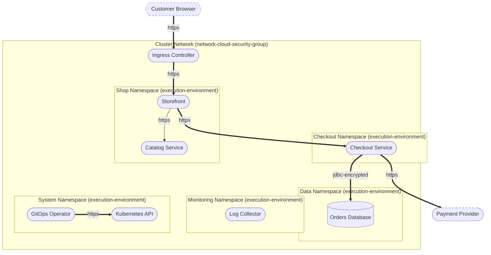

# Threat Model Report: Web Shop on Kubernetes

- **Author:** Jane Doe (jane.doe@example.com)
- **Date:** 7 November 2026
- **Business criticality:** critical
- **Threagile version:** test-version

## Contents

1. [Management Summary](#management-summary)
2. [Impact Analysis of the Initial Risks](#impact-analysis-of-the-initial-risks)
3. [Risk Mitigation](#risk-mitigation)
4. [Impact Analysis of the Remaining Risks](#impact-analysis-of-the-remaining-risks)
5. [Risks by Severity](#risks-by-severity)
6. [Application Overview](#application-overview)
7. [Data-Flow Diagram](#data-flow-diagram)
8. [Asset Register](#asset-register)
9. [STRIDE Classification of Identified Risks](#stride-classification-of-identified-risks)
10. [Assignment by Function](#assignment-by-function)
11. [RAA Analysis](#raa-analysis)
12. [Data Mapping](#data-mapping)
13. [Out-of-Scope Assets](#out-of-scope-assets)
14. [Potential Model Failures](#potential-model-failures)
15. [Identified Risks by Vulnerability Category](#identified-risks-by-vulnerability-category)
16. [Identified Risks by Technical Asset](#identified-risks-by-technical-asset)
17. [Identified Data Breach Probabilities by Data Asset](#identified-data-breach-probabilities-by-data-asset)
18. [Trust Boundaries](#trust-boundaries)
19. [Shared Runtimes](#shared-runtimes)
20. [Communication Links](#communication-links)
21. [Risk Tracking](#risk-tracking)
22. [Threat Catalog Coverage](#threat-catalog-coverage)
23. [Risk Rules Checked by Threagile](#risk-rules-checked-by-threagile)
24. [Ratings](#ratings)
25. [Disclaimer](#disclaimer)

## Management Summary

Threagile toolkit was used to model the architecture of "Web Shop on Kubernetes" and derive risks by analyzing the components and data flows. The risks identified during this analysis are shown in the following chapters. Identified risks during threat modeling do not necessarily mean that the vulnerability associated with this risk actually exists: it is more to be seen as a list of potential risks and threats, which should be individually reviewed and reduced by removing false positives. For the remaining risks it should be checked in the design and implementation of "Web Shop on Kubernetes" whether the mitigation advices have been applied or not.

Each risk finding references a chapter of the OWASP ASVS (Application Security Verification Standard) audit checklist. The OWASP ASVS checklist should be considered as an inspiration by architects and developers to further harden the application in a Defense-in-Depth approach. Additionally, for each risk finding a link towards a matching OWASP Cheat Sheet or similar with technical details about how to implement a mitigation is given.

In total **35 initial risks** in **20 categories** have been identified during the threat modeling process:

| Severity | Risks | Status | Risks |
| --- | ---: | --- | ---: |
| Critical | 0 | Unchecked | 35 |
| High | 0 | In Discussion | 0 |
| Elevated | 9 | Accepted | 0 |
| Medium | 23 | In Progress | 0 |
| Low | 3 | Mitigated | 0 |
|  |  | False Positive | 0 |

## Impact Analysis of the Initial Risks

The most prevalent impacts of the **35 initial risks** (distributed over **20 risk categories**) are (taking the severity ratings into account and using the highest for each category):

- **Elevated**: [Cross-Site Scripting (XSS)](#cross-site-scripting-xss): 1 Initial Risk, exploitation likelihood is _Likely_ with _Medium_ impact

    If this risk remains unmitigated, attackers might be able to access individual victim sessions and steal or modify user data.

- **Elevated**: [Missing Cloud Hardening](#missing-cloud-hardening): 1 Initial Risk, exploitation likelihood is _Unlikely_ with _Very High_ impact

    If this risk is unmitigated, attackers might access cloud components in an unintended way.

- **Elevated**: [Missing Hardening](#missing-hardening): 3 Initial Risks, exploitation likelihood is _Likely_ with _Medium_ impact

    If this risk remains unmitigated, attackers might be able to easier attack high-value targets.

- **Elevated**: [Missing Network Policy](#missing-network-policy): 2 Initial Risks, exploitation likelihood is _Likely_ with _High_ impact

    If this risk is unmitigated, attackers who compromise any pod of the cluster might move on to the workloads of the namespace and their data, or, from a pod of the namespace, to anything it can reach.

- **Elevated**: [SQL/NoSQL-Injection](#sqlnosql-injection): 1 Initial Risk, exploitation likelihood is _Very Likely_ with _Medium_ impact

    If this risk is unmitigated, attackers might be able to modify SQL/NoSQL queries to steal and modify data and eventually further escalate towards a deeper system penetration via code executions.

- **Elevated**: [Server-Side Request Forgery (SSRF)](#server-side-request-forgery-ssrf): 4 Initial Risks, exploitation likelihood is _Likely_ with _Medium_ impact

    If this risk is unmitigated, attackers might be able to access sensitive services or files of network-reachable components by modifying outgoing calls of affected components.

- **Medium**: [Container Base Image Backdooring](#container-base-image-backdooring): 8 Initial Risks, exploitation likelihood is _Unlikely_ with _High_ impact

    If this risk is unmitigated, attackers might be able to deeply persist in the target system by executing code in deployed containers.

- **Medium**: [Container Platform Escape](#container-platform-escape): 1 Initial Risk, exploitation likelihood is _Unlikely_ with _Medium_ impact

    If this risk is unmitigated, attackers which have successfully compromised a container (via other vulnerabilities) might be able to deeply persist in the target system by executing code in many deployed containers and the container platform itself.

- **Medium**: [Cross-Site Request Forgery (CSRF)](#cross-site-request-forgery-csrf): 1 Initial Risk, exploitation likelihood is _Very Likely_ with _Low_ impact

    If this risk remains unmitigated, attackers might be able to trick logged-in victim users into unwanted actions within the web application by visiting an attacker controlled web site.

- **Medium**: [Kubernetes API Write Access](#kubernetes-api-write-access): 1 Initial Risk, exploitation likelihood is _Unlikely_ with _High_ impact

    If this risk is unmitigated, attackers who compromise the workload might run their own workloads in the cluster, read its secrets and take over the other workloads and their data.

- **Medium**: [Long-Lived Credentials](#long-lived-credentials): 1 Initial Risk, exploitation likelihood is _Unlikely_ with _Medium_ impact

    If this risk is unmitigated, attackers who find a leaked secret might use it for a long time to access the target with the permissions of the caller.

- **Medium**: [Missing Build Infrastructure](#missing-build-infrastructure): 1 Initial Risk, exploitation likelihood is _Unlikely_ with _Medium_ impact

    If this risk is unmitigated, attackers might be able to exploit risks unseen in this threat model due to critical build infrastructure components missing in the model.

- **Medium**: [Missing Hardening](#missing-hardening): 3 Initial Risks, exploitation likelihood is _Likely_ with _Medium_ impact

    If this risk remains unmitigated, attackers might be able to easier attack high-value targets.

- **Medium**: [Missing Identity Propagation](#missing-identity-propagation): 1 Initial Risk, exploitation likelihood is _Unlikely_ with _Medium_ impact

    If this risk is unmitigated, attackers might be able to access or modify foreign data after a successful compromise of a component within the system due to missing resource-based authorization checks.

- **Medium**: [Missing Identity Store](#missing-identity-store): 1 Initial Risk, exploitation likelihood is _Unlikely_ with _Medium_ impact

    If this risk is unmitigated, attackers might be able to exploit risks unseen in this threat model in the identity provider/store that is currently missing in the model.

- **Medium**: [Missing Multi-Factor Authentication (MFA)](#missing-multi-factor-authentication-mfa): 1 Initial Risk, exploitation likelihood is _Unlikely_ with _Medium_ impact

    If this risk is unmitigated, attackers might be able to access or modify highly sensitive data without strong authentication.

- **Medium**: [Missing Network Policy](#missing-network-policy): 2 Initial Risks, exploitation likelihood is _Likely_ with _High_ impact

    If this risk is unmitigated, attackers who compromise any pod of the cluster might move on to the workloads of the namespace and their data, or, from a pod of the namespace, to anything it can reach.

- **Medium**: [Missing Network Segmentation](#missing-network-segmentation): 3 Initial Risks, exploitation likelihood is _Unlikely_ with _Medium_ impact

    If this risk is unmitigated, attackers successfully attacking other components of the system might have an easy path towards more valuable targets, as they are not separated by network segmentation.

- **Medium**: [Missing Vault (Secret Storage)](#missing-vault-secret-storage): 1 Initial Risk, exploitation likelihood is _Unlikely_ with _Medium_ impact

    If this risk is unmitigated, attackers might be able to easier steal config secrets (like credentials, private keys, client certificates, etc.) once a vulnerability to access files is present and exploited.

- **Medium**: [Mixed Targets on Shared Runtime](#mixed-targets-on-shared-runtime): 1 Initial Risk, exploitation likelihood is _Unlikely_ with _Medium_ impact

    If this risk is unmitigated, attackers successfully attacking other components of the system might have an easy path towards more valuable targets, as they are running on the same shared runtime.

- **Medium**: [Privileged Workload](#privileged-workload): 1 Initial Risk, exploitation likelihood is _Unlikely_ with _High_ impact

    If this risk is unmitigated, attackers who compromise the workload might take over its node and from there the other workloads of the shared runtime and their data, and possibly the cluster.

- **Low**: [Missing Network Segmentation](#missing-network-segmentation): 3 Initial Risks, exploitation likelihood is _Unlikely_ with _Medium_ impact

    If this risk is unmitigated, attackers successfully attacking other components of the system might have an easy path towards more valuable targets, as they are not separated by network segmentation.

- **Low**: [Unnecessary Technical Asset](#unnecessary-technical-asset): 1 Initial Risk, exploitation likelihood is _Unlikely_ with _Low_ impact

    If this risk is unmitigated, attackers might be able to target unnecessary technical assets.

## Risk Mitigation

The following table gives a high-level overview of the risk tracking status (including mitigated risks):

| Severity | Risks | Unchecked | In Discussion | Accepted | In Progress | Mitigated | False Positive |
| --- | ---: | ---: | ---: | ---: | ---: | ---: | ---: |
| Critical | 0 | 0 | 0 | 0 | 0 | 0 | 0 |
| High | 0 | 0 | 0 | 0 | 0 | 0 | 0 |
| Elevated | 9 | 9 | 0 | 0 | 0 | 0 | 0 |
| Medium | 23 | 23 | 0 | 0 | 0 | 0 | 0 |
| Low | 3 | 3 | 0 | 0 | 0 | 0 | 0 |

After removal of risks with status _mitigated_ and _false positive_ the following **35 remain unmitigated**:

| Severity | Unmitigated risks | To be checked by | Unmitigated risks |
| --- | ---: | --- | ---: |
| Critical | 0 | Business Side | 1 |
| High | 0 | Architecture | 5 |
| Elevated | 9 | Development | 7 |
| Medium | 23 | Operations | 22 |
| Low | 3 |  |  |

## Impact Analysis of the Remaining Risks

The most prevalent impacts of the **35 remaining risks** (distributed over **20 risk categories**) are (taking the severity ratings into account and using the highest for each category):

- **Elevated**: [Cross-Site Scripting (XSS)](#cross-site-scripting-xss): 1 Remaining Risk, exploitation likelihood is _Likely_ with _Medium_ impact

    If this risk remains unmitigated, attackers might be able to access individual victim sessions and steal or modify user data.

- **Elevated**: [Missing Cloud Hardening](#missing-cloud-hardening): 1 Remaining Risk, exploitation likelihood is _Unlikely_ with _Very High_ impact

    If this risk is unmitigated, attackers might access cloud components in an unintended way.

- **Elevated**: [Missing Hardening](#missing-hardening): 3 Remaining Risks, exploitation likelihood is _Likely_ with _Medium_ impact

    If this risk remains unmitigated, attackers might be able to easier attack high-value targets.

- **Elevated**: [Missing Network Policy](#missing-network-policy): 2 Remaining Risks, exploitation likelihood is _Likely_ with _High_ impact

    If this risk is unmitigated, attackers who compromise any pod of the cluster might move on to the workloads of the namespace and their data, or, from a pod of the namespace, to anything it can reach.

- **Elevated**: [SQL/NoSQL-Injection](#sqlnosql-injection): 1 Remaining Risk, exploitation likelihood is _Very Likely_ with _Medium_ impact

    If this risk is unmitigated, attackers might be able to modify SQL/NoSQL queries to steal and modify data and eventually further escalate towards a deeper system penetration via code executions.

- **Elevated**: [Server-Side Request Forgery (SSRF)](#server-side-request-forgery-ssrf): 4 Remaining Risks, exploitation likelihood is _Likely_ with _Medium_ impact

    If this risk is unmitigated, attackers might be able to access sensitive services or files of network-reachable components by modifying outgoing calls of affected components.

- **Medium**: [Container Base Image Backdooring](#container-base-image-backdooring): 8 Remaining Risks, exploitation likelihood is _Unlikely_ with _High_ impact

    If this risk is unmitigated, attackers might be able to deeply persist in the target system by executing code in deployed containers.

- **Medium**: [Container Platform Escape](#container-platform-escape): 1 Remaining Risk, exploitation likelihood is _Unlikely_ with _Medium_ impact

    If this risk is unmitigated, attackers which have successfully compromised a container (via other vulnerabilities) might be able to deeply persist in the target system by executing code in many deployed containers and the container platform itself.

- **Medium**: [Cross-Site Request Forgery (CSRF)](#cross-site-request-forgery-csrf): 1 Remaining Risk, exploitation likelihood is _Very Likely_ with _Low_ impact

    If this risk remains unmitigated, attackers might be able to trick logged-in victim users into unwanted actions within the web application by visiting an attacker controlled web site.

- **Medium**: [Kubernetes API Write Access](#kubernetes-api-write-access): 1 Remaining Risk, exploitation likelihood is _Unlikely_ with _High_ impact

    If this risk is unmitigated, attackers who compromise the workload might run their own workloads in the cluster, read its secrets and take over the other workloads and their data.

- **Medium**: [Long-Lived Credentials](#long-lived-credentials): 1 Remaining Risk, exploitation likelihood is _Unlikely_ with _Medium_ impact

    If this risk is unmitigated, attackers who find a leaked secret might use it for a long time to access the target with the permissions of the caller.

- **Medium**: [Missing Build Infrastructure](#missing-build-infrastructure): 1 Remaining Risk, exploitation likelihood is _Unlikely_ with _Medium_ impact

    If this risk is unmitigated, attackers might be able to exploit risks unseen in this threat model due to critical build infrastructure components missing in the model.

- **Medium**: [Missing Hardening](#missing-hardening): 3 Remaining Risks, exploitation likelihood is _Likely_ with _Medium_ impact

    If this risk remains unmitigated, attackers might be able to easier attack high-value targets.

- **Medium**: [Missing Identity Propagation](#missing-identity-propagation): 1 Remaining Risk, exploitation likelihood is _Unlikely_ with _Medium_ impact

    If this risk is unmitigated, attackers might be able to access or modify foreign data after a successful compromise of a component within the system due to missing resource-based authorization checks.

- **Medium**: [Missing Identity Store](#missing-identity-store): 1 Remaining Risk, exploitation likelihood is _Unlikely_ with _Medium_ impact

    If this risk is unmitigated, attackers might be able to exploit risks unseen in this threat model in the identity provider/store that is currently missing in the model.

- **Medium**: [Missing Multi-Factor Authentication (MFA)](#missing-multi-factor-authentication-mfa): 1 Remaining Risk, exploitation likelihood is _Unlikely_ with _Medium_ impact

    If this risk is unmitigated, attackers might be able to access or modify highly sensitive data without strong authentication.

- **Medium**: [Missing Network Policy](#missing-network-policy): 2 Remaining Risks, exploitation likelihood is _Likely_ with _High_ impact

    If this risk is unmitigated, attackers who compromise any pod of the cluster might move on to the workloads of the namespace and their data, or, from a pod of the namespace, to anything it can reach.

- **Medium**: [Missing Network Segmentation](#missing-network-segmentation): 3 Remaining Risks, exploitation likelihood is _Unlikely_ with _Medium_ impact

    If this risk is unmitigated, attackers successfully attacking other components of the system might have an easy path towards more valuable targets, as they are not separated by network segmentation.

- **Medium**: [Missing Vault (Secret Storage)](#missing-vault-secret-storage): 1 Remaining Risk, exploitation likelihood is _Unlikely_ with _Medium_ impact

    If this risk is unmitigated, attackers might be able to easier steal config secrets (like credentials, private keys, client certificates, etc.) once a vulnerability to access files is present and exploited.

- **Medium**: [Mixed Targets on Shared Runtime](#mixed-targets-on-shared-runtime): 1 Remaining Risk, exploitation likelihood is _Unlikely_ with _Medium_ impact

    If this risk is unmitigated, attackers successfully attacking other components of the system might have an easy path towards more valuable targets, as they are running on the same shared runtime.

- **Medium**: [Privileged Workload](#privileged-workload): 1 Remaining Risk, exploitation likelihood is _Unlikely_ with _High_ impact

    If this risk is unmitigated, attackers who compromise the workload might take over its node and from there the other workloads of the shared runtime and their data, and possibly the cluster.

- **Low**: [Missing Network Segmentation](#missing-network-segmentation): 3 Remaining Risks, exploitation likelihood is _Unlikely_ with _Medium_ impact

    If this risk is unmitigated, attackers successfully attacking other components of the system might have an easy path towards more valuable targets, as they are not separated by network segmentation.

- **Low**: [Unnecessary Technical Asset](#unnecessary-technical-asset): 1 Remaining Risk, exploitation likelihood is _Unlikely_ with _Low_ impact

    If this risk is unmitigated, attackers might be able to target unnecessary technical assets.

## Risks by Severity

All **35 risks** by severity, with their tracking status. Each risk links to its details in the chapter of its category.

### Critical

**0 risks**

_No risks._

### High

**0 risks**

_No risks._

### Elevated

**9 risks**

| Severity | Risk | Category | Most relevant | Status |
| --- | --- | --- | --- | --- |
| Elevated | [**Cross-Site Scripting (XSS)** risk at **Storefront**](#cross-site-scripting-xss) | [Cross-Site Scripting (XSS)](#cross-site-scripting-xss) | [Storefront](#storefront) | Unchecked |
| Elevated | [**Missing Cloud Hardening** risk at **Cluster Network**](#missing-cloud-hardening) | [Missing Cloud Hardening](#missing-cloud-hardening) | none | Unchecked |
| Elevated | [**Missing Hardening** risk at **Checkout Service**](#missing-hardening) | [Missing Hardening](#missing-hardening) | [Checkout Service](#checkout-service) | Unchecked |
| Elevated | [**Missing Network Policy** risk at **Shop Namespace** (no ingress and no egress restriction)](#missing-network-policy) | [Missing Network Policy](#missing-network-policy) | [Shop Namespace](#shop-namespace) | Unchecked |
| Elevated | [**Server-Side Request Forgery (SSRF)** risk at **Checkout Service** server-side web-requesting the target **Payment Provider** via **Payment**](#server-side-request-forgery-ssrf) | [Server-Side Request Forgery (SSRF)](#server-side-request-forgery-ssrf) | [Checkout Service](#checkout-service), [Payment](#payment) | Unchecked |
| Elevated | [**Server-Side Request Forgery (SSRF)** risk at **GitOps Operator** server-side web-requesting the target **Kubernetes API** via **Apply Manifests**](#server-side-request-forgery-ssrf) | [Server-Side Request Forgery (SSRF)](#server-side-request-forgery-ssrf) | [GitOps Operator](#gitops-operator), [Apply Manifests](#apply-manifests) | Unchecked |
| Elevated | [**Server-Side Request Forgery (SSRF)** risk at **Storefront** server-side web-requesting the target **Catalog Service** via **Catalog API**](#server-side-request-forgery-ssrf) | [Server-Side Request Forgery (SSRF)](#server-side-request-forgery-ssrf) | [Storefront](#storefront), [Catalog API](#catalog-api) | Unchecked |
| Elevated | [**Server-Side Request Forgery (SSRF)** risk at **Storefront** server-side web-requesting the target **Checkout Service** via **Checkout API**](#server-side-request-forgery-ssrf) | [Server-Side Request Forgery (SSRF)](#server-side-request-forgery-ssrf) | [Storefront](#storefront), [Checkout API](#checkout-api) | Unchecked |
| Elevated | [**SQL/NoSQL-Injection** risk at **Checkout Service** against database **Orders Database** via **Order Storage**](#sqlnosql-injection) | [SQL/NoSQL-Injection](#sqlnosql-injection) | [Checkout Service](#checkout-service), [Order Storage](#order-storage) | Unchecked |

### Medium

**23 risks**

| Severity | Risk | Category | Most relevant | Status |
| --- | --- | --- | --- | --- |
| Medium | [**Container Base Image Backdooring** risk at **Checkout Service**](#container-base-image-backdooring) | [Container Base Image Backdooring](#container-base-image-backdooring) | [Checkout Service](#checkout-service) | Unchecked |
| Medium | [**Container Base Image Backdooring** risk at **Catalog Service**](#container-base-image-backdooring) | [Container Base Image Backdooring](#container-base-image-backdooring) | [Catalog Service](#catalog-service) | Unchecked |
| Medium | [**Container Base Image Backdooring** risk at **GitOps Operator**](#container-base-image-backdooring) | [Container Base Image Backdooring](#container-base-image-backdooring) | [GitOps Operator](#gitops-operator) | Unchecked |
| Medium | [**Container Base Image Backdooring** risk at **Ingress Controller**](#container-base-image-backdooring) | [Container Base Image Backdooring](#container-base-image-backdooring) | [Ingress Controller](#ingress-controller) | Unchecked |
| Medium | [**Container Base Image Backdooring** risk at **Kubernetes API**](#container-base-image-backdooring) | [Container Base Image Backdooring](#container-base-image-backdooring) | [Kubernetes API](#kubernetes-api) | Unchecked |
| Medium | [**Container Base Image Backdooring** risk at **Log Collector**](#container-base-image-backdooring) | [Container Base Image Backdooring](#container-base-image-backdooring) | [Log Collector](#log-collector) | Unchecked |
| Medium | [**Container Base Image Backdooring** risk at **Orders Database**](#container-base-image-backdooring) | [Container Base Image Backdooring](#container-base-image-backdooring) | [Orders Database](#orders-database) | Unchecked |
| Medium | [**Container Base Image Backdooring** risk at **Storefront**](#container-base-image-backdooring) | [Container Base Image Backdooring](#container-base-image-backdooring) | [Storefront](#storefront) | Unchecked |
| Medium | [**Container Platform Escape** risk at **Kubernetes API**](#container-platform-escape) | [Container Platform Escape](#container-platform-escape) | [Kubernetes API](#kubernetes-api) | Unchecked |
| Medium | [**Cross-Site Request Forgery (CSRF)** risk at **Storefront** via **Storefront Traffic** from **Ingress Controller**](#cross-site-request-forgery-csrf) | [Cross-Site Request Forgery (CSRF)](#cross-site-request-forgery-csrf) | [Storefront](#storefront), [Storefront Traffic](#storefront-traffic) | Unchecked |
| Medium | [**Kubernetes API Write Access** risk at **GitOps Operator** to **Kubernetes API**](#kubernetes-api-write-access) | [Kubernetes API Write Access](#kubernetes-api-write-access) | [GitOps Operator](#gitops-operator), [Apply Manifests](#apply-manifests) | Unchecked |
| Medium | [**Long-Lived Credentials** risk at **Orders Database** used by **Checkout Service** (credentials)](#long-lived-credentials) | [Long-Lived Credentials](#long-lived-credentials) | [Orders Database](#orders-database), [Order Storage](#order-storage) | Unchecked |
| Medium | [**Missing Multi-Factor Authentication** covering communication link **Storefront Traffic** from **Customer Browser** forwarded via **Ingress Controller** to **Storefront**](#missing-multi-factor-authentication-mfa) | [Missing Multi-Factor Authentication (MFA)](#missing-multi-factor-authentication-mfa) | [Storefront](#storefront), [Storefront Traffic](#storefront-traffic) | Unchecked |
| Medium | [**Missing Build Infrastructure** in the threat model (referencing asset **Checkout Service** as an example)](#missing-build-infrastructure) | [Missing Build Infrastructure](#missing-build-infrastructure) | [Checkout Service](#checkout-service) | Unchecked |
| Medium | [**Missing Hardening** risk at **Kubernetes API**](#missing-hardening) | [Missing Hardening](#missing-hardening) | [Kubernetes API](#kubernetes-api) | Unchecked |
| Medium | [**Missing Hardening** risk at **Orders Database**](#missing-hardening) | [Missing Hardening](#missing-hardening) | [Orders Database](#orders-database) | Unchecked |
| Medium | [**Missing End User Identity Propagation** over communication link **Checkout API** from **Storefront** to **Checkout Service**](#missing-identity-propagation) | [Missing Identity Propagation](#missing-identity-propagation) | [Checkout Service](#checkout-service), [Checkout API](#checkout-api) | Unchecked |
| Medium | [**Missing Identity Store** in the threat model (referencing asset **Ingress Controller** as an example)](#missing-identity-store) | [Missing Identity Store](#missing-identity-store) | [Ingress Controller](#ingress-controller) | Unchecked |
| Medium | [**Missing Network Policy** risk at **Checkout Namespace** (no egress restriction)](#missing-network-policy) | [Missing Network Policy](#missing-network-policy) | [Checkout Namespace](#checkout-namespace) | Unchecked |
| Medium | [**Missing Network Segmentation** to further encapsulate and protect **Checkout Service** against unrelated lower protected assets in the same network segment, which might be easier to compromise by attackers](#missing-network-segmentation) | [Missing Network Segmentation](#missing-network-segmentation) | [Checkout Service](#checkout-service) | Unchecked |
| Medium | [**Missing Vault (Secret Storage)** in the threat model (referencing asset **Checkout Service** as an example)](#missing-vault-secret-storage) | [Missing Vault (Secret Storage)](#missing-vault-secret-storage) | [Checkout Service](#checkout-service) | Unchecked |
| Medium | [**Mixed Targets on Shared Runtime** named **Node Pool** might enable attackers moving from one less valuable target to a more valuable one](#mixed-targets-on-shared-runtime) | [Mixed Targets on Shared Runtime](#mixed-targets-on-shared-runtime) | [Node Pool](#node-pool) | Unchecked |
| Medium | [**Privileged Workload** risk at **Log Collector**](#privileged-workload) | [Privileged Workload](#privileged-workload) | [Log Collector](#log-collector) | Unchecked |

### Low

**3 risks**

| Severity | Risk | Category | Most relevant | Status |
| --- | --- | --- | --- | --- |
| Low | [**Missing Network Segmentation** to further encapsulate and protect **Kubernetes API** against unrelated lower protected assets in the same network segment, which might be easier to compromise by attackers](#missing-network-segmentation) | [Missing Network Segmentation](#missing-network-segmentation) | [Kubernetes API](#kubernetes-api) | Unchecked |
| Low | [**Missing Network Segmentation** to further encapsulate and protect **Orders Database** against unrelated lower protected assets in the same network segment, which might be easier to compromise by attackers](#missing-network-segmentation) | [Missing Network Segmentation](#missing-network-segmentation) | [Orders Database](#orders-database) | Unchecked |
| Low | [**Unnecessary Technical Asset** named **Log Collector**](#unnecessary-technical-asset) | [Unnecessary Technical Asset](#unnecessary-technical-asset) | [Log Collector](#log-collector) | Unchecked |

## Application Overview

### Business Criticality

The overall business criticality of "Web Shop on Kubernetes" was rated as:

- archive
- operational
- important
- **critical** (selected)
- mission-critical

### Business Overview

An online shop whose services run in a managed Kubernetes cluster.

### Technical Overview

The shop's services run in namespaces of one cluster on a shared node pool. An ingress controller takes the traffic of the customers, a GitOps operator applies the deployments, and a node agent collects the logs.

## Data-Flow Diagram

The following diagram was generated by Threagile based on the model input and gives a high-level overview of the data-flow between technical assets. The RAA value of each asset, the calculated _Relative Attacker Attractiveness_ in percent, is in the chapter [RAA Analysis](#raa-analysis).

Data-flow diagram of "Web Shop on Kubernetes". A box is an external entity, a stadium a process, a cylinder a datastore and a hexagon a client used by a human; assets out of scope have a dashed border, and the trust boundaries enclose the assets inside them. An arrow points from the asset that initiates a communication link to its target and names the protocol; a thick arrow is a link that also receives data back.

## Asset Register

### Technical Assets

- [Checkout Service](#checkout-service)

    Checkout Service

- [GitOps Operator](#gitops-operator)

    GitOps Operator

- [Storefront](#storefront)

    Storefront

- [Catalog Service](#catalog-service)

    Catalog Service

- [Ingress Controller](#ingress-controller)

    Ingress Controller

- [Kubernetes API](#kubernetes-api)

    Kubernetes API

- [Log Collector](#log-collector)

    Log Collector

- [Orders Database](#orders-database)

    Orders Database

- [Customer Browser](#customer-browser) (out of scope)

    Customer Browser

- [Payment Provider](#payment-provider) (out of scope)

    Payment Provider

### Data Assets

- [Cluster Configuration](#cluster-configuration)

    The manifests of the workloads, applied by the operator

- [Customer Orders](#customer-orders)

    The orders of the customers, with their addresses

- [Payment Tokens](#payment-tokens)

    Tokens of the payment provider for the cards of the customers

- [Product Catalog](#product-catalog)

    The products and their prices

## STRIDE Classification of Identified Risks

This chapter clusters and classifies the risks by STRIDE categories: in total **35 potential risks** have been identified during the threat modeling process.

### Spoofing

**3 risks**

Spoofing - Authenticity

- **Medium**: [Cross-Site Request Forgery (CSRF)](#cross-site-request-forgery-csrf): 1/1 unmitigated Risk, exploitation likelihood is _Very Likely_ with _Low_ impact

    When a web application is accessed via web protocols Cross-Site Request Forgery (CSRF) risks might arise.

- **Medium**: [Long-Lived Credentials](#long-lived-credentials): 1/1 unmitigated Risk, exploitation likelihood is _Unlikely_ with _Medium_ impact

    Passwords of service accounts, API keys and personal access tokens stay valid for months or for good. Once one leaks, from a repository, a log, a build system or a laptop, it lets anyone in until someone notices and rotates it.

- **Medium**: [Missing Identity Store](#missing-identity-store): 1/1 unmitigated Risk, exploitation likelihood is _Unlikely_ with _Medium_ impact

    The modeled architecture does not contain an identity store, which might be the risk of a model missing critical assets (and thus not seeing their risks).

### Tampering

**15 risks**

Tampering - Integrity

- **Elevated**: [Cross-Site Scripting (XSS)](#cross-site-scripting-xss): 1/1 unmitigated Risk, exploitation likelihood is _Likely_ with _Medium_ impact

    For each web application Cross-Site Scripting (XSS) risks might arise. In terms of the overall risk level take other applications running on the same domain into account as well.

- **Elevated**: [Missing Cloud Hardening](#missing-cloud-hardening): 1/1 unmitigated Risk, exploitation likelihood is _Unlikely_ with _Very High_ impact

    Cloud components should be hardened according to the cloud vendor best practices. This affects their configuration, auditing, and further areas.

- **Elevated**: [Missing Hardening](#missing-hardening): 3/3 unmitigated Risks, exploitation likelihood is _Likely_ with _Medium_ impact

    Technical assets with a Relative Attacker Attractiveness (RAA) value of 55 % or higher should be explicitly hardened taking best practices and vendor hardening guides into account.

- **Elevated**: [SQL/NoSQL-Injection](#sqlnosql-injection): 1/1 unmitigated Risk, exploitation likelihood is _Very Likely_ with _Medium_ impact

    When a database is accessed via database access protocols SQL/NoSQL-Injection risks might arise. The risk rating depends on the sensitivity technical asset itself and of the data assets processed.

- **Medium**: [Container Base Image Backdooring](#container-base-image-backdooring): 8/8 unmitigated Risks, exploitation likelihood is _Unlikely_ with _High_ impact

    When a technical asset is built using container technologies, Base Image Backdooring risks might arise where base images and other layers used contain vulnerable components or backdoors.

- **Medium**: [Missing Build Infrastructure](#missing-build-infrastructure): 1/1 unmitigated Risk, exploitation likelihood is _Unlikely_ with _Medium_ impact

    The modeled architecture does not contain a build infrastructure (devops-client, sourcecode-repo, build-pipeline, etc.), which might be the risk of a model missing critical assets (and thus not seeing their risks). If the architecture contains custom-developed parts, the pipeline where code gets developed and built needs to be part of the model.

- **Medium**: [Missing Hardening](#missing-hardening): 3/3 unmitigated Risks, exploitation likelihood is _Likely_ with _Medium_ impact

    Technical assets with a Relative Attacker Attractiveness (RAA) value of 55 % or higher should be explicitly hardened taking best practices and vendor hardening guides into account.

### Repudiation

**0 risks**

Repudiation - Non-repudiability

_No risks were identified._

### Information Disclosure

**5 risks**

Information disclosure - Confidentiality

- **Elevated**: [Server-Side Request Forgery (SSRF)](#server-side-request-forgery-ssrf): 4/4 unmitigated Risks, exploitation likelihood is _Likely_ with _Medium_ impact

    When a server system (i.e. not a client) is accessing other server systems via typical web protocols Server-Side Request Forgery (SSRF) or Local-File-Inclusion (LFI) or Remote-File-Inclusion (RFI) risks might arise.

- **Medium**: [Missing Vault (Secret Storage)](#missing-vault-secret-storage): 1/1 unmitigated Risk, exploitation likelihood is _Unlikely_ with _Medium_ impact

    In order to avoid the risk of secret leakage via config files (when attacked through vulnerabilities being able to read files like Path-Traversal and others), it is best practice to use a separate hardened process with proper authentication, authorization, and audit logging to access config secrets (like credentials, private keys, client certificates, etc.). This component is usually some kind of Vault.

### Denial of Service

**0 risks**

Denial of service - Availability

_No risks were identified._

### Elevation of Privilege

**12 risks**

Elevation of privilege - Authorization

- **Elevated**: [Missing Network Policy](#missing-network-policy): 2/2 unmitigated Risks, exploitation likelihood is _Likely_ with _High_ impact

    Without network policies, every pod of a Kubernetes cluster can reach the pods of a namespace, and its pods can reach the rest of the cluster and beyond: the namespace separates names, not traffic.

- **Medium**: [Container Platform Escape](#container-platform-escape): 1/1 unmitigated Risk, exploitation likelihood is _Unlikely_ with _Medium_ impact

    Container platforms are especially interesting targets for attackers as they host big parts of a containerized runtime infrastructure. When not configured and operated with security best practices in mind, attackers might exploit a vulnerability inside an container and escape towards the platform as highly privileged users. These scenarios might give attackers capabilities to attack every other container as owning the container platform (via container escape attacks) equals to owning every container.

- **Medium**: [Kubernetes API Write Access](#kubernetes-api-write-access): 1/1 unmitigated Risk, exploitation likelihood is _Unlikely_ with _High_ impact

    A workload whose service account may change resources through the API of its cluster, even narrowly, like creating pods, reading secrets or patching deployments, hands that power to whoever compromises the workload: a pod created with a mounted host path, or a secret read, opens the rest of the cluster.

- **Medium**: [Missing Identity Propagation](#missing-identity-propagation): 1/1 unmitigated Risk, exploitation likelihood is _Unlikely_ with _Medium_ impact

    Technical assets (especially multi-tenant systems), which usually process data for end users should authorize every request based on the identity of the end user when the data flow is authenticated (i.e. non-public). For DevOps usages at least the identity of a service account or a workload is required.

- **Medium**: [Missing Multi-Factor Authentication (MFA)](#missing-multi-factor-authentication-mfa): 1/1 unmitigated Risk, exploitation likelihood is _Unlikely_ with _Medium_ impact

    Technical assets (especially multi-tenant systems) should authenticate incoming requests with multi-factor (MFA) authentication when the asset processes or stores highly sensitive data (in terms of confidentiality, integrity, and availability) and is accessed by humans.

- **Medium**: [Missing Network Policy](#missing-network-policy): 2/2 unmitigated Risks, exploitation likelihood is _Likely_ with _High_ impact

    Without network policies, every pod of a Kubernetes cluster can reach the pods of a namespace, and its pods can reach the rest of the cluster and beyond: the namespace separates names, not traffic.

- **Medium**: [Missing Network Segmentation](#missing-network-segmentation): 3/3 unmitigated Risks, exploitation likelihood is _Unlikely_ with _Medium_ impact

    Highly sensitive assets and/or data stores residing in the same network segment than other lower sensitive assets (like webservers or content management systems etc.) should be better protected by a network segmentation trust-boundary.

- **Medium**: [Mixed Targets on Shared Runtime](#mixed-targets-on-shared-runtime): 1/1 unmitigated Risk, exploitation likelihood is _Unlikely_ with _Medium_ impact

    Different attacker targets (like frontend and backend/datastore components) should not be running on the same shared (underlying) runtime.

- **Medium**: [Privileged Workload](#privileged-workload): 1/1 unmitigated Risk, exploitation likelihood is _Unlikely_ with _High_ impact

    A workload that runs as a privileged container, mounts a path of its node or shares the node's network, process or IPC namespace is not contained by its container: whoever controls the workload controls the node, the other workloads on it and the credentials of the node's kubelet.

- **Low**: [Missing Network Segmentation](#missing-network-segmentation): 3/3 unmitigated Risks, exploitation likelihood is _Unlikely_ with _Medium_ impact

    Highly sensitive assets and/or data stores residing in the same network segment than other lower sensitive assets (like webservers or content management systems etc.) should be better protected by a network segmentation trust-boundary.

- **Low**: [Unnecessary Technical Asset](#unnecessary-technical-asset): 1/1 unmitigated Risk, exploitation likelihood is _Unlikely_ with _Low_ impact

    When a technical asset does not process any data assets, this is an indicator for an unnecessary technical asset (or for an incomplete model). This is also the case if the asset has no communication links (either outgoing or incoming).

## Assignment by Function

This chapter clusters and assigns the risks by functions which are most likely able to check and mitigate them: in total **35 potential risks** have been identified during the threat modeling process.

### Business Side

**1 risk**

Business

- **Medium**: [Missing Multi-Factor Authentication (MFA)](#missing-multi-factor-authentication-mfa): 1/1 unmitigated Risk, exploitation likelihood is _Unlikely_ with _Medium_ impact

    Apply an authentication method to the technical asset protecting highly sensitive data via multi-factor authentication for human users.

### Architecture

**5 risks**

Architecture

- **Medium**: [Missing Build Infrastructure](#missing-build-infrastructure): 1/1 unmitigated Risk, exploitation likelihood is _Unlikely_ with _Medium_ impact

    Include the build infrastructure in the model.

- **Medium**: [Missing Identity Propagation](#missing-identity-propagation): 1/1 unmitigated Risk, exploitation likelihood is _Unlikely_ with _Medium_ impact

    When processing requests for end users if possible authorize in the backend against the propagated identity of the end user. This can be achieved in passing JWTs or similar tokens and checking them in the backend services, and model the link with the identity _end-user_. For DevOps usages pass at least the identity of a service account or a workload.

- **Medium**: [Missing Identity Store](#missing-identity-store): 1/1 unmitigated Risk, exploitation likelihood is _Unlikely_ with _Medium_ impact

    Include an identity store in the model if the application has a login.

- **Medium**: [Missing Vault (Secret Storage)](#missing-vault-secret-storage): 1/1 unmitigated Risk, exploitation likelihood is _Unlikely_ with _Medium_ impact

    Consider using a Vault (Secret Storage) to securely store and access config secrets (like credentials, private keys, client certificates, etc.).

- **Low**: [Unnecessary Technical Asset](#unnecessary-technical-asset): 1/1 unmitigated Risk, exploitation likelihood is _Unlikely_ with _Low_ impact

    Try to avoid using technical assets that do not process or store anything.

### Development

**7 risks**

Development

- **Elevated**: [Cross-Site Scripting (XSS)](#cross-site-scripting-xss): 1/1 unmitigated Risk, exploitation likelihood is _Likely_ with _Medium_ impact

    Try to encode all values sent back to the browser and also handle DOM-manipulations in a safe way to avoid DOM-based XSS. When a third-party product is used instead of custom developed software, check if the product applies the proper mitigation and ensure a reasonable patch-level.

- **Elevated**: [SQL/NoSQL-Injection](#sqlnosql-injection): 1/1 unmitigated Risk, exploitation likelihood is _Very Likely_ with _Medium_ impact

    Try to use parameter binding to be safe from injection vulnerabilities. When a third-party product is used instead of custom developed software, check if the product applies the proper mitigation and ensure a reasonable patch-level.

- **Elevated**: [Server-Side Request Forgery (SSRF)](#server-side-request-forgery-ssrf): 4/4 unmitigated Risks, exploitation likelihood is _Likely_ with _Medium_ impact

    Try to avoid constructing the outgoing target URL with caller controllable values. Alternatively use a mapping (whitelist) when accessing outgoing URLs instead of creating them including caller controllable values. When a third-party product is used instead of custom developed software, check if the product applies the proper mitigation and ensure a reasonable patch-level.

- **Medium**: [Cross-Site Request Forgery (CSRF)](#cross-site-request-forgery-csrf): 1/1 unmitigated Risk, exploitation likelihood is _Very Likely_ with _Low_ impact

    Try to use anti-CSRF tokens ot the double-submit patterns (at least for logged-in requests). When your authentication scheme depends on cookies (like session or token cookies), consider marking them with the same-site flag. When a third-party product is used instead of custom developed software, check if the product applies the proper mitigation and ensure a reasonable patch-level.

### Operations

**22 risks**

Operations

- **Elevated**: [Missing Cloud Hardening](#missing-cloud-hardening): 1/1 unmitigated Risk, exploitation likelihood is _Unlikely_ with _Very High_ impact

    Apply hardening of all cloud components and services, taking special care to follow the individual risk descriptions (which depend on the cloud provider tags in the model).

- **Elevated**: [Missing Hardening](#missing-hardening): 3/3 unmitigated Risks, exploitation likelihood is _Likely_ with _Medium_ impact

    Try to apply all hardening best practices (like CIS benchmarks, OWASP recommendations, vendor recommendations, DevSec Hardening Framework, DBSAT for Oracle databases, and others).

- **Elevated**: [Missing Network Policy](#missing-network-policy): 2/2 unmitigated Risks, exploitation likelihood is _Likely_ with _High_ impact

    Deny all ingress and egress traffic of the namespace by default with a network policy, allow only the traffic that its workloads need, by namespace and pod labels and ports, and make sure the network plugin of the cluster enforces network policies. Model the namespace with the network_policy _ingress-and-egress_ once they are in place.

- **Medium**: [Container Base Image Backdooring](#container-base-image-backdooring): 8/8 unmitigated Risks, exploitation likelihood is _Unlikely_ with _High_ impact

    Apply hardening of all container infrastructures (see for example the _CIS-Benchmarks for Docker and Kubernetes_ and the _Docker Bench for Security_). Use only trusted base images of the original vendors, verify digital signatures and apply image creation best practices. Also consider using Google's _Distroless_ base images or otherwise very small base images. Regularly execute container image scans with tools checking the layers for vulnerable components.

- **Medium**: [Container Platform Escape](#container-platform-escape): 1/1 unmitigated Risk, exploitation likelihood is _Unlikely_ with _Medium_ impact

    Apply hardening of all container infrastructures.

- **Medium**: [Kubernetes API Write Access](#kubernetes-api-write-access): 1/1 unmitigated Risk, exploitation likelihood is _Unlikely_ with _High_ impact

    Give the workload a service account of its own, bound to a role in its namespace with only the verbs and resources it uses (no create on pods, no get on secrets, no wildcards), disable the mounting of its token where it does not call the API, and leave changes to the cluster to the deployment pipeline or an operator on nodes of its own.

- **Medium**: [Long-Lived Credentials](#long-lived-credentials): 1/1 unmitigated Risk, exploitation likelihood is _Unlikely_ with _Medium_ impact

    Replace static secrets between services with a workload identity issued by the platform (cloud IAM roles, Kubernetes service account tokens, SPIFFE), or with short-lived tokens obtained through OAuth 2.0 client credentials or token exchange, and model the link with the identity _workload_ or the authentication _short-lived-token_. Where a long-lived secret remains, keep it in a vault, scope it narrowly, rotate it automatically and detect its use from unexpected places.

- **Medium**: [Missing Hardening](#missing-hardening): 3/3 unmitigated Risks, exploitation likelihood is _Likely_ with _Medium_ impact

    Try to apply all hardening best practices (like CIS benchmarks, OWASP recommendations, vendor recommendations, DevSec Hardening Framework, DBSAT for Oracle databases, and others).

- **Medium**: [Missing Network Policy](#missing-network-policy): 2/2 unmitigated Risks, exploitation likelihood is _Likely_ with _High_ impact

    Deny all ingress and egress traffic of the namespace by default with a network policy, allow only the traffic that its workloads need, by namespace and pod labels and ports, and make sure the network plugin of the cluster enforces network policies. Model the namespace with the network_policy _ingress-and-egress_ once they are in place.

- **Medium**: [Missing Network Segmentation](#missing-network-segmentation): 3/3 unmitigated Risks, exploitation likelihood is _Unlikely_ with _Medium_ impact

    Apply a network segmentation trust-boundary around the highly sensitive assets and/or data stores.

- **Medium**: [Mixed Targets on Shared Runtime](#mixed-targets-on-shared-runtime): 1/1 unmitigated Risk, exploitation likelihood is _Unlikely_ with _Medium_ impact

    Use separate runtime environments for running different target components or apply similar separation styles to prevent load- or breach-related problems originating from one more attacker-facing asset impacts also the other more critical rated backend/datastore assets.

- **Medium**: [Privileged Workload](#privileged-workload): 1/1 unmitigated Risk, exploitation likelihood is _Unlikely_ with _High_ impact

    Run the workload unprivileged, as a non-root user with a read-only root file system, without host paths, host namespaces and added capabilities, and enforce the restricted Pod Security Standard on its namespace. A workload that must stay privileged, like a node agent, belongs on nodes of its own and deserves the hardening of the node itself.

- **Low**: [Missing Network Segmentation](#missing-network-segmentation): 3/3 unmitigated Risks, exploitation likelihood is _Unlikely_ with _Medium_ impact

    Apply a network segmentation trust-boundary around the highly sensitive assets and/or data stores.

## RAA Analysis

For each technical asset the **"Relative Attacker Attractiveness"** (RAA) value was calculated in percent. The higher the RAA, the more interesting it is for an attacker to compromise the asset. The calculation algorithm takes the sensitivity ratings and quantities of stored and processed data into account as well as the communication links of the technical asset. Neighbouring assets to high-value RAA targets might receive an increase in their RAA value when they have a communication link towards that target ("Pivoting-Factor").

The following lists all technical assets sorted by their RAA value from highest (most attacker attractive) to lowest. This list can be used to prioritize on efforts relevant for the most attacker-attractive technical assets:

- [Kubernetes API](#kubernetes-api): RAA 100 %, highest severity still at risk: **Medium**

    Kubernetes API

- [Checkout Service](#checkout-service): RAA 90 %, highest severity still at risk: **Elevated**

    Checkout Service

- [Storefront](#storefront): RAA 51 %, highest severity still at risk: **Elevated**

    Storefront

- [Orders Database](#orders-database): RAA 50 %, highest severity still at risk: **Medium**

    Orders Database

- [GitOps Operator](#gitops-operator): RAA 33 %, highest severity still at risk: **Elevated**

    GitOps Operator

- [Ingress Controller](#ingress-controller): RAA 11 %, highest severity still at risk: **Medium**

    Ingress Controller

- [Catalog Service](#catalog-service): RAA 11 %, highest severity still at risk: **Medium**

    Catalog Service

- [Log Collector](#log-collector): RAA 2 %, highest severity still at risk: **Medium**

    Log Collector

## Data Mapping

The following table and diagram were generated by Threagile based on the model input and give a high-level distribution of data assets across technical assets, with the data breach probability still at risk of each data asset (see the chapter [Identified Data Breach Probabilities by Data Asset](#identified-data-breach-probabilities-by-data-asset)).

| Data asset | Data breach | Stored by | Processed by |
| --- | --- | --- | --- |
| [Cluster Configuration](#cluster-configuration) | Probable | none | [GitOps Operator](#gitops-operator), [Kubernetes API](#kubernetes-api) |
| [Customer Orders](#customer-orders) | Probable | none | [Checkout Service](#checkout-service), [Customer Browser](#customer-browser), [Ingress Controller](#ingress-controller), [Orders Database](#orders-database), [Storefront](#storefront) |
| [Payment Tokens](#payment-tokens) | Probable | none | [Checkout Service](#checkout-service), [Payment Provider](#payment-provider) |
| [Product Catalog](#product-catalog) | Probable | none | [Catalog Service](#catalog-service), [Customer Browser](#customer-browser), [Ingress Controller](#ingress-controller), [Log Collector](#log-collector), [Storefront](#storefront) |

_No technical asset stores a data asset._

## Out-of-Scope Assets

**2 assets**

This chapter lists all technical assets that have been defined as out-of-scope. Each one should be checked in the model whether it should better be included in the overall risk analysis:

- [Customer Browser](#customer-browser) (out of scope)

    Missing out of scope justification.

- [Payment Provider](#payment-provider) (out of scope)

    Missing out of scope justification.

## Potential Model Failures

**4 of 4 unmitigated**

This chapter lists potential model failures where not all relevant assets have been modeled or the model might itself contain inconsistencies. Each potential model failure should be checked in the model against the architecture design:

- **Medium**: [Missing Build Infrastructure](#missing-build-infrastructure): 1/1 unmitigated Risk, exploitation likelihood is _Unlikely_ with _Medium_ impact

    The modeled architecture does not contain a build infrastructure (devops-client, sourcecode-repo, build-pipeline, etc.), which might be the risk of a model missing critical assets (and thus not seeing their risks). If the architecture contains custom-developed parts, the pipeline where code gets developed and built needs to be part of the model.

- **Medium**: [Missing Identity Store](#missing-identity-store): 1/1 unmitigated Risk, exploitation likelihood is _Unlikely_ with _Medium_ impact

    The modeled architecture does not contain an identity store, which might be the risk of a model missing critical assets (and thus not seeing their risks).

- **Medium**: [Missing Vault (Secret Storage)](#missing-vault-secret-storage): 1/1 unmitigated Risk, exploitation likelihood is _Unlikely_ with _Medium_ impact

    In order to avoid the risk of secret leakage via config files (when attacked through vulnerabilities being able to read files like Path-Traversal and others), it is best practice to use a separate hardened process with proper authentication, authorization, and audit logging to access config secrets (like credentials, private keys, client certificates, etc.). This component is usually some kind of Vault.

- **Low**: [Unnecessary Technical Asset](#unnecessary-technical-asset): 1/1 unmitigated Risk, exploitation likelihood is _Unlikely_ with _Low_ impact

    When a technical asset does not process any data assets, this is an indicator for an unnecessary technical asset (or for an incomplete model). This is also the case if the asset has no communication links (either outgoing or incoming).

## Identified Risks by Vulnerability Category

In total **35 potential risks** have been identified during the threat modeling process, distributed across **20 vulnerability categories**. The following sections describe each identified risk category and its risks.

### Cross-Site Scripting (XSS)

**Elevated** · 1/1 unmitigated Risk · `cross-site-scripting`

| Property | Value |
| --- | --- |
| STRIDE | Tampering |
| CWE | [CWE 79](https://cwe.mitre.org/data/definitions/79.html) |
| Function | Development |
| Action | XSS Prevention |
| ASVS chapter | V5 - Validation, Sanitization and Encoding Verification Requirements |
| Cheat sheet | [Cross_Site_Scripting_Prevention_Cheat_Sheet](https://cheatsheetseries.owasp.org/cheatsheets/Cross_Site_Scripting_Prevention_Cheat_Sheet.html) |
| References | OWASP A05:2025 Injection |

#### Description

For each web application Cross-Site Scripting (XSS) risks might arise. In terms of the overall risk level take other applications running on the same domain into account as well.

#### Impact

If this risk remains unmitigated, attackers might be able to access individual victim sessions and steal or modify user data.

#### Detection Logic

In-scope web applications.

#### Risk Rating

The risk rating depends on the sensitivity of the data processed in the web application.

#### False Positives

When the technical asset is not accessed via a browser-like component (i.e not by a human user initiating the request that gets passed through all components until it reaches the web application) this can be considered a false positive.

#### Mitigation

Try to encode all values sent back to the browser and also handle DOM-manipulations in a safe way to avoid DOM-based XSS. When a third-party product is used instead of custom developed software, check if the product applies the proper mitigation and ensure a reasonable patch-level.

#### Check

Are recommendations from the linked cheat sheet and referenced ASVS chapter applied?

#### Risk Findings

The risk **Cross-Site Scripting (XSS)** was found **1 time** in the analyzed architecture to be potentially possible. Each spot should be checked individually by reviewing the implementation whether all controls have been applied properly in order to mitigate each risk.

| Severity | Risk | ID | Likelihood | Impact | Most relevant | Status | Tracking |
| --- | --- | --- | --- | --- | --- | --- | --- |
| Elevated | **Cross-Site Scripting (XSS)** risk at **Storefront** | `cross-site-scripting@storefront` | Likely | Medium | [Storefront](#storefront) | Unchecked | _not tracked_ |

### Missing Cloud Hardening

**Elevated** · 1/1 unmitigated Risk · `missing-cloud-hardening`

| Property | Value |
| --- | --- |
| STRIDE | Tampering |
| CWE | [CWE 1008](https://cwe.mitre.org/data/definitions/1008.html) |
| Function | Operations |
| Action | Cloud Hardening |
| ASVS chapter | V1 - Architecture, Design and Threat Modeling Requirements |
| Cheat sheet | [Attack_Surface_Analysis_Cheat_Sheet](https://cheatsheetseries.owasp.org/cheatsheets/Attack_Surface_Analysis_Cheat_Sheet.html) |
| References | OWASP A02:2025 Security Misconfiguration; OWASP API8:2023 Security Misconfiguration |

#### Description

Cloud components should be hardened according to the cloud vendor best practices. This affects their configuration, auditing, and further areas.

#### Impact

If this risk is unmitigated, attackers might access cloud components in an unintended way.

#### Detection Logic

In-scope cloud components (either residing in cloud trust boundaries or more specifically tagged with cloud provider types).

#### Risk Rating

The risk rating depends on the sensitivity of the technical asset itself and of the data assets processed.

#### False Positives

Cloud components not running parts of the target architecture can be considered as false positives after individual review.

#### Mitigation

Apply hardening of all cloud components and services, taking special care to follow the individual risk descriptions (which depend on the cloud provider tags in the model).

For **Amazon Web Services (AWS)**: Follow the _CIS Benchmark for Amazon Web Services_ (see also the automated checks of cloud audit tools like _"PacBot", "CloudSploit", "CloudMapper", "ScoutSuite", or "Prowler AWS CIS Benchmark Tool"_).

For EC2 and other servers running Amazon Linux, follow the _CIS Benchmark for Amazon Linux_ and switch to IMDSv2.

For S3 buckets follow the _Security Best Practices for Amazon S3_ at [https://docs.aws.amazon.com/AmazonS3/latest/dev/security-best-practices.html](https://docs.aws.amazon.com/AmazonS3/latest/dev/security-best-practices.html) to avoid accidental leakage.

Also take a look at some of these tools: [https://github.com/toniblyx/my-arsenal-of-aws-security-tools](https://github.com/toniblyx/my-arsenal-of-aws-security-tools)

For **Microsoft Azure**: Follow the _CIS Benchmark for Microsoft Azure_ (see also the automated checks of cloud audit tools like _"CloudSploit" or "ScoutSuite"_).

For **Google Cloud Platform**: Follow the _CIS Benchmark for Google Cloud Computing Platform_ (see also the automated checks of cloud audit tools like _"CloudSploit" or "ScoutSuite"_).

For **Oracle Cloud Platform**: Follow the hardening best practices (see also the automated checks of cloud audit tools like _"CloudSploit"_).

#### Check

Are recommendations from the linked cheat sheet and referenced ASVS chapter applied?

#### Risk Findings

The risk **Missing Cloud Hardening** was found **1 time** in the analyzed architecture to be potentially possible. Each spot should be checked individually by reviewing the implementation whether all controls have been applied properly in order to mitigate each risk.

| Severity | Risk | ID | Likelihood | Impact | Most relevant | Status | Tracking |
| --- | --- | --- | --- | --- | --- | --- | --- |
| Elevated | **Missing Cloud Hardening** risk at **Cluster Network** | `missing-cloud-hardening@cluster-network` | Unlikely | Very High | none | Unchecked | _not tracked_ |

### Missing Hardening

**Elevated** · 3/3 unmitigated Risks · `missing-hardening`

| Property | Value |
| --- | --- |
| STRIDE | Tampering |
| CWE | [CWE 16](https://cwe.mitre.org/data/definitions/16.html) |
| Function | Operations |
| Action | System Hardening |
| ASVS chapter | V14 - Configuration Verification Requirements |
| Cheat sheet | [Attack_Surface_Analysis_Cheat_Sheet](https://cheatsheetseries.owasp.org/cheatsheets/Attack_Surface_Analysis_Cheat_Sheet.html) |
| References | OWASP A02:2025 Security Misconfiguration; OWASP API8:2023 Security Misconfiguration |

#### Description

Technical assets with a Relative Attacker Attractiveness (RAA) value of 55 % or higher should be explicitly hardened taking best practices and vendor hardening guides into account.

#### Impact

If this risk remains unmitigated, attackers might be able to easier attack high-value targets.

#### Detection Logic

In-scope technical assets with RAA values of 55 % or higher. Generally for high-value targets like data stores, application servers, identity providers and ERP systems this limit is reduced to 40 %

#### Risk Rating

The risk rating depends on the sensitivity of the data processed in the technical asset.

#### False Positives

Usually no false positives.

#### Mitigation

Try to apply all hardening best practices (like CIS benchmarks, OWASP recommendations, vendor recommendations, DevSec Hardening Framework, DBSAT for Oracle databases, and others).

#### Check

Are recommendations from the linked cheat sheet and referenced ASVS chapter applied?

#### Risk Findings

The risk **Missing Hardening** was found **3 times** in the analyzed architecture to be potentially possible. Each spot should be checked individually by reviewing the implementation whether all controls have been applied properly in order to mitigate each risk.

| Severity | Risk | ID | Likelihood | Impact | Most relevant | Status | Tracking |
| --- | --- | --- | --- | --- | --- | --- | --- |
| Elevated | **Missing Hardening** risk at **Checkout Service** | `missing-hardening@checkout-service` | Likely | Medium | [Checkout Service](#checkout-service) | Unchecked | _not tracked_ |
| Medium | **Missing Hardening** risk at **Kubernetes API** | `missing-hardening@kube-api` | Likely | Low | [Kubernetes API](#kubernetes-api) | Unchecked | _not tracked_ |
| Medium | **Missing Hardening** risk at **Orders Database** | `missing-hardening@orders-db` | Likely | Low | [Orders Database](#orders-database) | Unchecked | _not tracked_ |

### Missing Network Policy

**Elevated** · 2/2 unmitigated Risks · `missing-network-policy`

| Property | Value |
| --- | --- |
| STRIDE | Elevation of Privilege |
| CWE | [CWE 923](https://cwe.mitre.org/data/definitions/923.html) |
| Function | Operations |
| Action | Network Segmentation of Namespaces |
| ASVS chapter | V1 - Architecture, Design and Threat Modeling Requirements |
| Cheat sheet | [Kubernetes_Security_Cheat_Sheet](https://cheatsheetseries.owasp.org/cheatsheets/Kubernetes_Security_Cheat_Sheet.html) |
| References | OWASP K05:2025 Missing Network Segmentation Controls; OWASP A02:2025 Security Misconfiguration |

#### Description

Without network policies, every pod of a Kubernetes cluster can reach the pods of a namespace, and its pods can reach the rest of the cluster and beyond: the namespace separates names, not traffic.

#### Impact

If this risk is unmitigated, attackers who compromise any pod of the cluster might move on to the workloads of the namespace and their data, or, from a pod of the namespace, to anything it can reach.

#### Detection Logic

Execution environment trust boundaries (Kubernetes namespaces) whose network_policy is _none_, _ingress_ or _egress_, holding in-scope technical assets that process or store data rated at least as confidential or critical. Namespaces whose network policy is not modelled are skipped.

#### Risk Rating

The risk rating depends on the most sensitive technical asset in the namespace. The attack is likely when incoming traffic is not restricted, and unlikely when only outgoing traffic is not.

#### False Positives

Namespaces whose traffic a service mesh restricts by default, with authorization policies that allow only the intended callers, can be considered as false positives after individual review.

#### Mitigation

Deny all ingress and egress traffic of the namespace by default with a network policy, allow only the traffic that its workloads need, by namespace and pod labels and ports, and make sure the network plugin of the cluster enforces network policies. Model the namespace with the network_policy _ingress-and-egress_ once they are in place.

#### Check

Are recommendations from the linked cheat sheet and referenced ASVS chapter applied?

#### Risk Findings

The risk **Missing Network Policy** was found **2 times** in the analyzed architecture to be potentially possible. Each spot should be checked individually by reviewing the implementation whether all controls have been applied properly in order to mitigate each risk.

| Severity | Risk | ID | Likelihood | Impact | Most relevant | Status | Tracking |
| --- | --- | --- | --- | --- | --- | --- | --- |
| Elevated | **Missing Network Policy** risk at **Shop Namespace** (no ingress and no egress restriction) | `missing-network-policy@shop-namespace` | Likely | Medium | [Shop Namespace](#shop-namespace) | Unchecked | _not tracked_ |
| Medium | **Missing Network Policy** risk at **Checkout Namespace** (no egress restriction) | `missing-network-policy@checkout-namespace` | Unlikely | High | [Checkout Namespace](#checkout-namespace) | Unchecked | _not tracked_ |

### SQL/NoSQL-Injection

**Elevated** · 1/1 unmitigated Risk · `sql-nosql-injection`

| Property | Value |
| --- | --- |
| STRIDE | Tampering |
| CWE | [CWE 89](https://cwe.mitre.org/data/definitions/89.html) |
| Function | Development |
| Action | SQL/NoSQL-Injection Prevention |
| ASVS chapter | V5 - Validation, Sanitization and Encoding Verification Requirements |
| Cheat sheet | [SQL_Injection_Prevention_Cheat_Sheet](https://cheatsheetseries.owasp.org/cheatsheets/SQL_Injection_Prevention_Cheat_Sheet.html) |
| References | OWASP A05:2025 Injection |

#### Description

When a database is accessed via database access protocols SQL/NoSQL-Injection risks might arise. The risk rating depends on the sensitivity technical asset itself and of the data assets processed.

#### Impact

If this risk is unmitigated, attackers might be able to modify SQL/NoSQL queries to steal and modify data and eventually further escalate towards a deeper system penetration via code executions.

#### Detection Logic

In-scope datastores accessed via typical database access protocols, and databases accessed via HTTP or binary protocols as well (like NoSQL databases with a REST interface).

#### Risk Rating

The risk rating depends on the sensitivity of the data stored inside the database.

#### False Positives

Database accesses by queries not consisting of parts controllable by the caller can be considered as false positives after individual review.

#### Mitigation

Try to use parameter binding to be safe from injection vulnerabilities. When a third-party product is used instead of custom developed software, check if the product applies the proper mitigation and ensure a reasonable patch-level.

#### Check

Are recommendations from the linked cheat sheet and referenced ASVS chapter applied?

#### Risk Findings

The risk **SQL/NoSQL-Injection** was found **1 time** in the analyzed architecture to be potentially possible. Each spot should be checked individually by reviewing the implementation whether all controls have been applied properly in order to mitigate each risk.

| Severity | Risk | ID | Likelihood | Impact | Most relevant | Status | Tracking |
| --- | --- | --- | --- | --- | --- | --- | --- |
| Elevated | **SQL/NoSQL-Injection** risk at **Checkout Service** against database **Orders Database** via **Order Storage** | `sql-nosql-injection@checkout-service@orders-db@checkout-service>order-storage` | Very Likely | Medium | [Checkout Service](#checkout-service), [Order Storage](#order-storage) | Unchecked | _not tracked_ |

### Server-Side Request Forgery (SSRF)

**Elevated** · 4/4 unmitigated Risks · `server-side-request-forgery`

| Property | Value |
| --- | --- |
| STRIDE | Information Disclosure |
| CWE | [CWE 918](https://cwe.mitre.org/data/definitions/918.html) |
| Function | Development |
| Action | SSRF Prevention |
| ASVS chapter | V12 - File and Resources Verification Requirements |
| Cheat sheet | [Server_Side_Request_Forgery_Prevention_Cheat_Sheet](https://cheatsheetseries.owasp.org/cheatsheets/Server_Side_Request_Forgery_Prevention_Cheat_Sheet.html) |
| References | OWASP A01:2025 Broken Access Control; OWASP API7:2023 Server Side Request Forgery |

#### Description

When a server system (i.e. not a client) is accessing other server systems via typical web protocols Server-Side Request Forgery (SSRF) or Local-File-Inclusion (LFI) or Remote-File-Inclusion (RFI) risks might arise.

#### Impact

If this risk is unmitigated, attackers might be able to access sensitive services or files of network-reachable components by modifying outgoing calls of affected components.

#### Detection Logic

In-scope non-client systems accessing (using outgoing communication links) targets with either HTTP or HTTPS protocol.

#### Risk Rating

The risk rating (low or medium) depends on the sensitivity of the data assets receivable via web protocols from targets within the same network trust-boundary as well on the sensitivity of the data assets receivable via web protocols from the target asset itself. Also for cloud-based environments the exploitation impact is at least medium, as cloud backend services can be attacked via SSRF.

#### False Positives

Servers not sending outgoing web requests can be considered as false positives after review.

#### Mitigation

Try to avoid constructing the outgoing target URL with caller controllable values. Alternatively use a mapping (whitelist) when accessing outgoing URLs instead of creating them including caller controllable values. When a third-party product is used instead of custom developed software, check if the product applies the proper mitigation and ensure a reasonable patch-level.

#### Check

Are recommendations from the linked cheat sheet and referenced ASVS chapter applied?

#### Risk Findings

The risk **Server-Side Request Forgery (SSRF)** was found **4 times** in the analyzed architecture to be potentially possible. Each spot should be checked individually by reviewing the implementation whether all controls have been applied properly in order to mitigate each risk.

| Severity | Risk | ID | Likelihood | Impact | Most relevant | Status | Tracking |
| --- | --- | --- | --- | --- | --- | --- | --- |
| Elevated | **Server-Side Request Forgery (SSRF)** risk at **Checkout Service** server-side web-requesting the target **Payment Provider** via **Payment** | `server-side-request-forgery@checkout-service@payment-provider@checkout-service>payment` | Likely | Medium | [Checkout Service](#checkout-service), [Payment](#payment) | Unchecked | _not tracked_ |
| Elevated | **Server-Side Request Forgery (SSRF)** risk at **GitOps Operator** server-side web-requesting the target **Kubernetes API** via **Apply Manifests** | `server-side-request-forgery@gitops-operator@kube-api@gitops-operator>apply-manifests` | Likely | Medium | [GitOps Operator](#gitops-operator), [Apply Manifests](#apply-manifests) | Unchecked | _not tracked_ |
| Elevated | **Server-Side Request Forgery (SSRF)** risk at **Storefront** server-side web-requesting the target **Catalog Service** via **Catalog API** | `server-side-request-forgery@storefront@catalog-service@storefront>catalog-api` | Likely | Medium | [Storefront](#storefront), [Catalog API](#catalog-api) | Unchecked | _not tracked_ |
| Elevated | **Server-Side Request Forgery (SSRF)** risk at **Storefront** server-side web-requesting the target **Checkout Service** via **Checkout API** | `server-side-request-forgery@storefront@checkout-service@storefront>checkout-api` | Likely | Medium | [Storefront](#storefront), [Checkout API](#checkout-api) | Unchecked | _not tracked_ |

### Container Base Image Backdooring

**Medium** · 8/8 unmitigated Risks · `container-baseimage-backdooring`

| Property | Value |
| --- | --- |
| STRIDE | Tampering |
| CWE | [CWE 912](https://cwe.mitre.org/data/definitions/912.html) |
| Function | Operations |
| Action | Container Infrastructure Hardening |
| ASVS chapter | V10 - Malicious Code Verification Requirements |
| Cheat sheet | [Docker_Security_Cheat_Sheet](https://cheatsheetseries.owasp.org/cheatsheets/Docker_Security_Cheat_Sheet.html) |
| References | OWASP A03:2025 Software Supply Chain Failures |

#### Description

When a technical asset is built using container technologies, Base Image Backdooring risks might arise where base images and other layers used contain vulnerable components or backdoors.

See for example: [https://techcrunch.com/2018/06/15/tainted-crypto-mining-containers-pulled-from-docker-hub/](https://techcrunch.com/2018/06/15/tainted-crypto-mining-containers-pulled-from-docker-hub/)

#### Impact

If this risk is unmitigated, attackers might be able to deeply persist in the target system by executing code in deployed containers.

#### Detection Logic

In-scope technical assets running as containers, other than external entities. To track the risks of all containers at once, use the risk tracking key _container-baseimage-backdooring@\*_.

#### Risk Rating

The risk rating depends on the sensitivity of the technical asset itself and of the data assets.

#### False Positives

Fully trusted (i.e. reviewed and cryptographically signed or similar) base images of containers can be considered as false positives after individual review.

#### Mitigation

Apply hardening of all container infrastructures (see for example the _CIS-Benchmarks for Docker and Kubernetes_ and the _Docker Bench for Security_). Use only trusted base images of the original vendors, verify digital signatures and apply image creation best practices. Also consider using Google's _Distroless_ base images or otherwise very small base images. Regularly execute container image scans with tools checking the layers for vulnerable components.

#### Check

Are recommendations from the linked cheat sheet and referenced ASVS/CSVS applied?

#### Risk Findings

The risk **Container Base Image Backdooring** was found **8 times** in the analyzed architecture to be potentially possible. Each spot should be checked individually by reviewing the implementation whether all controls have been applied properly in order to mitigate each risk.

| Severity | Risk | ID | Likelihood | Impact | Most relevant | Status | Tracking |
| --- | --- | --- | --- | --- | --- | --- | --- |
| Medium | **Container Base Image Backdooring** risk at **Checkout Service** | `container-baseimage-backdooring@checkout-service` | Unlikely | High | [Checkout Service](#checkout-service) | Unchecked | _not tracked_ |
| Medium | **Container Base Image Backdooring** risk at **Catalog Service** | `container-baseimage-backdooring@catalog-service` | Unlikely | Medium | [Catalog Service](#catalog-service) | Unchecked | _not tracked_ |
| Medium | **Container Base Image Backdooring** risk at **GitOps Operator** | `container-baseimage-backdooring@gitops-operator` | Unlikely | Medium | [GitOps Operator](#gitops-operator) | Unchecked | _not tracked_ |
| Medium | **Container Base Image Backdooring** risk at **Ingress Controller** | `container-baseimage-backdooring@ingress-controller` | Unlikely | Medium | [Ingress Controller](#ingress-controller) | Unchecked | _not tracked_ |
| Medium | **Container Base Image Backdooring** risk at **Kubernetes API** | `container-baseimage-backdooring@kube-api` | Unlikely | Medium | [Kubernetes API](#kubernetes-api) | Unchecked | _not tracked_ |
| Medium | **Container Base Image Backdooring** risk at **Log Collector** | `container-baseimage-backdooring@log-collector` | Unlikely | Medium | [Log Collector](#log-collector) | Unchecked | _not tracked_ |
| Medium | **Container Base Image Backdooring** risk at **Orders Database** | `container-baseimage-backdooring@orders-db` | Unlikely | Medium | [Orders Database](#orders-database) | Unchecked | _not tracked_ |
| Medium | **Container Base Image Backdooring** risk at **Storefront** | `container-baseimage-backdooring@storefront` | Unlikely | Medium | [Storefront](#storefront) | Unchecked | _not tracked_ |

### Container Platform Escape

**Medium** · 1/1 unmitigated Risk · `container-platform-escape`

| Property | Value |
| --- | --- |
| STRIDE | Elevation of Privilege |
| CWE | [CWE 1008](https://cwe.mitre.org/data/definitions/1008.html) |
| Function | Operations |
| Action | Container Infrastructure Hardening |
| ASVS chapter | V14 - Configuration Verification Requirements |
| Cheat sheet | [Docker_Security_Cheat_Sheet](https://cheatsheetseries.owasp.org/cheatsheets/Docker_Security_Cheat_Sheet.html) |
| References | OWASP A02:2025 Security Misconfiguration |

#### Description

Container platforms are especially interesting targets for attackers as they host big parts of a containerized runtime infrastructure. When not configured and operated with security best practices in mind, attackers might exploit a vulnerability inside an container and escape towards the platform as highly privileged users. These scenarios might give attackers capabilities to attack every other container as owning the container platform (via container escape attacks) equals to owning every container.

#### Impact

If this risk is unmitigated, attackers which have successfully compromised a container (via other vulnerabilities) might be able to deeply persist in the target system by executing code in many deployed containers and the container platform itself.

#### Detection Logic

In-scope container platforms.

#### Risk Rating

The risk rating depends on the sensitivity of the technical asset itself and of the data assets processed.

#### False Positives

Container platforms not running parts of the target architecture can be considered as false positives after individual review.

#### Mitigation

Apply hardening of all container infrastructures. &lt;p&gt;See for example the _CIS-Benchmarks for Docker and Kubernetes_ as well as the _Docker Bench for Security_ ( [https://github.com/docker/docker-bench-security](https://github.com/docker/docker-bench-security) ) or _InSpec Checks for Docker and Kubernetes_ ( [https://github.com/dev-sec/cis-docker-benchmark](https://github.com/dev-sec/cis-kubernetes-benchmark) and [https://github.com/dev-sec/cis-kubernetes-benchmark](https://github.com/dev-sec/cis-kubernetes-benchmark) ). Use only trusted base images, verify digital signatures and apply image creation best practices. Also consider using Google's **Distroless&lt;/i&gt; base images or otherwise very small base images. Apply namespace isolation and nod affinity to separate pods from each other in terms of access and nodes the same style as you separate data.**

#### Check

Are recommendations from the linked cheat sheet and referenced ASVS or CSVS chapter applied?

#### Risk Findings

The risk **Container Platform Escape** was found **1 time** in the analyzed architecture to be potentially possible. Each spot should be checked individually by reviewing the implementation whether all controls have been applied properly in order to mitigate each risk.

| Severity | Risk | ID | Likelihood | Impact | Most relevant | Status | Tracking |
| --- | --- | --- | --- | --- | --- | --- | --- |
| Medium | **Container Platform Escape** risk at **Kubernetes API** | `container-platform-escape@kube-api` | Unlikely | Medium | [Kubernetes API](#kubernetes-api) | Unchecked | _not tracked_ |

### Cross-Site Request Forgery (CSRF)

**Medium** · 1/1 unmitigated Risk · `cross-site-request-forgery`

| Property | Value |
| --- | --- |
| STRIDE | Spoofing |
| CWE | [CWE 352](https://cwe.mitre.org/data/definitions/352.html) |
| Function | Development |
| Action | CSRF Prevention |
| ASVS chapter | V4 - Access Control Verification Requirements |
| Cheat sheet | [Cross-Site_Request_Forgery_Prevention_Cheat_Sheet](https://cheatsheetseries.owasp.org/cheatsheets/Cross-Site_Request_Forgery_Prevention_Cheat_Sheet.html) |
| References | OWASP A01:2025 Broken Access Control |

#### Description

When a web application is accessed via web protocols Cross-Site Request Forgery (CSRF) risks might arise.

#### Impact

If this risk remains unmitigated, attackers might be able to trick logged-in victim users into unwanted actions within the web application by visiting an attacker controlled web site.

#### Detection Logic

In-scope web applications accessed via typical web access protocols by a caller used by humans or a browser, directly or through technical assets forwarding the traffic, like load balancers, reverse proxies and WAFs. Requests of other callers, like a backend or a batch job, come from no browser a forged request could use, and are skipped.

#### Risk Rating

The risk rating depends on the integrity rating of the data sent across the communication link. The attack is very likely, likely for DevOps usage, and unlikely when the link is authenticated with a token (_token_, _short-lived-token_ or _long-lived-token_), which a browser does not send on its own like a cookie.

#### False Positives

Web applications passing the authentication state via custom headers instead of cookies can eventually be false positives; model their links with a token authentication. Clients used by humans that are no browser and render no web content, like a command-line tool, can be considered as false positives after individual review.

#### Mitigation

Try to use anti-CSRF tokens ot the double-submit patterns (at least for logged-in requests). When your authentication scheme depends on cookies (like session or token cookies), consider marking them with the same-site flag. When a third-party product is used instead of custom developed software, check if the product applies the proper mitigation and ensure a reasonable patch-level.

#### Check

Are recommendations from the linked cheat sheet and referenced ASVS chapter applied?

#### Risk Findings

The risk **Cross-Site Request Forgery (CSRF)** was found **1 time** in the analyzed architecture to be potentially possible. Each spot should be checked individually by reviewing the implementation whether all controls have been applied properly in order to mitigate each risk.

| Severity | Risk | ID | Likelihood | Impact | Most relevant | Status | Tracking |
| --- | --- | --- | --- | --- | --- | --- | --- |
| Medium | **Cross-Site Request Forgery (CSRF)** risk at **Storefront** via **Storefront Traffic** from **Ingress Controller** | `cross-site-request-forgery@storefront@ingress-controller>storefront-traffic` | Very Likely | Low | [Storefront](#storefront), [Storefront Traffic](#storefront-traffic) | Unchecked | _not tracked_ |

### Kubernetes API Write Access

**Medium** · 1/1 unmitigated Risk · `kubernetes-api-write-access`

| Property | Value |
| --- | --- |
| STRIDE | Elevation of Privilege |
| CWE | [CWE 250](https://cwe.mitre.org/data/definitions/250.html) |
| Function | Operations |
| Action | Least Privilege for Service Accounts |
| ASVS chapter | V4 - Access Control Verification Requirements |
| Cheat sheet | [Kubernetes_Security_Cheat_Sheet](https://cheatsheetseries.owasp.org/cheatsheets/Kubernetes_Security_Cheat_Sheet.html) |
| References | OWASP K02:2025 Overly Permissive Authorization Configurations; OWASP A01:2025 Broken Access Control |

#### Description

A workload whose service account may change resources through the API of its cluster, even narrowly, like creating pods, reading secrets or patching deployments, hands that power to whoever compromises the workload: a pod created with a mounted host path, or a secret read, opens the rest of the cluster.

#### Impact

If this risk is unmitigated, attackers who compromise the workload might run their own workloads in the cluster, read its secrets and take over the other workloads and their data.

#### Detection Logic

Communication links that are not readonly and not process-local to a container-platform technical asset from a technical asset that is not used by humans, where either is in scope. Links of devops usage, like deployments, are skipped.

#### Risk Rating

The risk rating depends on the most sensitive of the platform, the workload and the technical assets sharing a runtime with the workload. The attack is likely when the workload is on the internet or talks to the internet, and unlikely otherwise.

#### False Positives

Operators and controllers whose job is to change the cluster, running on nodes of their own with roles scoped to what they manage, can be considered as false positives after individual review.

#### Mitigation

Give the workload a service account of its own, bound to a role in its namespace with only the verbs and resources it uses (no create on pods, no get on secrets, no wildcards), disable the mounting of its token where it does not call the API, and leave changes to the cluster to the deployment pipeline or an operator on nodes of its own.

#### Check

Are recommendations from the linked cheat sheet and referenced ASVS chapter applied?

#### Risk Findings

The risk **Kubernetes API Write Access** was found **1 time** in the analyzed architecture to be potentially possible. Each spot should be checked individually by reviewing the implementation whether all controls have been applied properly in order to mitigate each risk.

| Severity | Risk | ID | Likelihood | Impact | Most relevant | Status | Tracking |
| --- | --- | --- | --- | --- | --- | --- | --- |
| Medium | **Kubernetes API Write Access** risk at **GitOps Operator** to **Kubernetes API** | `kubernetes-api-write-access@gitops-operator@gitops-operator>apply-manifests` | Unlikely | High | [GitOps Operator](#gitops-operator), [Apply Manifests](#apply-manifests) | Unchecked | _not tracked_ |

### Long-Lived Credentials

**Medium** · 1/1 unmitigated Risk · `long-lived-credentials`

| Property | Value |
| --- | --- |
| STRIDE | Spoofing |
| CWE | [CWE 522](https://cwe.mitre.org/data/definitions/522.html) |
| Function | Operations |
| Action | Short-Lived Credentials |
| ASVS chapter | V2 - Authentication Verification Requirements |
| Cheat sheet | [Secrets_Management_Cheat_Sheet](https://cheatsheetseries.owasp.org/cheatsheets/Secrets_Management_Cheat_Sheet.html) |
| References | OWASP A07:2025 Authentication Failures; OWASP NHI7:2025 Long-Lived Secrets; OWASP NHI2:2025 Secret Leakage |

#### Description

Passwords of service accounts, API keys and personal access tokens stay valid for months or for good. Once one leaks, from a repository, a log, a build system or a laptop, it lets anyone in until someone notices and rotates it.

#### Impact

If this risk is unmitigated, attackers who find a leaked secret might use it for a long time to access the target with the permissions of the caller.

#### Detection Logic

In-scope technical assets processing or storing data rated at least as confidential or critical with an incoming communication link that is not process-local and is authenticated with _long-lived-token_, or with _credentials_ by a caller not used by humans, unless the identity of the link is _workload_. Links authenticated with _token_ are skipped, as the lifetime of the token is not modelled.

#### Risk Rating

The risk rating depends on the sensitivity of the data processed or stored by the target. The attack is likely when the caller is on the internet, is used by humans or calls across a network trust boundary, where secrets leak more easily, and unlikely otherwise.

#### False Positives

Secrets that are rotated automatically within hours can be considered as false positives after individual review.

#### Mitigation

Replace static secrets between services with a workload identity issued by the platform (cloud IAM roles, Kubernetes service account tokens, SPIFFE), or with short-lived tokens obtained through OAuth 2.0 client credentials or token exchange, and model the link with the identity _workload_ or the authentication _short-lived-token_. Where a long-lived secret remains, keep it in a vault, scope it narrowly, rotate it automatically and detect its use from unexpected places.

#### Check

Are recommendations from the linked cheat sheet and referenced ASVS chapter applied?

#### Risk Findings

The risk **Long-Lived Credentials** was found **1 time** in the analyzed architecture to be potentially possible. Each spot should be checked individually by reviewing the implementation whether all controls have been applied properly in order to mitigate each risk.

| Severity | Risk | ID | Likelihood | Impact | Most relevant | Status | Tracking |
| --- | --- | --- | --- | --- | --- | --- | --- |
| Medium | **Long-Lived Credentials** risk at **Orders Database** used by **Checkout Service** (credentials) | `long-lived-credentials@orders-db@checkout-service>order-storage` | Unlikely | Medium | [Orders Database](#orders-database), [Order Storage](#order-storage) | Unchecked | _not tracked_ |

### Missing Build Infrastructure

**Medium** · 1/1 unmitigated Risk · `missing-build-infrastructure`

| Property | Value |
| --- | --- |
| STRIDE | Tampering |
| CWE | [CWE 1127](https://cwe.mitre.org/data/definitions/1127.html) |
| Function | Architecture |
| Action | Build Pipeline Hardening |
| ASVS chapter | V1 - Architecture, Design and Threat Modeling Requirements |
| Cheat sheet | [Attack_Surface_Analysis_Cheat_Sheet](https://cheatsheetseries.owasp.org/cheatsheets/Attack_Surface_Analysis_Cheat_Sheet.html) |

#### Description

The modeled architecture does not contain a build infrastructure (devops-client, sourcecode-repo, build-pipeline, etc.), which might be the risk of a model missing critical assets (and thus not seeing their risks). If the architecture contains custom-developed parts, the pipeline where code gets developed and built needs to be part of the model.

#### Impact

If this risk is unmitigated, attackers might be able to exploit risks unseen in this threat model due to critical build infrastructure components missing in the model.

#### Detection Logic

Models with in-scope custom-developed parts missing in-scope development (code creation) and build infrastructure components (devops-client, sourcecode-repo, build-pipeline, etc.).

#### Risk Rating

The risk rating depends on the highest sensitivity of the in-scope assets running custom-developed parts.

#### False Positives

Models not having any custom-developed parts can be considered as false positives after individual review.

#### Mitigation

Include the build infrastructure in the model.

#### Check

Are recommendations from the linked cheat sheet and referenced ASVS chapter applied?

#### Risk Findings

The risk **Missing Build Infrastructure** was found **1 time** in the analyzed architecture to be potentially possible. Each spot should be checked individually by reviewing the implementation whether all controls have been applied properly in order to mitigate each risk.

| Severity | Risk | ID | Likelihood | Impact | Most relevant | Status | Tracking |
| --- | --- | --- | --- | --- | --- | --- | --- |
| Medium | **Missing Build Infrastructure** in the threat model (referencing asset **Checkout Service** as an example) | `missing-build-infrastructure@checkout-service` | Unlikely | Medium | [Checkout Service](#checkout-service) | Unchecked | _not tracked_ |

### Missing Identity Propagation

**Medium** · 1/1 unmitigated Risk · `missing-identity-propagation`

| Property | Value |
| --- | --- |
| STRIDE | Elevation of Privilege |
| CWE | [CWE 284](https://cwe.mitre.org/data/definitions/284.html) |
| Function | Architecture |
| Action | Identity Propagation and Resource-based Authorization |
| ASVS chapter | V4 - Access Control Verification Requirements |
| Cheat sheet | [Access_Control_Cheat_Sheet](https://cheatsheetseries.owasp.org/cheatsheets/Access_Control_Cheat_Sheet.html) |
| References | OWASP A01:2025 Broken Access Control; OWASP API1:2023 Broken Object Level Authorization |

#### Description

Technical assets (especially multi-tenant systems), which usually process data for end users should authorize every request based on the identity of the end user when the data flow is authenticated (i.e. non-public). For DevOps usages at least the identity of a service account or a workload is required.

#### Impact

If this risk is unmitigated, attackers might be able to access or modify foreign data after a successful compromise of a component within the system due to missing resource-based authorization checks.

#### Detection Logic

In-scope service-like technical assets which usually process data based on end user requests, if authenticated (i.e. non-public), should authorize incoming requests based on the propagated end user identity when their rating is sensitive. This is especially the case for all multi-tenant assets (there even less-sensitive rated ones). DevOps usages are exempted from this risk.

#### Risk Rating

The risk rating (medium or high) depends on the confidentiality, integrity, and availability rating of the technical asset.

#### False Positives

Technical assets which do not process requests regarding functionality or data linked to end-users (customers) can be considered as false positives after individual review.

#### Mitigation

When processing requests for end users if possible authorize in the backend against the propagated identity of the end user. This can be achieved in passing JWTs or similar tokens and checking them in the backend services, and model the link with the identity _end-user_. For DevOps usages pass at least the identity of a service account or a workload.

#### Check

Are recommendations from the linked cheat sheet and referenced ASVS chapter applied?

#### Risk Findings

The risk **Missing Identity Propagation** was found **1 time** in the analyzed architecture to be potentially possible. Each spot should be checked individually by reviewing the implementation whether all controls have been applied properly in order to mitigate each risk.

| Severity | Risk | ID | Likelihood | Impact | Most relevant | Status | Tracking |
| --- | --- | --- | --- | --- | --- | --- | --- |
| Medium | **Missing End User Identity Propagation** over communication link **Checkout API** from **Storefront** to **Checkout Service** | `missing-identity-propagation@storefront>checkout-api@storefront@checkout-service` | Unlikely | Medium | [Checkout Service](#checkout-service), [Checkout API](#checkout-api) | Unchecked | _not tracked_ |

### Missing Identity Store

**Medium** · 1/1 unmitigated Risk · `missing-identity-store`

| Property | Value |
| --- | --- |
| STRIDE | Spoofing |
| CWE | [CWE 287](https://cwe.mitre.org/data/definitions/287.html) |
| Function | Architecture |
| Action | Identity Store |
| ASVS chapter | V2 - Authentication Verification Requirements |
| Cheat sheet | [Authentication_Cheat_Sheet](https://cheatsheetseries.owasp.org/cheatsheets/Authentication_Cheat_Sheet.html) |

#### Description

The modeled architecture does not contain an identity store, which might be the risk of a model missing critical assets (and thus not seeing their risks).

#### Impact

If this risk is unmitigated, attackers might be able to exploit risks unseen in this threat model in the identity provider/store that is currently missing in the model.

#### Detection Logic

Models with authenticated data-flows authorized via end user identity missing an in-scope identity store.

#### Risk Rating

The risk rating depends on the sensitivity of the end user-identity authorized technical assets and their data assets processed.

#### False Positives

Models only offering data/services without any real authentication need can be considered as false positives after individual review.

#### Mitigation

Include an identity store in the model if the application has a login.

#### Check

Are recommendations from the linked cheat sheet and referenced ASVS chapter applied?

#### Risk Findings

The risk **Missing Identity Store** was found **1 time** in the analyzed architecture to be potentially possible. Each spot should be checked individually by reviewing the implementation whether all controls have been applied properly in order to mitigate each risk.

| Severity | Risk | ID | Likelihood | Impact | Most relevant | Status | Tracking |
| --- | --- | --- | --- | --- | --- | --- | --- |
| Medium | **Missing Identity Store** in the threat model (referencing asset **Ingress Controller** as an example) | `missing-identity-store@ingress-controller` | Unlikely | Medium | [Ingress Controller](#ingress-controller) | Unchecked | _not tracked_ |

### Missing Multi-Factor Authentication (MFA)

**Medium** · 1/1 unmitigated Risk · `missing-authentication-second-factor`

| Property | Value |
| --- | --- |
| STRIDE | Elevation of Privilege |
| CWE | [CWE 308](https://cwe.mitre.org/data/definitions/308.html) |
| Function | Business Side |
| Action | Multi-Factor Authentication (MFA) |
| ASVS chapter | V2 - Authentication Verification Requirements |
| Cheat sheet | [Multifactor_Authentication_Cheat_Sheet](https://cheatsheetseries.owasp.org/cheatsheets/Multifactor_Authentication_Cheat_Sheet.html) |
| References | OWASP A07:2025 Authentication Failures; OWASP API2:2023 Broken Authentication |

#### Description

Technical assets (especially multi-tenant systems) should authenticate incoming requests with multi-factor (MFA) authentication when the asset processes or stores highly sensitive data (in terms of confidentiality, integrity, and availability) and is accessed by humans.

#### Impact

If this risk is unmitigated, attackers might be able to access or modify highly sensitive data without strong authentication.

#### Detection Logic

In-scope technical assets (except load-balancer, reverse-proxy, waf, ids, and ips) should authenticate incoming requests via multi-factor authentication (MFA) when the asset processes or stores highly sensitive data (in terms of confidentiality, integrity, and availability) and is accessed by a client used by a human user. Links over industrial control protocols that cannot authenticate are left to the insecure-control-protocol rule.

#### Risk Rating

medium

#### False Positives

Technical assets which do not process requests regarding functionality or data linked to end-users (customers) can be considered as false positives after individual review.

#### Mitigation

Apply an authentication method to the technical asset protecting highly sensitive data via multi-factor authentication for human users.

#### Check

Are recommendations from the linked cheat sheet and referenced ASVS chapter applied?

#### Risk Findings

The risk **Missing Multi-Factor Authentication (MFA)** was found **1 time** in the analyzed architecture to be potentially possible. Each spot should be checked individually by reviewing the implementation whether all controls have been applied properly in order to mitigate each risk.

| Severity | Risk | ID | Likelihood | Impact | Most relevant | Status | Tracking |
| --- | --- | --- | --- | --- | --- | --- | --- |
| Medium | **Missing Multi-Factor Authentication** covering communication link **Storefront Traffic** from **Customer Browser** forwarded via **Ingress Controller** to **Storefront** | `missing-authentication-second-factor@ingress-controller>storefront-traffic@customer-browser@storefront` | Unlikely | Medium | [Storefront](#storefront), [Storefront Traffic](#storefront-traffic) | Unchecked | _not tracked_ |

### Missing Network Segmentation

**Medium** · 3/3 unmitigated Risks · `missing-network-segmentation`

| Property | Value |
| --- | --- |
| STRIDE | Elevation of Privilege |
| CWE | [CWE 1008](https://cwe.mitre.org/data/definitions/1008.html) |
| Function | Operations |
| Action | Network Segmentation |
| ASVS chapter | V1 - Architecture, Design and Threat Modeling Requirements |
| Cheat sheet | [Attack_Surface_Analysis_Cheat_Sheet](https://cheatsheetseries.owasp.org/cheatsheets/Attack_Surface_Analysis_Cheat_Sheet.html) |
| References | OWASP A06:2025 Insecure Design |

#### Description

Highly sensitive assets and/or data stores residing in the same network segment than other lower sensitive assets (like webservers or content management systems etc.) should be better protected by a network segmentation trust-boundary.

#### Impact

If this risk is unmitigated, attackers successfully attacking other components of the system might have an easy path towards more valuable targets, as they are not separated by network segmentation.

#### Detection Logic

In-scope technical assets with high sensitivity and RAA values as well as data stores when surrounded by assets (without a network trust-boundary in-between) which are of type client-system, web-server, web-application, cms, web-service-rest, web-service-soap, build-pipeline, sourcecode-repository, monitoring, or similar and there is no direct connection between these (hence no requirement to be so close to each other).

#### Risk Rating

Default is low risk. The risk is increased to medium when the asset missing the trust-boundary protection is rated as strictly-confidential or mission-critical.

#### False Positives

When all assets within the network segmentation trust-boundary are hardened and protected to the same extend as if all were containing/processing highly sensitive data.

#### Mitigation

Apply a network segmentation trust-boundary around the highly sensitive assets and/or data stores.

#### Check

Are recommendations from the linked cheat sheet and referenced ASVS chapter applied?

#### Risk Findings

The risk **Missing Network Segmentation** was found **3 times** in the analyzed architecture to be potentially possible. Each spot should be checked individually by reviewing the implementation whether all controls have been applied properly in order to mitigate each risk.

| Severity | Risk | ID | Likelihood | Impact | Most relevant | Status | Tracking |
| --- | --- | --- | --- | --- | --- | --- | --- |
| Medium | **Missing Network Segmentation** to further encapsulate and protect **Checkout Service** against unrelated lower protected assets in the same network segment, which might be easier to compromise by attackers | `missing-network-segmentation@checkout-service` | Unlikely | Medium | [Checkout Service](#checkout-service) | Unchecked | _not tracked_ |
| Low | **Missing Network Segmentation** to further encapsulate and protect **Kubernetes API** against unrelated lower protected assets in the same network segment, which might be easier to compromise by attackers | `missing-network-segmentation@kube-api` | Unlikely | Low | [Kubernetes API](#kubernetes-api) | Unchecked | _not tracked_ |
| Low | **Missing Network Segmentation** to further encapsulate and protect **Orders Database** against unrelated lower protected assets in the same network segment, which might be easier to compromise by attackers | `missing-network-segmentation@orders-db` | Unlikely | Low | [Orders Database](#orders-database) | Unchecked | _not tracked_ |

### Missing Vault (Secret Storage)

**Medium** · 1/1 unmitigated Risk · `missing-vault`

| Property | Value |
| --- | --- |
| STRIDE | Information Disclosure |
| CWE | [CWE 522](https://cwe.mitre.org/data/definitions/522.html) |
| Function | Architecture |
| Action | Vault (Secret Storage) |
| ASVS chapter | V6 - Stored Cryptography Verification Requirements |
| Cheat sheet | [Cryptographic_Storage_Cheat_Sheet](https://cheatsheetseries.owasp.org/cheatsheets/Cryptographic_Storage_Cheat_Sheet.html) |
| References | OWASP NHI2:2025 Secret Leakage |

#### Description

In order to avoid the risk of secret leakage via config files (when attacked through vulnerabilities being able to read files like Path-Traversal and others), it is best practice to use a separate hardened process with proper authentication, authorization, and audit logging to access config secrets (like credentials, private keys, client certificates, etc.). This component is usually some kind of Vault.

#### Impact

If this risk is unmitigated, attackers might be able to easier steal config secrets (like credentials, private keys, client certificates, etc.) once a vulnerability to access files is present and exploited.

#### Detection Logic

Models without a Vault (Secret Storage).

#### Risk Rating

The risk rating depends on the sensitivity of the technical asset itself and of the data assets processed.

#### False Positives

Models where no technical assets have any kind of sensitive config data to protect can be considered as false positives after individual review.

#### Mitigation

Consider using a Vault (Secret Storage) to securely store and access config secrets (like credentials, private keys, client certificates, etc.).

#### Check

GetAttribute a Vault (Secret Storage) in place?

#### Risk Findings

The risk **Missing Vault (Secret Storage)** was found **1 time** in the analyzed architecture to be potentially possible. Each spot should be checked individually by reviewing the implementation whether all controls have been applied properly in order to mitigate each risk.

| Severity | Risk | ID | Likelihood | Impact | Most relevant | Status | Tracking |
| --- | --- | --- | --- | --- | --- | --- | --- |
| Medium | **Missing Vault (Secret Storage)** in the threat model (referencing asset **Checkout Service** as an example) | `missing-vault@checkout-service` | Unlikely | Medium | [Checkout Service](#checkout-service) | Unchecked | _not tracked_ |

### Mixed Targets on Shared Runtime

**Medium** · 1/1 unmitigated Risk · `mixed-targets-on-shared-runtime`

| Property | Value |
| --- | --- |
| STRIDE | Elevation of Privilege |
| CWE | [CWE 1008](https://cwe.mitre.org/data/definitions/1008.html) |
| Function | Operations |
| Action | Runtime Separation |
| ASVS chapter | V1 - Architecture, Design and Threat Modeling Requirements |
| Cheat sheet | [Attack_Surface_Analysis_Cheat_Sheet](https://cheatsheetseries.owasp.org/cheatsheets/Attack_Surface_Analysis_Cheat_Sheet.html) |
| References | OWASP A06:2025 Insecure Design |

#### Description

Different attacker targets (like frontend and backend/datastore components) should not be running on the same shared (underlying) runtime.

#### Impact

If this risk is unmitigated, attackers successfully attacking other components of the system might have an easy path towards more valuable targets, as they are running on the same shared runtime.

#### Detection Logic

Shared runtime running technical assets of different trust-boundaries is at risk. Also mixing backend/datastore with frontend components on the same shared runtime is considered a risk.

#### Risk Rating

The risk rating (low or medium) depends on the confidentiality, integrity, and availability rating of the technical asset running on the shared runtime.

#### False Positives

When all assets running on the shared runtime are hardened and protected to the same extend as if all were containing/processing highly sensitive data.

#### Mitigation

Use separate runtime environments for running different target components or apply similar separation styles to prevent load- or breach-related problems originating from one more attacker-facing asset impacts also the other more critical rated backend/datastore assets.

#### Check

Are recommendations from the linked cheat sheet and referenced ASVS chapter applied?

#### Risk Findings

The risk **Mixed Targets on Shared Runtime** was found **1 time** in the analyzed architecture to be potentially possible. Each spot should be checked individually by reviewing the implementation whether all controls have been applied properly in order to mitigate each risk.

| Severity | Risk | ID | Likelihood | Impact | Most relevant | Status | Tracking |
| --- | --- | --- | --- | --- | --- | --- | --- |
| Medium | **Mixed Targets on Shared Runtime** named **Node Pool** might enable attackers moving from one less valuable target to a more valuable one | `mixed-targets-on-shared-runtime@node-pool` | Unlikely | Medium | [Node Pool](#node-pool) | Unchecked | _not tracked_ |

### Privileged Workload

**Medium** · 1/1 unmitigated Risk · `privileged-workload`

| Property | Value |
| --- | --- |
| STRIDE | Elevation of Privilege |
| CWE | [CWE 250](https://cwe.mitre.org/data/definitions/250.html) |
| Function | Operations |
| Action | Unprivileged Workloads |
| ASVS chapter | V1 - Architecture, Design and Threat Modeling Requirements |
| Cheat sheet | [Kubernetes_Security_Cheat_Sheet](https://cheatsheetseries.owasp.org/cheatsheets/Kubernetes_Security_Cheat_Sheet.html) |
| References | OWASP K01:2025 Insecure Workload Configurations; OWASP A02:2025 Security Misconfiguration |

#### Description

A workload that runs as a privileged container, mounts a path of its node or shares the node's network, process or IPC namespace is not contained by its container: whoever controls the workload controls the node, the other workloads on it and the credentials of the node's kubelet.

#### Impact

If this risk is unmitigated, attackers who compromise the workload might take over its node and from there the other workloads of the shared runtime and their data, and possibly the cluster.

#### Detection Logic

In-scope technical assets that are privileged (the field privileged), rated by what runs on the same shared runtimes.

#### Risk Rating

The risk rating depends on the most sensitive of the workload and the technical assets sharing a runtime with it, at least medium as the node itself is at stake. The attack is likely when the workload is on the internet or talks to the internet, and unlikely otherwise.

#### False Positives

Workloads that are privileged by design and run alone on dedicated nodes, like the agents of the platform, can be considered as false positives after individual review.

#### Mitigation

Run the workload unprivileged, as a non-root user with a read-only root file system, without host paths, host namespaces and added capabilities, and enforce the restricted Pod Security Standard on its namespace. A workload that must stay privileged, like a node agent, belongs on nodes of its own and deserves the hardening of the node itself.

#### Check

Are recommendations from the linked cheat sheet and referenced ASVS chapter applied?

#### Risk Findings

The risk **Privileged Workload** was found **1 time** in the analyzed architecture to be potentially possible. Each spot should be checked individually by reviewing the implementation whether all controls have been applied properly in order to mitigate each risk.

| Severity | Risk | ID | Likelihood | Impact | Most relevant | Status | Tracking |
| --- | --- | --- | --- | --- | --- | --- | --- |
| Medium | **Privileged Workload** risk at **Log Collector** | `privileged-workload@log-collector` | Unlikely | High | [Log Collector](#log-collector) | Unchecked | _not tracked_ |

### Unnecessary Technical Asset

**Low** · 1/1 unmitigated Risk · `unnecessary-technical-asset`

| Property | Value |
| --- | --- |
| STRIDE | Elevation of Privilege |
| CWE | [CWE 1008](https://cwe.mitre.org/data/definitions/1008.html) |
| Function | Architecture |
| Action | Attack Surface Reduction |
| ASVS chapter | V1 - Architecture, Design and Threat Modeling Requirements |
| Cheat sheet | [Attack_Surface_Analysis_Cheat_Sheet](https://cheatsheetseries.owasp.org/cheatsheets/Attack_Surface_Analysis_Cheat_Sheet.html) |

#### Description

When a technical asset does not process any data assets, this is an indicator for an unnecessary technical asset (or for an incomplete model). This is also the case if the asset has no communication links (either outgoing or incoming).

#### Impact

If this risk is unmitigated, attackers might be able to target unnecessary technical assets.

#### Detection Logic

Technical assets not processing or storing any data assets.

#### Risk Rating

low

#### False Positives

Usually no false positives as this looks like an incomplete model.

#### Mitigation

Try to avoid using technical assets that do not process or store anything.

#### Check

Are recommendations from the linked cheat sheet and referenced ASVS chapter applied?

#### Risk Findings

The risk **Unnecessary Technical Asset** was found **1 time** in the analyzed architecture to be potentially possible. Each spot should be checked individually by reviewing the implementation whether all controls have been applied properly in order to mitigate each risk.

| Severity | Risk | ID | Likelihood | Impact | Most relevant | Status | Tracking |
| --- | --- | --- | --- | --- | --- | --- | --- |
| Low | **Unnecessary Technical Asset** named **Log Collector** | `unnecessary-technical-asset@log-collector` | Unlikely | Low | [Log Collector](#log-collector) | Unchecked | _not tracked_ |

## Identified Risks by Technical Asset

In total **35 potential risks** have been identified during the threat modeling process, distributed across **8 in-scope technical assets**. The RAA value of a technical asset is the calculated "Relative Attacker Attractiveness" value in percent.

### Checkout Service

**Elevated** · 8/8 unmitigated Risks · `checkout-service`

Checkout Service

#### Identified Risks of the Asset

- **Elevated**: [**SQL/NoSQL-Injection** risk at **Checkout Service** against database **Orders Database** via **Order Storage**](#sqlnosql-injection) (Unchecked)
- **Elevated**: [**Missing Hardening** risk at **Checkout Service**](#missing-hardening) (Unchecked)
- **Elevated**: [**Server-Side Request Forgery (SSRF)** risk at **Checkout Service** server-side web-requesting the target **Payment Provider** via **Payment**](#server-side-request-forgery-ssrf) (Unchecked)
- **Medium**: [**Container Base Image Backdooring** risk at **Checkout Service**](#container-base-image-backdooring) (Unchecked)
- **Medium**: [**Missing Build Infrastructure** in the threat model (referencing asset **Checkout Service** as an example)](#missing-build-infrastructure) (Unchecked)
- **Medium**: [**Missing End User Identity Propagation** over communication link **Checkout API** from **Storefront** to **Checkout Service**](#missing-identity-propagation) (Unchecked)
- **Medium**: [**Missing Network Segmentation** to further encapsulate and protect **Checkout Service** against unrelated lower protected assets in the same network segment, which might be easier to compromise by attackers](#missing-network-segmentation) (Unchecked)
- **Medium**: [**Missing Vault (Secret Storage)** in the threat model (referencing asset **Checkout Service** as an example)](#missing-vault-secret-storage) (Unchecked)

#### Asset Information

| Property | Value |
| --- | --- |
| Type | process |
| Usage | business |
| RAA | 90 % |
| Size | service |
| Technology | web-service-rest |
| Tags | none |
| Trust boundary | [Checkout Namespace](#checkout-namespace) |
| Internet | no |
| Machine | container |
| Encryption | none |
| Multi-tenant | no |
| Redundant | no |
| Custom-developed | yes |
| Client used by a human | no |
| Data formats accepted | JSON |
| Data processed | [Customer Orders](#customer-orders), [Payment Tokens](#payment-tokens) |
| Data stored | none |
| Outgoing communication links | [Payment](#payment), [Order Storage](#order-storage) |
| Incoming communication links | [Checkout API](#checkout-api) |

#### Asset Rating

| Property | Value |
| --- | --- |
| Owner | Some Company |
| Confidentiality | strictly-confidential |
| Integrity | mission-critical |
| Availability | critical |
| CIA justification | Test |

### GitOps Operator

**Elevated** · 3/3 unmitigated Risks · `gitops-operator`

GitOps Operator

#### Identified Risks of the Asset

- **Elevated**: [**Server-Side Request Forgery (SSRF)** risk at **GitOps Operator** server-side web-requesting the target **Kubernetes API** via **Apply Manifests**](#server-side-request-forgery-ssrf) (Unchecked)
- **Medium**: [**Kubernetes API Write Access** risk at **GitOps Operator** to **Kubernetes API**](#kubernetes-api-write-access) (Unchecked)
- **Medium**: [**Container Base Image Backdooring** risk at **GitOps Operator**](#container-base-image-backdooring) (Unchecked)

#### Asset Information

| Property | Value |
| --- | --- |
| Type | process |
| Usage | business |
| RAA | 33 % |
| Size | service |
| Technology | tool |
| Tags | none |
| Trust boundary | [System Namespace](#system-namespace) |
| Internet | no |
| Machine | container |
| Encryption | none |
| Multi-tenant | no |
| Redundant | no |
| Custom-developed | yes |
| Client used by a human | no |
| Data formats accepted | JSON |
| Data processed | [Cluster Configuration](#cluster-configuration) |
| Data stored | none |
| Outgoing communication links | [Apply Manifests](#apply-manifests) |
| Incoming communication links | none |

#### Asset Rating

| Property | Value |
| --- | --- |
| Owner | Some Company |
| Confidentiality | confidential |
| Integrity | critical |
| Availability | critical |
| CIA justification | Test |

### Storefront

**Elevated** · 6/6 unmitigated Risks · `storefront`

Storefront

#### Identified Risks of the Asset

- **Elevated**: [**Cross-Site Scripting (XSS)** risk at **Storefront**](#cross-site-scripting-xss) (Unchecked)
- **Elevated**: [**Server-Side Request Forgery (SSRF)** risk at **Storefront** server-side web-requesting the target **Catalog Service** via **Catalog API**](#server-side-request-forgery-ssrf) (Unchecked)
- **Elevated**: [**Server-Side Request Forgery (SSRF)** risk at **Storefront** server-side web-requesting the target **Checkout Service** via **Checkout API**](#server-side-request-forgery-ssrf) (Unchecked)
- **Medium**: [**Container Base Image Backdooring** risk at **Storefront**](#container-base-image-backdooring) (Unchecked)
- **Medium**: [**Missing Multi-Factor Authentication** covering communication link **Storefront Traffic** from **Customer Browser** forwarded via **Ingress Controller** to **Storefront**](#missing-multi-factor-authentication-mfa) (Unchecked)
- **Medium**: [**Cross-Site Request Forgery (CSRF)** risk at **Storefront** via **Storefront Traffic** from **Ingress Controller**](#cross-site-request-forgery-csrf) (Unchecked)

#### Asset Information

| Property | Value |
| --- | --- |
| Type | process |
| Usage | business |
| RAA | 51 % |
| Size | service |
| Technology | web-application |
| Tags | none |
| Trust boundary | [Shop Namespace](#shop-namespace) |
| Internet | no |
| Machine | container |
| Encryption | none |
| Multi-tenant | no |
| Redundant | no |
| Custom-developed | yes |
| Client used by a human | no |
| Data formats accepted | JSON |
| Data processed | [Customer Orders](#customer-orders), [Product Catalog](#product-catalog) |
| Data stored | none |
| Outgoing communication links | [Checkout API](#checkout-api), [Catalog API](#catalog-api) |
| Incoming communication links | [Storefront Traffic](#storefront-traffic) |

#### Asset Rating

| Property | Value |
| --- | --- |
| Owner | Some Company |
| Confidentiality | confidential |
| Integrity | critical |
| Availability | critical |
| CIA justification | Test |

### Catalog Service

**Medium** · 1/1 unmitigated Risk · `catalog-service`

Catalog Service

#### Identified Risks of the Asset

- **Medium**: [**Container Base Image Backdooring** risk at **Catalog Service**](#container-base-image-backdooring) (Unchecked)

#### Asset Information

| Property | Value |
| --- | --- |
| Type | process |
| Usage | business |
| RAA | 11 % |
| Size | service |
| Technology | web-service-rest |
| Tags | none |
| Trust boundary | [Shop Namespace](#shop-namespace) |
| Internet | no |
| Machine | container |
| Encryption | none |
| Multi-tenant | no |
| Redundant | no |
| Custom-developed | yes |
| Client used by a human | no |
| Data formats accepted | JSON |
| Data processed | [Product Catalog](#product-catalog) |
| Data stored | none |
| Outgoing communication links | none |
| Incoming communication links | [Catalog API](#catalog-api) |

#### Asset Rating

| Property | Value |
| --- | --- |
| Owner | Some Company |
| Confidentiality | public |
| Integrity | important |
| Availability | important |
| CIA justification | Test |

### Ingress Controller

**Medium** · 2/2 unmitigated Risks · `ingress-controller`

Ingress Controller

#### Identified Risks of the Asset

- **Medium**: [**Container Base Image Backdooring** risk at **Ingress Controller**](#container-base-image-backdooring) (Unchecked)
- **Medium**: [**Missing Identity Store** in the threat model (referencing asset **Ingress Controller** as an example)](#missing-identity-store) (Unchecked)

#### Asset Information

| Property | Value |
| --- | --- |
| Type | process |
| Usage | business |
| RAA | 11 % |
| Size | service |
| Technology | load-balancer |
| Tags | none |
| Trust boundary | [Cluster Network](#cluster-network) |
| Internet | no |
| Machine | container |
| Encryption | none |
| Multi-tenant | no |
| Redundant | no |
| Custom-developed | yes |
| Client used by a human | no |
| Data formats accepted | JSON |
| Data processed | [Customer Orders](#customer-orders), [Product Catalog](#product-catalog) |
| Data stored | none |
| Outgoing communication links | [Storefront Traffic](#storefront-traffic) |
| Incoming communication links | [Shop Traffic](#shop-traffic) |

#### Asset Rating

| Property | Value |
| --- | --- |
| Owner | Some Company |
| Confidentiality | confidential |
| Integrity | critical |
| Availability | critical |
| CIA justification | Test |

### Kubernetes API

**Medium** · 4/4 unmitigated Risks · `kube-api`

Kubernetes API

#### Identified Risks of the Asset

- **Medium**: [**Container Base Image Backdooring** risk at **Kubernetes API**](#container-base-image-backdooring) (Unchecked)
- **Medium**: [**Container Platform Escape** risk at **Kubernetes API**](#container-platform-escape) (Unchecked)
- **Medium**: [**Missing Hardening** risk at **Kubernetes API**](#missing-hardening) (Unchecked)
- **Low**: [**Missing Network Segmentation** to further encapsulate and protect **Kubernetes API** against unrelated lower protected assets in the same network segment, which might be easier to compromise by attackers](#missing-network-segmentation) (Unchecked)

#### Asset Information

| Property | Value |
| --- | --- |
| Type | process |
| Usage | business |
| RAA | 100 % |
| Size | service |
| Technology | container-platform |
| Tags | none |
| Trust boundary | [System Namespace](#system-namespace) |
| Internet | no |
| Machine | container |
| Encryption | none |
| Multi-tenant | no |
| Redundant | no |
| Custom-developed | yes |
| Client used by a human | no |
| Data formats accepted | JSON |
| Data processed | [Cluster Configuration](#cluster-configuration) |
| Data stored | none |
| Outgoing communication links | none |
| Incoming communication links | [Apply Manifests](#apply-manifests) |

#### Asset Rating

| Property | Value |
| --- | --- |
| Owner | Some Company |
| Confidentiality | confidential |
| Integrity | critical |
| Availability | critical |
| CIA justification | Test |

### Log Collector

**Medium** · 3/3 unmitigated Risks · `log-collector`

Log Collector

#### Identified Risks of the Asset

- **Medium**: [**Privileged Workload** risk at **Log Collector**](#privileged-workload) (Unchecked)
- **Medium**: [**Container Base Image Backdooring** risk at **Log Collector**](#container-base-image-backdooring) (Unchecked)
- **Low**: [**Unnecessary Technical Asset** named **Log Collector**](#unnecessary-technical-asset) (Unchecked)

#### Asset Information

| Property | Value |
| --- | --- |
| Type | process |
| Usage | business |
| RAA | 2 % |
| Size | service |
| Technology | monitoring |
| Tags | none |
| Trust boundary | [Monitoring Namespace](#monitoring-namespace) |
| Internet | no |
| Machine | container |
| Encryption | none |
| Multi-tenant | no |
| Redundant | no |
| Privileged | yes |
| Custom-developed | yes |
| Client used by a human | no |
| Data formats accepted | JSON |
| Data processed | [Product Catalog](#product-catalog) |
| Data stored | none |
| Outgoing communication links | none |
| Incoming communication links | none |

#### Asset Rating

| Property | Value |
| --- | --- |
| Owner | Some Company |
| Confidentiality | public |
| Integrity | important |
| Availability | important |
| CIA justification | Test |

### Orders Database

**Medium** · 4/4 unmitigated Risks · `orders-db`

Orders Database

#### Identified Risks of the Asset

- **Medium**: [**Container Base Image Backdooring** risk at **Orders Database**](#container-base-image-backdooring) (Unchecked)
- **Medium**: [**Long-Lived Credentials** risk at **Orders Database** used by **Checkout Service** (credentials)](#long-lived-credentials) (Unchecked)
- **Medium**: [**Missing Hardening** risk at **Orders Database**](#missing-hardening) (Unchecked)
- **Low**: [**Missing Network Segmentation** to further encapsulate and protect **Orders Database** against unrelated lower protected assets in the same network segment, which might be easier to compromise by attackers](#missing-network-segmentation) (Unchecked)

#### Asset Information

| Property | Value |
| --- | --- |
| Type | datastore |
| Usage | business |
| RAA | 50 % |
| Size | service |
| Technology | database |
| Tags | none |
| Trust boundary | [Data Namespace](#data-namespace) |
| Internet | no |
| Machine | container |
| Encryption | none |
| Multi-tenant | no |
| Redundant | no |
| Custom-developed | yes |
| Client used by a human | no |
| Data formats accepted | JSON |
| Data processed | [Customer Orders](#customer-orders) |
| Data stored | none |
| Outgoing communication links | none |
| Incoming communication links | [Order Storage](#order-storage) |

#### Asset Rating

| Property | Value |
| --- | --- |
| Owner | Some Company |
| Confidentiality | confidential |
| Integrity | critical |
| Availability | critical |
| CIA justification | Test |

### Customer Browser

**out of scope** · `customer-browser`

Customer Browser

#### Identified Risks of the Asset

_The asset was defined as out-of-scope._

#### Asset Information

| Property | Value |
| --- | --- |
| Type | external-entity |
| Usage | business |
| RAA | out of scope |
| Size | service |
| Technology | browser |
| Tags | none |
| Trust boundary | none |
| Internet | yes |
| Machine | physical |
| Encryption | none |
| Multi-tenant | no |
| Redundant | no |
| Custom-developed | yes |
| Client used by a human | yes |
| Data formats accepted | JSON |
| Data processed | [Customer Orders](#customer-orders), [Product Catalog](#product-catalog) |
| Data stored | none |
| Outgoing communication links | [Shop Traffic](#shop-traffic) |
| Incoming communication links | none |

#### Asset Rating

| Property | Value |
| --- | --- |
| Owner | Some Company |
| Confidentiality | confidential |
| Integrity | critical |
| Availability | critical |
| CIA justification | Test |
| Out-of-scope justification |  |

### Payment Provider

**out of scope** · `payment-provider`

Payment Provider

#### Identified Risks of the Asset

_The asset was defined as out-of-scope._

#### Asset Information

| Property | Value |
| --- | --- |
| Type | process |
| Usage | business |
| RAA | out of scope |
| Size | service |
| Technology | web-service-rest |
| Tags | none |
| Trust boundary | none |
| Internet | yes |
| Machine | virtual |
| Encryption | none |
| Multi-tenant | no |
| Redundant | no |
| Custom-developed | yes |
| Client used by a human | no |
| Data formats accepted | JSON |
| Data processed | [Payment Tokens](#payment-tokens) |
| Data stored | none |
| Outgoing communication links | none |
| Incoming communication links | [Payment](#payment) |

#### Asset Rating

| Property | Value |
| --- | --- |
| Owner | Some Company |
| Confidentiality | strictly-confidential |
| Integrity | mission-critical |
| Availability | critical |
| CIA justification | Test |
| Out-of-scope justification |  |

## Identified Data Breach Probabilities by Data Asset

In total **35 potential risks** have been identified during the threat modeling process, distributed across **4 data assets**. The following sections describe the derived data breach probabilities grouped by data asset.

### Cluster Configuration

**Probable** · 12/12 unmitigated Risks · `cluster-config`

The manifests of the workloads, applied by the operator

| Property | Value |
| --- | --- |
| Usage | devops |
| Quantity | few |
| Tags | none |
| Origin | Platform Team |
| Owner | Platform Team |
| Confidentiality | confidential |
| Integrity | critical |
| Availability | important |
| CIA justification | Changing them changes what runs in the cluster |
| Processed by | [GitOps Operator](#gitops-operator), [Kubernetes API](#kubernetes-api) |
| Stored by | none |
| Sent via | [Apply Manifests](#apply-manifests) |
| Received via | [Apply Manifests](#apply-manifests) |
| Data breach | Probable |

#### Data Breach Risks

This data asset has data breach potential because of 12 remaining risks:

- Probable, **Medium**: [**Container Base Image Backdooring** risk at **GitOps Operator**](#container-base-image-backdooring) (Unchecked)
- Probable, **Medium**: [**Container Base Image Backdooring** risk at **Kubernetes API**](#container-base-image-backdooring) (Unchecked)
- Probable, **Medium**: [**Container Platform Escape** risk at **Kubernetes API**](#container-platform-escape) (Unchecked)
- Probable, **Elevated**: [**Missing Cloud Hardening** risk at **Cluster Network**](#missing-cloud-hardening) (Unchecked)
- Possible, **Medium**: [**Kubernetes API Write Access** risk at **GitOps Operator** to **Kubernetes API**](#kubernetes-api-write-access) (Unchecked)
- Possible, **Elevated**: [**Server-Side Request Forgery (SSRF)** risk at **Checkout Service** server-side web-requesting the target **Payment Provider** via **Payment**](#server-side-request-forgery-ssrf) (Unchecked)
- Possible, **Elevated**: [**Server-Side Request Forgery (SSRF)** risk at **GitOps Operator** server-side web-requesting the target **Kubernetes API** via **Apply Manifests**](#server-side-request-forgery-ssrf) (Unchecked)
- Possible, **Elevated**: [**Server-Side Request Forgery (SSRF)** risk at **Storefront** server-side web-requesting the target **Catalog Service** via **Catalog API**](#server-side-request-forgery-ssrf) (Unchecked)
- Possible, **Elevated**: [**Server-Side Request Forgery (SSRF)** risk at **Storefront** server-side web-requesting the target **Checkout Service** via **Checkout API**](#server-side-request-forgery-ssrf) (Unchecked)
- Improbable, **Medium**: [**Missing Hardening** risk at **Kubernetes API**](#missing-hardening) (Unchecked)
- Improbable, **Low**: [**Missing Network Segmentation** to further encapsulate and protect **Kubernetes API** against unrelated lower protected assets in the same network segment, which might be easier to compromise by attackers](#missing-network-segmentation) (Unchecked)
- Improbable, **Medium**: [**Mixed Targets on Shared Runtime** named **Node Pool** might enable attackers moving from one less valuable target to a more valuable one](#mixed-targets-on-shared-runtime) (Unchecked)

### Customer Orders

**Probable** · 23/23 unmitigated Risks · `orders`

The orders of the customers, with their addresses

| Property | Value |
| --- | --- |
| Usage | business |
| Quantity | many |
| Tags | none |
| Origin | Customers |
| Owner | Shop Operations |
| Confidentiality | confidential |
| Integrity | critical |
| Availability | critical |
| CIA justification | Personal data of the customers, and the business of the shop |
| Processed by | [Checkout Service](#checkout-service), [Customer Browser](#customer-browser), [Ingress Controller](#ingress-controller), [Orders Database](#orders-database), [Storefront](#storefront) |
| Stored by | none |
| Sent via | [Storefront Traffic](#storefront-traffic), [Shop Traffic](#shop-traffic), [Order Storage](#order-storage), [Checkout API](#checkout-api) |
| Received via | [Storefront Traffic](#storefront-traffic), [Shop Traffic](#shop-traffic), [Order Storage](#order-storage), [Checkout API](#checkout-api) |
| Data breach | Probable |

#### Data Breach Risks

This data asset has data breach potential because of 23 remaining risks:

- Probable, **Medium**: [**Container Base Image Backdooring** risk at **Checkout Service**](#container-base-image-backdooring) (Unchecked)
- Probable, **Medium**: [**Container Base Image Backdooring** risk at **Ingress Controller**](#container-base-image-backdooring) (Unchecked)
- Probable, **Medium**: [**Container Base Image Backdooring** risk at **Orders Database**](#container-base-image-backdooring) (Unchecked)
- Probable, **Medium**: [**Container Base Image Backdooring** risk at **Storefront**](#container-base-image-backdooring) (Unchecked)
- Probable, **Medium**: [**Container Platform Escape** risk at **Kubernetes API**](#container-platform-escape) (Unchecked)
- Probable, **Elevated**: [**Missing Cloud Hardening** risk at **Cluster Network**](#missing-cloud-hardening) (Unchecked)
- Probable, **Elevated**: [**SQL/NoSQL-Injection** risk at **Checkout Service** against database **Orders Database** via **Order Storage**](#sqlnosql-injection) (Unchecked)
- Possible, **Elevated**: [**Cross-Site Scripting (XSS)** risk at **Storefront**](#cross-site-scripting-xss) (Unchecked)
- Possible, **Medium**: [**Long-Lived Credentials** risk at **Orders Database** used by **Checkout Service** (credentials)](#long-lived-credentials) (Unchecked)
- Possible, **Medium**: [**Missing Multi-Factor Authentication** covering communication link **Storefront Traffic** from **Customer Browser** forwarded via **Ingress Controller** to **Storefront**](#missing-multi-factor-authentication-mfa) (Unchecked)
- Possible, **Medium**: [**Missing Network Policy** risk at **Checkout Namespace** (no egress restriction)](#missing-network-policy) (Unchecked)
- Possible, **Elevated**: [**Missing Network Policy** risk at **Shop Namespace** (no ingress and no egress restriction)](#missing-network-policy) (Unchecked)
- Possible, **Elevated**: [**Server-Side Request Forgery (SSRF)** risk at **Checkout Service** server-side web-requesting the target **Payment Provider** via **Payment**](#server-side-request-forgery-ssrf) (Unchecked)
- Possible, **Elevated**: [**Server-Side Request Forgery (SSRF)** risk at **GitOps Operator** server-side web-requesting the target **Kubernetes API** via **Apply Manifests**](#server-side-request-forgery-ssrf) (Unchecked)
- Possible, **Elevated**: [**Server-Side Request Forgery (SSRF)** risk at **Storefront** server-side web-requesting the target **Catalog Service** via **Catalog API**](#server-side-request-forgery-ssrf) (Unchecked)
- Possible, **Elevated**: [**Server-Side Request Forgery (SSRF)** risk at **Storefront** server-side web-requesting the target **Checkout Service** via **Checkout API**](#server-side-request-forgery-ssrf) (Unchecked)
- Improbable, **Medium**: [**Cross-Site Request Forgery (CSRF)** risk at **Storefront** via **Storefront Traffic** from **Ingress Controller**](#cross-site-request-forgery-csrf) (Unchecked)
- Improbable, **Medium**: [**Missing End User Identity Propagation** over communication link **Checkout API** from **Storefront** to **Checkout Service**](#missing-identity-propagation) (Unchecked)
- Improbable, **Elevated**: [**Missing Hardening** risk at **Checkout Service**](#missing-hardening) (Unchecked)
- Improbable, **Medium**: [**Missing Hardening** risk at **Orders Database**](#missing-hardening) (Unchecked)
- Improbable, **Medium**: [**Missing Network Segmentation** to further encapsulate and protect **Checkout Service** against unrelated lower protected assets in the same network segment, which might be easier to compromise by attackers](#missing-network-segmentation) (Unchecked)
- Improbable, **Low**: [**Missing Network Segmentation** to further encapsulate and protect **Orders Database** against unrelated lower protected assets in the same network segment, which might be easier to compromise by attackers](#missing-network-segmentation) (Unchecked)
- Improbable, **Medium**: [**Mixed Targets on Shared Runtime** named **Node Pool** might enable attackers moving from one less valuable target to a more valuable one](#mixed-targets-on-shared-runtime) (Unchecked)

### Payment Tokens

**Probable** · 12/12 unmitigated Risks · `payment-tokens`

Tokens of the payment provider for the cards of the customers

| Property | Value |
| --- | --- |
| Usage | business |
| Quantity | many |
| Tags | none |
| Origin | Payment Provider |
| Owner | Shop Operations |
| Confidentiality | strictly-confidential |
| Integrity | mission-critical |
| Availability | critical |
| CIA justification | Stolen tokens let attackers charge the cards of the customers |
| Processed by | [Checkout Service](#checkout-service), [Payment Provider](#payment-provider) |
| Stored by | none |
| Sent via | [Payment](#payment) |
| Received via | [Payment](#payment) |
| Data breach | Probable |

#### Data Breach Risks

This data asset has data breach potential because of 12 remaining risks:

- Probable, **Medium**: [**Container Base Image Backdooring** risk at **Checkout Service**](#container-base-image-backdooring) (Unchecked)
- Probable, **Medium**: [**Container Platform Escape** risk at **Kubernetes API**](#container-platform-escape) (Unchecked)
- Probable, **Elevated**: [**Missing Cloud Hardening** risk at **Cluster Network**](#missing-cloud-hardening) (Unchecked)
- Possible, **Medium**: [**Missing Network Policy** risk at **Checkout Namespace** (no egress restriction)](#missing-network-policy) (Unchecked)
- Possible, **Elevated**: [**Server-Side Request Forgery (SSRF)** risk at **Checkout Service** server-side web-requesting the target **Payment Provider** via **Payment**](#server-side-request-forgery-ssrf) (Unchecked)
- Possible, **Elevated**: [**Server-Side Request Forgery (SSRF)** risk at **GitOps Operator** server-side web-requesting the target **Kubernetes API** via **Apply Manifests**](#server-side-request-forgery-ssrf) (Unchecked)
- Possible, **Elevated**: [**Server-Side Request Forgery (SSRF)** risk at **Storefront** server-side web-requesting the target **Catalog Service** via **Catalog API**](#server-side-request-forgery-ssrf) (Unchecked)
- Possible, **Elevated**: [**Server-Side Request Forgery (SSRF)** risk at **Storefront** server-side web-requesting the target **Checkout Service** via **Checkout API**](#server-side-request-forgery-ssrf) (Unchecked)
- Improbable, **Medium**: [**Missing End User Identity Propagation** over communication link **Checkout API** from **Storefront** to **Checkout Service**](#missing-identity-propagation) (Unchecked)
- Improbable, **Elevated**: [**Missing Hardening** risk at **Checkout Service**](#missing-hardening) (Unchecked)
- Improbable, **Medium**: [**Missing Network Segmentation** to further encapsulate and protect **Checkout Service** against unrelated lower protected assets in the same network segment, which might be easier to compromise by attackers](#missing-network-segmentation) (Unchecked)
- Improbable, **Medium**: [**Mixed Targets on Shared Runtime** named **Node Pool** might enable attackers moving from one less valuable target to a more valuable one](#mixed-targets-on-shared-runtime) (Unchecked)

### Product Catalog

**Probable** · 17/17 unmitigated Risks · `catalog`

The products and their prices

| Property | Value |
| --- | --- |
| Usage | business |
| Quantity | many |
| Tags | none |
| Origin | Shop Operations |
| Owner | Shop Operations |
| Confidentiality | public |
| Integrity | important |
| Availability | important |
| CIA justification | Public, but wrong prices cost money |
| Processed by | [Catalog Service](#catalog-service), [Customer Browser](#customer-browser), [Ingress Controller](#ingress-controller), [Log Collector](#log-collector), [Storefront](#storefront) |
| Stored by | none |
| Sent via | none |
| Received via | [Storefront Traffic](#storefront-traffic), [Shop Traffic](#shop-traffic), [Catalog API](#catalog-api) |
| Data breach | Probable |

#### Data Breach Risks

This data asset has data breach potential because of 17 remaining risks:

- Probable, **Medium**: [**Container Base Image Backdooring** risk at **Catalog Service**](#container-base-image-backdooring) (Unchecked)
- Probable, **Medium**: [**Container Base Image Backdooring** risk at **Ingress Controller**](#container-base-image-backdooring) (Unchecked)
- Probable, **Medium**: [**Container Base Image Backdooring** risk at **Log Collector**](#container-base-image-backdooring) (Unchecked)
- Probable, **Medium**: [**Container Base Image Backdooring** risk at **Storefront**](#container-base-image-backdooring) (Unchecked)
- Probable, **Medium**: [**Container Platform Escape** risk at **Kubernetes API**](#container-platform-escape) (Unchecked)
- Probable, **Elevated**: [**Missing Cloud Hardening** risk at **Cluster Network**](#missing-cloud-hardening) (Unchecked)
- Probable, **Medium**: [**Privileged Workload** risk at **Log Collector**](#privileged-workload) (Unchecked)
- Possible, **Elevated**: [**Cross-Site Scripting (XSS)** risk at **Storefront**](#cross-site-scripting-xss) (Unchecked)
- Possible, **Medium**: [**Missing Multi-Factor Authentication** covering communication link **Storefront Traffic** from **Customer Browser** forwarded via **Ingress Controller** to **Storefront**](#missing-multi-factor-authentication-mfa) (Unchecked)
- Possible, **Elevated**: [**Missing Network Policy** risk at **Shop Namespace** (no ingress and no egress restriction)](#missing-network-policy) (Unchecked)
- Possible, **Elevated**: [**Server-Side Request Forgery (SSRF)** risk at **Checkout Service** server-side web-requesting the target **Payment Provider** via **Payment**](#server-side-request-forgery-ssrf) (Unchecked)
- Possible, **Elevated**: [**Server-Side Request Forgery (SSRF)** risk at **GitOps Operator** server-side web-requesting the target **Kubernetes API** via **Apply Manifests**](#server-side-request-forgery-ssrf) (Unchecked)
- Possible, **Elevated**: [**Server-Side Request Forgery (SSRF)** risk at **Storefront** server-side web-requesting the target **Catalog Service** via **Catalog API**](#server-side-request-forgery-ssrf) (Unchecked)
- Possible, **Elevated**: [**Server-Side Request Forgery (SSRF)** risk at **Storefront** server-side web-requesting the target **Checkout Service** via **Checkout API**](#server-side-request-forgery-ssrf) (Unchecked)
- Improbable, **Medium**: [**Cross-Site Request Forgery (CSRF)** risk at **Storefront** via **Storefront Traffic** from **Ingress Controller**](#cross-site-request-forgery-csrf) (Unchecked)
- Improbable, **Medium**: [**Mixed Targets on Shared Runtime** named **Node Pool** might enable attackers moving from one less valuable target to a more valuable one](#mixed-targets-on-shared-runtime) (Unchecked)
- Improbable, **Low**: [**Unnecessary Technical Asset** named **Log Collector**](#unnecessary-technical-asset) (Unchecked)

## Trust Boundaries

In total **6 trust boundaries have** been modeled during the threat modeling process.

### Checkout Namespace

`checkout-namespace`

Checkout Namespace

| Property | Value |
| --- | --- |
| Type | execution-environment (not a network boundary) |
| Network policy | ingress |
| Tags | none |
| Nested in | [Cluster Network](#cluster-network) |
| Assets inside | [Checkout Service](#checkout-service) |
| Boundaries nested | none |

### Cluster Network

`cluster-network`

Cluster Network

| Property | Value |
| --- | --- |
| Type | network-cloud-security-group |
| Tags | none |
| Nested in | none |
| Assets inside | [Ingress Controller](#ingress-controller) |
| Boundaries nested | [Checkout Namespace](#checkout-namespace), [Data Namespace](#data-namespace), [Monitoring Namespace](#monitoring-namespace), [Shop Namespace](#shop-namespace), [System Namespace](#system-namespace) |

### Data Namespace

`data-namespace`

Data Namespace

| Property | Value |
| --- | --- |
| Type | execution-environment (not a network boundary) |
| Network policy | ingress-and-egress |
| Tags | none |
| Nested in | [Cluster Network](#cluster-network) |
| Assets inside | [Orders Database](#orders-database) |
| Boundaries nested | none |

### Monitoring Namespace

`monitoring-namespace`

Monitoring Namespace

| Property | Value |
| --- | --- |
| Type | execution-environment (not a network boundary) |
| Tags | none |
| Nested in | [Cluster Network](#cluster-network) |
| Assets inside | [Log Collector](#log-collector) |
| Boundaries nested | none |

### Shop Namespace

`shop-namespace`

Shop Namespace

| Property | Value |
| --- | --- |
| Type | execution-environment (not a network boundary) |
| Network policy | none |
| Tags | none |
| Nested in | [Cluster Network](#cluster-network) |
| Assets inside | [Catalog Service](#catalog-service), [Storefront](#storefront) |
| Boundaries nested | none |

### System Namespace

`system-namespace`

System Namespace

| Property | Value |
| --- | --- |
| Type | execution-environment (not a network boundary) |
| Tags | none |
| Nested in | [Cluster Network](#cluster-network) |
| Assets inside | [GitOps Operator](#gitops-operator), [Kubernetes API](#kubernetes-api) |
| Boundaries nested | none |

## Shared Runtimes

In total **1 shared runtime has** been modeled during the threat modeling process.

### Node Pool

`node-pool`

The nodes that run the workloads of the shop

| Property | Value |
| --- | --- |
| Tags | none |
| Assets running | [Catalog Service](#catalog-service), [Checkout Service](#checkout-service), [GitOps Operator](#gitops-operator), [Ingress Controller](#ingress-controller), [Log Collector](#log-collector), [Orders Database](#orders-database), [Storefront](#storefront) |

## Communication Links

In total **7 communication links have** been modeled, listed by their source asset.

### Payment

from [Checkout Service](#checkout-service) to [Payment Provider](#payment-provider) · `checkout-service>payment`

Payment

| Property | Value |
| --- | --- |
| Source | [Checkout Service](#checkout-service) |
| Target | [Payment Provider](#payment-provider) |
| Protocol | https |
| Encrypted | yes |
| Authentication | client-certificate |
| Identity | service-account |
| Authorization | function-level |
| Read-only | no |
| Usage | business |
| Tags | none |
| VPN | no |
| IP-filtered | no |
| Data sent | [Payment Tokens](#payment-tokens) |
| Data received | [Payment Tokens](#payment-tokens) |

### Order Storage

from [Checkout Service](#checkout-service) to [Orders Database](#orders-database) · `checkout-service>order-storage`

Order Storage

| Property | Value |
| --- | --- |
| Source | [Checkout Service](#checkout-service) |
| Target | [Orders Database](#orders-database) |
| Protocol | jdbc-encrypted |
| Encrypted | yes |
| Authentication | credentials |
| Identity | service-account |
| Authorization | function-level |
| Read-only | no |
| Usage | business |
| Tags | none |
| VPN | no |
| IP-filtered | no |
| Data sent | [Customer Orders](#customer-orders) |
| Data received | [Customer Orders](#customer-orders) |

### Shop Traffic

from [Customer Browser](#customer-browser) to [Ingress Controller](#ingress-controller) · `customer-browser>shop-traffic`

Shop Traffic

| Property | Value |
| --- | --- |
| Source | [Customer Browser](#customer-browser) |
| Target | [Ingress Controller](#ingress-controller) |
| Protocol | https |
| Encrypted | yes |
| Authentication | session-id |
| Identity | end-user |
| Authorization | object-level |
| Read-only | no |
| Usage | business |
| Tags | none |
| VPN | no |
| IP-filtered | no |
| Data sent | [Customer Orders](#customer-orders) |
| Data received | [Customer Orders](#customer-orders), [Product Catalog](#product-catalog) |

### Apply Manifests

from [GitOps Operator](#gitops-operator) to [Kubernetes API](#kubernetes-api) · `gitops-operator>apply-manifests`

Apply Manifests

| Property | Value |
| --- | --- |
| Source | [GitOps Operator](#gitops-operator) |
| Target | [Kubernetes API](#kubernetes-api) |
| Protocol | https |
| Encrypted | yes |
| Authentication | client-certificate |
| Identity | workload |
| Authorization | function-level |
| Read-only | no |
| Usage | business |
| Tags | none |
| VPN | no |
| IP-filtered | no |
| Data sent | [Cluster Configuration](#cluster-configuration) |
| Data received | [Cluster Configuration](#cluster-configuration) |

### Storefront Traffic

from [Ingress Controller](#ingress-controller) to [Storefront](#storefront) · `ingress-controller>storefront-traffic`

Storefront Traffic

| Property | Value |
| --- | --- |
| Source | [Ingress Controller](#ingress-controller) |
| Target | [Storefront](#storefront) |
| Protocol | https |
| Encrypted | yes |
| Authentication | session-id |
| Identity | end-user |
| Authorization | object-level |
| Read-only | no |
| Usage | business |
| Tags | none |
| VPN | no |
| IP-filtered | no |
| Data sent | [Customer Orders](#customer-orders) |
| Data received | [Customer Orders](#customer-orders), [Product Catalog](#product-catalog) |

### Checkout API

from [Storefront](#storefront) to [Checkout Service](#checkout-service) · `storefront>checkout-api`

Checkout API

| Property | Value |
| --- | --- |
| Source | [Storefront](#storefront) |
| Target | [Checkout Service](#checkout-service) |
| Protocol | https |
| Encrypted | yes |
| Authentication | client-certificate |
| Identity | workload |
| Authorization | function-level |
| Read-only | no |
| Usage | business |
| Tags | none |
| VPN | no |
| IP-filtered | no |
| Data sent | [Customer Orders](#customer-orders) |
| Data received | [Customer Orders](#customer-orders) |

### Catalog API

from [Storefront](#storefront) to [Catalog Service](#catalog-service) · `storefront>catalog-api`

Catalog API

| Property | Value |
| --- | --- |
| Source | [Storefront](#storefront) |
| Target | [Catalog Service](#catalog-service) |
| Protocol | https |
| Encrypted | yes |
| Authentication | client-certificate |
| Identity | workload |
| Authorization | function-level |
| Read-only | yes |
| Usage | business |
| Tags | none |
| VPN | no |
| IP-filtered | no |
| Data sent | none |
| Data received | [Product Catalog](#product-catalog) |

## Risk Tracking

**0 of 35 risks** are tracked in the model; the others are unchecked.

## Threat Catalog Coverage

The risk rules reference the entries of threat catalogs. For each entry of the catalogs that the risks of this model fall into, the report lists the risk rules that checked it and the risks they found. An entry that no risk rule checks needs a review of its own.

### OWASP Top 10:2025

The risk rules checked **10 of 10** entries of the [OWASP Top 10:2025](https://top10.owasp.org/2025/).

| Entry | Risk rules | Risks |
| --- | --- | --- |
| `A01` Broken Access Control | Confused Deputy Agent, Cross-Account Takeover, [Cross-Site Request Forgery (CSRF)](#cross-site-request-forgery-csrf), [Kubernetes API Write Access](#kubernetes-api-write-access), [Missing Identity Propagation](#missing-identity-propagation), Missing Object-Level Authorization, Overprivileged Machine Identity, Path-Traversal, Public Cloud Asset Access, [Server-Side Request Forgery (SSRF)](#server-side-request-forgery-ssrf) | 7/7 unmitigated Risks |
| `A02` Security Misconfiguration | [Container Platform Escape](#container-platform-escape), [Missing Cloud Hardening](#missing-cloud-hardening), [Missing Hardening](#missing-hardening), [Missing Network Policy](#missing-network-policy), [Privileged Workload](#privileged-workload), Public Cloud Asset Access, Publicly Shared Cloud Snapshot, XML External Entity (XXE) | 8/8 unmitigated Risks |
| `A03` Software Supply Chain Failures | Code Backdooring, [Container Base Image Backdooring](#container-base-image-backdooring), Unchecked Deployment | 8/8 unmitigated Risks |
| `A04` Cryptographic Failures | Unencrypted Communication, Unencrypted Technical Assets | _no risks found_ |
| `A05` Injection | [Cross-Site Scripting (XSS)](#cross-site-scripting-xss), LDAP-Injection, [SQL/NoSQL-Injection](#sqlnosql-injection), Search-Query Injection | 2/2 unmitigated Risks |
| `A06` Insecure Design | Missing File Validation, Missing Identity Provider Isolation, [Missing Network Segmentation](#missing-network-segmentation), Missing Vault Isolation, [Mixed Targets on Shared Runtime](#mixed-targets-on-shared-runtime), Unguarded Access From Internet, Unguarded Direct Datastore Access | 4/4 unmitigated Risks |
| `A07` Authentication Failures | Human Use of Machine Identity, [Long-Lived Credentials](#long-lived-credentials), Missing Authentication, [Missing Multi-Factor Authentication (MFA)](#missing-multi-factor-authentication-mfa) | 2/2 unmitigated Risks |
| `A08` Software or Data Integrity Failures | Code Backdooring, Push instead of Pull Deployment, Service Registry Poisoning, Untrusted Deserialization | _no risks found_ |
| `A09` Security Logging and Alerting Failures | Missing AI Monitoring | _no risks found_ |
| `A10` Mishandling of Exceptional Conditions | Missing Policy Decision Point Redundancy | _no risks found_ |

### OWASP API Security Top 10 2023

The risk rules checked **6 of 10** entries of the [OWASP API Security Top 10 2023](https://owasp.org/API-Security/editions/2023/en/0x11-t10/).

| Entry | Risk rules | Risks |
| --- | --- | --- |
| `API1` Broken Object Level Authorization | [Missing Identity Propagation](#missing-identity-propagation), Missing Object-Level Authorization | 1/1 unmitigated Risk |
| `API2` Broken Authentication | Missing Authentication, [Missing Multi-Factor Authentication (MFA)](#missing-multi-factor-authentication-mfa) | 1/1 unmitigated Risk |
| `API3` Broken Object Property Level Authorization | none | _not checked by any risk rule_ |
| `API4` Unrestricted Resource Consumption | DoS-risky Access Across Trust-Boundary, Unbounded Model Consumption | _no risks found_ |
| `API5` Broken Function Level Authorization | Missing Object-Level Authorization | _no risks found_ |
| `API6` Unrestricted Access to Sensitive Business Flows | none | _not checked by any risk rule_ |
| `API7` Server Side Request Forgery | [Server-Side Request Forgery (SSRF)](#server-side-request-forgery-ssrf) | 4/4 unmitigated Risks |
| `API8` Security Misconfiguration | [Missing Cloud Hardening](#missing-cloud-hardening), [Missing Hardening](#missing-hardening), Unencrypted Communication | 4/4 unmitigated Risks |
| `API9` Improper Inventory Management | none | _not checked by any risk rule_ |
| `API10` Unsafe Consumption of APIs | none | _not checked by any risk rule_ |

### OWASP Non-Human Identities Top 10 2025

The risk rules checked **6 of 10** entries of the [OWASP Non-Human Identities Top 10 2025](https://owasp.org/www-project-non-human-identities-top-10/2025/).

| Entry | Risk rules | Risks |
| --- | --- | --- |
| `NHI1` Improper Offboarding | none | _not checked by any risk rule_ |
| `NHI2` Secret Leakage | Accidental Secret Leak, [Long-Lived Credentials](#long-lived-credentials), [Missing Vault (Secret Storage)](#missing-vault-secret-storage) | 2/2 unmitigated Risks |
| `NHI3` Vulnerable Third-Party NHI | none | _not checked by any risk rule_ |
| `NHI4` Insecure Authentication | none | _not checked by any risk rule_ |
| `NHI5` Overprivileged NHI | Overprivileged Machine Identity | _no risks found_ |
| `NHI6` Insecure Cloud Deployment Configurations | Push instead of Pull Deployment | _no risks found_ |
| `NHI7` Long-Lived Secrets | [Long-Lived Credentials](#long-lived-credentials) | 1/1 unmitigated Risk |
| `NHI8` Environment Isolation | none | _not checked by any risk rule_ |
| `NHI9` NHI Reuse | Confused Deputy Agent, Shared Machine Account | _no risks found_ |
| `NHI10` Human Use of NHI | Human Use of Machine Identity | _no risks found_ |

### OWASP Kubernetes Top 10 2025

The risk rules checked **3 of 10** entries of the [OWASP Kubernetes Top 10 2025](https://kubernetes-top10.owasp.org/).

| Entry | Risk rules | Risks |
| --- | --- | --- |
| `K01` Insecure Workload Configurations | [Privileged Workload](#privileged-workload) | 1/1 unmitigated Risk |
| `K02` Overly Permissive Authorization Configurations | [Kubernetes API Write Access](#kubernetes-api-write-access) | 1/1 unmitigated Risk |
| `K03` Secrets Management Failures | none | _not checked by any risk rule_ |
| `K04` Lack Of Cluster Level Policy Enforcement | none | _not checked by any risk rule_ |
| `K05` Missing Network Segmentation Controls | [Missing Network Policy](#missing-network-policy) | 2/2 unmitigated Risks |
| `K06` Overly Exposed Kubernetes Components | none | _not checked by any risk rule_ |
| `K07` Misconfigured And Vulnerable Cluster Components | none | _not checked by any risk rule_ |
| `K08` Cluster To Cloud Lateral Movement | none | _not checked by any risk rule_ |
| `K09` Broken Authentication Mechanisms | none | _not checked by any risk rule_ |
| `K10` Inadequate Logging And Monitoring | none | _not checked by any risk rule_ |

## Risk Rules Checked by Threagile

| Property | Value |
| --- | --- |
| Threagile version | test-version |
| Threagile build timestamp | test-build-timestamp |
| Threagile execution timestamp | 20231114221320 |
| Model filename | ../../demo/kubernetes/threagile.yaml |
| Model hash (SHA256) | `test-model-hash` |

Threagile (see [threagile.io](https://threagile.io) for more details) is an open-source toolkit for agile threat modeling, created by Christian Schneider ([christian-schneider.net](https://christian-schneider.net)): It allows to model an architecture with its assets in an agile fashion as a YAML file directly inside the IDE. Upon execution of the Threagile toolkit all standard risk rules (as well as individual custom rules if present) are checked against the architecture model. At the time the Threagile toolkit was executed on the model input file the following risk rules were checked:

| Risk rule | ID | STRIDE | Description | Detection | Rating |
| --- | --- | --- | --- | --- | --- |
| Accidental Secret Leak | `accidental-secret-leak` | Information Disclosure | Sourcecode repositories (including their histories) as well as artifact registries can accidentally contain secrets like checked-in or packaged-in passwords, API tokens, certificates, crypto keys, etc. | In-scope sourcecode repositories and artifact registries. | The risk rating depends on the sensitivity of the technical asset itself and of the data assets processed. |
| Code Backdooring | `code-backdooring` | Tampering | For each build pipeline component Code Backdooring risks might arise where attackers compromise the build pipeline in order to let backdoored artifacts be shipped into production. Aside from direct code backdooring this includes backdooring of dependencies and even of more lower-level build infrastructure, like backdooring compilers (similar to what the XcodeGhost malware did) or dependencies. | In-scope development relevant technical assets which are either accessed by out-of-scope unmanaged developer clients and/or are directly accessed by any kind of internet-located (non-VPN) component or are themselves directly located on the internet. | The risk rating depends on the confidentiality and integrity rating of the code being handled and deployed as well as the placement/calling of this technical asset on/from the internet. |
| Confused Deputy Agent | `confused-deputy-agent` | Elevation of Privilege | An AI agent that acts for its users but reaches data and tools with an identity of its own, a service account or a workload, can do for any user what the agent may do for all of them. The targets check the agent, not the user, so whatever a user asks for, or a prompt injection makes the agent ask for, is allowed. | In-scope ai-agent technical assets that act for users, through an incoming communication link with the identity _end-user_ or from a caller used by humans (other than devops links), and reach a technical asset (other than an llm) processing or storing data rated at least as confidential or critical with the identity _service-account_ or _workload_, either directly or through the tools of an mcp-server technical asset. | The risk rating depends on the sensitivity of the most sensitive technical asset the agent reaches with its own identity. The attack is likely when the agent takes untrusted input, and unlikely otherwise. |
| Container Base Image Backdooring | `container-baseimage-backdooring` | Tampering | When a technical asset is built using container technologies, Base Image Backdooring risks might arise where base images and other layers used contain vulnerable components or backdoors. | In-scope technical assets running as containers, other than external entities. To track the risks of all containers at once, use the risk tracking key _container-baseimage-backdooring@\*_. | The risk rating depends on the sensitivity of the technical asset itself and of the data assets. |
| Container Platform Escape | `container-platform-escape` | Elevation of Privilege | Container platforms are especially interesting targets for attackers as they host big parts of a containerized runtime infrastructure. When not configured and operated with security best practices in mind, attackers might exploit a vulnerability inside an container and escape towards the platform as highly privileged users. These scenarios might give attackers capabilities to attack every other container as owning the container platform (via container escape attacks) equals to owning every container. | In-scope container platforms. | The risk rating depends on the sensitivity of the technical asset itself and of the data assets processed. |
| Cross-Account Takeover | `cross-account-takeover` | Elevation of Privilege | Cloud accounts, subscriptions, projects and VPCs isolate workloads and tenants from each other. Access from one of them into another (account A to account B) is granted by cross-account roles, trust policies or resource policies, and a misconfigured grant (too broad principals or rights, or no condition on the calling account) breaks that isolation. | Communication links into in-scope technical assets from technical assets in another cloud account, i.e. where the innermost trust boundaries of type network-cloud-provider around the source and the target differ. | The risk rating depends on the sensitivity of the target technical asset itself and of the data assets it processes and stores. The likelihood rises when the source or the target is multi-tenant, as another tenant can then try to abuse the cross-account access. |
| Cross-Site Request Forgery (CSRF) | `cross-site-request-forgery` | Spoofing | When a web application is accessed via web protocols Cross-Site Request Forgery (CSRF) risks might arise. | In-scope web applications accessed via typical web access protocols by a caller used by humans or a browser, directly or through technical assets forwarding the traffic, like load balancers, reverse proxies and WAFs. Requests of other callers, like a backend or a batch job, come from no browser a forged request could use, and are skipped. | The risk rating depends on the integrity rating of the data sent across the communication link. The attack is very likely, likely for DevOps usage, and unlikely when the link is authenticated with a token (_token_, _short-lived-token_ or _long-lived-token_), which a browser does not send on its own like a cookie. |
| Cross-Site Scripting (XSS) | `cross-site-scripting` | Tampering | For each web application Cross-Site Scripting (XSS) risks might arise. In terms of the overall risk level take other applications running on the same domain into account as well. | In-scope web applications. | The risk rating depends on the sensitivity of the data processed in the web application. |
| Direct IT/OT Communication | `direct-it-ot-communication` | Elevation of Privilege | Controllers, field devices, HMIs, SCADA servers and engineering workstations of an industrial control system belong into control zones that IT assets reach only through an industrial DMZ. A direct communication link between an IT asset and an asset of a control zone lets attackers who compromise the IT side, which is far more exposed, move straight into the control of the physical process. | In-scope OT technical assets (plc, rtu, safety-controller, field-device, hmi, scada-server, engineering-workstation) with a communication link, in either direction, with a technical asset that is neither an OT asset nor in the industrial DMZ (a historian or an asset tagged with _industrial-dmz_). | The risk rating depends on the integrity and availability of the OT asset, and is the highest for safety controllers. The attack is very likely when the other asset is on the internet, and likely otherwise. |
| DoS-risky Access Across Trust-Boundary | `dos-risky-access-across-trust-boundary` | Denial of Service | Assets accessed across trust boundaries with critical or mission-critical availability rating are more prone to Denial-of-Service (DoS) risks. | In-scope technical assets (excluding load-balancer) with availability rating of critical or higher which have incoming data-flows across a network trust-boundary (excluding devops usage). | Matching technical assets with availability rating of critical or higher are at low risk. When the availability rating is mission-critical and neither a VPN nor IP filter for the incoming data-flow nor redundancy for the asset is applied, the risk-rating is considered medium. |
| Denial of Service by Encryption Key Deletion | `encryption-key-deletion` | Denial of Service | Data in cloud storage encrypted with a key from a cloud key management service (like AWS KMS, Azure Key Vault or Google Cloud KMS) can only be decrypted as long as the key exists. Deleting the key, by mistake or by an attacker with enough rights, makes the data permanently unusable. | In-scope encrypted cloud technical assets (residing in cloud trust boundaries or tagged with cloud provider tags) storing data assets, which are either tagged as encrypted with a key from a cloud key management service (aws:kms, azure:keyvault, gcp:kms on the asset, a trust boundary around it or its shared runtime) or communicate with a cloud vault or hsm asset. Key stores themselves are excluded. | The risk rating depends on the availability rating of the technical asset itself and of the data assets stored, as the deletion destroys the data but does not disclose it. |
| Excessive Agency | `excessive-agency` | Elevation of Privilege | An AI agent decides on its own which tools to call and with which arguments. An agent that can change critical systems, directly or through the tools of an MCP server, without a human approving the change, does whatever a prompt injection, a hallucination or a misunderstanding makes it do. | In-scope ai-agent technical assets with a non-readonly communication link to a technical asset (other than an llm) processing or storing data rated at least as critical in integrity, either directly or through the tools of an mcp-server technical asset. Agents and links tagged with _human-in-the-loop_ are skipped. | The risk rating depends on the integrity rating of the technical asset the agent can change. The attack is likely when the agent takes untrusted input, and unlikely otherwise. |
| Human Use of Machine Identity | `human-use-of-machine-identity` | Repudiation | People who call a service with the account of a machine, like an administrator using the credentials of a service account or a client that ships with an API key of its own, act without an identity of theirs. The service cannot tell them apart, nor require a second factor or end their access when they leave, and the secret gets copied to wherever they work. | In-scope technical assets processing or storing data rated at least as confidential or critical with an incoming communication link that is not process-local, from a caller used by humans, whose identity is _service-account_ or _workload_. | The risk rating depends on the sensitivity of the data processed or stored by the target. The attack is likely, as secrets in the hands of people leak easily. |
| Incomplete Model | `incomplete-model` | Information Disclosure | When the threat model contains unknown technologies or transfers data over unknown protocols, this is an indicator for an incomplete model. | All technical assets and communication links with technology type or protocol type specified as unknown. | low |
| Insecure Control Protocol | `insecure-control-protocol` | Tampering | Most industrial control protocols, like Modbus, DNP3, S7comm, EtherNet/IP or PROFINET, were designed for closed networks: a controller or field device executes every command it receives, without checking who sent it or whether it was changed on the way. Anyone who can send packets to it can write setpoints and outputs, stop it or download a new program. | In-scope controllers (plc, rtu, safety-controller) and field-device technical assets with an incoming non-readonly communication link over an industrial control protocol without a secure variant in use (all of them except modbus-security, dnp3-encrypted and opc-ua-encrypted). | The risk rating depends on the integrity and availability of the controlled process, and is the highest for safety controllers. The attack is very likely when the sender is on the internet, likely when it is an IT asset, reaches IT or calls across a network trust boundary, and unlikely otherwise. |
| Insecure Inter-Agent Communication | `insecure-inter-agent-communication` | Spoofing | An AI agent takes the messages of another agent as tasks to act on. When it cannot verify which agent sent a message, because the link is not authenticated or only with a static secret, or cannot rely on the message being unchanged, because the link is not encrypted, anyone who reaches the link can make it act, and a prompt injection in one agent passes on to the next. | Communication links that are not process-local between ai-agent technical assets, into an in-scope agent, whose authentication is _none_, _credentials_, _session-id_ or _long-lived-token_, or whose protocol is not encrypted, when the receiving agent processes data rated at least as confidential or critical or can change such an asset, directly or through the tools of an mcp-server technical asset. | The risk rating depends on what the receiving agent can do: the most sensitive data it processes or asset it can change. The attack is likely across a network trust boundary, and unlikely otherwise. The rules on missing authentication, long-lived credentials and unencrypted communication may report the same link for the data it carries. |
| Kubernetes API Write Access | `kubernetes-api-write-access` | Elevation of Privilege | A workload whose service account may change resources through the API of its cluster, even narrowly, like creating pods, reading secrets or patching deployments, hands that power to whoever compromises the workload: a pod created with a mounted host path, or a secret read, opens the rest of the cluster. | Communication links that are not readonly and not process-local to a container-platform technical asset from a technical asset that is not used by humans, where either is in scope. Links of devops usage, like deployments, are skipped. | The risk rating depends on the most sensitive of the platform, the workload and the technical assets sharing a runtime with the workload. The attack is likely when the workload is on the internet or talks to the internet, and unlikely otherwise. |
| LDAP-Injection | `ldap-injection` | Tampering | When an LDAP server is accessed LDAP-Injection risks might arise. The risk rating depends on the sensitivity of the LDAP server itself and of the data assets processed. | In-scope clients accessing LDAP servers via typical LDAP access protocols. | The risk rating depends on the sensitivity of the LDAP server itself and of the data assets processed. |
| Long-Lived Credentials | `long-lived-credentials` | Spoofing | Passwords of service accounts, API keys and personal access tokens stay valid for months or for good. Once one leaks, from a repository, a log, a build system or a laptop, it lets anyone in until someone notices and rotates it. | In-scope technical assets processing or storing data rated at least as confidential or critical with an incoming communication link that is not process-local and is authenticated with _long-lived-token_, or with _credentials_ by a caller not used by humans, unless the identity of the link is _workload_. Links authenticated with _token_ are skipped, as the lifetime of the token is not modelled. | The risk rating depends on the sensitivity of the data processed or stored by the target. The attack is likely when the caller is on the internet, is used by humans or calls across a network trust boundary, where secrets leak more easily, and unlikely otherwise. |
| Missing AI Guardrail | `missing-ai-guardrail` | Elevation of Privilege | A guardrail screens what reaches a language model or an agent, and what comes back from it, for prompt injection, jailbreaks and data that must not pass, independently of the model. Without one, the instructions of the system prompt are the only defense, and a model follows whatever content convinces it. | In-scope llm and ai-agent technical assets that untrusted content reaches (as for prompt injection) through a communication link that no guardrail screens. A link is screened when it comes from an ai-guardrail technical asset, or when the model or agent is one itself or has a link to one. Links from other language models and agents are skipped, as the rule reports a missing guardrail where the content first reaches a model. | The risk rating depends on the sensitivity of the data processed by the model or agent. The attack is likely when the model or agent talks to the internet directly, and unlikely otherwise. |
| Missing AI Monitoring | `missing-ai-monitoring` | Repudiation | What an AI agent or a language model does depends on what it reads, so it cannot be tested in full before it runs. Without a record of its prompts, its tool calls and its answers in a monitoring system, nobody sees a prompt injection, an agent going astray or a model that drifts, nor can tell afterwards what it did. | In-scope ai-agent technical assets, and in-scope llm technical assets not on the internet (self-hosted models), with no communication link to or from a monitoring technical asset. | The risk rating depends on the sensitivity of the data processed by the agent or model. The attack is likely when the agent or model takes untrusted content, and unlikely otherwise. |
| Missing Authentication | `missing-authentication` | Elevation of Privilege | Technical assets (especially multi-tenant systems) should authenticate incoming requests when the asset processes sensitive data. | In-scope technical assets (except load-balancer, reverse-proxy, service-registry, waf, ids, and ips and in-process calls) should authenticate incoming requests when the asset processes sensitive data. This is especially the case for all multi-tenant assets (there even non-sensitive ones). Links over industrial control protocols that cannot authenticate are left to the insecure-control-protocol rule. | The risk rating (medium or high) depends on the sensitivity of the data sent across the communication link. Monitoring callers are exempted from this risk. |
| Missing Multi-Factor Authentication (MFA) | `missing-authentication-second-factor` | Elevation of Privilege | Technical assets (especially multi-tenant systems) should authenticate incoming requests with multi-factor (MFA) authentication when the asset processes or stores highly sensitive data (in terms of confidentiality, integrity, and availability) and is accessed by humans. | In-scope technical assets (except load-balancer, reverse-proxy, waf, ids, and ips) should authenticate incoming requests via multi-factor authentication (MFA) when the asset processes or stores highly sensitive data (in terms of confidentiality, integrity, and availability) and is accessed by a client used by a human user. Links over industrial control protocols that cannot authenticate are left to the insecure-control-protocol rule. | medium |
| Missing Build Infrastructure | `missing-build-infrastructure` | Tampering | The modeled architecture does not contain a build infrastructure (devops-client, sourcecode-repo, build-pipeline, etc.), which might be the risk of a model missing critical assets (and thus not seeing their risks). If the architecture contains custom-developed parts, the pipeline where code gets developed and built needs to be part of the model. | Models with in-scope custom-developed parts missing in-scope development (code creation) and build infrastructure components (devops-client, sourcecode-repo, build-pipeline, etc.). | The risk rating depends on the highest sensitivity of the in-scope assets running custom-developed parts. |
| Missing Cloud Hardening | `missing-cloud-hardening` | Tampering | Cloud components should be hardened according to the cloud vendor best practices. This affects their configuration, auditing, and further areas. | In-scope cloud components (either residing in cloud trust boundaries or more specifically tagged with cloud provider types). | The risk rating depends on the sensitivity of the technical asset itself and of the data assets processed. |
| Missing File Validation | `missing-file-validation` | Spoofing | When a technical asset accepts files, these input files should be strictly validated about filename and type. | In-scope technical assets with custom-developed code accepting file data formats. | The risk rating depends on the sensitivity of the technical asset itself and of the data assets processed. |
| Missing Hardening | `missing-hardening` | Tampering | Technical assets with a Relative Attacker Attractiveness (RAA) value of 55 % or higher should be explicitly hardened taking best practices and vendor hardening guides into account. | In-scope technical assets with RAA values of 55 % or higher. Generally for high-value targets like data stores, application servers, identity providers and ERP systems this limit is reduced to 40 % | The risk rating depends on the sensitivity of the data processed in the technical asset. |
| Missing Identity Propagation | `missing-identity-propagation` | Elevation of Privilege | Technical assets (especially multi-tenant systems), which usually process data for end users should authorize every request based on the identity of the end user when the data flow is authenticated (i.e. non-public). For DevOps usages at least the identity of a service account or a workload is required. | In-scope service-like technical assets which usually process data based on end user requests, if authenticated (i.e. non-public), should authorize incoming requests based on the propagated end user identity when their rating is sensitive. This is especially the case for all multi-tenant assets (there even less-sensitive rated ones). DevOps usages are exempted from this risk. | The risk rating (medium or high) depends on the confidentiality, integrity, and availability rating of the technical asset. |
| Missing Identity Provider Isolation | `missing-identity-provider-isolation` | Elevation of Privilege | Highly sensitive identity provider assets and their identity data stores should be isolated from other assets by their own network segmentation trust-boundary (execution-environment boundaries do not count as network isolation). | In-scope identity provider assets and their identity data stores when surrounded by other (not identity-related) assets (without a network trust-boundary in-between). This risk is especially prevalent when other non-identity related assets are within the same execution environment (i.e. same database or same application server). | Default is high impact. The impact is increased to very-high when the asset missing the trust-boundary protection is rated as strictly-confidential or mission-critical. |
| Missing Identity Store | `missing-identity-store` | Spoofing | The modeled architecture does not contain an identity store, which might be the risk of a model missing critical assets (and thus not seeing their risks). | Models with authenticated data-flows authorized via end user identity missing an in-scope identity store. | The risk rating depends on the sensitivity of the end user-identity authorized technical assets and their data assets processed. |
| Missing Network Policy | `missing-network-policy` | Elevation of Privilege | Without network policies, every pod of a Kubernetes cluster can reach the pods of a namespace, and its pods can reach the rest of the cluster and beyond: the namespace separates names, not traffic. | Execution environment trust boundaries (Kubernetes namespaces) whose network_policy is _none_, _ingress_ or _egress_, holding in-scope technical assets that process or store data rated at least as confidential or critical. Namespaces whose network policy is not modelled are skipped. | The risk rating depends on the most sensitive technical asset in the namespace. The attack is likely when incoming traffic is not restricted, and unlikely when only outgoing traffic is not. |
| Missing Network Segmentation | `missing-network-segmentation` | Elevation of Privilege | Highly sensitive assets and/or data stores residing in the same network segment than other lower sensitive assets (like webservers or content management systems etc.) should be better protected by a network segmentation trust-boundary. | In-scope technical assets with high sensitivity and RAA values as well as data stores when surrounded by assets (without a network trust-boundary in-between) which are of type client-system, web-server, web-application, cms, web-service-rest, web-service-soap, build-pipeline, sourcecode-repository, monitoring, or similar and there is no direct connection between these (hence no requirement to be so close to each other). | Default is low risk. The risk is increased to medium when the asset missing the trust-boundary protection is rated as strictly-confidential or mission-critical. |
| Missing Object-Level Authorization | `missing-object-level-authorization` | Elevation of Privilege | A service that acts for its users must check in each request that the user may access the object at hand, like the order or the account the request names. Checking only that the caller is logged in, or that its role may call the operation, lets any user read or change the objects of others by changing an id in the request (BOLA, also known as IDOR). | In-scope technical assets other than datastores and assets that forward requests without authenticating them (like load balancers and reverse proxies), processing or storing data rated at least as confidential or critical, with an incoming communication link whose authorization is _none_, _authenticated-only_ or _function-level_, and whose identity is _end-user_ or whose caller is used by humans. DevOps links, which administrators use by role, and links whose authorization is _unknown_ are skipped. | The risk rating depends on the sensitivity of the data processed or stored by the target, one step higher when the link has no function-level authorization either. The attack is very likely when the caller is on the internet, and likely otherwise. |
| Missing Policy Decision Point Redundancy | `missing-policy-decision-point-redundancy` | Denial of Service | Services that externalize their authorization to a policy decision point, for example through the AuthZEN Authorization API, cannot decide a request without it. When it fails, they either deny every request and stop working, or, when they fail open, allow every request. | In-scope policy-decision-point technical assets that are not redundant and that in-scope technical assets ask for decisions through communication links that are not process-local. | The risk rating depends on the highest availability rating of the services that ask the policy decision point. |
| Missing Safety System Independence | `missing-safety-system-independence` | Elevation of Privilege | A safety instrumented system brings the process into a safe state when the basic process control fails or is attacked. It only does so when it is independent of that control: when assets other than a dedicated safety engineering workstation can change its program, setpoints or outputs, one compromise can disable the control and the safety function together, as the TRITON attack did. | In-scope safety-controller technical assets with an incoming non-readonly communication link that is not process-local, from a technical asset other than an engineering-workstation that has no non-readonly communication links to other controllers. | The impact is very high, as the safety function protects people. The attack is very likely when the sender is on the internet, likely when it is an IT asset, reaches IT or calls across a network trust boundary, and unlikely otherwise. |
| Missing Vault (Secret Storage) | `missing-vault` | Information Disclosure | In order to avoid the risk of secret leakage via config files (when attacked through vulnerabilities being able to read files like Path-Traversal and others), it is best practice to use a separate hardened process with proper authentication, authorization, and audit logging to access config secrets (like credentials, private keys, client certificates, etc.). This component is usually some kind of Vault. | Models without a Vault (Secret Storage). | The risk rating depends on the sensitivity of the technical asset itself and of the data assets processed. |
| Missing Vault Isolation | `missing-vault-isolation` | Elevation of Privilege | Highly sensitive vault assets and their data stores should be isolated from other assets by their own network segmentation trust-boundary (execution-environment boundaries do not count as network isolation). | In-scope vault assets when surrounded by other (not vault-related) assets (without a network trust-boundary in-between). This risk is especially prevalent when other non-vault related assets are within the same execution environment (i.e. same database or same application server). | Default is medium impact. The impact is increased to high when the asset missing the trust-boundary protection is rated as strictly-confidential or mission-critical. |
| Missing Web Application Firewall (WAF) | `missing-waf` | Tampering | To have a first line of filtering defense, security architectures with web-services or web-applications should include a WAF in front of them. Even though a WAF is not a replacement for security (all components must be secure even without a WAF) it adds another layer of defense to the overall system by delaying some attacks and having easier attack alerting through it. | In-scope web-services and/or web-applications accessed across a network trust boundary not having a Web Application Firewall (WAF) in front of them. | The risk rating depends on the sensitivity of the technical asset itself and of the data assets processed. |
| Mixed Targets on Shared Runtime | `mixed-targets-on-shared-runtime` | Elevation of Privilege | Different attacker targets (like frontend and backend/datastore components) should not be running on the same shared (underlying) runtime. | Shared runtime running technical assets of different trust-boundaries is at risk. Also mixing backend/datastore with frontend components on the same shared runtime is considered a risk. | The risk rating (low or medium) depends on the confidentiality, integrity, and availability rating of the technical asset running on the shared runtime. |
| Sensitive Data Disclosure through Model Output | `model-output-disclosure` | Information Disclosure | Whatever a language model or an agent can read, it can be talked into writing: data in its prompt, in its context window, in the documents it retrieves or in its training data. A model that has confidential data at hand and answers callers from the internet, from users or from another trust zone may hand that data to callers who are not allowed to see it. | In-scope llm and ai-agent technical assets that take untrusted input (as the prompt-injection rule defines it) and process, or read from a vector-database technical asset, data rated at least as confidential. | The risk rating depends on the confidentiality of the data the model or agent can read. Talking to the internet directly makes the attack very likely, other untrusted input likely. |
| Unverified Model Supply Chain | `model-supply-chain` | Tampering | Model weights are code in all but name: they decide what the system answers, and some model formats run code when they are loaded. Models that are self-hosted, fine-tuned or pulled from a model registry can be swapped, backdoored or poisoned anywhere between their training and their deployment. | In-scope model-registry technical assets, and in-scope llm technical assets that are custom-developed or communicate with a model-registry. | The risk rating depends on the sensitivity of the data processed by the model, or by the models a registry serves. |
| Overprivileged Machine Identity | `overprivileged-machine-identity` | Elevation of Privilege | A service account or workload identity that the target lets do everything, because it checks only that the caller is authenticated, like a cluster-admin binding, a subscription-wide role or a database owner, gives whoever controls the caller the whole target, while the caller needs only a part of it. | In-scope technical assets processing or storing data rated at least as confidential or critical with an incoming communication link that is not process-local and not readonly, whose identity is _service-account_ or _workload_ and whose authorization is _none_ or _authenticated-only_. Links whose authorization is _unknown_ are skipped. | The risk rating depends on the sensitivity of the data processed or stored by the target. The attack is likely when the link crosses a network trust boundary, and unlikely otherwise. |
| Path-Traversal | `path-traversal` | Information Disclosure | When a filesystem is accessed Path-Traversal or Local-File-Inclusion (LFI) risks might arise. The risk rating depends on the sensitivity of the technical asset itself and of the data assets processed. | Filesystems accessed by in-scope callers. | The risk rating depends on the sensitivity of the data stored inside the technical asset. |
| Privileged Workload | `privileged-workload` | Elevation of Privilege | A workload that runs as a privileged container, mounts a path of its node or shares the node's network, process or IPC namespace is not contained by its container: whoever controls the workload controls the node, the other workloads on it and the credentials of the node's kubelet. | In-scope technical assets that are privileged (the field privileged), rated by what runs on the same shared runtimes. | The risk rating depends on the most sensitive of the workload and the technical assets sharing a runtime with it, at least medium as the node itself is at stake. The attack is likely when the workload is on the internet or talks to the internet, and unlikely otherwise. |
| Prompt Injection | `prompt-injection` | Elevation of Privilege | A language model cannot tell the instructions of its prompt apart from the data in it. Content that reaches a model or an agent from users, the internet or another trust zone can carry instructions of its own, either directly in a request or indirectly in a document, a web page or a tool response the model reads, and so take over what the model does. | In-scope llm and ai-agent technical assets that untrusted content reaches: they are on the internet, are called across a network trust boundary, read from internet assets (directly or through a tool that does), or are sent requests, directly or through other technical assets, by internet assets or clients used by humans. | The risk rating depends on the sensitivity of the data processed by the model or agent, raised by one step for agents as they act on what they read. Talking to the internet directly makes the attack very likely, other untrusted input likely. |
| Public Cloud Asset Access | `public-cloud-asset-access` | Information Disclosure | Cloud storage and messaging services like object storage buckets or message queues are governed by resource policies and access control lists. A policy with wildcards (like a principal of _"\*"_) or an ACL granting access to all users makes the asset public. | In-scope cloud technical assets (residing in cloud trust boundaries or tagged with cloud provider tags) processing or storing data assets, that are either tagged as resource-policy governed services (aws:s3, aws:sqs) or are serverless file storage (like file-server), data-lake or message-queue assets, which is how managed cloud storage and queue services are modelled. | The risk rating depends on the sensitivity of the technical asset itself and of the data assets processed and stored. The likelihood rises when the asset is reachable from the internet (the internet flag of the asset or a communication link from an internet asset). |
| Publicly Shared Cloud Snapshot | `public-cloud-snapshot` | Information Disclosure | Snapshots and images of cloud disks, databases and virtual machines (like EBS or RDS snapshots and EC2 AMIs) can be shared with all accounts of the cloud provider. A snapshot shared publicly by mistake hands everything stored on the asset to anyone. | In-scope cloud technical assets (residing in cloud trust boundaries or tagged with cloud provider tags) storing data assets, that are either tagged as snapshot-capable services (aws:ebs, aws:rds, aws:ec2 for AMIs) or are database or block-storage assets not running as containers. | The risk rating depends on the confidentiality of the technical asset itself and of the data assets stored, as a snapshot discloses the stored data but does not alter it. |
| Push instead of Pull Deployment | `push-instead-of-pull-deployment` | Tampering | When comparing push-based vs. pull-based deployments from a security perspective, pull-based deployments improve the overall security of the deployment targets. Every exposed interface of a production system to accept a deployment increases the attack surface of the production system, thus a pull-based approach exposes less attack surface relevant interfaces. | Models with build pipeline components accessing in-scope targets of deployment (in a non-readonly way) which are not build-related components themselves. | The risk rating depends on the highest sensitivity of the deployment targets running custom-developed parts. |
| Search-Query Injection | `search-query-injection` | Tampering | When a search engine server is accessed Search-Query Injection risks might arise. | In-scope clients accessing search engine servers via typical search access protocols. | The risk rating depends on the sensitivity of the search engine server itself and of the data assets processed. |
| Server-Side Request Forgery (SSRF) | `server-side-request-forgery` | Information Disclosure | When a server system (i.e. not a client) is accessing other server systems via typical web protocols Server-Side Request Forgery (SSRF) or Local-File-Inclusion (LFI) or Remote-File-Inclusion (RFI) risks might arise. | In-scope non-client systems accessing (using outgoing communication links) targets with either HTTP or HTTPS protocol. | The risk rating (low or medium) depends on the sensitivity of the data assets receivable via web protocols from targets within the same network trust-boundary as well on the sensitivity of the data assets receivable via web protocols from the target asset itself. Also for cloud-based environments the exploitation impact is at least medium, as cloud backend services can be attacked via SSRF. |
| Service Registry Poisoning | `service-registry-poisoning` | Spoofing | When a service registry used for discovery of trusted service endpoints Service Registry Poisoning risks might arise. | In-scope service registries. | The risk rating depends on the sensitivity of the technical assets accessing the service registry as well as the data assets processed. |
| Shared Machine Account | `shared-machine-account` | Elevation of Privilege | Several technical assets that call others with one service account, API key or workload identity share all of its permissions: each can do what any of them needs, and the targets cannot tell them apart. | In-scope technical assets with a communication link naming an _account_ that communication links of other technical assets name as well, with the identity _service-account_ or _workload_. Links that name no account are skipped. | The risk rating depends on the sensitivity of the data processed or stored by the targets of all links of the account. The attack is likely when the callers are in different trust boundaries, so that the compromise of one crosses into others, and unlikely otherwise. |
| SQL/NoSQL-Injection | `sql-nosql-injection` | Tampering | When a database is accessed via database access protocols SQL/NoSQL-Injection risks might arise. The risk rating depends on the sensitivity technical asset itself and of the data assets processed. | In-scope datastores accessed via typical database access protocols, and databases accessed via HTTP or binary protocols as well (like NoSQL databases with a REST interface). | The risk rating depends on the sensitivity of the data stored inside the database. |
| Unauthenticated MCP Server | `unauthenticated-mcp-server` | Spoofing | An MCP server, or another server exposing tools to AI agents, acts on the systems behind its tools with its own permissions. When it does not authenticate its callers, anyone who can reach it can call those tools, and it cannot tell one agent or user from another to limit what each may do. | In-scope mcp-server technical assets with an incoming communication link without authentication that is not process-local, whose tools (the outgoing communication links) reach technical assets processing or storing data rated at least as confidential or critical. | The risk rating depends on the sensitivity of the technical assets the tools reach. The attack is very likely when the caller is on the internet, likely when it takes untrusted input or sits across a network trust boundary, and unlikely otherwise. |
| Unbounded Model Consumption | `unbounded-model-consumption` | Denial of Service | Every request to a language model or an agent costs compute and tokens, and an agent can turn one request into many model calls. Users who reach a model or an agent without a gateway that limits their requests and tokens can exhaust its capacity, or the budget of a model paid for by use. | In-scope llm and ai-agent technical assets that users reach, from the internet or from clients used by humans, through communication links that pass no gateway technical asset. An agent that calls all its language models through a gateway technical asset is skipped, as the gateway can limit its tokens. | The risk rating depends on the availability rating of the data processed by the model or agent, at least medium for the costs. The attack is very likely when users on the internet reach it, and likely otherwise. |
| Unchecked Deployment | `unchecked-deployment` | Tampering | For each build-pipeline component Unchecked Deployment risks might arise when the build-pipeline does not include established DevSecOps best-practices. DevSecOps best-practices scan as part of CI/CD pipelines for vulnerabilities in source- or byte-code, dependencies, container layers, and dynamically against running test systems. There are several open-source and commercial tools existing in the categories DAST, SAST, and IAST. | All development-relevant technical assets. | The risk rating depends on the highest rating of the technical assets and data assets processed by deployment-receiving targets. |
| Unencrypted Technical Assets | `unencrypted-asset` | Information Disclosure | Due to the confidentiality rating of the technical asset itself and/or the stored data assets this technical asset must be encrypted. The risk rating depends on the sensitivity technical asset itself and of the data assets stored. | In-scope unencrypted technical assets (excluding reverse-proxy, load-balancer, waf, ids, ips and embedded components like library) storing data assets rated at least as confidential or critical. For technical assets storing data assets rated as strictly-confidential or mission-critical the encryption must be of type data-with-end-user-individual-key. | Depending on the confidentiality rating of the stored data-assets either medium or high risk. |
| Unencrypted Communication | `unencrypted-communication` | Information Disclosure | Due to the confidentiality and/or integrity rating of the data assets transferred over the communication link this connection must be encrypted. | Unencrypted technical communication links of in-scope technical assets (excluding monitoring traffic as well as local-file-access, in-process-library-call and inter-process-communication) transferring sensitive data. | Depending on the confidentiality rating of the transferred data-assets either medium or high risk. |
| Unguarded Access From Internet | `unguarded-access-from-internet` | Elevation of Privilege | Internet-exposed assets must be guarded by a protecting service, application, or reverse-proxy. | In-scope technical assets (excluding load-balancer) with confidentiality rating of confidential (or higher) or with integrity rating of critical (or higher) when accessed directly from the internet. All web-server, web-application, reverse-proxy, waf, and gateway assets are exempted from this risk when they do not consist of custom developed code and the data-flow only consists of HTTP or FTP protocols. Access from monitoring systems as well as VPN-protected connections are exempted. | The matching technical assets are at low risk. When either the confidentiality rating is strictly-confidential or the integrity rating is mission-critical, the risk-rating is considered medium. For assets with RAA values higher than 40 % the risk-rating increases. |
| Unguarded Direct Datastore Access | `unguarded-direct-datastore-access` | Elevation of Privilege | Data stores accessed across trust boundaries must be guarded by some protecting service or application. | In-scope technical assets of type datastore (except identity-store-ldap when accessed from identity-provider and file-server when accessed via file transfer protocols) with confidentiality rating of confidential (or higher) or with integrity rating of critical (or higher) which have incoming data-flows from assets outside across a network trust-boundary. DevOps config and deployment access is excluded from this risk. | The matching technical assets are at low risk. When either the confidentiality rating is strictly-confidential or the integrity rating is mission-critical, the risk-rating is considered medium. For assets with RAA values higher than 40 % the risk-rating increases. |
| Unnecessary Communication Link | `unnecessary-communication-link` | Elevation of Privilege | When a technical communication link does not send or receive any data assets, this is an indicator for an unnecessary communication link (or for an incomplete model). | In-scope technical assets' technical communication links not sending or receiving any data assets. | low |
| Unnecessary Data Asset | `unnecessary-data-asset` | Elevation of Privilege | When a data asset is not processed by any data assets and also not transferred by any communication links, this is an indicator for an unnecessary data asset (or for an incomplete model). | Modelled data assets not processed by any data assets and also not transferred by any communication links. | low |
| Unnecessary Data Transfer | `unnecessary-data-transfer` | Elevation of Privilege | When a technical asset sends or receives data assets, which it neither processes or stores this is an indicator for unnecessarily transferred data (or for an incomplete model). When the unnecessarily transferred data assets are sensitive, this poses an unnecessary risk of an increased attack surface. | In-scope technical assets sending or receiving sensitive data assets which are neither processed nor stored by the technical asset are flagged with this risk. The risk rating (low or medium) depends on the confidentiality, integrity, and availability rating of the technical asset. Monitoring data is exempted from this risk. | The risk assessment is depending on the confidentiality and integrity rating of the transferred data asset either low or medium. |
| Unnecessary Technical Asset | `unnecessary-technical-asset` | Elevation of Privilege | When a technical asset does not process any data assets, this is an indicator for an unnecessary technical asset (or for an incomplete model). This is also the case if the asset has no communication links (either outgoing or incoming). | Technical assets not processing or storing any data assets. | low |
| Unprotected Authorization Decisions | `unprotected-authorization-decisions` | Tampering | A service that asks a policy decision point whether to allow a request trusts the answer it gets. When the link to the decision point is unauthenticated or unencrypted, attackers in the network can answer in its place or change its answers, and so allow themselves anything the service can do. | In-scope technical assets with a communication link to a policy-decision-point technical asset that is not process-local and is unauthenticated or uses a protocol that is not encrypted. | The risk rating depends on the sensitivity of the data processed or stored by the service that asks. The attack is likely when the link crosses a network trust boundary, and unlikely otherwise. |
| Unsandboxed Code Execution | `unsandboxed-code-execution` | Elevation of Privilege | A code interpreter runs the code that a language model or an AI agent writes. When untrusted content reaches the model, a prompt injection decides what that code does, and the code can do whatever the interpreter can reach: the systems it has links to, the internet, and the other assets of the runtime it shares, or all of the agent when it runs inside it. | In-scope code-interpreter technical assets that a language model or an AI agent taking untrusted content (as for prompt injection) sends code to, or that are such a model or agent themselves, when the code can reach data rated at least as confidential or critical: through a link of the interpreter, in an asset of a shared runtime it runs in, by sending what it processes to an internet asset, or, inside an agent, through what the agent processes and can change. | The risk rating depends on the most sensitive data the code can reach. The attack is very likely when the model or agent writing the code talks to the internet directly, and likely otherwise. |
| Untrusted Deserialization | `untrusted-deserialization` | Tampering | When a technical asset accepts data in a specific serialized form (like Java or .NET serialization), Untrusted Deserialization risks might arise. | In-scope technical assets accepting serialization data formats (including EJB and RMI protocols). | The risk rating depends on the sensitivity of the technical asset itself and of the data assets processed. |
| Vector Store Poisoning | `vector-store-poisoning` | Tampering | Language models and agents answer and act on what they retrieve from vector stores, for retrieval-augmented generation (RAG) or as the memory of an agent. Whoever can write into the store decides what the model believes: a poisoned document or memory entry carries false facts or hidden instructions into every answer that retrieves it, long after it was written. | In-scope vector-database technical assets that an llm or ai-agent technical asset communicates with. | The risk rating depends on the sensitivity of the data processed by the models and agents that use the store. The attack is likely when the store is written by an asset that takes untrusted input or sits across a network trust boundary, and unlikely otherwise. |
| Wrong Communication Link Content | `wrong-communication-link-content` | Information Disclosure | When a communication link is defined as readonly, but does not receive any data asset, or when it is defined as not readonly, but does not send any data asset, it is likely to be a model failure. | Communication links with inconsistent data assets being sent/received not matching their readonly flag or otherwise inconsistent protocols not matching the target technology type. | low |
| Wrong Trust Boundary Content | `wrong-trust-boundary-content` | Elevation of Privilege | When a trust boundary of type network-policy-namespace-isolation contains non-container assets it is likely to be a model failure. | Trust boundaries which should only contain containers, but have different assets inside. | low |
| XML External Entity (XXE) | `xml-external-entity` | Information Disclosure | When a technical asset accepts data in XML format, XML External Entity (XXE) risks might arise. | In-scope technical assets accepting XML data formats. | The risk rating depends on the sensitivity of the technical asset itself and of the data assets processed. Also for cloud-based environments the exploitation impact is at least medium, as cloud backend services can be attacked via SSRF (and XXE vulnerabilities are often also SSRF vulnerabilities). |

## Ratings

### Confidentiality Values

| Name | Value | Description |
| --- | ---: | --- |
| public | 1 | Public available information |
| internal | 2 | (Company) internal information - but all people in the institution can access it |
| restricted | 3 | Internal and with restricted access |
| confidential | 4 | Only a few selected people have access |
| strictly-confidential | 5 | Highest secrecy level |

### Criticality Values

| Name | Value | Description |
| --- | ---: | --- |
| archive | 1 | Stored, not active |
| operational | 2 | If this fails, people will just have an ad-hoc coffee break until it is back |
| important | 3 | Issues here results in angry people |
| critical | 4 | Failure is really expensive or crippling |
| mission-critical | 5 | This must not fail |

## Disclaimer

Jane Doe conducted this threat analysis using the open-source Threagile toolkit on the applications and systems that were modeled as of this report's date. Information security threats are continually changing, with new vulnerabilities discovered on a daily basis, and no application can ever be 100% secure no matter how much threat modeling is conducted. It is recommended to execute threat modeling and also penetration testing on a regular basis (for example yearly) to ensure a high ongoing level of security and constantly check for new attack vectors.

This report cannot and does not protect against personal or business loss as the result of use of the applications or systems described. Jane Doe and the Threagile toolkit offers no warranties, representations or legal certifications concerning the applications or systems it tests. All software includes defects: nothing in this document is intended to represent or warrant that threat modeling was complete and without error, nor does this document represent or warrant that the architecture analyzed is suitable to task, free of other defects than reported, fully compliant with any industry standards, or fully compatible with any operating system, hardware, or other application. Threat modeling tries to analyze the modeled architecture without having access to a real working system and thus cannot and does not test the implementation for defects and vulnerabilities. These kinds of checks would only be possible with a separate code review and penetration test against a working system and not via a threat model.

By using the resulting information you agree that Jane Doe and the Threagile toolkit shall be held harmless in any event.

This report is confidential and intended for internal, confidential use by the client. The recipient is obligated to ensure the highly confidential contents are kept secret. The recipient assumes responsibility for further distribution of this document.

In this particular project, a time box approach was used to define the analysis effort. This means that the author allotted a prearranged amount of time to identify and document threats. Because of this, there is no guarantee that all possible threats and risks are discovered. Furthermore, the analysis applies to a snapshot of the current state of the modeled architecture (based on the architecture information provided by the customer) at the examination time.

### Report Distribution

Distribution of this report (in full or in part like diagrams or risk findings) requires that this disclaimer as well as the chapter about the Threagile toolkit and method used is kept intact as part of the distributed report or referenced from the distributed parts.

_Generated by Threagile test-version on 2023-11-14T22:13:20Z._
