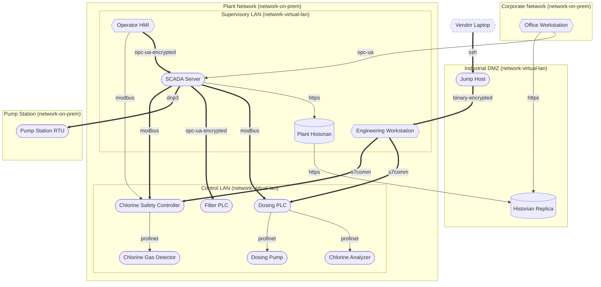
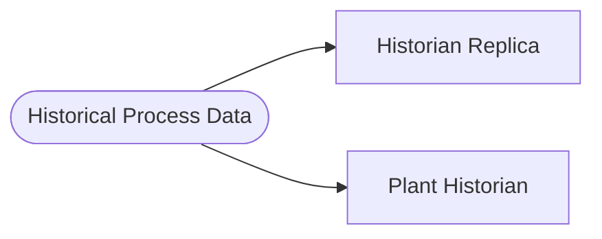

# Threat Model Report: Water Treatment Plant

- **Author:** John Doe, [https://www.example.com](https://www.example.com)
- **Date:** 4 November 2026
- **Business criticality:** mission-critical
- **Threagile version:** test-version

## Contents

1. [Management Summary](#management-summary)
2. [Impact Analysis of the Initial Risks](#impact-analysis-of-the-initial-risks)
3. [Risk Mitigation](#risk-mitigation)
4. [Impact Analysis of the Remaining Risks](#impact-analysis-of-the-remaining-risks)
5. [Risks by Severity](#risks-by-severity)
6. [Application Overview](#application-overview)
7. [Data-Flow Diagram](#data-flow-diagram)
8. [Asset Register](#asset-register)
9. [Security Requirements](#security-requirements)
10. [Abuse Cases](#abuse-cases)
11. [Tag Listing](#tag-listing)
12. [STRIDE Classification of Identified Risks](#stride-classification-of-identified-risks)
13. [Assignment by Function](#assignment-by-function)
14. [RAA Analysis](#raa-analysis)
15. [Data Mapping](#data-mapping)
16. [Out-of-Scope Assets](#out-of-scope-assets)
17. [Potential Model Failures](#potential-model-failures)
18. [Questions](#questions)
19. [Identified Risks by Vulnerability Category](#identified-risks-by-vulnerability-category)
20. [Identified Risks by Technical Asset](#identified-risks-by-technical-asset)
21. [Identified Data Breach Probabilities by Data Asset](#identified-data-breach-probabilities-by-data-asset)
22. [Trust Boundaries](#trust-boundaries)
23. [Shared Runtimes](#shared-runtimes)
24. [Communication Links](#communication-links)
25. [Risk Tracking](#risk-tracking)
26. [Risk Rules Checked by Threagile](#risk-rules-checked-by-threagile)
27. [Ratings](#ratings)
28. [Disclaimer](#disclaimer)

## Management Summary

Threagile toolkit was used to model the architecture of "Water Treatment Plant" and derive risks by analyzing the components and data flows. The risks identified during this analysis are shown in the following chapters. Identified risks during threat modeling do not necessarily mean that the vulnerability associated with this risk actually exists: it is more to be seen as a list of potential risks and threats, which should be individually reviewed and reduced by removing false positives. For the remaining risks it should be checked in the design and implementation of "Water Treatment Plant" whether the mitigation advices have been applied or not.

Each risk finding references a chapter of the OWASP ASVS (Application Security Verification Standard) audit checklist. The OWASP ASVS checklist should be considered as an inspiration by architects and developers to further harden the application in a Defense-in-Depth approach. Additionally, for each risk finding a link towards a matching OWASP Cheat Sheet or similar with technical details about how to implement a mitigation is given.

In total **42 initial risks** in **13 categories** have been identified during the threat modeling process:

| Severity | Risks | Status | Risks |
| --- | ---: | --- | ---: |
| Critical | 0 | Unchecked | 41 |
| High | 0 | In Discussion | 0 |
| Elevated | 23 | Accepted | 0 |
| Medium | 19 | In Progress | 1 |
| Low | 0 | Mitigated | 0 |
|  |  | False Positive | 0 |

The plant supplies the drinking water of the town; a failure of the dosing or of the safety function endangers the public and the operators.

## Impact Analysis of the Initial Risks

The most prevalent impacts of the **42 initial risks** (distributed over **13 risk categories**) are (taking the severity ratings into account and using the highest for each category):

- **Elevated**: [Direct IT/OT Communication](#direct-itot-communication): 1 Initial Risk, exploitation likelihood is _Likely_ with _High_ impact

    If this risk is unmitigated, attackers who compromise an IT asset might reach the industrial control system and change, stop or damage the physical process it controls.

- **Elevated**: [Insecure Control Protocol](#insecure-control-protocol): 6 Initial Risks, exploitation likelihood is _Likely_ with _Very High_ impact

    If this risk is unmitigated, attackers in the network might send commands that change, stop or damage the physical process, or alter the commands and readings exchanged with the controller.

- **Elevated**: [Long-Lived Credentials](#long-lived-credentials): 3 Initial Risks, exploitation likelihood is _Likely_ with _High_ impact

    If this risk is unmitigated, attackers who find a leaked secret might use it for a long time to access the target with the permissions of the caller.

- **Elevated**: [Missing Hardening](#missing-hardening): 3 Initial Risks, exploitation likelihood is _Likely_ with _Medium_ impact

    If this risk remains unmitigated, attackers might be able to easier attack high-value targets.

- **Elevated**: [Missing Safety System Independence](#missing-safety-system-independence): 2 Initial Risks, exploitation likelihood is _Likely_ with _Very High_ impact

    If this risk is unmitigated, attackers might disable or trip the safety function and so cause explosions, releases of hazardous material or injuries.

- **Elevated**: [SQL/NoSQL-Injection](#sqlnosql-injection): 3 Initial Risks, exploitation likelihood is _Very Likely_ with _Medium_ impact

    If this risk is unmitigated, attackers might be able to modify SQL/NoSQL queries to steal and modify data and eventually further escalate towards a deeper system penetration via code executions.

- **Elevated**: [Unencrypted Communication](#unencrypted-communication): 10 Initial Risks, exploitation likelihood is _Likely_ with _High_ impact

    If this risk is unmitigated, network attackers might be able to eavesdrop on unencrypted sensitive data sent between components.

- **Elevated**: [Unguarded Access From Internet](#unguarded-access-from-internet): 1 Initial Risk, exploitation likelihood is _Very Likely_ with _Medium_ impact

    If this risk is unmitigated, attackers might be able to directly attack sensitive systems without any hardening components in-between due to them being directly exposed on the internet.

- **Medium**: [DoS-risky Access Across Trust-Boundary](#dos-risky-access-across-trust-boundary): 8 Initial Risks, exploitation likelihood is _Unlikely_ with _Medium_ impact

    If this risk remains unmitigated, attackers might be able to disturb the availability of important parts of the system.

- **Medium**: [Insecure Control Protocol](#insecure-control-protocol): 6 Initial Risks, exploitation likelihood is _Likely_ with _Very High_ impact

    If this risk is unmitigated, attackers in the network might send commands that change, stop or damage the physical process, or alter the commands and readings exchanged with the controller.

- **Medium**: [Long-Lived Credentials](#long-lived-credentials): 3 Initial Risks, exploitation likelihood is _Likely_ with _High_ impact

    If this risk is unmitigated, attackers who find a leaked secret might use it for a long time to access the target with the permissions of the caller.

- **Medium**: [Missing Hardening](#missing-hardening): 3 Initial Risks, exploitation likelihood is _Likely_ with _Medium_ impact

    If this risk remains unmitigated, attackers might be able to easier attack high-value targets.

- **Medium**: [Missing Identity Store](#missing-identity-store): 1 Initial Risk, exploitation likelihood is _Unlikely_ with _Medium_ impact

    If this risk is unmitigated, attackers might be able to exploit risks unseen in this threat model in the identity provider/store that is currently missing in the model.

- **Medium**: [Missing Multi-Factor Authentication (MFA)](#missing-multi-factor-authentication-mfa): 1 Initial Risk, exploitation likelihood is _Unlikely_ with _Medium_ impact

    If this risk is unmitigated, attackers might be able to access or modify highly sensitive data without strong authentication.

- **Medium**: [Missing Vault (Secret Storage)](#missing-vault-secret-storage): 1 Initial Risk, exploitation likelihood is _Unlikely_ with _Medium_ impact

    If this risk is unmitigated, attackers might be able to easier steal config secrets (like credentials, private keys, client certificates, etc.) once a vulnerability to access files is present and exploited.

- **Medium**: [Server-Side Request Forgery (SSRF)](#server-side-request-forgery-ssrf): 2 Initial Risks, exploitation likelihood is _Likely_ with _Low_ impact

    If this risk is unmitigated, attackers might be able to access sensitive services or files of network-reachable components by modifying outgoing calls of affected components.

- **Medium**: [Unencrypted Communication](#unencrypted-communication): 10 Initial Risks, exploitation likelihood is _Likely_ with _High_ impact

    If this risk is unmitigated, network attackers might be able to eavesdrop on unencrypted sensitive data sent between components.

## Risk Mitigation

The following table gives a high-level overview of the risk tracking status (including mitigated risks):

| Severity | Risks | Unchecked | In Discussion | Accepted | In Progress | Mitigated | False Positive |
| --- | ---: | ---: | ---: | ---: | ---: | ---: | ---: |
| Critical | 0 | 0 | 0 | 0 | 0 | 0 | 0 |
| High | 0 | 0 | 0 | 0 | 0 | 0 | 0 |
| Elevated | 23 | 22 | 0 | 0 | 1 | 0 | 0 |
| Medium | 19 | 19 | 0 | 0 | 0 | 0 | 0 |
| Low | 0 | 0 | 0 | 0 | 0 | 0 | 0 |

After removal of risks with status _mitigated_ and _false positive_ the following **42 remain unmitigated**:

| Severity | Unmitigated risks | To be checked by | Unmitigated risks |
| --- | ---: | --- | ---: |
| Critical | 0 | Business Side | 1 |
| High | 0 | Architecture | 12 |
| Elevated | 23 | Development | 5 |
| Medium | 19 | Operations | 24 |
| Low | 0 |  |  |

## Impact Analysis of the Remaining Risks

The most prevalent impacts of the **42 remaining risks** (distributed over **13 risk categories**) are (taking the severity ratings into account and using the highest for each category):

- **Elevated**: [Direct IT/OT Communication](#direct-itot-communication): 1 Remaining Risk, exploitation likelihood is _Likely_ with _High_ impact

    If this risk is unmitigated, attackers who compromise an IT asset might reach the industrial control system and change, stop or damage the physical process it controls.

- **Elevated**: [Insecure Control Protocol](#insecure-control-protocol): 6 Remaining Risks, exploitation likelihood is _Likely_ with _Very High_ impact

    If this risk is unmitigated, attackers in the network might send commands that change, stop or damage the physical process, or alter the commands and readings exchanged with the controller.

- **Elevated**: [Long-Lived Credentials](#long-lived-credentials): 3 Remaining Risks, exploitation likelihood is _Likely_ with _High_ impact

    If this risk is unmitigated, attackers who find a leaked secret might use it for a long time to access the target with the permissions of the caller.

- **Elevated**: [Missing Hardening](#missing-hardening): 3 Remaining Risks, exploitation likelihood is _Likely_ with _Medium_ impact

    If this risk remains unmitigated, attackers might be able to easier attack high-value targets.

- **Elevated**: [Missing Safety System Independence](#missing-safety-system-independence): 2 Remaining Risks, exploitation likelihood is _Likely_ with _Very High_ impact

    If this risk is unmitigated, attackers might disable or trip the safety function and so cause explosions, releases of hazardous material or injuries.

- **Elevated**: [SQL/NoSQL-Injection](#sqlnosql-injection): 3 Remaining Risks, exploitation likelihood is _Very Likely_ with _Medium_ impact

    If this risk is unmitigated, attackers might be able to modify SQL/NoSQL queries to steal and modify data and eventually further escalate towards a deeper system penetration via code executions.

- **Elevated**: [Unencrypted Communication](#unencrypted-communication): 10 Remaining Risks, exploitation likelihood is _Likely_ with _High_ impact

    If this risk is unmitigated, network attackers might be able to eavesdrop on unencrypted sensitive data sent between components.

- **Elevated**: [Unguarded Access From Internet](#unguarded-access-from-internet): 1 Remaining Risk, exploitation likelihood is _Very Likely_ with _Medium_ impact

    If this risk is unmitigated, attackers might be able to directly attack sensitive systems without any hardening components in-between due to them being directly exposed on the internet.

- **Medium**: [DoS-risky Access Across Trust-Boundary](#dos-risky-access-across-trust-boundary): 8 Remaining Risks, exploitation likelihood is _Unlikely_ with _Medium_ impact

    If this risk remains unmitigated, attackers might be able to disturb the availability of important parts of the system.

- **Medium**: [Insecure Control Protocol](#insecure-control-protocol): 6 Remaining Risks, exploitation likelihood is _Likely_ with _Very High_ impact

    If this risk is unmitigated, attackers in the network might send commands that change, stop or damage the physical process, or alter the commands and readings exchanged with the controller.

- **Medium**: [Long-Lived Credentials](#long-lived-credentials): 3 Remaining Risks, exploitation likelihood is _Likely_ with _High_ impact

    If this risk is unmitigated, attackers who find a leaked secret might use it for a long time to access the target with the permissions of the caller.

- **Medium**: [Missing Hardening](#missing-hardening): 3 Remaining Risks, exploitation likelihood is _Likely_ with _Medium_ impact

    If this risk remains unmitigated, attackers might be able to easier attack high-value targets.

- **Medium**: [Missing Identity Store](#missing-identity-store): 1 Remaining Risk, exploitation likelihood is _Unlikely_ with _Medium_ impact

    If this risk is unmitigated, attackers might be able to exploit risks unseen in this threat model in the identity provider/store that is currently missing in the model.

- **Medium**: [Missing Multi-Factor Authentication (MFA)](#missing-multi-factor-authentication-mfa): 1 Remaining Risk, exploitation likelihood is _Unlikely_ with _Medium_ impact

    If this risk is unmitigated, attackers might be able to access or modify highly sensitive data without strong authentication.

- **Medium**: [Missing Vault (Secret Storage)](#missing-vault-secret-storage): 1 Remaining Risk, exploitation likelihood is _Unlikely_ with _Medium_ impact

    If this risk is unmitigated, attackers might be able to easier steal config secrets (like credentials, private keys, client certificates, etc.) once a vulnerability to access files is present and exploited.

- **Medium**: [Server-Side Request Forgery (SSRF)](#server-side-request-forgery-ssrf): 2 Remaining Risks, exploitation likelihood is _Likely_ with _Low_ impact

    If this risk is unmitigated, attackers might be able to access sensitive services or files of network-reachable components by modifying outgoing calls of affected components.

- **Medium**: [Unencrypted Communication](#unencrypted-communication): 10 Remaining Risks, exploitation likelihood is _Likely_ with _High_ impact

    If this risk is unmitigated, network attackers might be able to eavesdrop on unencrypted sensitive data sent between components.

## Risks by Severity

All **42 risks** by severity, with their tracking status. Each risk links to its details in the chapter of its category.

### Critical

**0 risks**

_No risks._

### High

**0 risks**

_No risks._

### Elevated

**23 risks**

| Severity | Risk | Category | Most relevant | Status |
| --- | --- | --- | --- | --- |
| Elevated | [**Direct IT/OT Communication** risk at **SCADA Server** with **Office Workstation**](#direct-itot-communication) | [Direct IT/OT Communication](#direct-itot-communication) | [SCADA Server](#scada-server), [Live Dashboard](#live-dashboard) | Unchecked |
| Elevated | [**Insecure Control Protocol** risk at **Chlorine Safety Controller** over **modbus** from **SCADA Server**](#insecure-control-protocol) | [Insecure Control Protocol](#insecure-control-protocol) | [Chlorine Safety Controller](#chlorine-safety-controller), [Safety Reset](#safety-reset) | Unchecked |
| Elevated | [**Insecure Control Protocol** risk at **Chlorine Safety Controller** over **s7comm** from **Engineering Workstation**](#insecure-control-protocol) | [Insecure Control Protocol](#insecure-control-protocol) | [Chlorine Safety Controller](#chlorine-safety-controller), [Safety Programming](#safety-programming) | Unchecked |
| Elevated | [**Insecure Control Protocol** risk at **Dosing PLC** over **modbus** from **SCADA Server**](#insecure-control-protocol) | [Insecure Control Protocol](#insecure-control-protocol) | [Dosing PLC](#dosing-plc), [Dosing Control](#dosing-control) | Unchecked |
| Elevated | [**Insecure Control Protocol** risk at **Dosing PLC** over **s7comm** from **Engineering Workstation**](#insecure-control-protocol) | [Insecure Control Protocol](#insecure-control-protocol) | [Dosing PLC](#dosing-plc), [Dosing Programming](#dosing-programming) | Unchecked |
| Elevated | [**Insecure Control Protocol** risk at **Pump Station RTU** over **dnp3** from **SCADA Server**](#insecure-control-protocol) | [Insecure Control Protocol](#insecure-control-protocol) | [Pump Station RTU](#pump-station-rtu), [Pump Station Telemetry](#pump-station-telemetry) | In Progress |
| Elevated | [**Long-Lived Credentials** risk at **Engineering Workstation** used by **Jump Host** (credentials)](#long-lived-credentials) | [Long-Lived Credentials](#long-lived-credentials) | [Engineering Workstation](#engineering-workstation), [Remote Desktop](#remote-desktop) | Unchecked |
| Elevated | [**Long-Lived Credentials** risk at **Filter PLC** used by **SCADA Server** (credentials)](#long-lived-credentials) | [Long-Lived Credentials](#long-lived-credentials) | [Filter PLC](#filter-plc), [Filter Control](#filter-control) | Unchecked |
| Elevated | [**Missing Hardening** risk at **Dosing PLC**](#missing-hardening) | [Missing Hardening](#missing-hardening) | [Dosing PLC](#dosing-plc) | Unchecked |
| Elevated | [**Missing Hardening** risk at **SCADA Server**](#missing-hardening) | [Missing Hardening](#missing-hardening) | [SCADA Server](#scada-server) | Unchecked |
| Elevated | [**Missing Safety System Independence** risk at **Chlorine Safety Controller** changed by **Engineering Workstation**](#missing-safety-system-independence) | [Missing Safety System Independence](#missing-safety-system-independence) | [Chlorine Safety Controller](#chlorine-safety-controller), [Safety Programming](#safety-programming) | Unchecked |
| Elevated | [**Missing Safety System Independence** risk at **Chlorine Safety Controller** changed by **SCADA Server**](#missing-safety-system-independence) | [Missing Safety System Independence](#missing-safety-system-independence) | [Chlorine Safety Controller](#chlorine-safety-controller), [Safety Reset](#safety-reset) | Unchecked |
| Elevated | [**SQL/NoSQL-Injection** risk at **Office Workstation** against database **Historian Replica** via **Report Access**](#sqlnosql-injection) | [SQL/NoSQL-Injection](#sqlnosql-injection) | [Office Workstation](#office-workstation), [Report Access](#report-access) | Unchecked |
| Elevated | [**SQL/NoSQL-Injection** risk at **Plant Historian** against database **Historian Replica** via **Replication**](#sqlnosql-injection) | [SQL/NoSQL-Injection](#sqlnosql-injection) | [Plant Historian](#plant-historian), [Replication](#replication) | Unchecked |
| Elevated | [**SQL/NoSQL-Injection** risk at **SCADA Server** against database **Plant Historian** via **Archiving**](#sqlnosql-injection) | [SQL/NoSQL-Injection](#sqlnosql-injection) | [SCADA Server](#scada-server), [Archiving](#archiving) | Unchecked |
| Elevated | [**Unencrypted Communication** named **Dosing Control** between **SCADA Server** and **Dosing PLC**](#unencrypted-communication) | [Unencrypted Communication](#unencrypted-communication) | [SCADA Server](#scada-server), [Dosing Control](#dosing-control) | Unchecked |
| Elevated | [**Unencrypted Communication** named **Dosing Programming** between **Engineering Workstation** and **Dosing PLC**](#unencrypted-communication) | [Unencrypted Communication](#unencrypted-communication) | [Engineering Workstation](#engineering-workstation), [Dosing Programming](#dosing-programming) | Unchecked |
| Elevated | [**Unencrypted Communication** named **Live Dashboard** between **Office Workstation** and **SCADA Server** transferring authentication data (like credentials, token, session-id, etc.)](#unencrypted-communication) | [Unencrypted Communication](#unencrypted-communication) | [Office Workstation](#office-workstation), [Live Dashboard](#live-dashboard) | Unchecked |
| Elevated | [**Unencrypted Communication** named **Pump Station Telemetry** between **SCADA Server** and **Pump Station RTU**](#unencrypted-communication) | [Unencrypted Communication](#unencrypted-communication) | [SCADA Server](#scada-server), [Pump Station Telemetry](#pump-station-telemetry) | Unchecked |
| Elevated | [**Unencrypted Communication** named **Safety Programming** between **Engineering Workstation** and **Chlorine Safety Controller**](#unencrypted-communication) | [Unencrypted Communication](#unencrypted-communication) | [Engineering Workstation](#engineering-workstation), [Safety Programming](#safety-programming) | Unchecked |
| Elevated | [**Unencrypted Communication** named **Safety Reset** between **SCADA Server** and **Chlorine Safety Controller**](#unencrypted-communication) | [Unencrypted Communication](#unencrypted-communication) | [SCADA Server](#scada-server), [Safety Reset](#safety-reset) | Unchecked |
| Elevated | [**Unencrypted Communication** named **Safety Status** between **Operator HMI** and **Chlorine Safety Controller**](#unencrypted-communication) | [Unencrypted Communication](#unencrypted-communication) | [Operator HMI](#operator-hmi), [Safety Status](#safety-status) | Unchecked |
| Elevated | [**Unguarded Access from Internet** of **Jump Host** by **Vendor Laptop** via **Remote Support**](#unguarded-access-from-internet) | [Unguarded Access From Internet](#unguarded-access-from-internet) | [Jump Host](#jump-host), [Remote Support](#remote-support) | Unchecked |

### Medium

**19 risks**

| Severity | Risk | Category | Most relevant | Status |
| --- | --- | --- | --- | --- |
| Medium | [**Denial-of-Service** risky access of **Chlorine Safety Controller** by **Engineering Workstation** via **Safety Programming**](#dos-risky-access-across-trust-boundary) | [DoS-risky Access Across Trust-Boundary](#dos-risky-access-across-trust-boundary) | [Chlorine Safety Controller](#chlorine-safety-controller), [Safety Programming](#safety-programming) | Unchecked |
| Medium | [**Denial-of-Service** risky access of **Chlorine Safety Controller** by **Operator HMI** via **Safety Status**](#dos-risky-access-across-trust-boundary) | [DoS-risky Access Across Trust-Boundary](#dos-risky-access-across-trust-boundary) | [Chlorine Safety Controller](#chlorine-safety-controller), [Safety Status](#safety-status) | Unchecked |
| Medium | [**Denial-of-Service** risky access of **Chlorine Safety Controller** by **SCADA Server** via **Safety Reset**](#dos-risky-access-across-trust-boundary) | [DoS-risky Access Across Trust-Boundary](#dos-risky-access-across-trust-boundary) | [Chlorine Safety Controller](#chlorine-safety-controller), [Safety Reset](#safety-reset) | Unchecked |
| Medium | [**Denial-of-Service** risky access of **Dosing PLC** by **Engineering Workstation** via **Dosing Programming**](#dos-risky-access-across-trust-boundary) | [DoS-risky Access Across Trust-Boundary](#dos-risky-access-across-trust-boundary) | [Dosing PLC](#dosing-plc), [Dosing Programming](#dosing-programming) | Unchecked |
| Medium | [**Denial-of-Service** risky access of **Dosing PLC** by **SCADA Server** via **Dosing Control**](#dos-risky-access-across-trust-boundary) | [DoS-risky Access Across Trust-Boundary](#dos-risky-access-across-trust-boundary) | [Dosing PLC](#dosing-plc), [Dosing Control](#dosing-control) | Unchecked |
| Medium | [**Denial-of-Service** risky access of **Filter PLC** by **SCADA Server** via **Filter Control**](#dos-risky-access-across-trust-boundary) | [DoS-risky Access Across Trust-Boundary](#dos-risky-access-across-trust-boundary) | [Filter PLC](#filter-plc), [Filter Control](#filter-control) | Unchecked |
| Medium | [**Denial-of-Service** risky access of **Pump Station RTU** by **SCADA Server** via **Pump Station Telemetry**](#dos-risky-access-across-trust-boundary) | [DoS-risky Access Across Trust-Boundary](#dos-risky-access-across-trust-boundary) | [Pump Station RTU](#pump-station-rtu), [Pump Station Telemetry](#pump-station-telemetry) | Unchecked |
| Medium | [**Denial-of-Service** risky access of **SCADA Server** by **Office Workstation** via **Live Dashboard**](#dos-risky-access-across-trust-boundary) | [DoS-risky Access Across Trust-Boundary](#dos-risky-access-across-trust-boundary) | [SCADA Server](#scada-server), [Live Dashboard](#live-dashboard) | Unchecked |
| Medium | [**Insecure Control Protocol** risk at **Dosing Pump** over **profinet** from **Dosing PLC**](#insecure-control-protocol) | [Insecure Control Protocol](#insecure-control-protocol) | [Dosing Pump](#dosing-pump), [Dosing Pump Control](#dosing-pump-control) | Unchecked |
| Medium | [**Long-Lived Credentials** risk at **Plant Historian** used by **SCADA Server** (credentials)](#long-lived-credentials) | [Long-Lived Credentials](#long-lived-credentials) | [Plant Historian](#plant-historian), [Archiving](#archiving) | Unchecked |
| Medium | [**Missing Multi-Factor Authentication** covering communication link **Operation** from **Operator HMI** to **SCADA Server**](#missing-multi-factor-authentication-mfa) | [Missing Multi-Factor Authentication (MFA)](#missing-multi-factor-authentication-mfa) | [SCADA Server](#scada-server), [Operation](#operation) | Unchecked |
| Medium | [**Missing Hardening** risk at **Plant Historian**](#missing-hardening) | [Missing Hardening](#missing-hardening) | [Plant Historian](#plant-historian) | Unchecked |
| Medium | [**Missing Identity Store** in the threat model (referencing asset **Engineering Workstation** as an example)](#missing-identity-store) | [Missing Identity Store](#missing-identity-store) | [Engineering Workstation](#engineering-workstation) | Unchecked |
| Medium | [**Missing Vault (Secret Storage)** in the threat model (referencing asset **Chlorine Safety Controller** as an example)](#missing-vault-secret-storage) | [Missing Vault (Secret Storage)](#missing-vault-secret-storage) | [Chlorine Safety Controller](#chlorine-safety-controller) | Unchecked |
| Medium | [**Server-Side Request Forgery (SSRF)** risk at **Plant Historian** server-side web-requesting the target **Historian Replica** via **Replication**](#server-side-request-forgery-ssrf) | [Server-Side Request Forgery (SSRF)](#server-side-request-forgery-ssrf) | [Plant Historian](#plant-historian), [Replication](#replication) | Unchecked |
| Medium | [**Server-Side Request Forgery (SSRF)** risk at **SCADA Server** server-side web-requesting the target **Plant Historian** via **Archiving**](#server-side-request-forgery-ssrf) | [Server-Side Request Forgery (SSRF)](#server-side-request-forgery-ssrf) | [SCADA Server](#scada-server), [Archiving](#archiving) | Unchecked |
| Medium | [**Unencrypted Communication** named **Dosing Pump Control** between **Dosing PLC** and **Dosing Pump**](#unencrypted-communication) | [Unencrypted Communication](#unencrypted-communication) | [Dosing PLC](#dosing-plc), [Dosing Pump Control](#dosing-pump-control) | Unchecked |
| Medium | [**Unencrypted Communication** named **Chlorine Reading** between **Dosing PLC** and **Chlorine Analyzer**](#unencrypted-communication) | [Unencrypted Communication](#unencrypted-communication) | [Dosing PLC](#dosing-plc), [Chlorine Reading](#chlorine-reading) | Unchecked |
| Medium | [**Unencrypted Communication** named **Leak Detection** between **Chlorine Safety Controller** and **Chlorine Gas Detector**](#unencrypted-communication) | [Unencrypted Communication](#unencrypted-communication) | [Chlorine Safety Controller](#chlorine-safety-controller), [Leak Detection](#leak-detection) | Unchecked |

### Low

**0 risks**

_No risks._

## Application Overview

### Business Criticality

The overall business criticality of "Water Treatment Plant" was rated as:

- archive
- operational
- important
- critical
- **mission-critical** (selected)

### Business Overview

The plant treats raw water into drinking water and pumps it to the town around the clock.

### Technical Overview

A SCADA server supervises the dosing and filter PLCs and a remote pump station. A safety controller closes the chlorine supply on a leak. The corporate network reaches the plant through an industrial DMZ with a jump host and a replica of the historian.

## Data-Flow Diagram

The following diagram was generated by Threagile based on the model input and gives a high-level overview of the data-flow between technical assets. The RAA value of each asset, the calculated _Relative Attacker Attractiveness_ in percent, is in the chapter [RAA Analysis](#raa-analysis).

Data-flow diagram of "Water Treatment Plant". A box is an external entity, a stadium a process, a cylinder a datastore and a hexagon a client used by a human; assets out of scope have a dashed border, and the trust boundaries enclose the assets inside them. An arrow points from the asset that initiates a communication link to its target and names the protocol; a thick arrow is a link that also receives data back.

## Asset Register

### Technical Assets

- [Chlorine Safety Controller](#chlorine-safety-controller)

    Closes the chlorine supply when a leak or an overdose is detected

- [Dosing PLC](#dosing-plc)

    Doses chlorine into the treated water

- [Engineering Workstation](#engineering-workstation)

    Programs the PLCs, the RTU and the safety controller

- [Filter PLC](#filter-plc)

    Runs the filters and their backwash

- [Jump Host](#jump-host)

    The only way into the plant network for remote access

- [Office Workstation](#office-workstation)

    The workstations of the plant management in the corporate network

- [Operator HMI](#operator-hmi)

    The screens the operators run the plant with

- [Plant Historian](#plant-historian)

    Archives the process values of the plant

- [Pump Station RTU](#pump-station-rtu)

    Runs the pumps of the remote pump station

- [SCADA Server](#scada-server)

    Supervises the treatment and sends the commands of the operators

- [Dosing Pump](#dosing-pump)

    The pump dosing the chlorine

- [Chlorine Analyzer](#chlorine-analyzer)

    Measures the chlorine in the treated water

- [Chlorine Gas Detector](#chlorine-gas-detector)

    Detects chlorine gas in the dosing room

- [Historian Replica](#historian-replica)

    A copy of the plant historian for the corporate network

- [Vendor Laptop](#vendor-laptop) (out of scope)

    The laptops of the PLC vendor for remote support

### Data Assets

- [Historical Process Data](#historical-process-data)

    Archived process values for reports and compliance

- [Process Values](#process-values)

    Measurements of flow, level, pressure and chlorine concentration

- [Control Commands](#control-commands)

    Setpoints, start and stop commands and outputs to pumps and valves

- [Controller Programs](#controller-programs)

    The logic and configuration of the PLCs and the RTU

- [Safety Logic](#safety-logic)

    The program of the chlorine safety controller

## Security Requirements

This chapter lists the custom security requirements which have been defined for the modeled target.

- **Safety Independence**

    The safety controller is changed only from a dedicated safety engineering workstation.

- **Zones and Conduits**

    IT reaches the plant only through the industrial DMZ.

_This list is not complete and regulatory or law relevant security requirements have to be taken into account as well. Also custom individual security requirements might exist for the project._

## Abuse Cases

This chapter lists the custom abuse cases which have been defined for the modeled target.

- **Chlorine Overdose**

    As an attacker I want to raise the chlorine setpoint of the dosing PLC to poison the drinking water.

- **Safety Bypass**

    As an attacker I want to disable the safety controller first, so that a chlorine leak goes unnoticed.

- **Supply Outage**

    As an attacker I want to stop the pumps of the pump station to cut the water supply of the town.

_This list is not complete and regulatory or law relevant abuse cases have to be taken into account as well. Also custom individual abuse cases might exist for the project._

## Tag Listing

This chapter lists what tags are used by which elements.

- **industrial-dmz**: [Jump Host](#jump-host)

## STRIDE Classification of Identified Risks

This chapter clusters and classifies the risks by STRIDE categories: in total **42 potential risks** have been identified during the threat modeling process.

### Spoofing

**4 risks**

Spoofing - Authenticity

- **Elevated**: [Long-Lived Credentials](#long-lived-credentials): 3/3 unmitigated Risks, exploitation likelihood is _Likely_ with _High_ impact

    Passwords of service accounts, API keys and personal access tokens stay valid for months or for good. Once one leaks, from a repository, a log, a build system or a laptop, it lets anyone in until someone notices and rotates it.

- **Medium**: [Long-Lived Credentials](#long-lived-credentials): 3/3 unmitigated Risks, exploitation likelihood is _Likely_ with _High_ impact

    Passwords of service accounts, API keys and personal access tokens stay valid for months or for good. Once one leaks, from a repository, a log, a build system or a laptop, it lets anyone in until someone notices and rotates it.

- **Medium**: [Missing Identity Store](#missing-identity-store): 1/1 unmitigated Risk, exploitation likelihood is _Unlikely_ with _Medium_ impact

    The modeled architecture does not contain an identity store, which might be the risk of a model missing critical assets (and thus not seeing their risks).

### Tampering

**12 risks**

Tampering - Integrity

- **Elevated**: [Insecure Control Protocol](#insecure-control-protocol): 6/6 unmitigated Risks, exploitation likelihood is _Likely_ with _Very High_ impact

    Most industrial control protocols, like Modbus, DNP3, S7comm, EtherNet/IP or PROFINET, were designed for closed networks: a controller or field device executes every command it receives, without checking who sent it or whether it was changed on the way. Anyone who can send packets to it can write setpoints and outputs, stop it or download a new program.

- **Elevated**: [Missing Hardening](#missing-hardening): 3/3 unmitigated Risks, exploitation likelihood is _Likely_ with _Medium_ impact

    Technical assets with a Relative Attacker Attractiveness (RAA) value of 55 % or higher should be explicitly hardened taking best practices and vendor hardening guides into account.

- **Elevated**: [SQL/NoSQL-Injection](#sqlnosql-injection): 3/3 unmitigated Risks, exploitation likelihood is _Very Likely_ with _Medium_ impact

    When a database is accessed via database access protocols SQL/NoSQL-Injection risks might arise. The risk rating depends on the sensitivity technical asset itself and of the data assets processed.

- **Medium**: [Insecure Control Protocol](#insecure-control-protocol): 6/6 unmitigated Risks, exploitation likelihood is _Likely_ with _Very High_ impact

    Most industrial control protocols, like Modbus, DNP3, S7comm, EtherNet/IP or PROFINET, were designed for closed networks: a controller or field device executes every command it receives, without checking who sent it or whether it was changed on the way. Anyone who can send packets to it can write setpoints and outputs, stop it or download a new program.

- **Medium**: [Missing Hardening](#missing-hardening): 3/3 unmitigated Risks, exploitation likelihood is _Likely_ with _Medium_ impact

    Technical assets with a Relative Attacker Attractiveness (RAA) value of 55 % or higher should be explicitly hardened taking best practices and vendor hardening guides into account.

### Repudiation

**0 risks**

Repudiation - Non-repudiability

_No risks were identified._

### Information Disclosure

**13 risks**

Information disclosure - Confidentiality

- **Elevated**: [Unencrypted Communication](#unencrypted-communication): 10/10 unmitigated Risks, exploitation likelihood is _Likely_ with _High_ impact

    Due to the confidentiality and/or integrity rating of the data assets transferred over the communication link this connection must be encrypted.

- **Medium**: [Missing Vault (Secret Storage)](#missing-vault-secret-storage): 1/1 unmitigated Risk, exploitation likelihood is _Unlikely_ with _Medium_ impact

    In order to avoid the risk of secret leakage via config files (when attacked through vulnerabilities being able to read files like Path-Traversal and others), it is best practice to use a separate hardened process with proper authentication, authorization, and audit logging to access config secrets (like credentials, private keys, client certificates, etc.). This component is usually some kind of Vault.

- **Medium**: [Server-Side Request Forgery (SSRF)](#server-side-request-forgery-ssrf): 2/2 unmitigated Risks, exploitation likelihood is _Likely_ with _Low_ impact

    When a server system (i.e. not a client) is accessing other server systems via typical web protocols Server-Side Request Forgery (SSRF) or Local-File-Inclusion (LFI) or Remote-File-Inclusion (RFI) risks might arise.

- **Medium**: [Unencrypted Communication](#unencrypted-communication): 10/10 unmitigated Risks, exploitation likelihood is _Likely_ with _High_ impact

    Due to the confidentiality and/or integrity rating of the data assets transferred over the communication link this connection must be encrypted.

### Denial of Service

**8 risks**

Denial of service - Availability

- **Medium**: [DoS-risky Access Across Trust-Boundary](#dos-risky-access-across-trust-boundary): 8/8 unmitigated Risks, exploitation likelihood is _Unlikely_ with _Medium_ impact

    Assets accessed across trust boundaries with critical or mission-critical availability rating are more prone to Denial-of-Service (DoS) risks.

### Elevation of Privilege

**5 risks**

Elevation of privilege - Authorization

- **Elevated**: [Direct IT/OT Communication](#direct-itot-communication): 1/1 unmitigated Risk, exploitation likelihood is _Likely_ with _High_ impact

    Controllers, field devices, HMIs, SCADA servers and engineering workstations of an industrial control system belong into control zones that IT assets reach only through an industrial DMZ. A direct communication link between an IT asset and an asset of a control zone lets attackers who compromise the IT side, which is far more exposed, move straight into the control of the physical process.

- **Elevated**: [Missing Safety System Independence](#missing-safety-system-independence): 2/2 unmitigated Risks, exploitation likelihood is _Likely_ with _Very High_ impact

    A safety instrumented system brings the process into a safe state when the basic process control fails or is attacked. It only does so when it is independent of that control: when assets other than a dedicated safety engineering workstation can change its program, setpoints or outputs, one compromise can disable the control and the safety function together, as the TRITON attack did.

- **Elevated**: [Unguarded Access From Internet](#unguarded-access-from-internet): 1/1 unmitigated Risk, exploitation likelihood is _Very Likely_ with _Medium_ impact

    Internet-exposed assets must be guarded by a protecting service, application, or reverse-proxy.

- **Medium**: [Missing Multi-Factor Authentication (MFA)](#missing-multi-factor-authentication-mfa): 1/1 unmitigated Risk, exploitation likelihood is _Unlikely_ with _Medium_ impact

    Technical assets (especially multi-tenant systems) should authenticate incoming requests with multi-factor (MFA) authentication when the asset processes or stores highly sensitive data (in terms of confidentiality, integrity, and availability) and is accessed by humans.

## Assignment by Function

This chapter clusters and assigns the risks by functions which are most likely able to check and mitigate them: in total **42 potential risks** have been identified during the threat modeling process.

### Business Side

**1 risk**

Business

- **Medium**: [Missing Multi-Factor Authentication (MFA)](#missing-multi-factor-authentication-mfa): 1/1 unmitigated Risk, exploitation likelihood is _Unlikely_ with _Medium_ impact

    Apply an authentication method to the technical asset protecting highly sensitive data via multi-factor authentication for human users.

### Architecture

**12 risks**

Architecture

- **Elevated**: [Direct IT/OT Communication](#direct-itot-communication): 1/1 unmitigated Risk, exploitation likelihood is _Likely_ with _High_ impact

    Separate IT and OT with an industrial DMZ, so that no communication link crosses from IT into a control zone directly: replicate the historian into the DMZ for IT users, give remote and vendor access only through a jump host there, and filter what passes with firewalls on both sides. Tag the assets in the DMZ with _industrial-dmz_.

- **Elevated**: [Insecure Control Protocol](#insecure-control-protocol): 6/6 unmitigated Risks, exploitation likelihood is _Likely_ with _Very High_ impact

    Use the secure variant of the protocol where the devices support it (Modbus/TCP Security, DNP3 over TLS or with Secure Authentication, CIP Security, OPC UA with SignAndEncrypt, S7comm-plus with access protection), and enable the access protection of the controllers. Where the protocol cannot be secured, allow only the expected senders and function codes with an industrial firewall in front of the controller, and keep controllers in RUN mode with the key switch.

- **Elevated**: [Missing Safety System Independence](#missing-safety-system-independence): 2/2 unmitigated Risks, exploitation likelihood is _Likely_ with _Very High_ impact

    Let only a dedicated safety engineering workstation, which programs no other controllers, change the safety controller, and give the basic process control and the HMIs readonly access to its status. Keep the key switch of the safety controller in RUN mode outside of maintenance, and alert on every program change.

- **Elevated**: [Unguarded Access From Internet](#unguarded-access-from-internet): 1/1 unmitigated Risk, exploitation likelihood is _Very Likely_ with _Medium_ impact

    Encapsulate the asset behind a guarding service, application, or reverse-proxy. For admin maintenance a bastion-host should be used as a jump-server. For file transfer a store-and-forward-host should be used as an indirect file exchange platform.

- **Medium**: [Insecure Control Protocol](#insecure-control-protocol): 6/6 unmitigated Risks, exploitation likelihood is _Likely_ with _Very High_ impact

    Use the secure variant of the protocol where the devices support it (Modbus/TCP Security, DNP3 over TLS or with Secure Authentication, CIP Security, OPC UA with SignAndEncrypt, S7comm-plus with access protection), and enable the access protection of the controllers. Where the protocol cannot be secured, allow only the expected senders and function codes with an industrial firewall in front of the controller, and keep controllers in RUN mode with the key switch.

- **Medium**: [Missing Identity Store](#missing-identity-store): 1/1 unmitigated Risk, exploitation likelihood is _Unlikely_ with _Medium_ impact

    Include an identity store in the model if the application has a login.

- **Medium**: [Missing Vault (Secret Storage)](#missing-vault-secret-storage): 1/1 unmitigated Risk, exploitation likelihood is _Unlikely_ with _Medium_ impact

    Consider using a Vault (Secret Storage) to securely store and access config secrets (like credentials, private keys, client certificates, etc.).

### Development

**5 risks**

Development

- **Elevated**: [SQL/NoSQL-Injection](#sqlnosql-injection): 3/3 unmitigated Risks, exploitation likelihood is _Very Likely_ with _Medium_ impact

    Try to use parameter binding to be safe from injection vulnerabilities. When a third-party product is used instead of custom developed software, check if the product applies the proper mitigation and ensure a reasonable patch-level.

- **Medium**: [Server-Side Request Forgery (SSRF)](#server-side-request-forgery-ssrf): 2/2 unmitigated Risks, exploitation likelihood is _Likely_ with _Low_ impact

    Try to avoid constructing the outgoing target URL with caller controllable values. Alternatively use a mapping (whitelist) when accessing outgoing URLs instead of creating them including caller controllable values. When a third-party product is used instead of custom developed software, check if the product applies the proper mitigation and ensure a reasonable patch-level.

### Operations

**24 risks**

Operations

- **Elevated**: [Long-Lived Credentials](#long-lived-credentials): 3/3 unmitigated Risks, exploitation likelihood is _Likely_ with _High_ impact

    Replace static secrets between services with a workload identity issued by the platform (cloud IAM roles, Kubernetes service account tokens, SPIFFE), or with short-lived tokens obtained through OAuth 2.0 client credentials or token exchange, and model the link with the identity _workload_ or the authentication _short-lived-token_. Where a long-lived secret remains, keep it in a vault, scope it narrowly, rotate it automatically and detect its use from unexpected places.

- **Elevated**: [Missing Hardening](#missing-hardening): 3/3 unmitigated Risks, exploitation likelihood is _Likely_ with _Medium_ impact

    Try to apply all hardening best practices (like CIS benchmarks, OWASP recommendations, vendor recommendations, DevSec Hardening Framework, DBSAT for Oracle databases, and others).

- **Elevated**: [Unencrypted Communication](#unencrypted-communication): 10/10 unmitigated Risks, exploitation likelihood is _Likely_ with _High_ impact

    Apply transport layer encryption to the communication link.

- **Medium**: [DoS-risky Access Across Trust-Boundary](#dos-risky-access-across-trust-boundary): 8/8 unmitigated Risks, exploitation likelihood is _Unlikely_ with _Medium_ impact

    Apply anti-DoS techniques like throttling and/or per-client load blocking with quotas. Also for maintenance access routes consider applying a VPN instead of public reachable interfaces. Generally applying redundancy on the targeted technical asset reduces the risk of DoS.

- **Medium**: [Long-Lived Credentials](#long-lived-credentials): 3/3 unmitigated Risks, exploitation likelihood is _Likely_ with _High_ impact

    Replace static secrets between services with a workload identity issued by the platform (cloud IAM roles, Kubernetes service account tokens, SPIFFE), or with short-lived tokens obtained through OAuth 2.0 client credentials or token exchange, and model the link with the identity _workload_ or the authentication _short-lived-token_. Where a long-lived secret remains, keep it in a vault, scope it narrowly, rotate it automatically and detect its use from unexpected places.

- **Medium**: [Missing Hardening](#missing-hardening): 3/3 unmitigated Risks, exploitation likelihood is _Likely_ with _Medium_ impact

    Try to apply all hardening best practices (like CIS benchmarks, OWASP recommendations, vendor recommendations, DevSec Hardening Framework, DBSAT for Oracle databases, and others).

- **Medium**: [Unencrypted Communication](#unencrypted-communication): 10/10 unmitigated Risks, exploitation likelihood is _Likely_ with _High_ impact

    Apply transport layer encryption to the communication link.

## RAA Analysis

For each technical asset the **"Relative Attacker Attractiveness"** (RAA) value was calculated in percent. The higher the RAA, the more interesting it is for an attacker to compromise the asset. The calculation algorithm takes the sensitivity ratings and quantities of stored and processed data into account as well as the communication links of the technical asset. Neighbouring assets to high-value RAA targets might receive an increase in their RAA value when they have a communication link towards that target ("Pivoting-Factor").

The following lists all technical assets sorted by their RAA value from highest (most attacker attractive) to lowest. This list can be used to prioritize on efforts relevant for the most attacker-attractive technical assets:

- [SCADA Server](#scada-server): RAA 100 %, highest severity still at risk: **Elevated**

    Supervises the treatment and sends the commands of the operators

- [Plant Historian](#plant-historian): RAA 63 %, highest severity still at risk: **Elevated**

    Archives the process values of the plant

- [Dosing PLC](#dosing-plc): RAA 59 %, highest severity still at risk: **Elevated**

    Doses chlorine into the treated water

- [Engineering Workstation](#engineering-workstation): RAA 55 %, highest severity still at risk: **Elevated**

    Programs the PLCs, the RTU and the safety controller

- [Operator HMI](#operator-hmi): RAA 53 %, highest severity still at risk: **Elevated**

    The screens the operators run the plant with

- [Chlorine Safety Controller](#chlorine-safety-controller): RAA 52 %, highest severity still at risk: **Elevated**

    Closes the chlorine supply when a leak or an overdose is detected

- [Filter PLC](#filter-plc): RAA 46 %, highest severity still at risk: **Elevated**

    Runs the filters and their backwash

- [Office Workstation](#office-workstation): RAA 37 %, highest severity still at risk: **Elevated**

    The workstations of the plant management in the corporate network

- [Historian Replica](#historian-replica): RAA 36 %

    A copy of the plant historian for the corporate network

- [Jump Host](#jump-host): RAA 33 %, highest severity still at risk: **Elevated**

    The only way into the plant network for remote access

- [Pump Station RTU](#pump-station-rtu): RAA 33 %, highest severity still at risk: **Elevated**

    Runs the pumps of the remote pump station

- [Dosing Pump](#dosing-pump): RAA 23 %, highest severity still at risk: **Medium**

    The pump dosing the chlorine

- [Chlorine Analyzer](#chlorine-analyzer): RAA 20 %

    Measures the chlorine in the treated water

- [Chlorine Gas Detector](#chlorine-gas-detector): RAA 20 %

    Detects chlorine gas in the dosing room

## Data Mapping

The following table and diagram were generated by Threagile based on the model input and give a high-level distribution of data assets across technical assets, with the data breach probability still at risk of each data asset (see the chapter [Identified Data Breach Probabilities by Data Asset](#identified-data-breach-probabilities-by-data-asset)).

| Data asset | Data breach | Stored by | Processed by |
| --- | --- | --- | --- |
| [Historical Process Data](#historical-process-data) | Probable | [Historian Replica](#historian-replica), [Plant Historian](#plant-historian) | [Historian Replica](#historian-replica), [Office Workstation](#office-workstation), [Plant Historian](#plant-historian), [SCADA Server](#scada-server) |
| [Process Values](#process-values) | Probable | none | [Chlorine Analyzer](#chlorine-analyzer), [Chlorine Gas Detector](#chlorine-gas-detector), [Chlorine Safety Controller](#chlorine-safety-controller), [Dosing PLC](#dosing-plc), [Filter PLC](#filter-plc), [Office Workstation](#office-workstation), [Operator HMI](#operator-hmi), [Plant Historian](#plant-historian), [Pump Station RTU](#pump-station-rtu), [SCADA Server](#scada-server) |
| [Control Commands](#control-commands) | Possible | none | [Chlorine Safety Controller](#chlorine-safety-controller), [Dosing PLC](#dosing-plc), [Dosing Pump](#dosing-pump), [Filter PLC](#filter-plc), [Operator HMI](#operator-hmi), [Pump Station RTU](#pump-station-rtu), [SCADA Server](#scada-server) |
| [Controller Programs](#controller-programs) | Possible | none | [Dosing PLC](#dosing-plc), [Engineering Workstation](#engineering-workstation), [Filter PLC](#filter-plc), [Jump Host](#jump-host), [Vendor Laptop](#vendor-laptop) |
| [Safety Logic](#safety-logic) | Possible | none | [Chlorine Safety Controller](#chlorine-safety-controller), [Engineering Workstation](#engineering-workstation) |

The diagram shows where the data assets are stored: an arrow points from a data asset, a stadium, to each technical asset that stores it, a box; assets out of scope have a dashed border.

## Out-of-Scope Assets

**1 asset**

This chapter lists all technical assets that have been defined as out-of-scope. Each one should be checked in the model whether it should better be included in the overall risk analysis:

- [Vendor Laptop](#vendor-laptop) (out of scope)

    Owned and managed by the vendor

## Potential Model Failures

**3 of 3 unmitigated**

This chapter lists potential model failures where not all relevant assets have been modeled or the model might itself contain inconsistencies. Each potential model failure should be checked in the model against the architecture design:

- **Elevated**: [Direct IT/OT Communication](#direct-itot-communication): 1/1 unmitigated Risk, exploitation likelihood is _Likely_ with _High_ impact

    Controllers, field devices, HMIs, SCADA servers and engineering workstations of an industrial control system belong into control zones that IT assets reach only through an industrial DMZ. A direct communication link between an IT asset and an asset of a control zone lets attackers who compromise the IT side, which is far more exposed, move straight into the control of the physical process.

- **Medium**: [Missing Identity Store](#missing-identity-store): 1/1 unmitigated Risk, exploitation likelihood is _Unlikely_ with _Medium_ impact

    The modeled architecture does not contain an identity store, which might be the risk of a model missing critical assets (and thus not seeing their risks).

- **Medium**: [Missing Vault (Secret Storage)](#missing-vault-secret-storage): 1/1 unmitigated Risk, exploitation likelihood is _Unlikely_ with _Medium_ impact

    In order to avoid the risk of secret leakage via config files (when attacked through vulnerabilities being able to read files like Path-Traversal and others), it is best practice to use a separate hardened process with proper authentication, authorization, and audit logging to access config secrets (like credentials, private keys, client certificates, etc.). This component is usually some kind of Vault.

## Questions

**2 of 2 unanswered**

This chapter lists custom questions that arose during the threat modeling process.

- **Can the controllers be switched to RUN mode with the key switch?**

    _answer pending_

- **Which remote access does the vendor need, and when?**

    _answer pending_

## Identified Risks by Vulnerability Category

In total **42 potential risks** have been identified during the threat modeling process, distributed across **13 vulnerability categories**. The following sections describe each identified risk category and its risks.

### Direct IT/OT Communication

**Elevated** · 1/1 unmitigated Risk · `direct-it-ot-communication`

| Property | Value |
| --- | --- |
| STRIDE | Elevation of Privilege |
| CWE | [CWE 1008](https://cwe.mitre.org/data/definitions/1008.html) |
| Function | Architecture |
| Action | Industrial DMZ |
| ASVS chapter | V1 - Architecture, Design and Threat Modeling Requirements |
| Cheat sheet | [final](https://csrc.nist.gov/pubs/sp/800/82/r3/final) |
| References | IEC 62443-3-3 SR 5.1 Network Segmentation; IEC 62443-3-3 SR 5.2 Zone Boundary Protection; MITRE ATT&amp;CK for ICS T0883 Internet Accessible Device; MITRE ATT&amp;CK for ICS T0886 Remote Services; NIST SP 800-82r3 Guide to Operational Technology (OT) Security |

**Description**

Controllers, field devices, HMIs, SCADA servers and engineering workstations of an industrial control system belong into control zones that IT assets reach only through an industrial DMZ. A direct communication link between an IT asset and an asset of a control zone lets attackers who compromise the IT side, which is far more exposed, move straight into the control of the physical process.

**Impact**

If this risk is unmitigated, attackers who compromise an IT asset might reach the industrial control system and change, stop or damage the physical process it controls.

**Detection Logic**

In-scope OT technical assets (plc, rtu, safety-controller, field-device, hmi, scada-server, engineering-workstation) with a communication link, in either direction, with a technical asset that is neither an OT asset nor in the industrial DMZ (a historian or an asset tagged with _industrial-dmz_).

**Risk Rating**

The risk rating depends on the integrity and availability of the OT asset, and is the highest for safety controllers. The attack is very likely when the other asset is on the internet, and likely otherwise.

**False Positives**

Links that pass through a firewall allowing only them, and that are documented exceptions of the zone model, can be considered as false positives after individual review.

**Mitigation**

Separate IT and OT with an industrial DMZ, so that no communication link crosses from IT into a control zone directly: replicate the historian into the DMZ for IT users, give remote and vendor access only through a jump host there, and filter what passes with firewalls on both sides. Tag the assets in the DMZ with _industrial-dmz_.

**Check**

Are the recommendations of NIST SP 800-82 and the referenced IEC 62443 requirements applied?

**Risk Findings**

The risk **Direct IT/OT Communication** was found **1 time** in the analyzed architecture to be potentially possible. Each spot should be checked individually by reviewing the implementation whether all controls have been applied properly in order to mitigate each risk.

| Severity | Risk | ID | Likelihood | Impact | Most relevant | Status | Tracking |
| --- | --- | --- | --- | --- | --- | --- | --- |
| Elevated | **Direct IT/OT Communication** risk at **SCADA Server** with **Office Workstation** | `direct-it-ot-communication@scada-server@office-workstation>live-dashboard` | Likely | High | [SCADA Server](#scada-server), [Live Dashboard](#live-dashboard) | Unchecked | _not tracked_ |

### Insecure Control Protocol

**Elevated** · 6/6 unmitigated Risks · `insecure-control-protocol`

| Property | Value |
| --- | --- |
| STRIDE | Tampering |
| CWE | [CWE 306](https://cwe.mitre.org/data/definitions/306.html) |
| Function | Architecture |
| Action | Authenticated Control Protocols |
| ASVS chapter | V1 - Architecture, Design and Threat Modeling Requirements |
| Cheat sheet | [final](https://csrc.nist.gov/pubs/sp/800/82/r3/final) |
| References | IEC 62443-3-3 SR 1.2 Software Process and Device Identification and Authentication; IEC 62443-3-3 SR 3.1 Communication Integrity; MITRE ATT&amp;CK for ICS T0855 Unauthorized Command Message; MITRE ATT&amp;CK for ICS T0830 Adversary-in-the-Middle; NIST SP 800-82r3 Guide to Operational Technology (OT) Security |

**Description**

Most industrial control protocols, like Modbus, DNP3, S7comm, EtherNet/IP or PROFINET, were designed for closed networks: a controller or field device executes every command it receives, without checking who sent it or whether it was changed on the way. Anyone who can send packets to it can write setpoints and outputs, stop it or download a new program.

**Impact**

If this risk is unmitigated, attackers in the network might send commands that change, stop or damage the physical process, or alter the commands and readings exchanged with the controller.

**Detection Logic**

In-scope controllers (plc, rtu, safety-controller) and field-device technical assets with an incoming non-readonly communication link over an industrial control protocol without a secure variant in use (all of them except modbus-security, dnp3-encrypted and opc-ua-encrypted).

**Risk Rating**

The risk rating depends on the integrity and availability of the controlled process, and is the highest for safety controllers. The attack is very likely when the sender is on the internet, likely when it is an IT asset, reaches IT or calls across a network trust boundary, and unlikely otherwise.

**False Positives**

Links in an isolated network that only the sender and the receiver are part of can be considered as false positives after individual review.

**Mitigation**

Use the secure variant of the protocol where the devices support it (Modbus/TCP Security, DNP3 over TLS or with Secure Authentication, CIP Security, OPC UA with SignAndEncrypt, S7comm-plus with access protection), and enable the access protection of the controllers. Where the protocol cannot be secured, allow only the expected senders and function codes with an industrial firewall in front of the controller, and keep controllers in RUN mode with the key switch.

**Check**

Are the recommendations of NIST SP 800-82 and the referenced IEC 62443 requirements applied?

**Risk Findings**

The risk **Insecure Control Protocol** was found **6 times** in the analyzed architecture to be potentially possible. Each spot should be checked individually by reviewing the implementation whether all controls have been applied properly in order to mitigate each risk.

| Severity | Risk | ID | Likelihood | Impact | Most relevant | Status | Tracking |
| --- | --- | --- | --- | --- | --- | --- | --- |
| Elevated | **Insecure Control Protocol** risk at **Chlorine Safety Controller** over **modbus** from **SCADA Server** | `insecure-control-protocol@chlorine-safety-controller@scada-server>safety-reset` | Likely | Very High | [Chlorine Safety Controller](#chlorine-safety-controller), [Safety Reset](#safety-reset) | Unchecked | _not tracked_ |
| Elevated | **Insecure Control Protocol** risk at **Chlorine Safety Controller** over **s7comm** from **Engineering Workstation** | `insecure-control-protocol@chlorine-safety-controller@engineering-workstation>safety-programming` | Likely | Very High | [Chlorine Safety Controller](#chlorine-safety-controller), [Safety Programming](#safety-programming) | Unchecked | _not tracked_ |
| Elevated | **Insecure Control Protocol** risk at **Dosing PLC** over **modbus** from **SCADA Server** | `insecure-control-protocol@dosing-plc@scada-server>dosing-control` | Likely | High | [Dosing PLC](#dosing-plc), [Dosing Control](#dosing-control) | Unchecked | _not tracked_ |
| Elevated | **Insecure Control Protocol** risk at **Dosing PLC** over **s7comm** from **Engineering Workstation** | `insecure-control-protocol@dosing-plc@engineering-workstation>dosing-programming` | Likely | High | [Dosing PLC](#dosing-plc), [Dosing Programming](#dosing-programming) | Unchecked | _not tracked_ |
| Elevated | **Insecure Control Protocol** risk at **Pump Station RTU** over **dnp3** from **SCADA Server** | `insecure-control-protocol@pump-station-rtu@scada-server>pump-station-telemetry` | Likely | High | [Pump Station RTU](#pump-station-rtu), [Pump Station Telemetry](#pump-station-telemetry) | In Progress | 2026-11-04; by John Doe; ticket OT-17; Moving the pump station to DNP3 over TLS with the next RTU firmware |
| Medium | **Insecure Control Protocol** risk at **Dosing Pump** over **profinet** from **Dosing PLC** | `insecure-control-protocol@dosing-pump@dosing-plc>dosing-pump-control` | Unlikely | High | [Dosing Pump](#dosing-pump), [Dosing Pump Control](#dosing-pump-control) | Unchecked | _not tracked_ |

### Long-Lived Credentials

**Elevated** · 3/3 unmitigated Risks · `long-lived-credentials`

| Property | Value |
| --- | --- |
| STRIDE | Spoofing |
| CWE | [CWE 522](https://cwe.mitre.org/data/definitions/522.html) |
| Function | Operations |
| Action | Short-Lived Credentials |
| ASVS chapter | V2 - Authentication Verification Requirements |
| Cheat sheet | [Secrets_Management_Cheat_Sheet](https://cheatsheetseries.owasp.org/cheatsheets/Secrets_Management_Cheat_Sheet.html) |
| References | OWASP NHI7:2025 Long-Lived Secrets; OWASP NHI2:2025 Secret Leakage |

**Description**

Passwords of service accounts, API keys and personal access tokens stay valid for months or for good. Once one leaks, from a repository, a log, a build system or a laptop, it lets anyone in until someone notices and rotates it.

**Impact**

If this risk is unmitigated, attackers who find a leaked secret might use it for a long time to access the target with the permissions of the caller.

**Detection Logic**

In-scope technical assets processing or storing data rated at least as confidential or critical with an incoming communication link that is not process-local and is authenticated with _long-lived-token_, or with _credentials_ by a caller not used by humans, unless the identity of the link is _workload_. Links authenticated with _token_ are skipped, as the lifetime of the token is not modelled.

**Risk Rating**

The risk rating depends on the sensitivity of the data processed or stored by the target. The attack is likely when the caller is on the internet, is used by humans or calls across a network trust boundary, where secrets leak more easily, and unlikely otherwise.

**False Positives**

Secrets that are rotated automatically within hours can be considered as false positives after individual review.

**Mitigation**

Replace static secrets between services with a workload identity issued by the platform (cloud IAM roles, Kubernetes service account tokens, SPIFFE), or with short-lived tokens obtained through OAuth 2.0 client credentials or token exchange, and model the link with the identity _workload_ or the authentication _short-lived-token_. Where a long-lived secret remains, keep it in a vault, scope it narrowly, rotate it automatically and detect its use from unexpected places.

**Check**

Are recommendations from the linked cheat sheet and referenced ASVS chapter applied?

**Risk Findings**

The risk **Long-Lived Credentials** was found **3 times** in the analyzed architecture to be potentially possible. Each spot should be checked individually by reviewing the implementation whether all controls have been applied properly in order to mitigate each risk.

| Severity | Risk | ID | Likelihood | Impact | Most relevant | Status | Tracking |
| --- | --- | --- | --- | --- | --- | --- | --- |
| Elevated | **Long-Lived Credentials** risk at **Engineering Workstation** used by **Jump Host** (credentials) | `long-lived-credentials@engineering-workstation@jump-host>remote-desktop` | Likely | High | [Engineering Workstation](#engineering-workstation), [Remote Desktop](#remote-desktop) | Unchecked | _not tracked_ |
| Elevated | **Long-Lived Credentials** risk at **Filter PLC** used by **SCADA Server** (credentials) | `long-lived-credentials@filter-plc@scada-server>filter-control` | Likely | High | [Filter PLC](#filter-plc), [Filter Control](#filter-control) | Unchecked | _not tracked_ |
| Medium | **Long-Lived Credentials** risk at **Plant Historian** used by **SCADA Server** (credentials) | `long-lived-credentials@plant-historian@scada-server>archiving` | Unlikely | High | [Plant Historian](#plant-historian), [Archiving](#archiving) | Unchecked | _not tracked_ |

### Missing Hardening

**Elevated** · 3/3 unmitigated Risks · `missing-hardening`

| Property | Value |
| --- | --- |
| STRIDE | Tampering |
| CWE | [CWE 16](https://cwe.mitre.org/data/definitions/16.html) |
| Function | Operations |
| Action | System Hardening |
| ASVS chapter | V14 - Configuration Verification Requirements |
| Cheat sheet | [Attack_Surface_Analysis_Cheat_Sheet](https://cheatsheetseries.owasp.org/cheatsheets/Attack_Surface_Analysis_Cheat_Sheet.html) |

**Description**

Technical assets with a Relative Attacker Attractiveness (RAA) value of 55 % or higher should be explicitly hardened taking best practices and vendor hardening guides into account.

**Impact**

If this risk remains unmitigated, attackers might be able to easier attack high-value targets.

**Detection Logic**

In-scope technical assets with RAA values of 55 % or higher. Generally for high-value targets like data stores, application servers, identity providers and ERP systems this limit is reduced to 40 %

**Risk Rating**

The risk rating depends on the sensitivity of the data processed in the technical asset.

**False Positives**

Usually no false positives.

**Mitigation**

Try to apply all hardening best practices (like CIS benchmarks, OWASP recommendations, vendor recommendations, DevSec Hardening Framework, DBSAT for Oracle databases, and others).

**Check**

Are recommendations from the linked cheat sheet and referenced ASVS chapter applied?

**Risk Findings**

The risk **Missing Hardening** was found **3 times** in the analyzed architecture to be potentially possible. Each spot should be checked individually by reviewing the implementation whether all controls have been applied properly in order to mitigate each risk.

| Severity | Risk | ID | Likelihood | Impact | Most relevant | Status | Tracking |
| --- | --- | --- | --- | --- | --- | --- | --- |
| Elevated | **Missing Hardening** risk at **Dosing PLC** | `missing-hardening@dosing-plc` | Likely | Medium | [Dosing PLC](#dosing-plc) | Unchecked | _not tracked_ |
| Elevated | **Missing Hardening** risk at **SCADA Server** | `missing-hardening@scada-server` | Likely | Medium | [SCADA Server](#scada-server) | Unchecked | _not tracked_ |
| Medium | **Missing Hardening** risk at **Plant Historian** | `missing-hardening@plant-historian` | Likely | Low | [Plant Historian](#plant-historian) | Unchecked | _not tracked_ |

### Missing Safety System Independence

**Elevated** · 2/2 unmitigated Risks · `missing-safety-system-independence`

| Property | Value |
| --- | --- |
| STRIDE | Elevation of Privilege |
| CWE | [CWE 284](https://cwe.mitre.org/data/definitions/284.html) |
| Function | Architecture |
| Action | Safety System Independence |
| ASVS chapter | V1 - Architecture, Design and Threat Modeling Requirements |
| Cheat sheet | [final](https://csrc.nist.gov/pubs/sp/800/82/r3/final) |
| References | IEC 61511 Independence of the Safety Instrumented System; MITRE ATT&amp;CK for ICS T0880 Loss of Safety; MITRE ATT&amp;CK for ICS T0843 Program Download; IEC 62443-3-3 SR 5.1 Network Segmentation; NIST SP 800-82r3 Guide to Operational Technology (OT) Security |

**Description**

A safety instrumented system brings the process into a safe state when the basic process control fails or is attacked. It only does so when it is independent of that control: when assets other than a dedicated safety engineering workstation can change its program, setpoints or outputs, one compromise can disable the control and the safety function together, as the TRITON attack did.

**Impact**

If this risk is unmitigated, attackers might disable or trip the safety function and so cause explosions, releases of hazardous material or injuries.

**Detection Logic**

In-scope safety-controller technical assets with an incoming non-readonly communication link that is not process-local, from a technical asset other than an engineering-workstation that has no non-readonly communication links to other controllers.

**Risk Rating**

The impact is very high, as the safety function protects people. The attack is very likely when the sender is on the internet, likely when it is an IT asset, reaches IT or calls across a network trust boundary, and unlikely otherwise.

**False Positives**

Links whose writes the safety controller itself restricts to values that cannot impair the safety function can be considered as false positives after individual review.

**Mitigation**

Let only a dedicated safety engineering workstation, which programs no other controllers, change the safety controller, and give the basic process control and the HMIs readonly access to its status. Keep the key switch of the safety controller in RUN mode outside of maintenance, and alert on every program change.

**Check**

Are the recommendations of NIST SP 800-82 and the referenced IEC 62443 requirements applied?

**Risk Findings**

The risk **Missing Safety System Independence** was found **2 times** in the analyzed architecture to be potentially possible. Each spot should be checked individually by reviewing the implementation whether all controls have been applied properly in order to mitigate each risk.

| Severity | Risk | ID | Likelihood | Impact | Most relevant | Status | Tracking |
| --- | --- | --- | --- | --- | --- | --- | --- |
| Elevated | **Missing Safety System Independence** risk at **Chlorine Safety Controller** changed by **Engineering Workstation** | `missing-safety-system-independence@chlorine-safety-controller@engineering-workstation>safety-programming` | Likely | Very High | [Chlorine Safety Controller](#chlorine-safety-controller), [Safety Programming](#safety-programming) | Unchecked | _not tracked_ |
| Elevated | **Missing Safety System Independence** risk at **Chlorine Safety Controller** changed by **SCADA Server** | `missing-safety-system-independence@chlorine-safety-controller@scada-server>safety-reset` | Likely | Very High | [Chlorine Safety Controller](#chlorine-safety-controller), [Safety Reset](#safety-reset) | Unchecked | _not tracked_ |

### SQL/NoSQL-Injection

**Elevated** · 3/3 unmitigated Risks · `sql-nosql-injection`

| Property | Value |
| --- | --- |
| STRIDE | Tampering |
| CWE | [CWE 89](https://cwe.mitre.org/data/definitions/89.html) |
| Function | Development |
| Action | SQL/NoSQL-Injection Prevention |
| ASVS chapter | V5 - Validation, Sanitization and Encoding Verification Requirements |
| Cheat sheet | [SQL_Injection_Prevention_Cheat_Sheet](https://cheatsheetseries.owasp.org/cheatsheets/SQL_Injection_Prevention_Cheat_Sheet.html) |

**Description**

When a database is accessed via database access protocols SQL/NoSQL-Injection risks might arise. The risk rating depends on the sensitivity technical asset itself and of the data assets processed.

**Impact**

If this risk is unmitigated, attackers might be able to modify SQL/NoSQL queries to steal and modify data and eventually further escalate towards a deeper system penetration via code executions.

**Detection Logic**

Database accessed via typical database access protocols by in-scope clients.

**Risk Rating**

The risk rating depends on the sensitivity of the data stored inside the database.

**False Positives**

Database accesses by queries not consisting of parts controllable by the caller can be considered as false positives after individual review.

**Mitigation**

Try to use parameter binding to be safe from injection vulnerabilities. When a third-party product is used instead of custom developed software, check if the product applies the proper mitigation and ensure a reasonable patch-level.

**Check**

Are recommendations from the linked cheat sheet and referenced ASVS chapter applied?

**Risk Findings**

The risk **SQL/NoSQL-Injection** was found **3 times** in the analyzed architecture to be potentially possible. Each spot should be checked individually by reviewing the implementation whether all controls have been applied properly in order to mitigate each risk.

| Severity | Risk | ID | Likelihood | Impact | Most relevant | Status | Tracking |
| --- | --- | --- | --- | --- | --- | --- | --- |
| Elevated | **SQL/NoSQL-Injection** risk at **Office Workstation** against database **Historian Replica** via **Report Access** | `sql-nosql-injection@office-workstation@historian-replica@office-workstation>report-access` | Very Likely | Medium | [Office Workstation](#office-workstation), [Report Access](#report-access) | Unchecked | _not tracked_ |
| Elevated | **SQL/NoSQL-Injection** risk at **Plant Historian** against database **Historian Replica** via **Replication** | `sql-nosql-injection@plant-historian@historian-replica@plant-historian>replication` | Very Likely | Medium | [Plant Historian](#plant-historian), [Replication](#replication) | Unchecked | _not tracked_ |
| Elevated | **SQL/NoSQL-Injection** risk at **SCADA Server** against database **Plant Historian** via **Archiving** | `sql-nosql-injection@scada-server@plant-historian@scada-server>archiving` | Very Likely | Medium | [SCADA Server](#scada-server), [Archiving](#archiving) | Unchecked | _not tracked_ |

### Unencrypted Communication

**Elevated** · 10/10 unmitigated Risks · `unencrypted-communication`

| Property | Value |
| --- | --- |
| STRIDE | Information Disclosure |
| CWE | [CWE 319](https://cwe.mitre.org/data/definitions/319.html) |
| Function | Operations |
| Action | Encryption of Communication Links |
| ASVS chapter | V9 - Communication Verification Requirements |
| Cheat sheet | [Transport_Layer_Protection_Cheat_Sheet](https://cheatsheetseries.owasp.org/cheatsheets/Transport_Layer_Protection_Cheat_Sheet.html) |

**Description**

Due to the confidentiality and/or integrity rating of the data assets transferred over the communication link this connection must be encrypted.

**Impact**

If this risk is unmitigated, network attackers might be able to eavesdrop on unencrypted sensitive data sent between components.

**Detection Logic**

Unencrypted technical communication links of in-scope technical assets (excluding monitoring traffic as well as local-file-access, in-process-library-call and inter-process-communication) transferring sensitive data.

**Risk Rating**

Depending on the confidentiality rating of the transferred data-assets either medium or high risk.

**False Positives**

When all sensitive data sent over the communication link is already fully encrypted on document or data level. Also intra-container/pod communication can be considered false positive when container orchestration platform handles encryption.

**Mitigation**

Apply transport layer encryption to the communication link.

**Check**

Are recommendations from the linked cheat sheet and referenced ASVS chapter applied?

**Risk Findings**

The risk **Unencrypted Communication** was found **10 times** in the analyzed architecture to be potentially possible. Each spot should be checked individually by reviewing the implementation whether all controls have been applied properly in order to mitigate each risk.

| Severity | Risk | ID | Likelihood | Impact | Most relevant | Status | Tracking |
| --- | --- | --- | --- | --- | --- | --- | --- |
| Elevated | **Unencrypted Communication** named **Dosing Control** between **SCADA Server** and **Dosing PLC** | `unencrypted-communication@scada-server>dosing-control@scada-server@dosing-plc` | Likely | High | [SCADA Server](#scada-server), [Dosing Control](#dosing-control) | Unchecked | _not tracked_ |
| Elevated | **Unencrypted Communication** named **Dosing Programming** between **Engineering Workstation** and **Dosing PLC** | `unencrypted-communication@engineering-workstation>dosing-programming@engineering-workstation@dosing-plc` | Likely | High | [Engineering Workstation](#engineering-workstation), [Dosing Programming](#dosing-programming) | Unchecked | _not tracked_ |
| Elevated | **Unencrypted Communication** named **Live Dashboard** between **Office Workstation** and **SCADA Server** transferring authentication data (like credentials, token, session-id, etc.) | `unencrypted-communication@office-workstation>live-dashboard@office-workstation@scada-server` | Likely | High | [Office Workstation](#office-workstation), [Live Dashboard](#live-dashboard) | Unchecked | _not tracked_ |
| Elevated | **Unencrypted Communication** named **Pump Station Telemetry** between **SCADA Server** and **Pump Station RTU** | `unencrypted-communication@scada-server>pump-station-telemetry@scada-server@pump-station-rtu` | Likely | High | [SCADA Server](#scada-server), [Pump Station Telemetry](#pump-station-telemetry) | Unchecked | _not tracked_ |
| Elevated | **Unencrypted Communication** named **Safety Programming** between **Engineering Workstation** and **Chlorine Safety Controller** | `unencrypted-communication@engineering-workstation>safety-programming@engineering-workstation@chlorine-safety-controller` | Likely | High | [Engineering Workstation](#engineering-workstation), [Safety Programming](#safety-programming) | Unchecked | _not tracked_ |
| Elevated | **Unencrypted Communication** named **Safety Reset** between **SCADA Server** and **Chlorine Safety Controller** | `unencrypted-communication@scada-server>safety-reset@scada-server@chlorine-safety-controller` | Likely | High | [SCADA Server](#scada-server), [Safety Reset](#safety-reset) | Unchecked | _not tracked_ |
| Elevated | **Unencrypted Communication** named **Safety Status** between **Operator HMI** and **Chlorine Safety Controller** | `unencrypted-communication@operator-hmi>safety-status@operator-hmi@chlorine-safety-controller` | Likely | Medium | [Operator HMI](#operator-hmi), [Safety Status](#safety-status) | Unchecked | _not tracked_ |
| Medium | **Unencrypted Communication** named **Dosing Pump Control** between **Dosing PLC** and **Dosing Pump** | `unencrypted-communication@dosing-plc>dosing-pump-control@dosing-plc@dosing-pump` | Unlikely | High | [Dosing PLC](#dosing-plc), [Dosing Pump Control](#dosing-pump-control) | Unchecked | _not tracked_ |
| Medium | **Unencrypted Communication** named **Chlorine Reading** between **Dosing PLC** and **Chlorine Analyzer** | `unencrypted-communication@dosing-plc>chlorine-reading@dosing-plc@chlorine-analyzer` | Unlikely | Medium | [Dosing PLC](#dosing-plc), [Chlorine Reading](#chlorine-reading) | Unchecked | _not tracked_ |
| Medium | **Unencrypted Communication** named **Leak Detection** between **Chlorine Safety Controller** and **Chlorine Gas Detector** | `unencrypted-communication@chlorine-safety-controller>leak-detection@chlorine-safety-controller@chlorine-gas-detector` | Unlikely | Medium | [Chlorine Safety Controller](#chlorine-safety-controller), [Leak Detection](#leak-detection) | Unchecked | _not tracked_ |

### Unguarded Access From Internet

**Elevated** · 1/1 unmitigated Risk · `unguarded-access-from-internet`

| Property | Value |
| --- | --- |
| STRIDE | Elevation of Privilege |
| CWE | [CWE 501](https://cwe.mitre.org/data/definitions/501.html) |
| Function | Architecture |
| Action | Encapsulation of Technical Asset |
| ASVS chapter | V1 - Architecture, Design and Threat Modeling Requirements |
| Cheat sheet | [Attack_Surface_Analysis_Cheat_Sheet](https://cheatsheetseries.owasp.org/cheatsheets/Attack_Surface_Analysis_Cheat_Sheet.html) |

**Description**

Internet-exposed assets must be guarded by a protecting service, application, or reverse-proxy.

**Impact**

If this risk is unmitigated, attackers might be able to directly attack sensitive systems without any hardening components in-between due to them being directly exposed on the internet.

**Detection Logic**

In-scope technical assets (excluding load-balancer) with confidentiality rating of confidential (or higher) or with integrity rating of critical (or higher) when accessed directly from the internet. All web-server, web-application, reverse-proxy, waf, and gateway assets are exempted from this risk when they do not consist of custom developed code and the data-flow only consists of HTTP or FTP protocols. Access from monitoring systems as well as VPN-protected connections are exempted.

**Risk Rating**

The matching technical assets are at low risk. When either the confidentiality rating is strictly-confidential or the integrity rating is mission-critical, the risk-rating is considered medium. For assets with RAA values higher than 40 % the risk-rating increases.

**False Positives**

When other means of filtering client requests are applied equivalent of reverse-proxy, waf, or gateway components.

**Mitigation**

Encapsulate the asset behind a guarding service, application, or reverse-proxy. For admin maintenance a bastion-host should be used as a jump-server. For file transfer a store-and-forward-host should be used as an indirect file exchange platform.

**Check**

Are recommendations from the linked cheat sheet and referenced ASVS chapter applied?

**Risk Findings**

The risk **Unguarded Access From Internet** was found **1 time** in the analyzed architecture to be potentially possible. Each spot should be checked individually by reviewing the implementation whether all controls have been applied properly in order to mitigate each risk.

| Severity | Risk | ID | Likelihood | Impact | Most relevant | Status | Tracking |
| --- | --- | --- | --- | --- | --- | --- | --- |
| Elevated | **Unguarded Access from Internet** of **Jump Host** by **Vendor Laptop** via **Remote Support** | `unguarded-access-from-internet@jump-host@vendor-laptop@vendor-laptop>remote-support` | Very Likely | Medium | [Jump Host](#jump-host), [Remote Support](#remote-support) | Unchecked | _not tracked_ |

### DoS-risky Access Across Trust-Boundary

**Medium** · 8/8 unmitigated Risks · `dos-risky-access-across-trust-boundary`

| Property | Value |
| --- | --- |
| STRIDE | Denial of Service |
| CWE | [CWE 400](https://cwe.mitre.org/data/definitions/400.html) |
| Function | Operations |
| Action | Anti-DoS Measures |
| ASVS chapter | V1 - Architecture, Design and Threat Modeling Requirements |
| Cheat sheet | [Denial_of_Service_Cheat_Sheet](https://cheatsheetseries.owasp.org/cheatsheets/Denial_of_Service_Cheat_Sheet.html) |

**Description**

Assets accessed across trust boundaries with critical or mission-critical availability rating are more prone to Denial-of-Service (DoS) risks.

**Impact**

If this risk remains unmitigated, attackers might be able to disturb the availability of important parts of the system.

**Detection Logic**

In-scope technical assets (excluding load-balancer) with availability rating of critical or higher which have incoming data-flows across a network trust-boundary (excluding devops usage).

**Risk Rating**

Matching technical assets with availability rating of critical or higher are at low risk. When the availability rating is mission-critical and neither a VPN nor IP filter for the incoming data-flow nor redundancy for the asset is applied, the risk-rating is considered medium.

**False Positives**

When the accessed target operations are not time- or resource-consuming.

**Mitigation**

Apply anti-DoS techniques like throttling and/or per-client load blocking with quotas. Also for maintenance access routes consider applying a VPN instead of public reachable interfaces. Generally applying redundancy on the targeted technical asset reduces the risk of DoS.

**Check**

Are recommendations from the linked cheat sheet and referenced ASVS chapter applied?

**Risk Findings**

The risk **DoS-risky Access Across Trust-Boundary** was found **8 times** in the analyzed architecture to be potentially possible. Each spot should be checked individually by reviewing the implementation whether all controls have been applied properly in order to mitigate each risk.

| Severity | Risk | ID | Likelihood | Impact | Most relevant | Status | Tracking |
| --- | --- | --- | --- | --- | --- | --- | --- |
| Medium | **Denial-of-Service** risky access of **Chlorine Safety Controller** by **Engineering Workstation** via **Safety Programming** | `dos-risky-access-across-trust-boundary@chlorine-safety-controller@engineering-workstation@engineering-workstation>safety-programming->` | Unlikely | Medium | [Chlorine Safety Controller](#chlorine-safety-controller), [Safety Programming](#safety-programming) | Unchecked | _not tracked_ |
| Medium | **Denial-of-Service** risky access of **Chlorine Safety Controller** by **Operator HMI** via **Safety Status** | `dos-risky-access-across-trust-boundary@chlorine-safety-controller@operator-hmi@operator-hmi>safety-status->` | Unlikely | Medium | [Chlorine Safety Controller](#chlorine-safety-controller), [Safety Status](#safety-status) | Unchecked | _not tracked_ |
| Medium | **Denial-of-Service** risky access of **Chlorine Safety Controller** by **SCADA Server** via **Safety Reset** | `dos-risky-access-across-trust-boundary@chlorine-safety-controller@scada-server@scada-server>safety-reset->` | Unlikely | Medium | [Chlorine Safety Controller](#chlorine-safety-controller), [Safety Reset](#safety-reset) | Unchecked | _not tracked_ |
| Medium | **Denial-of-Service** risky access of **Dosing PLC** by **Engineering Workstation** via **Dosing Programming** | `dos-risky-access-across-trust-boundary@dosing-plc@engineering-workstation@engineering-workstation>dosing-programming->` | Unlikely | Medium | [Dosing PLC](#dosing-plc), [Dosing Programming](#dosing-programming) | Unchecked | _not tracked_ |
| Medium | **Denial-of-Service** risky access of **Dosing PLC** by **SCADA Server** via **Dosing Control** | `dos-risky-access-across-trust-boundary@dosing-plc@scada-server@scada-server>dosing-control->` | Unlikely | Medium | [Dosing PLC](#dosing-plc), [Dosing Control](#dosing-control) | Unchecked | _not tracked_ |
| Medium | **Denial-of-Service** risky access of **Filter PLC** by **SCADA Server** via **Filter Control** | `dos-risky-access-across-trust-boundary@filter-plc@scada-server@scada-server>filter-control->` | Unlikely | Medium | [Filter PLC](#filter-plc), [Filter Control](#filter-control) | Unchecked | _not tracked_ |
| Medium | **Denial-of-Service** risky access of **Pump Station RTU** by **SCADA Server** via **Pump Station Telemetry** | `dos-risky-access-across-trust-boundary@pump-station-rtu@scada-server@scada-server>pump-station-telemetry->` | Unlikely | Medium | [Pump Station RTU](#pump-station-rtu), [Pump Station Telemetry](#pump-station-telemetry) | Unchecked | _not tracked_ |
| Medium | **Denial-of-Service** risky access of **SCADA Server** by **Office Workstation** via **Live Dashboard** | `dos-risky-access-across-trust-boundary@scada-server@office-workstation@office-workstation>live-dashboard->` | Unlikely | Medium | [SCADA Server](#scada-server), [Live Dashboard](#live-dashboard) | Unchecked | _not tracked_ |

### Missing Identity Store

**Medium** · 1/1 unmitigated Risk · `missing-identity-store`

| Property | Value |
| --- | --- |
| STRIDE | Spoofing |
| CWE | [CWE 287](https://cwe.mitre.org/data/definitions/287.html) |
| Function | Architecture |
| Action | Identity Store |
| ASVS chapter | V2 - Authentication Verification Requirements |
| Cheat sheet | [Authentication_Cheat_Sheet](https://cheatsheetseries.owasp.org/cheatsheets/Authentication_Cheat_Sheet.html) |

**Description**

The modeled architecture does not contain an identity store, which might be the risk of a model missing critical assets (and thus not seeing their risks).

**Impact**

If this risk is unmitigated, attackers might be able to exploit risks unseen in this threat model in the identity provider/store that is currently missing in the model.

**Detection Logic**

Models with authenticated data-flows authorized via end user identity missing an in-scope identity store.

**Risk Rating**

The risk rating depends on the sensitivity of the end user-identity authorized technical assets and their data assets processed.

**False Positives**

Models only offering data/services without any real authentication need can be considered as false positives after individual review.

**Mitigation**

Include an identity store in the model if the application has a login.

**Check**

Are recommendations from the linked cheat sheet and referenced ASVS chapter applied?

**Risk Findings**

The risk **Missing Identity Store** was found **1 time** in the analyzed architecture to be potentially possible. Each spot should be checked individually by reviewing the implementation whether all controls have been applied properly in order to mitigate each risk.

| Severity | Risk | ID | Likelihood | Impact | Most relevant | Status | Tracking |
| --- | --- | --- | --- | --- | --- | --- | --- |
| Medium | **Missing Identity Store** in the threat model (referencing asset **Engineering Workstation** as an example) | `missing-identity-store@engineering-workstation` | Unlikely | Medium | [Engineering Workstation](#engineering-workstation) | Unchecked | _not tracked_ |

### Missing Multi-Factor Authentication (MFA)

**Medium** · 1/1 unmitigated Risk · `missing-authentication-second-factor`

| Property | Value |
| --- | --- |
| STRIDE | Elevation of Privilege |
| CWE | [CWE 308](https://cwe.mitre.org/data/definitions/308.html) |
| Function | Business Side |
| Action | Multi-Factor Authentication (MFA) |
| ASVS chapter | V2 - Authentication Verification Requirements |
| Cheat sheet | [Multifactor_Authentication_Cheat_Sheet](https://cheatsheetseries.owasp.org/cheatsheets/Multifactor_Authentication_Cheat_Sheet.html) |

**Description**

Technical assets (especially multi-tenant systems) should authenticate incoming requests with multi-factor (MFA) authentication when the asset processes or stores highly sensitive data (in terms of confidentiality, integrity, and availability) and is accessed by humans.

**Impact**

If this risk is unmitigated, attackers might be able to access or modify highly sensitive data without strong authentication.

**Detection Logic**

In-scope technical assets (except load-balancer, reverse-proxy, waf, ids, and ips) should authenticate incoming requests via multi-factor authentication (MFA) when the asset processes or stores highly sensitive data (in terms of confidentiality, integrity, and availability) and is accessed by a client used by a human user. Links over industrial control protocols that cannot authenticate are left to the insecure-control-protocol rule.

**Risk Rating**

medium

**False Positives**

Technical assets which do not process requests regarding functionality or data linked to end-users (customers) can be considered as false positives after individual review.

**Mitigation**

Apply an authentication method to the technical asset protecting highly sensitive data via multi-factor authentication for human users.

**Check**

Are recommendations from the linked cheat sheet and referenced ASVS chapter applied?

**Risk Findings**

The risk **Missing Multi-Factor Authentication (MFA)** was found **1 time** in the analyzed architecture to be potentially possible. Each spot should be checked individually by reviewing the implementation whether all controls have been applied properly in order to mitigate each risk.

| Severity | Risk | ID | Likelihood | Impact | Most relevant | Status | Tracking |
| --- | --- | --- | --- | --- | --- | --- | --- |
| Medium | **Missing Multi-Factor Authentication** covering communication link **Operation** from **Operator HMI** to **SCADA Server** | `missing-authentication-second-factor@operator-hmi>operation@operator-hmi@scada-server` | Unlikely | Medium | [SCADA Server](#scada-server), [Operation](#operation) | Unchecked | _not tracked_ |

### Missing Vault (Secret Storage)

**Medium** · 1/1 unmitigated Risk · `missing-vault`

| Property | Value |
| --- | --- |
| STRIDE | Information Disclosure |
| CWE | [CWE 522](https://cwe.mitre.org/data/definitions/522.html) |
| Function | Architecture |
| Action | Vault (Secret Storage) |
| ASVS chapter | V6 - Stored Cryptography Verification Requirements |
| Cheat sheet | [Cryptographic_Storage_Cheat_Sheet](https://cheatsheetseries.owasp.org/cheatsheets/Cryptographic_Storage_Cheat_Sheet.html) |

**Description**

In order to avoid the risk of secret leakage via config files (when attacked through vulnerabilities being able to read files like Path-Traversal and others), it is best practice to use a separate hardened process with proper authentication, authorization, and audit logging to access config secrets (like credentials, private keys, client certificates, etc.). This component is usually some kind of Vault.

**Impact**

If this risk is unmitigated, attackers might be able to easier steal config secrets (like credentials, private keys, client certificates, etc.) once a vulnerability to access files is present and exploited.

**Detection Logic**

Models without a Vault (Secret Storage).

**Risk Rating**

The risk rating depends on the sensitivity of the technical asset itself and of the data assets processed.

**False Positives**

Models where no technical assets have any kind of sensitive config data to protect can be considered as false positives after individual review.

**Mitigation**

Consider using a Vault (Secret Storage) to securely store and access config secrets (like credentials, private keys, client certificates, etc.).

**Check**

GetAttribute a Vault (Secret Storage) in place?

**Risk Findings**

The risk **Missing Vault (Secret Storage)** was found **1 time** in the analyzed architecture to be potentially possible. Each spot should be checked individually by reviewing the implementation whether all controls have been applied properly in order to mitigate each risk.

| Severity | Risk | ID | Likelihood | Impact | Most relevant | Status | Tracking |
| --- | --- | --- | --- | --- | --- | --- | --- |
| Medium | **Missing Vault (Secret Storage)** in the threat model (referencing asset **Chlorine Safety Controller** as an example) | `missing-vault@chlorine-safety-controller` | Unlikely | Medium | [Chlorine Safety Controller](#chlorine-safety-controller) | Unchecked | _not tracked_ |

### Server-Side Request Forgery (SSRF)

**Medium** · 2/2 unmitigated Risks · `server-side-request-forgery`

| Property | Value |
| --- | --- |
| STRIDE | Information Disclosure |
| CWE | [CWE 918](https://cwe.mitre.org/data/definitions/918.html) |
| Function | Development |
| Action | SSRF Prevention |
| ASVS chapter | V12 - File and Resources Verification Requirements |
| Cheat sheet | [Server_Side_Request_Forgery_Prevention_Cheat_Sheet](https://cheatsheetseries.owasp.org/cheatsheets/Server_Side_Request_Forgery_Prevention_Cheat_Sheet.html) |

**Description**

When a server system (i.e. not a client) is accessing other server systems via typical web protocols Server-Side Request Forgery (SSRF) or Local-File-Inclusion (LFI) or Remote-File-Inclusion (RFI) risks might arise.

**Impact**

If this risk is unmitigated, attackers might be able to access sensitive services or files of network-reachable components by modifying outgoing calls of affected components.

**Detection Logic**

In-scope non-client systems accessing (using outgoing communication links) targets with either HTTP or HTTPS protocol.

**Risk Rating**

The risk rating (low or medium) depends on the sensitivity of the data assets receivable via web protocols from targets within the same network trust-boundary as well on the sensitivity of the data assets receivable via web protocols from the target asset itself. Also for cloud-based environments the exploitation impact is at least medium, as cloud backend services can be attacked via SSRF.

**False Positives**

Servers not sending outgoing web requests can be considered as false positives after review.

**Mitigation**

Try to avoid constructing the outgoing target URL with caller controllable values. Alternatively use a mapping (whitelist) when accessing outgoing URLs instead of creating them including caller controllable values. When a third-party product is used instead of custom developed software, check if the product applies the proper mitigation and ensure a reasonable patch-level.

**Check**

Are recommendations from the linked cheat sheet and referenced ASVS chapter applied?

**Risk Findings**

The risk **Server-Side Request Forgery (SSRF)** was found **2 times** in the analyzed architecture to be potentially possible. Each spot should be checked individually by reviewing the implementation whether all controls have been applied properly in order to mitigate each risk.

| Severity | Risk | ID | Likelihood | Impact | Most relevant | Status | Tracking |
| --- | --- | --- | --- | --- | --- | --- | --- |
| Medium | **Server-Side Request Forgery (SSRF)** risk at **Plant Historian** server-side web-requesting the target **Historian Replica** via **Replication** | `server-side-request-forgery@plant-historian@historian-replica@plant-historian>replication` | Likely | Low | [Plant Historian](#plant-historian), [Replication](#replication) | Unchecked | _not tracked_ |
| Medium | **Server-Side Request Forgery (SSRF)** risk at **SCADA Server** server-side web-requesting the target **Plant Historian** via **Archiving** | `server-side-request-forgery@scada-server@plant-historian@scada-server>archiving` | Likely | Low | [SCADA Server](#scada-server), [Archiving](#archiving) | Unchecked | _not tracked_ |

## Identified Risks by Technical Asset

In total **42 potential risks** have been identified during the threat modeling process, distributed across **14 in-scope technical assets**. The RAA value of a technical asset is the calculated "Relative Attacker Attractiveness" value in percent.

### Chlorine Safety Controller

**Elevated** · 9/9 unmitigated Risks · `chlorine-safety-controller`

Closes the chlorine supply when a leak or an overdose is detected

**Identified Risks of the Asset**

- **Elevated**: [**Insecure Control Protocol** risk at **Chlorine Safety Controller** over **modbus** from **SCADA Server**](#insecure-control-protocol) (Unchecked)
- **Elevated**: [**Insecure Control Protocol** risk at **Chlorine Safety Controller** over **s7comm** from **Engineering Workstation**](#insecure-control-protocol) (Unchecked)
- **Elevated**: [**Missing Safety System Independence** risk at **Chlorine Safety Controller** changed by **Engineering Workstation**](#missing-safety-system-independence) (Unchecked)
- **Elevated**: [**Missing Safety System Independence** risk at **Chlorine Safety Controller** changed by **SCADA Server**](#missing-safety-system-independence) (Unchecked)
- **Medium**: [**Denial-of-Service** risky access of **Chlorine Safety Controller** by **Engineering Workstation** via **Safety Programming**](#dos-risky-access-across-trust-boundary) (Unchecked)
- **Medium**: [**Denial-of-Service** risky access of **Chlorine Safety Controller** by **Operator HMI** via **Safety Status**](#dos-risky-access-across-trust-boundary) (Unchecked)
- **Medium**: [**Denial-of-Service** risky access of **Chlorine Safety Controller** by **SCADA Server** via **Safety Reset**](#dos-risky-access-across-trust-boundary) (Unchecked)
- **Medium**: [**Missing Vault (Secret Storage)** in the threat model (referencing asset **Chlorine Safety Controller** as an example)](#missing-vault-secret-storage) (Unchecked)
- **Medium**: [**Unencrypted Communication** named **Leak Detection** between **Chlorine Safety Controller** and **Chlorine Gas Detector**](#unencrypted-communication) (Unchecked)

**Asset Information**

| Property | Value |
| --- | --- |
| Type | process |
| Usage | business |
| RAA | 52 % |
| Size | component |
| Technology | safety-controller |
| Tags | none |
| Trust boundary | [Control LAN](#control-lan) |
| Internet | no |
| Machine | physical |
| Encryption | none |
| Multi-tenant | no |
| Redundant | no |
| Custom-developed | no |
| Client used by a human | no |
| Data formats accepted | JSON |
| Data processed | [Control Commands](#control-commands), [Process Values](#process-values), [Safety Logic](#safety-logic) |
| Data stored | none |
| Outgoing communication links | [Leak Detection](#leak-detection) |
| Incoming communication links | [Safety Programming](#safety-programming), [Safety Reset](#safety-reset), [Safety Status](#safety-status) |

**Asset Rating**

| Property | Value |
| --- | --- |
| Owner | Some Company |
| Confidentiality | confidential |
| Integrity | mission-critical |
| Availability | mission-critical |
| CIA justification | Protects the operators and the public |

### Dosing PLC

**Elevated** · 7/7 unmitigated Risks · `dosing-plc`

Doses chlorine into the treated water

**Identified Risks of the Asset**

- **Elevated**: [**Insecure Control Protocol** risk at **Dosing PLC** over **modbus** from **SCADA Server**](#insecure-control-protocol) (Unchecked)
- **Elevated**: [**Insecure Control Protocol** risk at **Dosing PLC** over **s7comm** from **Engineering Workstation**](#insecure-control-protocol) (Unchecked)
- **Elevated**: [**Missing Hardening** risk at **Dosing PLC**](#missing-hardening) (Unchecked)
- **Medium**: [**Unencrypted Communication** named **Dosing Pump Control** between **Dosing PLC** and **Dosing Pump**](#unencrypted-communication) (Unchecked)
- **Medium**: [**Denial-of-Service** risky access of **Dosing PLC** by **Engineering Workstation** via **Dosing Programming**](#dos-risky-access-across-trust-boundary) (Unchecked)
- **Medium**: [**Denial-of-Service** risky access of **Dosing PLC** by **SCADA Server** via **Dosing Control**](#dos-risky-access-across-trust-boundary) (Unchecked)
- **Medium**: [**Unencrypted Communication** named **Chlorine Reading** between **Dosing PLC** and **Chlorine Analyzer**](#unencrypted-communication) (Unchecked)

**Asset Information**

| Property | Value |
| --- | --- |
| Type | process |
| Usage | business |
| RAA | 59 % |
| Size | component |
| Technology | plc |
| Tags | none |
| Trust boundary | [Control LAN](#control-lan) |
| Internet | no |
| Machine | physical |
| Encryption | none |
| Multi-tenant | no |
| Redundant | no |
| Custom-developed | no |
| Client used by a human | no |
| Data formats accepted | JSON |
| Data processed | [Control Commands](#control-commands), [Controller Programs](#controller-programs), [Process Values](#process-values) |
| Data stored | none |
| Outgoing communication links | [Dosing Pump Control](#dosing-pump-control), [Chlorine Reading](#chlorine-reading) |
| Incoming communication links | [Dosing Control](#dosing-control), [Dosing Programming](#dosing-programming) |

**Asset Rating**

| Property | Value |
| --- | --- |
| Owner | Some Company |
| Confidentiality | confidential |
| Integrity | mission-critical |
| Availability | mission-critical |
| CIA justification | Overdosing poisons the water |

### Engineering Workstation

**Elevated** · 4/4 unmitigated Risks · `engineering-workstation`

Programs the PLCs, the RTU and the safety controller

**Identified Risks of the Asset**

- **Elevated**: [**Long-Lived Credentials** risk at **Engineering Workstation** used by **Jump Host** (credentials)](#long-lived-credentials) (Unchecked)
- **Elevated**: [**Unencrypted Communication** named **Dosing Programming** between **Engineering Workstation** and **Dosing PLC**](#unencrypted-communication) (Unchecked)
- **Elevated**: [**Unencrypted Communication** named **Safety Programming** between **Engineering Workstation** and **Chlorine Safety Controller**](#unencrypted-communication) (Unchecked)
- **Medium**: [**Missing Identity Store** in the threat model (referencing asset **Engineering Workstation** as an example)](#missing-identity-store) (Unchecked)

**Asset Information**

| Property | Value |
| --- | --- |
| Type | process |
| Usage | business |
| RAA | 55 % |
| Size | system |
| Technology | engineering-workstation |
| Tags | none |
| Trust boundary | [Supervisory LAN](#supervisory-lan) |
| Internet | no |
| Machine | physical |
| Encryption | none |
| Multi-tenant | no |
| Redundant | no |
| Custom-developed | no |
| Client used by a human | yes |
| Data formats accepted | JSON |
| Data processed | [Controller Programs](#controller-programs), [Safety Logic](#safety-logic) |
| Data stored | none |
| Outgoing communication links | [Safety Programming](#safety-programming), [Dosing Programming](#dosing-programming) |
| Incoming communication links | [Remote Desktop](#remote-desktop) |

**Asset Rating**

| Property | Value |
| --- | --- |
| Owner | Some Company |
| Confidentiality | confidential |
| Integrity | mission-critical |
| Availability | important |
| CIA justification | Can change every controller |

### Filter PLC

**Elevated** · 2/2 unmitigated Risks · `filter-plc`

Runs the filters and their backwash

**Identified Risks of the Asset**

- **Elevated**: [**Long-Lived Credentials** risk at **Filter PLC** used by **SCADA Server** (credentials)](#long-lived-credentials) (Unchecked)
- **Medium**: [**Denial-of-Service** risky access of **Filter PLC** by **SCADA Server** via **Filter Control**](#dos-risky-access-across-trust-boundary) (Unchecked)

**Asset Information**

| Property | Value |
| --- | --- |
| Type | process |
| Usage | business |
| RAA | 46 % |
| Size | component |
| Technology | plc |
| Tags | none |
| Trust boundary | [Control LAN](#control-lan) |
| Internet | no |
| Machine | physical |
| Encryption | none |
| Multi-tenant | no |
| Redundant | no |
| Custom-developed | no |
| Client used by a human | no |
| Data formats accepted | JSON |
| Data processed | [Control Commands](#control-commands), [Controller Programs](#controller-programs), [Process Values](#process-values) |
| Data stored | none |
| Outgoing communication links | none |
| Incoming communication links | [Filter Control](#filter-control) |

**Asset Rating**

| Property | Value |
| --- | --- |
| Owner | Some Company |
| Confidentiality | confidential |
| Integrity | mission-critical |
| Availability | mission-critical |
| CIA justification | Failing filters let contaminated water through |

### Jump Host

**Elevated** · 1/1 unmitigated Risk · `jump-host`

The only way into the plant network for remote access

**Identified Risks of the Asset**

- **Elevated**: [**Unguarded Access from Internet** of **Jump Host** by **Vendor Laptop** via **Remote Support**](#unguarded-access-from-internet) (Unchecked)

**Asset Information**

| Property | Value |
| --- | --- |
| Type | process |
| Usage | business |
| RAA | 33 % |
| Size | system |
| Technology | gateway |
| Tags | industrial-dmz |
| Trust boundary | [Industrial DMZ](#industrial-dmz) |
| Internet | no |
| Machine | virtual |
| Encryption | none |
| Multi-tenant | no |
| Redundant | no |
| Custom-developed | no |
| Client used by a human | no |
| Data formats accepted | JSON |
| Data processed | [Controller Programs](#controller-programs) |
| Data stored | none |
| Outgoing communication links | [Remote Desktop](#remote-desktop) |
| Incoming communication links | [Remote Support](#remote-support) |

**Asset Rating**

| Property | Value |
| --- | --- |
| Owner | Some Company |
| Confidentiality | confidential |
| Integrity | mission-critical |
| Availability | important |
| CIA justification | Gives access to the engineering workstation |

### Office Workstation

**Elevated** · 2/2 unmitigated Risks · `office-workstation`

The workstations of the plant management in the corporate network

**Identified Risks of the Asset**

- **Elevated**: [**Unencrypted Communication** named **Live Dashboard** between **Office Workstation** and **SCADA Server** transferring authentication data (like credentials, token, session-id, etc.)](#unencrypted-communication) (Unchecked)
- **Elevated**: [**SQL/NoSQL-Injection** risk at **Office Workstation** against database **Historian Replica** via **Report Access**](#sqlnosql-injection) (Unchecked)

**Asset Information**

| Property | Value |
| --- | --- |
| Type | process |
| Usage | business |
| RAA | 37 % |
| Size | system |
| Technology | desktop |
| Tags | none |
| Trust boundary | [Corporate Network](#corporate-network) |
| Internet | no |
| Machine | physical |
| Encryption | none |
| Multi-tenant | no |
| Redundant | no |
| Custom-developed | no |
| Client used by a human | yes |
| Data formats accepted | JSON |
| Data processed | [Historical Process Data](#historical-process-data), [Process Values](#process-values) |
| Data stored | none |
| Outgoing communication links | [Report Access](#report-access), [Live Dashboard](#live-dashboard) |
| Incoming communication links | none |

**Asset Rating**

| Property | Value |
| --- | --- |
| Owner | Some Company |
| Confidentiality | internal |
| Integrity | critical |
| Availability | mission-critical |
| CIA justification | Used for email and reports |

### Operator HMI

**Elevated** · 1/1 unmitigated Risk · `operator-hmi`

The screens the operators run the plant with

**Identified Risks of the Asset**

- **Elevated**: [**Unencrypted Communication** named **Safety Status** between **Operator HMI** and **Chlorine Safety Controller**](#unencrypted-communication) (Unchecked)

**Asset Information**

| Property | Value |
| --- | --- |
| Type | process |
| Usage | business |
| RAA | 53 % |
| Size | system |
| Technology | hmi |
| Tags | none |
| Trust boundary | [Supervisory LAN](#supervisory-lan) |
| Internet | no |
| Machine | physical |
| Encryption | none |
| Multi-tenant | no |
| Redundant | no |
| Custom-developed | no |
| Client used by a human | yes |
| Data formats accepted | JSON |
| Data processed | [Control Commands](#control-commands), [Process Values](#process-values) |
| Data stored | none |
| Outgoing communication links | [Safety Status](#safety-status), [Operation](#operation) |
| Incoming communication links | none |

**Asset Rating**

| Property | Value |
| --- | --- |
| Owner | Some Company |
| Confidentiality | internal |
| Integrity | mission-critical |
| Availability | mission-critical |
| CIA justification | Operators control the plant with it |

### Plant Historian

**Elevated** · 4/4 unmitigated Risks · `plant-historian`

Archives the process values of the plant

**Identified Risks of the Asset**

- **Elevated**: [**SQL/NoSQL-Injection** risk at **Plant Historian** against database **Historian Replica** via **Replication**](#sqlnosql-injection) (Unchecked)
- **Medium**: [**Long-Lived Credentials** risk at **Plant Historian** used by **SCADA Server** (credentials)](#long-lived-credentials) (Unchecked)
- **Medium**: [**Missing Hardening** risk at **Plant Historian**](#missing-hardening) (Unchecked)
- **Medium**: [**Server-Side Request Forgery (SSRF)** risk at **Plant Historian** server-side web-requesting the target **Historian Replica** via **Replication**](#server-side-request-forgery-ssrf) (Unchecked)

**Asset Information**

| Property | Value |
| --- | --- |
| Type | datastore |
| Usage | business |
| RAA | 63 % |
| Size | system |
| Technology | historian |
| Tags | none |
| Trust boundary | [Supervisory LAN](#supervisory-lan) |
| Internet | no |
| Machine | virtual |
| Encryption | none |
| Multi-tenant | no |
| Redundant | no |
| Custom-developed | no |
| Client used by a human | no |
| Data formats accepted | JSON |
| Data processed | [Historical Process Data](#historical-process-data), [Process Values](#process-values) |
| Data stored | [Historical Process Data](#historical-process-data) |
| Outgoing communication links | [Replication](#replication) |
| Incoming communication links | [Archiving](#archiving) |

**Asset Rating**

| Property | Value |
| --- | --- |
| Owner | Some Company |
| Confidentiality | internal |
| Integrity | important |
| Availability | important |
| CIA justification | Archive of the process |

### Pump Station RTU

**Elevated** · 2/2 unmitigated Risks · `pump-station-rtu`

Runs the pumps of the remote pump station

**Identified Risks of the Asset**

- **Elevated**: [**Insecure Control Protocol** risk at **Pump Station RTU** over **dnp3** from **SCADA Server**](#insecure-control-protocol) (In Progress)
- **Medium**: [**Denial-of-Service** risky access of **Pump Station RTU** by **SCADA Server** via **Pump Station Telemetry**](#dos-risky-access-across-trust-boundary) (Unchecked)

**Asset Information**

| Property | Value |
| --- | --- |
| Type | process |
| Usage | business |
| RAA | 33 % |
| Size | component |
| Technology | rtu |
| Tags | none |
| Trust boundary | [Pump Station](#pump-station) |
| Internet | no |
| Machine | physical |
| Encryption | none |
| Multi-tenant | no |
| Redundant | no |
| Custom-developed | no |
| Client used by a human | no |
| Data formats accepted | JSON |
| Data processed | [Control Commands](#control-commands), [Process Values](#process-values) |
| Data stored | none |
| Outgoing communication links | none |
| Incoming communication links | [Pump Station Telemetry](#pump-station-telemetry) |

**Asset Rating**

| Property | Value |
| --- | --- |
| Owner | Some Company |
| Confidentiality | internal |
| Integrity | mission-critical |
| Availability | mission-critical |
| CIA justification | Stopped pumps cut the water supply |

### SCADA Server

**Elevated** · 9/9 unmitigated Risks · `scada-server`

Supervises the treatment and sends the commands of the operators

**Identified Risks of the Asset**

- **Elevated**: [**Direct IT/OT Communication** risk at **SCADA Server** with **Office Workstation**](#direct-itot-communication) (Unchecked)
- **Elevated**: [**Unencrypted Communication** named **Dosing Control** between **SCADA Server** and **Dosing PLC**](#unencrypted-communication) (Unchecked)
- **Elevated**: [**Unencrypted Communication** named **Pump Station Telemetry** between **SCADA Server** and **Pump Station RTU**](#unencrypted-communication) (Unchecked)
- **Elevated**: [**Unencrypted Communication** named **Safety Reset** between **SCADA Server** and **Chlorine Safety Controller**](#unencrypted-communication) (Unchecked)
- **Elevated**: [**SQL/NoSQL-Injection** risk at **SCADA Server** against database **Plant Historian** via **Archiving**](#sqlnosql-injection) (Unchecked)
- **Elevated**: [**Missing Hardening** risk at **SCADA Server**](#missing-hardening) (Unchecked)
- **Medium**: [**Denial-of-Service** risky access of **SCADA Server** by **Office Workstation** via **Live Dashboard**](#dos-risky-access-across-trust-boundary) (Unchecked)
- **Medium**: [**Missing Multi-Factor Authentication** covering communication link **Operation** from **Operator HMI** to **SCADA Server**](#missing-multi-factor-authentication-mfa) (Unchecked)
- **Medium**: [**Server-Side Request Forgery (SSRF)** risk at **SCADA Server** server-side web-requesting the target **Plant Historian** via **Archiving**](#server-side-request-forgery-ssrf) (Unchecked)

**Asset Information**

| Property | Value |
| --- | --- |
| Type | process |
| Usage | business |
| RAA | 100 % |
| Size | system |
| Technology | scada-server |
| Tags | none |
| Trust boundary | [Supervisory LAN](#supervisory-lan) |
| Internet | no |
| Machine | virtual |
| Encryption | none |
| Multi-tenant | no |
| Redundant | no |
| Custom-developed | no |
| Client used by a human | no |
| Data formats accepted | JSON |
| Data processed | [Control Commands](#control-commands), [Historical Process Data](#historical-process-data), [Process Values](#process-values) |
| Data stored | none |
| Outgoing communication links | [Safety Reset](#safety-reset), [Pump Station Telemetry](#pump-station-telemetry), [Filter Control](#filter-control), [Dosing Control](#dosing-control), [Archiving](#archiving) |
| Incoming communication links | [Live Dashboard](#live-dashboard), [Operation](#operation) |

**Asset Rating**

| Property | Value |
| --- | --- |
| Owner | Some Company |
| Confidentiality | internal |
| Integrity | mission-critical |
| Availability | mission-critical |
| CIA justification | Controls the whole plant |

### Dosing Pump

**Medium** · 1/1 unmitigated Risk · `dosing-pump`

The pump dosing the chlorine

**Identified Risks of the Asset**

- **Medium**: [**Insecure Control Protocol** risk at **Dosing Pump** over **profinet** from **Dosing PLC**](#insecure-control-protocol) (Unchecked)

**Asset Information**

| Property | Value |
| --- | --- |
| Type | process |
| Usage | business |
| RAA | 23 % |
| Size | component |
| Technology | field-device |
| Tags | none |
| Trust boundary | [Control LAN](#control-lan) |
| Internet | no |
| Machine | physical |
| Encryption | none |
| Multi-tenant | no |
| Redundant | no |
| Custom-developed | no |
| Client used by a human | no |
| Data formats accepted | JSON |
| Data processed | [Control Commands](#control-commands) |
| Data stored | none |
| Outgoing communication links | none |
| Incoming communication links | [Dosing Pump Control](#dosing-pump-control) |

**Asset Rating**

| Property | Value |
| --- | --- |
| Owner | Some Company |
| Confidentiality | internal |
| Integrity | mission-critical |
| Availability | mission-critical |
| CIA justification | Doses the chlorine |

### Chlorine Analyzer

0 mitigated Risks · `chlorine-analyzer`

Measures the chlorine in the treated water

**Identified Risks of the Asset**

_No risks were identified._

**Asset Information**

| Property | Value |
| --- | --- |
| Type | process |
| Usage | business |
| RAA | 20 % |
| Size | component |
| Technology | field-device |
| Tags | none |
| Trust boundary | [Control LAN](#control-lan) |
| Internet | no |
| Machine | physical |
| Encryption | none |
| Multi-tenant | no |
| Redundant | no |
| Custom-developed | no |
| Client used by a human | no |
| Data formats accepted | JSON |
| Data processed | [Process Values](#process-values) |
| Data stored | none |
| Outgoing communication links | none |
| Incoming communication links | [Chlorine Reading](#chlorine-reading) |

**Asset Rating**

| Property | Value |
| --- | --- |
| Owner | Some Company |
| Confidentiality | internal |
| Integrity | mission-critical |
| Availability | mission-critical |
| CIA justification | The dosing depends on its readings |

### Chlorine Gas Detector

0 mitigated Risks · `chlorine-gas-detector`

Detects chlorine gas in the dosing room

**Identified Risks of the Asset**

_No risks were identified._

**Asset Information**

| Property | Value |
| --- | --- |
| Type | process |
| Usage | business |
| RAA | 20 % |
| Size | component |
| Technology | field-device |
| Tags | none |
| Trust boundary | [Control LAN](#control-lan) |
| Internet | no |
| Machine | physical |
| Encryption | none |
| Multi-tenant | no |
| Redundant | no |
| Custom-developed | no |
| Client used by a human | no |
| Data formats accepted | JSON |
| Data processed | [Process Values](#process-values) |
| Data stored | none |
| Outgoing communication links | none |
| Incoming communication links | [Leak Detection](#leak-detection) |

**Asset Rating**

| Property | Value |
| --- | --- |
| Owner | Some Company |
| Confidentiality | internal |
| Integrity | mission-critical |
| Availability | mission-critical |
| CIA justification | The safety function depends on it |

### Historian Replica

0 mitigated Risks · `historian-replica`

A copy of the plant historian for the corporate network

**Identified Risks of the Asset**

_No risks were identified._

**Asset Information**

| Property | Value |
| --- | --- |
| Type | datastore |
| Usage | business |
| RAA | 36 % |
| Size | system |
| Technology | historian |
| Tags | none |
| Trust boundary | [Industrial DMZ](#industrial-dmz) |
| Internet | no |
| Machine | virtual |
| Encryption | none |
| Multi-tenant | no |
| Redundant | no |
| Custom-developed | no |
| Client used by a human | no |
| Data formats accepted | JSON |
| Data processed | [Historical Process Data](#historical-process-data) |
| Data stored | [Historical Process Data](#historical-process-data) |
| Outgoing communication links | none |
| Incoming communication links | [Replication](#replication), [Report Access](#report-access) |

**Asset Rating**

| Property | Value |
| --- | --- |
| Owner | Some Company |
| Confidentiality | internal |
| Integrity | important |
| Availability | important |
| CIA justification | Copy of the archive |

### Vendor Laptop

**out of scope** · `vendor-laptop`

The laptops of the PLC vendor for remote support

**Identified Risks of the Asset**

_The asset was defined as out-of-scope._

**Asset Information**

| Property | Value |
| --- | --- |
| Type | external-entity |
| Usage | business |
| RAA | out of scope |
| Size | system |
| Technology | desktop |
| Tags | none |
| Trust boundary | none |
| Internet | yes |
| Machine | physical |
| Encryption | none |
| Multi-tenant | no |
| Redundant | no |
| Custom-developed | no |
| Client used by a human | yes |
| Data formats accepted | JSON |
| Data processed | [Controller Programs](#controller-programs) |
| Data stored | none |
| Outgoing communication links | [Remote Support](#remote-support) |
| Incoming communication links | none |

**Asset Rating**

| Property | Value |
| --- | --- |
| Owner | PLC Vendor |
| Confidentiality | confidential |
| Integrity | mission-critical |
| Availability | important |
| CIA justification | Devices of the vendor |
| Out-of-scope justification | Owned and managed by the vendor |

## Identified Data Breach Probabilities by Data Asset

In total **42 potential risks** have been identified during the threat modeling process, distributed across **5 data assets**. The following sections describe the derived data breach probabilities grouped by data asset.

### Historical Process Data

**Probable** · 11/11 unmitigated Risks · `historical-process-data`

Archived process values for reports and compliance

| Property | Value |
| --- | --- |
| Usage | business |
| Quantity | many |
| Tags | none |
| Origin | Some Company |
| Owner | Some Company |
| Confidentiality | internal |
| Integrity | important |
| Availability | important |
| CIA justification | Needed for the regulatory reports |
| Processed by | [Historian Replica](#historian-replica), [Office Workstation](#office-workstation), [Plant Historian](#plant-historian), [SCADA Server](#scada-server) |
| Stored by | [Historian Replica](#historian-replica), [Plant Historian](#plant-historian) |
| Sent via | [Replication](#replication), [Archiving](#archiving) |
| Received via | [Report Access](#report-access) |
| Data breach | Probable |

**Data Breach Risks**

This data asset has data breach potential because of 11 remaining risks:

- Probable, **Elevated**: [**SQL/NoSQL-Injection** risk at **Office Workstation** against database **Historian Replica** via **Report Access**](#sqlnosql-injection) (Unchecked)
- Probable, **Elevated**: [**SQL/NoSQL-Injection** risk at **Plant Historian** against database **Historian Replica** via **Replication**](#sqlnosql-injection) (Unchecked)
- Probable, **Elevated**: [**SQL/NoSQL-Injection** risk at **SCADA Server** against database **Plant Historian** via **Archiving**](#sqlnosql-injection) (Unchecked)
- Possible, **Elevated**: [**Direct IT/OT Communication** risk at **SCADA Server** with **Office Workstation**](#direct-itot-communication) (Unchecked)
- Possible, **Medium**: [**Long-Lived Credentials** risk at **Plant Historian** used by **SCADA Server** (credentials)](#long-lived-credentials) (Unchecked)
- Possible, **Medium**: [**Missing Multi-Factor Authentication** covering communication link **Operation** from **Operator HMI** to **SCADA Server**](#missing-multi-factor-authentication-mfa) (Unchecked)
- Possible, **Medium**: [**Server-Side Request Forgery (SSRF)** risk at **Plant Historian** server-side web-requesting the target **Historian Replica** via **Replication**](#server-side-request-forgery-ssrf) (Unchecked)
- Possible, **Medium**: [**Server-Side Request Forgery (SSRF)** risk at **SCADA Server** server-side web-requesting the target **Plant Historian** via **Archiving**](#server-side-request-forgery-ssrf) (Unchecked)
- Possible, **Elevated**: [**Unencrypted Communication** named **Live Dashboard** between **Office Workstation** and **SCADA Server** transferring authentication data (like credentials, token, session-id, etc.)](#unencrypted-communication) (Unchecked)
- Improbable, **Medium**: [**Missing Hardening** risk at **Plant Historian**](#missing-hardening) (Unchecked)
- Improbable, **Elevated**: [**Missing Hardening** risk at **SCADA Server**](#missing-hardening) (Unchecked)

### Process Values

**Probable** · 26/26 unmitigated Risks · `process-values`

Measurements of flow, level, pressure and chlorine concentration

| Property | Value |
| --- | --- |
| Usage | business |
| Quantity | many |
| Tags | none |
| Origin | Some Company |
| Owner | Some Company |
| Confidentiality | internal |
| Integrity | critical |
| Availability | mission-critical |
| CIA justification | Operators and controllers act on the readings, so wrong or missing values upset the treatment |
| Processed by | [Chlorine Analyzer](#chlorine-analyzer), [Chlorine Gas Detector](#chlorine-gas-detector), [Chlorine Safety Controller](#chlorine-safety-controller), [Dosing PLC](#dosing-plc), [Filter PLC](#filter-plc), [Office Workstation](#office-workstation), [Operator HMI](#operator-hmi), [Plant Historian](#plant-historian), [Pump Station RTU](#pump-station-rtu), [SCADA Server](#scada-server) |
| Stored by | none |
| Sent via | [Archiving](#archiving) |
| Received via | [Safety Status](#safety-status), [Safety Reset](#safety-reset), [Pump Station Telemetry](#pump-station-telemetry), [Operation](#operation), [Live Dashboard](#live-dashboard), [Leak Detection](#leak-detection), [Filter Control](#filter-control), [Dosing Control](#dosing-control), [Chlorine Reading](#chlorine-reading) |
| Data breach | Probable |

**Data Breach Risks**

This data asset has data breach potential because of 26 remaining risks:

- Probable, **Elevated**: [**SQL/NoSQL-Injection** risk at **SCADA Server** against database **Plant Historian** via **Archiving**](#sqlnosql-injection) (Unchecked)
- Possible, **Elevated**: [**Direct IT/OT Communication** risk at **SCADA Server** with **Office Workstation**](#direct-itot-communication) (Unchecked)
- Possible, **Elevated**: [**Long-Lived Credentials** risk at **Filter PLC** used by **SCADA Server** (credentials)](#long-lived-credentials) (Unchecked)
- Possible, **Medium**: [**Long-Lived Credentials** risk at **Plant Historian** used by **SCADA Server** (credentials)](#long-lived-credentials) (Unchecked)
- Possible, **Medium**: [**Missing Multi-Factor Authentication** covering communication link **Operation** from **Operator HMI** to **SCADA Server**](#missing-multi-factor-authentication-mfa) (Unchecked)
- Possible, **Medium**: [**Server-Side Request Forgery (SSRF)** risk at **Plant Historian** server-side web-requesting the target **Historian Replica** via **Replication**](#server-side-request-forgery-ssrf) (Unchecked)
- Possible, **Medium**: [**Server-Side Request Forgery (SSRF)** risk at **SCADA Server** server-side web-requesting the target **Plant Historian** via **Archiving**](#server-side-request-forgery-ssrf) (Unchecked)
- Possible, **Medium**: [**Unencrypted Communication** named **Chlorine Reading** between **Dosing PLC** and **Chlorine Analyzer**](#unencrypted-communication) (Unchecked)
- Possible, **Elevated**: [**Unencrypted Communication** named **Dosing Control** between **SCADA Server** and **Dosing PLC**](#unencrypted-communication) (Unchecked)
- Possible, **Elevated**: [**Unencrypted Communication** named **Dosing Programming** between **Engineering Workstation** and **Dosing PLC**](#unencrypted-communication) (Unchecked)
- Possible, **Medium**: [**Unencrypted Communication** named **Leak Detection** between **Chlorine Safety Controller** and **Chlorine Gas Detector**](#unencrypted-communication) (Unchecked)
- Possible, **Elevated**: [**Unencrypted Communication** named **Live Dashboard** between **Office Workstation** and **SCADA Server** transferring authentication data (like credentials, token, session-id, etc.)](#unencrypted-communication) (Unchecked)
- Possible, **Elevated**: [**Unencrypted Communication** named **Pump Station Telemetry** between **SCADA Server** and **Pump Station RTU**](#unencrypted-communication) (Unchecked)
- Possible, **Elevated**: [**Unencrypted Communication** named **Safety Programming** between **Engineering Workstation** and **Chlorine Safety Controller**](#unencrypted-communication) (Unchecked)
- Possible, **Elevated**: [**Unencrypted Communication** named **Safety Reset** between **SCADA Server** and **Chlorine Safety Controller**](#unencrypted-communication) (Unchecked)
- Possible, **Elevated**: [**Unencrypted Communication** named **Safety Status** between **Operator HMI** and **Chlorine Safety Controller**](#unencrypted-communication) (Unchecked)
- Improbable, **Elevated**: [**Insecure Control Protocol** risk at **Chlorine Safety Controller** over **modbus** from **SCADA Server**](#insecure-control-protocol) (Unchecked)
- Improbable, **Elevated**: [**Insecure Control Protocol** risk at **Chlorine Safety Controller** over **s7comm** from **Engineering Workstation**](#insecure-control-protocol) (Unchecked)
- Improbable, **Elevated**: [**Insecure Control Protocol** risk at **Dosing PLC** over **modbus** from **SCADA Server**](#insecure-control-protocol) (Unchecked)
- Improbable, **Elevated**: [**Insecure Control Protocol** risk at **Dosing PLC** over **s7comm** from **Engineering Workstation**](#insecure-control-protocol) (Unchecked)
- Improbable, **Elevated**: [**Missing Hardening** risk at **Dosing PLC**](#missing-hardening) (Unchecked)
- Improbable, **Medium**: [**Missing Hardening** risk at **Plant Historian**](#missing-hardening) (Unchecked)
- Improbable, **Elevated**: [**Missing Hardening** risk at **SCADA Server**](#missing-hardening) (Unchecked)
- Improbable, **Elevated**: [**Missing Safety System Independence** risk at **Chlorine Safety Controller** changed by **Engineering Workstation**](#missing-safety-system-independence) (Unchecked)
- Improbable, **Elevated**: [**Missing Safety System Independence** risk at **Chlorine Safety Controller** changed by **SCADA Server**](#missing-safety-system-independence) (Unchecked)
- Improbable, **Elevated**: [**Insecure Control Protocol** risk at **Pump Station RTU** over **dnp3** from **SCADA Server**](#insecure-control-protocol) (In Progress)

### Control Commands

**Possible** · 22/22 unmitigated Risks · `control-commands`

Setpoints, start and stop commands and outputs to pumps and valves

| Property | Value |
| --- | --- |
| Usage | business |
| Quantity | many |
| Tags | none |
| Origin | Some Company |
| Owner | Some Company |
| Confidentiality | internal |
| Integrity | mission-critical |
| Availability | mission-critical |
| CIA justification | Wrong commands overdose chlorine or stop the water supply |
| Processed by | [Chlorine Safety Controller](#chlorine-safety-controller), [Dosing PLC](#dosing-plc), [Dosing Pump](#dosing-pump), [Filter PLC](#filter-plc), [Operator HMI](#operator-hmi), [Pump Station RTU](#pump-station-rtu), [SCADA Server](#scada-server) |
| Stored by | none |
| Sent via | [Safety Reset](#safety-reset), [Pump Station Telemetry](#pump-station-telemetry), [Operation](#operation), [Filter Control](#filter-control), [Dosing Pump Control](#dosing-pump-control), [Dosing Control](#dosing-control) |
| Received via | none |
| Data breach | Possible |

**Data Breach Risks**

This data asset has data breach potential because of 22 remaining risks:

- Possible, **Elevated**: [**Direct IT/OT Communication** risk at **SCADA Server** with **Office Workstation**](#direct-itot-communication) (Unchecked)
- Possible, **Elevated**: [**Long-Lived Credentials** risk at **Filter PLC** used by **SCADA Server** (credentials)](#long-lived-credentials) (Unchecked)
- Possible, **Medium**: [**Missing Multi-Factor Authentication** covering communication link **Operation** from **Operator HMI** to **SCADA Server**](#missing-multi-factor-authentication-mfa) (Unchecked)
- Possible, **Medium**: [**Server-Side Request Forgery (SSRF)** risk at **SCADA Server** server-side web-requesting the target **Plant Historian** via **Archiving**](#server-side-request-forgery-ssrf) (Unchecked)
- Possible, **Elevated**: [**Unencrypted Communication** named **Dosing Control** between **SCADA Server** and **Dosing PLC**](#unencrypted-communication) (Unchecked)
- Possible, **Elevated**: [**Unencrypted Communication** named **Dosing Programming** between **Engineering Workstation** and **Dosing PLC**](#unencrypted-communication) (Unchecked)
- Possible, **Medium**: [**Unencrypted Communication** named **Dosing Pump Control** between **Dosing PLC** and **Dosing Pump**](#unencrypted-communication) (Unchecked)
- Possible, **Elevated**: [**Unencrypted Communication** named **Live Dashboard** between **Office Workstation** and **SCADA Server** transferring authentication data (like credentials, token, session-id, etc.)](#unencrypted-communication) (Unchecked)
- Possible, **Elevated**: [**Unencrypted Communication** named **Pump Station Telemetry** between **SCADA Server** and **Pump Station RTU**](#unencrypted-communication) (Unchecked)
- Possible, **Elevated**: [**Unencrypted Communication** named **Safety Programming** between **Engineering Workstation** and **Chlorine Safety Controller**](#unencrypted-communication) (Unchecked)
- Possible, **Elevated**: [**Unencrypted Communication** named **Safety Reset** between **SCADA Server** and **Chlorine Safety Controller**](#unencrypted-communication) (Unchecked)
- Possible, **Elevated**: [**Unencrypted Communication** named **Safety Status** between **Operator HMI** and **Chlorine Safety Controller**](#unencrypted-communication) (Unchecked)
- Improbable, **Elevated**: [**Insecure Control Protocol** risk at **Chlorine Safety Controller** over **modbus** from **SCADA Server**](#insecure-control-protocol) (Unchecked)
- Improbable, **Elevated**: [**Insecure Control Protocol** risk at **Chlorine Safety Controller** over **s7comm** from **Engineering Workstation**](#insecure-control-protocol) (Unchecked)
- Improbable, **Elevated**: [**Insecure Control Protocol** risk at **Dosing PLC** over **modbus** from **SCADA Server**](#insecure-control-protocol) (Unchecked)
- Improbable, **Elevated**: [**Insecure Control Protocol** risk at **Dosing PLC** over **s7comm** from **Engineering Workstation**](#insecure-control-protocol) (Unchecked)
- Improbable, **Medium**: [**Insecure Control Protocol** risk at **Dosing Pump** over **profinet** from **Dosing PLC**](#insecure-control-protocol) (Unchecked)
- Improbable, **Elevated**: [**Missing Hardening** risk at **Dosing PLC**](#missing-hardening) (Unchecked)
- Improbable, **Elevated**: [**Missing Hardening** risk at **SCADA Server**](#missing-hardening) (Unchecked)
- Improbable, **Elevated**: [**Missing Safety System Independence** risk at **Chlorine Safety Controller** changed by **Engineering Workstation**](#missing-safety-system-independence) (Unchecked)
- Improbable, **Elevated**: [**Missing Safety System Independence** risk at **Chlorine Safety Controller** changed by **SCADA Server**](#missing-safety-system-independence) (Unchecked)
- Improbable, **Elevated**: [**Insecure Control Protocol** risk at **Pump Station RTU** over **dnp3** from **SCADA Server**](#insecure-control-protocol) (In Progress)

### Controller Programs

**Possible** · 8/8 unmitigated Risks · `controller-programs`

The logic and configuration of the PLCs and the RTU

| Property | Value |
| --- | --- |
| Usage | business |
| Quantity | few |
| Tags | none |
| Origin | Some Company |
| Owner | Some Company |
| Confidentiality | confidential |
| Integrity | mission-critical |
| Availability | important |
| CIA justification | Whoever changes the logic controls the plant |
| Processed by | [Dosing PLC](#dosing-plc), [Engineering Workstation](#engineering-workstation), [Filter PLC](#filter-plc), [Jump Host](#jump-host), [Vendor Laptop](#vendor-laptop) |
| Stored by | none |
| Sent via | [Remote Support](#remote-support), [Remote Desktop](#remote-desktop), [Dosing Programming](#dosing-programming) |
| Received via | [Remote Support](#remote-support), [Remote Desktop](#remote-desktop), [Dosing Programming](#dosing-programming) |
| Data breach | Possible |

**Data Breach Risks**

This data asset has data breach potential because of 8 remaining risks:

- Possible, **Elevated**: [**Long-Lived Credentials** risk at **Engineering Workstation** used by **Jump Host** (credentials)](#long-lived-credentials) (Unchecked)
- Possible, **Elevated**: [**Long-Lived Credentials** risk at **Filter PLC** used by **SCADA Server** (credentials)](#long-lived-credentials) (Unchecked)
- Possible, **Elevated**: [**Unencrypted Communication** named **Dosing Control** between **SCADA Server** and **Dosing PLC**](#unencrypted-communication) (Unchecked)
- Possible, **Elevated**: [**Unencrypted Communication** named **Dosing Programming** between **Engineering Workstation** and **Dosing PLC**](#unencrypted-communication) (Unchecked)
- Possible, **Elevated**: [**Unguarded Access from Internet** of **Jump Host** by **Vendor Laptop** via **Remote Support**](#unguarded-access-from-internet) (Unchecked)
- Improbable, **Elevated**: [**Insecure Control Protocol** risk at **Dosing PLC** over **modbus** from **SCADA Server**](#insecure-control-protocol) (Unchecked)
- Improbable, **Elevated**: [**Insecure Control Protocol** risk at **Dosing PLC** over **s7comm** from **Engineering Workstation**](#insecure-control-protocol) (Unchecked)
- Improbable, **Elevated**: [**Missing Hardening** risk at **Dosing PLC**](#missing-hardening) (Unchecked)

### Safety Logic

**Possible** · 8/8 unmitigated Risks · `safety-logic`

The program of the chlorine safety controller

| Property | Value |
| --- | --- |
| Usage | business |
| Quantity | few |
| Tags | none |
| Origin | Some Company |
| Owner | Some Company |
| Confidentiality | confidential |
| Integrity | mission-critical |
| Availability | important |
| CIA justification | The safety function protects the operators and the public from chlorine releases |
| Processed by | [Chlorine Safety Controller](#chlorine-safety-controller), [Engineering Workstation](#engineering-workstation) |
| Stored by | none |
| Sent via | [Safety Programming](#safety-programming) |
| Received via | [Safety Programming](#safety-programming) |
| Data breach | Possible |

**Data Breach Risks**

This data asset has data breach potential because of 8 remaining risks:

- Possible, **Elevated**: [**Long-Lived Credentials** risk at **Engineering Workstation** used by **Jump Host** (credentials)](#long-lived-credentials) (Unchecked)
- Possible, **Elevated**: [**Unencrypted Communication** named **Safety Programming** between **Engineering Workstation** and **Chlorine Safety Controller**](#unencrypted-communication) (Unchecked)
- Possible, **Elevated**: [**Unencrypted Communication** named **Safety Reset** between **SCADA Server** and **Chlorine Safety Controller**](#unencrypted-communication) (Unchecked)
- Possible, **Elevated**: [**Unencrypted Communication** named **Safety Status** between **Operator HMI** and **Chlorine Safety Controller**](#unencrypted-communication) (Unchecked)
- Improbable, **Elevated**: [**Insecure Control Protocol** risk at **Chlorine Safety Controller** over **modbus** from **SCADA Server**](#insecure-control-protocol) (Unchecked)
- Improbable, **Elevated**: [**Insecure Control Protocol** risk at **Chlorine Safety Controller** over **s7comm** from **Engineering Workstation**](#insecure-control-protocol) (Unchecked)
- Improbable, **Elevated**: [**Missing Safety System Independence** risk at **Chlorine Safety Controller** changed by **Engineering Workstation**](#missing-safety-system-independence) (Unchecked)
- Improbable, **Elevated**: [**Missing Safety System Independence** risk at **Chlorine Safety Controller** changed by **SCADA Server**](#missing-safety-system-independence) (Unchecked)

## Trust Boundaries

In total **6 trust boundaries have** been modeled during the threat modeling process.

### Control LAN

`control-lan`

The controllers and their field devices

| Property | Value |
| --- | --- |
| Type | network-virtual-lan |
| Tags | none |
| Nested in | [Plant Network](#plant-network) |
| Assets inside | [Chlorine Analyzer](#chlorine-analyzer), [Chlorine Gas Detector](#chlorine-gas-detector), [Chlorine Safety Controller](#chlorine-safety-controller), [Dosing PLC](#dosing-plc), [Dosing Pump](#dosing-pump), [Filter PLC](#filter-plc) |
| Boundaries nested | none |

### Corporate Network

`corporate-network`

The office network of the utility

| Property | Value |
| --- | --- |
| Type | network-on-prem |
| Tags | none |
| Nested in | none |
| Assets inside | [Office Workstation](#office-workstation) |
| Boundaries nested | none |

### Industrial DMZ

`industrial-dmz`

Between the corporate and the plant network, behind firewalls on both sides

| Property | Value |
| --- | --- |
| Type | network-virtual-lan |
| Tags | none |
| Nested in | none |
| Assets inside | [Historian Replica](#historian-replica), [Jump Host](#jump-host) |
| Boundaries nested | none |

### Plant Network

`plant-network`

The control system of the treatment plant

| Property | Value |
| --- | --- |
| Type | network-on-prem |
| Tags | none |
| Nested in | none |
| Assets inside | none |
| Boundaries nested | [Control LAN](#control-lan), [Supervisory LAN](#supervisory-lan) |

### Pump Station

`pump-station`

The remote pump station, connected over a leased line

| Property | Value |
| --- | --- |
| Type | network-on-prem |
| Tags | none |
| Nested in | none |
| Assets inside | [Pump Station RTU](#pump-station-rtu) |
| Boundaries nested | none |

### Supervisory LAN

`supervisory-lan`

The SCADA server, the HMIs, the historian and the engineering workstation

| Property | Value |
| --- | --- |
| Type | network-virtual-lan |
| Tags | none |
| Nested in | [Plant Network](#plant-network) |
| Assets inside | [Engineering Workstation](#engineering-workstation), [Operator HMI](#operator-hmi), [Plant Historian](#plant-historian), [SCADA Server](#scada-server) |
| Boundaries nested | none |

## Shared Runtimes

In total **0 shared runtimes have** been modeled during the threat modeling process.

## Communication Links

In total **17 communication links have** been modeled, listed by their source asset.

### Leak Detection

from [Chlorine Safety Controller](#chlorine-safety-controller) to [Chlorine Gas Detector](#chlorine-gas-detector) · `chlorine-safety-controller>leak-detection`

Reads the chlorine gas detectors

| Property | Value |
| --- | --- |
| Source | [Chlorine Safety Controller](#chlorine-safety-controller) |
| Target | [Chlorine Gas Detector](#chlorine-gas-detector) |
| Protocol | profinet |
| Encrypted | no |
| Authentication | none |
| Identity | none |
| Authorization | unknown |
| Read-only | yes |
| Usage | business |
| Tags | none |
| VPN | no |
| IP-filtered | no |
| Data sent | none |
| Data received | [Process Values](#process-values) |

### Dosing Pump Control

from [Dosing PLC](#dosing-plc) to [Dosing Pump](#dosing-pump) · `dosing-plc>dosing-pump-control`

Sets the speed of the dosing pump

| Property | Value |
| --- | --- |
| Source | [Dosing PLC](#dosing-plc) |
| Target | [Dosing Pump](#dosing-pump) |
| Protocol | profinet |
| Encrypted | no |
| Authentication | none |
| Identity | none |
| Authorization | unknown |
| Read-only | no |
| Usage | business |
| Tags | none |
| VPN | no |
| IP-filtered | no |
| Data sent | [Control Commands](#control-commands) |
| Data received | none |

### Chlorine Reading

from [Dosing PLC](#dosing-plc) to [Chlorine Analyzer](#chlorine-analyzer) · `dosing-plc>chlorine-reading`

Reads the chlorine concentration

| Property | Value |
| --- | --- |
| Source | [Dosing PLC](#dosing-plc) |
| Target | [Chlorine Analyzer](#chlorine-analyzer) |
| Protocol | profinet |
| Encrypted | no |
| Authentication | none |
| Identity | none |
| Authorization | unknown |
| Read-only | yes |
| Usage | business |
| Tags | none |
| VPN | no |
| IP-filtered | no |
| Data sent | none |
| Data received | [Process Values](#process-values) |

### Safety Programming

from [Engineering Workstation](#engineering-workstation) to [Chlorine Safety Controller](#chlorine-safety-controller) · `engineering-workstation>safety-programming`

Downloads the safety logic

| Property | Value |
| --- | --- |
| Source | [Engineering Workstation](#engineering-workstation) |
| Target | [Chlorine Safety Controller](#chlorine-safety-controller) |
| Protocol | s7comm |
| Encrypted | no |
| Authentication | none |
| Identity | none |
| Authorization | unknown |
| Read-only | no |
| Usage | business |
| Tags | none |
| VPN | no |
| IP-filtered | no |
| Data sent | [Safety Logic](#safety-logic) |
| Data received | [Safety Logic](#safety-logic) |

### Dosing Programming

from [Engineering Workstation](#engineering-workstation) to [Dosing PLC](#dosing-plc) · `engineering-workstation>dosing-programming`

Downloads and monitors the logic of the dosing PLC

| Property | Value |
| --- | --- |
| Source | [Engineering Workstation](#engineering-workstation) |
| Target | [Dosing PLC](#dosing-plc) |
| Protocol | s7comm |
| Encrypted | no |
| Authentication | none |
| Identity | none |
| Authorization | unknown |
| Read-only | no |
| Usage | business |
| Tags | none |
| VPN | no |
| IP-filtered | no |
| Data sent | [Controller Programs](#controller-programs) |
| Data received | [Controller Programs](#controller-programs) |

### Remote Desktop

from [Jump Host](#jump-host) to [Engineering Workstation](#engineering-workstation) · `jump-host>remote-desktop`

Remote desktop session on the engineering workstation

| Property | Value |
| --- | --- |
| Source | [Jump Host](#jump-host) |
| Target | [Engineering Workstation](#engineering-workstation) |
| Protocol | binary-encrypted |
| Encrypted | yes |
| Authentication | credentials |
| Identity | end-user |
| Authorization | unknown |
| Read-only | no |
| Usage | business |
| Tags | none |
| VPN | no |
| IP-filtered | no |
| Data sent | [Controller Programs](#controller-programs) |
| Data received | [Controller Programs](#controller-programs) |

### Report Access

from [Office Workstation](#office-workstation) to [Historian Replica](#historian-replica) · `office-workstation>report-access`

Reads the reports of the treatment

| Property | Value |
| --- | --- |
| Source | [Office Workstation](#office-workstation) |
| Target | [Historian Replica](#historian-replica) |
| Protocol | https |
| Encrypted | yes |
| Authentication | credentials |
| Identity | service-account |
| Authorization | unknown |
| Read-only | yes |
| Usage | business |
| Tags | none |
| VPN | no |
| IP-filtered | no |
| Data sent | none |
| Data received | [Historical Process Data](#historical-process-data) |

### Live Dashboard

from [Office Workstation](#office-workstation) to [SCADA Server](#scada-server) · `office-workstation>live-dashboard`

Shows the live values of the plant on a dashboard

| Property | Value |
| --- | --- |
| Source | [Office Workstation](#office-workstation) |
| Target | [SCADA Server](#scada-server) |
| Protocol | opc-ua |
| Encrypted | no |
| Authentication | credentials |
| Identity | service-account |
| Authorization | unknown |
| Read-only | yes |
| Usage | business |
| Tags | none |
| VPN | no |
| IP-filtered | no |
| Data sent | none |
| Data received | [Process Values](#process-values) |

### Safety Status

from [Operator HMI](#operator-hmi) to [Chlorine Safety Controller](#chlorine-safety-controller) · `operator-hmi>safety-status`

Shows the state of the safety function

| Property | Value |
| --- | --- |
| Source | [Operator HMI](#operator-hmi) |
| Target | [Chlorine Safety Controller](#chlorine-safety-controller) |
| Protocol | modbus |
| Encrypted | no |
| Authentication | none |
| Identity | none |
| Authorization | unknown |
| Read-only | yes |
| Usage | business |
| Tags | none |
| VPN | no |
| IP-filtered | no |
| Data sent | none |
| Data received | [Process Values](#process-values) |

### Operation

from [Operator HMI](#operator-hmi) to [SCADA Server](#scada-server) · `operator-hmi>operation`

Shows the process and sends the commands of the operators

| Property | Value |
| --- | --- |
| Source | [Operator HMI](#operator-hmi) |
| Target | [SCADA Server](#scada-server) |
| Protocol | opc-ua-encrypted |
| Encrypted | yes |
| Authentication | credentials |
| Identity | end-user |
| Authorization | unknown |
| Read-only | no |
| Usage | business |
| Tags | none |
| VPN | no |
| IP-filtered | no |
| Data sent | [Control Commands](#control-commands) |
| Data received | [Process Values](#process-values) |

### Replication

from [Plant Historian](#plant-historian) to [Historian Replica](#historian-replica) · `plant-historian>replication`

Pushes new values to the replica in the DMZ

| Property | Value |
| --- | --- |
| Source | [Plant Historian](#plant-historian) |
| Target | [Historian Replica](#historian-replica) |
| Protocol | https |
| Encrypted | yes |
| Authentication | credentials |
| Identity | service-account |
| Authorization | unknown |
| Read-only | no |
| Usage | business |
| Tags | none |
| VPN | no |
| IP-filtered | no |
| Data sent | [Historical Process Data](#historical-process-data) |
| Data received | none |

### Safety Reset

from [SCADA Server](#scada-server) to [Chlorine Safety Controller](#chlorine-safety-controller) · `scada-server>safety-reset`

Lets the operators reset a trip of the safety controller from the HMI

| Property | Value |
| --- | --- |
| Source | [SCADA Server](#scada-server) |
| Target | [Chlorine Safety Controller](#chlorine-safety-controller) |
| Protocol | modbus |
| Encrypted | no |
| Authentication | none |
| Identity | none |
| Authorization | unknown |
| Read-only | no |
| Usage | business |
| Tags | none |
| VPN | no |
| IP-filtered | no |
| Data sent | [Control Commands](#control-commands) |
| Data received | [Process Values](#process-values) |

### Pump Station Telemetry

from [SCADA Server](#scada-server) to [Pump Station RTU](#pump-station-rtu) · `scada-server>pump-station-telemetry`

Polls the remote pump station and starts and stops the pumps

| Property | Value |
| --- | --- |
| Source | [SCADA Server](#scada-server) |
| Target | [Pump Station RTU](#pump-station-rtu) |
| Protocol | dnp3 |
| Encrypted | no |
| Authentication | none |
| Identity | none |
| Authorization | unknown |
| Read-only | no |
| Usage | business |
| Tags | none |
| VPN | no |
| IP-filtered | no |
| Data sent | [Control Commands](#control-commands) |
| Data received | [Process Values](#process-values) |

### Filter Control

from [SCADA Server](#scada-server) to [Filter PLC](#filter-plc) · `scada-server>filter-control`

Polls values and writes setpoints

| Property | Value |
| --- | --- |
| Source | [SCADA Server](#scada-server) |
| Target | [Filter PLC](#filter-plc) |
| Protocol | opc-ua-encrypted |
| Encrypted | yes |
| Authentication | credentials |
| Identity | service-account |
| Authorization | unknown |
| Read-only | no |
| Usage | business |
| Tags | none |
| VPN | no |
| IP-filtered | no |
| Data sent | [Control Commands](#control-commands) |
| Data received | [Process Values](#process-values) |

### Dosing Control

from [SCADA Server](#scada-server) to [Dosing PLC](#dosing-plc) · `scada-server>dosing-control`

Polls values and writes setpoints

| Property | Value |
| --- | --- |
| Source | [SCADA Server](#scada-server) |
| Target | [Dosing PLC](#dosing-plc) |
| Protocol | modbus |
| Encrypted | no |
| Authentication | none |
| Identity | none |
| Authorization | unknown |
| Read-only | no |
| Usage | business |
| Tags | none |
| VPN | no |
| IP-filtered | no |
| Data sent | [Control Commands](#control-commands) |
| Data received | [Process Values](#process-values) |

### Archiving

from [SCADA Server](#scada-server) to [Plant Historian](#plant-historian) · `scada-server>archiving`

Stores the process values

| Property | Value |
| --- | --- |
| Source | [SCADA Server](#scada-server) |
| Target | [Plant Historian](#plant-historian) |
| Protocol | https |
| Encrypted | yes |
| Authentication | credentials |
| Identity | service-account |
| Authorization | unknown |
| Read-only | no |
| Usage | business |
| Tags | none |
| VPN | no |
| IP-filtered | no |
| Data sent | [Historical Process Data](#historical-process-data), [Process Values](#process-values) |
| Data received | none |

### Remote Support

from [Vendor Laptop](#vendor-laptop) to [Jump Host](#jump-host) · `vendor-laptop>remote-support`

The vendor connects to the jump host over a VPN

| Property | Value |
| --- | --- |
| Source | [Vendor Laptop](#vendor-laptop) |
| Target | [Jump Host](#jump-host) |
| Protocol | ssh |
| Encrypted | yes |
| Authentication | multi-factor |
| Identity | end-user |
| Authorization | unknown |
| Read-only | no |
| Usage | business |
| Tags | none |
| VPN | no |
| IP-filtered | no |
| Data sent | [Controller Programs](#controller-programs) |
| Data received | [Controller Programs](#controller-programs) |

## Risk Tracking

**1 of 42 risks** are tracked in the model; the others are unchecked.

| Risk | ID | Severity | Status | Date | Checked by | Ticket | Justification |
| --- | --- | --- | --- | --- | --- | --- | --- |
| [**Insecure Control Protocol** risk at **Pump Station RTU** over **dnp3** from **SCADA Server**](#insecure-control-protocol) | `insecure-control-protocol@pump-station-rtu@scada-server>pump-station-telemetry` | Elevated | In Progress | 2026-11-04 | John Doe | OT-17 | Moving the pump station to DNP3 over TLS with the next RTU firmware |

## Risk Rules Checked by Threagile

| Property | Value |
| --- | --- |
| Threagile version | test-version |
| Threagile build timestamp | test-build-timestamp |
| Threagile execution timestamp | 20231114221320 |
| Model filename | ../../demo/ot-plant/threagile.yaml |
| Model hash (SHA256) | `test-model-hash` |

Threagile (see [threagile.io](https://threagile.io) for more details) is an open-source toolkit for agile threat modeling, created by Christian Schneider ([christian-schneider.net](https://christian-schneider.net)): It allows to model an architecture with its assets in an agile fashion as a YAML file directly inside the IDE. Upon execution of the Threagile toolkit all standard risk rules (as well as individual custom rules if present) are checked against the architecture model. At the time the Threagile toolkit was executed on the model input file the following risk rules were checked:

| Risk rule | ID | STRIDE | Description | Detection | Rating |
| --- | --- | --- | --- | --- | --- |
| Accidental Secret Leak | `accidental-secret-leak` | Information Disclosure | Sourcecode repositories (including their histories) as well as artifact registries can accidentally contain secrets like checked-in or packaged-in passwords, API tokens, certificates, crypto keys, etc. | In-scope sourcecode repositories and artifact registries. | The risk rating depends on the sensitivity of the technical asset itself and of the data assets processed. |
| Code Backdooring | `code-backdooring` | Tampering | For each build pipeline component Code Backdooring risks might arise where attackers compromise the build pipeline in order to let backdoored artifacts be shipped into production. Aside from direct code backdooring this includes backdooring of dependencies and even of more lower-level build infrastructure, like backdooring compilers (similar to what the XcodeGhost malware did) or dependencies. | In-scope development relevant technical assets which are either accessed by out-of-scope unmanaged developer clients and/or are directly accessed by any kind of internet-located (non-VPN) component or are themselves directly located on the internet. | The risk rating depends on the confidentiality and integrity rating of the code being handled and deployed as well as the placement/calling of this technical asset on/from the internet. |
| Container Base Image Backdooring | `container-baseimage-backdooring` | Tampering | When a technical asset is built using container technologies, Base Image Backdooring risks might arise where base images and other layers used contain vulnerable components or backdoors. | In-scope technical assets running as containers. | The risk rating depends on the sensitivity of the technical asset itself and of the data assets. |
| Container Platform Escape | `container-platform-escape` | Elevation of Privilege | Container platforms are especially interesting targets for attackers as they host big parts of a containerized runtime infrastructure. When not configured and operated with security best practices in mind, attackers might exploit a vulnerability inside an container and escape towards the platform as highly privileged users. These scenarios might give attackers capabilities to attack every other container as owning the container platform (via container escape attacks) equals to owning every container. | In-scope container platforms. | The risk rating depends on the sensitivity of the technical asset itself and of the data assets processed. |
| Cross-Account Takeover | `cross-account-takeover` | Elevation of Privilege | Cloud accounts, subscriptions, projects and VPCs isolate workloads and tenants from each other. Access from one of them into another (account A to account B) is granted by cross-account roles, trust policies or resource policies, and a misconfigured grant (too broad principals or rights, or no condition on the calling account) breaks that isolation. | Communication links into in-scope technical assets from technical assets in another cloud account, i.e. where the innermost trust boundaries of type network-cloud-provider around the source and the target differ. | The risk rating depends on the sensitivity of the target technical asset itself and of the data assets it processes and stores. The likelihood rises when the source or the target is multi-tenant, as another tenant can then try to abuse the cross-account access. |
| Cross-Site Request Forgery (CSRF) | `cross-site-request-forgery` | Spoofing | When a web application is accessed via web protocols Cross-Site Request Forgery (CSRF) risks might arise. | In-scope web applications accessed via typical web access protocols. | The risk rating depends on the integrity rating of the data sent across the communication link. |
| Cross-Site Scripting (XSS) | `cross-site-scripting` | Tampering | For each web application Cross-Site Scripting (XSS) risks might arise. In terms of the overall risk level take other applications running on the same domain into account as well. | In-scope web applications. | The risk rating depends on the sensitivity of the data processed in the web application. |
| Direct IT/OT Communication | `direct-it-ot-communication` | Elevation of Privilege | Controllers, field devices, HMIs, SCADA servers and engineering workstations of an industrial control system belong into control zones that IT assets reach only through an industrial DMZ. A direct communication link between an IT asset and an asset of a control zone lets attackers who compromise the IT side, which is far more exposed, move straight into the control of the physical process. | In-scope OT technical assets (plc, rtu, safety-controller, field-device, hmi, scada-server, engineering-workstation) with a communication link, in either direction, with a technical asset that is neither an OT asset nor in the industrial DMZ (a historian or an asset tagged with _industrial-dmz_). | The risk rating depends on the integrity and availability of the OT asset, and is the highest for safety controllers. The attack is very likely when the other asset is on the internet, and likely otherwise. |
| DoS-risky Access Across Trust-Boundary | `dos-risky-access-across-trust-boundary` | Denial of Service | Assets accessed across trust boundaries with critical or mission-critical availability rating are more prone to Denial-of-Service (DoS) risks. | In-scope technical assets (excluding load-balancer) with availability rating of critical or higher which have incoming data-flows across a network trust-boundary (excluding devops usage). | Matching technical assets with availability rating of critical or higher are at low risk. When the availability rating is mission-critical and neither a VPN nor IP filter for the incoming data-flow nor redundancy for the asset is applied, the risk-rating is considered medium. |
| Denial of Service by Encryption Key Deletion | `encryption-key-deletion` | Denial of Service | Data in cloud storage encrypted with a key from a cloud key management service (like AWS KMS, Azure Key Vault or Google Cloud KMS) can only be decrypted as long as the key exists. Deleting the key, by mistake or by an attacker with enough rights, makes the data permanently unusable. | In-scope encrypted cloud technical assets (residing in cloud trust boundaries or tagged with cloud provider tags) storing data assets, which are either tagged as encrypted with a key from a cloud key management service (aws:kms, azure:keyvault, gcp:kms on the asset, a trust boundary around it or its shared runtime) or communicate with a cloud vault or hsm asset. Key stores themselves are excluded. | The risk rating depends on the availability rating of the technical asset itself and of the data assets stored, as the deletion destroys the data but does not disclose it. |
| Excessive Agency | `excessive-agency` | Elevation of Privilege | An AI agent decides on its own which tools to call and with which arguments. An agent that can change critical systems, directly or through the tools of an MCP server, without a human approving the change, does whatever a prompt injection, a hallucination or a misunderstanding makes it do. | In-scope ai-agent technical assets with a non-readonly communication link to a technical asset (other than an llm) processing or storing data rated at least as critical in integrity, either directly or through the tools of an mcp-server technical asset. Agents and links tagged with _human-in-the-loop_ are skipped. | The risk rating depends on the integrity rating of the technical asset the agent can change. The attack is likely when the agent takes untrusted input, and unlikely otherwise. |
| Incomplete Model | `incomplete-model` | Information Disclosure | When the threat model contains unknown technologies or transfers data over unknown protocols, this is an indicator for an incomplete model. | All technical assets and communication links with technology type or protocol type specified as unknown. | low |
| Insecure Control Protocol | `insecure-control-protocol` | Tampering | Most industrial control protocols, like Modbus, DNP3, S7comm, EtherNet/IP or PROFINET, were designed for closed networks: a controller or field device executes every command it receives, without checking who sent it or whether it was changed on the way. Anyone who can send packets to it can write setpoints and outputs, stop it or download a new program. | In-scope controllers (plc, rtu, safety-controller) and field-device technical assets with an incoming non-readonly communication link over an industrial control protocol without a secure variant in use (all of them except modbus-security, dnp3-encrypted and opc-ua-encrypted). | The risk rating depends on the integrity and availability of the controlled process, and is the highest for safety controllers. The attack is very likely when the sender is on the internet, likely when it is an IT asset, reaches IT or calls across a network trust boundary, and unlikely otherwise. |
| LDAP-Injection | `ldap-injection` | Tampering | When an LDAP server is accessed LDAP-Injection risks might arise. The risk rating depends on the sensitivity of the LDAP server itself and of the data assets processed. | In-scope clients accessing LDAP servers via typical LDAP access protocols. | The risk rating depends on the sensitivity of the LDAP server itself and of the data assets processed. |
| Long-Lived Credentials | `long-lived-credentials` | Spoofing | Passwords of service accounts, API keys and personal access tokens stay valid for months or for good. Once one leaks, from a repository, a log, a build system or a laptop, it lets anyone in until someone notices and rotates it. | In-scope technical assets processing or storing data rated at least as confidential or critical with an incoming communication link that is not process-local and is authenticated with _long-lived-token_, or with _credentials_ by a caller not used by humans, unless the identity of the link is _workload_. Links authenticated with _token_ are skipped, as the lifetime of the token is not modelled. | The risk rating depends on the sensitivity of the data processed or stored by the target. The attack is likely when the caller is on the internet, is used by humans or calls across a network trust boundary, where secrets leak more easily, and unlikely otherwise. |
| Missing Authentication | `missing-authentication` | Elevation of Privilege | Technical assets (especially multi-tenant systems) should authenticate incoming requests when the asset processes sensitive data. | In-scope technical assets (except load-balancer, reverse-proxy, service-registry, waf, ids, and ips and in-process calls) should authenticate incoming requests when the asset processes sensitive data. This is especially the case for all multi-tenant assets (there even non-sensitive ones). Links over industrial control protocols that cannot authenticate are left to the insecure-control-protocol rule. | The risk rating (medium or high) depends on the sensitivity of the data sent across the communication link. Monitoring callers are exempted from this risk. |
| Missing Multi-Factor Authentication (MFA) | `missing-authentication-second-factor` | Elevation of Privilege | Technical assets (especially multi-tenant systems) should authenticate incoming requests with multi-factor (MFA) authentication when the asset processes or stores highly sensitive data (in terms of confidentiality, integrity, and availability) and is accessed by humans. | In-scope technical assets (except load-balancer, reverse-proxy, waf, ids, and ips) should authenticate incoming requests via multi-factor authentication (MFA) when the asset processes or stores highly sensitive data (in terms of confidentiality, integrity, and availability) and is accessed by a client used by a human user. Links over industrial control protocols that cannot authenticate are left to the insecure-control-protocol rule. | medium |
| Missing Build Infrastructure | `missing-build-infrastructure` | Tampering | The modeled architecture does not contain a build infrastructure (devops-client, sourcecode-repo, build-pipeline, etc.), which might be the risk of a model missing critical assets (and thus not seeing their risks). If the architecture contains custom-developed parts, the pipeline where code gets developed and built needs to be part of the model. | Models with in-scope custom-developed parts missing in-scope development (code creation) and build infrastructure components (devops-client, sourcecode-repo, build-pipeline, etc.). | The risk rating depends on the highest sensitivity of the in-scope assets running custom-developed parts. |
| Missing Cloud Hardening | `missing-cloud-hardening` | Tampering | Cloud components should be hardened according to the cloud vendor best practices. This affects their configuration, auditing, and further areas. | In-scope cloud components (either residing in cloud trust boundaries or more specifically tagged with cloud provider types). | The risk rating depends on the sensitivity of the technical asset itself and of the data assets processed. |
| Missing File Validation | `missing-file-validation` | Spoofing | When a technical asset accepts files, these input files should be strictly validated about filename and type. | In-scope technical assets with custom-developed code accepting file data formats. | The risk rating depends on the sensitivity of the technical asset itself and of the data assets processed. |
| Missing Hardening | `missing-hardening` | Tampering | Technical assets with a Relative Attacker Attractiveness (RAA) value of 55 % or higher should be explicitly hardened taking best practices and vendor hardening guides into account. | In-scope technical assets with RAA values of 55 % or higher. Generally for high-value targets like data stores, application servers, identity providers and ERP systems this limit is reduced to 40 % | The risk rating depends on the sensitivity of the data processed in the technical asset. |
| Missing Identity Propagation | `missing-identity-propagation` | Elevation of Privilege | Technical assets (especially multi-tenant systems), which usually process data for end users should authorize every request based on the identity of the end user when the data flow is authenticated (i.e. non-public). For DevOps usages at least the identity of a service account or a workload is required. | In-scope service-like technical assets which usually process data based on end user requests, if authenticated (i.e. non-public), should authorize incoming requests based on the propagated end user identity when their rating is sensitive. This is especially the case for all multi-tenant assets (there even less-sensitive rated ones). DevOps usages are exempted from this risk. | The risk rating (medium or high) depends on the confidentiality, integrity, and availability rating of the technical asset. |
| Missing Identity Provider Isolation | `missing-identity-provider-isolation` | Elevation of Privilege | Highly sensitive identity provider assets and their identity data stores should be isolated from other assets by their own network segmentation trust-boundary (execution-environment boundaries do not count as network isolation). | In-scope identity provider assets and their identity data stores when surrounded by other (not identity-related) assets (without a network trust-boundary in-between). This risk is especially prevalent when other non-identity related assets are within the same execution environment (i.e. same database or same application server). | Default is high impact. The impact is increased to very-high when the asset missing the trust-boundary protection is rated as strictly-confidential or mission-critical. |
| Missing Identity Store | `missing-identity-store` | Spoofing | The modeled architecture does not contain an identity store, which might be the risk of a model missing critical assets (and thus not seeing their risks). | Models with authenticated data-flows authorized via end user identity missing an in-scope identity store. | The risk rating depends on the sensitivity of the end user-identity authorized technical assets and their data assets processed. |
| Missing Network Segmentation | `missing-network-segmentation` | Elevation of Privilege | Highly sensitive assets and/or data stores residing in the same network segment than other lower sensitive assets (like webservers or content management systems etc.) should be better protected by a network segmentation trust-boundary. | In-scope technical assets with high sensitivity and RAA values as well as data stores when surrounded by assets (without a network trust-boundary in-between) which are of type client-system, web-server, web-application, cms, web-service-rest, web-service-soap, build-pipeline, sourcecode-repository, monitoring, or similar and there is no direct connection between these (hence no requirement to be so close to each other). | Default is low risk. The risk is increased to medium when the asset missing the trust-boundary protection is rated as strictly-confidential or mission-critical. |
| Missing Object-Level Authorization | `missing-object-level-authorization` | Elevation of Privilege | A service that acts for its users must check in each request that the user may access the object at hand, like the order or the account the request names. Checking only that the caller is logged in, or that its role may call the operation, lets any user read or change the objects of others by changing an id in the request (BOLA, also known as IDOR). | In-scope technical assets other than datastores and assets that forward requests without authenticating them (like load balancers and reverse proxies), processing or storing data rated at least as confidential or critical, with an incoming communication link whose authorization is _none_, _authenticated-only_ or _function-level_, and whose identity is _end-user_ or whose caller is used by humans. DevOps links, which administrators use by role, and links whose authorization is _unknown_ are skipped. | The risk rating depends on the sensitivity of the data processed or stored by the target, one step higher when the link has no function-level authorization either. The attack is very likely when the caller is on the internet, and likely otherwise. |
| Missing Policy Decision Point Redundancy | `missing-policy-decision-point-redundancy` | Denial of Service | Services that externalize their authorization to a policy decision point, for example through the AuthZEN Authorization API, cannot decide a request without it. When it fails, they either deny every request and stop working, or, when they fail open, allow every request. | In-scope policy-decision-point technical assets that are not redundant and that in-scope technical assets ask for decisions through communication links that are not process-local. | The risk rating depends on the highest availability rating of the services that ask the policy decision point. |
| Missing Safety System Independence | `missing-safety-system-independence` | Elevation of Privilege | A safety instrumented system brings the process into a safe state when the basic process control fails or is attacked. It only does so when it is independent of that control: when assets other than a dedicated safety engineering workstation can change its program, setpoints or outputs, one compromise can disable the control and the safety function together, as the TRITON attack did. | In-scope safety-controller technical assets with an incoming non-readonly communication link that is not process-local, from a technical asset other than an engineering-workstation that has no non-readonly communication links to other controllers. | The impact is very high, as the safety function protects people. The attack is very likely when the sender is on the internet, likely when it is an IT asset, reaches IT or calls across a network trust boundary, and unlikely otherwise. |
| Missing Vault (Secret Storage) | `missing-vault` | Information Disclosure | In order to avoid the risk of secret leakage via config files (when attacked through vulnerabilities being able to read files like Path-Traversal and others), it is best practice to use a separate hardened process with proper authentication, authorization, and audit logging to access config secrets (like credentials, private keys, client certificates, etc.). This component is usually some kind of Vault. | Models without a Vault (Secret Storage). | The risk rating depends on the sensitivity of the technical asset itself and of the data assets processed. |
| Missing Vault Isolation | `missing-vault-isolation` | Elevation of Privilege | Highly sensitive vault assets and their data stores should be isolated from other assets by their own network segmentation trust-boundary (execution-environment boundaries do not count as network isolation). | In-scope vault assets when surrounded by other (not vault-related) assets (without a network trust-boundary in-between). This risk is especially prevalent when other non-vault related assets are within the same execution environment (i.e. same database or same application server). | Default is medium impact. The impact is increased to high when the asset missing the trust-boundary protection is rated as strictly-confidential or mission-critical. |
| Missing Web Application Firewall (WAF) | `missing-waf` | Tampering | To have a first line of filtering defense, security architectures with web-services or web-applications should include a WAF in front of them. Even though a WAF is not a replacement for security (all components must be secure even without a WAF) it adds another layer of defense to the overall system by delaying some attacks and having easier attack alerting through it. | In-scope web-services and/or web-applications accessed across a network trust boundary not having a Web Application Firewall (WAF) in front of them. | The risk rating depends on the sensitivity of the technical asset itself and of the data assets processed. |
| Mixed Targets on Shared Runtime | `mixed-targets-on-shared-runtime` | Elevation of Privilege | Different attacker targets (like frontend and backend/datastore components) should not be running on the same shared (underlying) runtime. | Shared runtime running technical assets of different trust-boundaries is at risk. Also mixing backend/datastore with frontend components on the same shared runtime is considered a risk. | The risk rating (low or medium) depends on the confidentiality, integrity, and availability rating of the technical asset running on the shared runtime. |
| Sensitive Data Disclosure through Model Output | `model-output-disclosure` | Information Disclosure | Whatever a language model or an agent can read, it can be talked into writing: data in its prompt, in its context window, in the documents it retrieves or in its training data. A model that has confidential data at hand and answers callers from the internet, from users or from another trust zone may hand that data to callers who are not allowed to see it. | In-scope llm and ai-agent technical assets that take untrusted input (as the prompt-injection rule defines it) and process, or read from a vector-database technical asset, data rated at least as confidential. | The risk rating depends on the confidentiality of the data the model or agent can read. Talking to the internet directly makes the attack very likely, other untrusted input likely. |
| Unverified Model Supply Chain | `model-supply-chain` | Tampering | Model weights are code in all but name: they decide what the system answers, and some model formats run code when they are loaded. Models that are self-hosted, fine-tuned or pulled from a model registry can be swapped, backdoored or poisoned anywhere between their training and their deployment. | In-scope model-registry technical assets, and in-scope llm technical assets that are custom-developed or communicate with a model-registry. | The risk rating depends on the sensitivity of the data processed by the model, or by the models a registry serves. |
| Path-Traversal | `path-traversal` | Information Disclosure | When a filesystem is accessed Path-Traversal or Local-File-Inclusion (LFI) risks might arise. The risk rating depends on the sensitivity of the technical asset itself and of the data assets processed. | Filesystems accessed by in-scope callers. | The risk rating depends on the sensitivity of the data stored inside the technical asset. |
| Prompt Injection | `prompt-injection` | Elevation of Privilege | A language model cannot tell the instructions of its prompt apart from the data in it. Content that reaches a model or an agent from users, the internet or another trust zone can carry instructions of its own, either directly in a request or indirectly in a document, a web page or a tool response the model reads, and so take over what the model does. | In-scope llm and ai-agent technical assets that untrusted content reaches: they are on the internet, are called across a network trust boundary, read from internet assets (directly or through a tool that does), or are sent requests, directly or through other technical assets, by internet assets or clients used by humans. | The risk rating depends on the sensitivity of the data processed by the model or agent, raised by one step for agents as they act on what they read. Talking to the internet directly makes the attack very likely, other untrusted input likely. |
| Public Cloud Asset Access | `public-cloud-asset-access` | Information Disclosure | Cloud storage and messaging services like object storage buckets or message queues are governed by resource policies and access control lists. A policy with wildcards (like a principal of _"\*"_) or an ACL granting access to all users makes the asset public. | In-scope cloud technical assets (residing in cloud trust boundaries or tagged with cloud provider tags) processing or storing data assets, that are either tagged as resource-policy governed services (aws:s3, aws:sqs) or are serverless file storage (like file-server), data-lake or message-queue assets, which is how managed cloud storage and queue services are modelled. | The risk rating depends on the sensitivity of the technical asset itself and of the data assets processed and stored. The likelihood rises when the asset is reachable from the internet (the internet flag of the asset or a communication link from an internet asset). |
| Publicly Shared Cloud Snapshot | `public-cloud-snapshot` | Information Disclosure | Snapshots and images of cloud disks, databases and virtual machines (like EBS or RDS snapshots and EC2 AMIs) can be shared with all accounts of the cloud provider. A snapshot shared publicly by mistake hands everything stored on the asset to anyone. | In-scope cloud technical assets (residing in cloud trust boundaries or tagged with cloud provider tags) storing data assets, that are either tagged as snapshot-capable services (aws:ebs, aws:rds, aws:ec2 for AMIs) or are database or block-storage assets. | The risk rating depends on the confidentiality of the technical asset itself and of the data assets stored, as a snapshot discloses the stored data but does not alter it. |
| Push instead of Pull Deployment | `push-instead-of-pull-deployment` | Tampering | When comparing push-based vs. pull-based deployments from a security perspective, pull-based deployments improve the overall security of the deployment targets. Every exposed interface of a production system to accept a deployment increases the attack surface of the production system, thus a pull-based approach exposes less attack surface relevant interfaces. | Models with build pipeline components accessing in-scope targets of deployment (in a non-readonly way) which are not build-related components themselves. | The risk rating depends on the highest sensitivity of the deployment targets running custom-developed parts. |
| Search-Query Injection | `search-query-injection` | Tampering | When a search engine server is accessed Search-Query Injection risks might arise. | In-scope clients accessing search engine servers via typical search access protocols. | The risk rating depends on the sensitivity of the search engine server itself and of the data assets processed. |
| Server-Side Request Forgery (SSRF) | `server-side-request-forgery` | Information Disclosure | When a server system (i.e. not a client) is accessing other server systems via typical web protocols Server-Side Request Forgery (SSRF) or Local-File-Inclusion (LFI) or Remote-File-Inclusion (RFI) risks might arise. | In-scope non-client systems accessing (using outgoing communication links) targets with either HTTP or HTTPS protocol. | The risk rating (low or medium) depends on the sensitivity of the data assets receivable via web protocols from targets within the same network trust-boundary as well on the sensitivity of the data assets receivable via web protocols from the target asset itself. Also for cloud-based environments the exploitation impact is at least medium, as cloud backend services can be attacked via SSRF. |
| Service Registry Poisoning | `service-registry-poisoning` | Spoofing | When a service registry used for discovery of trusted service endpoints Service Registry Poisoning risks might arise. | In-scope service registries. | The risk rating depends on the sensitivity of the technical assets accessing the service registry as well as the data assets processed. |
| SQL/NoSQL-Injection | `sql-nosql-injection` | Tampering | When a database is accessed via database access protocols SQL/NoSQL-Injection risks might arise. The risk rating depends on the sensitivity technical asset itself and of the data assets processed. | Database accessed via typical database access protocols by in-scope clients. | The risk rating depends on the sensitivity of the data stored inside the database. |
| Unauthenticated MCP Server | `unauthenticated-mcp-server` | Spoofing | An MCP server, or another server exposing tools to AI agents, acts on the systems behind its tools with its own permissions. When it does not authenticate its callers, anyone who can reach it can call those tools, and it cannot tell one agent or user from another to limit what each may do. | In-scope mcp-server technical assets with an incoming communication link without authentication that is not process-local, whose tools (the outgoing communication links) reach technical assets processing or storing data rated at least as confidential or critical. | The risk rating depends on the sensitivity of the technical assets the tools reach. The attack is very likely when the caller is on the internet, likely when it takes untrusted input or sits across a network trust boundary, and unlikely otherwise. |
| Unchecked Deployment | `unchecked-deployment` | Tampering | For each build-pipeline component Unchecked Deployment risks might arise when the build-pipeline does not include established DevSecOps best-practices. DevSecOps best-practices scan as part of CI/CD pipelines for vulnerabilities in source- or byte-code, dependencies, container layers, and dynamically against running test systems. There are several open-source and commercial tools existing in the categories DAST, SAST, and IAST. | All development-relevant technical assets. | The risk rating depends on the highest rating of the technical assets and data assets processed by deployment-receiving targets. |
| Unencrypted Technical Assets | `unencrypted-asset` | Information Disclosure | Due to the confidentiality rating of the technical asset itself and/or the stored data assets this technical asset must be encrypted. The risk rating depends on the sensitivity technical asset itself and of the data assets stored. | In-scope unencrypted technical assets (excluding reverse-proxy, load-balancer, waf, ids, ips and embedded components like library) storing data assets rated at least as confidential or critical. For technical assets storing data assets rated as strictly-confidential or mission-critical the encryption must be of type data-with-end-user-individual-key. | Depending on the confidentiality rating of the stored data-assets either medium or high risk. |
| Unencrypted Communication | `unencrypted-communication` | Information Disclosure | Due to the confidentiality and/or integrity rating of the data assets transferred over the communication link this connection must be encrypted. | Unencrypted technical communication links of in-scope technical assets (excluding monitoring traffic as well as local-file-access, in-process-library-call and inter-process-communication) transferring sensitive data. | Depending on the confidentiality rating of the transferred data-assets either medium or high risk. |
| Unguarded Access From Internet | `unguarded-access-from-internet` | Elevation of Privilege | Internet-exposed assets must be guarded by a protecting service, application, or reverse-proxy. | In-scope technical assets (excluding load-balancer) with confidentiality rating of confidential (or higher) or with integrity rating of critical (or higher) when accessed directly from the internet. All web-server, web-application, reverse-proxy, waf, and gateway assets are exempted from this risk when they do not consist of custom developed code and the data-flow only consists of HTTP or FTP protocols. Access from monitoring systems as well as VPN-protected connections are exempted. | The matching technical assets are at low risk. When either the confidentiality rating is strictly-confidential or the integrity rating is mission-critical, the risk-rating is considered medium. For assets with RAA values higher than 40 % the risk-rating increases. |
| Unguarded Direct Datastore Access | `unguarded-direct-datastore-access` | Elevation of Privilege | Data stores accessed across trust boundaries must be guarded by some protecting service or application. | In-scope technical assets of type datastore (except identity-store-ldap when accessed from identity-provider and file-server when accessed via file transfer protocols) with confidentiality rating of confidential (or higher) or with integrity rating of critical (or higher) which have incoming data-flows from assets outside across a network trust-boundary. DevOps config and deployment access is excluded from this risk. | The matching technical assets are at low risk. When either the confidentiality rating is strictly-confidential or the integrity rating is mission-critical, the risk-rating is considered medium. For assets with RAA values higher than 40 % the risk-rating increases. |
| Unnecessary Communication Link | `unnecessary-communication-link` | Elevation of Privilege | When a technical communication link does not send or receive any data assets, this is an indicator for an unnecessary communication link (or for an incomplete model). | In-scope technical assets' technical communication links not sending or receiving any data assets. | low |
| Unnecessary Data Asset | `unnecessary-data-asset` | Elevation of Privilege | When a data asset is not processed by any data assets and also not transferred by any communication links, this is an indicator for an unnecessary data asset (or for an incomplete model). | Modelled data assets not processed by any data assets and also not transferred by any communication links. | low |
| Unnecessary Data Transfer | `unnecessary-data-transfer` | Elevation of Privilege | When a technical asset sends or receives data assets, which it neither processes or stores this is an indicator for unnecessarily transferred data (or for an incomplete model). When the unnecessarily transferred data assets are sensitive, this poses an unnecessary risk of an increased attack surface. | In-scope technical assets sending or receiving sensitive data assets which are neither processed nor stored by the technical asset are flagged with this risk. The risk rating (low or medium) depends on the confidentiality, integrity, and availability rating of the technical asset. Monitoring data is exempted from this risk. | The risk assessment is depending on the confidentiality and integrity rating of the transferred data asset either low or medium. |
| Unnecessary Technical Asset | `unnecessary-technical-asset` | Elevation of Privilege | When a technical asset does not process any data assets, this is an indicator for an unnecessary technical asset (or for an incomplete model). This is also the case if the asset has no communication links (either outgoing or incoming). | Technical assets not processing or storing any data assets. | low |
| Unprotected Authorization Decisions | `unprotected-authorization-decisions` | Tampering | A service that asks a policy decision point whether to allow a request trusts the answer it gets. When the link to the decision point is unauthenticated or unencrypted, attackers in the network can answer in its place or change its answers, and so allow themselves anything the service can do. | In-scope technical assets with a communication link to a policy-decision-point technical asset that is not process-local and is unauthenticated or uses a protocol that is not encrypted. | The risk rating depends on the sensitivity of the data processed or stored by the service that asks. The attack is likely when the link crosses a network trust boundary, and unlikely otherwise. |
| Untrusted Deserialization | `untrusted-deserialization` | Tampering | When a technical asset accepts data in a specific serialized form (like Java or .NET serialization), Untrusted Deserialization risks might arise. | In-scope technical assets accepting serialization data formats (including EJB and RMI protocols). | The risk rating depends on the sensitivity of the technical asset itself and of the data assets processed. |
| Vector Store Poisoning | `vector-store-poisoning` | Tampering | Language models and agents answer and act on what they retrieve from vector stores, for retrieval-augmented generation (RAG) or as the memory of an agent. Whoever can write into the store decides what the model believes: a poisoned document or memory entry carries false facts or hidden instructions into every answer that retrieves it, long after it was written. | In-scope vector-database technical assets that an llm or ai-agent technical asset communicates with. | The risk rating depends on the sensitivity of the data processed by the models and agents that use the store. The attack is likely when the store is written by an asset that takes untrusted input or sits across a network trust boundary, and unlikely otherwise. |
| Wrong Communication Link Content | `wrong-communication-link-content` | Information Disclosure | When a communication link is defined as readonly, but does not receive any data asset, or when it is defined as not readonly, but does not send any data asset, it is likely to be a model failure. | Communication links with inconsistent data assets being sent/received not matching their readonly flag or otherwise inconsistent protocols not matching the target technology type. | low |
| Wrong Trust Boundary Content | `wrong-trust-boundary-content` | Elevation of Privilege | When a trust boundary of type network-policy-namespace-isolation contains non-container assets it is likely to be a model failure. | Trust boundaries which should only contain containers, but have different assets inside. | low |
| XML External Entity (XXE) | `xml-external-entity` | Information Disclosure | When a technical asset accepts data in XML format, XML External Entity (XXE) risks might arise. | In-scope technical assets accepting XML data formats. | The risk rating depends on the sensitivity of the technical asset itself and of the data assets processed. Also for cloud-based environments the exploitation impact is at least medium, as cloud backend services can be attacked via SSRF (and XXE vulnerabilities are often also SSRF vulnerabilities). |

## Ratings

### Confidentiality Values

| Name | Value | Description |
| --- | ---: | --- |
| public | 1 | Public available information |
| internal | 2 | (Company) internal information - but all people in the institution can access it |
| restricted | 3 | Internal and with restricted access |
| confidential | 4 | Only a few selected people have access |
| strictly-confidential | 5 | Highest secrecy level |

### Criticality Values

| Name | Value | Description |
| --- | ---: | --- |
| archive | 1 | Stored, not active |
| operational | 2 | If this fails, people will just have an ad-hoc coffee break until it is back |
| important | 3 | Issues here results in angry people |
| critical | 4 | Failure is really expensive or crippling |
| mission-critical | 5 | This must not fail |

## Disclaimer

John Doe conducted this threat analysis using the open-source Threagile toolkit on the applications and systems that were modeled as of this report's date. Information security threats are continually changing, with new vulnerabilities discovered on a daily basis, and no application can ever be 100% secure no matter how much threat modeling is conducted. It is recommended to execute threat modeling and also penetration testing on a regular basis (for example yearly) to ensure a high ongoing level of security and constantly check for new attack vectors.

This report cannot and does not protect against personal or business loss as the result of use of the applications or systems described. John Doe and the Threagile toolkit offers no warranties, representations or legal certifications concerning the applications or systems it tests. All software includes defects: nothing in this document is intended to represent or warrant that threat modeling was complete and without error, nor does this document represent or warrant that the architecture analyzed is suitable to task, free of other defects than reported, fully compliant with any industry standards, or fully compatible with any operating system, hardware, or other application. Threat modeling tries to analyze the modeled architecture without having access to a real working system and thus cannot and does not test the implementation for defects and vulnerabilities. These kinds of checks would only be possible with a separate code review and penetration test against a working system and not via a threat model.

By using the resulting information you agree that John Doe and the Threagile toolkit shall be held harmless in any event.

This report is confidential and intended for internal, confidential use by the client. The recipient is obligated to ensure the highly confidential contents are kept secret. The recipient assumes responsibility for further distribution of this document.

In this particular project, a time box approach was used to define the analysis effort. This means that the author allotted a prearranged amount of time to identify and document threats. Because of this, there is no guarantee that all possible threats and risks are discovered. Furthermore, the analysis applies to a snapshot of the current state of the modeled architecture (based on the architecture information provided by the customer) at the examination time.

### Report Distribution

Distribution of this report (in full or in part like diagrams or risk findings) requires that this disclaimer as well as the chapter about the Threagile toolkit and method used is kept intact as part of the distributed report or referenced from the distributed parts.

_Generated by Threagile test-version on 2023-11-14T22:13:20Z._
